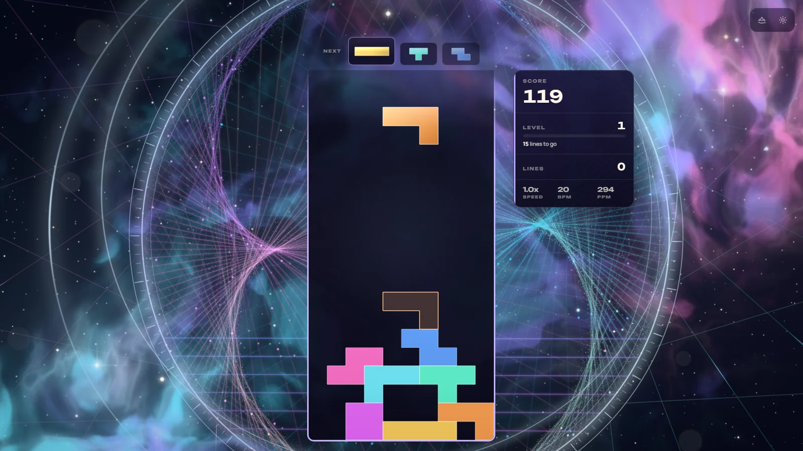
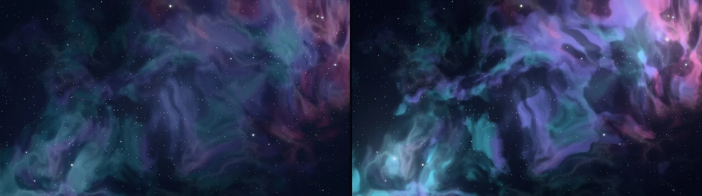
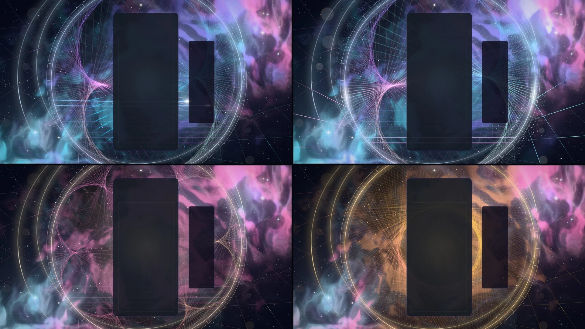
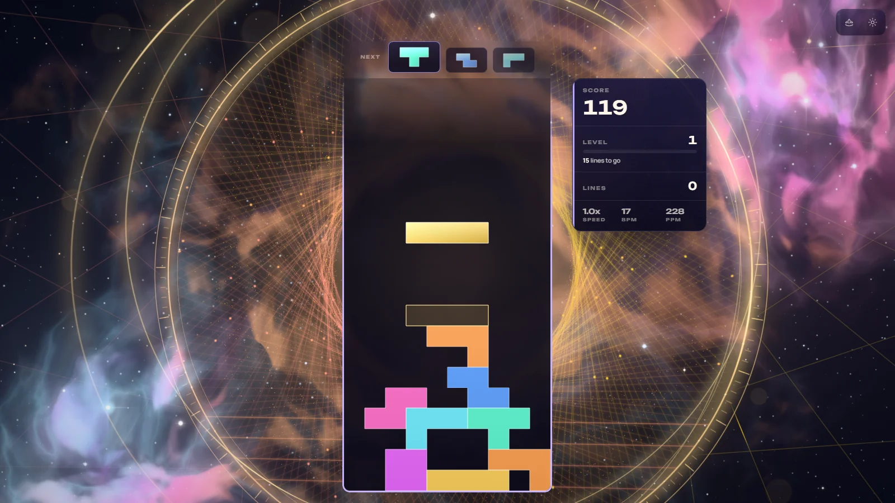
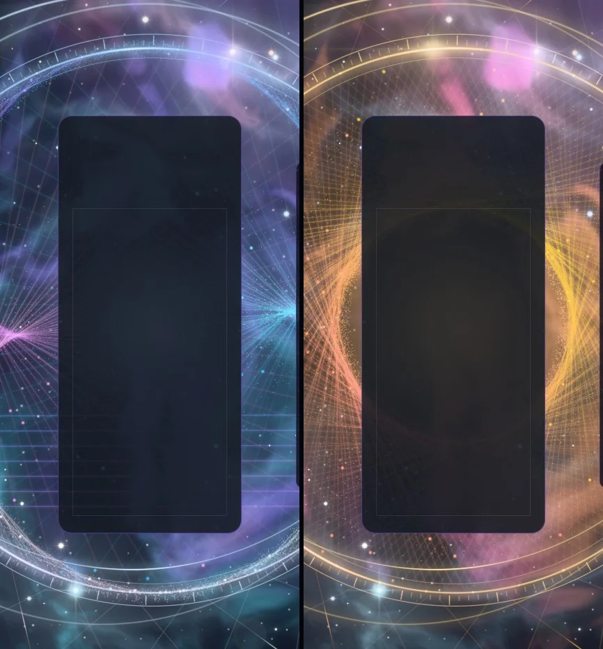

# Astral Weave — the Loom of Heaven

Implemented 2026-10-05 on `feature/astral-weave-masterpiece`, with Three.js 0.186.1. A
from-scratch rebuild: it replaces the 2026-10-04 "celestial silk" pass in full (scene,
materials, compute, post, event language, lifecycle class and tests). This document records
the shipped design and what was verified. It is a reference, not a backlog.

A second pass (2026-10-21, `feature/astral-weave-atmosphere`) lit the sky: see
[Second pass: the lit sky](#second-pass-the-lit-sky).

## The picture

A monumental hoop hangs in a river of nebula with the gameplay card at its heart. The hoop is
strung with a string-art weave, and the board is the loom's work: what you do on the board is
woven into the sky.

## The one idea

Thread *i* runs from the peg at angle *a* to the peg at *k·a + φ*. The envelope of those
chords is an epicycloid with *k − 1* cusps, so one uniform re-weaves the whole figure:

| k | Figure | When |
| --- | --- | --- |
| 0 | The fan: every thread ends at the crown peg | A four-line clear gathers the weave |
| 1 | The iris: every thread tangent to one circle | The four-line clear's gold halo round the board |
| 3 | The nephroid: two cusps pointing in at the card | Rest |
| 3 + n | One more petal per chained clear (cap 8) | Combo |

`φ` is chosen so a cusp always points in from the hoop's right (and its left, at rest), the
fan lands on the crown, and the iris has the radius asked for. `phaseForK` is continuous, and
a test walks the whole four-line timeline at 240 Hz to prove `k` and `φ` never jump.

Each thread is brightest where it touches the envelope (`t = 1 / (1 + k)`), so the figure
reads as luminous petals and the long spans stay quiet. The dust (below) settles on the same
touch points.

## Event language

| Event | Response |
| --- | --- |
| Piece lock | The shuttle crosses the hoop at each row the piece occupies (alternating direction, like a loom) and leaves a weft thread that rings like a plucked string. Rosette threads passing the lock carry its light out to the hoop; the hoop rings from the peg where the shuttle lands. |
| Hard drop | The same, brighter, with a small camera push. |
| Line clear | The cleared rows burn: a runner races out to the hoop, two fronts chase round it re-lighting the weave thread by thread, pulses leave along the warp, a ring of excited gas crosses the nebula and pushes a wave through the dust. The burnt rows then drop out of the tapestry and the rows above move down, as the stack did. |
| Combo | Each consecutive clearing lock weaves one more petal (`k` rises on an exact critically damped spring) and warms the weave from pearl through rose to gold. The chain breaking unwinds it. |
| Four lines / perfect clear | Gather into the crown (0.42 s), dwell, open the iris in gold, hold, then bloom back into petals through `k = 2`. A perfect clear opens from a tighter sunburst and holds longer. |
| T-spin | One sprung turn of the whole hoop. |
| Level up | The resting figure gains a petal (2, 3, 4, 5, then round again). |

Combo here is the true consecutive-clear combo (one `ComboTracker` per player in
`AstralWeaveDirector`); the bus's `COMBO` event is cascade depth (ADR-0011) and only scales
the clear. Events from another local-multiplayer board pluck the weave where that board is
and ring the hoop, but only the primary board owns the weft rows.

## How it is built

| File | Role |
| --- | --- |
| `astral-weave-composition.js` | Three-free layout: reads the live card, board canvas and HUD rects, solves the hoop in screen space (sides on landscape, top and bottom strips on portrait), maps board rows to chords. |
| `astral-weave-tsl.js` | Hashes, the three-stage spectrum, the baked half-float fBm texture, screen-space ribbon and sprite helpers, the premultiplied "over" material. |
| `astral-weave-sky.js` | The nebula river lit by the heart and two embedded lamps, two hashed star layers (one full-screen draw, five or six texture fetches; the gas density goes out in alpha) and the instanced jewel stars. |
| `astral-weave-loom.js` | Rosette, wefts, warp, hoop, gimbals, pegs, heart and crown flares, the stateless spark pool. |
| `astral-weave-dust.js` | Silk dust: a compute simulation on WebGPU, the same motes drawn at their homes elsewhere. |
| `astral-weave-motes.js` | Near motes: out-of-focus dust between the lens and the loom (one instanced draw). |
| `astral-weave-world.js` | Owns the shared uniforms, the choreography and the camera rig. Shared with the playground effect, so what is iterated there ships. |
| `astral-weave-director.js` | Renderer-free: stages bus events per player and resolves one lock and one clear per frame. |
| `astral-weave-post.js` | One scene pass, bloom, and one output pass. |
| `astral-weave-theme.js` | Lifecycle, renderer selection, settings, layout watch, GPU-loss recovery, capture flags. |

Techniques worth knowing before changing it:

- **One node renderer on both backends.** `WebGPURenderer` on WebGPU, its WebGL2 backend
  otherwise (or `?forceWebGL`). There is no `ShaderMaterial` left, so `astral-weave` is off the
  dual-state allowlist.
- **Pixel-width threads.** Every thread is a strip expanded in screen space
  (`awRibbonClip`), with a Gaussian profile and a 0.85 px floor, so the weave is as fine at 4K
  as at 720p and needs no MSAA.
- **Closed form first.** Shuttles, wefts, plucks, fronts, warp pulses and sparks are functions
  of the world clock and event timestamps. Nothing is created at event time; sparks are written
  into a ring of dormant slots. `seek(t)` plus a fixed-step replay reproduces any frame.
- **Compute where state earns it.** The dust is two storage buffers and one compute pass. Each
  mote chases a home on the weave with an exact critically damped spring, so when the weave
  re-forms the dust streams after it, and locks and clears kick it. The pipelines compile off
  the frame through `compileComputeAsync`; if they fail or time out the world swaps in the
  drawn-at-home dust. Moving motes are drawn as short streaks along their screen velocity.
- **HDR, single output.** The scene is emissive and scene-linear; a max-channel knee selects
  what blooms (no MRT), and one output pass does the calm zones, an impact fringe, a
  hue-preserving filmic curve, grade, vignette and dither. `usesMrtScenePass()` is false.
- **No MaterialX noise.** The nebula reads one tileable fBm texture baked on the CPU in about
  40 ms; every shared `Fn` carries `setLayout`.

## Tiers

| Tier | Threads | Warp pairs | Sparks | Dust | Near motes | Cloud relief | Bloom (and its scatter) |
| --- | --- | --- | --- | --- | --- | --- | --- |
| Minimal | 72 | 10 | 128 | none | none | off | off |
| Low | 96 | 14 | 192 | 1,600 at home | 12 | off | off |
| Medium | 132 | 20 | 320 | 5,000 simulated | 20 | on | on |
| High | 180 | 26 | 512 | 14,000 simulated | 28 | on | on |
| Ultra | 240 | 32 | 768 | 30,000 simulated | 34 | on | on |
| Extreme | 300 | 40 | 1,024 | 60,000 simulated | 40 | on | on |

Without WebGPU the dust is capped at 5,000 motes drawn at their homes. Without relief the
clouds keep the lamps' and the heart's light but lose their lit faces and shadows.

## Verification

- Unit tests: 77 new tests in four files (composition 13, director 18, world 32, theme 14).
  Whole suite 544 files, 5,968 tests, 0 failures. The shared Astral/Chiral parity test is now
  Chiral-only (`chiral-gold-webgl-parity.test.js`).
- Gates: lint ratchet at baseline, typecheck, production build with the boot-closure guard,
  dependency boundaries, theme lifecycle audit and the IP-string gate all pass. The palette
  gate fails on `main` and here for the same unrelated reason (Stillwater); Astral Weave
  scores 0/7 on it.
- Playground captures on WebGPU (RTX 3070 Laptop): idle, lock, hard drop, clear, combo, the
  four-line gather, crown, iris opening and hold, at every tier, at 1080p and in a 430×932
  portrait window, plus High on the forced WebGL2 backend. No console errors or warnings.
- In the real game (Electron, dev server, single player, real hard drops plus bus-injected
  clears): the theme starts on WebGPU, seats on the live card, weaves the real stack's rows,
  survives a live quality change (High to Medium) and stops cleanly. Observed frame rate of
  the whole game: about 131 fps at 1264×655 and 115 fps at 1584×835 on the RTX 3070 at High;
  166 fps (the panel's cap) on the integrated Radeon at Medium, 1264×655.

Not verified: GPU cost per tier through the theme perf lane (the figures above are observed
frame rates, not ADR-0016 measurements); physical phones; local multiplayer and Infinity
layouts in a capture (their routing is unit-tested only); reduced motion in a capture.

## Reproduce

Run `npm run dev:playground`, then:

`/playground.html?effect=astral-weave&t=20&quality=High&board=1&stack=7`

Add `event=lock|drop|clear|tetris|tspin|perfect|levelUp` with `eventAge=<s>`, `combo=<n>`,
`level=<n>`, `lines=<n>`. `demo=1` (without `t`) plays a looping script. `parts=` draws only
the named layers (`sky`, `rosette`, `wefts`, `warp`, `hoop`, `flares`, `sparks`, `dust`,
`motes`); `falseColor=1` bands the pre-tone-map peak; `forceWebGL=1` uses the WebGL2
backend; `hud=0` hides the playground's panel. In the game: `?astralWeaveTime=`,
`?astralWeaveFixedDt=`, `?astralWeaveParts=`, `?astralWeaveFalseColor=1`.

The second pass's beats: a lamp flaring under a clear's ring,
`event=clear&lines=2&combo=1&eventAge=0.57`; the near motes struck by it, `eventAge=0.7`; a
rose chain, `combo=5`; the amber iris, `event=tetris&eventAge=2.2`; the sky alone,
`parts=sky`; a session an hour old (the jewels and lamps stay put, the gas has drifted),
`t=3600`.

## Second pass: the lit sky

Before this pass the nebula was one mid-dim haze over nearly the whole frame (0.1 to 0.6 in
false colour almost everywhere), lit by nothing, and the sky took no part in the event
language beyond the clear's ring. The weave was right; the world it hung in was flat.

| Change | What it does |
| --- | --- |
| Space is dark | The river holds the gas; outside it only thin wisps remain, so the corners read as deep space and the river as a shape. |
| The gas is lit | Three lights: the hoop's heart (its light follows `uCore`, capped so lit gas stays darker than a hot weave) and two hot stars embedded in the free corners the river crosses (portrait frames move them into the strips above and below the card). Each is drawn as a star with spikes in a haze of its own light. |
| Clouds have form | One more read of the broad octave, a little toward the lights: gas that thins toward the light is its lit face (a bright rim), gas that thickens toward it falls into its own shadow. Medium and up. |
| The weave lights the sky | The deep field writes its gas density into ALPHA, and the post multiplies the bloom by `1 + 0.85 · gas`: the weave's glow scatters where there is gas and stays a glow in empty space, so cusps, fronts and the iris visibly light the nebula. |
| Heat colours the light | A chain warms the gas round the loom to rose; the iris and the longest chains carry it on to amber. Hues are scaled to the gas's own brightness (warming never whitens) and take the long way round, teal → rose → amber (teal and gold meet in grey-green). |
| The ring wakes the lamps | A clear's shock ring flares each lamp as it passes (computed once a frame on the CPU), and the lamp relights its cloud: the clear cascades outward from the loom. |
| Depth in front of the loom | Near motes: a few dozen out-of-focus discs (flat, a faint rim, its colours split red out and blue in) beside the card column, carried 5–17 times further than the sky by the camera's parallax, and the other way. The clear's ring lights each as it passes. |
| A long-session fix | The jewels took the sky's slow time drift (×1.4, the wrong way): about half a screen after 30 minutes, gone after an hour. They, the lamps and the near motes now take the camera's parallax alone (`uParallax`); the gas still drifts. |

How the alpha channel is kept: three forces an opaque material's alpha to 1 only when its
blending is `NormalBlending` (`NodeBuilder.isOpaque()`), and only blends when the material is
transparent or not normal. The deep field is opaque with `blending = NoBlending`, so it writes
`vec4(sky, gas)` as is. Every other part is premultiplied "over" with alpha 0 (`One,
OneMinusSrcAlpha` for alpha too), which leaves the target's alpha untouched. The canvas is
`alpha: false`, and the pass-through fallback presents `vec4(rgb, 1)`.

Verified: a new shader gate (`tests/unit/astral-weave-shaders.test.js`) builds every material
in the world through the WGSL and GLSL node builders at High, Low and Minimal and fails on a
warning, a throw, equal smoothstep edges, NaN/Infinity literals, a stringified node, MaterialX
noise, a stage over 32 KB (the deep field is about 14 KB) or a deep field that would not keep its
alpha; it caught a missing import during this pass. Five new world tests cover the lamps'
placement on landscape and portrait frames, the flare, the parallax that no longer drifts and
the near motes. Playground captures on WebGPU (RTX 5080 Laptop) at High, Low and Minimal, a
430×932 portrait, the forced WebGL2 backend (frame-identical to WebGPU) and `t=3600`; in the
real game, single player with real hard drops plus a bus-injected four-line clear: the theme
starts on WebGPU at High, seats on the live card and the dust simulation runs. No console errors
or warnings.

Not verified: frame cost. GPU timestamps A/B against `origin/main` were taken on the RTX 5080
and on the integrated Radeon 610M while other sessions were loading both GPUs, and they did not
resolve the difference (the same unchanged build swung 24–45 ms between rounds on the Radeon).
What was added per pixel of the sky: one texture fetch (Medium and up), the three lights and
their hue (a uniform branch skips the warming at rest), and each lamp's star only within about
110 px of it (a coherent branch); plus one alpha read in the output pass and one instanced
draw of at most 40 quads.

## Captured previews

