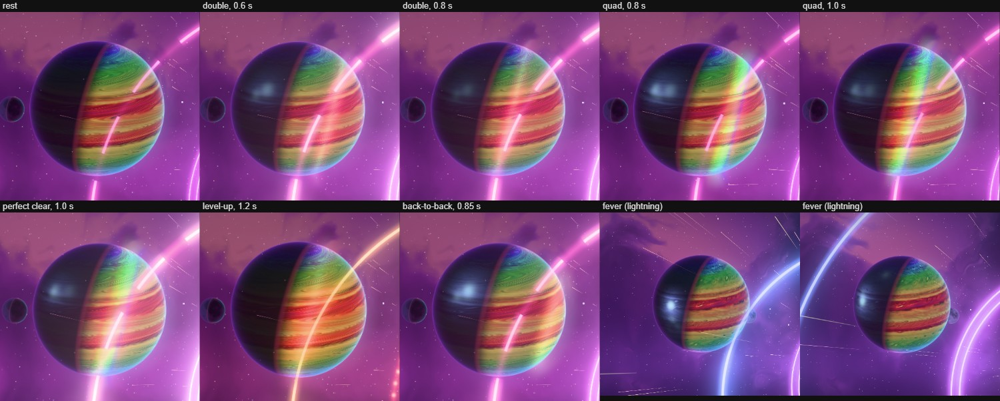
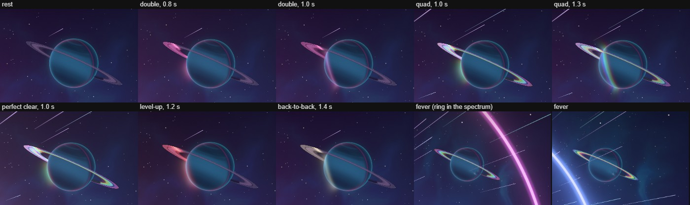

# Chromadelic Highway — the planets catch the board's light (2026-10)

**A record.** Olov: "can we have some better event effects on the planets in Chromadelic highway?"

## 1. What was there

The planets sat out play. A quad lit every arch of the tunnel, warped the streaks and opened the
lens, and the rainbow giant, its moon and the ringed ice giant did not change at all. The only
planet reaction was a cyan flicker over the hero's whole night side on a clear (High and up), masked
by the texture's fine detail; at the hero's size it read as a faint shimmer, if at all.

## 2. What changed

The theme's rule is "the board is the sun": the key light sits at the highway core behind the
card, so every lit limb faces the board, and every event's light comes out of the board. The
planets now catch that light (`src/themes/chromadelic-highway/chromadelic-highway-planet-events.js`,
drawn in `chromadelic-highway-planets.js`, sent from `chromadelic-highway-world.js`).

- **Light fronts.** A clear sends a shell of its light out of the board. On each body it is a narrow
  arc of the event's colour with a white-hot core that crosses the lit face from the board's side to
  the terminator (about 0.8 s), leaving the day side glowing in that colour for a moment. It reaches
  the hero about 0.16 s after the clear and the ice giant (farther from the key) about 0.28 s after;
  on the giant it first runs across the ring (twice as fast, at full light) and then the globe.
  The moon and the Ultra witness catch it too, except where the moon is eclipsed or shadowed.
- **The spectrum.** A quad's and a perfect clear's front is a prism: the spectrum across the arc's
  width, red ahead, violet behind, every hue at the same brightness. The giant's ring rings out in
  the spectrum with it and holds the spectrum, running outward, through a fever.
- **Lightning.** The hero's storm is four lightning cells: a hot core and a wide glow diffused
  through the cloud bands (the bands light up round it), on the night side the camera sees, each
  two or three strokes. A clear fires one per line, a quad three, a perfect clear four; between
  clears the storm the heat builds keeps firing them (heat above warm a little, a full fever about
  three a second). Under Reduce flashing a cell is one soft glow with no strokes.

| Event | The planets |
|---|---|
| Line clear (n ≤ 3) | A front in the clear's band colour, brighter the hotter play runs; n lightning cells |
| Cascade wave ≥ 3 | Its band colour folds into that wave's clear front |
| Tetris | A prism front with the prism cascade; the giant's ring in the spectrum as it arrives; three cells |
| T-spin | A front in the T's electric lemon |
| Back-to-back | A gold front with the gold cascade (0.42 s on), two cells |
| Perfect clear | A wide, slow prism front; the ring in the spectrum; four cells |
| Level up | A wide, slow front in the new movement's colour (a dawn), before the hero grows |
| Fever | Lightning flickering on the night side; the ring in the spectrum, flowing outward |

Everything accumulates like the rest of the theme: fronts share three slots, a front born within
0.1 s of a live one adds to it (one clear's beats are one front), and a full pool never gives up a
front still holding more than half a newcomer's light (the newcomer folds into the youngest). Every
value is a closed form of the event's birth; lightning sites come from a seeded sequence, so a
seek replays the same frame. The ring's spectrum turns on an integrated phase (never clock × rate).

## 3. Decisions found in the captures

- **The front's travel axis is tilted off the line of sight.** The ice giant lies beyond the key,
  which it sees nearly head-on, so a front along the true key direction began as a spot in the
  middle of its disc and grew into a circle round its limb: a soap-bubble outline, the kind of ring
  round a planet the user disliked in Stellar Drift. The fronts now travel along the key direction
  with its pull toward the camera removed (`uFrontAxis`), so on every body they sweep across the
  face from the board's side as an arc. Lighting still uses the true key.
- **No extra light at the limb.** A limb-scatter term drew bright beads where an arc met the limb,
  and a ring on the giant. The halo outside the limb catches a front softly (gain 0.2) on the lit
  stretch only.
- **An evenly bright spectrum.** The first prism front read as a green wash: the spectrum was
  squeezed into the green-cyan middle of the band and green is the brightest hue. It now spans red
  to violet within one band width, through the theme's luminance-normalised neon colour.
- **Narrow, slow bands.** Wide bands (a quarter of the face) read as a tint, not as light moving;
  the band is now 0.08–0.2 of the face's key cosine wide and crosses it in about 0.8 s.
- **Lightning off the terminator.** Cells sat on the terminator and read as a white dot; they are now
  placed between 5° and 45° into the night side, at least 30° in from the limb, with a glow about
  three times the core's width.

## 4. Validation

Playground captures (`?effect=chromadelic-highway&board=1&quality=High&t=70`, events replayed with
`window.__chromadelic.seekEvent`) at 0.45–1.6 s after each event, crops on both planets, plus a live
12-clear chain and a pinned full fever, on an RTX 5080 Laptop through a scratch Electron harness.
Minimal, Low and Ultra built and drew with no console or WebGPU errors.

Tests: `tests/unit/chromadelic-highway-planet-shaders.test.js` builds every planet variant through
the WGSL and GLSL node builders (clean, no NaN literal, no var read before assignment; the event
terms only where a body has them). `tests/unit/chromadelic-highway-planet-events.test.js` pins the
fronts (fold, never cut, run from the key's side, the farther body later, the ring at twice the
pace), the lightning (slots, strokes, the calm glow, the rumble, the seeded replay), the world's
event mapping, the fever, the seek reset, Reduce flashing and Minimal, and with real impostors that
the hero catches a front before the ice giant and that every cell lands on the night side the
camera sees.

## 5. Cost

By construction (GPU timings on this machine swing too much with other sessions running to resolve
a change this size). Per fragment of a planet quad, the WGSL grew from 6.3 to 13.5 KB on the High
hero, 8.4 to 16.3 KB on the ice giant and 3.7 to 6.8 KB on the Minimal hero: three front slots at
two sites (surface and halo; the ring is a third on the giant) and four lightning cells, all
arithmetic, no new texture reads, no new draws or pipelines. The planets cover about a tenth of the
frame; at roughly 250 operations per hero pixel that is in the order of 0.05 ms on the integrated
Radeon 610M.
