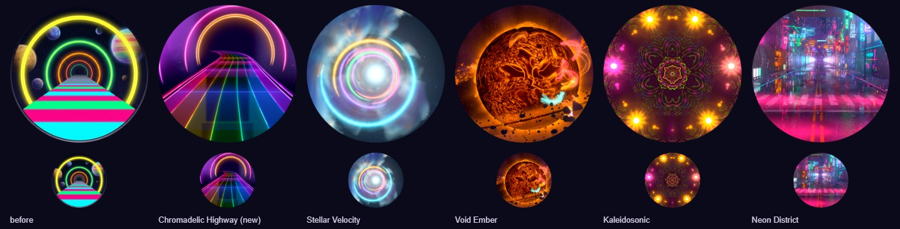

# Chromadelic Highway — the spectrum pass (2026-10)

Status: **Reference** (shipped design + evidence). Builds on
[CHROMADELIC_HIGHWAY_VISUAL_OVERHAUL_2026-09.md](CHROMADELIC_HIGHWAY_VISUAL_OVERHAUL_2026-09.md)
("the board is the sun"); its composition, planets, road, post and tiers still hold. This pass
replaces the rings' palette, the level palette step and the event table.

Evidence: [reports/chromadelic-highway-spectrum/](../reports/chromadelic-highway-spectrum/):
`six-movements-playground.jpg` (one frame per movement), `ring-forms.jpg` (every form forced in
turn), `events-chase-prism-levelup.jpg` (clear chase, Tetris prism, level-up repaint, combo),
`ingame-drift-level1.jpg` (the real game at level 1, 0 lines: the spectrum drifting by itself),
`ingame-prism-level1.jpg`, `chord-horizon-mist-high.jpg`, `triad-extreme.jpg`,
`ember-webgl2.jpg`, `tetris-prism-burst.jpg`, `perf-ab-rtx3070.txt`.

## 1. The ask and what changed

Olov, 2026-10-20: "Improve the visuals of chromadelic highway, i want better effects, that the rings
can be of any color, more variety, and better atmosphere!"

Before: the rings walked a 16-step palette of four hues (cyan, violet, azure, magenta), one form
(a neon tube), and the palette only moved on a level-up (+30°). The air between the objects was a
fixed dark violet.

After:

- **Any colour.** Every ring takes a hue from the whole wheel. Six movements arrange them: a
  rainbow run, warm and cool runs, a triad, complementary pairs.
- **Variety.** Eleven ring forms: tube, double line, spinning dashes, beads, hexagon and octagon
  gates (as tube, double, dashes or beads), and prism arcs that carry the whole spectrum foot to
  foot. Every fourth ring is the movement's accent form.
- **Atmosphere.** Each ring lights the air it stands in (a coloured haze, peaked on the tube and
  decaying into the tunnel), the horizon carries a luminous mist in the tunnel's colour (textured
  by the nebula), the vanishing point glows with it, dust motes glint in the colour of the ring
  passing over them, every ring pools its light on the glass road, and the nebula turns with the
  movement.
- **Effects.** Rings flare as they clear the card edge. Clears send chase lights filling every arch
  from its feet to its crown. A Tetris turns every arch into the spectrum as the cascade passes,
  and the next three rings out are prism arcs. A level-up repaints the tunnel: a cascade in the
  next movement's first colour sweeps from the board to the lens and re-dresses every ring it
  passes (the whole tunnel wears the new movement within 0.7 s). Event bands take the newest
  ring's colour.

## 2. The spectrum (`chromadelic-highway-spectrum.js`)

**Place** = `levelPlace + distance / STEP_TRAVEL` (`STEP_TRAVEL` = 16 200 u = 90 s at the 180 u/s
cruise). A session starts at `SPECTRUM_HOME` = 0.35 (35 % into the first movement, where the sky
has come to rest on its tint).

- **Drift (clock):** the distance term moves the spectrum at ANY level, with no gameplay: one
  movement about every 90 s at level 1 (faster when the play pace raises the world speed; a quarter
  speed under reduced motion, like the road itself). Proven in the real game: level 1, 0 lines,
  theme clock 90 → 280 s ran orchid → ember → triad (`reports/chromadelic-highway-spectrum/ingame-drift-level1.jpg`).
- **Level-up:** one whole step on top of the drift (a jump of several levels counts at most three).
  A new game (a lower level) keeps the light where it is and counts its first level-up as a step,
  so a new run never turns the colours back. A GPU device-loss rebuild hands the place to the new
  world (`getSpectrumState` / `restoreSpectrumState`).

**Movements** (in cycle order; the sky's turn walks in ≤ 0.14-turn steps):

| Movement | Scheme | Hues | Beat forms | Accent (every 4th ring) | Nebula turn |
|---|---|---|---|---|---|
| prism | a rainbow every 7 rings | all | tube, tube, double | prism arc | 0 |
| orchid | run (±0.09) | violet–magenta | double, tube, dashes | octagon | +0.03 |
| ember | run | red–orange–gold | beads, tube, tube | hexagon double | +0.10 |
| triad | three hues ⅓ apart | rose, lime, azure | tube, dashes, tube | hexagon | +0.04 |
| chord | complementary pairs | azure ↔ orange | double, tube, tube | octagon beads | −0.06 |
| tide | run | teal–cyan–azure | dashes, tube, beads | octagon dashes | −0.14 |

**Colour law:** `neonColor(h)` = smooth saturated hue (Quilez smooth HSV) with a 10 % white floor,
luminance-normalised with exponent 0.6, so yellow and blue sit within ~2× in luma instead of 13×
and none blows out. `chdNeonColor` in `chromadelic-highway-tsl.js` is its GPU twin (used for prism
arcs per fragment). Halos may be two-tone (a per-movement hue shift).

**Rings keep their style.** A ring's style slot (J mod 16, the lattice id the ring shader, the
road's gate lines and the motes all read) is written by the CPU when the ring comes within one
ring spacing of clearing the card edge (`ringLockDepth`), at the place of its closed-form lock
distance, so seeking reproduces live play exactly. A new scheme therefore arrives ring by ring
down the highway and never blends two palettes through grey. The one exception is a level-up's
repaint: the spectrum steps at once, the rings still hidden behind the card drop their style, and
the level-up cascade (2000 u/s from where rings come out) re-locks every ring its front passes, so
the change happens inside the flash and the whole tunnel wears the new movement within ~0.7 s.

**The air** (`updateAir`): the hue the rings on screen agree on (a hue-vector mean; prism rings
count 0.4), blended on the wheel with the sky's own violet (weight 0.35), eased over 2.5 s. One
colour family gives the air its hue; rings spread round the wheel cancel and leave the sky's. It
is always a saturated colour (unit test), never a grey average. It feeds the sky's tunnel light and
horizon mist and the road's distant haze. The nebula's ramps turn with the movement (`skyTurnAt`,
centred on each boundary, resting 15 % at each end).

## 3. Drawing it

| Part | Change |
|---|---|
| Rings (`chromadelic-highway-fx.js`) | Shared lattice helper; per-ring style from three uniform arrays (core, halo + prism code, form); polygon gates in the vertex stage (flat-topped, mean radius ≈ R); branchless patterns (double, dashes with a pixel-average fallback, beads with a line fallback when sub-pixel); prism arcs; ignition flare at the card edge; chase lights; prism cascade; packets on a CPU-integrated phase (`uRingPhase`, wrapped at 40π, every spin a multiple of 1/20). Varyings packed into six. |
| Ring air (new draw, Medium+) | Same lattice, wide band (0.5 R inside, 0.26 R outside), exponential falloff peaked on the tube, taken to zero at the band edges and over the last 35° of each end; thins out near the lens; brightens with the event light. Sub-threshold: never blooms. |
| Sky | `uAir`: tunnel light around the vanishing point; horizon mist (textured by the nebula density where taps exist), kept off the card by the calm zone; band glow turns with the nebula. |
| Road | Gate lines show only under rings that are out; the rings' light pools on the glass (spilling 110 u toward the lens). |
| Motes (High+) | Lit by the nearest ring: they glint in its halo colour as it passes. |

## 4. Event language

| Event | Response |
|---|---|
| Piece lock | A band in the newest ring's colour + rail tick (rate-limited to one per 0.35 s) |
| Combo c | A band climbing the wheel from the newest ring's hue (+25° per step); the packets race (rate +1.4 rad/s at c ≥ 6, eased back over 2.5 s); meteors at c = 3, 6, 9…; one comet per chain at c ≥ 5 |
| Line clear (n ≤ 3) | n bands in the newest ring's colour (its complement for a triple); chase lights fill every arch from its feet to its crown, one front per line; star twinkle; hero storm flashes |
| Tetris | Bands out of the card (0–150 ms); a prism cascade (150 ms on) turning every arch into the spectrum as it passes; streak warp (300 ms on); FOV surge; the next three rings out are prism arcs |
| Level up | The spectrum steps to the next movement at once; a cascade in its first colour repaints every ring it passes, board to lens (~0.7 s); violet band, binary flare, nebula breath, twinkle wave; the hero grows a little (+0.5 s) |

The road bands now flash a ring at 60 % (the chase and the cascade carry the rings' own event
light), so a clear no longer whitens every arch at once.

## 5. Validation

- Playground (WebGPU, RTX 3070): contact sheets across all six movements, every form forced in
  turn (`ringForm=`), events at several ages (clear 1/3 lines, Tetris, level-up), High, Extreme
  (4× MSAA) and Minimal; WebGL2 backend (`forceWebGL=1`). Zero console errors or WebGPU validation
  messages on every path.
- Real game (dev server, WebGPU): the theme boots, runs at level 1 with the spectrum drifting, takes
  LINE_CLEAR / COMBO / LEVEL_UP from the game's event bus (level 2 stepped one movement; the Tetris
  echo's prism arcs came out next), no theme errors in the console.
- Unit tests: `tests/unit/chromadelic-highway-spectrum.test.js` (colour law, every 30° of the wheel
  reached in a cycle, a full rainbow in the first movement, every pattern/shape/prism appears, an
  accent on every fourth ring, seamless spin wrap, continuous sky turn and its rests) and the
  spectrum block of `tests/unit/chromadelic-highway-world.test.js` (clock-only drift at level 1
  with a movement change after 90 s, level steps and new games never going back, rings keeping
  their style while the road drifts across a movement boundary, the level-up repaint (half the
  tunnel at 0.2 s, all of it by 0.7 s, and the rings out afterwards), seek = live play, the
  air always a colour, the packet phase never jumping under a rapid combo in a new and a
  ten-minute-old session, the device-loss hand-over).

Playground knobs: `place=
` pins the level place (0.35 home; movement = floor), `ringForm=<name>`
forces every ring's form, `airGain=<x>` sets the ring-air gain (default 0.12), and
`window.__chromadelic.seekEvent(t, {name, age, lines, combo, level})` replays any event at any age
in the same task (for contact sheets).

## 6. Performance

Real game on the Vite dev server in Electron, WebGPU, RTX 3070 on mains power, uncapped (vsync and
frame-rate limit off), 1600 × 852 window, per-pass GPU timestamps injected before load (summed per
frame), 7 s settle, 4 s windows. Before = main `d557160a` (served from the main checkout), after =
this pass; arms alternated after → before → after → before under one GPU-lock turn. The canvas
size varies a little between runs (the adaptive scaler, 1461–1600 px wide), so read the deltas as
an observation, not a fine measurement.

| GPU per frame (ms, p50 / p95) | Before 1 | Before 2 | After 1 | After 2 |
|---|---|---|---|---|
| High, rest | 0.453 / 0.708 | 0.451 / 0.716 | 0.505 / 0.820 | 0.555 / 0.886 |
| High, event storm | 0.446 / 0.690 | 0.456 / 0.726 | 0.434 / 0.844 | 0.520 / 0.821 |
| Extreme, rest | 0.432 / 0.511 | 0.513 / 0.552 | 0.591 / 0.641 | 0.608 / 1.105 |
| Extreme, event storm | 0.432 / 0.880 | 0.483 / 0.551 | 0.592 / 0.642 | 0.600 / 0.643 |

The pass costs about +0.05–0.10 ms of GPU per frame at High and +0.1–0.15 ms at Extreme (the
ring air, the heavier ring shader, the sky's mist): well under 1 ms against the 8.3 ms of a
120 fps frame. Delivered frame rate is unchanged (210–230 fps uncapped in both arms; the frame is
CPU-bound at ~3.2 ms p50 in both). Not run: the packaged Electron perf lane and the integrated GPU.
The level-up repaint landed after this measurement; it is CPU-side slot writes only (no GPU work).

## 7. The icon (2026-10-20)

The theme has a new icon (`src/themes/chromadelic-highway/chromadelic-highway-theme-icon.png`,
with the same bytes at `public/assets/themes/`). The old one was an illustration from before the
2026-09 overhaul (concentric yellow rings, a striped road, scattered planets); the new one is a
frame of the shipping world through the playground's icon lens, which the effect now has
(`icon=1`: the lens looks straight down the road at the arches' vanishing point, closed to
`iconFov`, with `iconYaw` and `iconPitch` in radians; `window.__chromadelic.iconLens =
{ fov, yaw, pitch }` turns it live for a contact sheet):

`/playground.html?effect=chromadelic-highway&t=20&quality=Ultra&icon=1&iconFov=40&iconPitch=-0.07`

captured in a 1000 × 852 window at 1.5× (1500 × 1278), cropped to a 1176 px square round
(750, 665), given a colour lift (contrast 1.12, saturation 1.3, brightness 1.22) and baked as a
512 px circle on a transparent ground. Pitching the lens down a little keeps the three arches
whole inside the circle and gives the rainbow road the lower half; `t=20` stands on the prism
movement, so every lane colour is in the frame. Turning the lens left to centre the road
(`iconYaw` 0.09–0.18) brings the striped planet in at the top-left but pushes the arches out of
the circle; wider lenses (50–54°) keep both but make the arches too small to read at the picker's
88 px. The reading at that size is the test: arches, then the road.

