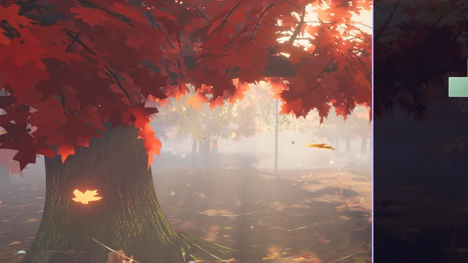
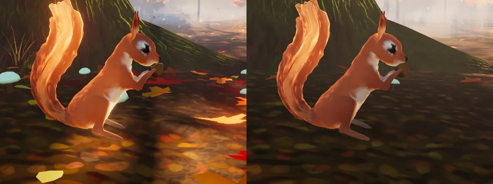
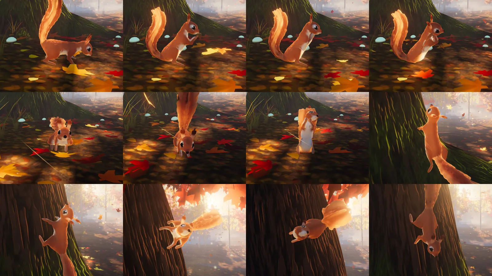
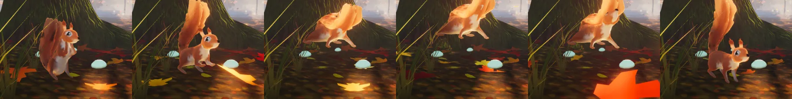
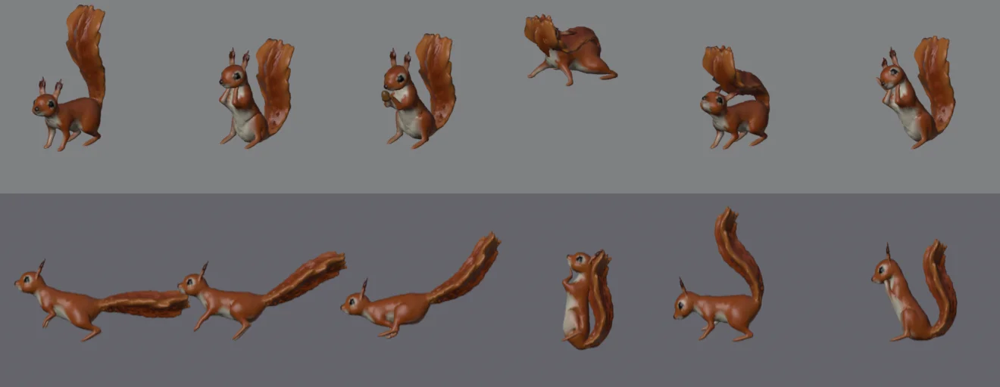
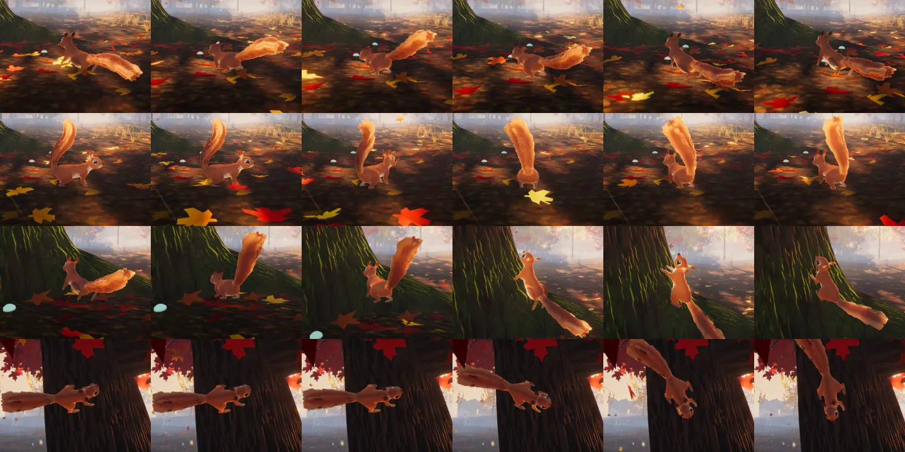
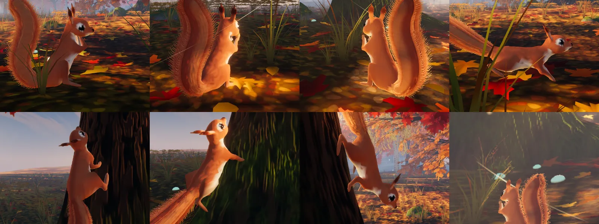
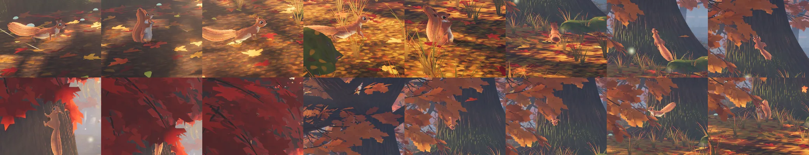

# Fall — the enchanted grove (visual overhaul, 2026-10-05)

**Status: implemented (branch `feature/fall-enchanted-forest`; the red squirrel 2026-10-26, its motion pass and its trees-and-tail pass the same day). A record of what was built
and how it was checked — not a backlog.** Supersedes the "amber glade" rebuild of the same
week (`reports/fall-overhaul/README.md`), whose flat-shaded procedural grove this replaces.

| Before | After (High, native WebGPU) |
| --- | --- |
|  |  |

## What the player sees

A low sun stands behind an old autumn wood. An ancient maple frames the left of the
screen and a spreading oak the right; between them a leaf-strewn path winds toward the
light, birches hang gold in the glare, and the forest goes on into haze. Sun shafts are
real volumes carved by the canopy, trunk shadows rake across the floor toward the
camera, and every leaf is a translucent blade that glows when the sun is behind it.
Leaves let go of the crowns, swing down, land, and are taken up again by the wind.

The board card hides the middle fifth to quarter of a landscape screen, so the picture is composed
for the two side thirds and the strips above and below the card. Portrait keeps the
same world with a wider field of view; there the card covers most of the screen and the
grove is a margin.

## How the grove answers the game

`FallReactions` is a pure director; `FallLeafDirector` turns its emitters into leaves
thrown from behind the board card, at the height and on the side where the event
happened.

| Event | Response |
| --- | --- |
| Piece lock | A puff of leaves from the card's edge beside the piece, at the piece's row; the leaves lying under it jump. A long hard drop (`HARD_DROP` distance) makes it harder. |
| Line clear (1–3) | Twin jets of leaves blown out of both sides of the card at the cleared rows; warmer light; from two lines a gust front crosses the forest, bending trees and lifting litter as it passes. |
| Four lines | All of that, a shower from the lower boughs, and a sunburst (shafts and bloom swell). |
| Combo / streak | A leaf vortex winds around the board. Cascade depth (`COMBO`) or consecutive clearing locks raise it; it climbs and speeds up, and above ~55 % its leaves glow like embers. A lock without a clear ends the streak and the column unwinds. |
| T-spin | A spiral flourish beside the board. |
| Back-to-back | Holds the vortex and lifts the lanterns. |
| Perfect clear / level up | The whole grove exhales: shower, front, wisps and lantern caps flare. |
| Game over | The wind dies and the leaves settle. |

Everything honours `backgroundComboEffects` and `pieceLockRipple`, pauses with the theme,
and is driven by simulation seconds. No event allocates: leaves come from a fixed hidden
reserve and emitters from a fixed pool (4–16 by tier).

| Hard drop | Three lines | Four lines |
| --- | --- | --- |
|  |  |  |

| Combo ×12 | Perfect clear | In the game (production build) |
| --- | --- | --- |
|  |  |  |

## How it is built

### Trees authored in Blender

`scripts/blender/fall_grove_assets.py` grows seven specimens (hero maple, hero oak, three
grove maples, two birches), bakes bark ambient occlusion in Cycles, renders the
distant-forest sprite sheet, and writes compact GLBs with its own quantising writer.
A tree file holds a bark mesh and a point cloud of *foliage sites* — not leaves; the
runtime instances shared sprays of real lobed leaf geometry onto the sites. Details,
formats and the regeneration command are in
[`src/themes/fall/assets/ATTRIBUTION.md`](../src/themes/fall/assets/ATTRIBUTION.md).
The pack is 3.4 MB: nine files, no third-party source.

The generator runs **headless** (`blender --background --factory-startup`). The Blender
MCP session on port 9876 was holding another project's unsaved scene during this work,
so it was only read from, never written to; the script is still runnable inside a
session (it works in its own scene and removes it).

### Runtime modules (`src/themes/fall/`)

| Module | Owns |
| --- | --- |
| `fall-theme.js` | Lifecycle, renderer, asset loading, gameplay subscriptions, board tracking. |
| `fall-assets.js` | Loading and decoding the GLBs and the sprite sheet. |
| `fall-world.js` | Composition root: builds and updates everything below. |
| `fall-light.js` | The sun, its static shadow map, haze, ambient, wind, a shared noise texture. |
| `fall-composition.js` | Camera framings, hand-placed trees, the procedural grove layout, the visibility test. |
| `fall-terrain.js` | Heightfield, path, ground material. |
| `fall-forest.js` | Bark and foliage instancing and their materials. |
| `fall-backdrop.js` | The sprite forest and the wooded ridges. |
| `fall-understory.js` | Leaf litter, grass, ferns, stones, lantern caps. |
| `fall-atmosphere.js` | Sky, mist banks, sun motes, wisps. |
| `fall-leaf-sim.js` | The leaves in the air (pure typed-array simulation). |
| `fall-leaves.js` | Drawing them. |
| `fall-reactions.js` | The event director (pure). |
| `fall-stage.js`, `fall-leaf-director.js` | Board card → world, and emitters → leaves and force fields. |
| `fall-post.js` | Volumetric shafts, bloom, grade, FXAA. |
| `fall-quality.js` | One table for everything a tier scales. |

### Techniques (three 0.186.1)

- **One static shadow map, used everywhere.** Materials stay unlit `MeshBasicNodeMaterial`
  and call a shared `shadow(light)` node themselves; the grove never moves under a fixed
  sun, so `light.shadow.autoUpdate` is off and the map is drawn over the first frames
  only. Ground, bark, leaves, sprites, mist and motes all read it — a falling leaf
  flares as it crosses a shaft.
- **Volumetric shafts with `GodraysNode`.** r186's shadow-map raymarch, half resolution,
  bilateral blur, added as sunlit air over a cool shaded haze. First use in this repo;
  it runs on native WebGPU and on the forced-WebGL2 backend.
- **Thin-blade foliage.** Front light, transmitted light when the sun is behind the
  blade, a baked sky-visibility term and bent normal per spray, and a per-tree position
  on a species colour ramp. No alpha cards, so no overdraw and no alpha-test shimmer.
- **Global instancing.** Every spray of every tree is an instance in eight draws. Sprays
  that can never be on screen (above or behind the camera in both framings) are dropped
  at build time. The whole scene is about 50 draws.
- **Data sprites for the far forest.** One Blender-rendered sheet storing shade, leaf
  mask and hue seed gives every distant tree its own colour, lit and hazed like the rest,
  and casting into the same shadow map.
- **CPU leaf simulation.** A few thousand leaves in typed arrays: the same code on both
  backends, in the playground's deterministic `seek`, and in the unit tests.

Three r186 behaviours cost time and are now in the TSL skill's gotcha table: a shadow
*caster* must not sample the shadow map in its `colorNode` (use `fragmentNode`),
`GodraysNode` needs the shadow rig built before its own graph, and `bilateralBlur` needs
the pass texture rather than the node.

### Quality tiers

| Tier | Grove / far trees | Sprays kept | Leaves in the air | Shafts | Post |
| --- | --- | --- | --- | --- | --- |
| Extreme | 30 / 190 | 100 % | 4,200 | 40 steps | on |
| Ultra | 27 / 160 | 100 % | 3,400 | 32 steps | on |
| High | 24 / 130 | 86 % | 2,600 | 26 steps | on |
| Medium | 18 / 90 | 60 % | 1,600 | 16 steps, 0.35 scale | on |
| Low | 13 / 60 | 34 %, no twigs | 900 | analytic glow in the haze | off |
| Minimal | 9 / 40 | 24 %, no twigs | 500 | analytic glow in the haze | off |

Low and Minimal draw the same scene directly with ACES tone mapping and skip the twig
geometry (the bark index buffer is ordered so a tier can stop before it). At High the
scene is about 1.2 M triangles; at Minimal about 0.35 M. The historical
`QUALITY_PRESETS` table in `fall-theme.js` is kept unchanged for its existing readers.

| WebGL2 backend, High | Low (no post) | Portrait, Low, WebGL2 |
| --- | --- | --- |
|  |  |  |

## Verification

- **Playground** (`npm run dev:playground`, `?effect=fall&orbit=0&seed=271&hud=0`): the
  captures above, each with a clean console (no WebGPU validation errors, no TSL
  warnings), on native WebGPU and with `forceWebGL=1`. Events are reproducible with
  `&t=8&event=lock|drop|clear|double|triple|tetris|combo|streak|spin|perfect|level`,
  `&eventAge=<s>`, `&col=0..9&row=0..19`, `&combo=<n>` and `&board=1` for a stand-in card.
- **In the game**: `node scripts/validate-all-themes.mjs --theme fall` on a production
  build — PASS, 0 lifecycle failures, 0 console errors (activation, teardown,
  re-activation).
- **Build**: `npm run build` — boot closure OK; the theme chunk is 80 kB before gzip.
- **Lint**: 0 ESLint errors in `src/themes/fall` and the playground effect.
- **Tests**: 279 tests in six suites under `tests/unit/fall-*.test.js` — the director (46), the asset pack
  and its manifest (51), the leaf director and stage (38), the leaf simulation (31), the theme adapter (63)
  and the world and post (50, built from the real GLBs in Node).

### Frame cost (one reading, not a budget)

Theme perf lane, High, native WebGPU on the RTX 3070 Laptop GPU (mains power), pins held,
10 s idle window, 51 draws and 1.22 M triangles on both visits:
GPU 1.51 ms p50 / 1.84 ms p95; wall 7.7 ms p50 / 8.6 ms p95, one frame over 16.7 ms.
**The cell is marked inadmissible by the lane** ("the theme also resets renderer.info"),
and other sessions were using the machine, so by ADR-0016 these numbers may not be quoted
as a budget or a comparison. In steady state nothing on the Fall path resets
`renderer.info` (probed); the reset is not understood yet. No measurement exists for
integrated or phone GPUs — the lower tiers are untested on real low-end hardware.

## Known limits

- Portrait composition is the landscape world seen wider: the two hero trunks are out of
  frame and the upper strip is mostly sky.
- The shadow map is static, so swaying crowns do not move their shadows.
- Leaf, bark and ground detail are procedural in the shader; there are no texture maps.
- Gossamer threads are fixed in place (they sway, but nothing breaks them), and they glint only on the
  side of the board toward the sun at most angles.
- Low and Minimal have no shafts, only a warmer haze toward the sun.
- The far sprites face one camera; they are not meant to be seen from elsewhere.

## Second pass (2026-10-20): sky, floor, shadows and gossamer

A look-and-feel pass on top of the grove, in the same modules. Each change was iterated in the
playground (`?effect=fall&orbit=0&seed=271&hud=0&t=8`, landscape and 540 × 960 portrait) and
checked in a real Single Player game at High.

| What | Before | After |
| --- | --- | --- |
| **Sky** (`fall-post.js`, `fall-atmosphere.js`, `fall-light.js`) | On every tier with shafts the sky was a flat milky lavender: the shaft march integrated hundreds of metres of lit air toward the dome and laid it over the whole sky. The sky itself was a blue gradient with thin streaks. | The shafts fade out where the view reaches the dome (beyond the last ridge, about 280–390 m) and keep only a glow round the sun. The dome is a late-afternoon sky: clean blue overhead (green-leaning, since ACES turns a pure blue violet), gold low toward the sun, a rose haze opposite, under a domain-warped deck of fair-weather cloud whose undersides take the low sun (gold on its side, rose away), with lavender-grey bodies and a silver lining on thin edges near the sun. The deck thins out below about ten degrees. |
| **Forest floor** (`fall-terrain.js`) | Soft orange and gold blotches. | Near the eye the carpet resolves into single fallen leaves: two hashed layers of teardrop leaves (one a cell, about 13 cm, each with its own turn, size, colour tint, midrib, darker curled rim and small tilt toward or away from the low sun), the litter beneath darker. The layers fade into the broad colour they average to where a leaf is under a few pixels, so the distance does not shimmer. `fallLeafLayer` is a laid-out pure TSL function, shared with the stones. |
| **Stones** (`fall-understory.js`) | Faceted green lumps: `IcosahedronGeometry` is not indexed, so its normals were per face. | Welded (`mergeVertices`) before displacement, so they shade round; granite with lichen flecks, moss on the tops, a few fallen leaves where the top is flat, darker where they meet the ground. |
| **Grass** (`fall-understory.js`) | Nine stiff two-segment blades a tuft, one straw colour. | Fourteen thinner arching blades a tuft; each tuft dried at its own pace (straw, rust or still a little olive), dark roots, and tips the low sun shines through. |
| **Shadows** (`fall-light.js`) | A fine diagonal crosshatch over leaves, bark and ground on every tier: three's PCF turns its five samples by per-pixel noise meant for a temporal filter, and under a sun 11.5° high nearly every surface is at the edge of its own shadow. | `fallShadowFilter`: a fixed grid of hardware-filtered compares (nine taps where the tier grades in post, four below), the same penumbra width with no grain. |
| **Grade** (`fall-post.js`) | Shade cooled slightly. | Split tone by scaling only: cooler shade, a touch of gold in the highlights. |
| **Gossamer** (`fall-atmosphere.js`, new) | — | Silk threads strung between the grass and the low boughs on both sides of the board, sagging and breathing with the wind, invisible until one catches the sun: a fibre highlight where the sun's half-vector stands square to the thread, a glow when it hangs between the eye and the sun, a slow shimmer along it, brighter in combos. Each thread is a ribbon turned to the eye and widened with distance (about a pixel across), so the scene stays all meshes. |
| **Sun motes** (`fall-atmosphere.js`) | Even sparkle. | Dust between the eye and the sun scatters it forward and shines; side-lit dust stays faint. |

The `gossamer` column in `fall-quality.js` gives 110 / 96 / 80 / 52 / 26 / 0 threads from Extreme
to Minimal. Changing the grass geometry changed how many random draws it takes, so the seeded
places of the litter, plants and stones after it differ from the first pass; the hand-placed
trees do not move.

Checked: playground captures on native WebGPU (High, Low, Minimal, a triple clear, a ×12 combo,
portrait) and on the forced WebGL2 backend, each with a clean console; a real Single Player game
at High on this machine's integrated Radeon 610M (clean console); `validate-all-themes.mjs --theme
fall` PASS (0 lifecycle failures, 0 console errors); the six `tests/unit/fall-*.test.js` suites
(284 tests); ESLint at the same 10 pre-existing warnings in `src/themes/fall` and the effect.

## The red squirrel (2026-10-26)

Asked for: "a squirrel into the Fall theme climbing and moving around randomly … designed and animated
… using the Blender MCP, so that we get a visually stunning and funny squirrel in this theme."

A Eurasian red squirrel in its autumn coat lives on the two great trees and the floor between them: a
rusty back, a cream belly with a clean line along the flanks, a big round head with large dark eyes in
a pale ring, dark ear tufts, and a plume of a tail as long as its body. It is drawn 3.3 times life size
(about 50 px on the maple's bark and 90 px on the floor at 1920 × 1080: life size it was a few pixels),
which still leaves it small on a trunk two metres across.

| In the game (Single Player, High, 1920 × 1080) | WebGL2 backend, High · Minimal tier |
| --- | --- |
|  |  |

### What it does

Its day is a string of acts (a dash, a hop, a leap onto the bark, a climb, a cling, a sit) and of
little routines made of them, chosen at random where it is:

| On the floor | On the bark |
| --- | --- |
| **forage** in short hops, nose in the litter · **snack**: digs up an acorn, sits up and nibbles it (the jaw going like a sewing machine, the nut turned in its paws), then washes its face · **bury**: digs, pats the earth down, and looks round to see who saw · **sit** or stand up tall to look (the periscope) · **itch**: a hind foot going like the clappers behind an ear · **dash** in bursts with a dead stop halfway · **climb**: runs to a trunk, leaps on and climbs · **cross** to the other tree behind the board (rarely) | **shift** up, down and round the trunk · **look** about in quick head snaps · **peek**: round to the far side, a wait out of sight, then a peek round the edge · **chatter**: the scold, every call a jerk of the body and a whip of the tail out to its brush · **crown**: up into the leaves and gone a while, then down again head first · **down** head first to the foot and a jump off |

It starts in the maple's crown and comes down head first a couple of seconds after the theme opens.

| Some of its routines, from the follow camera (`squirrelCam=2.4`) |
| --- |
|  |

### How it answers the game

Through the director's emitters (`FallWorld.cueSquirrel`, each new emitter once), so it obeys the same
settings as the rest of the grove's reactions:

| Event | The squirrel |
| --- | --- |
| Hard drop from about half the board's height | Jumps out of its skin: a flinch, straight up level as a plank with every leg flung out and the tail bristling, down with a bump, frozen; then scolds or flees up its tree. Less each time (it gets used to the thumps: a fright raises its alarm, which wears off over ~14 s). |
| Line clear (1–3), T-spin | Turns its head to the board, or stands up tall to look (a nibbler keeps nibbling, looking). |
| Four lines | Jumps, then runs up its tree to scold from high on the bark. |
| Combo, back-to-back | Scolds the board. |
| Perfect clear | Jumps for joy and twirls a whole turn in the air. |
| Game over | Takes cover round the far side of its tree, then peeks out. |
| Reduced motion | A fright is a look, never a jump. |

| A hard drop (`event=drop&eventAt=1`, seeking 1.0 → 1.6 s) |
| --- |
|  |

### How it is made: modelled, rigged and animated in Blender

`scripts/blender/fall_squirrel.py` with its modules in `scripts/blender/fall_squirrel/`, run headless by
`node scripts/fall/pack-squirrel.mjs`, which packs the GLB and writes its manifest line. The same
modules ran inside the user's open Blender through the Blender MCP for the design loop
(`fall_squirrel/live.py`: the squirrel's own scene, posed lineups rendered with Workbench, nothing else
in the session touched).

| | |
| --- | --- |
| **Model** (`model.py`) | A distance field of ellipsoids and round cones joined by smooth unions round the rig's joints (the Grainfields horse's and Winter bear's meshing, `grainfields/horse_sdf.py`). The plume is built of locks laid like a feather (broad soft locks on each side sweeping back, shorter ones along its top and underside, a brush at the end), so its outline is scalloped: a smooth tube read as a sausage and noise on it as a pine cone. Surface nets on a 1.4 mm grid, then two decimation passes (body, legs and plume with the face held; the face with the rest held: Blender's collapse leaves a vertex of weight 0 alone, but partial weights spared nothing usefully), cleaned of folds, mirrored. 9,806 triangles, of which the face keeps about a third. |
| **Paint** | COLOR_0 = linear coat colour and the sky each vertex sees (occlusion traced through the field); `_fur` = hair length, light through it, eye, ear tuft. |
| **Rig** (`rig.py`) | Thirty bones (hips, spine, chest, neck, head, jaw, two ears, seven tail bones, and three or four a leg), each resting in the squirrel's own frame so a clip's rotations are about its own axes; skin weights by inverse distance along each part's chain, relaxed over the surface. |
| **Motion** (`motion.py`, `solver.py`) | Eighteen clips (sixteen, then the motion pass's two turns on the spot), each a function of time: where the body is and how it bends, where every paw is put (two-bone IK with the knee or elbow in the plane a pole gives; paws can ride a bone: the chest, the head), how the head, ears, jaw and tail turn (a travelling wave, a flick, the scold's whip). Gaits slide their planted paws back at their own speed so the runtime can play them in place. Sampled at 60 fps (30 for the slow standing loops since the motion pass) and keyed into one Blender action each. |
| **Acorn** | A glossy nut in a scaly cup, parented to the left hand bone, placed from the nibble pose so it sits between both paws in front of the mouth; drawn 1.4× (like the head). |
| **Pack** (`pack-squirrel.mjs`) | 1.44 MB from Blender → 440 KiB (526 KiB after the motion pass): 16-bit rotations, a still channel as one key, unused translation and scale channels dropped, byte colours, fur and weights, byte normals (`KHR_mesh_quantization`); the clips' lengths, loops and speeds in the asset's extras. Deterministic (three runs, one SHA-256). |

| The model in some of its clips (Blender Workbench lineups from the design loop) |
| --- |
|  |

### Runtime modules (`src/themes/fall/`)

| Module | Owns |
| --- | --- |
| `fall-squirrel-clips.js` | The clip table (length, loop, gait speed) and the drawn scale (3.3). |
| `fall-squirrel-stage.js` | The two trunks measured from their own bark meshes (48 horizontal rays at every 15 cm of height, binned by height, the outermost hit kept, smoothed; ~10 ms a trunk) as surfaces with a frame at any height and angle; the floor's frame from the terrain. |
| `fall-squirrel-mind.js` | The planner (three-free): places on the bark and the floor, acts and routines, the answers to the board, and the pose at any time. A seeded mulberry32 draws the choices in the order they are needed; an answer cuts the act it interrupts at that moment. The pose is a function of the clock and the events alone, so the playground's seek lands on it at any frame rate (a test holds 1/30 s and 1/144 s steps to the same pose). |
| `fall-squirrel.js` | The body: the clips blended through `AnimationMixer` with every clip's time and weight set from the mind (the mixer is never stepped), a head turn toward the board on top, the acorn shown while it nibbles, a soft contact shade (it is not in the grove's static shadow map), and the fur material. |
| `fall-squirrel-plume.js` | The plume's hair (the trees-and-tail pass): cards measured from the body's own tail and skinned to its bones, strands drawn in the shader. |

The fur is lit as the grove is, by its one low sun behind the trees: wrapped light, the hemisphere
ambient times the baked sky term, a rim through the hair all round its outline (strongest with the sun
behind it), its ears and the plume's locks shining when the sun is behind them, the trees' shadows
falling on it from the shared shadow node, a sun glint and a sky catchlight in its eyes, and the
grove's haze.

**Composition.** Its liked places on the floor were projected through the game's landscape eye: by the
maple between 12 and 30 % of the screen width from the left, by the oak beyond 76 % (clear of the HUD
that stands right of the board card). On the bark it keeps to the side of each trunk toward the board
(the maple stands at the screen's left edge). Over ten simulated minutes for three seeds it is visible
95 % of the time (the rest in the crown, by design), on screen for over 97 % of that and clear of the
card for over 97 %.

**Cost.** Three draws more (the skinned body, the acorn, the shade): 9,806 + 420 triangles. On the CPU,
at most two active clips through the mixer and one head turn a frame; the trunks are measured once when
the world is built. On every tier. GPU timings were not taken (other sessions share both GPUs).

### Verification

- **Playground** (`?effect=fall&orbit=0&hud=0`, with `squirrelPlan=`, `squirrelCam=`, `squirrelStart=`,
  `squirrelSeed=` and `event=…&eventAt=` to film a reaction): captures on native WebGPU at High and
  Minimal and on the forced WebGL2 backend; consoles clean (only Electron's dev-server CSP notice).
- **The real game**: Single Player at High, 1920 × 1080, via an Electron capture on a private dev
  server: it came down the maple, nibbled left of the board, three hard drops made it jump, then it
  ran across to the oak; console clean.
- **Tests**: `tests/unit/fall-squirrel.test.js` (21 after the motion pass: the asset's skin, bones, clips against the table,
  closed loops and budget; the measured trunks; the mind's determinism at any frame rate, staying on
  screen and clear of the card, no teleports, every routine, the acorn, the scold, habituating frights,
  the twirl and the game-over hiding, reduced motion; the body; the world's wiring through the
  director, and a grove without the asset); the Fall asset tests now know `squirrel.glb`.
- **Gates**: typecheck, lint and TS ratchets at baseline, architecture fitness, boundaries, theme
  lifecycle audit, IP-string gate.

### The motion pass (2026-10-26, later the same day)

Asked for: "We need to make the squirrel have better and more natural and smooth animations."

**Measured first.** A probe ran the real mind and body for five minutes at 60 fps over four seeds with
every board event, logging how fast each bone turned from frame to frame, and a clip audit
(`scripts/blender/fall_squirrel/audit.py`) read every clip for paws asked to reach past their leg,
planted paws that slid and pops at loop seams. What they found:

- Planted paws slid 1–2 cm in the bound and the climb: the clips asked for more leg than the squirrel
  has (its foreleg stood nearly straight), so the solver straightened the limb and the paw dragged.
- Loops jumped at their seam: the fidgets' noise did not repeat over the clip's length.
- The body swung up to 180° inside one blend when a new act faced another way.
- Hand-overs popped when the act before had barely begun, and a gait following itself restarted its
  stride (one action cannot be at two times).
- The head flipped side when the board passed behind it, and the head turn piled up frame on frame:
  `AnimationMixer` writes a bone only when its value changes, so a layer added on top of a still clip
  was added to itself again.
- The twirl read a quaternion while writing it, which skewed the spin.

**In Blender** (`motion.py`, `solver.py`):

| | |
| --- | --- |
| **Gaits** | Rebuilt round the leg's real reach: hind feet planted on their toes with the heel rolling, the chest dipping as the forefeet take the weight, each swing a Hermite curve matched to the ground speed, the lift a plateau eased up and down. A soft IK limit at 90 % of the leg, so a paw never snaps straight. The bound is 17 frames of 60 at 1.1 m/s life size; the hop, the climb and the head-first descent re-timed. |
| **Loops** | Every wave, sway and fidget repeats over its clip's length: no loop has a seam. |
| **Turning on the spot** | Two new clips: `shuffle` (the feet stepping round on the floor) and `pivot` (the paws walking round on the bark). |
| **Leap** | A crouch on planted toes, and take-off and landing marks in the clip (at 26 % and 75 %), so the runtime stretches only the flight. |
| **Rate** | Keyed at 60 fps; the slow standing loops (idle, sit, cling, look) packed at 30. Eighteen clips, 22,296 keys, 526 KiB. |

**At runtime** (`fall-squirrel-mind.js`, `fall-squirrel.js`, `fall-squirrel-stage.js`):

| | |
| --- | --- |
| **Turns** | A change of heading over about 30° is turned on the spot first (shuffle or pivot, 0.24–0.6 s by the angle); smaller ones settle in over 0.24 s on a quintic ease. A run from the floor onto the bark turns to face the trunk before it leaps. |
| **Starts and stops** | Speed eases up and down over 0.22 s, S-shaped (no jerk); a gait starts in its stride where the hind feet push off. |
| **Hand-overs** | 0.26 s blends, chained through the last few acts, so an act cut short hands over from what was really showing; the same clip following itself keeps its stride; an answer to the board cuts an act without re-timing what came before the cut. |
| **Follow-through** | The mind measures how far the body turned and how much its speed changed over the last 0.15 s (still a function of the clock, so a seek lands on it); the tail's seven bones bend back against both, more toward the brush. Held through leaps. |
| **Head** | Turns toward the board as a turn about the body's up and a nod, each within reach; a board behind it is let go of, never flipped to. The look and the tail's trail are laid on the clip pose afresh each frame. |
| **Bark** | The trunk's surface sampled bicubically (Catmull-Rom) and its frame taken over the squirrel's own length, so bumps in the bark no longer rock it. |

**Result.** The worst jolt (the change in a bone's turning speed from one frame to the next, at 60 fps)
over the same five minutes, four seeds and events: body, hips, chest and head 60–90° before, 4–12°
after; the tail's tip at most 20°. The legs keep the footfall snap of the bound (about 40°), as a
bounding squirrel does.

| From the follow camera: the bound; a shuffle turn on the floor; the crouch and the leap onto the bark; a pivot on the bark |
| --- |
|  |

**Checked** in the playground on native WebGPU at High and Minimal and on the forced WebGL2 backend
(consoles clean but for Electron's dev-server CSP notice); `validate-all-themes --theme fall` PASS. Not
re-checked in a full game this pass. Four new tests: every body, head and tail bone within those jolt
limits over two minutes for two seeds with every event; turns on the spot on the floor and on the bark;
a leap leaving from where it crouched and stopping where it lands; the look and the trail never piling
up. The asset test holds the leap's marks to the clip table.

### Both trees, and the tail (2026-10-26, a third pass)

Asked for: "We need to ensure the squirrel can run up and between both the left and the right trees.
And we need to ensure the tail looks and is animated perfectly."

**Measured first.** Over ten minutes a seed it did climb both trees, but went between them only 1 to
7 times, always as one straight bound, and one seed crossed once and then kept to the oak for nine
minutes. Close up the tail was the weak part: from the side a blade, from behind a slab, its outline a
frill of little round-ended lumps, blotched dark where the occlusion pooled between the locks, its
end cut square; on the bark it stood 30 degrees off the trunk instead of trailing down it; and it
moved only with its clip's small waves and a one-step follow-through.

**Between the trees** (`fall-squirrel-mind.js`):

| | |
| --- | --- |
| **It keeps to both** | The tree it keeps to (`home`) is noted at every plan. From 15 s by one tree it grows restless for the other (fully by 40 s), and past 75 s it goes: the floor crossing's weight and two new routines on the bark rise with it. Over ten minutes a seed it now goes between them 6 to 10 times (the game's own first trip at 55 s, then about every 40 to 65 s), climbs each tree 5 to 12 times, and spends no more than about two minutes by either. |
| **Over the floor** (`cross`, `over`) | As squirrels cross open ground: a dash to the edge of its own ground (the liked place nearest the other tree), a stop dead to look, a long dash past the board, a stop at the edge of the other tree's ground (one run in three goes through it), then on; half the time straight up the far tree. The stops are liked places, so never behind the board card (a test projects every floor stop through the game's eye); about 1 to 3 % of its time is spent passing behind the card. `over` comes down the trunk head first and crosses at once. |
| **Through the treetops** (`treetops`) | Up the trunk into the crown, out of sight 6 to 10 s, and out of the other tree's crown, head first down its trunk: as if it had gone across through the canopy. |

**The tail's look:**

| | |
| --- | --- |
| **The plume's body** (`model.py`) | A flattened tube through the tail joints (wide across, 0.6 to 0.9 of that deep, fullest two thirds of the way out, a round end past the last joint), 74 % of the plume's width, its surface combed by a fine displacement. Painted rust, darker down a parting in the middle and golden toward its edges; the occlusion in the plume is kept soft (no blotches). Tail vertices carry `_fur.w = 0.5`. Two earlier tries are worth knowing: tapering hair clumps over a fat body made a sausage with thorns, and broad curved clumps in one plane fused into lengthwise ridges (a churro). Solid geometry does not make a fur edge at this size. |
| **The hair** (`fall-squirrel-plume.js`, new) | Cards: four planes through the tail's axis, 45 degrees apart, each a strip on both sides from just inside the plume to about 60 % of its width past it, swept back toward the brush, closing round the end in a rounded brush. Measured from the skinned body when it is built (the tail bones' bind pose gives the axis, the tail's own vertices its outline in eight directions and their skin weights at each station) and skinned to the same bones with those weights, so the hair bends as the plume it grows from. The strands are drawn in the shader: three coats (a dense underfur, middle hairs, fewer long guard hairs), each strand its own length and tone, thinning to its tip, waving a little, solid at the root and parting into strands on the way out; a card seen edge on fades out. Alpha to coverage with the scene's 4x MSAA (High and up) makes a fine translucent fringe; below High it is a clean alpha cut. Strands finer than about a pixel fade to the soft band they add up to, so they do not sparkle at the size the game shows it. Lit as the coat is, from the radial direction they were built with (`normalWorldGeometry`, not turned over on a card's back face), and glowing gold when the low sun is behind them. 1,696 triangles in one more draw. |
| **The comb** (`fall-squirrel.js`) | The plume's face is combed in the fur shader: fine streaks of hair out from the parting and back toward the brush, read in the rest pose (so they ride on it), fading to their mean as they grow finer than a pixel. |

**The tail's motion:**

| | |
| --- | --- |
| **On the bark** (`solver.lay_tail`, `motion.py`) | Climbing, clinging, turning on the bark and coming down head first, the tail is laid along the bark: each tail bone is pitched so the joint at its end stands at a set height off it (solved in closed form, root first), and the clip's sway and wave are laid on top. It trails 3 to 6 cm (life size) off the bark up and down, held a little further off and rising when it comes down; the plume and its hair clear the bark. |
| **Follow-through** (`followThrough`) | A delay line: each tail bone, root to brush, points the way the body pointed 0.035 s longer ago than the one before it (to 0.245 s at the brush), so a turn bends the tail into a curve that comes round after the body and a stop throws it forward over the back, the brush last. Read off the body's own path through the last few acts (still a function of the clock: a seek lands on it), held through leaps. The worst frame-to-frame jolt in the tail is 18 deg/frame squared (it was about 20). |
| **Flicks** (`flicksOf`, `flickAt`) | The squirrel's tail-flag: a snap up and a smaller rebound running out to the brush (each bone 28 ms after the one before), now and then while it sits, nibbles, looks or clings, and two or three in quick succession first when it began on edge. Their timing is a hash of the act and the seed (the plans do not change for them, and a cut act keeps them); a flick runs on into the next act. Half size under reduced motion. |

| The tail: sitting, from behind, backlit, bounding, climbing, on the bark, coming down, and at game size |
| --- |
|  |

| Between the trees in the game's view: a crossing (dash, stop at the maple's edge, past the board, stop at the oak's edge, up the oak) and a trip through the treetops (up the maple into its crown, out of the oak's and down it) |
| --- |
|  |

**Checked** in the playground on native WebGPU at High and Minimal and on the forced WebGL2 backend,
close up from the game's side, the side and behind (new playground controls `squirrelOrbit=` and
`squirrelTilt=` swing the follow camera round it), and at game size; and in a real Single Player game
at High, 1920 x 1080: consoles clean but for Electron's dev-server notices. `validate-all-themes
--theme fall` PASS. Seven new tests: it goes between the trees over ten minutes for four seeds (trips,
longest stay, climbs of each tree, the share of time by each, the treetops); its floor stops are
never behind the card; `over` and `treetops` take it to the other tree; the hair is skinned to the
tail, reaches past the plume and closes round the brush; the tail lies along the bark in the bark
clips; the follow-through grows toward the brush in a turn; flicks are deterministic, come in a burst
when it is on edge and never in a dig. The asset is 531 KiB (9,502 triangles).

### Known limits and follow-ups

- The plume has hair cards; the body has none (its coat is a lit surface, the rim light carries it at
  game size). Fur shells or cards over the back and haunches would give its outline the same fuzz.
- It casts no sun shadow (the grove's map is static); a contact shade grounds it instead.
- It does not drop its acorn when startled. Through the treetops it goes out of sight (the crowns do
  not meet on screen), rather than leaping from branch to branch.
- Portrait: the same squirrel in the margins; not tuned there.
