# Forest — the firefly night (visual overhaul, 2026-10-08)

**Status: implemented (branch `feature/forest-masterpiece`). A record of what was built and
how it was checked — not a backlog.** Replaces the game's first theme: a CSS gradient, a
CSS moon, three scrolling silhouette layers and about a hundred legacy 2D particles.

| Before | After (High, native WebGPU) |
| --- | --- |
| 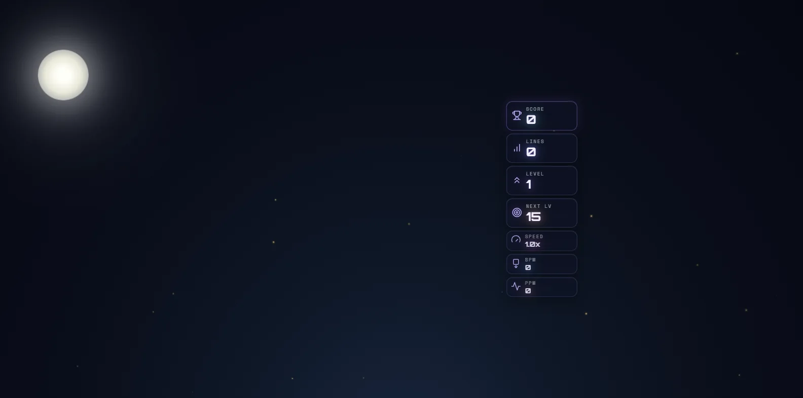 | 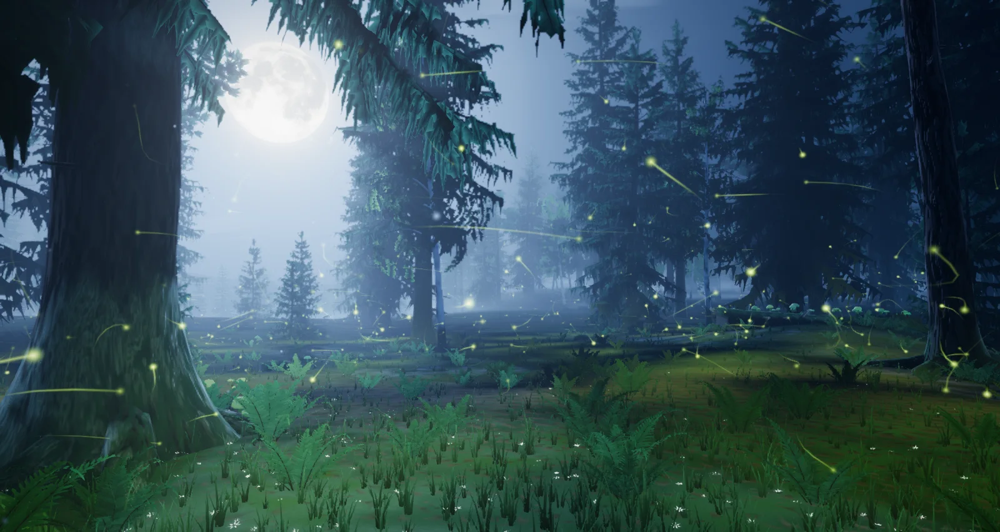 |

## What the player sees

The same idea the theme has always had — a full moon behind spruce, fireflies, mist — now
built as a place. The eye stands among old trees at the head of a *ride*: a long opening
that runs straight toward the moon and falls away into a valley of mist, with wooded
ridges beyond it. An ancient spruce frames the left of the screen, its low boughs hanging
over the moon; on the right the old wood closes in round an elder pine, birches, and a
mossy knoll where a spruce once fell. The moon (far larger than life, as it always was
here) carries its real seas and craters, an aureole in the damp air and a faint ice halo.
Moonbeams are real volumes cut by the trees. The floor is moss, fern, grass and wood
stars, and over it drift fireflies that leave the trails a long exposure would catch:
dotted arcs, lit only where each one was flashing. On a dead limb of the old spruce, beside
the moon, sits an eagle owl ([the eagle owl](#the-eagle-owl-2026-10-28)).

The board card hides the middle quarter of a landscape screen, so the picture is composed
for the two side thirds. Portrait keeps the same world, turned toward the moon.

## How the forest answers the game

`ForestReactions` is a pure director; `ForestFireflyDirector` turns its cues into light.
The forest's own light is firefly green and is the only saturated colour in a blue night,
so every reaction reads at once.

| Event | Response |
| --- | --- |
| Piece lock | A wave of light runs out across the moss from where the piece landed. It climbs the trunks it passes, the ferns and grass bow away from it, every firefly it crosses flashes, and a puff of fireflies leaves the card's edge beside the piece. |
| Hard drop | A stronger wave, and from a long drop the boughs shake: dew comes down through the moonlight. |
| Line clear (1–3) | Twin jets of fireflies from both sides of the card at the cleared rows and a taller, faster wave. From two lines a second wave follows and a front of wind crosses the trees; from three a star falls. |
| Four lines | All of that, fireflies lifting out of the ferns across the whole floor, the moon and its beams flaring — and the fireflies gather into one of the animals of the wood ([the animals](#the-animals-2026-10-09)) at one of five places beside the card ([where they stand](#where-the-animals-stand-2026-10-26)), which stands for a few seconds lighting the moss under it, then lets go. |
| Combo / streak | The forest wakes. Fireflies fall into step one by one until the wood flashes in waves that roll out from the board; garlands of them wind up the old trunks; threads of foxfire spread through the moss; the fungi on the fallen spruce and among the roots light one by one; the fireflies pale toward white gold and their trails lengthen. A lock without a clear lets it all sink back. |
| T-spin | A spiral flourish beside the board and a wave. |
| Back-to-back | Holds the wakefulness and lifts the moon. |
| Perfect clear / level up | The whole forest answers at once; a perfect clear calls an animal for longer. A level-up also turns the night one hour on ([the hours](#the-hours-of-the-night-2026-10-09)). |
| Game over | The wind dies, the forest goes back to sleep and the fireflies sink toward the moss. |

Everything honours `backgroundComboEffects` and `pieceLockRipple`, pauses with the theme,
and is driven by simulation seconds. No event allocates: fireflies come from a fixed
hidden reserve, emitters and waves from fixed pools.

| Hard drop | Three lines | Four lines: the stag |
| --- | --- | --- |
| 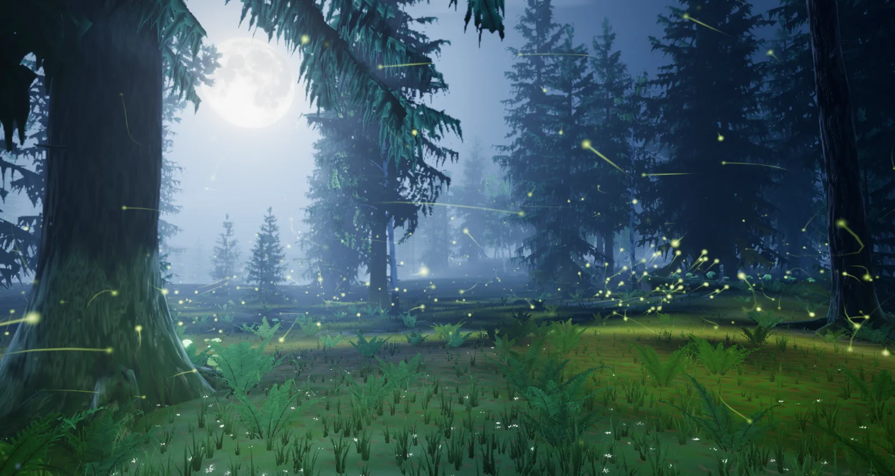 | 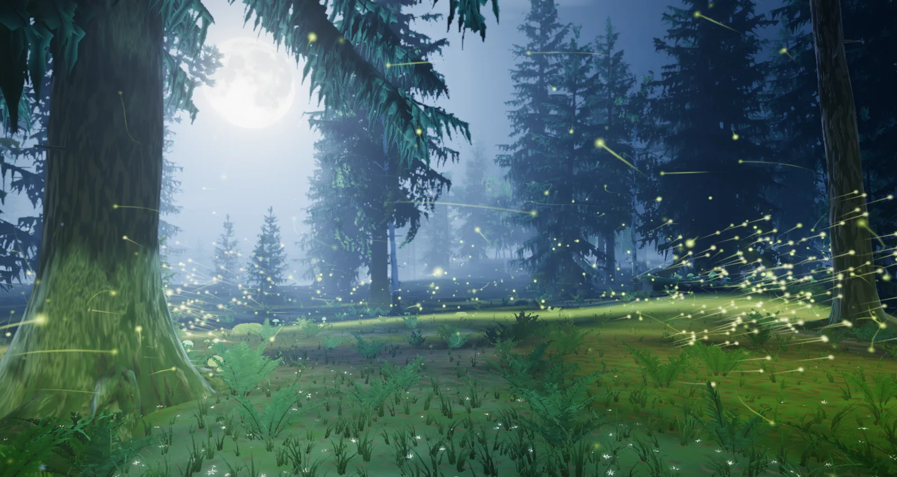 | 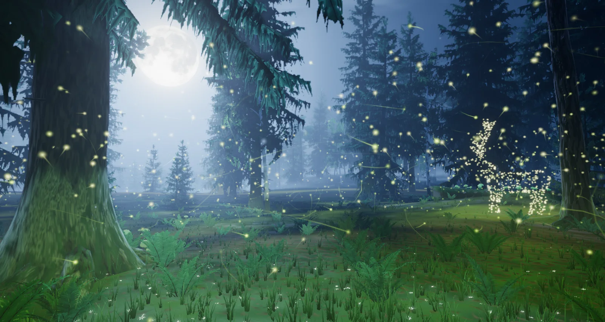 |

| Lock | Combo ×8, held | Perfect clear |
| --- | --- | --- |
|  | 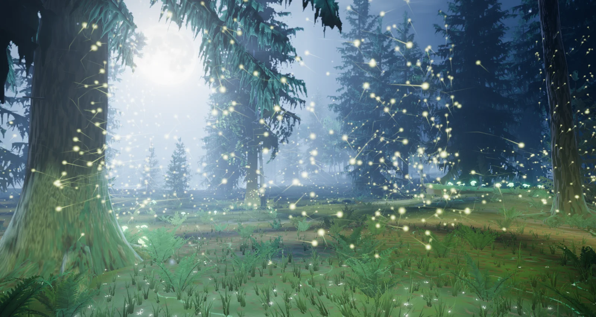 | 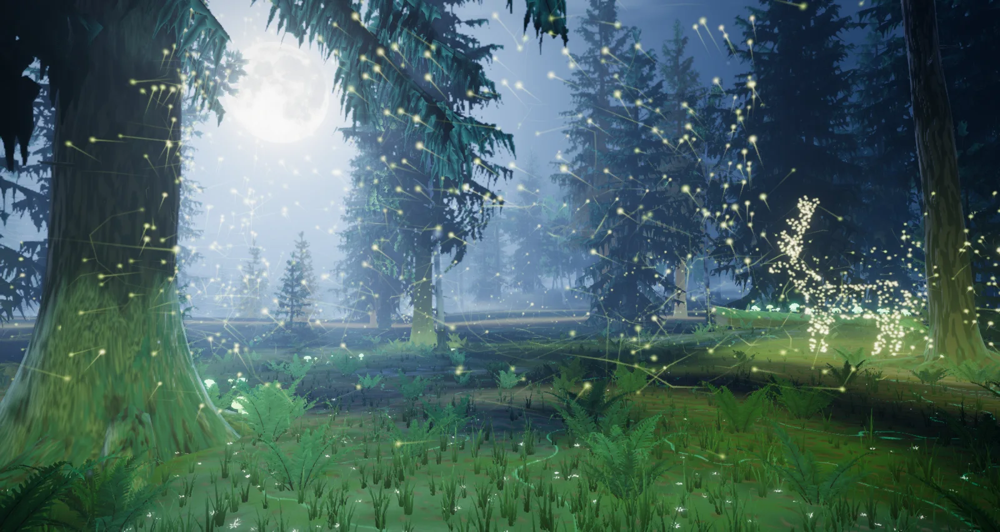 |

### The animals (2026-10-09)

The first build had one figure, the stag. It now has twelve: the stag, and eleven more
creatures of a northern wood. Four lines or a perfect clear calls one of them.

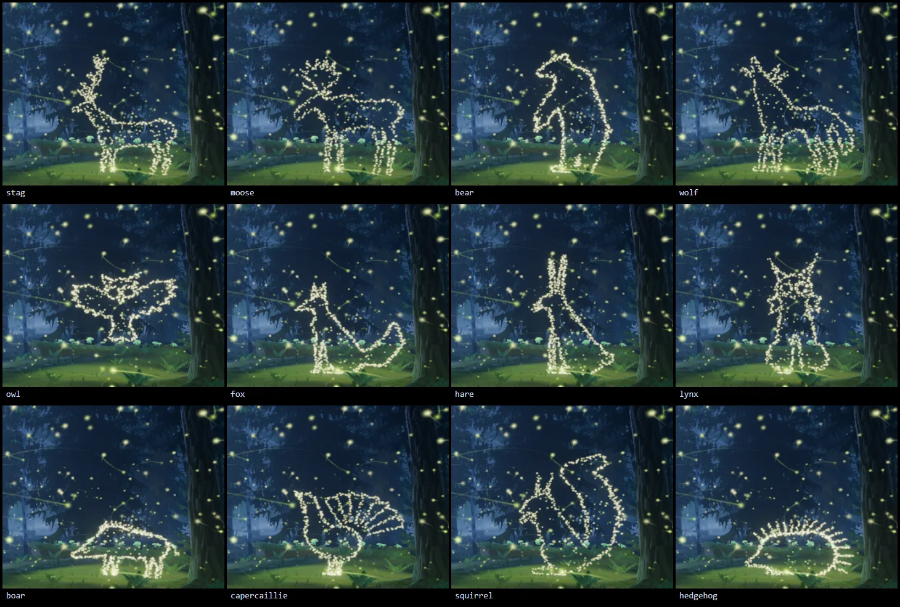

| Animal | How it is drawn |
| --- | --- |
| Stag | A red stag in profile, head up, antlers as strokes, and under them a body of sparks: it keeps a fifth of its lights inside, where the others keep a twelfth. Its shape is what it was in the first build. |
| Moose | A bull: long legs, the hump, the overhanging muzzle and bell, a palmate antler held over the head. |
| Bear | Risen on its hind legs, forepaws hanging, nose to the wind. |
| Wolf | Standing square, head thrown back and jaws open, howling: a thick neck, ears laid back, a deep chest, the brush hanging to its hocks. Figures face the moon, so it howls at it. |
| Owl | An eagle owl from the front, wings spread, coming in to land above the ferns; two round eyes. |
| Fox | Sitting, ears up, its brush lifted behind it. |
| Hare | Sat up on its haunches, ears high. |
| Lynx | Sat facing the player: tufted ears, round eyes, a ruff hanging at either cheek. |
| Boar | All shoulder, a long snout, tusks, a crest of bristles. |
| Capercaillie | The cock at his display: the tail fanned in quills, beak to the sky. |
| Squirrel | Sat up with a cone, its tail a great curl behind it. |
| Hedgehog | A dome of spines and a small sharp face. |

- **Which one comes.** `ForestReactions.nextFigure()` deals them from a shuffled round:
  every animal comes once before any comes back, and never the same one twice running,
  not even where two rounds meet. The round starts afresh with the reactions (a new
  session), so a seeded capture is reproducible. `callFor(name)` asks for one by name;
  the playground exposes it as `?animal=<name>`.
- **One description, many animals.** `forest-figures.js` describes each as tapered capsules
  (body, legs), closed outlines (a wing, an ear, an antler palm), holes (an eye) and
  strokes (antlers, whiskers, quills, spines), in plain numbers. Fur and spines are grown
  on a body by marching its distance field. To add an animal, add a figure to
  `FOREST_FIGURES`; nothing else names them.
- **The room a figure has.** Every figure is placed inside `FOREST_FIGURE_ROOM`, the room
  the stag takes where it stands (1.66 m behind, where an old pine stands close, 2.30 m
  toward the nose, 5.18 m overhead), and sized to fill it: these are figures of light,
  not life-size animals, so the hare stands as tall as the bear. The first captures had
  centred figures and the pine cut the wide ones.
- **Drawn for the size of a firefly.** A light is about a tenth of a metre of glow at
  twenty-three metres, so fine detail does not survive. Only a share of a body's lights
  stands inside it (`fill`, a twelfth for most), the rest draw its outline, and features
  are drawn large: the owl's eyes are half a metre across.
- **The wolf, drawn twice.** The first wolf was the smallest of the twelve (3.6 m) and
  read as a thin dog: its tail streamed out behind, and since the room's width sets a
  wide figure's size, the tail cost it a third of its height. The second carries its
  brush hanging, so the same room holds a wolf 5.1 m tall, and has what makes a wolf at
  this size: a thick neck, a deep chest tucked up to the waist, ears laid back, open jaws.
  A mane and a chest ruff drawn as teeth were tried and taken out again: in the forest
  each tooth was three or four lights, and the head became a cluster of points.
- **An even hand.** Lights scattered at random along an outline bunch and leave gaps:
  the first twelve were clouds of dots, and the wolf's outline broke up at its new size.
  Now more places than lights are found on a figure's outline (four for each light), and
  each light in turn takes the place furthest from every light already set, so the line
  is covered from end to end first and filled in after. Along a line a light's nearest
  neighbour is 0.8 to 1.9 of the usual spacing away, where scatter gave anything from
  nothing to five times it; at 112 lights (Minimal) an animal is still one unbroken
  line. All twelve are drawn this way, the stag too: its shape and antlers are what
  they were, its lights are not where they were.
- **Chance, in the game.** The theme builds its forest from a fixed seed, which would
  have replayed one order of animals; in the game the round is dealt by `Math.random`
  instead, and follows the seed only when `forestSeed` is in the URL.
- **No work at the summons.** All twelve are laid out when the director is built, as
  the stag was, so calling one allocates nothing. `forestFigureLights` keeps a figure's
  lights for each number of them, so a forest that is rebuilt (a quality change) lays
  nothing out twice. The layout looks for places only in the cells of a grid that the
  figure covers, and the distance to a figure skips, by its box, any part a point
  cannot be nearest to: all twelve at 560 lights take about 40 ms together on a busy
  machine.

Checked on 2026-10-09, after the even hand: every animal captured in the playground at
High on native WebGPU (`?effect=forest&animal=<name>&event=quad&eventAge=4.2&t=14`; the
sheet above is those captures, cropped). Also the stag and the capercaillie at Low (210
lights), the owl and the hedgehog at Minimal (112), the lynx at Medium (373), the bear on
the WebGL2 backend, the stag with the board card at 16:9, the moose on an upright
9:19.5 screen, a fox gathering, and a summons left to the round. No shader or console
errors. `tests/unit/forest-*.test.js`: 593 tests in seven suites, among them that every
animal fits its room and takes every light, that its outline is evenly lit where
scatter would bunch, that no two are the same drawing, that a round deals each once
and never one twice running, and that the distance to a figure never jumps. Not run
inside the real game, and no frame rate was measured: a figure is made of the same
reserve sparks, and as many of them, as the stag was.

### The hours of the night (2026-10-09)

The forest was one blue night at every level. Now the night turns: its colours pass
through five hours and come round, by the clock alone and one hour further with every
level.

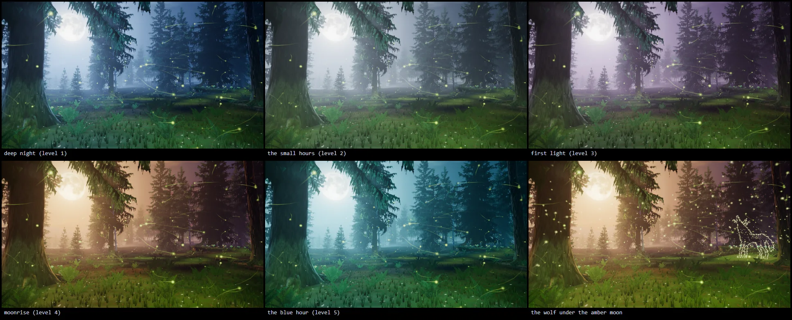

| Hour | Level | What it is |
| --- | --- | --- |
| Deep night | 1, 6, 11... | The forest as it opens, and as it was: ink and slate blue under a blue-white moon. |
| The small hours | 2, 7... | The mist thickens in the hollows, the moon whitens, the colour drains to silver. |
| First light | 3, 8... | Rose along the horizon away from the moon, lilac air, the stars going out. |
| Moonrise | 4, 9... | The moon amber: honey light down the ride, an ember band under indigo. |
| The blue hour | 5, 10... | The day's last light is teal in the air, the moon cool and clear. |

- **The moon does not move.** The whole wood is laid out for where it hangs and its
  shadows are drawn once, so an hour is a change of colour and air, not of light
  direction: the moonlight and the moon's own face, what the sky, the floor and the lit
  ride give back, the sky from zenith to horizon, the night air, the thin cloud, the
  moonbeams, the lean of the darkest tones, how thick the mist is and how many stars show.
  The fireflies' green is the forest's own light and is the same in every hour.
- **The clock.** An hour rests for 42 seconds, then melts into the next over 78
  (`FOREST_HOUR_PERIOD` 120 s, `FOREST_HOUR_REST` 0.35): ten minutes for the night to come
  round, so a long spell on one level does not stand still. `forestHourDrift(time)` is a
  function of the time alone, so a seek and a night lived through agree at any frame rate.
- **The level.** A level is one hour on from wherever the clock has brought the night,
  eased in over about four seconds, so a level-up always shows a new hour. A new run goes
  back to the first level's hour the short way round the night. The theme keeps the level
  and the seconds of night already lived, so a forest rebuilt for another quality tier
  takes the night up where the last one left it.
- **Not an effect.** With background effects switched off the level-up's flourish is not
  played, but the night still turns: a slow change of colour is the theme. For the same
  reason it is not slowed by reduced motion.
- **Values only.** Every colour an hour sets is a uniform of the light rig (eighteen
  colours and two numbers, `forest-hours.js`), each starting at deep night's value, so the
  first hour draws exactly what the forest drew before, and turning the night rebuilds no
  shader on either backend. A straight mix between neighbours is enough; the one seam
  that crosses from warm to cool (moonrise into the blue hour) passes through a silver
  dusk rather than a muddy one.

Checked on 2026-10-09 in the playground (`?effect=forest&level=<n>&t=14`): the five hours
at High on native WebGPU (the sheet above), two melts half-way (`t=81`), the stag at
first light, the wolf under the amber moon, a line clear at moonrise with the board
card, first light at Low, moonrise at Minimal and on the WebGL2 backend. No shader or
console errors. `tests/unit/forest-*.test.js`: 623 tests in eight suites with
`url-parameter-catalog`; the new `forest-hours.test.js` pins deep night to the values
the forest shipped with, the rest and the melt, seek against a night lived through at
three frame rates, the level as a step on top of the clock, and the short way round.
Not run inside the real game.

### The visual pass (2026-10-20)

A look at the night with fresh eyes, keeping everything it already was.

- **Moonbeams cut into rays.** The volumetric beams lit the air round the moon as one even
  glow. A short screen-space march (High and up 20 to 24 taps, Medium 14, none at Low) now
  weighs how open each pixel's line of sight to the moon is: open sky keeps more of the
  beam, a bough or a trunk in the way dims it, so the light streams out between the
  trees, near the moon only. Two short marches at quarter size, as the breathing stage
  draws its shafts (`breath-post.js`): no jitter, no grain. New tier column `rays`.
- **Backlit boughs are silhouettes.** The side of a tree the eye sees is the one turned
  away from the moon, but the needles wrapped 40 % of the moonlight round to it, so the
  boughs nearest the moon glowed teal. The wrap is 18 % now, and the light through a spray
  is half its own hue, half grey, and held to the tips: dark boughs edged in silver.
- **Grass in tussocks.** The grass was spread evenly and read as a lawn. Now it grows in
  clumps a few metres across with moss between them (a two-octave value noise,
  `forestGrassClump`), taller in a clump's heart, with drifts of last year's pale straw
  (`forestGrassDry`). Same count per tier.
- **Bark near the eye.** A finer layer of the bark noise draws furrows between the plates
  and moss in cushions with dark gaps; on a far trunk the mipmapped noise averages away.
- **The lens.** A firefly within about four metres of the eye goes out of focus: a soft
  disc up to four times as wide with a slightly brighter rim, its light spread over the
  disc (never brighter), and no sharp trail across its own blur.
- **Trails at Low.** Low draws a trail in three segments, and a curling path drawn in three
  chords looked like bent wire. A trail now covers less flight when it has fewer segments.

Checked in the playground at High and Low on native WebGPU, 1920×1080, 1280×720 and
390×844: idle, lock, hard drop, combo, four lines (the stag), moonrise; clean consoles.
GPU per frame at 1080p, interleaved against the forest before the pass: about 1.25 ms
against 1.15 ms. `tests/unit/forest-*.test.js`: 620 tests.

### Where the animals stand (2026-10-26)

Every animal stood on the same spot in front of the knoll, so the twelve of them read as one
place lit twelve ways (Olov: "is it possible to have the different spawned animals at
different places in the theme a bit random? now they always shows at the same place all the
time!"). There are now five places (`FOREST_FIGURE_STANDS`), and each new animal takes one by
chance.

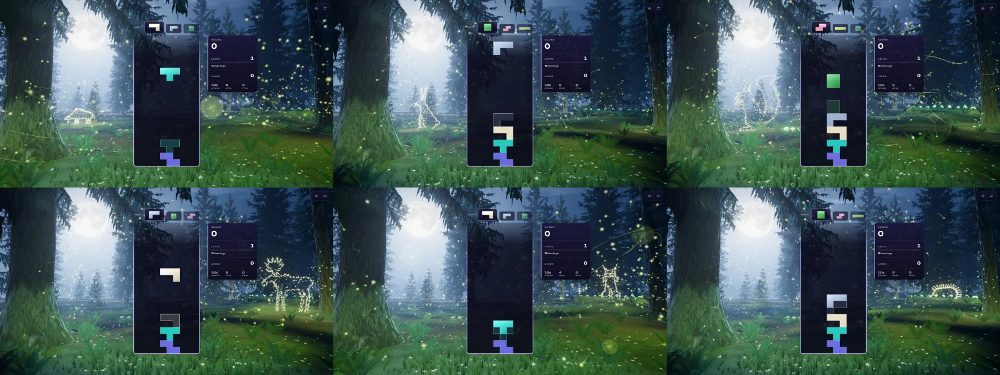

*Six four-line summons in the real game at 16:9 (High): a boar far down the ride, a hare in
its hollow, a squirrel near; a moose at the usual place, a lynx and a hedgehog up on the knoll.*

| Place | Where | Range |
| --- | --- | --- |
| 0 | In front of the knoll: the usual place, as before | 21 m |
| 1 | Up on the knoll behind the fallen spruce, whose trunk hides its hooves | 31 m |
| 2 | Out in the ride under the moon, near | 19 m |
| 3 | In the ride's hollow, where the mist gathers | 25 m |
| 4 | Far down the ride | 31 m |

- **Chance, in the game.** `ForestReactions.summon()` deals each new animal a `place` (0..1)
  from the generator that deals the animals: `Math.random` in the game unless `forestSeed` is
  in the URL, seeded in the playground and the tests. Four lines again feed the standing
  animal where it stands.
- **Only where it can be seen.** `ForestFireflyDirector.pickStand()` turns the chance into a
  place: one where the whole animal would be seen now (`forestFigureBox` projects the corners
  of the room every figure fills; `ForestStage.inSight` refuses a box that leaves the screen
  or overlaps the card or a panel beside it), never the place the last one took while another
  is in sight. With none in sight it may take any of them. No allocation at the summons.
- **The score panel.** The stage now also reads `.single-player-stats-bar`
  (`readForestPanelRects`, polled with the card). Between the card and the panel there is no
  room for an animal, so the two places on the right stand far right and differ by distance;
  the open ride on the left has three. The knoll place was moved 1 m left of the first
  candidate so it also fits a 3:2 screen.
- **Every screen.** `ForestWorld.figureAnchors()` offers each place whose whole figure is in
  the view, and the usual place always (moved into view on narrow screens, as before).
  16:10 and wider offer all five, in the game 16:9 and 21:9 see all five, 16:10, 3:2 and 32:9
  see places on both sides of the card, 4:3 and 1.2 at least one; a square screen offers the
  usual place only. On 16:10 the usual place, moved left to fit, lay partly behind the score
  panel (it did before this change too): the director now passes it over there.
- **Open ground.** Every place is a metre clear of every trunk, clear of the stump and the
  fallen spruce, with no trunk between it and the eye; scattered stones keep 3.2 m off every
  place, and the hand-placed ones lie at most in front of an animal's hooves.
- **Captures.** The playground's `?stand=<n>` stands every animal at place n (`callStand`),
  `?panel=1` draws a stand-in score panel beside `?board=1`'s card, and the diagnostics' `stand`
  says where the last one stood.

Checked on 2026-10-26 in Electron captures (RTX 5080): in the playground at 1600×900 the stag
at all five places, the owl far down the ride, the bear near, the wolf in the hollow and the
moose on the knoll, the stag at 21:9 and on a 440×960 upright screen (which picked the far
ride place); in the real game (single player, 16:9, High) six summons fired through the
theme's reactions stood at places 4, 1, 0, 3, 1, 2, all clear of the card and the score panel
the stage had measured. Clean consoles. `tests/unit/forest-*.test.js`: 661 tests in eight
suites, among them that every place fits the widest animal at ten aspects, is open ground on
every built tier, and is seen whole in the game's own layout, and that the director never
stands an animal behind the card or the panel nor twice running in one place.

### The eagle owl (2026-10-28)

The wood has an owl of its own now (Olov: "In the Forest theme i want to model and owl using
blender mcp... well modelled and able to be animated in a visually stunning way when it flies
around and sit in the trees... it must feel natural, smooth and have very good animations"). A
Eurasian eagle owl, the great owl of the northern wood, lives on a dead limb of the elder spruce
that reaches out toward the moon: from the eye it sits beside the moon's lower limb, dark against
the lit mist, edged in silver.

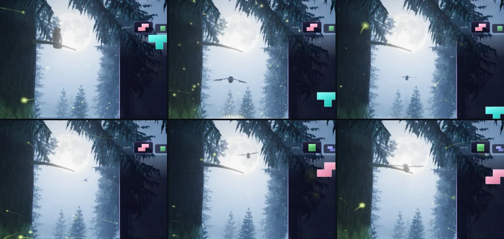

*In the real game (single player, 1920×1080, High): on its limb; off it; out along the ride;
turning far out; back across the moon; landing, wings thrown open against it.*

**What it does.**

- **On a perch it is still**, and its stillness is what makes it an owl. Its eyes are fixed in its
  skull, so it looks by turning its head, quickly (a quarter to half a second, eased like any sure
  movement, slower for a sweep from one shoulder to the other), and then holds it there; now and
  then it peers at something, bobbing and tilting its head; it blinks slowly, now and then one eye;
  its upper lids ride a little low (the eagle owl's hooded stare); its ear tufts rise when it is
  alert and sink as it dozes; it breathes; every minute or two it rouses (its whole plumage swells
  and shakes, its wings loosen), settles its wings, or hoots, bowing, its tail lifted and its white
  throat swelling twice.
- **Now and then it goes out** (every 40 to 80 s): a stoop into the ferns after something it heard
  (it stares down and peers first; a long falling glide, the stoop with its talons thrown forward
  under raised wings; mantled over its catch, its wings spread wide over it like a cape; then a
  labouring climb back to its limb), or across to another perch for half a minute (a dead stub on the
  elder pine at the right of the frame, the fallen spruce on the knoll, the stump beside it), and home.
- **Four lines or a perfect clear**: it lifts its head and stares at the board, then flies out along
  the ride, turns far out over the mist and comes back toward the eye straight across the moon's disc
  (23 m out, its wings half the disc wide), and lands on its limb again. A level-up sends it to another
  perch (or home). A hard drop startles it (tufts up, a snap of the head to the board); a line clear
  draws its look. When a run ends it dozes.
- **Only where it can be seen.** It goes only to a perch or a patch of floor the player sees whole,
  clear of the card and the score panel (`ForestWorld.owlSees`, the stage's own sight test), so a
  narrow or upright screen keeps it home. Under reduced motion it stays on its limb, living its
  stillness only. With background effects off the game's events no longer reach it (only the end of a run
  does, as it reaches the forest), and it lives its own life.

**How it moves.**

- **Flights** are planned whole when it sets off (`forest-owl-flight.js`): a curve through a few
  waypoints (centripetal Catmull-Rom, so it never loops between close points), flown at an owl's
  slow cruise (6.4 m/s) that it gathers off the perch and sheds before the next, faster down a
  slope and slower up one. Everything along it is found once and kept against time: where it is,
  its bank (from the turn's own curvature, tan(bank) = v²κ/g, eased, at most 52°), how much it climbs,
  and how hard it must work. Sampling that table gives the same bird at any frame rate.
- **The wingbeat** is an eagle owl's: slow and deep (2.3 beats a second, quicker off the perch), a
  downstroke longer than the upstroke with the wing fully spread and pressed forward, the hand flexed
  and turned to slice back up, the wingtip lagging the arm so a wave runs out along the wing, the
  outer primaries bending up under the load. Climbing and speeding up want wingbeats; level and falling
  stretches are glided. The body rides up with each downstroke while the **head stays level and still**,
  looking ahead, and at the perch as it comes in (looking past it, not down at its feet, at the end).
- **Off and on a perch.** A crouch and a lean forward (turning on the branch first when it goes the
  other way), the tufts laid flat, the wings opening as it drops off. Landing: the body raised upright,
  the wings thrown forward and beating against the air, the tail fanned and pressed down, the talons
  reaching and spread; then the wings lifted a little and folded away as it takes its weight with a bob.
  Every number of the pose crosses over from one mode to the next in a third of a second; nothing jumps.
- **The wings fold as a bird's do.** Every flight feather is on a bone of its own. Folded, the arm
  closes in a Z along the flank (shoulder back, elbow forward, wrist back) and every feather turns
  about its own root until it lies down the body, the primaries under the secondaries, the tertials
  on top, the folded wing curling round the body; any pose between is a slerp of each joint toward
  that, so a half-open wing is always a wing (`forest-owl-rig.js`).

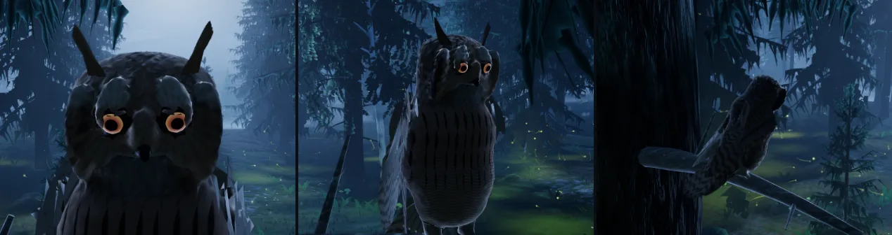

*Close up in the playground (`owlCam=`): the face (orange irises round big night pupils, the hooked
bill, the tufts), the breast streaked and barred, and a launch seen head on.*

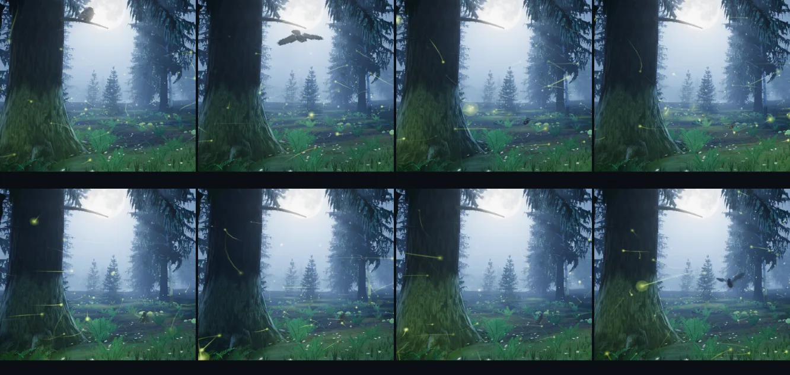

*A stoop (`owlTrip=hunt`): off the limb, the falling glide, the stoop, mantled, the climb home.*

**How it is made.**

- **Modelled and rigged in Blender** by its own generator, `scripts/blender/forest_owl.py`, headless,
  packed by `scripts/forest/pack-owl.mjs` (`assets/owl.glb`, 0.55 MB, 19,600 triangles, 110 bones;
  details in [`ATTRIBUTION.md`](../src/themes/forest/assets/ATTRIBUTION.md)). The soft body is a
  distance field round the rig's joints (the horse's, the bear's and the squirrel's toolkit); every
  feather is a curved vane of its own. It was designed through the Blender MCP in a scene of its own
  (`forest_owl/live.py`), with the theme's own poses written out by `scripts/forest/owl-poses.mjs`, so
  the renders show what the game draws.
- **Drawn in the forest's light** (`forest-owl.js`): unlit, lit by hand as the bark and the needles are.
  The moon stands behind it, so the side the eye sees is its shaded side: the sky and the moonlit ride
  fill it, its outline catches the moon in silver whatever its colour, a thin vane between the eye and
  the moon glows faintly, its bars dark in it, and the forest's own light (a wave, a firefly) shows its
  true colour and kindles its irises. The plumage is drawn in the shader from a code every vertex
  carries: the breast's bold drops and the belly's fine wavy bars, the mottled upperparts (every
  feather dark down its middle, its edges tawny), barred flight feathers paler underneath, the facial
  disc's fine lines, the eyes. Bars fade to their mean as they grow finer than a pixel.
- **Its dead limbs** were at first two grey tubes of its own; they are now grown into the elders
  ([the second pass](#the-owl-wanders-and-its-limbs-are-the-trees-own-2026-10-28)). The log's ridge and
  the stump's cut are measured from `forest-props.glb`.
- **Its life is closed-form.** Each act has a start and a length; each kind of act draws from a random
  stream of its own, so a seek and a night lived through agree at any frame rate (the same night lived
  at 30, 60 and 144 fps lands within centimetres), and the playground's seeded captures are repeatable.
- **Playground**: `owlTrip=moon|hunt|catch|miss|visit|home|sidle|turn|stretch|preen|doze|tall|away|direct|
  meander|patrol|overshoot|circle` at `owlAt=<s>` (`owlTo=` a perch for a visit, a sidle or a way of
  flying, a gate for `away`, `wingsUp` for the other stretch, `breast|left|right` for a preen),
  `owlBack=<s>` and `owlBackBy=<gate>` to bring it back from away, `owlPerch=<perch>` to set it on any
  perch and `owlHold=1` to keep it there, `owlLook=eye` or `<yaw>,<pitch>` to hold its gaze, `owlCam=<metres>` for a lens that follows it
  (`owlOrbit=`, `owlTilt=`, `owlFocus=<metres above its feet>`). The diagnostics' `owl` says what it
  is doing (its perch, its act, whether it faces away).

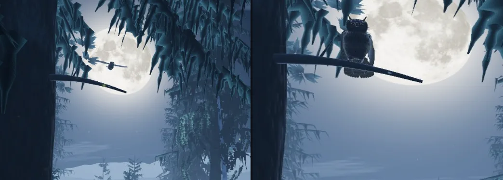

*On the WebGL2 backend at Low, crossing the moon; perched at Low (1920×1080 crop).*

**How it was checked.**

- **Measured, not eyeballed**: ten-minute nights of its mind at 60 fps in Node with four-line clears,
  level-ups, a hard drop and a game over thrown in (five seeds): per frame at most 0.14 m of travel
  (an 8 m/s stoop), 10° of heading, 3.5° of pitch, 5° of bank; no flight within 0.69 m of a trunk or
  through a crown; the whole moon loop on screen at 16:9 (never behind the elder's trunk). The faults
  this found, each fixed and now pinned by a test: a landing that forced a U-turn so it would face
  the eye (a 152° heading flip in a frame: it now lands the way it flies and turns on the perch as it
  settles); a swoop-up point lifted above a low perch by the floor's clearance (a pitch kink); a stoop
  to a spot too near its perch that doubled back past the elder's trunk; a far turn behind the elder's
  trunk and then a hairpin (re-laid as an arc over the ride); head and wing jumps where flight hands
  over to a perch (every number now crosses over); a head that tried to look behind it in the air.
- **Captured** in Electron (RTX 5080): the playground at High on WebGPU (perched, the moon loop frame by
  frame, the wingbeat and landing close up, the hunt, visits to the pine and the log), on the WebGL2
  backend at High and Low, at Minimal; and in the real game (single player, 1920×1080, High), four
  lines fired through the theme's reactions sending it out across the moon and back. Consoles clean
  but for Electron's own CSP notice and Chrome's `powerPreference` notice.
- **Tests**: `tests/unit/forest-owl.test.js` (27): the model on disk (one skinned mesh, every bone named
  and resting unturned, the same on both sides, a plumage code on every vertex, the plan the rig mirrors
  stamped in its extras); the rig (unit turns, the right wing the mirror of the left, folding without a
  jump, the folded primaries down the body, the body level for flight and upright on a perch); the
  wingbeat and the moon loop flown smoothly; every perch seen whole at 16:9 clear of the card and the
  panel; its mind (the moon loop for four lines, a visit for a level-up, never where it cannot be seen,
  home under reduced motion, a night without a jump, a NaN or a dive through a trunk, the same night at
  any frame rate); the reactions' cues; its shaders built for WGSL and GLSL without a warning.
- **Cost**: one skinned mesh of 19,600 triangles on 110 bones (one draw, the bone matrices uploaded once a
  frame), two limbs, one material at every tier. The asset pack grows from 2.96 to 3.51 MB (the pack's
  ceiling raised to 3.7 MB). Not timed on the GPU: the machine was shared with other sessions.

**Known limits.** The owl is not in the moon's static shadow map (it casts no shadow; it reads the map
like everything else, so it flies into and out of the trees' shadows). On the far perches (the log and
the stump, 27 m off) it is a small silhouette. A narrow or upright screen that cannot see its limb keeps
it home and unseen. Up close its facial disc reads a little lumpy.

### The owl wanders, and its limbs are the trees' own (2026-10-28)

A second pass the same evening (Olov: "We need to continue improving the owl and animations, it should
act more randomly and have more branches to fly to and sit on." and "the limps and braches needs to be
well modelled and really fit into the trees and scene."). Merged with the first pass on main
(`8e0a59fe`), it takes the owl off its routine (an outing every 40-80 s, out and home again) and gives it
a glade to live in.

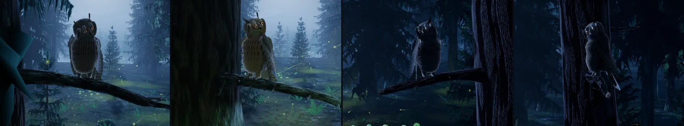

*The limbs close up in the playground (`owlPerch=`, `owlCam=`): the home limb toward the moon, the low limb
below it, the elder pine's stub and its high stub. Dead wood with its branchlets' stumps, a collar where it
leaves the trunk, broken ends; the trees' own bark, moss, occlusion and light.*

- **Its limbs are grown into the elders**, by the trees' own generator: `forest_night/owl_limbs.py` adds
  them to the grown spruce-elder and pine-elder before the bark mesher runs, so they are meshed, masked
  (the spruce's lichen, the pine's plates), occlusion-baked and drawn exactly as the trees' own limbs
  are, by the trees' bark shader, in the trees' draw, swaying with their trunks (at the limbs' height a
  trunk moves under a centimetre, so the owl does not need to follow it). A dead limb is a zigzag of
  short straight runs (the axis turns a few degrees at every node, away from the branchlet it grew
  there), wanders a little across its line, swells into a collar where it leaves the trunk (most
  underneath), is checked along the grain, and carries the stumps of its branchlets in two rows along
  its flanks: most broken short, a few still long and forked toward its end. It ends in a thin whip or
  broken off in splinters (a jagged cap, flat-shaded). Where the owl sits its toes find no stumps, and
  along the stretch it sidles there are only short ones low on the flanks (a long one there would reach
  into its breast). The generator's own dead stubs on both trunks are dressed the same way (six sides,
  checked wood, broken off) so the owl's limbs and the stubs beside them read as one tree's.
- **Five limbs, eleven perches.** On the elder spruce: the home limb toward the moon (three seats, the
  middle one where it always sat) and a stout broken limb below it over the ferns (two seats). On the
  elder pine: its stub over the knoll, a shorter one below and one high in its bare stretch (taking the
  place of one of the generator's stubs). Off the trees, both ends of the fallen spruce's ridge and the
  stump. `scripts/forest/pack-owl-limbs.mjs` runs the build and writes where each limb is in the world
  (`forest-owl-limbs.js`: its centreline, the top of its bark, its seats) for the perches to read
  without three.js; a test checks the module against the trees' own record and that every seat stands
  on bark in the part of the mesh every tier draws (the owl's limbs come with the trunk, ahead of the
  tier cut). The seats sit 0.45-1.25 m out from the bark.
- **It decides as it goes.** When it has sat a while (5 s to over a minute, drawn skewed toward short,
  longer at home) it weighs what it can do from where it is: sidle along its limb to another seat on it,
  hop round to face the other way (and back again later), fly to another perch (the nearer the likelier,
  the three it was on last less so, home more so the longer it is away, its own tree a little more), drop
  on something in the ferns, now and then the moon loop from home, or sit on. Hunts end either way: it
  catches (mantled over it) or misses (it folds its wings, stands up in the ferns and looks about) and
  then flies up to whichever perch it likes, most often the one it came from. A level-up moves it on;
  four lines bring it home (or out across the moon from home). Over a simulated ten minutes it flies
  13-20 times to 9-11 perches.
- **Its flights differ.** A dip low over the ferns and a swoop up into the perch, a near-level glide, or
  an arc over; a little quicker or slower, its wingbeat too, now and then flapped all the way. Between
  two limbs of one tree it hops: it turns on the perch toward the other place as it crouches, springs,
  gives a beat or two with its wings half open and held high, and comes onto the other limb level. By a
  trunk (a seat under a metre from the bark) it leaves out along the limb and comes in along it from the
  limb's end, so a wing spread in the flare never meets the bark. Every route keeps a body's width from
  every trunk below its top (the world hands the mind the trees' trunks): waypoints too near are pushed
  out, and every stretch between them is sampled at its quarters, since the curve cuts the corners.
- **It does more on a perch**, each act on its own clock and its own random stream, never two at once:
  a stretch (one wing down and back, fanned, the leg on that side reaching out behind, the tail swung
  the same way; or both wings raised over its back), a preen (its face buried in its breast or under a
  shoulder, nibbling and tugging, fluffed, its eyes half shut), a doze (eyes closed, tufts down, fluffed,
  the head sunk, an eye opened now and then; after a game over, or when nothing has happened for a
  while), the tall stance (sleeked thin, tufts up, staring: now and then after a hard drop), a hop round
  (the head swivels round first, then a crouch, a spring with the wings flicked open, and down facing the
  other way), and a sidle (a step at a time, a foot lifted and set down further along, the body rocking
  over the foot that holds, the head held still). A cue cuts a preen, a stretch or a doze short with a
  crossfade.

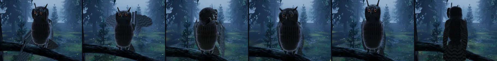

*Its acts (`owlTrip=stretch|preen|doze|tall|turn`): a wing-and-leg stretch, both wings over its back, a
preen under its left shoulder, a doze, the tall stance, sat facing away after a hop round.*

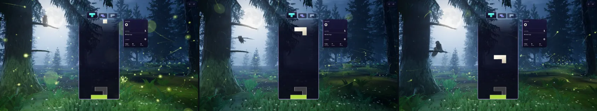

*In the real game (1920×1080, High): on its limb by the moon, hopping down to the low limb, stretching
there.*

**What the measuring found and fixed.** Ten-minute nights in Node (six seeds) turned up: a heading that
spun 180° in a frame on a near-vertical hop (the flight now keeps a heading table that holds its direction
where the path runs straight up or down and turns at most 6 rad/s); a hop that swung out from the trunk
and back (a 180° turn in a quarter second; hops now go straight to the other seat); a leg joint that
jumped 118° in a frame on short flights (the tuck out of the launch and the reach for the landing are now
the lesser of the two, never a switch); a climb that grazed the pine's trunk (the corner-cutting above);
the head flicking when a mark passed overhead (the look is now eased as a direction, then turned into head
angles); events that ran "as of" a time long past when an act had held them up (a 2 m jump into a flight,
a sidle that finished at once: an event is now dated no earlier than the frame step it happens in); and
eyelids that snapped open when a cue cut a doze short (the crossfade now carries the lids). Final: per
frame at 60 fps at most 12.2° of heading (the hop round), 4.3° of pitch, 3.5° of bank, 14° of head, no
flight nearer the bark than its seats are (0.42 m); the same night at 30, 60 and 144 fps to the
centimetre through 400 s.

**Checked** in Electron (RTX 5080): every limb close up and from the side, every act frozen mid-move, a
hop and a sidle, on WebGPU at High, the WebGL2 backend at High and Low, and Minimal (the limbs drawn on
every tier); and in the real game (Single Player, 1920×1080, High), the owl sent down to the low limb, a
stretch there, across to the pine and home on four lines. Consoles clean but for Electron's own CSP
notice. **Tests**: `forest-owl.test.js` 27 -> 37 (the limbs grown into the elders, the wander, a miss, the
hop round and the sidle, each act without a jump). **Cost**: the two elders gain 4,000 and 2,400 bark
triangles in their existing draws; spruce-elder.glb 0.53 -> 0.64 MB, pine-elder.glb 0.43 -> 0.51 MB; the
pack's ceiling 3.7 -> 3.75 MB. The owl's own grey limb tubes, their material and their two draws are gone.

**Known limits.** On the pine (18-20 m off at the right edge) it is small and dark against the pine's
trunk, as it was; at 16:10 and 4:3 those perches fall off screen and the sight test keeps it away. The
high pine stub points almost at the eye, so it sits there side-on. Its flights home cross behind the
board card for a moment.

### The owl leaves the glade and flies as it likes (2026-10-28)

A third pass that evening (Olov: "We can keep improving the owl, it can fly more random paths, it does
not have to be visible all the time, and it must really feel "random" in a good way."). On main after
the second pass (`4a6cb033`).

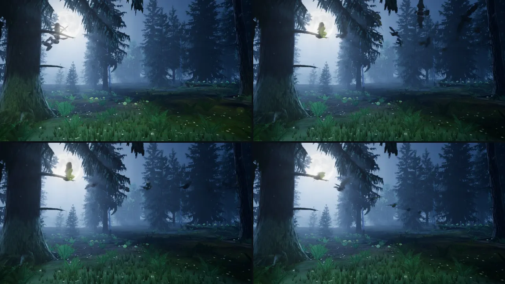

*Long exposures of single flights (the frames darkest-blended): out of the glade past the elder; a
circle over the glade on its way to the pine; a patrol that loops out past the frame's right edge and
comes back; flying past the log's end and round to it.*

- **It leaves the glade.** Five gates lie out of frame: past the left and right edges, behind the eye
  on either side, and over its head (`OWL_GATES`). Now and then it flies out by one (a turn through the
  glade on the way, perhaps), is gone 15-95 s (longer when it is still, shorter when restless), and
  comes back by another, already flying, to any perch it can be seen on (home likeliest). While it is
  away it is not drawn. A gate is used only while it is wholly out of frame (`setView`, the world's own
  `owlOnScreen`: a wider screen that sees one keeps it shut), and where a tree of the grove stands in a
  gate's way in (the grove grows differently in every forest) the nearest open air is used instead, or
  the gate stays shut. A great clear or a level-up while it is away brings it back within seconds;
  reduced motion brings it straight home. Over simulated quarter-hours it is away 10-18% of the time,
  and it is never in frame at the moment it leaves or comes back.
- **It flies more ways.** Besides the direct flight (a swoop, a near-level glide, an arc over): a
  meander (one to four turns off the straight way, to either side, up and down), a patrol (two to four
  legs through the glade's open air, 6-12 m each, before it goes where it is going, sometimes out of
  frame and back), an overshoot (past the perch a little above it, round in a wide turn, and back to it
  from beyond: only where it is clear of a trunk), and a circle (once round open air on the way). Every
  waypoint is sampled in open air: over the floor, a body's width and more from every trunk, out of
  every crown (the trees' crowns now come with their trunks, `ForestTrees.trunks()`), and never near the
  eye (6 m); the whole route is then looked at every 1.5 m and pushed out wherever it strays.
- **Random in a good way.** How restless it is drifts slowly (an Ornstein-Uhlenbeck walk with a
  two-minute memory), so it has spells: minutes of comings and goings, sidles and hunts, then minutes of
  stillness, preening and dozing. Its stays shorten when it is restless and lengthen when it is still;
  the game stirs it (a four-line clear, a level-up) and the end of a run calms it. It is unlikely to do
  the same thing twice running (its last few kinds of move and its last two gates count against
  themselves), so no two minutes look alike.

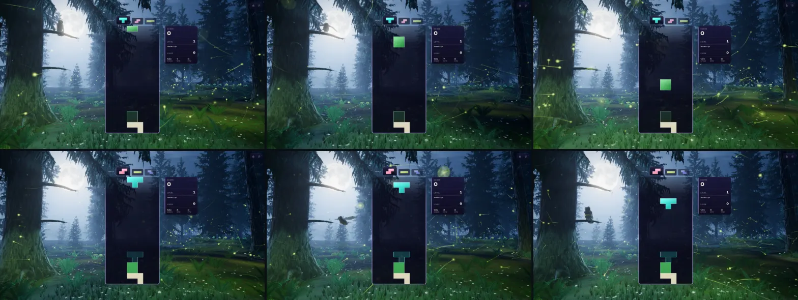

*In the real game (1920×1080, High): on its limb, leaving by the left, the glade without it, back in over
the viewer's head and out across the glade, landed on the low limb.*

**Checked.** Six simulated quarter-hours (seeds 7919, 11, 23, 5, 101, 4242): 18-24 flights each, every
gate and every way of flying used; per frame at most 12.2° of heading (the hop round), 4.8° of pitch,
5.3° of bank, 0.157 m of travel; in frame never inside a crown nor nearer the bark than its seats are;
never nearer the eye than 5.7 m; its restlessness ranges 0.02-0.98. Every change happens at its exact
time, so a night is the same at 30, 60 and 144 fps (a few centimetres apart only where it waits out of
frame). Filmed in the playground (each way of flying frame by frame, the trails above) and in the real
game (sent away by the left and brought back over the viewer); the console clean but for Electron's own
notices. What the filming found: two gates' ways in lay inside crowns of this forest's trees (the elder
spruce's low boughs over the eye's head, a birch on the right), so the owl left by the wrong gate; the
gates now find open air near their ways in. **Tests**: `forest-owl.test.js` 37 -> 40 (it leaves only out
of frame and comes back by other ways; its many ways stay clear of trunks, crowns, the floor and the eye;
it has spells of restlessness and stillness, and the game stirs it).

## How it is built

### Trees, fronds and props authored in Blender

`scripts/blender/forest_assets.py` (helpers in `scripts/blender/forest_night/`) grows ten
trees on the branching library the Fall grove introduced and the Golden Forest's conifer
recipes: an elder Norway spruce with a root plate and long low boughs, an elder Scots
pine, three old spruces, two young ones, an old pine and two silver birches. It bakes bark
ambient occlusion in Cycles, renders the far-stand sprite sheet, and builds a fern frond
(real geometry, near and far), a birch leaf strand, the fallen spruce, its stump, three
boulders and a dead snag. Formats and the regeneration command are in
[`src/themes/forest/assets/ATTRIBUTION.md`](../src/themes/forest/assets/ATTRIBUTION.md).
The pack is 2.9 MB in thirteen files with no third-party source; the generator's author
reports byte-identical output over three runs. The eagle owl (`owl.glb`, 0.55 MB) has a generator
of its own ([the eagle owl](#the-eagle-owl-2026-10-28)); its dead limbs are grown into the two
elders by `forest_night/owl_limbs.py` and placed in the world by `scripts/forest/pack-owl-limbs.mjs`.
The moon's face is the shared
`public/textures/2k_moon.jpg` (see `CREDITS.md`).

The generator runs **headless** (`blender --background --factory-startup`); the Blender
MCP session was not used, so nothing in an open Blender was touched.

### Runtime modules (`src/themes/forest/`)

| Module | Owns |
| --- | --- |
| `forest-theme.js` | Lifecycle, renderer, asset loading, gameplay subscriptions, board tracking. |
| `forest-plan.js` | The plan as plain numbers: the eye, the moon, the ride. |
| `forest-assets.js` | Loading and decoding the GLBs, the sprite sheet and the moon map. |
| `forest-world.js` | Composition root: builds and updates everything below. |
| `forest-light.js` | The moon, its static shadow map, night air, ambient, wind, a shared noise texture, a baked floor-height map, and the forest's own light (`glow`). |
| `forest-pulses.js`, `forest-light-field.js` | The waves of light, and the map the fireflies' light is gathered into. |
| `forest-composition.js` | Camera framings, hand-placed trees, the procedural stands, the visibility test. |
| `forest-terrain.js` | The analytic land (plateau, ride, valley, knoll), the floor and its foxfire threads. |
| `forest-trees.js` | Bark and spray instancing and their materials. |
| `forest-understory.js` | Ferns, grass, wood stars, foxfire fungi, boulders, the fallen spruce and its stump. |
| `forest-backdrop.js` | The sprite forest of the far stands and the valley, and the ridges. |
| `forest-sky.js` | The dome (moon, stars, Milky Way, cloud, falling stars), mist banks, moths in the beams. |
| `forest-firefly-sim.js`, `forest-fireflies.js` | The fireflies: simulation, and drawing (lights and trails). |
| `forest-figures.js` | The twelve animals as geometry, and the points their lights take. |
| `forest-hours.js` | The five hours of the night as plain numbers: the clock's turn, the colours at any moment, the short way round. |
| `forest-reactions.js` | The event director (pure); it also numbers the cues the owl hears. |
| `forest-stage.js`, `forest-firefly-director.js` | Board card → world, and cues → waves, sparks, force fields, garlands, the animals. |
| `forest-owl-rig.js`, `forest-owl-flight.js`, `forest-owl-perches.js`, `forest-owl-limbs.js` (generated), `forest-owl-mind.js`, `forest-owl.js` | The eagle owl ([below](#the-eagle-owl-2026-10-28)): its bones and every pose, its flights and wingbeat, where it sits (its limbs are the elders' own), what it does, and its drawing (plumage, light). |
| `forest-post.js` | Volumetric moonbeams, bloom, grade, FXAA. |
| `forest-quality.js` | One table for everything a tier scales. |

### Techniques (three 0.186.1)

- **The plan follows the light.** The moon stands 19° up. Ground can only be moonlit where
  it looks down the ride at open sky, so the ride is the first thing in the layout and
  nothing tall may stand on its floor; where it ends the land falls into the valley. The
  trees that hide the moon were found by counting, per tree, the sprays inside its disc
  from the eye, and the elder's place and turn were chosen by a scan of the same count.
- **One static shadow map, used everywhere.** Materials stay unlit `MeshBasicNodeMaterial`
  and call a shared `shadow(light)` node themselves; nothing moves under a fixed moon, so
  the map is drawn over the first frames only. Floor, bark, sprays, sprites, mist and
  moths all read it.
- **Volumetric moonbeams with `GodraysNode`**, at half resolution with a bilateral blur.
- **Moonlight takes the colour out of things; the forest's own light gives it back.**
  `ForestLight.night()` desaturates a surface for the moon and sky terms, `glow()` lights
  it in full colour. `glow()` is two things: up to six analytic waves (two `vec4`s each in
  a uniform array — no feedback texture, so they are identical on both backends and
  reproducible in a capture), and a small top-down map into which every lit firefly near
  the floor is splatted each frame on the CPU, so a firefly really does light the fern it
  passes and a firefly figure lights the moss it stands on.
- **Light trails without a history buffer.** An ambient firefly's path and its flash are
  closed-form in time, so the trail's vertex shader evaluates them again a little earlier
  for each point of a ribbon: a wanderer leaves a dotted arc, lit only where it was
  flashing. The CPU keeps a twin of both functions for the forces and the light map.
- **Synchrony.** A shared clock runs out from the board as phase per metre; each firefly
  blends from its own flash to the shared one at its own threshold as the forest wakes,
  so the chorus builds one voice at a time and then travels.
- **The animals are signed-distance figures.** Tapered capsules, closed outlines and
  strokes are sampled with the points crowded along the outline; reserve sparks are bound to those
  places with a critically damped spring, held without ageing, then released.
- **Needles and fronds as geometry, globally instanced.** No alpha cards. Sprays that can
  never be on screen are dropped at build time.
- **A dome that costs only the sky that shows.** The sky is drawn last among the opaque
  parts with the depth test on. Stars are a hashed lattice on the view direction; the
  moon is an orthographic lookup into the lunar map.

### Quality tiers

| Tier | Stands / far trees | Sprays kept | Ferns / grass | Fireflies | Trail | Waves | Firefly light map | Beams (rays) | Post |
| --- | --- | --- | --- | --- | --- | --- | --- | --- | --- |
| Extreme | 58 / 380 | 100 % | 360 / 5,200 | 3,600 | 8 seg. | 6 | 128² | 40 steps (24 taps) | on |
| Ultra | 52 / 320 | 100 % | 300 / 4,400 | 3,000 | 8 | 6 | 128² | 32 steps (22 taps) | on |
| High | 44 / 260 | 86 % | 250 / 3,400 | 2,400 | 6 | 5 | 96² | 26 steps (20 taps) | on |
| Medium | 34 / 190 | 62 % | 170 / 2,000 | 1,600 | 5 | 4 | 64² | 16 steps, 0.35 scale (14 taps) | on |
| Low | 22 / 120 | 40 %, trunks only | 100 / 900 | 900 | 3 | 3 | off | analytic glow in the haze | off |
| Minimal | 14 / 80 | 28 %, trunks only | 60 / 420 | 480 | none | 2 | off | analytic glow in the haze | off |

"Stands" are the modelled trees beyond the twenty-two placed by hand. Low and Minimal draw
the same scene directly with ACES tone mapping and skip limb geometry.

| WebGL2 backend, Low (no post) | Portrait, High |
| --- | --- |
| 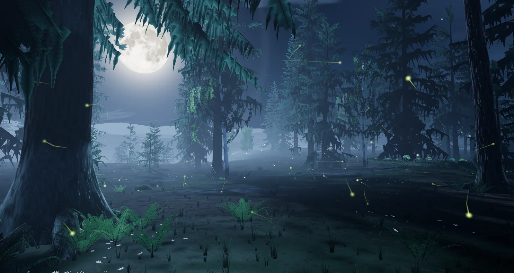 | 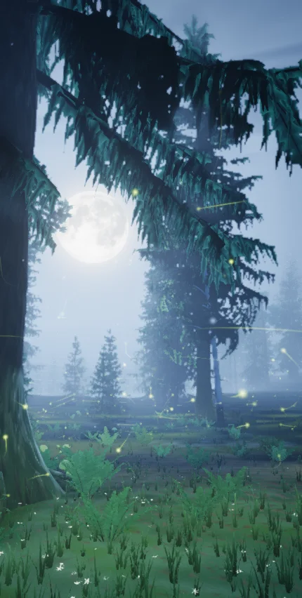 |

## The starter theme

Forest is the theme a new player starts with, the default background and the theme the
manager falls back to when another fails. It used to cost nothing; now it is a world, and
three things follow from that.

- **It must not fail to start for want of a file.** If the asset pack cannot be loaded,
  `ForestTheme` warns once and builds the forest from an empty bundle: sky, a plain moon,
  the floor with its grass, flowers and foxfire, the fireflies and every reaction, without
  trees, ferns or props. `theme.assetPackMissing` says so.
- **A bug the old theme hid.** Entering a mode while the boot pre-warm of the theme was
  still in flight left `#forest-theme` hidden behind a theme that reported itself running
  (a blank background). The pre-warm hides a theme through a flag on the theme object, and
  the visible activation read it. With a CSS theme the window was a few milliseconds; with
  a pack to load it is seconds. `ThemeManager.activateThemeInstance` now clears the flag
  before it starts the theme, and the pre-warm reveals a container it finds active when it
  ends (`revealThemeContainer`). Reproduced in the real game before the fix (single player
  entered half a second after boot: container without `.active`), not after.
- **It is registered as a heavy theme** (`HEAVY_GPU_THEME_IDS` in `theme-registry.js`), so
  it gets the 20 s lifecycle timeout and the deeper disposal the other worlds get. Its
  `startupEligible` flag becomes false with that; nothing reads the flag today.

## Verification

- **Playground** (`npm run dev:playground`, `?effect=forest&orbit=0&hud=0`), through the
  chrome-devtools MCP against a private dev server: the captures in this record, each with
  a clean console (no WebGPU validation errors, no TSL warnings) on native WebGPU at High,
  and with `forceWebGL=1` at Low and Medium. A second set at 1600 × 852 came from Electron
  (the frames in this record), on WebGPU and, for Low, the WebGL2 backend. Events are reproducible with
  `&t=8&event=lock|drop|clear|double|triple|quad|combo|streak|spin|perfect|level|over`,
  `&eventAge=<s>`, `&col=0..9&row=0..19`, `&combo=<n>`, `&hold=1` (repeat the event every
  second, to hold a combo) and `&board=1` for a stand-in card. The effect uses the theme's
  own generator and default seed. `&icon=1` is the icon's lens.
- **In the game** (dev server, Chrome, WebGPU, High): single player starts on the theme
  and it follows the measured board card; four lines sent through the app's own event bus
  gather the stag (the frame below); a quality change to Low and back rebuilds the world;
  with `backgroundComboEffects` off the same event does nothing; suspend and resume; and
  a switch to Golden Forest and to Mountain and back each disposed the old instance
  (canvas removed, renderer released) and built a visible new one. The console held only
  Chrome's `powerPreference` notice and `BaseTheme`'s restart notice.

  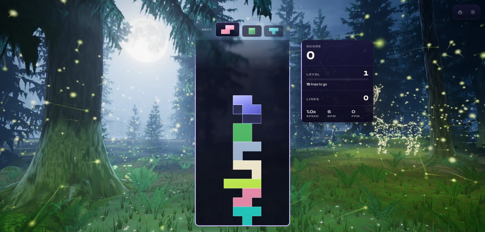

- **Lifecycle validator** (`node scripts/validate-all-themes.mjs --theme <id>` against the
  dev server, a fresh Electron process per theme). The validator needed three repairs
  before it could say anything about any theme (below). With them,
  `--theme golden-forest` passes: 79 of 79 checks, 0 console errors. That run boots into
  Forest and uses it as its anchor, so it starts Forest, disposes it for the target,
  builds it again as the clean-up anchor (1.06 s) and disposes it again.
  `--theme forest` does **not** pass, and cannot as the validator is written: its first
  step switches to an anchor theme (Mountain) directly on the manager, and single-player
  mode at level 1 re-applies the level's own theme, Forest, 16 ms later (both calls are
  in the run's log). The checks that concern Forest itself in that run pass (boot settled,
  running, critical-ready, 0 console errors); the anchor checks are the ones that fail.
  Forest as the theme under test is covered by the in-game checks above instead.

  The repairs, all in `scripts/capture-theme-screenshots.mjs`: the page URL carries
  `unlockAll=1` (since the theme collection landed, a fresh profile owns only Forest and a
  switch to anything else is refused without a word); after clicking a theme card the
  validator presses the detail page's Apply button (a card opens its detail page now); and
  it waits for the boot theme to be running before its first switch. The first two
  faults predate this change and fail every theme on main (Golden Forest failed the same
  four card checks until they were fixed); the third is a consequence of Forest no longer
  starting in an instant.
- **Build**: `npm run build` — boot closure OK; the theme chunk is 112 kB before gzip
  (39 kB gzipped). `check:ip-strings`, `check:pages-artifact`, `check:release-gates` and
  `check:boundaries` OK. `lint:ci` at baseline (807), `typecheck` clean, 0 ESLint problems
  in `src/themes/forest`, the playground effect and the new tests.
- **Tests**: 531 tests in eight suites — `tests/unit/forest-*.test.js` (the asset pack 74,
  the director 106, the firefly simulation with the light map, the waves and the stag
  figure 88, stage and firefly director 48, the theme adapter 111, world and post built
  from the real GLBs in Node 72, framing and guards 29) and
  `theme-prewarm-reveal.test.js` (3). A mutation pass rewrote 27 behaviours in memory, one
  at a time: 26 made a test fail, and the survivor was a clause another clause already
  implied (since removed). The full unit suite ran once after the last change: 692 of 693
  files and 9,558 of 9,559 tests passed. The one failure, `odyssey-level-briefing`, expects
  "250,000" where this machine's locale prints "250 000"; it is not touched by this change.

### Defects the test pass found

The helper that wrote the suites also read the finished modules and reported faults the
captures had not shown. All were fixed before this record was closed:

- The stag stood off-screen on upright screens and was cut off at 4:3: its stand was one
  fixed point. It now keeps that point when the whole figure fits and otherwise moves in
  toward the view's axis, clear of every trunk.
- Dark reserve sparks answered a passing wave of light: the lights' material did not gate
  on a spark being alight, so the whole unused reserve flashed where it lay (behind the
  card in landscape) and dead sparks flashed where they had died.
- Between aspects 0.85 and 1.15 the landscape framing cut the moon's limb; screens up to
  1.15 now use the upright framing.
- Foliage was dropped as "never on screen" for screens wider than about 2.8:1; the test
  now reaches 32:9.
- A settling firefly could sink through the moss; a new wave sat at full strength on a
  point for one zero-length frame; a stay of `NaN` left the stag standing for ever; a
  disposed director came back to life on `reset()`; the static shadow map was redrawn by
  frame count only, so a pipeline that compiled late could be missing from it for good
  (it is now also redrawn at 2, 5, 10 and 20 seconds).

### Start-up and frame cost

No admissible measurement exists. Eight other sessions were using this machine's GPU and
CPU throughout, so these are observations, not budgets:

- Playground at 1600 × 769 in Chrome on the RTX 3070, High: 163 frames a second (the
  display's rate) at rest and in a combo, 7.7 ms at the 95th percentile; one world update
  (simulation, light map, director) took 0.56 ms of CPU.
- The same effect on the laptop's integrated Radeon (Electron, `force_low_power_gpu`,
  1600 × 852, window shown): 86 frames a second at High, 110 at Medium, 123 at Low, 132
  at Minimal.
- First frame in the playground arrived 4–7 s after mount on WebGPU and 16 s on the
  WebGL2 backend at Medium (pipelines compile serially there).
- The theme perf lane (ADR-0016) was not run, and nothing was measured on a phone.

## What was removed

- The legacy Forest: the DOM children of `#forest-theme` in `index.html` (moon, three
  silhouette layers, two mist layers), their CSS and keyframes (and the styles of
  particles, mushrooms, eyes and wisps nothing created any more), and the `forest` branch
  of the legacy 2D particle layer in `src/rendering/renderer.js`. `#forest-theme` keeps a
  plain night gradient: it is what shows while a start is in flight.
- The old icon in the theme folder. `public/assets/themes/forest-theme-icon.png` is left
  as it was on purpose: `scripts/build-win.mjs` uses that file as the default source of
  the Windows application icon, and changing the application's icon is not part of this
  change. (Since 2026-10-25 the Windows icon is the app mark, `docs/desktop-icons.md`, and
  nothing reads this file for it.)

## Known limits

- The shadow map is static, so swaying crowns do not move their shadows, and crowns that
  are never on screen cast none: the floor at the eye's feet is moonlit, as the ride's
  floor is.
- Bark, floor and stone detail are procedural in the shader; there are no texture maps
  beyond the sprite sheet and the moon.
- A firefly figure is a drawing in lights in one plane, turned side-on to the eye. On a square
  screen only its usual place fits, moved toward the view's axis, where the board card covers
  part of it; when no place can be seen whole, an animal stands at one of them anyway.
- Low and Minimal have no beams, no bloom and no firefly light on the floor.
- The far sprites face one eye; they are not meant to be seen from elsewhere.
- If neither WebGPU nor WebGL2 can start, the theme fails and its container is hidden
  with it: the player sees the page's own dark background, not the forest's gradient.
- A fetch of the asset pack that never settles is not caught by the treeless fallback; it
  runs into the manager's 20 s lifecycle timeout like any other heavy theme.
- Tools that used Forest as a free "anchor" theme to switch from (the capture and perf
  scripts) now switch from a real world; their older numbers are not comparable.
