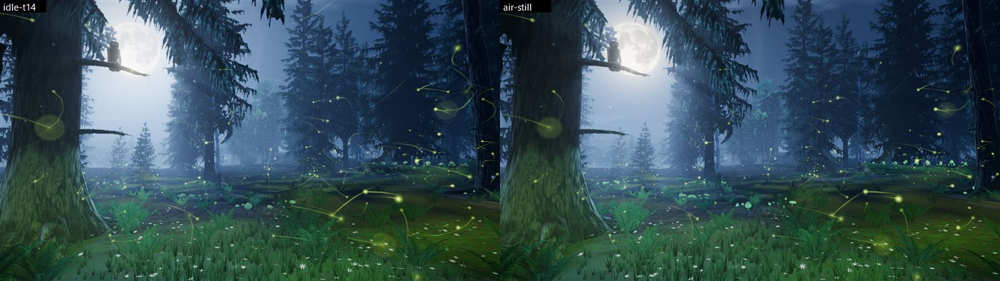
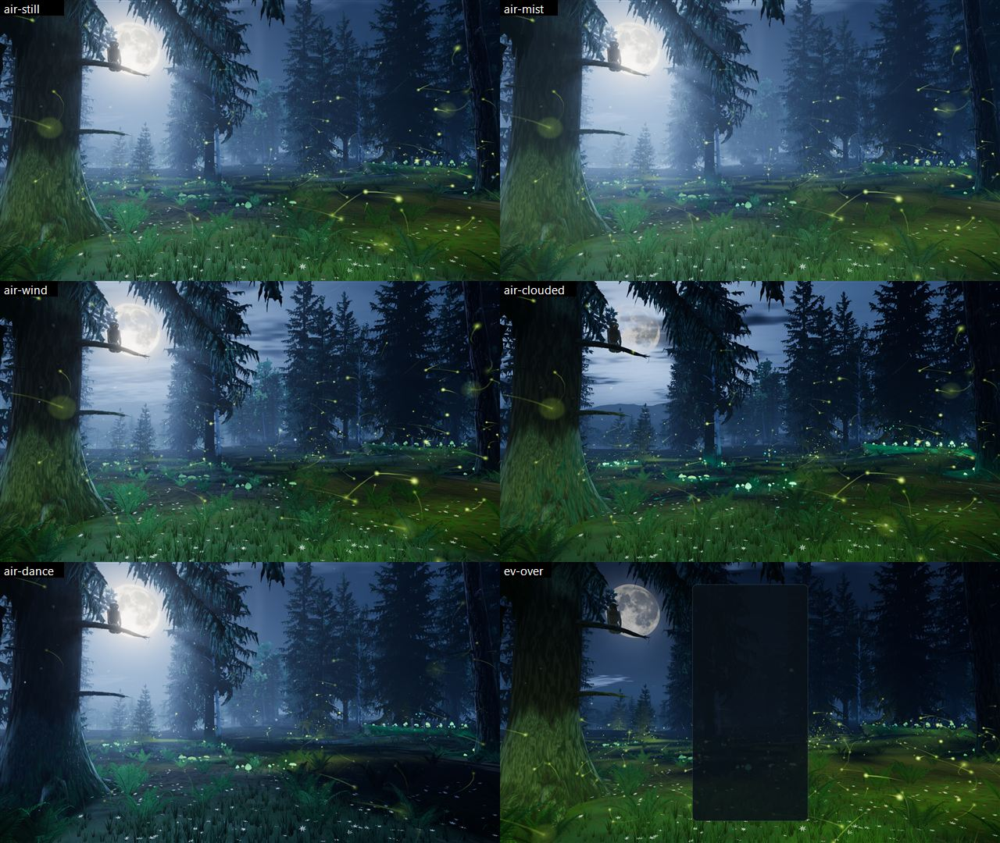
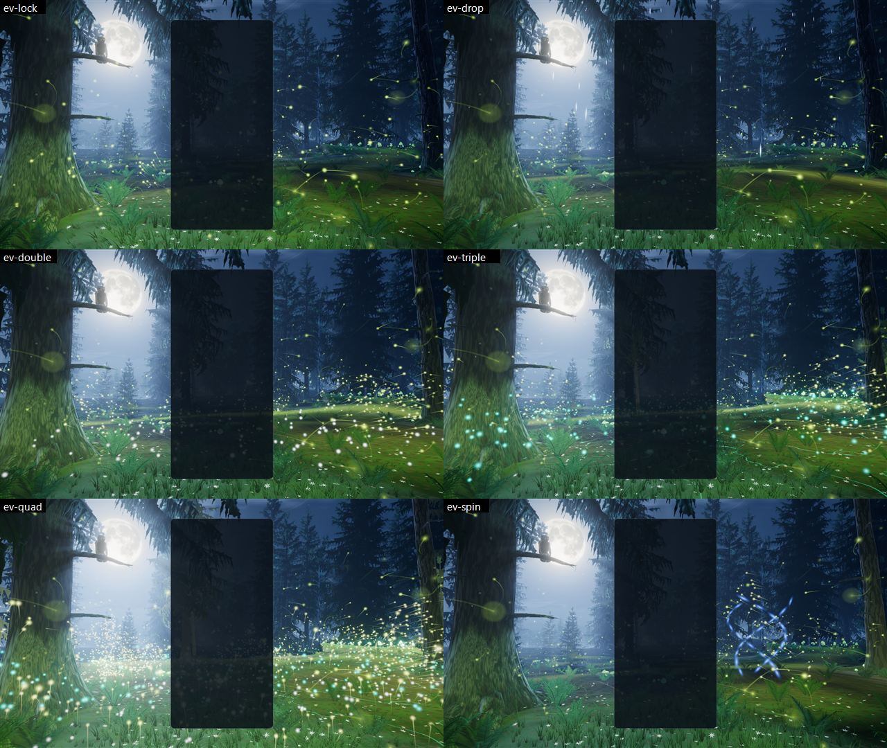
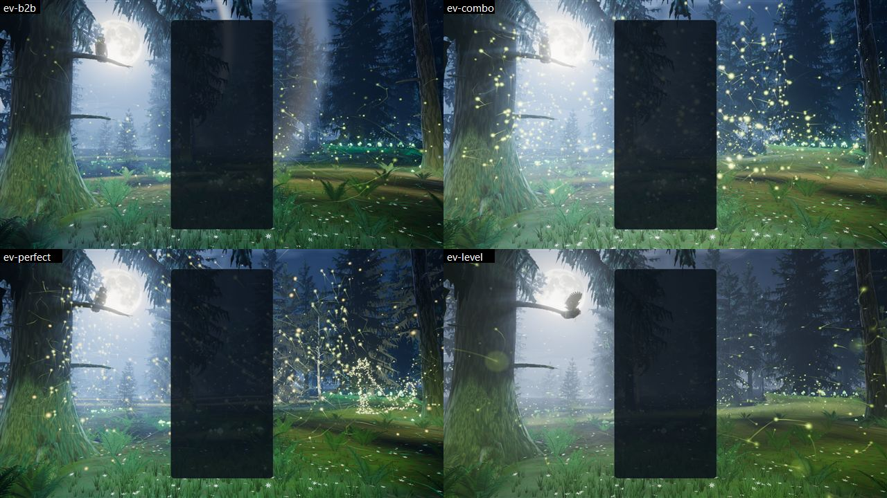
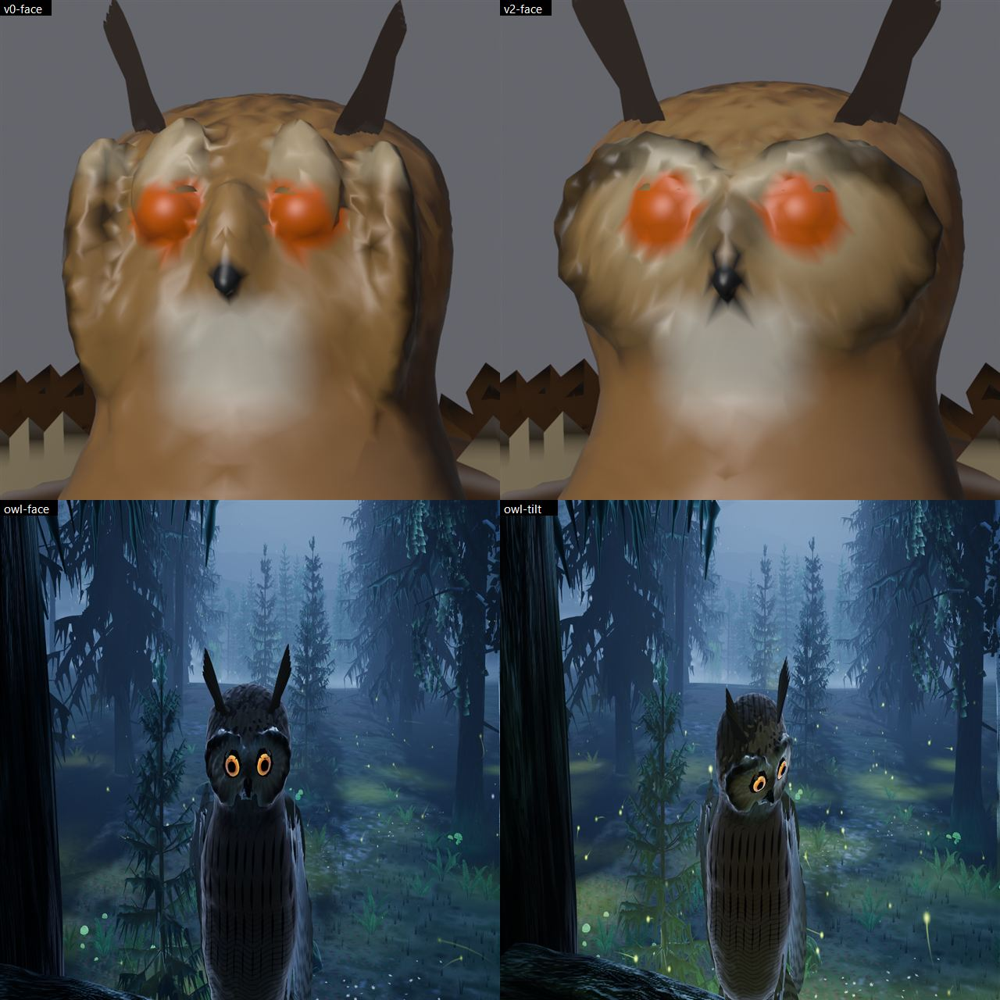
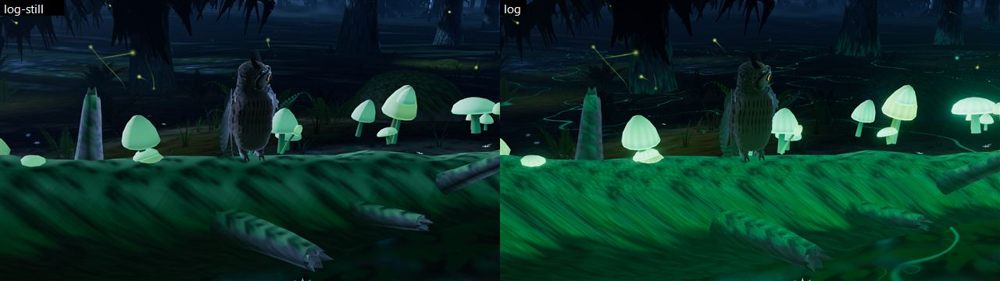
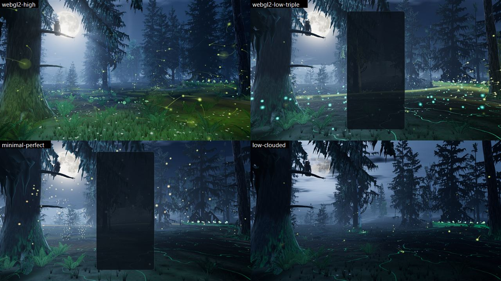
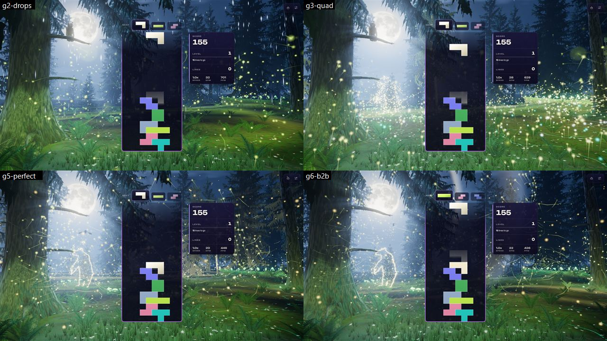

# Forest — the living night (audit and pass, 2026-11-25)

**Status: implemented on branch `feature/forest-masterpiece`. A record of what was found, what was
built and how it was checked — not a backlog.** Builds on the firefly night
([FOREST_FIREFLY_NIGHT_OVERHAUL_2026-10.md](FOREST_FIREFLY_NIGHT_OVERHAUL_2026-10.md)); everything
that record describes is still there.

The brief (owner, 2026-11-25): audit everything that makes up Forest (the mossy elder and the
spruces, the owl against the moon, the hazy moon and its light through the mist, the fireflies, the
ferns, grass and wood stars, the glowing fungi on the fallen log, the misty depths, colours, light,
motion, every event) and raise all of it until it is one of the most stunning themes in the game,
varied over time, with an effect of its own for every event and the biggest moments the most
spectacular, keeping play smooth and easy to read; Blender where it gives a better result.

*Left: the forest before the pass. Right: after (the still air).*

## What the audit found

- **The night only changed colour.** Five hours turned its colours, but the weather under them was
  the same minute after minute: the same thin mist, the same few cloud streaks, the same beams.
- **The events looked alike.** Nearly every answer was fireflies thrown from the card's edge and a
  green wave over the moss. A single clear, two lines, a twist and a back-to-back differed by how
  many sparks there were. A perfect clear was four lines with more of everything.
- **The moonbeams bleached the moon.** The volumetric beams were laid over the open sky in full, so
  the sky round the moon was a white wash that drowned the moon's face, and the cut into rays was
  too soft to read as rays.
- **The fungi were one plain shape, lit flat.** The glowing mushrooms on the fallen log were the same
  small dome everywhere, evenly lit, shedding no light on the moss round them.
- **The owl's face was four lumps.** From the glade it was a dark blob against the moon; close up its
  brows and cheeks were separate lobes, its eyes small, and it reacted to few events.
- **The lens.** A firefly drifting near the eye was a hard pale plate across the card; trails were
  long and scribbled at rest.
- **Dew borrowed the animals' fireflies.** Dew shaken off the boughs came from the firefly reserve,
  the same sparks the animals of light are made from.

## The airs of the night

*Still, rising mist, night wind, clouded moon, the dance; last, a run's end drawing cloud over the moon.*

The hours turn the colours; five airs now turn the weather under them, on a clock of their own
(`forest-airs.js`, 96 s an air, resting 40 % of that pure before it melts into the next). With five
hours of 120 s, a pairing comes round only every forty minutes. A function of the time alone, so a
seek and a night lived through agree; nothing is rebuilt, every number is a uniform.

| Air | What it does |
| --- | --- |
| Still | The night as it opens: thin mist in the hollow, clean beams, fireflies each on its own clock. |
| Rising mist | The banks come up out of the valley and fill the ride, the beams widen into pillars, the far stands go, the near wreaths of mist thicken. |
| Night wind | The boughs heave in long swells, the mist is torn thin and streams, cloud races, dust and seeds blow through the beams. |
| Clouded moon | Cloud closes over the moon (its disc a pale ghost in the grey, its light down to a quarter), the beams go out, and what glows by itself takes the night: every fungus burns, foxfire threads run through the moss, spores drift up. |
| The dance | A clear starry sky, and half the fireflies fall into step by themselves, flashing in slow swells that roll out through the trees. |

Near the eye, wreaths of mist now drift low through the glade (`ForestSky.buildWisps`): soft cards a
few metres across that move with the air, lit where a beam finds them, thinning to nothing at the
ends of their drift so none is seen to appear.

## An effect of its own for every event

The fireflies still answer every event as before. Besides them, each event now has an instrument of
its own, a different thing of the wood in a colour of its own, so no two great moments look alike.
`forest-flurry.js` throws them: closed-form particles (a record written once; the vertex stage
places it from the clock), in a ring that refuses a new particle rather than cut one in flight.

| Event | Its own effect |
| --- | --- |
| Lock | The wave of light over the moss and the puff of fireflies, as before (the lightest event). |
| Hard drop | Dew comes down through the moonlight in fine silver streaks, off the boughs and out of those overhead; it shines only where the moon finds it. Light, and at most once in 0.8 s: it comes with nearly every piece. |
| Line clear | The twin jets and the tall wave, as before. |
| Two lines | The wood stars give up their light: a ring of white runs out over the floor and every flower it crosses flares, white motes lifting off them. |
| Three lines | Every fungus in the wood breathes out its spores, cluster after cluster as the wave reaches it; spores lift off the whole floor in foxfire teal, the foxfire threads light through the moss, the fungi burn. |
| Four lines | Both of those, the moonburst (the beams thrown wide through the whole wood), an animal of light, and the owl out across the moon. |
| Twist | Three strands of blue will-o'-the-wisp wind up out of the ferns beside the board; the owl cocks its head right over. |
| Back-to-back | A ring of moonlight runs out from the moon through the mist of the whole wood (sharp at its front, a long soft trail inside, its inner edge warm), brighter for each in a row; the owl hoots. |
| Combo | The forest wakes as before; from a chain of four the owl peers at the board, bobbing its head. |
| Perfect clear | The greatest: gold comes down through the whole air from the crowns, the moonburst, a fan of four falling stars at once, the animal crowned white gold; the owl's next flight carries the gold on its wings, a wake of falling motes behind it as it crosses the moon. |
| Level-up | A wind carries leaves and seeds across the whole glade, turning in the moonlight, and the moon's beams open for a moment; the night turns an hour on, as before. |
| Game over | Cloud comes over the moon for a few seconds and clears again by itself (a moment, not a state: the forest goes on behind the menus). |

## The owl, rebuilt in Blender

*Top: the generator's head before (lobed brows and cheeks) and after (one face). Bottom: in the theme,
its stare and the deep tilt it gives a twist.*

- **Its face** (`scripts/blender/forest_owl/model.py`): one smooth plate, a shallow dish round each
  eye, framed by a thin dark ruff round its outside (painted along the ruff's own line), a low pale
  brow over each eye sweeping out toward the tuft, the bristled ridge down to the bill. The eyes are
  larger (an eagle owl's are the largest of any owl's), the ear tufts fuller (nine feathers a side,
  longer and broader), so the horns read against the moon from across the glade. Designed through the
  Blender MCP in the owl's own scene (`forest_owl/live.py`), shipped headless (`pack-owl.mjs`):
  19,826 triangles, 110 bones, 0.56 MB.
- **Its eyes shine**: the irises throw back the light they gather along the way it came, so when it
  looks at the board its eyes are two embers in a dark face; turned away they go out.
- **It answers more**: a twist has it cock its head right over, a chain of four has it peer, a
  back-to-back has it hoot; after a perfect clear its flight leaves a wake of falling gold. Each only
  on a perch and never into a bigger act.
- **Its outline** keeps a trace of silver from the sky when the moon is not behind it, so it never
  melts into a trunk.

## The fungi, the beams, the fireflies

- **Three kinds of foxfire** (`FOXFIRE_SHAPES` in `forest-understory.js`): a bonnet on a slender bent
  stem, a broad flat plate, a tall thin bell; each lathed and its stem curved. Their light is in their
  flesh: brightest under the skirt where the gills are, through the thin rim of the cap, faint at its
  thick crown, ribbed where the gills lie under it. They breathe, and a slow swell of light wanders
  through them by itself.
- **They light the moss**: every cap's pool of cold light is baked once into a map
  (`ForestLight.bakeFungi`) that the floor and everything on it reads (`glow`), brighter as the wood
  wakes and on a clouded night.
- **The beams** keep their volume and lose the wash: the light a line of sight gathers eases toward
  a soft ceiling, so the short path to a near tree keeps what it has while the long path out to the
  sky no longer bleaches it, and what is brightest already (the moon's face) keeps a share. The cut
  into rays is darker where a bough blocks the moon, so the rays read as rays.
- **Fireflies**: one almost on the lens is let go rather than drawn as a plate; the defocused disc is
  softer; trails are shorter at rest and fade faster along their length. Dew is no longer drawn from
  the firefly reserve, so every spark stays the animals'.

## How it is built

| Module | What is new |
| --- | --- |
| `forest-airs.js` | The five airs as plain numbers; the clock (`forestAirDrift`), a phase's numbers (`forestAirAt`), names. |
| `forest-flurry.js` | The instruments: dew, bloom, spores, wisps, leaves, goldfall, the fungi's own trickle of spores, the owl's gilded wake. One interleaved instance buffer, one draw, hidden while nothing is in flight. |
| `forest-light.js` | The air's uniforms (veil, cloud, drift, banks, motes, life, foxfire), the wind's swells, the fungi's baked light map, the bloom's rings, `awake()`. |
| `forest-sky.js` | Cloud that closes with the air and is lit by the moon it hides, the veiled moon, a sky of four falling stars (one by itself, all four for a perfect clear), the wreaths of mist. |
| `forest-post.js` | The beams' soft ceiling and bright hold-off, a cut whose weight never passes 1, the moonburst, the back-to-back's rings. |
| `forest-reactions.js` | New frame keys: `burst`, `foxfire`, `rings`, `veil`, `flurries`, `shower`. |
| `forest-owl-mind.js`, `forest-owl.js` | The twist's tilt, the chain's peer, the back-to-back's hoot; eyeshine, the sky's trace of silver. |
| `forest-understory.js` | The three foxfire shapes and their light; the wood stars flare as a bloom ring passes. |
| `scripts/blender/forest_owl/model.py` | The owl's new face, eyes and tufts. |

**Tiers.** Three new columns in `forest-quality.js`:

| Tier | Fungi light the moss | Flurry ring | Wreaths of mist |
| --- | --- | --- | --- |
| Extreme | yes | 3,800 | 14 |
| Ultra | yes | 3,300 | 12 |
| High | yes | 2,600 | 10 |
| Medium | yes | 1,730 | 7 |
| Low | yes | 1,040 | 4 |
| Minimal | no | 555 | none |

A tier's bursts are scaled by its ring against High's (`FLURRY_REFERENCE`); the ring holds well over
what the largest burst throws, so the perfect clear that crowns four lines in the same second finds
room.

**Playground.** `?air=still|mist|wind|clouded|dance` holds an air; `?event=b2b` fires a back-to-back;
`?shafts=`, `?rays=`, `?bloom=`, `?exposure=` scale the lens (1 in play).

## Faults found and fixed during the pass

- **A black hole in the sky under a combo.** The rays' cut was blended in with a weight that hot play
  pushes past 1, on purpose, to sharpen the rays. With the darker blocked end of this pass the
  extrapolation went below zero, and the beams' soft ceiling turned the negative into a black region
  between the boughs. The weight is now held to 1, the extra strength brightens the open rays, and the
  beams are clamped at zero before the ceiling.
- **Pale fringes on every far spruce.** A first try kept the beams off the sky by depth; a
  multisampled pass has one depth per pixel but a blend of colours at an edge, so every far spruce
  grew a fringe of white sparks. The ceiling replaced the depth cut.
- **The perfect clear's gold turned away.** In the real game a four-line clear's spores and bloom
  filled the High ring, and the perfect clear that came in the same second lost 234 of its particles.
  The rings now have room; a test plays four lines and a perfect clear at every tier and expects
  nothing refused (it fails on the old sizes).
- **A NaN into the particle buffer.** The wisps wrote their records straight into the ring, past the
  finite check the other kinds pass; the ring itself now refuses a record that is not sound.
- **The owl's pack deleted the manifest.** `pack-owl.mjs` rewrote the owl's line with a pattern that
  ran on to the end of the list and took every entry after the owl with it. It now rewrites the owl's
  entry in place.
- **A test that checked nothing.** The world suite's "every cap stands on the floor" looked the
  foxfire draw up by its exact name; with a draw for each shape it found none and passed. It now reads
  every shape's draw and requires that there are some.

## How it was checked

- **Captures** (private headless Chrome, real WebGPU on the RTX, capped at 30 fps): every air and
  every event at High, 1600 × 900, with a stand-in board; the WebGL2 backend at High and Low; Medium,
  Low and Minimal; a 390 × 844 phone frame; the owl close up from the front, the side and in flight;
  the fungi on the log. Consoles clean on both backends.

  

- **In the real game** (single player, 1600 × 900, High, real key presses): hard drops, four lines,
  a perfect clear and a back-to-back fired through the theme's own reactions. The console held only
  the browser's autoplay notices (no user gesture in a headless browser) and Chrome's
  `powerPreference` notice.

  

- **Tests**: `tests/unit/forest-*.test.js`, 14 suites with the URL catalogue, antialias and thumbnail
  suites: 904 tests, all passing (701 in the Forest suites before). New: `forest-airs.test.js`,
  `forest-flurry.test.js` (the ring never cuts a particle in flight however hard the game pushes, junk
  requests, seeds, tiers, both shader backends), the reactions' new cues, the owl's new acts, the
  overlap at every tier.
- **Cost**: GPU time per frame at 1920 × 1080, High, the still air, interleaved against main, capped
  at 30 fps (`profile=1&trackTimestamp=1`): 1.09 and 1.30 ms against 1.06 and 1.20 ms (the clouded
  moon 1.11 ms); CPU per frame 2.5 and 2.6 ms against 2.2 and 2.1 ms. About 0.1 ms of GPU and 0.3 ms
  of CPU, within the noise of a capped run. Not an uncapped frame-rate measurement.

## Known limits and open calls

- Not watched in motion by a person: every check was a still or a short sequence of stills.
- Not measured uncapped, on the integrated GPU or on a phone; multiplayer layouts not captured.
- The near wreaths of mist are deliberately faint; in the still air they barely show.
- The theme's icon and store screenshots still show the forest before this pass.
- The dance air brings half the fireflies into step; whether it should take them all is a matter of
  taste.
