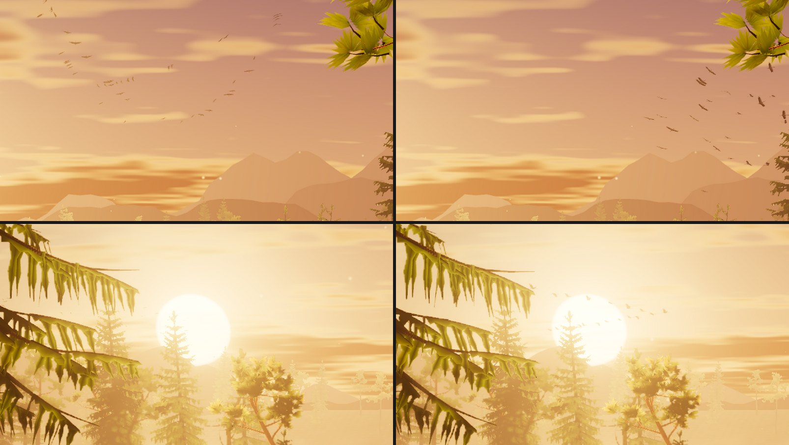
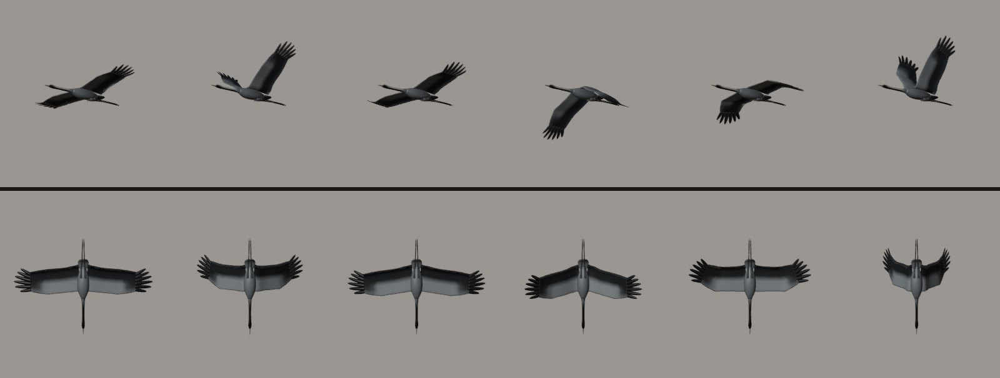
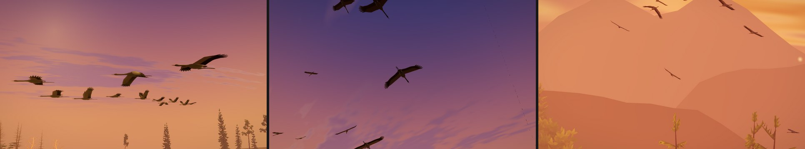

# Golden Forest — the cranes (2026-10-28)

Asked for by Olov: "I want to improve the look of the flying birds in the golden forest theme, we
can use blender MCP to model the birds and animate them! Go!"

## What they were

`golden-forest-birds.js` drew 84 birds (High) as one instanced mesh of eight flat triangles a bird,
a slim body and two jointed wing strips bent by a sine, all in one near-black tone run through the
haze. A flock milled about a centre wheeling over the far water, each bird on an ellipse of its own;
a V crossed the sky 290 m out on a lane through the sun. At 1080p the flock's birds were 10-17 px
little "m" darts that read as midges, the skein's 7-8 px specks, and near the sun the haze and the
sun's glare took them almost entirely.

## What they are now

Common cranes (*Grus grus*), the bird of the Nordic lake in the evening: in late summer the families
gather at shallow lakes to roost, circling down over the water and crossing the sky in long V's.

### The bird (Blender)

`scripts/blender/golden_forest/crane.py`, run headless by `golden_forest_assets.py --only crane`
(two seconds), writes `src/themes/golden-forest/assets/golden-forest-crane.glb` (72 KB) with the
pack's own GLB writer. It was designed in the live Blender session through the Blender MCP:
`crane.show()` builds a posed lineup in a scene of its own (`GoldenForestCrane`), `crane.animate()`
an animated one (`GoldenForestCraneFlight`: the wingbeat sampled into 16 shape keys keyed round the
cycle at 2.3 Hz, beside a soaring crane banked round a circle; press play), and Workbench renders
from every side plus flat silhouettes at 12 and 20 px, upscaled ×8 in Blender, were judged each
round. The user's own scenes are not touched.

Real size: 2.18 m span, 1.21 m bill to tail, the feet trailing 0.33 m further. Lofted from rings: a
slim body, a long thin neck held straight and a little low, a small flat-crowned head, a straight
bill as long as the head, a short rounded tail, the legs trailing together under and past it; long,
broad, rectangular wings whose hand ends in six parted primaries ("fingers") with blunt rounded
tips, fanned from 10° forward to 31° back. Plumage in scene-linear vertex colours: ash grey with a
browner back, black secondaries and hand from above (the black trailing edge), pale grey underwing
coverts against blackish flight feathers from below, the face, throat and foreneck black, a white
stripe from behind the eye down the neck, a red crown, a pale greenish bill, black legs and a black
tail end. Alpha marks the thin feathers.

Two levels of detail from the same lofts: near (2,508 triangles) and far (1,172; the fingers, neck
and trailing legs kept), chosen per bird by the angle its span fills (over 0.019 rad, about 22 px at
1080p, gets the near mesh).

No skeleton, as the geese and gulls: `_WING` carries per vertex how much the shoulder, the wrist and
the fingers move it (eased bands, the wrist's band twice as wide at the trailing edge, 0.30-0.80 m,
so the trailing edge bunches gently behind the wrist on the upstroke instead of creasing), and in
its fourth channel the head and neck's share (they hold their line while the body heaves). The
pivots and eleven authored poses (rest, soar, glide; the cruise beat's top, mid-down, bottom and
mid-up; the startled beat's four) go into the GLB and the asset manifest; the theme reads the
manifest's.

### The wingbeat

A crane's beat: slow and stiff on the way down, a quick flick up. Each beat is the four poses joined
smoothly round the cycle (X(φ) = A + B cos φ + C sin φ + D sin² φ) with the downstroke taking 60 %
of it, at 2.3 Hz (±5 % a bird); the startled beat is deeper and blends in with the startle. The body
heaves with each stroke. Soaring, the wings are spread flat and still, the hand a touch low and the
fingers curled up under the load.

### The flight

`golden-forest-crane-flight.js`, three-free and run by the tests in plain Node. Every position is a
function of the clock (and the startle as the world eases it); only the beat's phase is integrated,
so a startle quickens it without a jump. Heading, climb and bank come from each bird's path a step
either side: the lift leans into the sideways pull (a coordinated turn, at most 43°).

- **The kettle** (three quarters of the budget): a column of cranes circling over the far shore,
  each on its own circle (8-25 m, 9-11.5 m/s, all turning anticlockwise) at its own height, so
  they are banked 15-40° and seen from every side; now and then one beats a few strokes. The column
  drifts round a slow loop (170 s) that lingers over the open sky right of the board (above the
  score panel, against the mountains), visits the gap above the sun between the board and the old
  spruce, and crosses behind the board quickly. 115-170 m from the eye: 14-30 px at 1080p.
- **The skein** (3-21 birds): a V (sometimes an echelon) flying a lane past the islet, one pass
  every 118 s, the first at 24 s. Each pass varies its distance, tilt and V, and its height is
  solved so it crosses the low sun's disc (0-3° from its centre) wherever its own distance puts
  it. A wave of strokes runs down each arm; now and then a bird sets its wings for a short glide.
  About 125 m out: around 20 px.
- **A big clear** (the world's `flock` envelope, as before): the circles burst to 2.4 times their
  width, the column lifts 14 m and every crane beats hard; the skein beats harder too. Reduce
  motion calms it to its share, as before.
- **Size floor**: never smaller than 0.0088 rad of span (about 10 px at 1080p); a bird drawn larger
  than life gets the air of the distance its size says.

### Drawing them

`golden-forest-birds.js`: two instanced draws of one material (near and far), posed each frame on the
CPU into one interleaved instance buffer per draw, 16 floats a bird (place and drawn size, forward
and the heave, up and the arm's lift, sweep, bend, fold and curl). The vertex stage folds the wings
about the wrist, then the shoulder (`foldPoint` is its twin), normals with them. The light is the
lake's: the sky from above and the warm bounce from below (`light.ambient`), the low sun on faces
turned to it, then held under 0.18 of the luminance of the sky behind (a backlit crane is a
silhouette; lit, it vanished into the bright evening); a warm rim on edges turned to the sun; the
sun through the thin feathers only right by its disc; then the golden air, at 0.48 of its
ground-level thickness and thinner still toward the sun (the birds fly above the water's haze, and
a skein crossing the sun keeps its edge). The cranes stand in the lake's mirror too.

The world grows exactly as before around them: the birds take the same two random draws a bird
from the theme's generator that the old ones did, crane or no crane, so the fireflies and the lake
built after them are unchanged. Without the crane (a failed download) the sky goes without birds,
as Grainfields does without its goose.

### Playground

- `crane=k:12` (kettle bird 12) or `crane=s:0` (the skein's leader), `craneFov=<deg>`: from the
  theme's own eye, a long lens kept on that crane (real size: the birds are sized from the camera).
- `craneCam=k:5,7,100,-20,40`: fly beside a crane: metres off, degrees round from its heading,
  degrees up, lens.
- `t=24` the first skein crosses the sun; `t=140` the kettle is over the open sky on the right;
  `event=quad&eventAge=1.6` the startle.

## Traps

- **Animation in a scene that is not on screen is not evaluated.** `scene.frame_set()` on the design
  scene left every shape-key value at 0 (the F-curves were right); switch the window to the scene
  (`bpy.context.window.scene = scene`) before rendering frames of it.
- **The wrist's fold bunches the trailing edge.** Folding the hand back swings the trailing edge,
  40 cm behind the wrist, inward: with the wrist's band 0.42-0.64 m at the trailing edge, the
  upstroke crumpled edges there to a sixth of their length. The band now runs 0.30-0.80 m there and
  the deepest folds are a little gentler: worst 1.55× in the cruise beat, 1.89× startled (the test
  checks every pose, both directions).
- **A skein's distance moves its height on screen.** Varying a pass's distance by ±14 m at a fixed
  altitude put it anywhere from on the sun to 6° above it; each pass now solves its altitude from
  where it crosses the sun's bearing.
- **The kettle's left extreme sits behind the old spruce's boughs** if it swings as far left as the
  sun's bearing; the loop's left end is the gap above the sun, its right end the open sky.
- **A dotted line in the sky** seen only from the `craneCam` camera is the sky dome's own seam (it is
  there with the birds hidden, and gone with the atmosphere hidden), behind the rest view; not the
  birds.

## Verification

- Captures (Electron, RTX 5080, WebGPU unless stated): the playground at 1920×1080 over the kettle's
  loop and the skein's passes, close-ups through both lenses, the startle, forced WebGL2 (the same
  frame), Low; and a real Single Player game at 1920×1080 with its HUD (the kettle above the score
  panel on the right and in the gap above the sun on the left). Consoles clean.
- Tests: `tests/unit/golden-forest-cranes.test.js` (16: the model's frame, size, levels of detail,
  weights and plumage; no pose tears the skin; refused without its rig or weights; the beat through
  every authored pose with the 60 % downstroke; the tiers' shares; the eye and sun constants match
  the composition's and the light's; determinism; smoothness over 240 s at 60 fps for every bird;
  the kettle's bank; the size floor and the level-of-detail split; the kettle in frame and mostly
  right of the board; every skein across the sun; the startle; both draws built through the WGSL
  and GLSL node builders, quietly and within budget; the same random draws with or without the
  crane). `golden-forest-assets.test.js`, `-world.test.js`, `-theme.test.js` updated for the crane.
