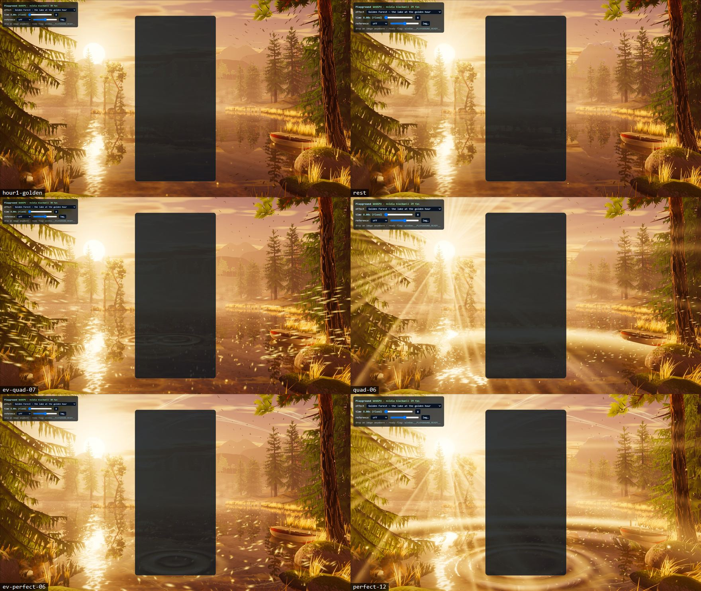
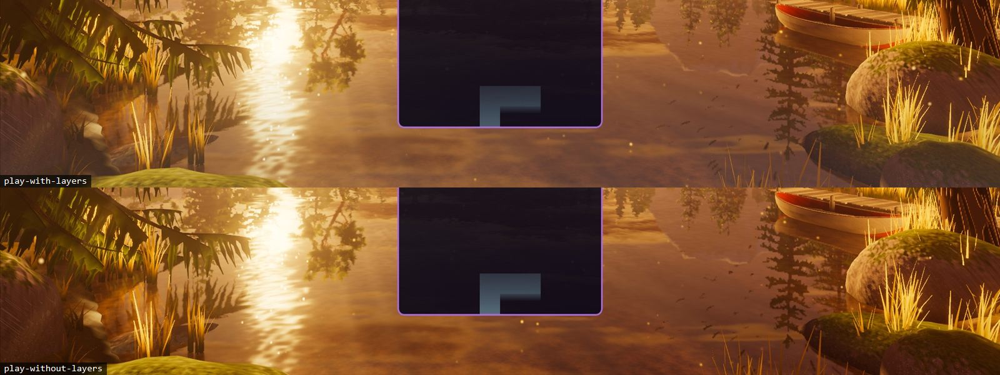
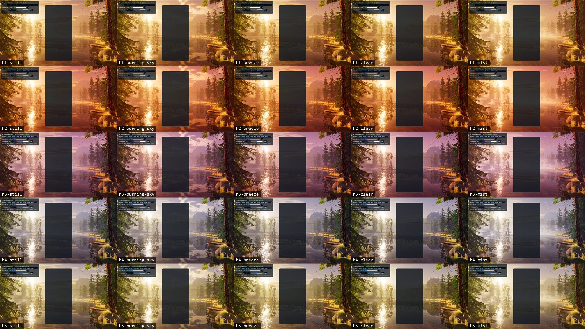
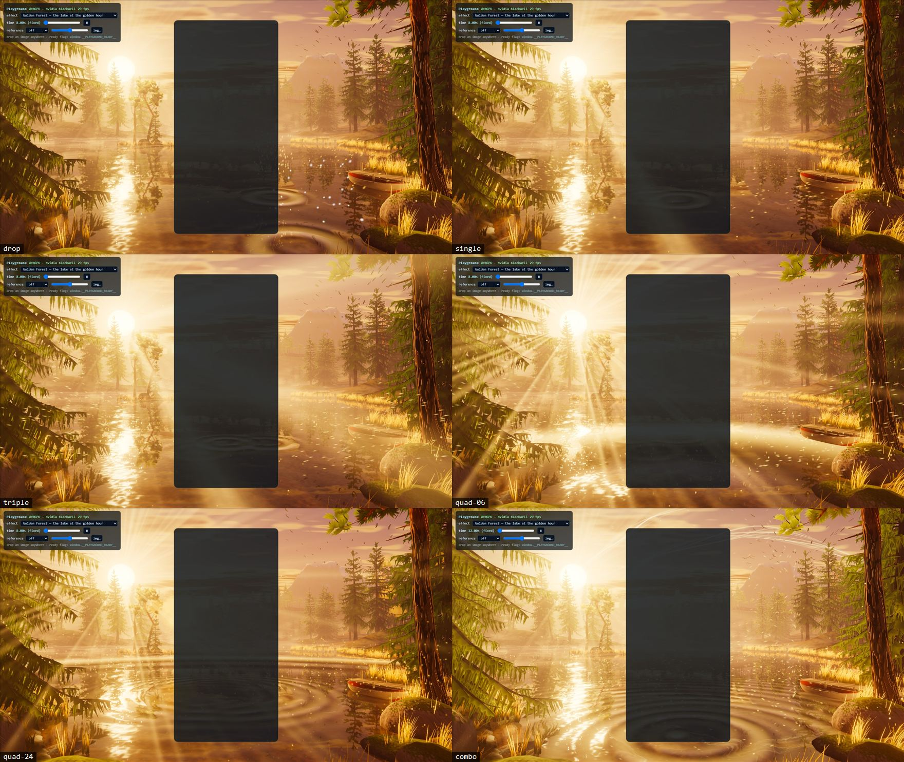
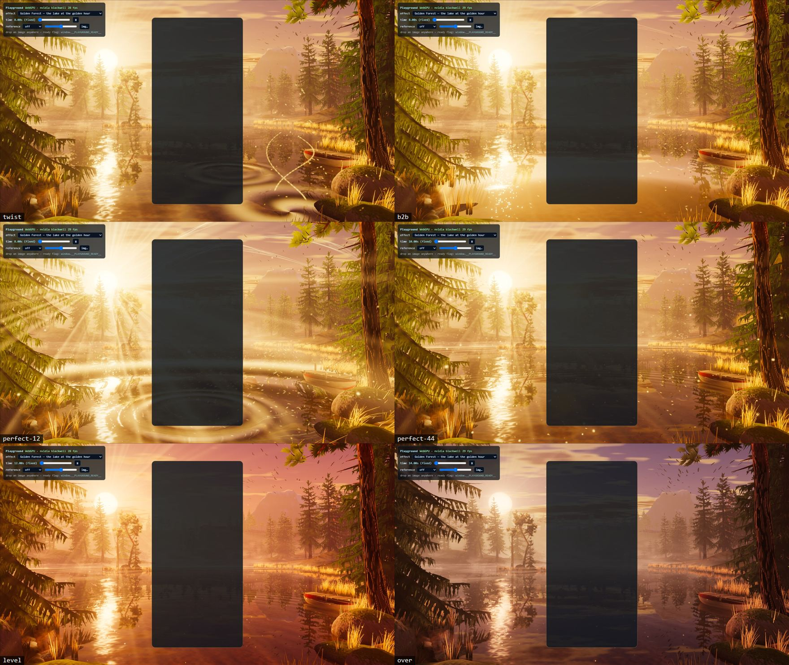
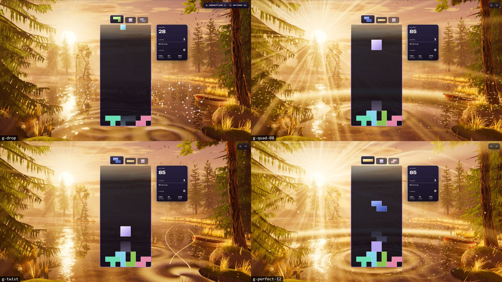

# Golden Forest — the living lake (2026-11-25)

Asked for by Olov: audit the Golden Forest theme thoroughly, then lift it until it is one of the
game's most stunning: review every part (the conifers, the island, the lake with its reflections
and sun glints, the mist, the low sun and golden haze, the mountains, the reeds, the dock and the
rowboat, the rocks, the motes, the birds, colours, light, animation, UI and every event effect),
keep what works, make it change over time, give every event an effect of its own with the biggest
moments the most spectacular, and keep it smooth and easy to read.

This is the record of that pass. It builds on the lake as rebuilt in
[GOLDEN_FOREST_LAKE_OVERHAUL_2026-10.md](GOLDEN_FOREST_LAKE_OVERHAUL_2026-10.md) and the cranes of
[GOLDEN_FOREST_CRANES_2026-10.md](GOLDEN_FOREST_CRANES_2026-10.md).

## What the audit found

Judged from captures of every hour, every event, zooms on each part, portrait, the lowest tiers
and the WebGL2 backend, and a run of the real game.

Strong, and left as they were: the composition (the old spruce and the leaning pine framing the
sun's road and the far shore), the Blender conifers and their needles, the mirror lake and its
rings, the sun's glitter, the reeds, the dock, the rowboat, the granite and its moss, the motes,
the five hours and their colours, the cranes.

Weak, generic or missing:

| Part | What was wrong |
|---|---|
| Sky | Faint streaks of stretched noise, the same in every hour. Nothing changed inside an hour. |
| Sun | A flat white disc with a hard edge: a sticker, not a light. |
| Mountains | Four cut-out cards with sine-wave crests in one flat tone, their straight segments showing. The "alpenglow" hour had no alpenglow. On the lower tiers a pale blob stood in front of the sun. |
| Mist | Cards that only slid sideways; nothing on the water itself. |
| Sun shafts | The volumetric shafts gave a glow, never rays: no shaft of light through the trees could be told apart. |
| Events | One vocabulary for all of them: pale dashes of sparks, a ring behind the card, a paler frame. They differed in amount, not in kind, and the biggest (four lines, a perfect clear) bleached the picture instead of crowning it. A twist drew almost nothing. A back-to-back could not be told from a clear. |
| Sparks | Thrown from 8 m, a spark was a blot twenty pixels wide drawn out into a dash: confetti. |
| Pieces | I (`#ffd27a`) and J (`#ffe8a6`) were four degrees of hue apart: one pale gold piece in the stack. |
| Time | Five hours on a clock, and nothing else: no weather, no visit, the same clouds and the same mist in every one. |
| The real game only | Five layers left in the theme's container from its CSS days (three empty parallax sheets, an empty god-ray fan and a `.mist` gradient) were still displayed and animating. The mist one has a z-index and the canvas has none, so a grey veil lay over the bottom quarter of the picture in the game and never in the playground. |

## What changed

### The airs: weather under the hours

`golden-forest-airs.js`. Five airs turn on a clock of their own (96 s each, resting two fifths of
that pure, then melting into the next) beside the five hours (120 s). Hour and air come round
together only every forty minutes, so the same hour is rarely the same evening.

| Air | What it does |
|---|---|
| still | The lake as built, and where a session starts. |
| burning sky | A ceiling of high cloud comes over with a clear slot along the horizon, lit from beneath: gold and ember toward the sun, rose round from it, dusk in its thick hearts, and the lake mirrors it. |
| breeze | The wind gets up: cat's-paws over the whole lake, the mist blown thin, the cloud streaming, a broader road of glitter. |
| clear | Hardly a cloud, thin air: the far ranges stand sharp with their snow. |
| mist | The banks thicken and stand taller, wisps smoke off the water, the far shore goes, and the sun throws visible rays through the trees. |

The air is a function of the evening's clock (the same one the hours use, carried over a rebuild
for another quality tier), so a seek and an evening lived agree. `world.setAirHold(name)` holds
one for a capture or a test. Not gated by Reduce motion or the effects setting, like the hours: a
slow change of weather is the theme, not an effect.

### Sky, sun, mist

- **The ceiling** (`buildSky` in `golden-forest-atmosphere.js`): broad masses, cells bent by them
  and fine tatters, each drifting at its own pace so the field forms and melts; the same field
  read a step toward the sun says which flank of a cell is lit. Skipped entirely (a branch) while
  no air brings it. The bars of evening cloud are kept as built; the air sets how many there are.
- **The cloud's own clock**: it streams with the air and races for a moment when a level turns
  the hour on (the level-up's time-lapse), without ever jumping.
- **The sun** is an orb: white at its heart, deepening to ember at its limb, with a soft edge.
  Same size and place as ever (the shores' static shadow map depends on it).
- **Mist**: the banks billow upward as well as sideways, and fill in and stand taller in a mist.
  New: two level sheets of wisps just over the water (`buildSmoke`), seen almost edge on, thickest
  in a mist and gone in a wind. They are kept out of the lake's mirror and read no shadow map.

### The far ranges are real ground

`golden-forest-ranges.js` (three-free) and `buildRanges` in `golden-forest-backdrop.js`. The two
far ridges are now a grid over a height function of folded noise (sharp crests, round cols), with
one horn over the right shore where a summit has always stood and a col where the sun stands, so
its disc rests between two shoulders. The sun is beyond them, so no face the eye sees is lit
directly: each face is lit by the sky it is turned to, warm on the sun's side and dusk-cool on the
other, and the snow above its line takes that light whole. In the alpenglow hour the horn is rose
and lavender; in a clear air it stands in the lake's mirror. The two near ridges stay silhouettes,
with a new crest (the wooded hill has a treeline) and light spilling over it.

The ranges take the same 24 draws from the theme's random stream that the four cards took, so the
forest, the fireflies and the lake are built exactly as before.

### Rays through the trees

`createRays` and `fan` in `golden-forest-post.js` (Medium and up). Two short marches at quarter
size walk each pixel toward the sun on screen and ask the depth buffer what stands in the way
(the dome is never written to it, so open sky is anything beyond the far ridge). The result is the
open share of the sun's glow along that line: the boughs round the sun comb its light into a fan.
It is used three ways: a faint fan at rest that the air strengthens (a mist stands the rays up),
the shafts single clears open, and the whole sunburst.

### Every event has its own effect

| Event | Its own effect | Where |
|---|---|---|
| Lock | A ring where the piece landed and a puff of fireflies from the card's edge (as before; the sparks are finer). | — |
| Hard drop | The lake is struck: a few drops leap beside the board, each on its own arc, cool white against the amber, and fall back. The lightest of the bursts, because nearly every piece is dropped hard: at most one in 0.4 s, and fewer drops the hotter play runs. | `flurry` droplets |
| 1–3 lines | The sun reaches in: every line opens one shaft of the fan, each line after line on a new direction (ten of them, the long diagonals over the open water and the sky first). | `beams` |
| 4 lines | The whole sunburst through the trees; a great wave of gold that leaves the board and crosses the lake to the far shore (the rowboat rocks as its crest reaches it); the spruces breathing out pollen where the wind goes through them; the lake breathing out light; the cranes going up. | `burst`, `waves`, `flurry` pollen |
| Combo / streak | The shores are gilded: the sun's light spreads round the lake from its own bearing, crown by crown and reed by reed, as far as the combo has built. With the river of fireflies and the ribbons, as before. | `gild`, `gildReach` |
| Twist | The water is wound up: a two-armed spiral on the lake beside the card, and a double helix of sparks climbing out of it. | `swirls`, `flurry` helix |
| Back-to-back | The sun pours gold down its road: a long swell runs from the far shore to your feet, bending the mirror as it comes, and the road itself broadens. Stronger for each one in a row. | `roads` |
| Perfect clear | The crown: the sunburst, a greater wave, every shore gilded at once, gold falling through the whole air for seven seconds, and a skein of cranes called across the sun. | all of the above, `flights`, `flurry` goldfall |
| Level-up | The hour turns: the cloud races for a moment, a gentler wave goes out, and a skein of cranes crosses the sun. | `rush`, `flights` |
| Game over | The evening after: the wind dies, the fireflies settle, and the light sinks toward the blue hour, stays a quarter of a minute and comes back by itself (at once with the next piece played), so the lake behind the menus is not left dim. | `dusk` |

How they are kept smooth under fast play (the owner's standing rule: effects build, never pop):

- A shaft takes a free slot, else the one with the least light left; a shaft still opening or
  standing is never cut, and when all eight are, the new one is let go.
- The sunburst, the cloud's rush and the gilding are accumulating envelopes (`Swell`): a new hit
  adds to what is lit and never restarts it.
- The lake carries three great waves and three spirals at once. With every slot running, a new
  mark replaces the oldest only once that one is past 70 % of its life; otherwise the new one is
  let go. Nothing plain on the water vanishes.
- The new particles (`golden-forest-flurry.js`) are records written once and placed by the clock
  alone in the vertex stage: no simulation, no per-frame cost after the throw. They live in a
  ring that refuses a new record when every slot searched is in flight, so nothing in the air is
  cut; nothing was refused in a session of every event.
- A called skein is other birds than the clock's. Its lane is fitted to the frame it is called in
  (the birds ask the camera where the frame's edges lie), so on any screen from a phone held
  upright to 21:9 its leader starts just out of sight on the left, the whole V comes in at one
  pace within a second, crosses the sun about four seconds after the call and leaves by the right
  edge; one at a time.
- A shaft still giving a quarter of its light is never re-aimed for a new line, and the pulse on
  the sun's road (a bell, brightest as it reaches the eye) gives its slot up only in its last
  moments. The dusk after a game lifts with the next piece locked whatever the effects settings
  say. All four were faults a tests-only review found in the first version of this pass.
- The sunburst and the shafts are frame-wide light, so they go through `flashScale()`
  (ADR-0021). Reduce motion calms the cloud's rush and the boat's rocking with the rest.

### Smaller things

- **Sparks** are never drawn wider than a fixed angle (about nine pixels across at 1080 lines), so
  the jets thrown from beside the board are sparks, not confetti. Far fireflies are unchanged.
- **The J piece** is the green of this year's spruce shoots (`#a4dd6c`): seven hues that stay
  apart in the stack. The palette gate (`scripts/palette-guideline-check.mjs`) passes as before.
- **The rowboat** rocks at its mooring when a great wave reaches it and settles over a few
  seconds, sending its rings out more often meanwhile.
- **The leftover layers are gone** from `index.html` and their rules from `main.css`: the
  container holds the canvas alone, the near water keeps its colour in the game, and five
  full-screen animated layers no longer composite over it. The container's fallback colour (what
  shows until the lake draws) is the evening's, not a cold blue.

## Tiers and backends

One table still scales everything (`golden-forest-quality.js`); new columns: `smoke` (sheets of
wisps: 2 / 2 / 2 / 1 / 0 / 0), `flurry` (particle records) and `puffs` (pollen clouds).

- Medium and up have the rays, the shafts and the sunburst (they live in the post chain).
- Low and Minimal draw no post, so no rays: their four lines are the great wave, the lake's
  light, the pollen motes and the cranes. They keep the ceiling (without its second read toward
  the sun, and with lighter hearts so it does not ring), the ranges on a coarser grid, the lake's
  marks and the particles.
- WebGPU and the WebGL2 backend draw the same picture; both were captured with the ceiling, four
  lines and a perfect clear, console clean.

## How it was checked

- Playground captures at a fixed time on real WebGPU (RTX, capped at 30 fps): every hour under
  every air (25), every event at one or two ages, zooms on the sun, the ranges, the islet and the
  water, portrait (390 × 844), Minimal, Low, Medium, Extreme and `forceWebGL=1`. Console clean in
  all of them.
- The real game in a private headless Chrome: Golden Forest, single player, real key presses for
  drops, the theme's own handlers for the rest. Console clean (the one line is Chrome's own note
  about `powerPreference`).

- Tests: 615 in `tests/unit/golden-forest-*.test.js` (449 before the pass), all passing. The new
  ones were written by a second, tests-only reviewer against the written contract while the look
  was being tuned, with leave to report faults and not to bend a test: three-free contracts
  (`golden-forest-living.test.js`), the parts on a light rig (`-living-parts`), the built world
  with its real assets, 60 s mixed sessions at 60 fps with every uniform and buffer checked each
  frame, and device-less WGSL and GLSL builds of every material and of the lens's fan
  (`-living-world`), and the regressions of the faults it found (`-faults`).
- That review found eight real faults in the first version, all fixed: a called skein born in
  sight on frames wider than about 2:1, and taken out of the sky with birds still in the frame; a
  shaft re-aimed while still bright in a cascade; a pulse on the road cut at its brightest by a
  third back-to-back; the dusk never lifting for a player with the lock ripple switched off; and
  three ways for junk to reach a uniform or lose a particle slot.
- The whole unit suite, the type check, the lint, TypeScript and architecture ratchets, the
  boundaries check, the theme lifecycle audit, the palette gate, the skill audit, the build with
  its boot-closure check and the budget gate pass. In the one full run three files failed that
  this work does not touch (`local-versus-cameras`, `breath-safety-gate`,
  `display-settings-apply`: wall-clock and timeout faults under load); all three pass alone.

## What is not done, and what to look at in the game

- **Frame cost was not measured.** A 30 fps reading of the playground's profiler put High at
  about 4 to 5 ms of GPU a frame before and after, but at that cap the GPU clocks down and the
  reading cannot resolve the difference (Minimal read the same as High). An uncapped A/B needs the
  owner's word. What was added per pixel at rest on High: two quarter-size marches of 20 and 6
  taps, one read of their result and one of noise at full size, two sheets of wisps (two noise
  reads each, no shadow lookups), and about 37,000 triangles of ranges (drawn again in the mirror).
- **Nobody has watched it in motion.** Every judgement here is from stills and from the numbers.
  In particular: whether the shafts feel like light or like an overlay, the pace of the great
  wave (15 m/s), and the cloud's race on a level-up.
- **Blender was not used.** The interactive Blender session was not running, and no asset needed
  rebuilding: the conifers, props and cranes were already the strong parts, and the gains were in
  light, sky, ground and events. Offered, not built: a pair of black-throated loons on the water
  with a wake, and water lilies in the near shallows.
- Open calls for the owner, my own doubts and not anyone's verdict:
  1. Three lines pale the right side of the frame a little; is that the right amount of light?
  2. The helix reads as two drawn lines rather than as separate sparks.
  3. The pollen is a thin veil with motes: easy to miss beside the sunburst. Thicker reads as blobs.
  4. In the golden hour the burning sky's rims are cream rather than fire; the ember and
     alpenglow hours carry it better.
  5. The ceiling over a white night is pale silver: a sky of its own, or too plain?
  6. The J piece's new green.
- Not captured: multiplayer layouts (several boards), an integrated GPU, a phone.
- The theme icon and `docs/theme-screenshots` still show the lake as it was.

## Playground

`playground.html?effect=golden-forest&maxFps=30` with:

- `air=still|burning-sky|breeze|clear|mist` (or 0–4) holds an air; `level=<n>` picks the hour.
- `event=lock|drop|clear|double|triple|quad|combo|streak|twist|b2b|perfect|level|over`, with
  `eventAge=<s>`, `col=`, `row=`, `combo=<n>`, `hold=1`.
- `look=x,y,z[,fov]` and `eye=x,y,z` for zooms and studies (`eye=0,40,14.5&look=60,110,-800,40`
  shows the ranges over the trees; `look=-40,22,-100,16` the sun).
- `board=1` draws a stand-in for the board card.

Lessons that cost a round are rows in the skill: #1526 (a burning sky that is flecks, then cream),
#1324 (light on a road that is already white), #1775 (sparks as confetti), #1776 (clouds born
inside a crown), #806 (shafts that wash the frame).
