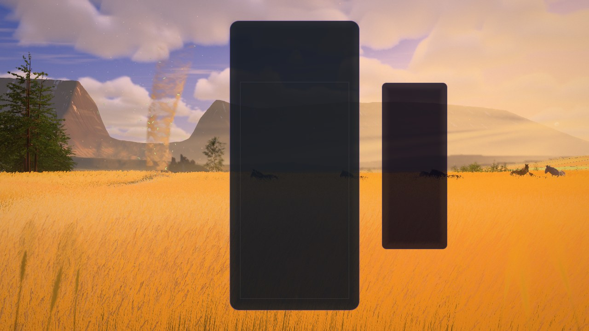
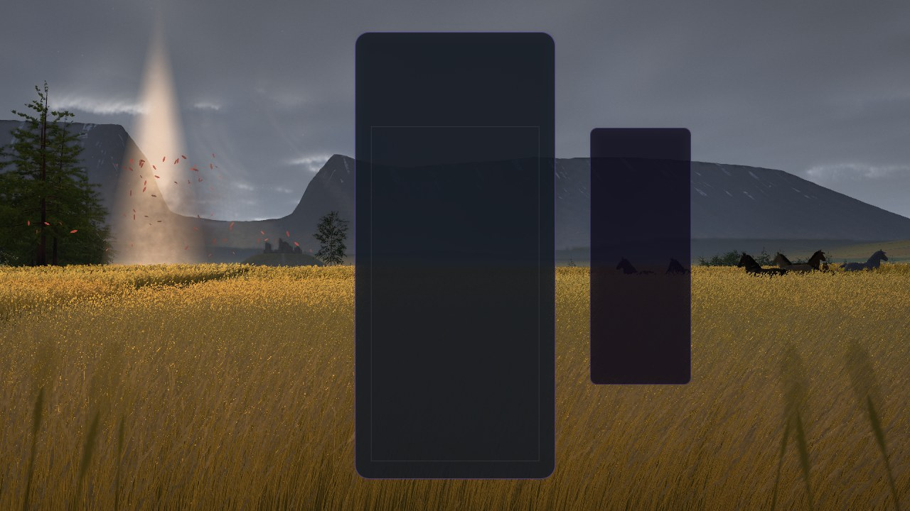
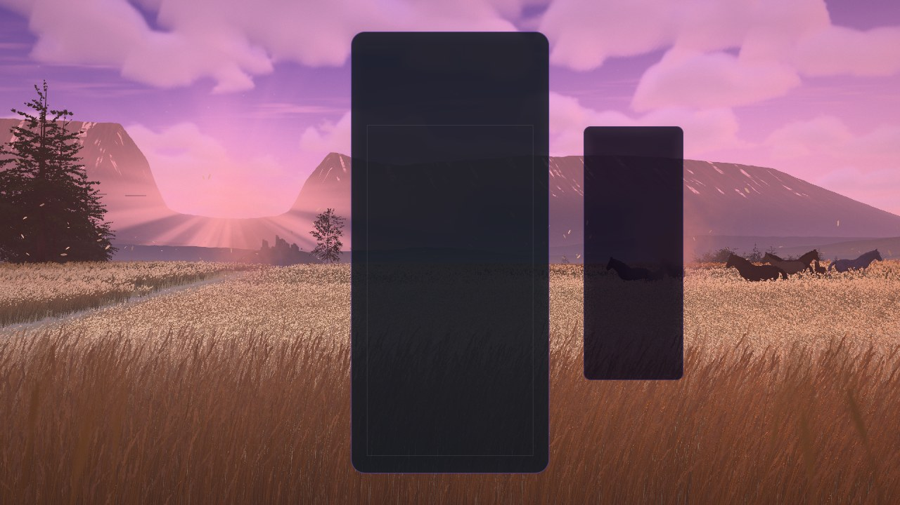
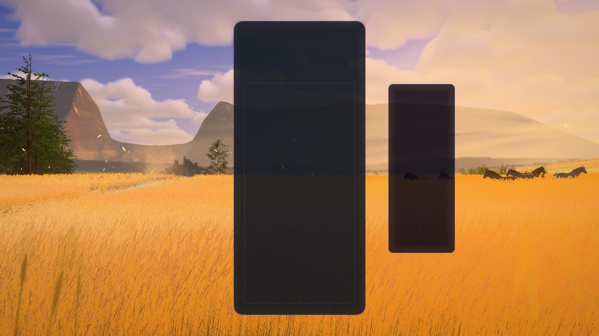
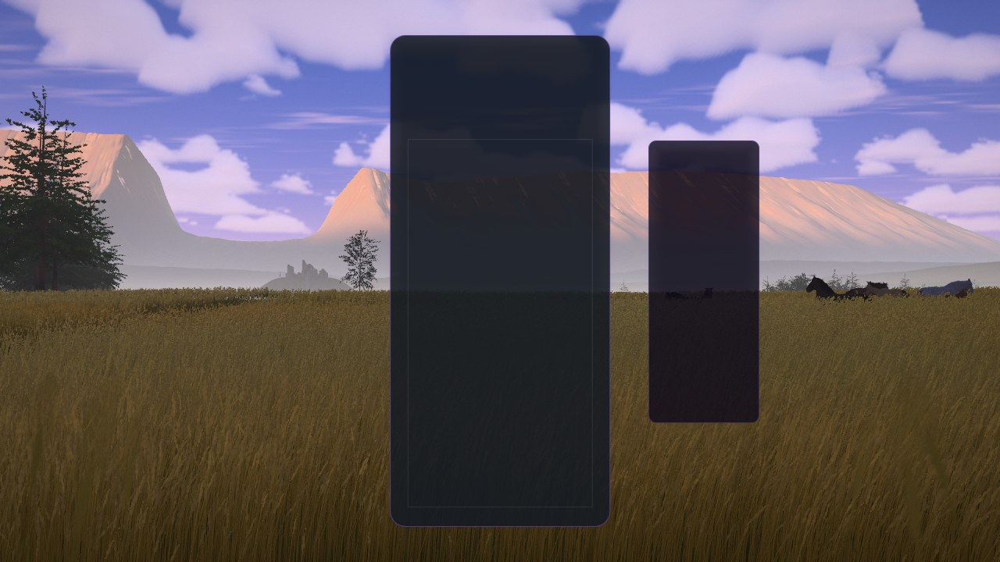

# Grainfields — the events pass (2026-11-14)

Olov asked for an audit of Grainfields and for it to become the game's most stunning theme, "all
event effects impressive, varied and stunning" (the same request High Coast had the same day:
[HIGH_COAST_VISUAL_OVERHAUL_2026-10.md](HIGH_COAST_VISUAL_OVERHAUL_2026-10.md), "Events and
light"). Earlier passes: [GRAINFIELDS_VISUAL_OVERHAUL_2026-10.md](GRAINFIELDS_VISUAL_OVERHAUL_2026-10.md),
[GRAINFIELDS_ATMOSPHERE_2026-10.md](GRAINFIELDS_ATMOSPHERE_2026-10.md).

Branch `feature/grainfields-masterpiece`. Every hour and every event was captured from `main`
first (playground, private dev server, headless Chrome on the RTX 5080 Laptop at `maxFps=30`).

## What the audit found

- **The events were the storm's.** A lock was a sunbeam through a gap in the deck, four lines a
  tear in it over the gate, a perfect clear the deck clearing. At the storm break that is a
  picture. At the other four hours (golden hour, dusk, dawn, morning: cover 0.4–0.56) there is no
  heavy deck: a lock, a hard drop, a clear, a twist and four lines all showed next to nothing.
- **The low eye hides the field.** The eye stands 1.45 m over a metre of barley. The stand within
  about ten metres fills the lower half of the frame; everything on the ground beyond it is a strip
  a few dozen pixels high under the horizon. A whirl in the barley 42 m out was 13 pixels tall, a
  clear's lane (full strength from 36 m) was in that strip, and the four-line front of light
  crossed twelve kilometres of land the crest hides and the last 150 m in a fifteenth of a second.
- **Light added to a bright picture is lost.** The events' motes were additive sparks a couple of
  pixels across: against the storm they glint, against a gold field and a bright sky they vanish.
- **The dawn station was the day's dullest hour**: the sun still under the horizon, the field
  olive, the fells a flat grey cut-out. The high cirrus drew as scratches across the gaps.

| Twist, golden hour: before | after |
| --- | --- |
|  |  |

## What each event does now

What reads at every hour stands in the AIR over the stand, or runs through the stand at the eye's
own feet. Everything below is on top of what the event did before.

| Event | New |
| --- | --- |
| Lock | Petals in the piece's colour and a puff of dust lift out of the ears where its beam lands, sized to the landing's distance (a far lock stands as tall beside the card as a near one). |
| Hard drop | A burst: a column of the field's dust thrown up through the ears in small clouds at many heights, a fountain of petals through it and a crown of them thrown out low. |
| Clear | The lane of wind sets out from the eye's own feet (3 m, not 6 m and full from 36 m), its head runs out at a pace the eye can follow (fifty metres in its first second, not 1,400), the stand rises again behind it, and it carries the rows' chaff out along it. |
| Twist | A **dust devil** rises over the whirl: a column of dust a dozen metres tall, narrow at its foot and opening upward, turning, leaning with the wind and walking over the field with the whirl, the last piece's petals wound up round it. A twist that clears nothing raises a smaller one. |
| Four lines | **Light bursts through Lapporten's gate** in a fan of shafts in the hour's own light, and the **gust** comes out of it: its front crosses the barley to the eye in about two and a half seconds, crest blazing, the whole stand laid over toward the eye as it passes, chaff torn out of the ears streaming past. |
| Back-to-back | The gate's shafts light at half a quad's strength with each difficult clear. |
| Perfect clear | In the stilled air gold dust rises, turning slowly, all over the near stand. |
| Level up | The day turns in **time-lapse**: the deck runs 170 s of its drift in five (about 1.6 km), and a second level-up adds a run of its own. |

| Hard drop under the storm | Four lines at dusk |
| --- | --- |
|  |  |

| A clear's lane, golden hour | The dawn: first light on the fells |
| --- | --- |
|  |  |

## The parts

- **Dust and chaff** (`grainfields-chaff.js`, part `chaff`): a ring of records flown in closed
  form by the vertex stage, like the herd's dust. Three kinds: a *puff* (dust: bursts out, slows,
  swells, rises, drifts), a *flake* (a husk, a fleck of straw or a petal: tumbles, flutters down)
  and a *wound* flake (round a dust devil's walking axis, the spiral opening as it climbs; with no
  turn to speak of, the perfect clear's rising motes). Blended as light plus cover
  (`lightAndCover`: `One, OneMinusSrcAlpha` on the colour, `Zero, One` on the alpha, so the
  target's alpha is left alone): dust hides what is behind it, and a flake is a thing with its own
  colour, not a spark. The pieces' colours are the cornfield's wildflowers (poppy, cornflower, corn
  marigold, corncockle), with a share of the field's gold. Half of the light's hue is let go on a
  flake, so a blue petal stays blue under the golden hour's orange sun.
- **The dust devil** (`grainfields-devil.js`, part `devils`): one tall quad per devil in 22 rows,
  turned to the eye about the vertical. Across it the fragment reads a hollow tube seen side on;
  on it, streaks wound round the tube, read once for the near wall and once for the far wall, which
  crosses the quad the other way: the column visibly rotates. Up to three stand at once.
- **The gate's shafts** (`grainfields-gate-rays.js`, part `rays`): one additive quad on the eye's
  line to the gate, 5.2 km out (in front of the fells, behind the trees, the ruin and the herd).
  Shafts by bearing round the gate from two reads of the noise (whole tiles round the circle: no
  seam), each with its own reach, mostly downward and to the sides.
- **The gust** (`gustFrontAt` in `grainfields-land.js`, `u.gustFront`): a line across the field
  that runs in toward the eye; the barley's vertex stage and the land's carpet read how hard it
  strikes, which way it pushes and how its crest blazes.
- **First and last light** (`grainfields-lapporten.js`): with the sun within a few degrees of
  the horizon its light lies on the fells' faces turned to it. At dawn it comes up behind the eye
  and reaches the summits first: a line of rose-gold light comes down the faces as the sun climbs
  (2,350 m with the sun five degrees under the horizon, the foot as it clears it). In the golden
  hour the low sun is warm on the walls that face it, and at dusk the line climbs back up them.
- **Cirrus** (`grainfields-sky.js`): fibres three to four times wider, softer thresholds.

## Decisions and traps

- **Additive sparks do not read on gold.** The first flakes were additive glints (as the motes
  are): invisible against the field and the sky even at a 22° lens. They are now lit objects with
  cover. The same for the dust devil: with the sky's fill on it, it was a pale ghost of a beam;
  darker dust with more cover reads as dust at every hour.
- **A puff must have no edge.** One big puff read as a ball; a puff eroded by a threshold on its
  own radius read as a bubble with a rim. A burst is many small puffs at different heights, each a
  Gaussian (no edge at all) bitten by noise that does not depend on the radius.
- **A flake has a size cap in pixels.** Sized to show at sixty metres (7–8 cm), a flake the gust
  carries past the lens was an ellipse across the frame, and the perfect clear's rising dust drew
  as confetti. A flake's half-length is clamped to 1.2–5.5 pixels, and the still air's dust rises
  no nearer than 11 m.
- **Events on the ground belong at the eye's feet or not on the ground.** See the audit: the
  lane now starts 3 m out; the devil, the bursts and the shafts stand in the air.
- **The time-lapse is a run with a target.** A closed form of the last level-up's time alone
  (`RUN · smooth(t − levelUpAt)`) stands at its full value before the first level-up and drops to
  zero at each one (High Coast's trap, gotcha #1700); carried on from where it stood with a fixed
  run, a second level-up cut the first one's short. It eases from where it stands to a target each
  level-up moves a whole run further (`lapseFrom`, `lapseTo`, `lapseAt`).
- **Fast play drops a piece a second.** A whole burst for each stood as one bank of dust in front
  of the gate within five drops (found in the real game, not the playground: one event at a time
  never shows it). A hard drop's burst is as big as the air has had time to clear since the last
  one (whole after 3.5 s, a quarter at least), and a puff is thinner and shorter-lived.
- **The gust lays the stand pale.** Flattened toward the eye, the stand hides its own dark
  interior and its backs catch the sky: at dusk it went nearly white. The gust's share of the
  "laid" sheen is 0.3 of what it bends; the geometry's own paling stays (it is what wind does).

## Checks

- Playground captures: the five hours, every event at several ages at the storm break, the golden
  hour, dusk, dawn and morning; High, Low and Minimal; WebGL2 (`forceWebGL=1`); portrait
  430 × 932. Consoles clean.
- The real game (`/?skipIntro=1&unlockAll=1&themeValidation=1`, the theme switched to Grainfields
  after the run starts, a single-player run driven with real key presses at 30 fps): eight hard
  drops gave eight locks and their bursts; a four-line clear and a twist through the world drew
  the shafts, the gust and a dust devil; 14 parts; console clean on WebGPU.
- GPU time at rest, 1920 × 1080, High, timestamp queries at 30 fps, interleaved with `main` on a
  second server (two rounds, 9–19 samples each): storm break 2.92–2.97 → 2.93–3.29 ms, golden
  hour 2.92–3.71 → 2.84–3.02 ms, with a dust devil standing 2.94–3.28 ms: no cost above the
  noise between rounds.
- Tests: `tests/unit/grainfields-events.test.js` (22: the reactions' devils, shafts and gust, the
  chaff ring, and the world's bursts, lane, time-lapse, tiers, reduced motion and seek); all 22
  Grainfields files, 472 tests; the shader gate builds the three new materials in WGSL and GLSL
  at High and Minimal.
- Stage sizes are far from the 48 KiB gate (the barley's vertex stage 25 KiB, the land's fragment
  22 KiB before this pass).
- Reduced motion: no chaff is thrown, the devil turns at a third of its pace, no time-lapse.
  Reduce flashing softens the gate's shafts.
