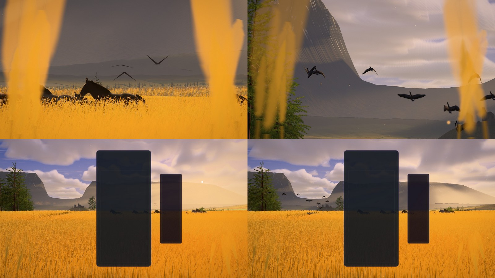

# Grainfields — the geese (2026-10-26)

Asked for by Olov: "there are some birds flying away at some points in the grainfields theme, we
need to improve the design, modelling and animation of those using blender mcp".

## What they were

The birds flying away are the level-up's skein (a fever and a perfect clear send one too); two
more skeins cross the sky by themselves. All of them were `grainfields-geese.js`'s one instanced
mesh of three flat triangles a bird: a sliver of body and two wing strips, the wings bent by a
sine shear of their height with |x| at 0.83 Hz, drawn 2.2× life size in one dark tone. Close up a
black chevron; a crossing seen edge-on from below a row of spikes.

- **Where the flight went.** It lifted off 85 m out, right of the stats bar, in a ready-made V,
  popping in from nothing over its first second, and from about 1 s to 11 s (its nearest and
  best-lit stretch) it flew behind the stats bar and the board before coming out on the left.
- **The budget cut it first.** The instance buffer listed the crossings first and the level-up's
  skein last, so a tier's `birds` cut the hero: High drew 4 of its 11 birds, Medium and below none.
- **The crossings** flew at about 9° up, across the fells' dark upper faces.

## What they are now

### The bird (Blender)

`scripts/blender/grainfields/goose.py`, run headless by `grainfields_assets.py --only goose`
(a second), writes `src/themes/grainfields/assets/grainfields-goose.glb` (53 KB) with the pack's own
deterministic GLB writer. It was designed in the live Blender session through the Blender MCP:
`goose.show()` builds a lineup of posed geese in a scene of its own (`GrainfieldsGoose`; the
open scene is not touched), and Workbench renders from the side, above, below, in front, behind
and three-quarter, plus flat silhouettes at the sizes the game draws (60, 25 and 7 px), judged
each round.

A **Taiga bean goose** (*Anser fabalis fabalis*): it breeds in the birch and bog country under
Lapporten (Čuonjávággi, the goose valley) and rests in its thousands on the Hokkaido stubble, so
it belongs to both of the theme's worlds. Real size: 1.60 m span, 0.84 m bill to tail; 2,752
triangles. Lofted from rings: a heavy body, a long neck held straight and a little low, a
rounded head, a long bill, a short rounded tail, long broad wings (an airfoil section with a
thick leading edge and a thin feathered back half; the carpal the forward-most point; the hand
tapering to a blunt point). Plumage in scene-linear vertex colours: the dark chocolate head and
neck, a black bill with its orange band, grey-brown upperparts scaled with pale fringes, a
paler breast, the white vent and undertail, the white band over a dark, white-tipped tail,
blackish flight feathers, a dark underwing. Alpha marks the thin feathers.

No skeleton. `_WING` carries per vertex how far the shoulder, the wrist and the tip move it,
eased across a band at each joint; the bands widen from the leading edge toward the trailing
edge, where the skin lies far from the joint (the inner flight feathers follow the folding hand
part of the way, as a real wing's do). Its fourth channel is the head's share: the head holds
still while the body heaves with the beat. The pivots and ten authored poses (rest, glide, the
cruise beat's top, mid-down, bottom and mid-up, the take-off beat's four) go into the GLB and the
asset manifest; the theme reads the manifest's.

### The wingbeat

Each beat is the four poses joined smoothly round the cycle (X(φ) = A + B cos φ + C sin φ +
D sin² φ through top, down, bottom, up), the downstroke taking 58 % of it. A goose's cruise beat,
2.9 Hz (±5 % a bird): steady, fairly shallow, straight wings, the hand flexed back on the
upstroke. The take-off beat, 3.8 Hz: the wings clapped high over the back, swept down and forward
to meet nearly under the breast, the hand folded back as it comes up; it eases into the cruise
over 2.4 s (the phase is the rate's integral, so the beat never jumps). The body heaves with each
stroke, the head held still. Crossing birds set their wings for a short glide now and then.

### A flight out (the birds flying away)

`grainfields-goose-flight.js`, three-free and run by the tests in plain Node:

1. **Where it goes up** (`planTakeoff`): every site in the near field across the frame (every
   2°, at 44, 54, 66 or 78 m, inside the crest) and every first heading (the gate's ±0, 20, 40,
   60°) is flown through the rest lens, against the layout on screen (the board cards and the
   stats bar the world reads from the DOM). The route that keeps the flock in the open longest
   wins: off the cards and the stats, inside the frame, its first six seconds counting double and
   its spread across the line checked too, with a small preference for turning (the geese seen
   side on, banking) and for nearer sites. A seed stirs near-equal routes so one launch after
   another need not go up from the same spot. The scores are cached per layout and warmed when
   it changes, so a level-up costs nothing. In 16:9 that is left of the board, 44 m out, a 20°
   turn toward the gate: each goose 50 px across at 1080p as it goes up; in portrait, the strip
   over the card.
2. **The take-off**: the geese sit hidden in the barley at their spots (an 8 × 5.5 m flock) and go
   up one after another within 1.3 s, each easing from rest into its first hard stroke, pitched
   up (the climb plus an attack that settles); 4.5 → 17.5 m/s, a 15 m first rise then 0.9 m/s of
   climb.
3. **The turn**: the track eases from its first heading onto the gate's over the first 70–160 m;
   the birds bank into it by the sideways acceleration (85 % of a coordinated turn).
4. **The V**: from 3 s to 20 s each bird slides from its spot into its slot in the V (arms of
   uneven length, each bird a little loose in its slot), the late ones catching up.
5. **Out through the gate**: drawn at real size near the eye and never under 7 px until 50 s,
   then shrinking with the distance, gone at 95–105 s, about 1.8 km out over the gate's floor.
   A second flight out while one is in the air flies beside it (two slots; the third takes the
   oldest's place).

### The crossings

Two skeins on their old lines and rounds (13 and 9 birds at High), raised to 185 and 300 m so
the eye sees them over the fells' summits against the sky, the line swaying gently, each drawn
no smaller than 7 px a bird with the V scaled to match.

### Drawing them

`grainfields-geese.js`: one instanced draw of the goose. Each frame the flight module poses the
birds in sight (it leaves out what the camera cannot see) into one interleaved instance buffer,
16 floats a bird: place and drawn size, forward and the heave, up (the bank) and the five hinge
angles. The newest flight out goes first, then the crossings, then the older flight, up to the
tier's budget. The vertex stage folds the wings about the wrist, then the shoulder (the twin of
`foldPoint`), normals with them. The light is the land's (`lightSurface`: the sun through the
deck's gaps, the sky's fill, the barley's gold bounce under the wings and belly), the low sun
through the thin feathers within ~8° of its disc, a faint warm graze on edges lit from behind,
and the air. A far bird drawn larger than life gets the air of the distance its size says, so it
stays a silhouette instead of fading into the haze.

Without the goose (a failed download) the sky goes without geese, as the herd does without its
horse.

### Playground

- `event=levelUp&eventAge=<s>`: the flight out at that age (as before).
- `gooseLook=out:0,8`: from the eye, a long lens kept on goose 0 of the flight out (or `a:i`,
  `b:i` for the crossings).
- `gooseCam=out:3,3,90,0.3,40`: fly beside goose 3: metres off, degrees round from its heading
  toward its left, height over it, lens.

## Traps

- **Judge game size in the game frame.** The size floor uses the camera's own pixel angle, so a
  long lens (`look=`, `gooseLook=`) shows real-size birds. Judge sizes on full-resolution crops of
  the rest lens (`capturePage({ rect })` at 2560 × 1440).
- **A track interpolated linearly has no curvature.** The bank read off the path was zero with
  spikes at the laid points. The track is a cubic Hermite through them with the heading's own
  tangents.
- **The rest lens's pitch had the wrong sign** (2.8° off on screen). A test now checks
  `restProjector` against three's camera posed by the world's own `restCamera`, portrait lens
  shift included.
- **Hinge bands tear at the trailing edge.** With the wrist band 5 cm wide, the take-off
  upstroke's folded hand stretched edges there to 3× (its points lie 30 cm from the pivot). The
  bands now widen toward the trailing edge. Worst stretch: under 1.35× in the cruise poses, 1.63×
  in the deepest take-off stroke (the skin over the shoulder). The assets test checks every pose.
- **Haze in front of a bird drawn larger than life** made far skeins fade into the bright air
  near the sun. The air is read at the apparent distance.
- **Instance budget order.** The hero flock must come first, or the tiers drop it.

## Verification

- Tests: `tests/unit/grainfields-geese.test.js` (17: tier sizes, the wingbeat hitting every
  authored pose, the stroke warp, the take-off's stagger, barley start and climb, pitch and
  heading to the gate, the V, the size floor and the end, frame-to-frame smoothness, determinism,
  two flights at once, the route in the open on four layouts, the lens against three's camera,
  the crossings over the summits and their smoothness, culling). `grainfields-assets.test.js`
  (the goose in the pack, manifest and loader; its frame, real size, weights, plumage range; no
  tearing in any pose; refused without its weights or rig; the theme gets by without it).
  `grainfields-world.test.js` (a level-up sends a flight out from the near field and draws it; two
  in the air at once; a seek clears them). The shader gate builds the goose material for WebGPU
  (WGSL) and WebGL2 (GLSL) under its budget.
- Playground captures on WebGPU, with the board overlay: the take-off at every station of the day
  (storm break, golden hour, dusk, dawn mist, morning), 2560 × 1440 crops at 0.9, 1.8 and 3.2 s,
  30 fps strips beside a goose in the take-off and in the cruise, golden-hour close-ups (side,
  behind, below), both crossings, portrait, near-square and Low. Consoles clean.
- The real game in Electron (NVIDIA Blackwell adapter): Single Player on Grainfields, a level-up
  through the live world. The route was read from the live layout, the flock went up left of the
  board, and no WGSL or validation errors were logged.

## Cost

By construction (no GPU timings; the RTX is shared with parallel sessions):

- **Draw calls:** one, as before.
- **Vertices:** 1,388 a goose in sight, at most the tier's budget of birds (High 26: 36k vertices).
  With none in sight it draws one bird of no size, which keeps the pipeline warm.
- **Fragments:** the land's light and the air on the pixels the birds cover.
- **CPU:** about a hundred path evaluations a frame. Scoring routes takes 5–15 ms once per layout
  (cached).
- **Download:** the goose adds 53 KB.

## Not done

- Legs: the geese tuck them from the first stroke.
- Calls (audio).
- Geese landing in, or feeding on, the stubble.
- Crossings that react to play.
- The design scene `GrainfieldsGoose` was left in the open Blender session; it is not saved
  anywhere.
