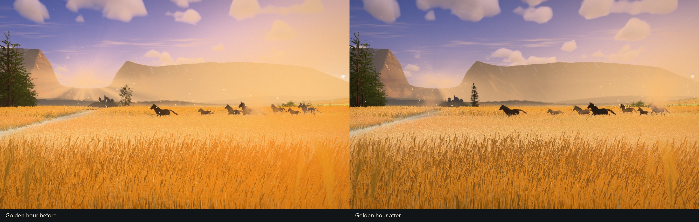
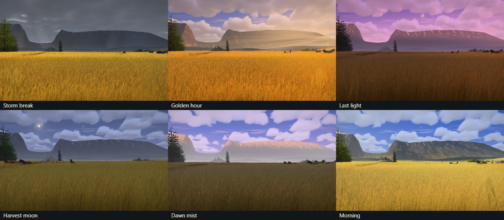
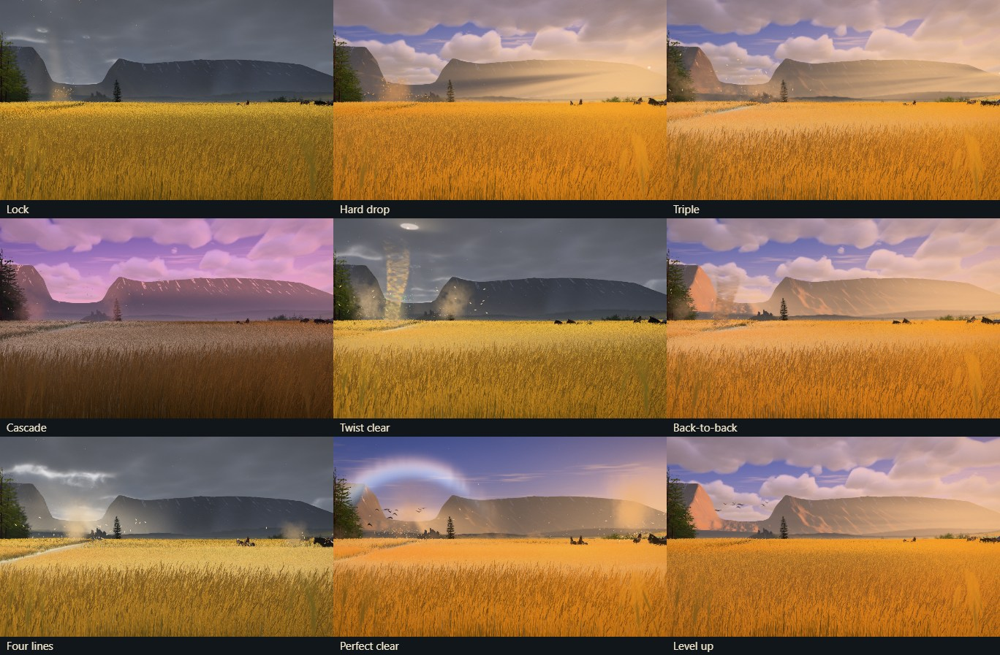
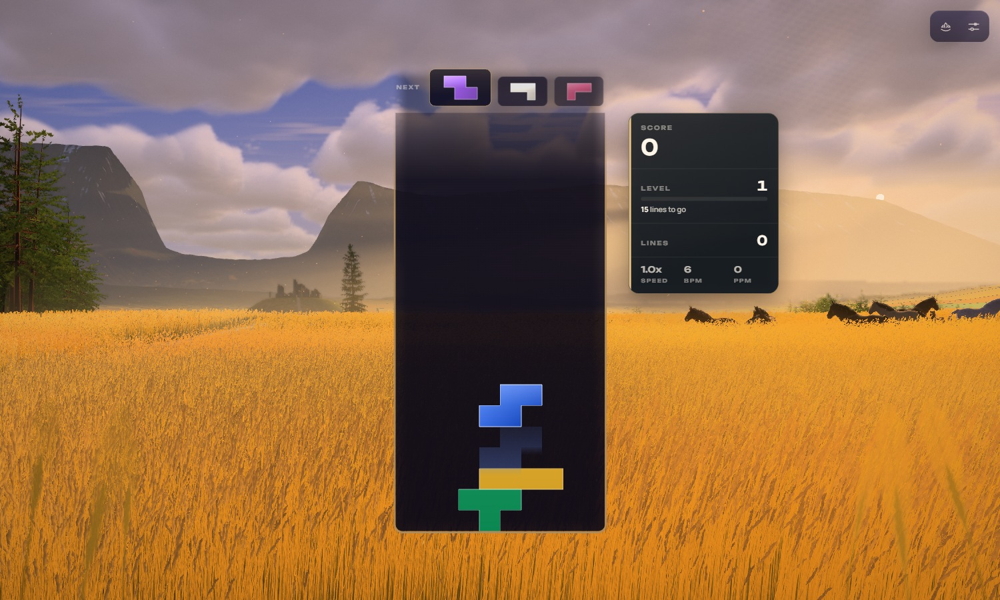

# Grainfields in harvest light

The original scene had a strong viewpoint. From inside the barley, the track leads past the ruined fort to the U between the flat-topped fells. Its weakest moment was looking into the low sun. The field, mist and sunward mountain face converged on the same pale orange, especially when a clear opened the clouds. In the matched frames below, follow the right-hand ridge down to the horses, then look at the dark stems beneath the nearest ears.

## Landscape, weather and wildlife

- **Sun and sky.** The solar halo hugs the disc more closely. Cloud rims and dust reach a soft brightness limit, and the exposure reserves room when several events coincide. Each cloud bank has a rolling lower edge, a cooler underside and a crown displaced downwind. The light shafts now feather into the air. They also align with the terrain through the shifted portrait lens.
- **Wind and depth.** Short ripples run through the longer sweeps of wind. Heavy ears dip just after their stems bend, and the nearest heads follow slightly different rhythms. A passing weather front changes the cloud cover and the amount of mist in the valley. Cool light in the recessed mountain faces separates them from the warmer ribs. A wind-grown spruce marks the track, with larch and birch behind it and cooler light on the outward needles.
- **Horses and geese.** Reflected field light reveals the horses’ flanks in backlight. Grazing horses glance toward the lead mare, and a foal checks its dam. In the sky, returning flocks change altitude and drift sideways. As they cross a rising air current, the glide passes down the ranks. Takeoffs follow the clear space beside the actual board, including the narrow opening on a phone.
- **The turn of the day.** Between the pink last light and dawn, the sky passes through indigo. A pale harvest moon moves above the gate, slips behind clouds and leaves enough skylight to distinguish horses from standing grain.

## What the player sees

| Gameplay | Response in the field |
| --- | --- |
| Lock and hard drop | A lock lifts a puff of the piece’s colour in a soft beam. A hard drop sends a low crown of husks out around a taller dust fountain. |
| One, two and three lines | A single lane of wind carries chaff forward. Two lines fork around standing grain. Three send successively taller crests across the field. |
| Cascade and back-to-back | Debris returns in rising pulses during a cascade. A repeated difficult clear folds two crescents of straw up one side. |
| Spin and twist clear | A spin raises a small whirl. A twist clear grows a travelling dust devil with coloured husks wound around it. |
| Four lines | Light spreads through mist across the mountain gate, and a broad gust runs from the pass through the barley at the player’s feet. |
| Perfect clear | The field falls still. Two drifts of pale seed down rise, geese lift off and a mistbow spans the pass. |
| Combo, level up and game over | A growing combo breaks the storm and sets the herd running. A level advances the light and sends a flock out over the field. Game over draws the scene into dusk. |

The solo well and queue take a brass edge from the grain, and the score panel takes its slate colour from the fells. The background grade holds back highlights behind the board and HUD, leaving the piece colours and ghost legible against moving light. The theme picker now shows a flight of geese crossing the pass in the updated scene.

In a solo session, two keyboard hard drops registered independently. Triggering the four-line and perfect-clear events together showed the mistbow, horses and flock through the mountain gate while the active piece and ghost stayed visible. [Staged perfect clear in the game](grainfields-events/harvest-game-perfect.jpg)

## Capture and performance checks

At six lighting states and 14 fixed event states, the share of pixels with all three colour channels at or above 248/255 measured 0% in the 720 × 432 downsampled captures. These readings cover the sampled moments. The comparison above retains the full 1800 × 1080 image from each side.

High quality ran at a 30 FPS cap on the sampled NVIDIA GPU, with a 1500 × 900 drawing buffer. Median frame interval was 33.3 ms in both scenes. The revised lighting uses the existing render passes and cloud sample budgets.

| Scene | Median GPU time | 95th-percentile GPU time |
| --- | ---: | ---: |
| Storm field | 2.62 ms | 4.33 ms |
| Golden hour, four-line clear and combo | 2.23 ms | 4.78 ms |

All 477 Grainfields tests passed across 21 files. Browser checks covered the production solo theme on WebGPU, a stacked hard drop on High WebGL2, and a level-up flight on Minimal WebGL2 in a 390 × 844 emulated touch viewport. The browser reported no theme rendering errors in these checks. [Portrait capture](grainfields-events/harvest-portrait.jpg)
