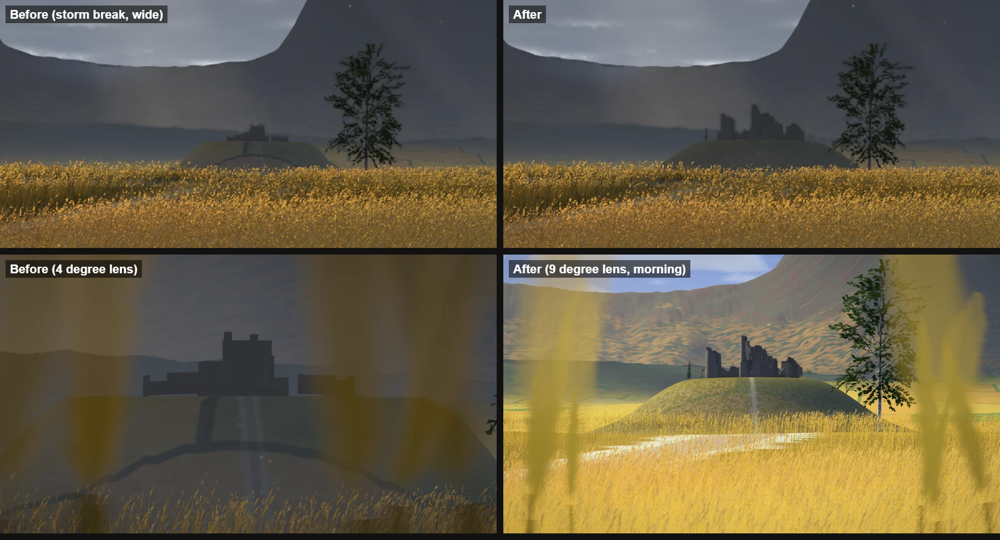
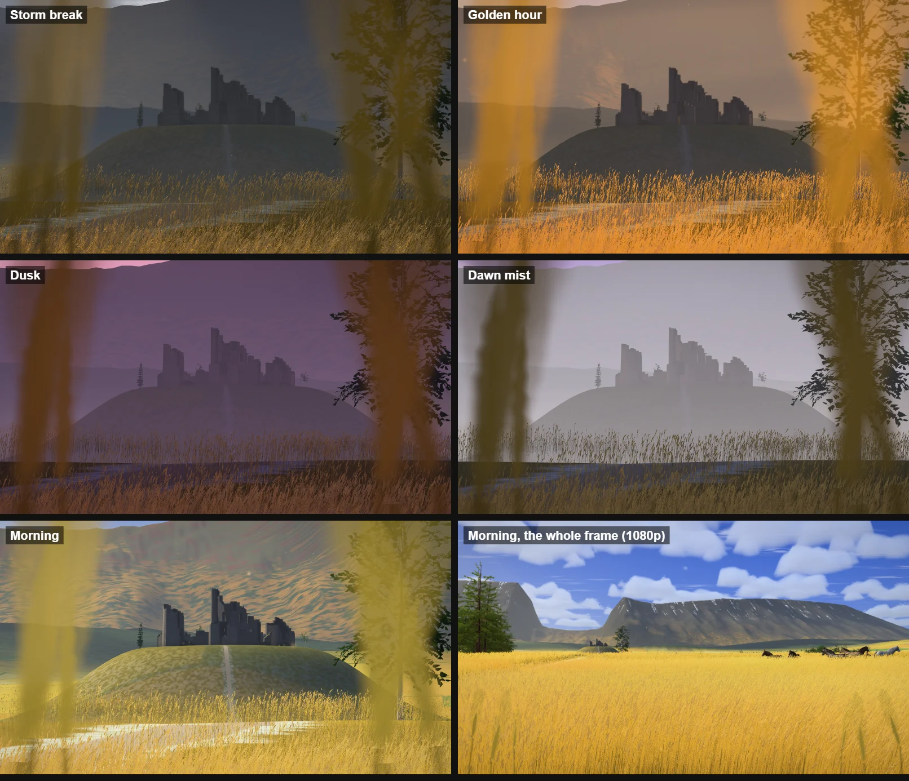
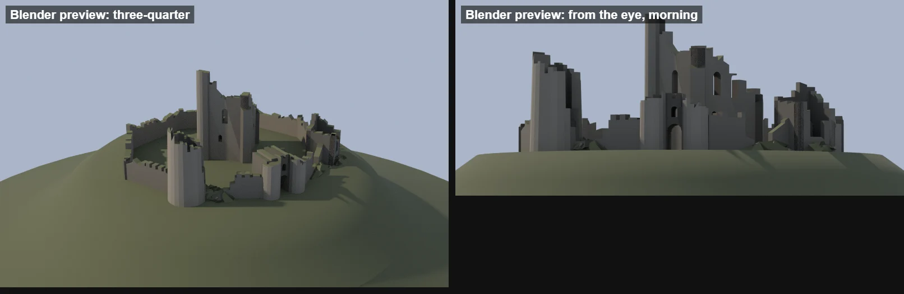

# Grainfields — the ruin on the knoll (2026-10-26)

Asked for by Olov, with a screenshot of the fields and the ruin circled: "what is this in the
grainfields theme?", then "It is really hard to see, can we make it a little larger and better
modelled and designed? use Blender MCP if needed!"

## What it was

The "fort" on the knoll in the vale (`PLACES.fort`, 1.4 km out under Lapporten's gate) was a
handful of boxes and a cylinder: a 13 m keep 15 m tall, a tower stub, a ring of wall. At that
distance a metre is about a pixel at 1080p, so the whole thing was ~15 px tall, one flat dark
tone, and it read as a grey lump. It also floated: the land's fan lays its rows 60 m (High) to
170 m (Minimal) apart out there, so the drawn knoll was a coarse mesa 2 m (High), 12 m (Ultra),
up to 20 m (Low) under its true crown, and the ruin's base showed as a straight line above it.

## What it is now

**The model** (`scripts/blender/grainfields/ruin.py`, run by `grainfields_assets.py --only ruin`,
written to `src/themes/grainfields/assets/grainfields-ruin.glb`). It is a skyline designed for
the eye's own view, which looks up at it 1.5° from the barley:

- From the left: a hollow round tower (r 6.6 m, tapering) split open toward the gate, its top
  broken off on a slant (26 → 16 m).
- The gatehouse where the path arrives: a block with an arched passage, two round fronts.
- Behind them the keep (19 × 15 m, walls 2.5 m), turned 38° so its left face takes the morning
  sun. It rises at its back-left corner, where a stair turret is the skyline's high point (35 m),
  and steps down to the right in broken courses, with two tiers of windows. The back wall is
  broken low, so the sky shows through the upper windows from the fields.
- A broken square tower at the right corner, its front fallen so its inside shows.
- A curtain wall round the crown (8 to 9 m with battlements in stretches) with two great
  breaches, grassed rubble heaps and fallen blocks at them.

It is about twice as tall as the old keep (35 m against 15) and 80 m across against 54: at
1080p ~35 px tall and ~80 px wide.

Every piece is a closed solid (wall elevations with their broken tops extruded through the wall,
hollow tapering cylinders) cut with Blender's boolean (`MANIFOLD` solver): windows, the gate's
arch, slanted breaks, collapsed slices. Then each face is baked by ray casting (a BVH of the whole
ruin, 40 cosine-weighted rays from up to 10 points a face): how much sky it sees (ambient
occlusion, colour R) and the mean open direction (the bent normal, `_BENT`). G is a per-face stone
tone, B turf, A dressed stone (1) or rubble (0). 3,726 triangles, 163 KB; two runs write the same
bytes; the build takes about a second.

**The shading** (`grainfields-fort.js`): grey stone in a few tones, blotched by weathering; turf
on what faces up and on the heaps, moss at the walls' feet; the sky's fill and the fields' bounce
scaled by the sky each face sees. The sun gets in only through the side a face is open to (a
cone round its bent normal as wide as the sky it sees), so the inside of the keep and the gate's
passage stay in shade. The bright sky round the sun lights the faces turned toward it a little
more, so the planes part even when the ruin is a silhouette.

**The knoll** (`grainfields-land.js`, `grainfields-plan.js`):

- Its own fine mesh (`createKnollGeometry`: 46 rings to 290 m, crowded where the crown breaks),
  drawn in the land's material, with the same cover attributes as the fan's posts. Under it
  the fan leaves the knoll out (`knollSink`: the knoll's lift plus 3 m, fading out from 200 to
  270 m), so the fine mesh is the one drawn at every tier.
- Reshaped: the crown is level to ~46 m (within 0.7 m across the ruin's footprint) with rounded
  shoulders, sides no steeper than 36° (were 53°: a drum that the land shader painted solid
  rock).
- Its own turf (a fifth of the barley's gold in the heath) with grey crags only where it is
  steep. The plots' tracks no longer show through it, and the light through the barley is one
  even sheen on it. The path still climbs it to the gate.

**Trees by the ruin** (`RUIN_TREES` in `grainfields-plan.js`): a birch self-sown in the bailey,
a spruce on the knoll's left shoulder, a birch on its right. They are far-belt sprites at this
distance, and they soften the skyline.

## Decisions and traps

- **The sun is never behind the fields.** Its bearings run −120° to 45° from the view axis, all
  ahead of the eye or beside it, so a face the fields see is never sunlit straight on. The design
  leans on the outline and on openings with sky in them. The keep is turned so the morning sun
  (−70°) reaches its left face, and the sky glow parts the planes in the backlit hours.
- **The bent cone has to be generous.** A tight cone (`smoothstep(cone − 0.2, cone + 0.08, …)`)
  kept the morning sun off the keep's left face: an outer wall with 80% of its sky only meets the
  grazing sun outside a narrow cone. `cone − 0.45 … cone + 0.05` lets an open wall take it and
  still shades what the walls enclose.
- **A constant sink is not enough under the knoll.** Sinking the fan's posts by 5, 8 and then
  14 m still left Minimal's 170 m cells standing over the concave foot (their chords cross ~16 m
  above it). Leaving the knoll out of the fan altogether is exact at every tier (the vale is
  gentle).
- **The dark arc across the knoll was the plots, not the ruin.** It was there before this pass.
  The knoll's heath covered the field at 80%, so the darker tracks between plots showed through,
  and the barley's light-through-the-awns term (`isGrain`) was off on the tracks, which drew them
  as dark lines when the sun was ahead. Both now stop at the knoll.
- **Blender.** Asked about the Blender MCP: the live session was connected, but the ruin is built
  by a headless, seeded script like the theme's trees and horse, so it can be regenerated and
  checked byte for byte. The previews (`--preview <dir>`) render it from the eye's own position
  through a long lens (storm, morning, golden hour, game scale) and from a high three-quarter
  view.

## Verification

- `tests/unit/grainfields-assets.test.js`: the pack (13 files, the ruin under 220 KB), the
  manifest, the parse (attributes, 2,500–6,000 triangles, unit normals and bent normals, sky seen
  from under 0.35 to over 0.95), the walls inside the level crown (46 m) with rubble to 48 m,
  foundations 4 m deep, the high point 30–40 m and left of the middle; loading without the ruin
  (failed download, other schema, missing `_bent`, missing size) keeps the fields.
- `tests/unit/grainfields-knoll.test.js` (new): the knoll's mesh lies on the true ground and faces
  up; the crown is drawn within 0.2 m of true across the ruin's footprint, never below the walls'
  foundations; at every tier the fan stays under the knoll's own mesh out to 110 m; the trees by
  the ruin stand on its crown and shoulders.
- `tests/unit/grainfields-world.test.js`: without assets the world builds every part but the
  trees, the herd and the ruin. All 18 Grainfields test files pass (418 tests).
- Playground captures (Electron, WebGPU on the RTX 5080, private Vite server): the wide frame the
  question came from (2460 × 1123), 1080p, portrait 430 × 932, the five hours through a long lens,
  Minimal, Low, High and Ultra; no WebGPU errors in the console.
