# Halcyon Apex — the sanctuary of first light

Implemented 2026-10-08 on `feature/halcyon-apex-masterpiece`, with Three.js 0.186.1. A
from-scratch rebuild: it replaces the earlier theme in full (the 2,280-line playground effect
that was the scene, with its lit standard materials, canvas-drawn textures, billboard comets
and `pulse()` API, and the thin wrapper class round it). Halcyon Apex keeps its identity — a
windless golden dawn over turquoise water, the terraced pyramid crowned by a crystal at the end
of a stone causeway lined with crystal shards, the obelisks, the diamond that simply floats,
the ley light that runs between them — and everything else is new. This document records the
shipped design and what was verified. It is a reference, not a backlog.

Later passes are recorded below in the order they landed: [depths](#depths-pass-2026-10-21),
[visitors](#visitors-2026-10-26) and
[skyfarers and the board's great moments](#skyfarers-and-the-boards-great-moments-2026-11-16),
which replaced the visitors' hulls and routes and gave every event an answer of its own. The
tables in the first half describe the theme as it ships now.

## The picture

Dawn, seen from the lagoon. The viewer stands in clear water beside a causeway that runs out,
between pairs of floating crystal shards, to a pyramid of eight terraces. A stair climbs its
face through the heart gate, a doorway of light, to the top platform, and over that the Apex
floats: a cut crystal the height of a house. The sun has just cleared the far ranges on the
right, and before it hangs the Halcyon, a diamond forty metres tall, over a ring of nine
standing stones. Under the Halcyon the lagoon runs upward: a funnel of drops that spirals in
and narrows into the diamond's lower point. Streaks of high cloud and banks of low cloud take
the dawn, and the whole sanctuary lies upside down in the water.

The scene is back-lit on purpose. The pyramid's face is in luminous shade, lit by the sky, by
the lagoon's bounce on its lowest walls and by its own crystals, so that the ley light — and
everything gameplay does with it — reads against the stone. The sun is in the frame, where its
road of sparks on the water, its shafts and the Halcyon's refractions are.

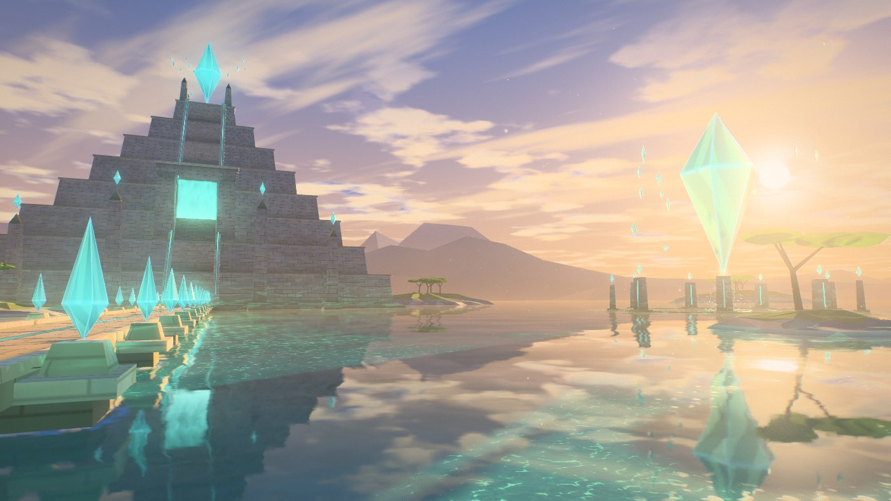

The gameplay card covers the middle of the frame, so the picture is built for what stays
visible: the pyramid, the Apex and the causeway to the left of it, the sun, the Halcyon and the
stones to the right, the lagoon below, the dawn above. On an upright screen, which is too
narrow for both sides, the rig turns to the pyramid and tips down: the Apex and the top tiers
stand over the card and the lagoon's bed lies under it.

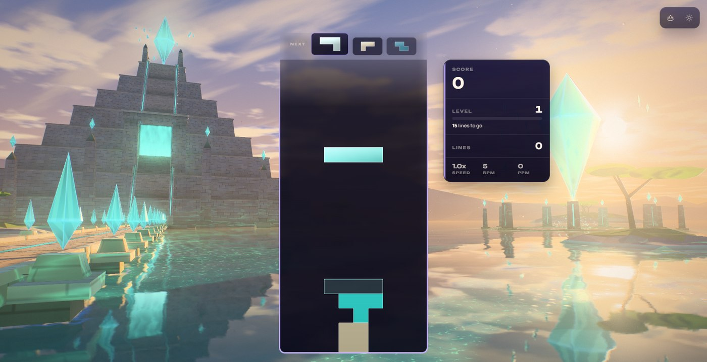

## The one idea

The sanctuary runs on first light, and what the light fills, floats. The board pours light into
the lagoon; the ley lines carry it to the two great crystals, which keep it; and the more a
chain of clears gives them, the more of the sanctuary leaves the ground.

## Event language

| Event | Response |
| --- | --- |
| Piece lock | The piece's light drops into the lagoon under the foot of the board, at its own column: a ring runs out over the water (a real ripple: it bends the mirror and the bed) and carries the piece's colour through the net of light on the sand. A wisp in the same colour leaves the edge of the card at the piece's height and flies to the head of a ley line: the causeway for the left half of the board, the stones for the right. From there the light runs the line as a pulse, shard to shard along the deck (each rune across the deck lights as it passes), up the stair through the heart gate and into the Apex — or round the ring of stones and up the rising water into the Halcyon. The great crystal keeps it: it glows in the colours of the pieces it has taken, for about half a minute. |
| Hard drop | The same, harder: a crown of spray where it struck and a fan of spray thrown out from under each side of the card, a wider ring and a second on its heels, a second pulse on the heels of the first, a camera dip. |
| Line clear | The cleared rows leave the card as blades of light at their own heights. A wave runs out through the sanctuary from the foot of the board, one front per line: the masonry flashes as it passes, the bed floods, every crystal on the lines rings and throws sparks, and the two great crystals let go of everything they were holding. One line answers in the ley's light, two in the crystal's, three in both at once. Two lines and three also send the board's light to the great crystals themselves: a wisp to the Apex and one to the Halcyon for every line past the first. |
| Combo | The sanctuary lifts. Pair by pair, nearest first, the ley shards rise off their plinths and turn; the stones' crystals follow; drops of the lagoon bead up into the air all over the water and rise, more of them with every step; the splinters round the great crystals swing wider and faster; the ley lines brighten and the clouds thin. When the chain breaks the sanctuary lets its breath go and everything settles. |
| Four lines | The sanctuary holds its breath: every light sinks for a fifth of a second. Then a beacon stands on the Apex and on the Halcyon, a ring of light opens over the sky from the Apex, the wave goes out in sunfire gold, the beads are thrown up, and the flock is put to flight. As the wave reaches each great crystal it breaks what it lets go of into its colours (a prism burst: a fan of rays, each a spectrum), and five swifts come in over the viewer's head, fanned across the whole sky, and run out to the horizon on trails of sunfire (the salute). |
| Perfect clear | Four lines, hotter and longer, with seven swifts and a crown: rings of the spectrum open over the sky from the Apex with a glory of rays round it, and eight orbs rise round the crystal in a turning ring and burst outward. |
| T-spin | Everything that floats turns on its axis, two more rings leave the foot of the board, and a helix of glitter winds up round each great crystal. |
| Level up | The hour changes: five palettes, cycled (golden dawn, rose hour, clear morning, amber haze, blue hour). The clouds race for a breath as in a time-lapse, both ley lines run a pulse of the new hour's light, and a flight of swifts comes over. |

Combo here is the true consecutive-clear combo (one `ComboTracker` per player in
`HalcyonApexDirector`); the bus's `COMBO` event is cascade depth (ADR-0011). With several boards
on screen each lock leaves its own board, and the sanctuary lifts to the longest chain any
board is holding.

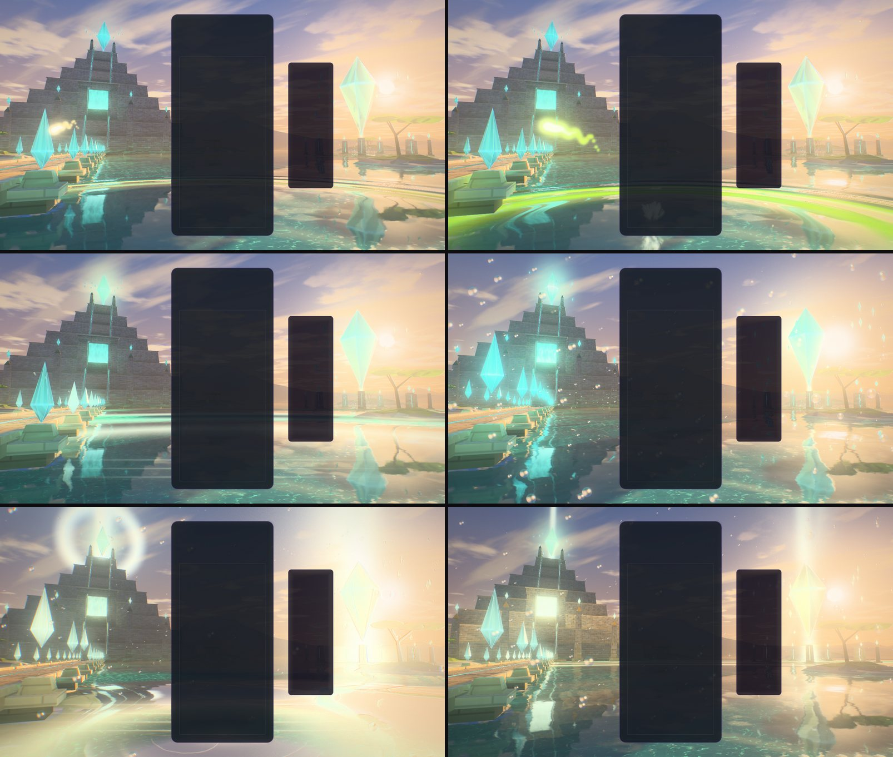

## How it is built

| File | Role |
| --- | --- |
| `halcyon-apex-core.js` | Three-free constants and maths shared by the plan, the choreography and the shaders: the site (where the pyramid, the causeway, the Apex, the Halcyon and the stones stand), the stair, the two ley lines' arc lengths, ring, wave and pulse timings, the five palettes, where the picture's anchors sit for an aspect. |
| `halcyon-apex-plan.js` | The sanctuary as numbers, seeded and deterministic: every block of masonry as flat triangles with its own baked occlusion, every ley strip with its arc length, every crystal. |
| `halcyon-apex-tsl.js` | Hashes, the baked noise texture, the shared uniforms, the sanctuary's light (the sky function every surface gathers, mirrors and fades into; lock rings, clear waves, ley pulses). |
| `halcyon-apex-sky.js` | The dome: gradient and scatter, the sun, the ringed giant, two decks of cloud in true perspective, the four-line ring, a perfect clear's crown. |
| `halcyon-apex-stone.js` | The masonry's material (courses and joints from each face's own metres, sun through the shadow map, sky, the lagoon's bounce, the crystals' own light) and the ley lines'. |
| `halcyon-apex-crystals.js` | Every crystal as one instanced cut, its shading, its halo, and where each one floats this frame. |
| `halcyon-apex-water.js` | The lagoon: the planar mirror, the bed with its net of light, depth and shore, the sun's road, lock rings, the clear's swell. |
| `halcyon-apex-terrain.js` | The far ranges, the islets, their trees and boulders. |
| `halcyon-apex-atmosphere.js` | The upfall under the Halcyon, the beads a chain lifts, motes, the flock. |
| `halcyon-apex-fx.js` | Wisps, sparks and spray, row beams, beacons, prism bursts. |
| `halcyon-apex-fleet-model.js` | Generated by `scripts/blender/halcyon_apex_fleet.py`: the eight hulls of the skyfarers, their lamps and engines (see [Skyfarers](#skyfarers-and-the-boards-great-moments-2026-11-16)). |
| `halcyon-apex-visitor-plan.js` | Three-free: unpacks the hulls into one buffer, names their surfaces, lamps and engines. |
| `halcyon-apex-flight.js` | Three-free: how the skyfarers fly. Paths, formations, bearing from the path itself, the sorties, the three streams of traffic. |
| `halcyon-apex-visitors.js` | The fleet as one instanced hull draw, the sprite pool for their lamps, the ribbons for their trails and beams. |
| `halcyon-apex-world.js` | Owns the uniforms, the parts, the camera rig, the sun and its shadow rig, and the choreography. Shared with the playground effect, so what is iterated there ships. |
| `halcyon-apex-director.js` | Renderer-free: stages bus events per player and resolves one lock and one clear per frame. |
| `halcyon-apex-composition.js` | Three-free: reads the live card, board and HUD rects and maps board columns and rows onto the screen. |
| `halcyon-apex-post.js` | One scene pass, bloom, and one output pass. |
| `halcyon-apex-quality.js` | The six tiers. |
| `halcyon-apex-theme.js` | Lifecycle, renderer selection, settings, layout watch, GPU-loss recovery, capture flags. |

Techniques worth knowing before changing it:

- **One node renderer on both backends.** `WebGPURenderer` on WebGPU, its WebGL2 backend
  otherwise (or `?forceWebGL`). No `ShaderMaterial`, no compute, no lit material.
- **Every surface shades itself** (`MeshBasicNodeMaterial`) from shared uniforms and one sky
  function, `haSkyBase`, which is at once the sky, what a facet or the water mirrors, and
  (read a little above the way a surface faces) the light that surface gathers: warm on the
  side that looks at the sun, blue on the far side. Distance fades into `haSkyFog`, the same
  function without the glare round the sun.
- **One shadow map, read by everything.** A `DirectionalLight` that lights nothing: its
  `shadow(light)` node is shared by the masonry, the crystals, the land and the lagoon (whose
  net of light and sparkle go out in the pyramid's shadow). The world fits the shadow camera
  round everything that casts, redraws the map over the first frames while pipelines compile,
  then as often as the tier allows (the crystals drift). Casters shade through `fragmentNode`,
  because a caster's `colorNode` also runs in the shadow pass, where it may not read the map it
  is drawing.
- **Masonry is planned, not modelled.** A few dozen calls describe the pyramid, stair, gate,
  obelisks, causeway and stones as boxes whose walls may lean. The builder cuts their faces
  into a grid, bakes occlusion at every grid point from the other boxes in closed form (the
  nearest point of each solid to a point lifted off the surface), and emits flat triangles
  with their own metres as UVs, from which the material draws courses, blocks and joints.
- **A ley line is a coordinate.** Every strip of light, rune and crystal on a line carries its
  arc length along it. A pulse is one uniform slot (birth time, line, colour); what lies at arc
  length `s` lights when `speed × age` passes `s`. The same number tells the world when the
  pulse reaches its great crystal.
- **A crystal is a cut stone without a framebuffer read.** One six-sided bipyramid, instanced.
  Each facet mirrors the sky by its own Fresnel; behind the mirror lies the sky along the
  refracted ray, broken into wedges, with the sun refracted once per colour channel so its
  image splits where the Halcyon stands before it; the light a crystal holds glows from its
  core; every arris is lit. Where each of the seventy floats is evaluated on the CPU once a
  frame from the world's clocks and shared by the crystals, their halos and their shadows.
- **The lagoon knows where the masonry stands.** A handful of signed distances (the plinth,
  the landing, the piers as one repeated box, the obelisks' footings, the stones' rim) give it
  a shelf to pale over and a line to foam on. Under the surface it is a bed (ripple marks, sea
  grass, a net of light from two noise fetches), an absorption per channel over the path
  through the water, and the deep's own colour; over it, Fresnel into the planar mirror.
- **The mirror.** On Medium and up a planar `reflector()` renders the sanctuary from the
  mirrored camera at reduced resolution; the water reads it through its own slopes. Wisps, row
  beams and motes live on layer 1, which the mirror's camera does not render. Low and Minimal
  mirror the sky function and the sun instead.
- **Clouds are two planes.** Each deck is a plane at its own height met by the view ray, so
  the clouds close up toward the horizon as real ones do. A deck is lit by reading its density
  once more a step toward the sun.
- **Closed form first.** Rings, waves, pulses, wisps, sparks, the upfall, beads, motes, the
  flock and the beacons are functions of the world clock, event timestamps and a few clocks the
  world integrates (how far the clouds have drifted, the crystals turned, the beads risen).
  Nothing is created at event time: events write numbers into ring-buffered uniform slots and
  preallocated pools. `seek(t)` plus a fixed-step replay reproduces any frame.
- **HDR, single output.** The scene is scene-linear; a max-channel knee selects what blooms (no
  MRT), and one output pass does the lens fringe, the calm zones on the card and HUD, bloom,
  shafts dragged out of the sun, a hue-preserving filmic curve, grade, vignette, grain and
  dither. An iris closes as the sanctuary flares so its colours survive the surge.
  `usesMrtScenePass()` is false.
- **No MaterialX noise.** One tileable fBm texture is baked on the CPU with its own mip chain.
- **Clamp what a thin strip interpolates.** With MSAA, a ley strip thinner than a pixel is
  shaded from varyings extrapolated far outside the triangle; an unclamped profile across the
  strip came out negative and drew black, red and green dashes along every distant line. The
  strip's profile and the crystals' core thickness are clamped.

## Tiers

| Tier | Mirror | Shadow map | Cloud decks | Wall shimmer, glitter, bed detail | Dispersion | Beads | Motes | Upfall | Sparks | Birds | Bloom, shafts | Scene MSAA |
| --- | --- | --- | ---: | --- | --- | ---: | ---: | ---: | ---: | ---: | --- | --- |
| Minimal | sky function | none | 1, unlit | off | off | 90 | none | 60 | 96 | none | off | off |
| Low | sky function | 1024, drawn once | 2 | on | off | 180 | 120 | 110 | 160 | 7 | off | off |
| Medium | 0.40 scale | 2048, every 4th frame | 2 | on | on | 360 | 260 | 180 | 320 | 11 | on | off |
| High | 0.50 scale | 2048, every 2nd frame | 2 | on | on | 640 | 420 | 260 | 512 | 15 | on | 4× |
| Ultra | 0.62 scale | 4096, every frame | 2 | on | on | 960 | 640 | 360 | 768 | 19 | on | 4× |
| Extreme | 0.75 scale | 4096, every frame | 2 | on | on | 1,400 | 900 | 480 | 1,024 | 23 | on | 4× |

Every tier keeps the whole picture and every event. On Minimal nothing is in shadow (the sun is
taken to reach everything). The lens fringe is High and up. These are allocation budgets, not
measurements of frame rate.

## Assets

No binaries, and nothing loaded at run time. The skyfarers' hulls are modelled in Blender and
shipped as a generated JavaScript module (2026-11-16, below). The sanctuary itself is generated: about 14,000 triangles of masonry planned and baked at start
(some 60 to 150 ms), the far ranges, islets, trees and boulders cut from seeded noise, seventy
crystals instanced from one cut, one 256 × 256 noise texture baked on the CPU, and shaders.
Blender was not needed and was not used: the pyramid, the stair, the gate, the obelisks, the
causeway and the stones are boxes whose walls lean, the crystals are bipyramids, and what makes
them read is their shading and their light. Building them from a plan also keeps them seeded,
testable and free of binaries. The piece colours (`halcyon-apex-tetrominos.js`) are unchanged.

## Verification

- Unit tests: 159 new tests in five files (world 56; plan, core and tiers 21; theme 49;
  director 23; composition 10), all passing. The world tests include the same state at 30 and
  at 240 frames a second, a bit-exact replay after `seek`, and a session-length check on the
  lifted crystals' turn (see the faults below).
- Whole suite, run once on a build machine that other sessions kept busy: 690 files, 9,187
  tests; 684 files passed. Of the six that did not, five are wall-clock limits in files this
  change does not touch, apart from the URL-parameter catalog, whose 5 s source scan timed out
  in the loaded run (Odyssey forest bake and lever, Odyssey world-bake loader, Stellar Drift
  reactions, the catalog); all five pass run on their own. The sixth,
  `odyssey-level-briefing.test.js`, fails on this machine alone or not: it expects
  "250,000" and the machine's locale writes "250 000". None of its imports are touched here; it
  was not run on pristine `main`.
- Gates: typecheck; lint ratchet (807 errors against a baseline of 807 — the new files add
  none); theme lifecycle audit; dependency boundaries (1,285 modules); production build with
  the boot-closure guard; IP-string gate; Pages artifact check; release gates — all pass.
  Halcyon Apex's piece colours are unchanged and score 3/7 on the palette screen, as before.
- Playground captures on WebGPU (RTX 3070 Laptop), High: rest; a lock at two moments; a hard
  drop at two; clears of two and three lines; held chains of 6 and 9; four lines at four
  moments from the burst to the beacons; a perfect clear; a T-spin; all five palettes. Also
  Minimal, Low, Medium, Ultra and Extreme; High and Low on the forced WebGL2 backend; an
  upright 430 × 852 frame at Medium at rest and through a hard drop, a chain and four lines;
  reduced motion through four lines. Twenty-one of these were retaken on the final build
  (the perfect clear, the T-spin, the chain of 9, Medium, Ultra, two palettes, High on WebGL2
  and reduced motion were not); no capture had a console error or warning.
- In the real game (Electron, dev server, single player, twice): the theme starts on WebGPU,
  aims its events at the live board, takes real hard drops from the keyboard (eight locks and
  fifteen pulses in the first run, both great crystals holding light) and bus-injected clears, a chain and four
  lines, survives a live quality change (High to Medium) and lets go of its canvas when another
  theme takes over. Its own console output is one "Scene ready" line per build. The same
  event script (hard drops, clears, a chain, four lines) ran clean on the WebGL2 backend at
  Low.
- Faults found on the way, all fixed and covered by the tests above. The captures caught one:
  black, red and green dashes along every distant ley line, from MSAA extrapolating a strip's
  UV (now a row in the TSL skill's table). A helper agent's tests caught three in the world: a
  lifted crystal turned by its lift times the *age of the session*, so its spin would have
  jumped on every lift late in a long session (it now integrates what it has turned); a clear
  rang only the first 22 crystals in plan order, so the dial never rang; and two arrivals due
  in the same frame resolved in the order they were queued, not the order they fell due, so a
  crystal could take a pulse and then lose it to an earlier wave. Clear waves also shared one
  origin, which would have moved a first wave when a second board cleared; each wave now
  carries its own.

Observed, not measured: the whole game at 1584 × 813 at High on the RTX 3070 ran at 113 to
128 frames a second in the two runs, and at about 130 on the WebGL2 backend at Low (which
renders at 0.85 scale), on a machine shared with about ten other capturing sessions.

Not verified: GPU cost per tier through the theme perf lane (ADR-0016); the integrated GPU
(a run started with Chromium's low-power-GPU switch ran clean at High, but the harness did not
record which adapter it was given and its frame rate matched the RTX runs, so it is not
counted as an integrated-GPU reading); physical phones, and the real mobile layout (the upright captures use the playground's mock card);
local multiplayer and Infinity layouts in a capture (their routing is unit-tested only);
`scripts/validate-all-themes.mjs` against this theme; sessions of several hours.
`docs/theme-screenshots/halcyon-apex.png` still shows the previous artwork (a fleet capture
writes it).

## Reproduce

Run `npm run dev:playground`, then:

`/playground.html?effect=halcyon-apex&t=20&quality=High&board=1`

Add `event=lock|drop|clear|quad|twist|perfect|levelUp` with `eventAge=<s>`, and `combo=<n>`,
`level=<n>`, `lines=<n>`, `u=<0..1>`, `row=<r>`, `color=<hex>`. `locks=<n>` plays n locks first,
so the great crystals are holding their light when the event fires. `demo=1` (without `t`)
plays a looping script. `parts=` draws only the named parts; `falseColor=1` bands the
pre-tone-map peak; `noPost=1` shows the raw scene; `forceWebGL=1` uses the WebGL2 backend;
`reduce=1` is reduced motion. In the game: `?halcyonApexTime=`, `?halcyonApexFixedDt=`,
`?halcyonApexParts=`, `?halcyonApexFalseColor=1`.

The theme icon is the pyramid, the Apex and the causeway through the playground's icon lens,
three locks in:

`/playground.html?effect=halcyon-apex&t=20&quality=Extreme&icon=1&iconFov=40&iconYaw=0.11&iconPitch=0.36&locks=3`

captured in an 840 × 840 window (the largest square this laptop's screen allows; the lens is
set for a square frame, where the rig is already part-way to its upright pose), cropped to 94%
about the centre, given a colour lift (contrast 1.14, saturation 1.3, brightness 1.06) and
baked as a 512 px circle on a transparent ground.

## Depths pass (2026-10-21)

A second visual pass on `feature/halcyon-apex-depths`. Evidence:
[reports/halcyon-apex-depths/](../reports/halcyon-apex-depths/).

| Before | After (High, WebGPU) |
| --- | --- |
| 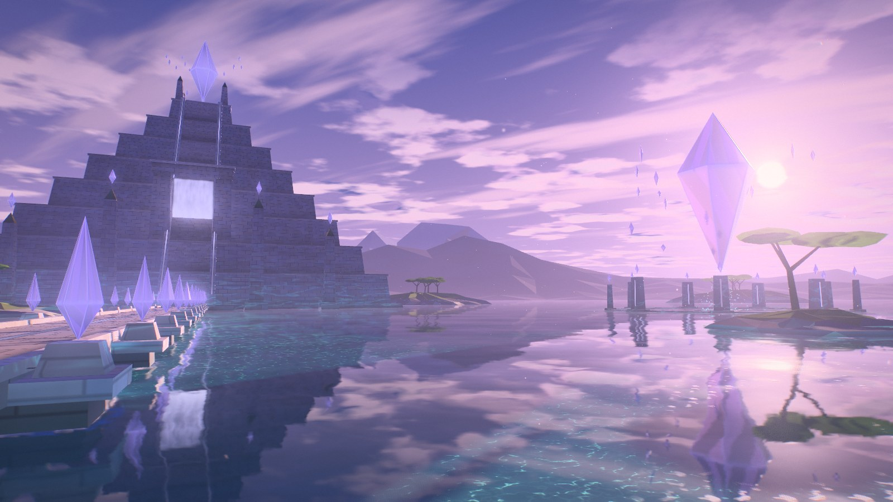 | 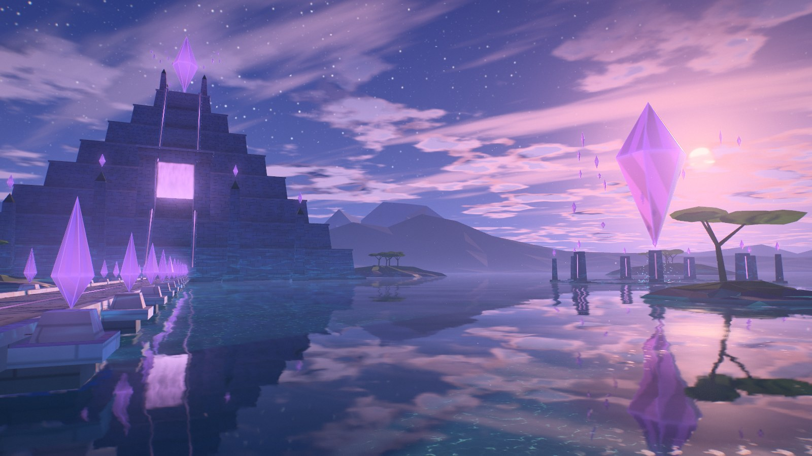 |
| 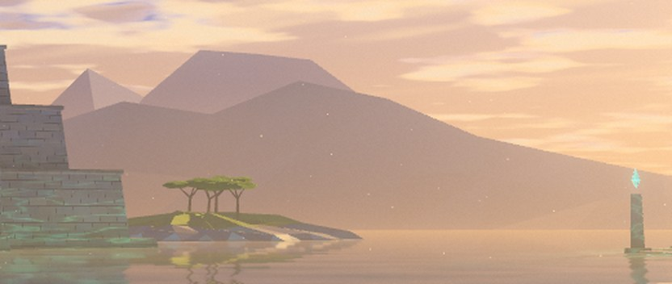 | 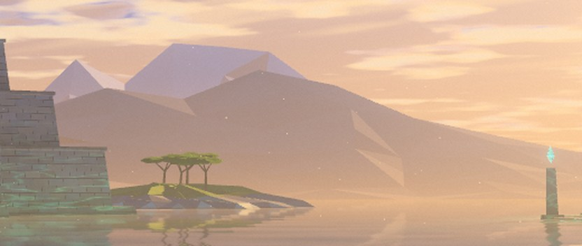 |
| 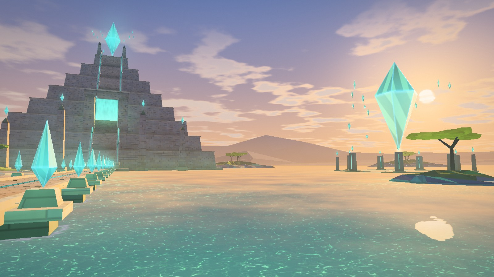 | 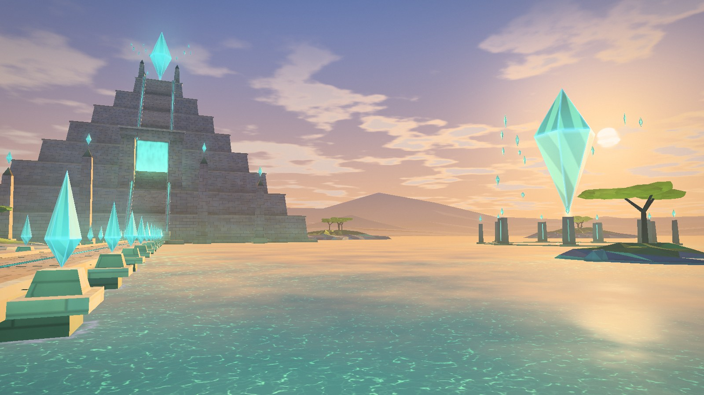 |

- **The blue hour is a dusk.** Its sky, clouds, sun and crystals sat on one lavender, so nothing
  stood out. The palette now has a deep blue zenith and horizon, a dim rose sun on the horizon,
  slate clouds with rose undersides toward it, cooler darker stone, and a saturated violet for
  the crystals and the ley lines, which become the brightest things in the frame.
- **Stars.** A 3D lattice of directions, one star at most per cell (round everywhere on the dome,
  no seam, never under a pixel), two layers. They come out where the hour's zenith is dark enough
  (`1 − smoothstep(0.035, 0.075, luma(zenith))`, so only the blue hour today), fade toward the sun's
  glow and hide behind cloud. The whole term is skipped behind an `If` in the bright hours.
- **The far ranges.** Each ridge was one row of four facets per crest point. It is now six rows from
  crest to foot, steep under the crest and flattening toward the valley, carved into alternating
  spurs and gullies with the diagonals alternating. The crests draw exactly the numbers they always
  drew from the plan's stream, so the skyline, and the islets and trees seeded after it, stand where
  they stood; the carving draws from a stream of its own. High faces that look up take snow; steep
  faces darken; mist lies in the valleys at each range's foot, computed with the air's colour once
  per pixel.
- **Minimal's sun on the water.** Without a mirror pass the lagoon returned the sun's sharp disc
  along its sloping mirror ray, which bent into a hard white blob (on `main` too). It now returns a
  soft road of light: a narrow lobe in a broad one round the sun's mirror direction.

Verified: the 159 Halcyon Apex tests; lint clean on the theme; playground captures with clean
consoles on WebGPU (High at rest and in game, the blue hour at rest and in game, a four-line clear,
an upright 430 × 850 frame, Minimal) and on the WebGL2 backend (Low in the blue hour). Cost: a
back-to-back A/B against `main` at 1600 × 900, High, WebGPU (NVIDIA Blackwell), 200 frames awaited on
the GPU queue: main 1.9–2.2 ms, this pass 1.6–2.6 ms, within the session's noise.

## Visitors (2026-10-26)

(Superseded on 2026-11-16 by [the skyfarers](#skyfarers-and-the-boards-great-moments-2026-11-16):
the hulls here were replaced by modelled ones, the triangle by the manta and the mothership by
the ark; the saucer's, the beam's, the orbs' and the capsule's routes fly on as heroes. The rules
learned here still hold. Kept as the record of that pass.)

Asked for: "different kind of UFO spaceships flying by occasionally". Now and then something not
of this world passes over the sanctuary, drawn by its light. One at a time, about once a minute
(the first some fifteen seconds into a session):

| Route | Hull | What it does |
| --- | --- | --- |
| `saucer` | chrome saucer, 15 m | Over the pyramid's shoulder, down across its face to skim the lagoon by the causeway, behind the card, up to hang over the right of the lagoon, rocking, then gone straight up in a blink. |
| `halcyon` | chrome saucer | Comes down out of the sky to hang over the Halcyon and lays a pale beam on the diamond, then rises and zips away. |
| `triangle` | dark delta, 36 m a side | In from the right, high over the HUD, slows to a stop, turns one notch of its three in place, lifts away up and out. White lamps at its corners, an amber one at its heart that breathes. |
| `mothership` | slate hull, about 200 m | Crosses the whole sky slowly, high and a kilometre out, a row of lit windows on its flank, beacons blinking at nose and tail, its engine glowing in the hour's crystal colour; it slides behind the Apex's tip. |
| `orbs` | three balls of light | Swoop down to the water in front of the causeway on a line, fall into a ring that turns, scatter three ways. |
| `capsule` | white capsule, 13 m | Hangs humming in front of the pyramid, hops between places in a fifth of a second (turning as it hops, never facing where it goes), leaves straight up. |

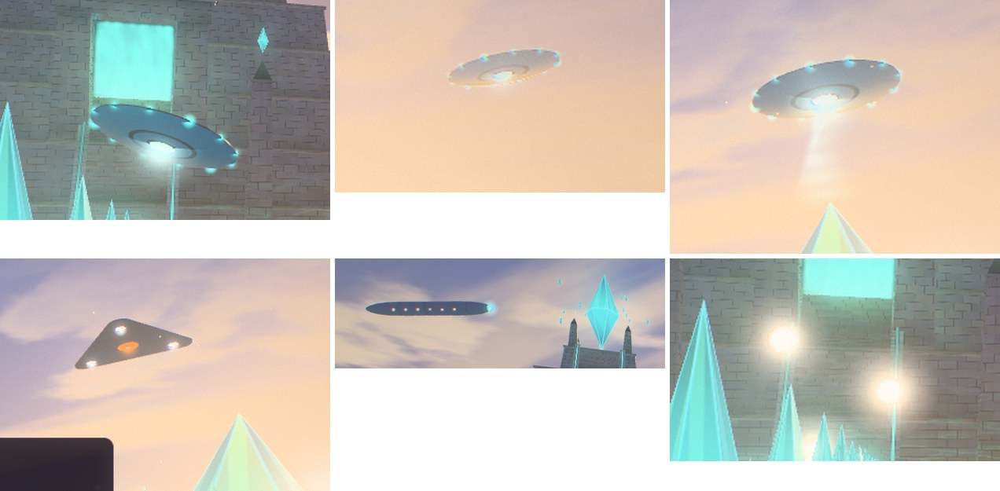

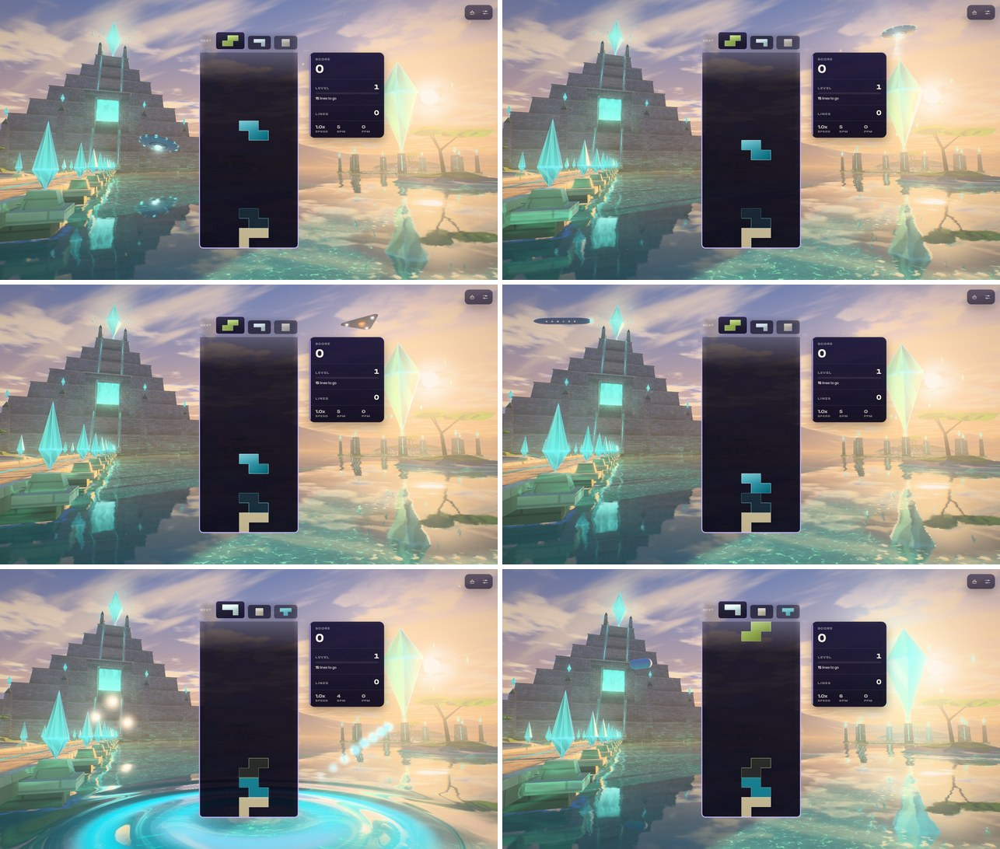

How it is built:

- **Generated, like the rest of the sanctuary.** Blender was offered and not needed: the hulls are
  surfaces of revolution (saucer, mothership, capsule, orbs) and a faceted plate (the triangle),
  and at the size they fly on screen (60 to 220 px) what makes them read is their shading, their
  lamps and how they move. They stay seeded, tested (winding, sizes) and free of binaries.
- **One mesh for all five.** Every hull is a contiguous range of one triangle buffer; only the kind
  that flies is drawn (`setDrawRange`), with one material that branches on what each vertex is made
  of (chrome, paint, matte, glass, lamp, orb). Chrome mirrors the dawn along its own reflection (the
  lagoon below the horizon), paint takes the sun and the sky's light, distance hazes it, and a
  visitor that comes or goes out of thin air dissolves into the sky behind it. Both parts stand in
  the lagoon's mirror.
- **Lamps are sprites** from a pool of 16 quads fed from a uniform table each frame (a lamp never
  shrinks under a few pixels), plus one slot that draws the beam as a strip turned to the eye. They
  are bright enough (HDR 5 to 16) to read against the dawn sky; the saucer's rim lamps and the
  mothership's engine take the hour's crystal colour, so they turn violet in the blue hour.
- **Routes are keys seen from the rest camera** (bearing and height off the view, distance; or
  metres in the camera's frame; or metres over the Halcyon), joined by a cubic with standstills,
  so they keep to the sky round the card at any aspect. On an upright screen they close in and
  rise into the band of sky over the card. Every route stays out of the band round the sun, where
  the post's shafts veil anything dark, and passes in front of the masonry rather than behind it.
- **The schedule is a function of the clock**: slots of 50 s, four in five hold a visit, every route
  once per cycle in a shuffled order. Seek and replay agree. Under reduced motion only the slow two
  (the triangle and the mothership) fly. `world.callVisitor(route, start)` flies one on demand.
- **Cost.** Between visits nothing is drawn. In flight: one draw of at most 4,320 vertices and one of
  17 sprite quads, twice with the mirror; four more pipelines, built out of sight over the first 90
  frames so the first visitor costs no compile. Every tier has them. No GPU timings were taken
  (the machine's GPUs were shared with other sessions); the per-pixel work is a few small objects.

Verified: 23 new tests (`tests/unit/halcyon-apex-visitors.test.js`: hull winding and sizes; the
schedule's rate, determinism and reduced motion; each route's seconds in view clear of the card and
HUD at 16:9 and upright; smooth flight; the world's warm-up, draw range, seek and calls; both
materials through the WGSL and GLSL node builders), the theme's 204 tests and the URL catalog.
Playground captures with clean consoles on WebGPU at High (every route), Medium upright, Minimal,
the blue hour, and Low on the WebGL2 backend. In the real game (Electron, single player, WebGPU,
High): the first scheduled saucer flew on its own 14 s in with only its hull drawn, each other route
flew when called, no console errors.

Reproduce: `/playground.html?effect=halcyon-apex&t=40&board=1&visitor=<route>&visitorAge=<s>`
(`saucer`, `halcyon`, `triangle`, `mothership`, `orbs`, `capsule`); without `t`, `visitor=` flies
it again and again.

## Skyfarers and the board's great moments (2026-11-16)

Asked for: an audit of the whole theme and whatever would make it one of the game's most
stunning, with better ships, far more variety in how they fly, and a distinct effect for every
event, the biggest moments the most spectacular. Built on `feature/halcyon-apex-skyfarers`.

### What the audit found

| Part | Finding |
| --- | --- |
| The picture at rest | Strong: the back-lit dawn, the mirror, the crystals. Kept as it was. |
| The visitors | The weakest part. Six scripted routes, one craft at a time, about once a minute, the same every time. Hulls were primitives (a lens, a flat delta, a pill, a banded tube) 60 to 100 px across. |
| Lock, hard drop | A hard drop was a lock with a wider ring: its crown of spray rose behind the card, where nobody sees it. |
| One, two, three lines | The same wave three times. Its front is past the card in a third of a second and a thin line near the horizon after that, so two lines and three could not be told apart. |
| Four lines, perfect clear | The pillars are a hand's width of light and the ring over the sky is faint: the largest moments did not look much larger than three lines. A perfect clear was a warmer four lines. |
| Twist | Two rings, like a lock. The crystals' turn is real but slow to read. |
| Level up | The palette changes, with a faint ring. Nothing marks the moment. |
| Pieces | Four of the seven were teal (`#8ff5ee`, `#3fd6cf`, `#2a8fa0`, `#bfd8d6`) and two sand: hard to tell apart on the board, and the world, which takes a piece's colour for its light, played in one hue. |
| Sky | Empty above the clouds outside the blue hour. |

### The fleet

Eight hulls, modelled in Blender (`scripts/blender/halcyon_apex_fleet.py`, run headless) and
shipped as a generated module (`halcyon-apex-fleet-model.js`, about 200 KB of source; nothing is
loaded at run time). Each is built for how the sanctuary sees it, from the lagoon looking up, so
for its silhouette and its belly first.

| Hull | What it is |
| --- | --- |
| `swift` | A courier dart, 21 m: a needle body of pearl with a dark belly, crescent wings swept back to points like a swallow's, two tail streamers, a canopy, a seam of light along its keel, twin engines. |
| `manta` | A dark flying wing, 44 m across: a thick heart thinning to down-curved tips, two horns at its brow, a long tail spine, veins of light over its back, white lamps and an amber heart under it. It beats its wings, slowly. |
| `barge` | A hauler, 34 m: a glazed cab on a spine between two chrome pontoons, six crystals of cargo that glow in the hour's colours, an engine block of four. |
| `saucer` | The disc the sanctuary has always had, redrawn: a chrome lens, a dark belt of chasing lamps, a glass dome, an emitter and six blisters under its belly. |
| `ark` | A ship of the sky, 233 m: a pearl hull keel-deep amidships with its bow and stern swept up, through two habitat rings, under three tall sails; a row of lit windows, three engines. |
| `hoop` | A ring that carries a crystal, 20 m: an upright hoop of pearl with a cut stone floating at its centre and three pods on its rim. |
| `capsule`, `orb` | The plain white capsule and the ball of light, as before. |

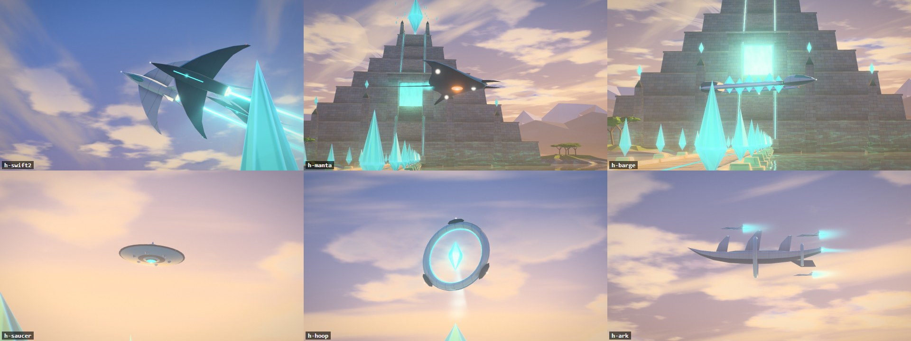

Every part is a closed shell lofted from sections (a superellipse ring along a body, an airfoil
ring along a wing), turned outward by its signed volume and tagged with what it is made of.
Normals are smoothed across edges flatter than 38 degrees; ambient occlusion is cast against the
whole hull and baked per vertex, so wing roots and the space between a ring and its hull darken.
Ten surfaces: the six there were (chrome, satin, matte, glass, lamp, orb) and pearl (a pale
lacquer that takes a breath of the hour's crystal colour where it turns away), engine, trim
(seams of light) and crystal. Painted surfaces carry plate seams, drawn from the hull's own
metres and gone before they would shimmer. A pale hull under a blue zenith read as blue paint, so
the sky's share of a hull's light is taken half way to grey.

### How they fly

`halcyon-apex-flight.js` (three-free). A sortie is a leader's path and the ships that fly it.
The path is a cubic through keys: as seen from the rest camera, as metres in its frame, or round
an anchor (the Apex, the Halcyon). Every ship of a formation flies the leader's path a moment
behind it, set off to the side, above and astern in the leader's own frame, so a formation banks
and climbs as one; a break sends each ship its own way; a `bearing` turns a ship's whole path
about the viewer (the salute's fan). What a ship points along and how far it leans comes from
the path itself: its nose lies on its velocity, and its up lies along the lift that would bend
the path (what is left of its acceleration square to its flight, plus what holds it up). So a
hard turn is flown on a wing tip and a loop upside down over the top, with nothing scripted, and
it rights itself as the path straightens.

Three streams of traffic run at once, each a function of the world clock:

| Stream | Slot | Sorties |
| --- | --- | --- |
| far | 24 s | `lane` (one to four couriers high and a kilometre or two out, drawing pale trails), `convoy` (two or three barges nose to tail), `ark` (the ark, with an escort of swifts about it, about once in five minutes) |
| mid | 31 s | `flyby` (two to five swifts in one of six formations, sometimes a roll that runs back through them, sometimes a break), `orbit` (a flight once round the Apex), `chase` (two swifts through a weave), `glide` (mantas), `haul` (a barge on its own), `string` (orbs out of the heart gate's mouth and down the causeway) |
| hero | 47 s | `skim` (swifts down the pyramid's face in a dive, flat over the lagoon in a plume of spray, past the viewer's shoulder), `loop` (a loop and a half before the stair and away), `spire` (swifts climbing the open sky beside the card in a helix, their trails wound together), `ray` (a manta's long low pass), `hang` (the manta that stops and turns), `rite` (the hoop come to the Halcyon, its beam on the diamond), `trio` (three saucers down as falling leaves, turning round each other, gone one by one), `dock` (a barge unloading over the causeway), and the four there always were: `saucer`, `halcyon`, `orbs`, `capsule` |

Every sortie's numbers (side, height, distance, speed, how many, which formation, which
flourish) are drawn from its slot's seed, so the same kind of pass never looks the same twice.
A stream turns through its names in a shuffled order, never the same twice running. On average
between one and two sorties are in the sky (some four hulls, mostly the far ones, small) and it
is empty one second in sixteen; never two heroes at once; never more hulls than the sky can draw
with a salute of seven on top. Under reduced motion only the slow sorties
fly, and no salute.

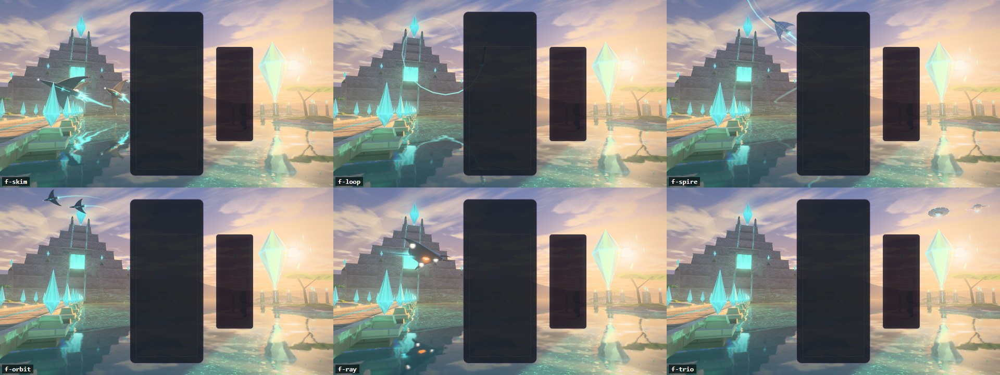

The craft touch the sanctuary. A hull skimming the lagoon throws spray; one hanging low presses
rings into it; a barge at the causeway pours its six crystals of cargo down as sparks, and each
runs the ley line into the Apex, which keeps it; the hoop's beam (and the saucer's) fills the
Halcyon while it burns.

### How they are drawn

- **One instanced draw for the whole fleet.** All eight hulls are one buffer (7,765 vertices),
  each vertex told which hull it belongs to. An instance reads where it is, its bearing (a
  quaternion) and its kind from a table of uniform rows, and a vertex of another kind leaves the
  clip volume. One pipeline, any mix of hulls, 24 at once; an empty sky draws nothing.
- **Lamps** are the sprite pool there was, now 192 and filled each frame; a far hull lights only
  its brightest.
- **Trails and beams are ribbons** turned to the eye on the CPU: 24 cross-sections each, a run of
  the craft's own path a few seconds back. The path is a function of the clock, so a trail needs
  no memory and a seek draws the same one. A trail is the engine's light, gone in a breath, in a
  longer wake of vapour that takes the dawn.
- All three parts stand in the lagoon's mirror.

### The events

| Event | What was added |
| --- | --- |
| Hard drop | Two fans of spray thrown out from under each side of the card, where the lagoon shows, and a second ring on the heels of the first. |
| Two lines, three lines | The board's light flies to the great crystals themselves: a wisp to the Apex and one to the Halcyon for every line past the first (two for two lines, four for three), arcing across the sky to both sides of the card. One line stays the wave alone. |
| Four lines | A **prism burst**: as its wave reaches each great crystal, the crystal breaks what it lets go of into its colours, a fan of sixteen rays, each a spectrum along its own length. And the **salute**: five swifts in over the viewer's head, fanned across the whole sky on bearings the card and the HUD leave open, running out to the horizon on trails of sunfire, pulling straight up and bursting apart. One salute at a time. |
| Perfect clear | Seven swifts, and the **crown**: three rings of the spectrum open over the sky from the Apex with a glory of rays round the crystal, and eight orbs rise round it in a turning ring and burst outward. |
| Twist | A helix of glitter winds up round each great crystal, twice round. |
| Level up | The hour turns in a breath: the clouds race as in a time-lapse and ease off, both ley lines run a pulse of the new hour's light their whole length, and a flight comes over to see. |

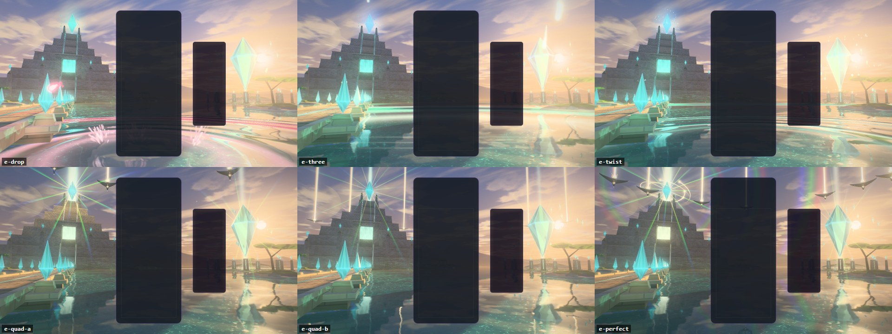

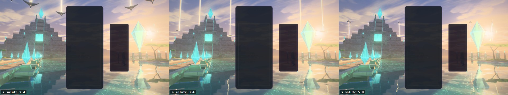

### The giant, and the pieces

A pale ringed giant hangs low in the dawn over the left ranges (beside the Apex on an upright
screen), a limb of it lit toward the sun. By day it is little more than a paler disc of sky
behind the clouds; as the hour darkens it stands out with the stars, which go out behind it.

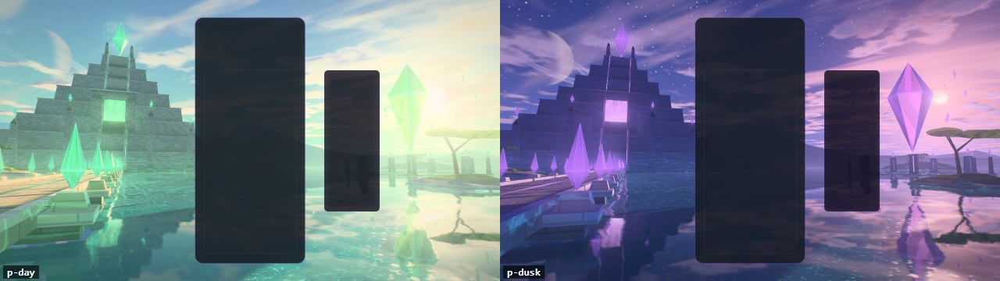

The pieces are seven hues of the sanctuary, one each: I the sun's gold `#f4c95d`, O the lagoon's
turquoise `#2fd9be`, T the rose hour `#f08aa0`, S the blue hour's violet `#a98cf2`, Z the islets'
green `#8fcf5b`, J the sandstone at first light `#e0723f`, L the clear morning's blue `#4a8fe6`.
No two sit within 18 degrees of hue, and none is the hue its shape usually wears (the palette
screen reads 0/7 where it read 3/7). Since the world takes a piece's colour for the light it
sends up the ley lines, the sanctuary now plays in seven colours.

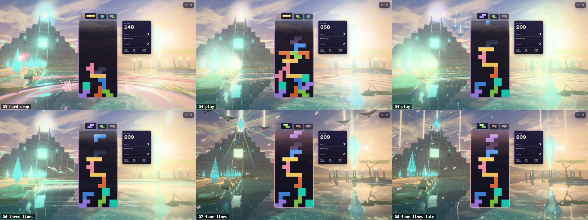

### Cost

One more pipeline (the bursts, 32 strips) and one more for the trails; the hulls and the lamps
replace the two there were. In flight: one instanced draw of at most 24 hulls (every hull's
vertices go through the vertex stage for each instance, some 7,600 triangles an instance, nearly
all thrown out before a pixel), one of lamp sprites, one of ribbons, each twice with the mirror.
The sky's two new terms sit in branches: the giant's is taken per pixel inside its rings' reach
and holds no derivative and no texture (WGSL allows neither there); the crown's is skipped
outright at rest. On the CPU a frame evaluates each flying ship's path a few dozen times (its
pose and its trail's 24 points). No GPU timings were taken (the owner's standing rule: capped
30 fps captures unless asked).

### Verified

- Unit tests: `tests/unit/halcyon-apex-visitors.test.js` rewritten (49 tests: the hulls' ranges,
  winding, sizes, surfaces and lamps; the traffic's rate, determinism, variety and reduced
  motion; every sortie over six seeds held over the water and out of the pyramid's masonry;
  smooth flight; a swift along its velocity, banked into a turn, upside down over the top of a
  loop; formations through a turn; the salute's fan; each scheduled sortie's seconds in view
  clear of the card and the HUD; near hulls out of the sun's glare; the world's handling; the
  three materials through the WGSL and GLSL builders) and `tests/unit/halcyon-apex-events.test.js`
  (new, 15 tests: each event's own answer, the giant, the palette, the bursts and the sky through
  both builders). The theme's other suites pass unchanged
  apart from the parts list.
- Playground captures with clean consoles, WebGPU at High: every sortie as a strip of six
  moments; every event; the five hours with traffic. Also Low on the WebGL2 backend, Minimal,
  and an upright 430 × 852 frame at Medium.
- In the real game (headless Chrome, single player, 30 fps cap): real hard drops from the
  keyboard (nine locks, eighteen pulses, both great crystals holding light, the first scheduled
  hero flying on its own), then three lines, four lines, a perfect clear, a twist and a level
  called on the live world. The theme's console output was clean.

Faults found on the way, fixed and covered by the tests above: eight routes ran through the
pyramid's volume (a loop inside it, a dive through its flank, an approach through its corner),
which no capture shows because the depth test hides the hull; a far crossing given as two wide
bearings bulged out of the top of the frame and was never in view; the manta's low pass crossed
the sun's glare; a loop's exit did the same.

Not verified, and open calls for the owner: frame cost on the integrated GPU; local multiplayer
and Infinity layouts in a capture; a physical phone (upright, the salute's fan closes to what the
frame shows, and several heroes fly behind the card). The piece palette is a visible change and
is the owner's to keep or revert. The salute's swifts pass low and back-lit, so they read as dark
silhouettes on golden trails. A hero pass now and then is large (the skim ends some 70 m from
the eye). The barge's unloading floods the causeway's crystals for a few seconds. The theme icon
and `docs/theme-screenshots/halcyon-apex.png` still show the sanctuary without its fleet.

### Reproduce

`/playground.html?effect=halcyon-apex&t=40&board=1&traffic=0&visitor=<sortie>&visitorAge=<s>`
with `visitorSeed=<n>` for another draw of its numbers and `zoom=ship,<fov>` to follow its leader
(a close look at a hull). `traffic=0` empties the sky of everything scheduled. Events as before
(`event=drop|clear|quad|perfect|twist|levelUp`, `eventAge=<s>`, `lines=<n>`). To rebuild the
fleet: `blender --background --factory-startup --python scripts/blender/halcyon_apex_fleet.py --
--out src/themes/halcyon-apex/halcyon-apex-fleet-model.js --preview <dir>`.

## Captured previews

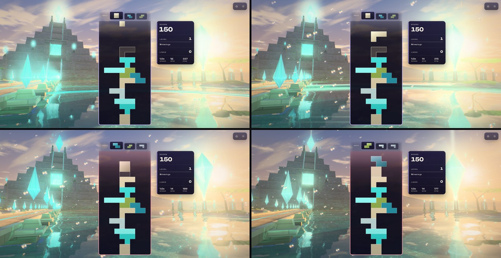

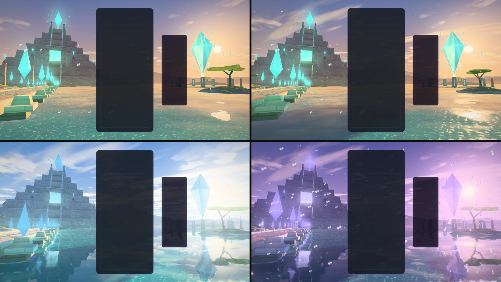

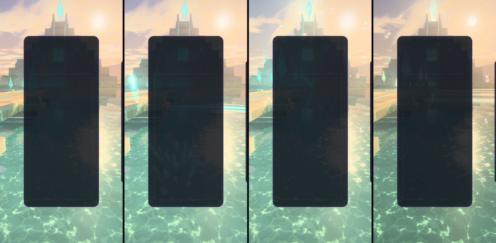
