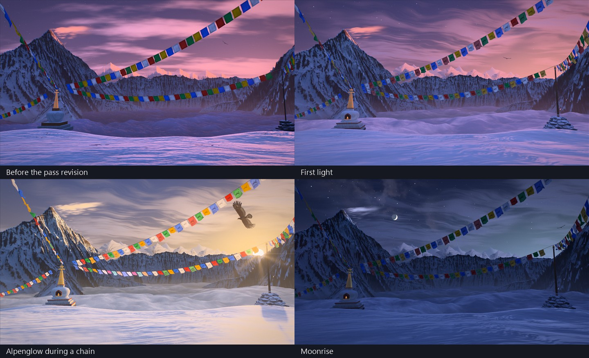
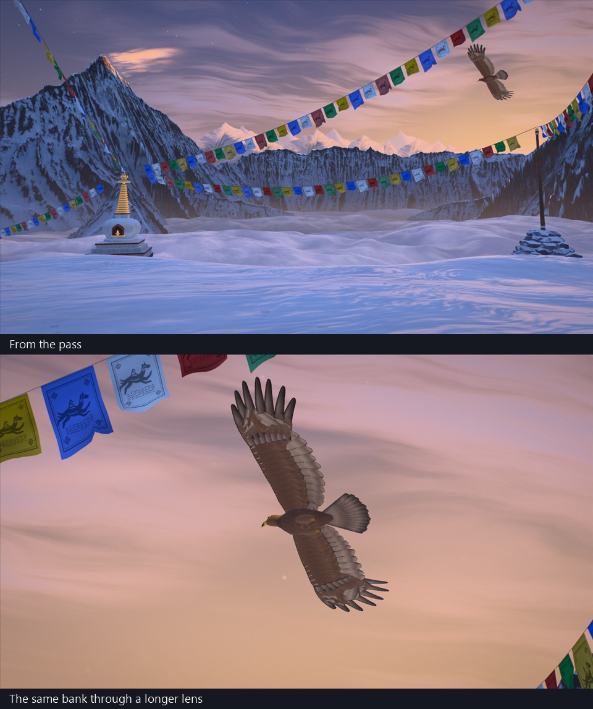
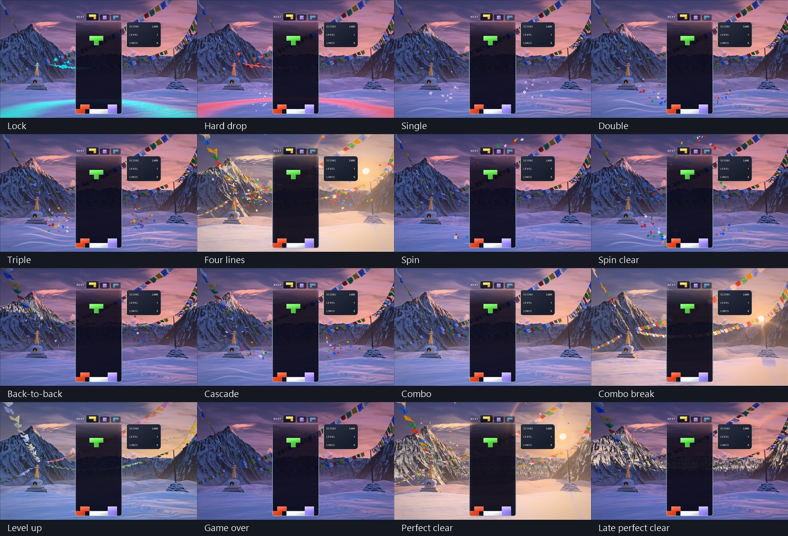
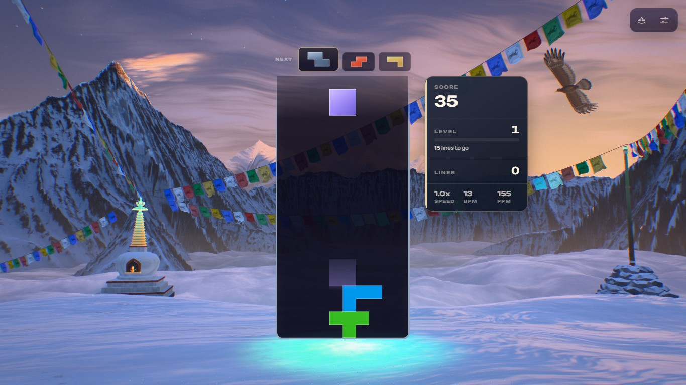

# Himalayan Peak — the high pass

The mountain still answers a chain of clears with sunrise. At rest, spindrift peels off the summit, the cloud banks travel through the basin, and the light moves through first light, gold, cobalt, ember and moonrise. A close eagle pass can now happen during any of those hours.

## Visual audit

| Subject | What the first capture showed | What changed |
| --- | --- | --- |
| Hero peak and distant range | The main horn had a recognizable silhouette. Its shadowed face lost snow detail and the evenly lit distant triangles gave little sense of depth. | Blue firn and a hanging glacier describe the shoulder. Two overlapping skylines put a second generation of summits beyond the cols. Snow and exposed rock catch different amounts of alpenglow. |
| Snow and clouds | The near snow reflected in long, shiny stripes. Cloud billows had creases sharp enough to read as another rock face. | Broader wind-scoured patches and less grazing reflection break up the foreground. Cloud shoulders carry soft highlights that fade into haze against the back wall. |
| Dusk and night | Wide pink bands dominated the sky. The star field and moonrise had little identity from the gameplay camera. | Wind shears the cirrus into fibres and builds lenticular shelves. A tilted Milky Way, small bright stars and a moving crescent with earthshine give the night its own composition. |
| Flags and landmarks | Identical rectangular flags, a dark stepped stupa and a stack of black boxes dominated the foreground. The pole sat against the frame edge. | The flags carry an original wind-horse woodcut, sun-faded dye, uneven hems and curved folds. The chorten has an offering niche, a butter lamp, thirteen gilt rings, a parasol and a crescent finial. The bound wooden pole stands farther inside the frame on fitted schist slabs. |
| Eagle | The bird banked convincingly at a distance. Its route and wingbeats repeated every 84 seconds, while smooth wings and missing facial details gave little reward for a closer look. | A new Blender-authored bird combines a keyed wingbeat with live gliding, banking, head stabilization, tail trim and individual primary-feather motion. Each session selects a different route through the thermal. |
| Board and HUD | The playground still previewed the older glass card. Pulsing pieces, saturated rings and colour separation at the edges competed for attention on impacts. | The preview uses the current solo well. Pieces retain their established seven colours with a steady bevel. Slate-blue walls and warm lettering echo the pass, and the camera adds a gentler colour fringe on impact. |

## The eagle in flight

The model has a hooked bill, brow, golden nape, tucked talons, layered coverts, seven articulated primaries per wing and a fanned tail. Each wing feather has coordinates for its shaft and slanting barbs, so that detail can fade as the bird recedes. Snow and cloud light the underside when the sun is behind it. The GLB contains one skinned mesh, 15,316 triangles, 26 joints and a keyed stroke. Reduced motion keeps the eagle on a distant glide. [Blender source](../scripts/blender/himalayan_eagle.py) · [In-engine flight recording](himalayan-peak-captures/november-flight.webm)

## Gameplay choreography

| Event | Visible response |
| --- | --- |
| Lock and hard drop | A lock sends the piece colour into the nearest prayer line. A hard drop also fans ice off the ground beside the well, with the size and reach following the fall distance. |
| One, two and three lines | A single sends blue light out from the cleared row. A double answers from the two margins in lilac. A triple draws rose-coloured ribbons and starts an avalanche on the hero’s face. |
| Four lines and perfect clear | The pass briefly dims before dawn reaches the snow, the flags release light and the avalanche runs. A perfect clear adds a prismatic corona, ice pillar and tangent arc. A late perfect-clear notification adds the crown to the ongoing scene. |
| Twist and spin clear | The papers curl around the well and the lines snap twice. A spin that clears rows adds the corresponding clear response. |
| Cascade, combo and back-to-back | Cascade waves follow the resolving rows. A sustained clear chain brings the sun over the col and keeps the flags lit. Breaking it releases colour. Back-to-back clears send a reply from the chorten to the pole. |
| Level and game over | The new hour’s colour travels along the flag lines at level-up. Game over settles the pass and lets a last fall of pale ice leave the spire. |

## Reproduce the captures

Start `npm run dev:playground`. The default capture seed is 3187. Set `seed` to compare a different flight at the same time.

- [Clouds and first light at 8 seconds](http://localhost:5173/playground.html?effect=himalayan-peak&t=8&maxFps=30)
- [Moonrise](http://localhost:5173/playground.html?effect=himalayan-peak&t=20&level=5&maxFps=30)
- [Close bank at gameplay scale](http://localhost:5173/playground.html?effect=himalayan-peak&t=104&seed=3187&board=1&maxFps=30)
- [The same instant through a long lens](http://localhost:5173/playground.html?effect=himalayan-peak&t=104&seed=3187&eagleLens=11&maxFps=30)
- [Perfect clear](http://localhost:5173/playground.html?effect=himalayan-peak&t=22&event=perfect&eventAge=1.6&board=1&maxFps=30)

The captures cover hardware WebGPU, forced WebGL2, Minimal quality, a 390 × 844 portrait viewport and reduced motion. The event sheet uses the playground’s solo board. The frame below comes from the live single-player game after two keyboard hard drops. The theme received both locks and sent their colours into the flags.

The desktop timing check used a 30 fps cap, a 1280 × 720 viewport and an NVIDIA Blackwell GPU. The playground recorded 129 CPU samples in the first idle run, with a median of 2.6 ms for the measured work. Physical phones and integrated GPUs still need separate measurements.
