# Kaleidosonic — a new theme in Singing Bowl's place (2026-10-13)

The owner asked for a total visual overhaul of Singing Bowl ("this theme just feels like a
demo"), built on three r186 and made a trippy, psychedelic visual masterpiece with amazing
lock-piece and combo effects, researched, unique, and renamed to fit its new style, starting from
`main` (850460d0). He named the rebuilt themes he likes as the bar: Ice Temple, Neon Dusk, Neon
District, Fall, Sakura Twilight, Forest, Himalayan Peak, Golden Forest and High Coast.

Singing Bowl (a classic `WebGLRenderer` scene of instanced recursive cube trees, a mirror floor and
rainbow hue-cycling) is retired: its id, folder, container, CSS, icon, song file and track key are
gone, `singing-bowl` is an alias of `kaleidosonic` in `RETIRED_THEME_IDS`, `SingingBowl` of
`Kaleidosonic` in `RETIRED_TRACK_KEYS`, and the frozen V2 save table keeps the old id. The new theme
takes its registry position, group (`meditation`), Odyssey orb 56 (chapter 7's finale, renamed from
"Recursive Infinity" to "Indra's Net", its two descriptions rewritten) and its placeholder song (renamed only: a
placeholder must stay a byte copy of `blood-moon.mp3`).

To look at it: `npm run dev`, then `/playground.html?effect=kaleidosonic&t=10&board=1`
(`mood=0..5` holds a mood; `combo=<n>` holds a chain; `event=lock|drop|clear|quad|tspin|perfect|levelUp|release|over`
with `eventAge`, `u`, `row`, `piece`, `lines`; `icon=1` the icon's lens). In the game:
`/?unlockAll=1&skipIntro=1`.

## The idea

Research (psychedelic visual phenomenology and art, cymatics, real-time fractal rendering) gave
three things the theme is built from:

- **Psychedelic imagery** reads through a few renderable properties: Klüver's form constants
  (tunnels, lattices, cobwebs, spirals), fractal self-similarity, kaleidoscopic symmetry, slowly
  breathing and flowing surfaces, and saturated complementary colours on black — the 1960s
  black-light poster.
- **Cymatics** (sound made visible as standing waves: Chladni plates, Faraday waves) was the one
  motif the fleet's research round had reserved for this slot, and "sound made visible" is on the
  catalogue's list of unclaimed event grammars. A struck singing bowl rings; here every piece is a
  struck note.
- **The Apollonian sphere-inversion fractal** is Indra's net: an endless lattice of pearls in
  which a jewel hangs in every cell. It ties the meditation heritage, the psychedelic and the orb's
  old name ("Recursive Infinity") together, and gives the orb its new one ("Indra's Net"); it is exactly periodic (so a dive can fly one period
  and land on the same view), and it is cheap enough to march in real time. KIFS, Mandelbox,
  Mandelbulb and pseudo-Kleinian fields were prototyped beside it and dropped (blobby, blocky,
  noisy or too busy). Every shader was written from the maths, not from shared shader code.

## The picture

The eye floats halfway between a floor and its vault in a hall of the temple, looking diagonally
across the pillar lattice (never down a nave: Ice Temple owns that). Hourglass pillars of pearls
stand at every lattice line, nested spherical voids stack into arches, and halls recede into the
mood's own darkness. The **core** — a faceted gem (twelve icosahedral facets lit from within in
the mood's colours, sparkling edges) inside a turning twelve-lobed lotus corona with sound rings —
hangs in the open air left of the card (above it on a phone). Its image hangs in the same place in
every cell, so the halls recede through glowing **jewels** that light their own halls and twinkle.

Lit as under black light: near-black pearl stone, fluorescent rims, and **veins** — concentric
nodal rings of the nearest source's standing wave cut by the stone, broken into twelve petals —
in three neon colours per mood chosen region by region from the fractal's orbit trap. Floors and
vaults carry each source's **Chladni figure** (nodal circles crossed by twelve diameters).

## Moods: palette by clock and level

Six moods, hue-ordered by the core: rose mandala, violet hum, azure bell, teal chime, jade drone,
amber gong. Each has its own darkness (plum, indigo, navy, teal-black, green-black, umber), its
core colour and three neons that vibrate against it. **The moods turn with the clock by
themselves** — wheel = clock / 100 s + (level − 1), resting 15 % of each step on the mood's own
palette — and a level-up steps the wheel forward from wherever the last turn was heading; a new
run keeps the place. The neon change crosses the stone region by region, never as a straight mix
of two complements (which would go grey).

## What gameplay does

| Event | The temple |
|---|---|
| Lock | A struck note at the stone beside the card the piece's column and row map to: a lotus of light blooms and closes at the struck point, the stone round it floods with the piece's colour, a wavefront crosses the stone, concentric ripples ring on at the piece's own wavelength (the I rings highest, the O lowest), and every jewel the front passes rings in its colour |
| Hard drop | The same, stronger and faster, and the eye kicks back and returns |
| Line clear | A harmonic: a shell of light leaves the core, nodal rings bloom round it (more lines, more shells), the whole temple resonates, jewels ring as the front passes, and the fractal refolds (its inversion springs to the next shape) |
| Chain | The trance: the temple grows finer, veins brighten and flow faster, and the lens folds into a kaleidoscope — a mirror at 2, six sectors at 5, twelve at 8 (alternate sectors take the mood's other colour) — the core's images becoming a crown of jewels round the card; a broken chain lets the mirrors go |
| Four lines | The dive: the temple streams past as the eye flies one diagonal lattice period down its free lane, the lens breathing wider, and lands on exactly the view it left |
| T-spin | The kaleidoscope turns: the eye rolls a full turn |
| Back-to-back | A drone: nodal rings pulse steadily round the core |
| Perfect clear | Every mirror aligns into one still mandala and the floors' figures flare |
| Level up | The mood wheel steps on (with a flare of the core) |
| Game over | The light sinks and the rings flow back into the core; a new run raises it |

Reduced motion: no roll, no dive flight (the resonance alone), no kick, no turn, a slower drift;
switched on mid-flight, it stops a dive, roll, kick or turn where it is.

A meditation click's clear (a screen point, no board) sounds its harmonic and refolds the temple
without a flash or a dive. Flashes come at most one per 0.34 s. With several boards side by side
(local multiplayer) the core hangs above the cards and each lock strikes from the strip under its
own player's card.

## How it is made

- **One full-screen material** (`kaleidosonic-temple.js`): every view ray is folded through the
  kaleidoscope (`ksLensFold`, three continuous stages about the core's live bearing), then marched
  through the Apollonian field (`createTempleField`: fold into the cell, invert, repeat; a
  fractional fold count blended between whole counts so the trance grows the temple finer without
  a pop), each ray starting where a small scout pass found its block of pixels still in open air
  (see *Performance pass*). Shading, veins, strikes, harmonics, jewels (an Amanatides–Woo walk through the cells the
  ray crosses), the gem (an analytic ray–sphere hit with facets snapped to the icosahedron's axes)
  and the fog all happen in that one pass.
- **The world** (`kaleidosonic-world.js`) owns the uniform bag, the eye's rig, the core's place
  (searched for open air with a long free view at the hero anchor), strike targeting (a CPU march
  of the same field from the rest eye), the mood wheel, the refold spring, the trance, the folds,
  the dive and every event slot. Phases whose rate gameplay changes (the veins' flow, the core's
  pulse) are integrated and wrapped; strikes' and harmonics' ages are written each frame, so the
  shader never compares against a clock.
- **Post** (`kaleidosonic-post.js`): calm zones over cards and HUD, a hue-preserving max-channel
  bloom, a chromatic fringe that only the resonance and the dive bring out, a hue-preserving filmic
  and a grade that adds nothing to the blacks.
- Adapter, director and composition are High Coast's, renamed (lifecycle, one WebGL2 recovery,
  session state across rebuilds, the clock and level surviving a rebuild in place).

## Quality tiers

| Tier | March steps | Folds | Strikes | Jewel cells | Veins | Light map | Beams | Jewel beams (shadowed) | Mirrored jewels |
|---|---|---|---|---|---|---|---|---|---|
| Minimal | 34 | 7 | 6 | 5 | 0.5 | 96² | 6 | — | — |
| Low | 46 | 8 | 8 | 6 | 0.62 | 128² | 6 | 1 cell (1) | 1 cell |
| Medium | 66 | 9 | 10 | 8 | 0.85 | 192² | 12 | 2 cells (2) | 1 cell |
| High | 96 | 10 | 12 | 10 | 1 | 256² | 12 | 3 cells (2) | 2 cells |
| Ultra | 120 | 10 | 12 | 10 | 1 | 320² | 12 | 4 cells (3) | 2 cells |
| Extreme | 150 | 11 | 12 | 12 | 1 | 384² | 12 | 5 cells (3) | 3 cells |

Bloom from Medium up; the chromatic fringe from Medium up; beam spots on the stone from Medium up.
Every tier keeps every feature and every event. (Until the light pass, Ultra and Extreme had a
12- and 18-step soft shadow toward the core; the light map now shadows the stone on every tier.)

## Decisions and traps

- **A near-miss aura** (glow summed along the march) saturates inside a dense fractal — every ray
  runs close to stone — and veiled the whole frame in the mood's colour. Removed.
- **An additive shadow lift in the grade** (`+ (0.006, 0.002, 0.012)` linear) turned every black
  into plum haze after sRGB encoding. The grade now only scales.
- **Luminous fog** (bright far air) gave depth but made the frame milky; the black-light look came
  from near-black stone, each mood's own dark fog and bright, narrow neon.
- **The kaleidoscope's fold centre** must follow the core's LIVE bearing (the eye drifts): folded
  about its rest bearing the core was doubled into a close pair.
- **Sector colours round an odd ring** (six half-sectors in three pairs) flip at `atan`'s branch
  cut and drew a seam; only the twelve-sector stage alternates colour.
- **A strike's shell drawn in the air** read as a soap bubble and stacked into a wash; only a
  hair-thin, short-lived rim stays in the air, the light lives on the stone.
- **A Faraday quasipattern** seen far off its centre on a vault reads as scribbles; the floors carry
  a circular plate's Chladni figure per source instead.
- **Strikes over a tier's cap** must drop the oldest, not the newest (found by the test agent).
- **A lock's flare lit the stone**: the core's light carried every event's flare, so each lock
  pulsed the whole temple. The flare now brightens only the core's corona and gem; the stone keeps
  to the pulse, and a lock's light stays where it struck.
- **The mirror ran down the frame with a kept side** (left or right, from the core's live
  bearing): a T-spin's roll (or the phone's centred core drifting) carried the core across the
  lens's axis and cut the whole frame over to the other half. Freezing the side lost the core from
  the frame instead. The mirror's line now runs square to the core's bearing, so the core's half is
  always the kept one and the mirror turns with a roll, continuously.
- **Phase wraps** must close a whole number of periods of every multiple a shader takes of the
  phase: `TAU · 64` did not for `× 0.15` and `× 0.7` (a jump every few minutes). `TAU · 80` does,
  and a test reads the multiples from the shader source.
- **Derivatives inside a branch** (`fwidth` under `If(onGem)`) are undefined on non-uniform control
  flow; the gem's facet edge width is worked out from the pixel's angle instead. Every `atan(y, x)`
  takes a hair on `x` (`atan(0, 0)` is undefined in GLSL and WGSL).

## Verification

- **Real GPU, playground** (RTX 3070, WebGPU, High, 1600 × 852): about 5 ms a frame. Every
  final capture below was taken on the final code; the console carries only the harness's own
  two lines (Vite's blocked HMR socket, Electron's CSP notice) — no WebGPU validation message.
- **Real game** (the dev server, the real menus and board, WebGPU, High): 130 fps at rest and 131
  through a four-line dive (the frame cap), no dropped frames; locks, hard drops, clears, a chain
  to the mirror, a four-line dive, game over, a level-up and a rebuild in place to Medium, then a
  clean exit to another theme; console clean.
- **Clock-only drift in the real game** (no clears, level 1): wheel place 0.11 at 11 s, 0.60 at
  60 s, 1.12 at 112 s, 1.61 at 161 s, 2.10 at 210 s, 2.62 at 262 s, 3.11 at 311 s, 3.60 at
  360 s — rose → violet → azure → teal → jade with no level change (`clock-ingame.jpg`).
- **WebGL2 backend** (`forceWebGL=1`): the same picture, chain and roll included; both backends'
  shaders also build in Node with no warnings at every tier.
- **AMD integrated GPU** (`force_low_power_gpu`, High): 35–46 ms a frame; Low and Minimal were
  trimmed after that reading. Not a perf reference (the dedicated GPU is).
- **Phone validator** (`scripts/lib/mobile-webgl2-validation.mjs`): passes at Low and Minimal.
- **Unit tests**: 257 in seven `tests/unit/kaleidosonic-*.test.js` files — the world's
  choreography without a renderer (strikes, harmonics, the kaleidoscope's stages, the dive's
  seamless landing, the roll turning the mirror continuously, reduced motion stopping motion in
  flight, meditation clicks, the flash gap, the core-only lock flare, phase wraps closing whole
  periods of every multiple the shader takes, multiplayer placement, clock-only mood drift,
  determinism, session round-trips), the director, the composition, the core, the shaders' build
  and the rename's save migration. The full suite: 883 of 892 files pass; of the nine red, seven
  are timeouts and bake-time budgets on a loaded machine (all seven pass run alone), the other two
  the TTS recorder's environment and a locale's thousands separator — none touches this theme.
- **Static gates**: palette, typecheck, ts-ratchet, lint ratchet (610 < 807), architecture fitness,
  theme lifecycle, dependency boundaries, perf budgets, release gates, the production build with
  the boot-closure guard, the IP-string gate and the Pages artifact check all pass.

## Performance pass (2026-10-19)

Kaleidosonic was the fleet's heaviest GPU theme (63–79 % GPU busy at the 120 fps cap where the
others sat near 35 %), and Extreme felt heavier than its neighbours on a laptop RTX 3070. Every
change below keeps the picture: the same frames, to sub-pixel placement of the hairline veins.

| Change | What it removes | Frame |
|---|---|---|
| The soft shadow read its field value twice per step without `.toVar()`, and the generated WGSL called the whole fractal **twice** per step | 18 of 36 shadow field calls a pixel (Ultra, Extreme) | identical |
| The march's field returns the distance only; the orbit trap is read once, at the hit (`createTempleTrap`) | the trap's mins in every march step | identical |
| The lattice fold `fract(p/2 + 1/2)·2 − 1` as `p − 2·floor(p/2 + 1/2)`; the per-fold branches replaced by a fixed loop of the rest folds plus the trance's whole folds | about a third of each fold's ops | identical |
| `foldSplit`: whole folds and the next fold's weight, written by the world; a weight within 0.004 of 0 or 1 snaps | the extra fold the field ran at rest (weighted by 0), and after every chain (the trance's exponential release left a weight of 1e-5) | identical |
| The jewel walk stops once a cell is entered more than half a cell's diagonal beyond the stone | a pixel that meets stone walks 4.4 of Extreme's 12 cells | identical |
| **The scout** (cone marching): a pass at 1/16 of the pixels marches one ray per 4 × 4 block while a cone holding the whole block is clear of stone; each pixel's march starts there, with the scout's step count | about 70 % of the march's steps (51 → 18 a pixel, scout included) | sub-pixel |

**The scout's details.** The cone's radius is the block's farthest pixel centre (2.1 px), the hit
threshold (1.1) and a pixel of margin, in pixel footprints at the ray's distance; the
kaleidoscope's folds never move two rays further apart, so the block stays inside it after the
lens. It stores the last distance at which the block was clear, as a 1/64 grid value and its
remainder (each exact in a half float), and the steps taken to get there. The start must not be
rounded: a start pulled back by 0.2 % made 40 % of the pixels take one step more, which
darkened the stone's step-count occlusion by 0.7 % on average; stored exactly, the occlusion
moves by 0.003 with no bias. A block whose cone reaches the fog marches no further. A target that
holds zeros (its pipeline still compiling) starts every march at the eye: slower, never wrong.

**Measured.** No GPU was reachable from the session that made it, so the timings are SwiftShader
(the CPU WebGPU rasteriser) at 640 × 360, which overweights the shading's transcendentals
relative to the field's arithmetic: real GPUs should gain more. Before → after, frame p50:

| Scenario | Extreme | High |
|---|---|---|
| rest | 583 → 310 ms | 427 → 265 ms |
| deep chain (kaleidoscope open) | 628 → 353 ms | 475 → 277 ms |
| lock strike | 564 → 344 ms | 480 → 291 ms |
| clear (harmonic) | 561 → 321 ms | — |
| perfect clear | 568 → 336 ms | — |
| four-line dive | 617 → 324 ms | — |
| board and HUD, chain of 3 | 585 → 288 ms | — |

Field calls per pixel at Extreme, from a CPU replica of the march (1080p, rest): about 89 before
(51 march, 4 normal, 1 occlusion, 33 shadow), about 41 after (16 march, 2 scout, 4 normal, 1
occlusion, 1 trap, 17 shadow), each with about a third fewer ops.

**Visual checks.** Pixel diffs of seven scenarios (mean |Δ| 1.5–4 of 255, unbiased: mean
brightness within 0.1 of 255); camera-drift sequences with the scout on and off at rest and with
the kaleidoscope open (frame-to-frame change identical, 0.946 against 0.947; no energy at the
blocks' edges); WebGL2; Minimal, Low, High and Extreme; 637 × 359 and 390 × 844. The shader gate
now counts the field calls of every march site, at Extreme too.

**Kept as they were.** Shadows by one fold fewer (mean change nil, but up to 0.06 of the core's
light at a few pixels near the core), a step relaxation above 0.9 or a shorter Extreme budget (the
occlusion reads the step count, so both change the stone's shading), and a lower Extreme pixel
ratio (a softer fractal).

**Verify on a real GPU.** `npm run build && npm run preview`, then
`/playground.html?effect=kaleidosonic&quality=Extreme&profile=1&trackTimestamp=1` against the
same with `&scout=0`, reading `window.__PLAYGROUND__.profile.snapshot().gpuMs` after
`profile.reset()`. In the game, `?kaleidosonicScout=0` is the same A/B.

## The light pass (2026-10-21)

The owner asked for better visuals, effects, atmosphere and graphics. The temple read as dark
stone covered evenly in thin neon lines: the air was flat, the core a small flower that lit
nothing round it, the pearls matte, and the vaults a web of wire. This pass gives it light that
travels.

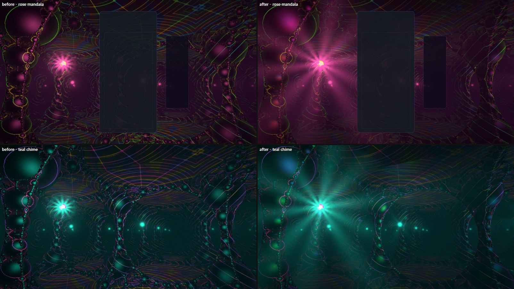
*Before (left) and after (right), the same frames: `t=10&board=1&mood=0` and `t=14&mood=3`.*

**What changed.**

- **The gem throws beams.** Each of the core's twelve facets throws a narrow beam (light halves
  8° off its axis), and the gem turns slowly about the vertical (faster in a trance, slowly under
  reduced motion), so shafts of the mood's light sweep the halls. Every jewel is the core's image,
  so every hall has its own small turning star of beams.
- **The light map.** A small octahedral map holds, for every direction from the jewels' place in
  the lattice, the distance to the first stone (`kaleidosonic-light.js`). The temple is periodic,
  so one map shadows the core and every jewel. It is marched again only when the temple's shape
  or the core's place changes (a refold, the trance's folds, a resize), and until it has really
  been drawn (three skips draws whose pipelines are still building) the shaders take every point
  as lit. The stone now has shadows from the core and the nearest jewel on every tier, and the
  pillars cut the beams.
- **Beams in closed form.** Seen from a light, the points of a view ray sweep one arc of
  directions, so a beam's light along the ray is a Gaussian in that arc's angle, integrated with
  erf between the ray's ends: no samples, no noise, at any sharpness. Each beam is shadowed by one
  map lookup where it crosses the ray. A dim even glow round each light (also closed form) sits
  under the beams. The core's beams are always shadowed; the jewels' in the first cells.
- **Nacre.** The pearls keep a soft lustre toward each light, mirror the core and the nearest
  jewels (a short walk of the reflected ray through the lattice), and all of it is tinted by a thin
  film whose thickness changes pearl by pearl (from the orbit trap) and drifts with the breath:
  every bead an oil-slick of the mood's light. The face-on reflectance is a real 4%.
- **Quieter stone.** The veins' glow away from every light fell from 0.3 to 0.17 and the floor
  figure's reach from 1.1 to 0.6 units, so the veins glow where a light, a beam or an event
  excites them (beams make them fluoresce), and the vaults are no longer a uniform web.
- **Events.** A lock's strike flashes in the mist round the struck point (closed form, the strikes
  gathered and capped softly, so several hard drops never wash the frame white). A clear's
  resonance makes the beams blaze; a lock does not (its light stays where it struck). The dive
  lets the core's own shadows go while it carries the core off its jewel and holds them again as
  it lands. While the twelve-sector kaleidoscope is open the air takes 30% less light, so the
  mirrored cores' rays keep dark between them.

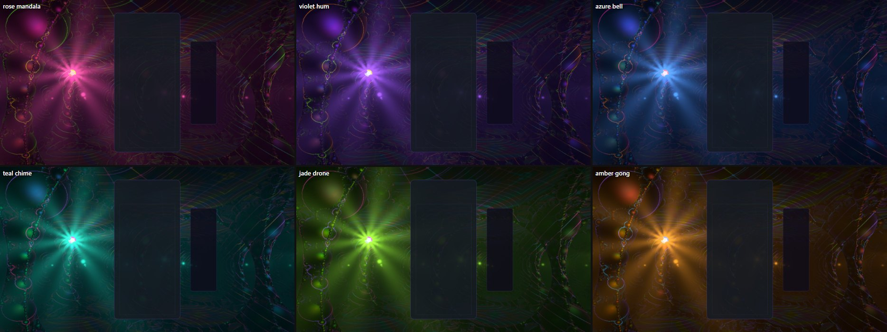
*`t=10&board=1&mood=0…5`: rose mandala, violet hum, azure bell; teal chime, jade drone, amber gong.*

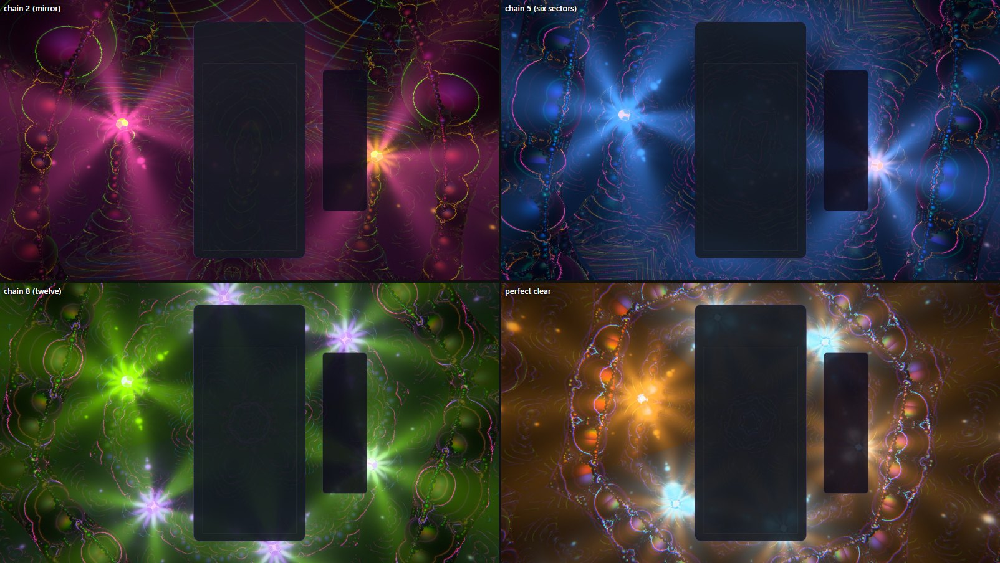
*`combo=2` (the mirror), `combo=5&mood=2` (six sectors), `combo=8&mood=4` (twelve: a wheel of
radiant cores), a perfect clear (`event=perfect&eventAge=2.0&mood=5`).*

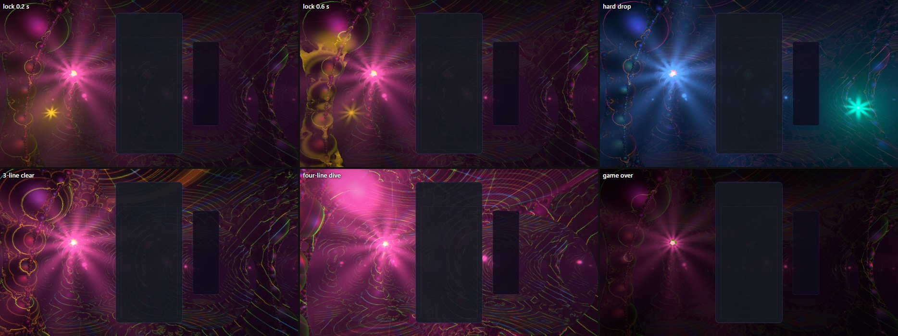
*An O locks left of the card (`event=lock&u=0.15&row=14&piece=O`, 0.2 s and 0.6 s: the strike's
star in the mist, then the stone flooding gold); a hard drop right of the HUD
(`event=drop&u=0.85&mood=2`); a three-line clear; a four-line dive at 1 s; game over 4 s on.*

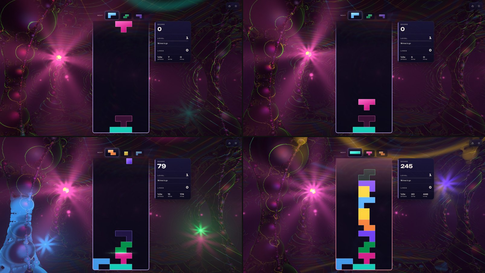
*The real game, WebGPU, High: rest, six seconds later (the beams have turned), hard drops striking
beside the card and beyond the stats panel, and a stack later in the run.*

**Decisions and traps.**

- **The air veiled the frame.** Two causes, each a few thousandths of linear light, plain after
  sRGB: the air's light fell off as `exp(−r / reach)`, whose tail reached every pixel, and a beam
  pointing at the eye lit the first stretch of every view ray (a veil each time the turning gem
  swept one past the lens). The air's light now falls off as a Gaussian, and the first 0.45 units
  in front of the lens are clear, as the fog's first half unit is. Bloom was not the cause (an
  A/B with bloom off showed the same veil).
- **Shafts need something to cut.** Lit only isotropically, the air round the core was a smooth
  ball: the core hangs in open air, so the pearls round it cast their shadows away from the eye.
  The gem's beams are what make shafts; the light map cuts them.
- **Sampled shafts dithered.** Eight equi-angular samples along the ray either hit or missed an
  8° beam, a fine dither over every shaft. The closed form has no samples.
- **One beam end is not enough.** Integrating only the end of each beam that faces the ray's range
  drew a straight seam where the choice flipped; both ends are integrated.
- **The pearls went flat.** Replacing the old broad highlight with a sharp, Fresnel-weighted
  reflection left the beads with nothing face-on; the broad lustre is back under the reflections.
  A face-on reflectance of 14% lifted every dark stone; it is 4%. The lustre and the reflections
  are occluded as the old highlight was (by the full occlusion, not a share of it), or the
  fractal's deep crevices glow.
- **Cost.** The beam maths, not its texture reads, was the cost (about 3.5 ms of 4.3 ms on an
  integrated GPU at Low). Skipping beams that cannot come near a ray before any erf, a polynomial
  erf, six beams instead of twelve and no beam spots on the stone on Minimal and Low, and analytic
  glows instead of sampled ones brought it down. Extreme gained nothing in cost: the light map
  replaced its 18-step shadow march.
- **The flat vault catches the core.** With gloss the vaults reflect the core's lustre, so a lit
  vault's straight edge against a void shows above the core in some views. It is geometry, kept.

**Cost.** Median GPU time per frame from timestamp queries in the playground (a shown window
placed off-screen: a hidden Electron window reports bogus timestamps), the original against this
pass:

| | Minimal | Low | High | Extreme |
|---|---|---|---|---|
| Integrated GPU (laptop), 1600 × 900 | 26.4 → 30.7 ms | 34.0 → 39.2 ms | 50.4 → 63.6 ms | — |
| RTX 5080 Laptop, 2560 × 1600 | — | 1.57 → 1.97 ms | 2.69 → 3.60 ms | 4.52 → 4.65 ms |

In the real game at High on the RTX 5080 Laptop: about 175 fps (the window uncapped off-screen).
The temple's fragment shader is 56 KB of WGSL at High and Extreme, under the gate's 64 KB.

**Verification.** Playground on WebGPU at every tier, the WebGL2 backend (`forceWebGL=1`, the
nested beam loop included, on ANGLE's D3D11 path), 430 × 900 portrait, and the real game (menus,
board, HUD, hard drops, game over); consoles clean apart from Electron's own notices. Unit tests:
the light map's retry while three skips its draw and its never clearing, its redraw only on a
refold or a moved core, the core's shadows through a dive, the gem's turn (trance, reduced
motion, carried through a rebuild), clears blazing the beams and locks not, the beam axes; the
shader gate builds the light map on both backends, counts one field call in it, and pins the beams
as loops. All 7 Kaleidosonic test files pass (280 tests); typecheck, the lint ratchet (at
baseline), dependency boundaries, perf budgets and the production build pass. The full suite's
four red files (game-over modal, Odyssey briefing, records view, TTS recorder) fail the same way
on `main`.

## Captures

All playground shots are `src/playground/effects/kaleidosonic.effect.js` (the theme's own world
and post) at `quality=High`, 1600 × 900 on WebGPU unless stated, with the mock card and stats bar
(`board=1`). In-game shots are the real game on the dev server.

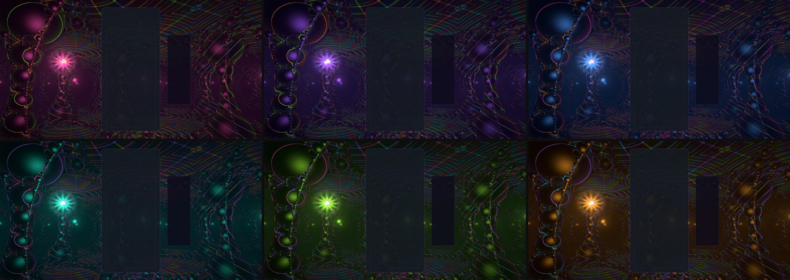
*`t=10&mood=0…5`: rose mandala, violet hum, azure bell; teal chime, jade drone, amber gong. The
core hangs in open air left of the card; the pillars, arches and Chladni floors recede into each
mood's own dark.*

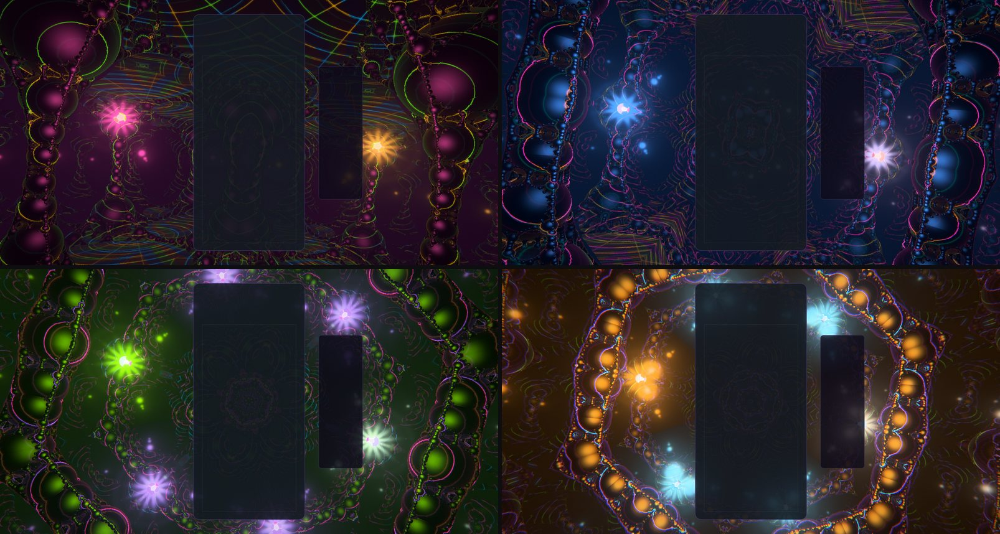
*The chain folds the lens: `combo=2` (the mirror: the core's image in the mood's other colour
right of the HUD), `combo=5&mood=2` (six sectors), `combo=8&mood=4` (twelve: a crown of jewels),
and a perfect clear's mandala (`event=perfect&eventAge=2.0&mood=5`).*

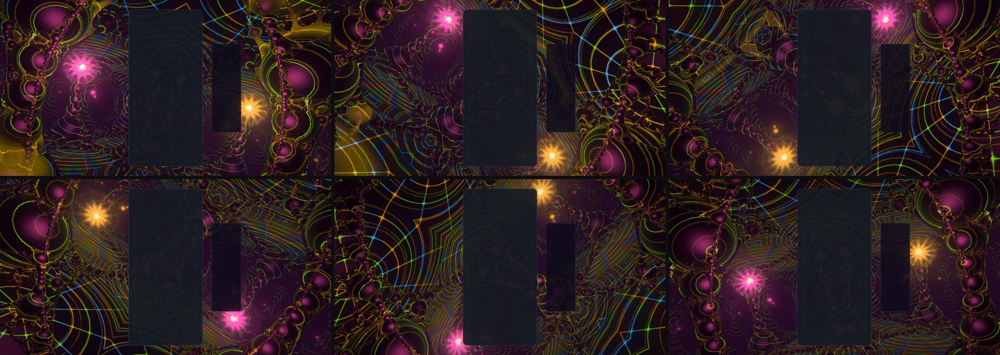
*`event=tspin&combo=3`, `eventAge` 0.3 → 1.8 s: the eye rolls a full turn with the mirror open;
the mirror's line turns with the core's bearing, so the core and its image wheel round the card
and the core never leaves the frame.*

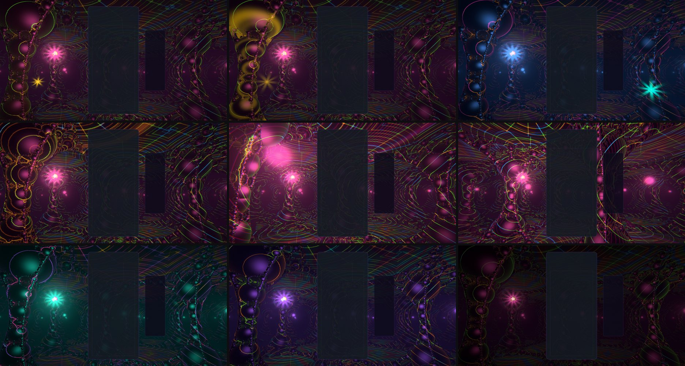
*Row 1: an O locks at the board's left (`event=lock&u=0.15&row=14&piece=O`, 0.2 s and 0.7 s: the
lotus, then the stone flooding gold); a hard-dropped I on the right (`event=drop&u=0.85&mood=2`).
Row 2: a three-line clear (`event=clear&lines=3`, 0.6 s); a four-line dive at 0.9 s and 1.6 s.
Row 3: a back-to-back drone (`b2b=3&mood=3`); a level-up 3 s on; game over 4 s on (the light
sunk).*

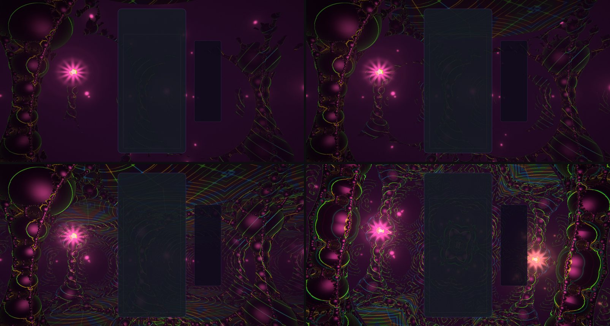
*Minimal, Low, Ultra (soft shadows), and the WebGL2 backend at High with six sectors open
(`combo=5&forceWebGL=1`).*

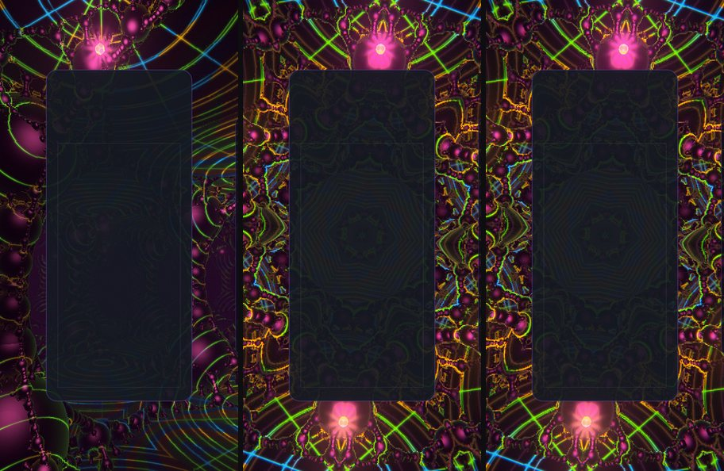
*430 px wide: at rest (the core above the card, smaller), a chain of eight (the mirror square to
the core's bearing folds the frame top to bottom), and the same on WebGL2.*

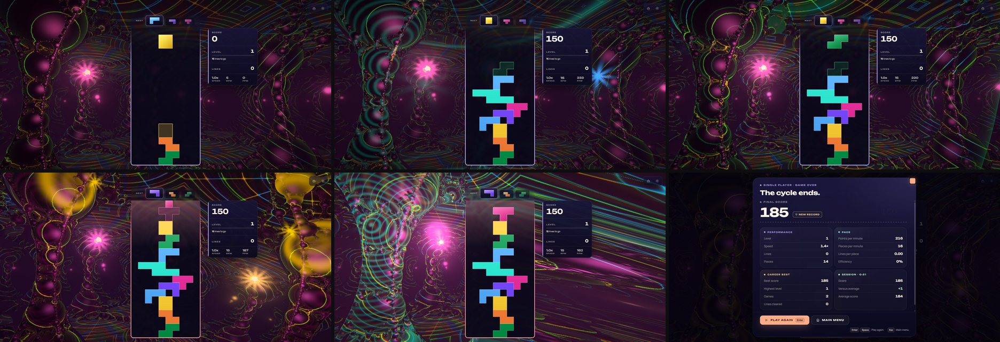
*The real game, WebGPU, High: rest; hard drops striking beside the card and beyond the stats
panel; a two-line clear; a chain with the mirror open and a gold lock flooding the left; a
four-line dive; game over.*

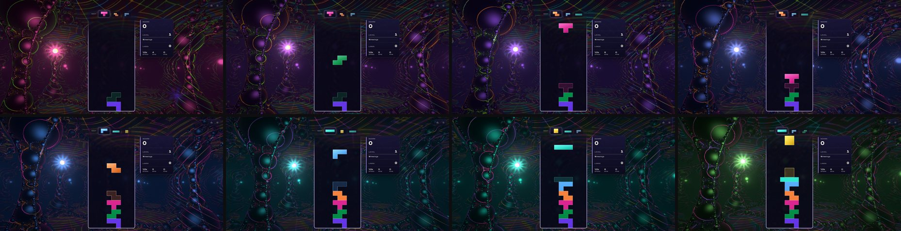
*The real game at level 1 with no clears, one frame about every 50 s from 11 s to 360 s: the
moods turn with the clock alone.*

*The icon at 80 px between its neighbours in the picker.*
