# Moonlit Greenhouse — the night garden under glass

Implemented 2026-10-11/12 on `ccr-ff8053a4-lvwr6k` (from `main` at `5d3478d`), with Three.js
0.186.1. A from-scratch rebuild: it replaces the earlier theme in full (a 1,180-line 2D canvas
theme drawing pollen, fireflies, leaf spirals and ripples over CSS plant silhouettes, the
container it kept in `index.html` and its 300 lines of CSS in `public/styles/main.css`). The
greenhouse keeps its identity — moonlight, a glasshouse full of plants, dew, moths, fireflies,
moss, blooms answering the board — and its piece colours (`moonlit-greenhouse-tetrominos.js`);
everything else is new, and for the first time it is a place in three dimensions. This document
records the shipped design and what was verified. It is a reference, not a backlog.

## The picture

A Victorian palm house at night. The viewer stands at the head of a long lily canal that runs
down the middle of the house; tiled paths with stone coping run beside it, and beyond them the
raised beds are full: Kentia palms and tree ferns under the vault, bananas and strelitzia,
monstera and philodendron, ferns spilling over the kerbs, hanging baskets and vines. Cast-iron
columns carry lattice girders that spring into a pointed vault of glass, rib after rib down the
house to a far door. Hexagonal lanterns hang on chains over the paths, each a small candle
flame. Two campana urns stand in the first lanterns' light.

The moon stands high on the left, seen through old glass. Its light comes in through the
glazing: every bar, purlin and rib, every lath blind rolled part-way down a bay, every palm
frond lays its shadow on the floor, the leaves, the water and the mist, and the beams stand in
the air where the mist is. The canal is black and still, a mirror of the vault, the lanterns
and the lilies; a low mist lies on it.

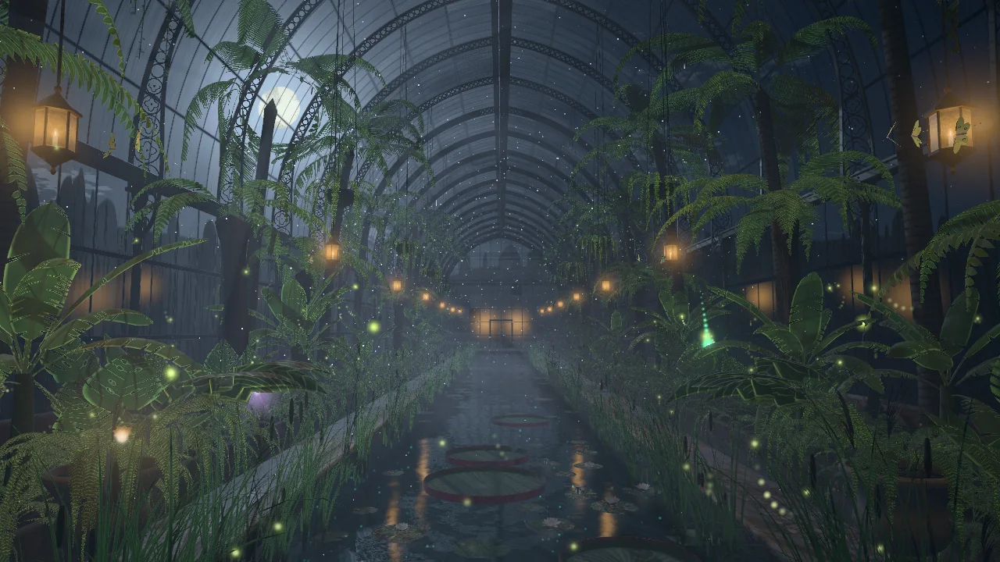

The gameplay card covers the middle of the frame, so the picture is built for what stays
visible: the moon and the vault to the left of the card, the lanterns on both sides, the beds
and the urns at the lower corners, the canal running out from under the card toward the eye.

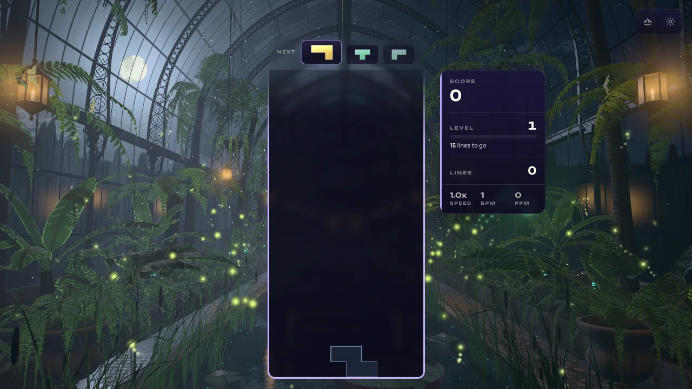

## The one idea

**The greenhouse blooms to the board.** Every piece that locks makes something open in the garden
in its own colour; every clear makes the garden exhale what it holds; a chain wakes the house's
own lights one after another; four lines open the flower that blooms one night a year. The moon
through the glass is the house's breath: its beams are always there, and the board plays in them.

## Event language

| Play | The greenhouse |
| --- | --- |
| Lock | A seed of light in the piece's colour leaves the card's edge at the piece's height and arcs into the garden beside the card, on the side its column is nearer (a piece low on the stack lands near the eye, one high up further down the house; the stats bar is kept clear). Where it lands a night flower opens in that colour over a second and a half: in the beds a flower on its stem, its petals lit from within, a bright heart and a halo that lights the leaves round it and glows in the mist; on the canal a water lily on its pad, a ring running out from it across the mirror. Over a game the garden fills with the colours played. |
| Hard drop | The house shudders: the lens jolts, a curtain of dew shakes loose from the glass and falls glittering through the beams, the plants sway; the bloom opens faster and larger and its ring is stronger. |
| Clear | The garden exhales. Each cleared row releases a ribbon of fireflies from both edges of the card that fly out into the beds and settle, blinking. A wave of moonlight runs across the glazing from the ridge above the card toward the eye, pane by pane, one front a line (moonlight, then the night's own glow). The oldest blooms give up their pollen, which rises glittering through the beams toward the glass, and close (one a line, more in a chain). The lanterns burn up. |
| Chain of clears | The fireflies fall into step: each on its own rhythm at rest, rolling waves of flashes down the house mid-chain, the whole swarm flashing as one from about eight. The swarm thickens. Bioluminescent moss climbs the iron columns 0.62 m a link with a bright written front, so the colonnade counts the chain. The lanterns burn brighter. When the chain breaks it all lets go slowly: the fireflies fall out of step, the moss drains. |
| T-spin | A turn of the air: the fireflies, the moths, the motes and the pollen wheel round the canal and the fronds sway, then settle over four seconds. |
| Four lines | The house holds its breath: for 0.42 s a cloud crosses the moon, every light sinks, the fireflies go dark. Then the Queen of the Night opens behind the card, her long white petals reaching out round it on every side (as far as the house allows: her tips stop short of the vault and the side glass), her golden heart blazing, her glow lying broad on the canal; moonlight floods the panes nearest the moon first, every firefly flashes at once, every bloom in the garden releases its pollen. She holds, turning slowly, and closes over seconds. Four lines again while she is open reopen her from where she is. |
| Perfect clear | The same, with a second, counter-rotating whorl of petals unfurling with her, and a corona round the moon: the coloured rings a veil of fine droplets draws a few degrees round it. |
| Level up | The night moves one step along the wheel of six, eased over 7 s, and a slow wave of the new night's glow runs across the glazing. |
| The clock, with no play at all | The night drifts along the same wheel by itself, one night in 150 s (resting 18 % of each step at either end), and the moon drifts a degree or two, so the lattice it lays creeps across the floor. A level is a step added on top: `place = (level − 1) + clock / 150`. |
| New run | The blooms close and go, the chain lets go, and the level's step eases back off the short way round the wheel (a run that reached level 15 turns two nights back, not fourteen); the clock runs on, and a rebuild in place (a quality change, a lost device) keeps it. |

## The nights

Six nights on a wheel, in hue order so neighbours never mix through grey: silver moon (blue-white
moonlight, green-gold fireflies, jade moss), lavender night (violet moonlight, gold fireflies),
jade dream (sea-green moonlight, aquamarine fireflies), harvest moon (an amber moon, warm
lanterns burning brighter), rose nocturne (a rose moon, pink mist) and blue hour (deep blue,
the sky lightening low). Each is uniforms only: twelve colours and four numbers.

## How it is built

`src/themes/moonlit-greenhouse/`:

| Module | Role |
| --- | --- |
| `moonlit-greenhouse-theme.js` | BaseTheme adapter (ported from Serenity Warp's): renderer (WebGPU, else the WebGL2 backend), post, director, layout reads on frame time, pointer parallax, settings, GPU-loss recovery, capture flags. The clock survives a rebuild in place. |
| `moonlit-greenhouse-world.js` | The world, shared with the playground effect: uniforms, parts, camera rig, the moon's placement, the event choreography (seeds, blooms, fireflies from the rows, pollen, pane waves, the hush, the Queen, the chain's gauges), the wheel of nights. |
| `moonlit-greenhouse-core.js` | Three-free numbers and their CPU twins: the house's pointed vault, `houseExit` / `glazingAt` / `blindAt` / `moonlightAt`, the floor's plan, the moon's drift, the six nights and the wheel, the event timings, the chain's gauges, the fireflies' flash, the baked noise. |
| `moonlit-greenhouse-plan.js` | The garden as numbers, seeded: ribs, columns, lanterns, palms (and their crowns' fronds), tree ferns, bananas, monsteras, ground ferns, baskets, vines, reeds, lily pads, the urns. |
| `moonlit-greenhouse-tsl.js` | The shared TSL: `mgMoonlight` (the lattice), `mgBlind`, `mgCanopy` (the palms' fronds), `mgSurface` (how every opaque surface is lit), `mgSky` (the night beyond the glass, the moon, the corona), the lantern and bloom light loops, hashes, the noise texture. |
| `moonlit-greenhouse-glass.js` | The inner glass of the vault, the side walls and the far screen, parametrised by the glass's own coordinates: the sky through old panes, blinds, condensation, the iron's bars, the lanterns mirrored, the pane waves and the flood. |
| `moonlit-greenhouse-iron.js` | Lattice girders following the pointed arch (chords as geometry, the web one plate a rib with its rings, quatrefoils and bosses cut by a distance field), the haunch brackets, fluted columns with bell capitals, the spring beam and its cornice, the ridge and its louvred vent, brick plinth walls, the far door case. The chain's moss climbs the columns and lights the spring beam from eight. |
| `moonlit-greenhouse-floor.js` | Encaustic tiled paths (drawn in the shader, wet: standing water in the grout, puddles mirroring the vault and the lanterns, the candle's pool under each lantern), limestone coping, ashlar canal walls with an algae line, the canal bed, the landing, bed kerbs and soil, the urns. |
| `moonlit-greenhouse-lanterns.js` | Hexagonal lanterns on chains; no flame geometry: each pane's shader draws what its ray sees through it (a flickering flame, the candle, the glass warmest at the flame's height). Halos that never fall under a few pixels, so the far lanterns are a string of sparks. |
| `moonlit-greenhouse-flora.js`, `-flora-geometry.js`, `-flora-shading.js` | Palms, tree ferns, bananas and strelitzia, monstera and philodendron, ground ferns, the urns' alocasia, vines and hanging baskets. Every leaf is one strip along its spine, cut out in the fragment shader (pinnate combs that merge into a toothed blade when the leaflets get under a few pixels, torn paddles, notched hearts with their holes); lit through the leaf at its margins and veins; swayed in the vertex shader by the air, a gust and the T-spin's turn; parted round the moon's line of sight. |
| `moonlit-greenhouse-pond.js` | The canal's water (the reflected ray traced to where it leaves the house and the glass there shaded as the glass shades it; crowns, bed foliage, kerbs and reeds stand in the reflection; lights lie on it as broken columns; rings from the blooms on the water, plankton they wake), Victoria and lily pads riding the swell with resident white lilies, reeds and cattails. |
| `moonlit-greenhouse-air.js` | Fireflies (the shared flash formula, its JS twin in core; the J-shaped hook of a flash), luna moths round the lanterns, motes lit only where the moonlight reaches them, the dew a hard drop shakes loose. |
| `moonlit-greenhouse-glows.js` | The pool of small lights the world fills every frame (seeds in flight, the cleared rows' fireflies, pollen). |
| `moonlit-greenhouse-post.js` | One scene pass (MSAA on High and up), the march through the air on a reduced target, hue-preserving bloom, calm zones over the card and HUD, filmic tone map, the night's grade. |
| `moonlit-greenhouse-director.js`, `-composition.js` | Gameplay staging and the layout rects (ported from Serenity Warp's), plus the greenhouse's framing: where the moon stands for an aspect, where a bloom lands, where its seed leaves the card. |
| `moonlit-greenhouse-quality.js` | Tiers. |

Techniques worth knowing before changing it:

- **The moonlight is a formula.** The house is a closed shape (two circular arcs over straight walls), so where a ray from any point toward the moon leaves it is closed form (two circle exits and a plane), and the iron there is a handful of line masks in the glass's own coordinates (metres along the house, metres of arc from the spring). Each bar's shadow softens with the distance it is thrown (the moon is a disc). The floor, the leaves, the water, the motes and the post's march all call the same `mgMoonlight`, so every beam in the air lands on its own lattice on the floor. CPU twin: `houseExit` + `glazingAt`.
- **Beams need occluders, and contrast.** Clear glazing passes about 85 % of the light everywhere, so at first the air was a uniform milky veil with faint dark lines. Lath blinds rolled part-way down most of the bays (`BLINDS`, 70 %) and the palms' crowns as an analytic canopy (`mgCanopy`, picked each time the moon moves by where their shadows land) make the beams alternate bay by bay, ruled by laths and fronds; and the march raises the moonlight a point of the air sees to a power (`TUNE.airContrast`), so clear glass throws a beam and the laths, fronds and fogged panes a shadow (see the second pass). The bay the eye sees the moon through keeps its blind up, and the moon's line of sight is moved to the middle of its bay, so the hero is never behind a rib or a blind.
- **One sky, along any ray.** `mgSky(dir, disc)` is the whole night beyond the glass: the air, the moon's glow and aureole, cloud silvered near it, stars on a 3D lattice, the disc with seas and craters kept under the tone curve's shoulder, the corona of a perfect clear, the garden's trees through the side walls. The glass draws the disc in the lens's image plane (round anywhere in the frame); the canal's mirror draws it about the moon's direction.
- **The march.** Each pixel walks its view ray from the eye to the scene pass's depth (reduced target, jittered start, depth-aware upsample) and gathers the moonlight the glazing and the canopy let through, scattered toward the eye by a Henyey–Greenstein lobe, plus the lanterns' and the blooms' glow in the same mist. The pass is given the scene camera's own matrices: inside a pass the camera nodes are the quad's. A step is metres long, so what is finer than a step is averaged, not sampled: the glazing bars' edges widen with the step (`TUNE.airSoft`), a pane's own glass gives way to the panes' mean once the softness passes a pane (`GLAZING.paneAverage`, in the CPU twin too), and the canopy's leaflets give way to their mean. Sampled, they alias into a mesh across the beams. The start jitter is a white hash: interleaved gradient noise left a diagonal hatch on the tiers that march few steps.
- **Every surface lit the same way.** `mgSurface` drains the moon's colour from what it lights, adds light through thin leaves when the moon is behind them, the dim sky, and the lanterns, blooms and fireflies, which bring the colour back. Every part uses it.
- **The fronds part for the moon.** Which crown stands in front of the moon depends on the aspect, the layout and the drift, so no plan can keep it clear. Instead the leaves' vertex shader moves every point the eye sees within about 7.5° of the moon outward onto a ring a degree past the disc (`mgClearMoon`; the map a → a + gap·(1 − a/reach)² is monotonic while gap ≤ reach / 2, so the fronds part without folding), and the leaves' cut-out drops what a strip still lays across the disc (`mgMoonGap`: a frond lying straight over the moon is only widened when its two edge vertices move apart). The palms' shadow parts the same way, so the mist toward the moon carries no shadow of a frond the eye cannot see. Trunks and baskets keep their shape: a trunk may cross the moon as a silhouette.
- **No alpha-to-coverage.** Drivers dither partial coverage into a pixel stipple; across a crown of sub-pixel leaflets nearly every pixel is partial, so the crowns and the far ribs turned into a grey screen door. Every cut-out is hard (a bar never finer than a pixel, a small cell solid, a merged comb a toothed blade), and the scene pass's MSAA keeps the geometry's own edges.
- **The air at full resolution is a joint bilateral upsample.** Each pixel blends the 3 × 3 texels of the reduced march target round it, weighted by distance and by how near each texel's depth is to its own, so the sky's mist never bleeds onto a frond's edge. Every tier: the two lowest once blended 2 × 2, which left the march's noise as blocks a few pixels wide once the beams were strong.
- **One walk of each table a pixel.** `mgMoonVis` is shared between a surface's light and its reflection (the iron's glint, the floor's wet sheen); `mgLanternsTwoSided` / `mgBloomLightTwoSided` give a leaf the light on its face and the light through it from one loop. The shared light helpers pin what they are handed (`.toVar()`) before their loops: TSL emits an unpinned node at its first build site, and inside a loop that means once a lantern (a normal and two texture reads per lantern on the soil, the trunks and the water, until the review caught it). The Queen's age is pinned before her If chain for the other half of the same rule: a node first built in one branch reads zero in the others.
- **The mirror is traced, not rendered.** The canal draws no second pass: its reflected ray is traced to where it leaves the house (the same closed form as the moonlight) and the glass there is shaded as the glass shades it; the crowns (through the canopy function), the beds' foliage, the kerbs and the reed clumps stand in it as approximations, and every light lies on it as a broken column.
- **Flowers built in the vertex shader.** A bloom is a slot in an instanced pool (position and size, seed and kind, tint, open and close times); every vertex is a point of a flat parameter sheet and the shader builds the whole flower from the slot and the clock, so opening, settling and closing are curves of time and nothing is animated on the CPU. The Queen is the same idea at the scale of the frame.

## Tiers

| Tier | Palms / tree ferns / bananas / monsteras / ferns | Reeds, pads | Fireflies, motes, dew | Blooms held | Crowns shading | Air steps (target) | Bloom, AA | Triangles |
| --- | --- | --- | --- | ---: | ---: | --- | --- | ---: |
| Minimal | 6 / 4 / 4 / 6 / 18 | 120, 24 | 70, 260, 72 | 16 | 4 | 9 (¼) | off, none | 120k |
| Low | 8 / 6 / 6 / 8 / 28 | 180, 34 | 110, 520, 120 | 20 | 5 | 13 (⅓) | off, none | 185k |
| Medium | 10 / 8 / 8 / 12 / 40 | 240, 46 | 160, 900, 180 | 26 | 6 | 18 (0.4) | on, FXAA | 281k |
| High | 12 / 10 / 10 / 16 / 56 | 320, 58 | 220, 1,400, 250 | 32 | 8 | 24 (½) | on, 4× MSAA | 440k |
| Ultra | 14 / 12 / 12 / 20 / 72 | 420, 70 | 300, 2,000, 340 | 36 | 10 | 30 (½) | on, 4× MSAA | 621k |
| Extreme | 16 / 14 / 14 / 24 / 90 | 520, 84 | 380, 2,800, 420 | 40 | 12 | 36 (½) | on, 4× MSAA | 760k |

Every tier keeps the whole picture and every event (the lattice, the plants, the canal, the
fireflies, the blooms, the Queen); the tiers also scale the frond and leaf segments, baskets and
vines, the stars' lattices, the cloud, the condensation on the panes, the moths, the Queen's
petals and how many lanterns (in whole pairs) and blooms a surface adds up; the Queen, while
she is open, always holds one of the bloom lights. The whole house is 32–35 draws
(eight of them instanced). These are allocation budgets, not measurements of frame rate. The
world builds in 0.3–1.3 s on the build machine (measured headless under load).

## Assets

None. Everything is generated in code: the house, the plants, the water and the flowers are
built from the seeded plan at start (0.3–1.3 s), and the one texture, the garden's noise (four
tileable fields in one RGBA image), is baked on the CPU at start too. No model, no image, no
sound file was added. The theme icon is a frame of the scene (see Reproduce).

## Verification

- Unit tests: 214 tests in twelve files (theme 64, director 21, composition 19, core 18, world
  17, air 16, blooms 15, house 14, pond 9, flora 8, plan 7, and 6 in
  `moonlit-greenhouse-shaders.test.js`, which builds every part's every mesh through three's
  WGSL and GLSL node builders at High and Minimal with no GPU and fails on a throw, a console
  word, a `NaN` or `Infinity` printed into a shader, an `mx_` noise, a `smoothstep` with equal
  edges, a stage over 96 KB, or a laid-out `mg_*` helper that captures a uniform or a texture).
  The world tests pin the event choreography (where a lock's bloom lands, on screen and beside
  the card; its seed coming down on the flower's heart and its ring running from the lily; the
  hush and the Queen, reopened by a second four lines without a jump in her turning; the chain's
  gauges; the night drifting with the clock, stepping with the level and turning back the short
  way after a long run) and that a seek is the same world at 30 and 120 frames a second. The
  air's flash has a JS twin pinned to the shader's to six decimals; the house tests check every
  triangle's winding against its normal; the blooms tests check the petals' closed-form normals
  against numeric derivatives.
- Whole suite, on the final code: 829 files, 15,720 tests, all passing (120 s timeouts, on a
  build machine other work was loading).
- Gates: typecheck; lint ratchet (599 errors against the baseline of 807; the theme's files add
  none); TypeScript ratchet (at baseline); architecture fitness; theme lifecycle audit;
  dependency boundaries (1,512 modules); production build with the boot-closure guard; IP-string
  gate over `dist/`; Pages artifact check; release gates; perf budgets gate; palette gate (the
  greenhouse 0/7) — all pass.
- Playground captures, headless Chromium 141 on SwiftShader (no GPU in this session; WebGPU
  through SwiftShader's Vulkan, WebGL2 through ANGLE; a frame takes 25–130 s): rest at
  Minimal, Low, Medium, High, Ultra and Extreme; Low, Medium and High on the forced WebGL2
  backend; a lock, a hard drop, a two-line clear, a chain of eight, a T-spin, the hush, four
  lines at 3.5 and 4 s, a perfect clear, a level-up; the six nights; 430 × 932 portrait at rest
  and through four lines; 4:3 through four lines and a perfect clear; reduced motion. None
  logged an error or a warning from the page.
- In the real game (the dev server, single player, the harness's fresh profile, bus-injected
  locks, hard drops and clears): the theme boots straight in on WebGL2 at Medium and at High,
  takes the events, and draws them; no warning or error from the theme (the console's two errors
  were the app's music request being aborted).
- `scripts/validate-mobile-webgl2.mjs` at Low and at Minimal (390 × 844 at DPR 3 and its
  landscape, WebGL2 through ANGLE/SwiftShader): pass, with 35 node materials, no non-finite
  attribute, no GL error, live frames and visible content in portrait, landscape and through
  the effects script.
- A review by eight agents (four reviewers on runtime, shaders, integration and performance,
  each checked by a skeptic who tried to refute every finding): 24 findings, 13 confirmed, all
  fixed and, where they could be, covered by the tests above. The real ones: a new run after a
  long game spun the house through every night in seven seconds; the Queen's lower petals sank
  under the paths, and on 4:3 and portrait she reached through the walls and the vault; her
  stamens, stigma and second whorl stood still (an unpinned node read as zero in their branches)
  and a second four lines snapped her turning; her light dropped out of the garden mid-blaze;
  a lock's ring and seed missed the flower the blooms part had moved, a path landing jumped off
  narrow frames and a near lily dropped under the frame; the T-spin left the pollen behind;
  the canal's drowned bed was shaded and painted over every frame, the water evaluated its swell
  once per lantern, the particles drew twice, and the shared light loops rebuilt a surface's
  normal and textures once per lantern.

Not measured: frame rates. There was no GPU in this session (software rendering only), so no
figure here says anything about speed.

Not verified: GPU cost per tier through the theme perf lane (ADR-0016) and on a real GPU at
all; physical phones; the chrome-devtools MCP loop (its server did not start in this cloud
session; the captures above stand in for it); local multiplayer and Infinity layouts in a
capture (their aim is unit-tested); long sessions. `docs/theme-screenshots/moonlit-greenhouse.png`
still shows the previous artwork (a fleet capture writes it).

## Reproduce

Run `npm run dev:playground`, then:

`/playground.html?effect=moonlit-greenhouse&t=20&quality=High&board=1`

Add `event=lock|drop|clear|quad|tspin|perfect|levelUp|break` with `eventAge=<s>` (a lock's seed
lands at 0.85 s and its flower is open by about 2.5; four lines open the Queen after the 0.42 s
hush, fully by about 2.3 s), and `lines=<n>`, `row=<r>`, `u=<0..1>`, `color=<hex>`,
`eventLevel=<n>`, `combo=<n>`, `level=<n>`, `night=<0..5>` (silver moon, lavender night, jade
dream, harvest moon, rose nocturne, blue hour; fractions mix neighbours). `locks=<n>` opens n
blooms first (every fourth is a hard drop, so its dew may still be falling). `demo=1` (without
`t`) plays a looping script; `parts=` draws only the named parts; `falseColor=1` bands the
pre-tone-map peak; `noPost=1` shows the raw scene; `bloom=0|1`; `px`, `py` hold a pointer
offset; `reduce=1`; `seed=<n>`; `P.<name>=<value>` overrides a number of the look (`TUNE`);
`forceWebGL=1` uses the WebGL2 backend. In the game: `?greenhouseTime=`, `?greenhouseFixedDt=`,
`?greenhouseParts=`, `?greenhouseFalseColor=1`, `?greenhouseForceWebGL=1`.

The theme icon is a frame of the scene through the playground's icon lens:

`/playground.html?effect=moonlit-greenhouse&t=20&quality=Extreme&icon=1&iconFov=44&iconYaw=0.45&iconPitch=0.32&locks=3&hud=0`

captured at 840 × 840, cropped to 820 px round (425, 420), given a colour lift (contrast 1.14,
saturation 1.25, brightness 1.12) and baked as a 512 px circle on a transparent ground. The same
file is kept at `public/assets/themes/moonlit-greenhouse-theme-icon.png`.

## Captured previews

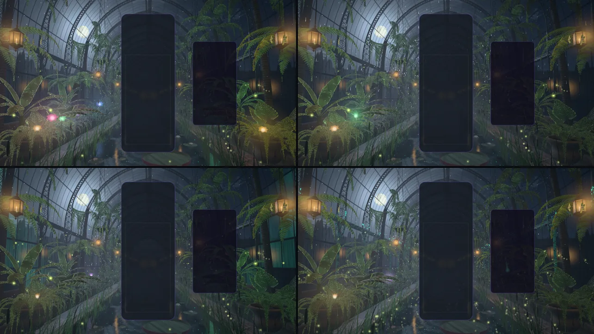

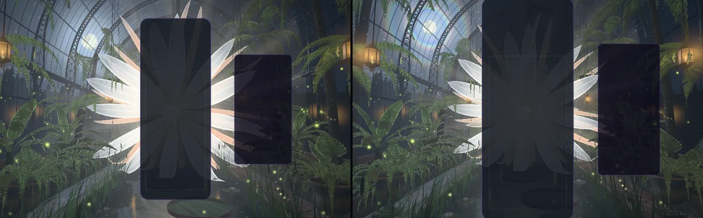

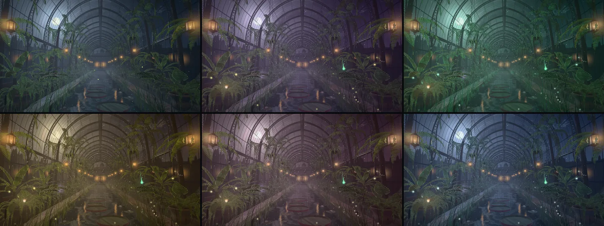

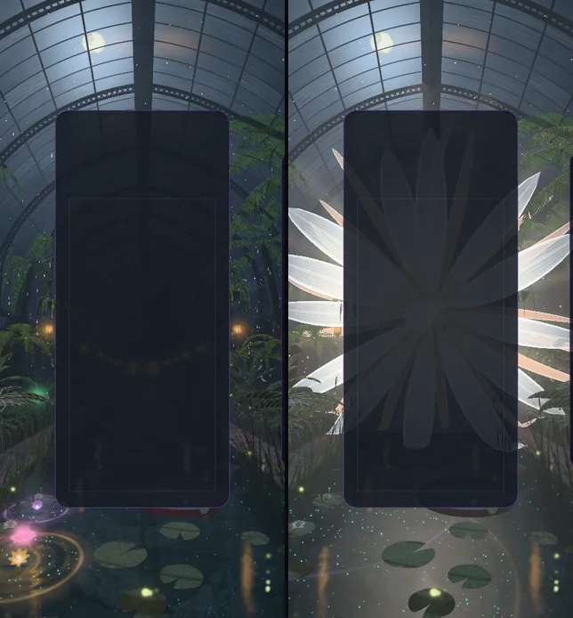

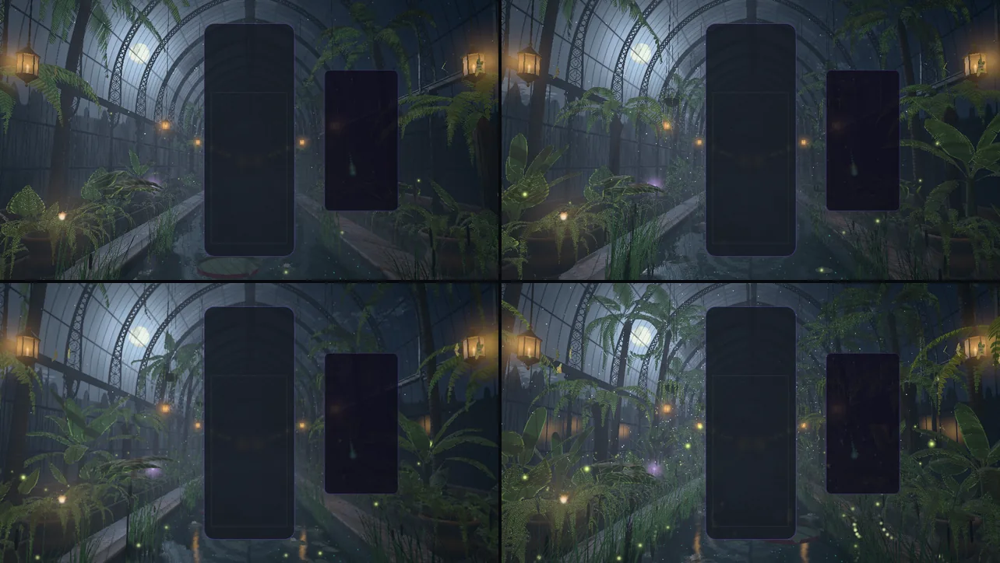

The previews above are the first build, rendered in software (SwiftShader). The second pass below
was judged on a real GPU.

## Second pass (2026-10-21): on a real GPU

The first build was never seen on a GPU (it was made in a cloud session with software rendering
only). On this machine's RTX 5080 Laptop GPU, through native WebGPU, the house rendered as
designed but its one idea did not show: almost the whole frame sat below 0.1 scene-linear, the
air was an even grey-blue veil, and no beam stood in it. A look pass followed, in the same
modules. Each change was iterated in the playground (`?effect=moonlit-greenhouse&t=20`, with
`P.<name>=` overrides of `TUNE`, the false-colour view and zoomed crops) and the result checked
in a real Single Player game at High.

| 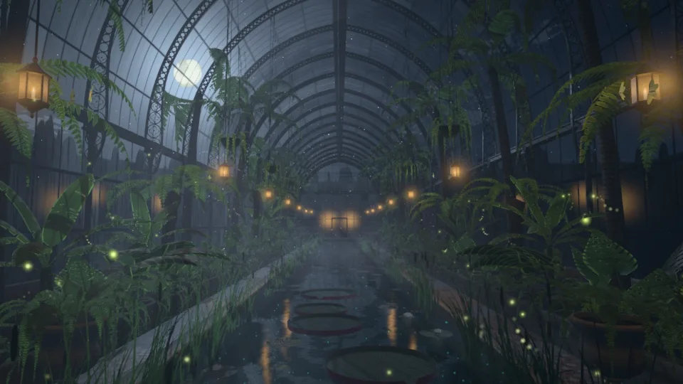 | 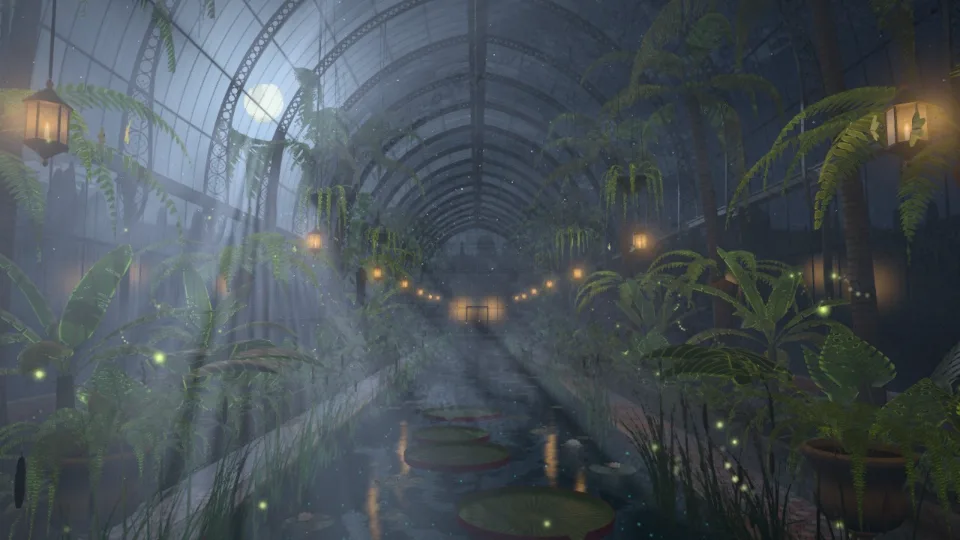 |
| --- | --- |

| What | Before | After |
| --- | --- | --- |
| **Moonbeams** (`moonlit-greenhouse-post.js`, `-tsl.js`, `-core.js`) | The march's beams added about 0.003–0.01 scene-linear: invisible. Raising them alone gave a milky fog, because clear glass passes most of the light everywhere, so lit and shaded air hardly differ. | The moonlight a point of the air sees is raised to the third power (`airContrast`), so clear glass throws a beam and the blinds, fronds and fogged panes a shadow; 70 % of the bays have a blind down (was 55 %), their laths more closed; the mist is thicker (`airHaze` 0.011, `airBeam` 0.8), billows in drifting columns (`airBillow`), and thins to a quarter under the vault's crown (`airTop`), so the beams stand among the plants and over the canal while the iron overhead stays crisp. The beams fan out from the moon down into the canal, and the events now move them: the hush puts them out, four lines floods them. |
| **The march's aliasing** (same) | Once the beams were strong, a fine mesh lay over the vault and the moon's disc (the 0.6 m glazing bars sampled by steps 1.5 m long), and a screen-door grid over the whole frame on Low and Minimal. | The bars' shadow edges widen with the step (`airSoft` 0.8 of a step); a pane's own glass and the palms' leaflets are averaged once a sample is wider than they are; the start jitter is a white hash (interleaved gradient noise drew a diagonal hatch); every tier upsamples with the 3 × 3 tent (the 2 × 2 left blocks). |
| **The Queen of the Night** (`moonlit-greenhouse-blooms.js`) | Her petals' light from within (1.5 at the base) sat above the tone curve's shoulder: a flat white paper pinwheel of narrow blades, see-through at 60 % like cellophane. | At 0.85 (`TUNE.queenPetal`) her veins, glowing margins and the cream-to-silver run show; the inner whorl's petals are broad overlapping spoons (`WHORL.inner.half` 0.12, was 0.066), opaque but for their thin tips; the outer tepals run from russet-amber to gold. |
| **Victoria pads** (`moonlit-greenhouse-pond.js`) | Dark grey plates with a uniform glossy-crimson rim. | A green that holds up under the moonlight; a weathered rim; a soft waxy shine broken up by the quilting; rain standing in puddles that mirror the vault, the moon and the lanterns, with the leaf darker under the water. |
| **Lanterns** (`moonlit-greenhouse-tsl.js`) | A candle's light fell to nothing within a metre: the half of the house away from the moon was one flat grey-green. | It reaches further and burns a little stronger (`lampGain` 1.6, `lampReach` 1.4), so the ferns and pads round each lantern catch warm gold against the cool beams. |

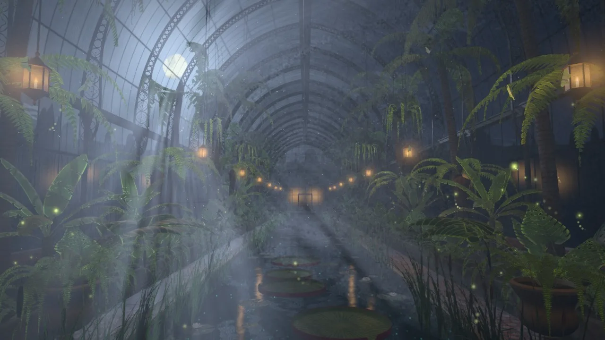

| 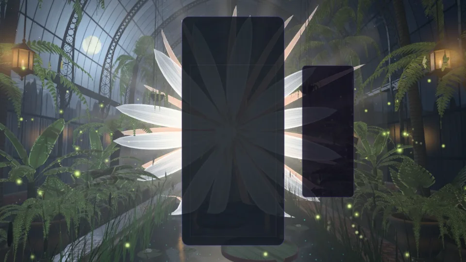 | 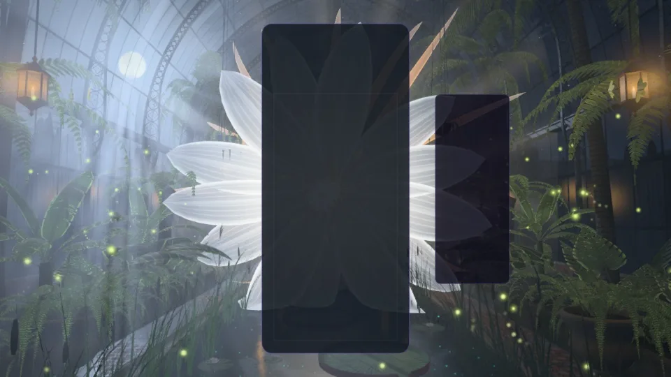 |
| --- | --- |

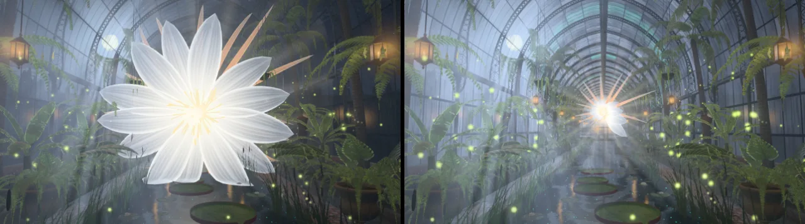

| 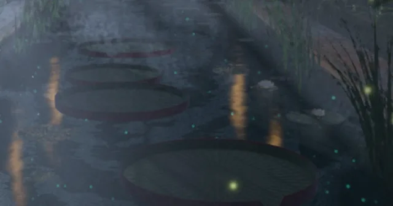 | 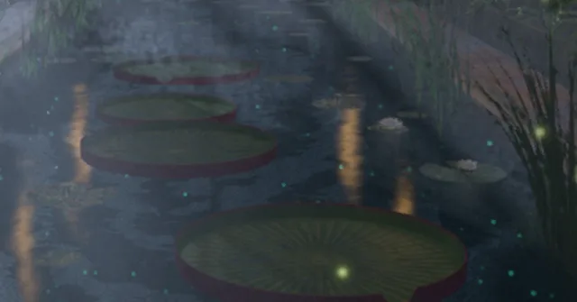 |
| --- | --- |

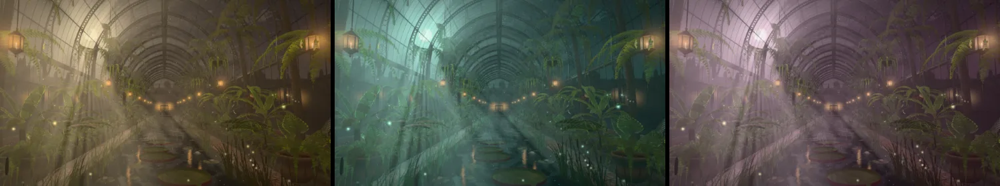

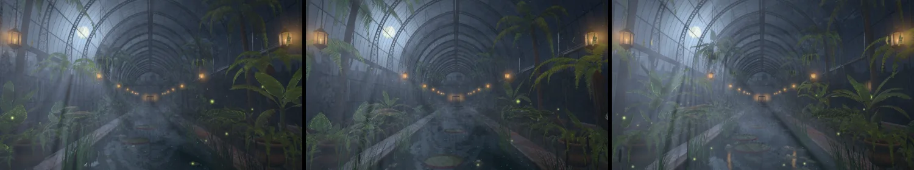

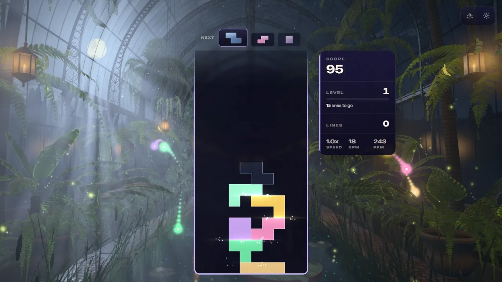

Checked: playground captures on native WebGPU at High (rest at t = 20 and 40 s, the board with
locks and a chain of eight, four lines at 0.3, 1.2 and 3 s, a perfect clear, 430 × 932 portrait,
five of the six nights, all but lavender), Ultra, Low and Minimal, and Medium on the forced WebGL2 backend, each
with a clean console; a real Single Player game at High (theme running on WebGPU, pieces locking,
no warning or error from the theme); the 13 `tests/unit/moonlit-greenhouse-*.test.js` suites
(221 tests); ESLint clean on the changed files.

Not measured: frame time. The pass adds a power and a few mixes to each march step and moves Low
and Minimal from four upsample taps to nine (each a depth read and an air read at full
resolution); the theme perf lane (ADR-0016) has not been run on it, and the GPU here is far
above what Low and Minimal are for.
