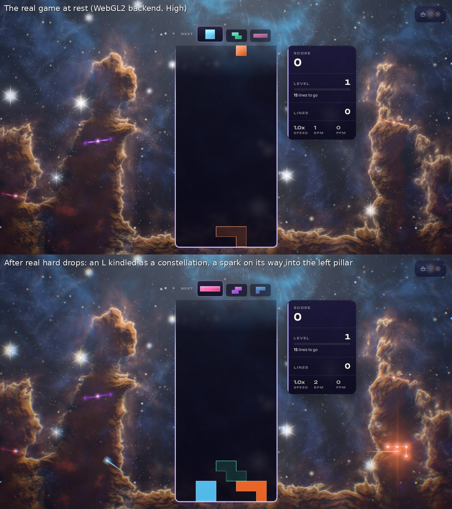
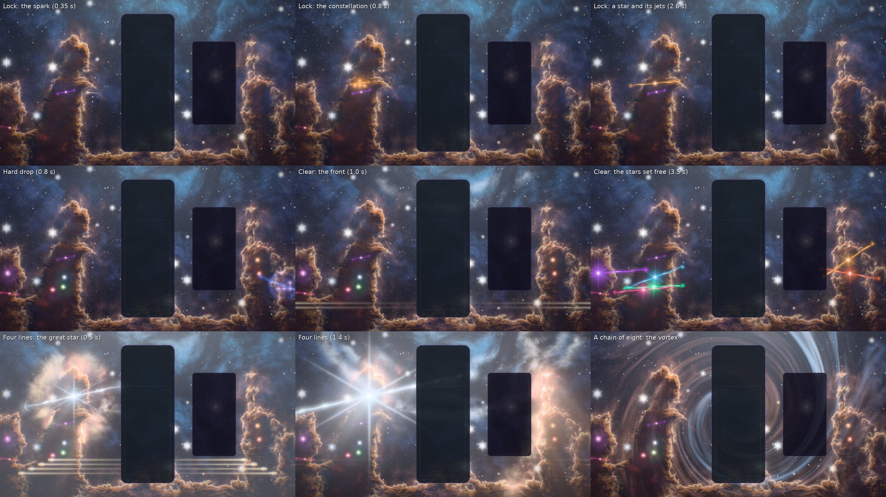
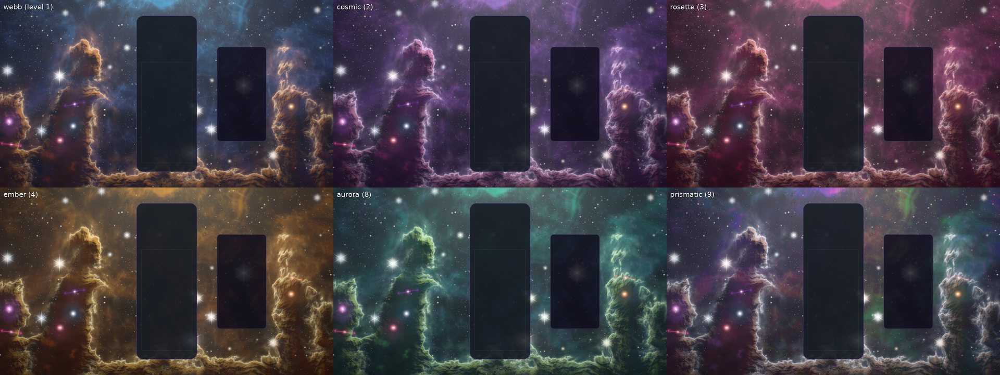
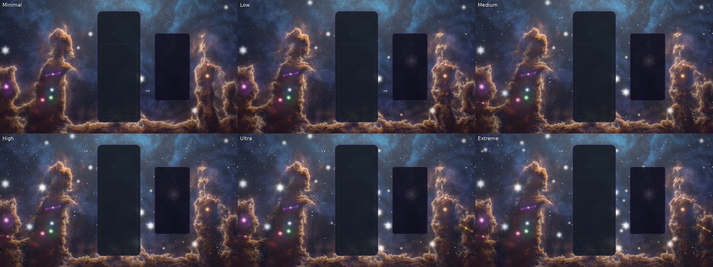
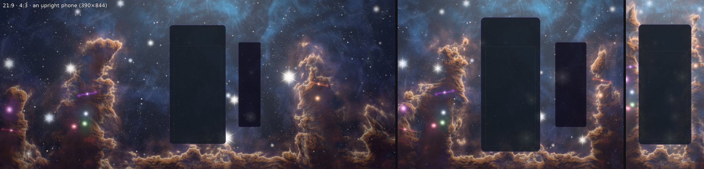
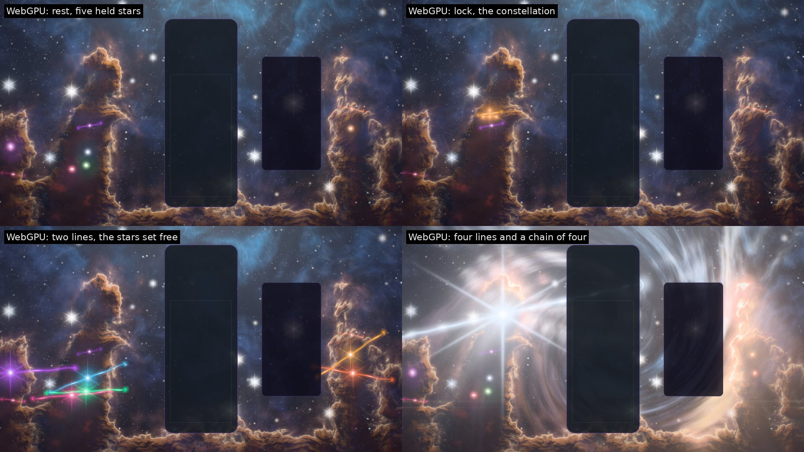
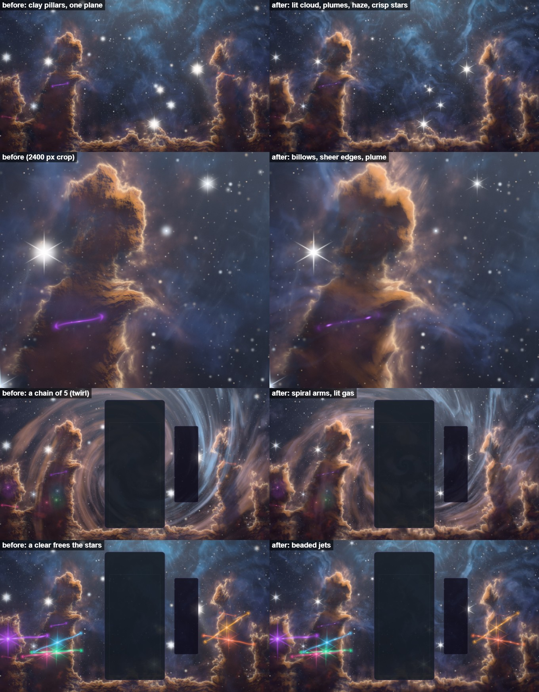
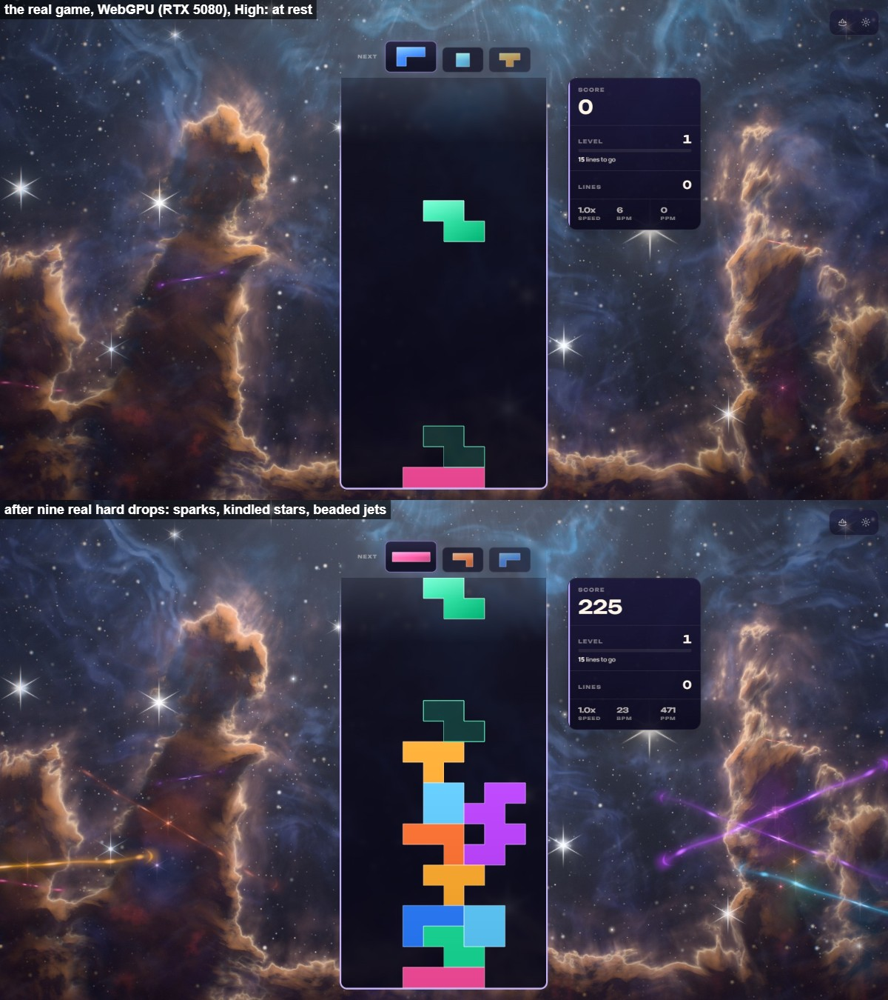

# Nebula Flow — the cradle of stars

Implemented 2026-10-11, with Three.js 0.186.1. A from-scratch rebuild: it replaces the earlier
theme in full (a raw-WebGL port of a Navier–Stokes dye simulator, `src/utils/webgl/fluid-simulator.js`,
drawing prismatic ink on black, with its own GLSL, a canvas of its own and effects fired at the
middle of the screen from timers). Nebula Flow keeps what made it itself — colour that flows, its
named palettes (cosmic, aurora, prismatic, and fire as ember; ocean's blue is webb's now), spirals
that wind up with a chain — and everything else is new. One node renderer on both backends: `WebGPURenderer` on WebGPU, else its
WebGL2 backend; no classic path (ADR-0008, ADR-0019). This document records the shipped design and
what was verified. It is a reference, not a backlog.

## The picture

A stellar nursery seen face on, in the manner of the space telescopes' Pillars of Creation: tall
pillars of cold dust stand either side of the board, rising out of a ridge of the same dust, their
heads set alight by a cluster of young stars just above the frame. Every edge the cluster's light
reaches burns with a thin ionization front; the gas that light boils off the pillars' heads streams
away; behind them the cavity the cluster has carved glows, hottest under the cluster, and the gas
in it flows outward along its light. Stars stand in the cavity, the brightest wearing a space
telescope's diffraction spikes (three long lines at sixty degrees and a short horizontal one);
the faint ones powder the dark between.

The card stands in the cavity between the pillars. The pillars are laid out round it: each stands
at its share of the free side (the card's edge to the frame's; on the right, past the stats bar
when there is room), thinner where the side is narrow, and on an upright phone they hug the frame's
edges and their heads rise above the card into the strip of sky over it. The stage follows the
live card when one is on screen.

## The one idea

**The board kindles stars.** Every locked piece sends a spark into a pillar, where its four cells
light as a little constellation in the piece's own shape and colour and then draw together into one
newborn star that fires its jets out of the dust. The star stays there, an ember lighting the dust
round it from within, so the pillars slowly fill with the colours of the pieces played. A clear is
the cluster breathing out: its light runs down through the nursery and sets every star the board
has kindled free.

## Event language

| Event | What happens |
|---|---|
| Lock | A spark leaves the card's edge at the piece's height on the side of its column and curves into a pillar (upper rows kindle higher in it). There the piece's cells light as four stars in its own shape, joined by lines of light — a constellation — and flare with long spikes; over a second and a half they draw together into one star. A pair of jets runs out of the dust along one axis, beaded with knots that travel outward, a soft bow shock at each tip, and a thin ripple runs out through the dust round it. The star stays, reddened by the dust it is buried in, lighting the dust round it in its colour. |
| Hard drop | A quicker spark, a bigger star, longer jets, a stronger ripple and a kick. |
| Clear | The cluster breathes out: one front of light per line runs down through the nursery from above the frame, lighting the gas it crosses and flaring every lit edge of the dust as it passes. The cleared rows leave the card as blades of light out of each side at their own height. As the front reaches each star the board kindled, the dust round it boils away (a hole with a burning rim opens) and it burns free: brighter, long spikes, its jets fired again. Freed stars burn bright a few seconds, then fade out (eighteen seconds in all) as the dust closes over their places. |
| Combo | Each step of a chain winds the gas round the board into a vortex, its arms glowing in the colour of the piece that made the step; the flow quickens, the cluster's light and its shafts grow. When the chain breaks the vortex lets go. |
| Four lines / perfect | The nursery holds its breath (the light sinks for a quarter second), then a great star is born in the head of the tallest pillar: a flash, spikes that span the frame and settle over a few seconds, jets across the whole picture, a front that crosses the frame and sets every pillar's edge burning, and a hole blown in the dust that heals over the next half minute. Every held star is freed with it. |
| T-spin | The whole flow twists round the board and springs back. |
| Level up | The nursery moves one palette along its line, and a front in the new colours leaves the cluster. |
| Time | With no level change the palette drifts along the same line by itself, one step every 95 s, resting 15 % of each step at either end. A level adds a step to the clock: `place = base + (level − 1) + t / 95`, `base` the place the sitting's earlier runs reached (a new run starts where the last one left the palette; a jump of levels walks the line, never strobes). |

The palettes, on one line walked there and back (neighbours by hue, so a change never passes
through grey): **prismatic** (the gas spread round the hue wheel — the old theme's own default),
**aurora** (green with violet veils), **webb** (a first run's level 1: a blue cavity and gold-lit
dust, the telescope's own look), **cosmic** (violet with rose veils), **rosette** (magenta), **ember** (the
old "fire": orange and gold).

## How it is built

`src/themes/nebula-flow/`:

| Module | Role |
|---|---|
| `nebula-flow-theme.js` | BaseTheme adapter (ported from Serenity Warp's): renderer (WebGPU, else the WebGL2 backend), post, director, layout reads on frame time, pointer parallax, settings, GPU-loss recovery, capture flags. The clock survives a rebuild in place. |
| `nebula-flow-world.js` | The world, shared with the playground effect: uniforms, parts, the stage, the births ring, fronts, the vortex, the twist, the palette clock, events. |
| `nebula-flow-core.js` | Three-free constants and maths: the baked noise and relief, the pillar plan and its layout per aspect and card, CPU twins of the dust's shape, the six palettes and their line, pieces' cells and colours, the closed-form timings of births, jets, flights, holes and fronts. |
| `nebula-flow-tsl.js` | Hashes, the tapered capsule and segment distances, GPU twins of the births' light and holes, the textures, the uniforms, part helpers. |
| `nebula-flow-nebula.js` | The nursery: ONE full-screen pass, back to front — far stars, the cavity's gas carried by a flow map, the veils, the pillars (shape, relief, light), the board's lanterns and holes, fronts, the vortex and twist. |
| `nebula-flow-stars.js` | Field stars (sprites, hidden behind the dust on the CPU) and the births (the constellation that draws into a star). |
| `nebula-flow-fx.js` | Jets, the sparks' flights, the clears' blades. |
| `nebula-flow-post.js` | One scene pass, a hue-preserving bloom (Medium and up), the cluster's shafts (the bloom dragged down from the cluster, so the pillars cast shadows down them), calm zones over the card and HUD, a hue-preserving filmic curve, grade, vignette, grain and dither. |
| `nebula-flow-director.js`, `-composition.js` | Gameplay staging and the layout rects, as in the sibling rebuilds. |
| `nebula-flow-quality.js` | Tiers. |

Techniques worth knowing before changing it:

- **Nursery space.** Everything is laid out in one coordinate system: the screen with its centre at
  the origin, x right, y up, one unit = half the screen's height. The nursery pass reads it from
  the full-screen triangle's own position (no `screenUV` flip to get wrong), and every sprite maps
  back through the same `nfClip` (which also takes the icon's zoom).
- **Pillars are distances, not textures.** Each pillar is two tapered capsules (foot → knee →
  head, iq's uneven capsule, exact) united with a smooth minimum, and the pillars with the ridge.
  Their edge is roughened by a baked relief. The same shape has a CPU twin (`dustDistance`), used
  to put a lock's star inside the dust and to hide the field stars behind it. Each capsule's
  constants (axis, length, taper) are worked out once per stage (`packPillars`), not per pixel.
- **Stars stay in their pillars.** A star's place is kept as a place in its pillar (which pillar,
  how far up, how far across), so a new stage (a resize, a phone turned, the game's own card
  appearing) puts every kindled star back in the dust. On an upright phone, where the pillars
  hug the frame's edges, a place past the edge moves across its pillar into the strip that shows.
  The sprites set in the dust (births, jets, the end of a spark's flight) move with its parallax.
- **Relief with exact normals.** The relief texture stores a smooth fBm AND its analytic gradient
  (`bakeRelief`); the dust's normal takes the gradient of the capsules (whose slope fades out
  toward a pillar's middle — the medial axis is a crease in any distance field) and the relief's
  baked gradient. A finite difference of a bilinearly filtered texture gave blocks and stripes.
  The billows' slope is the first relief read again two and a half levels up its mip chain
  (`billowSlope`); the full reads' slope only crisps the skin (see the atmosphere pass below).
- **Lit from above and behind.** The cluster stands above the frame and a little behind the
  pillars: faces stay dark, what turns toward the light catches it, and a few taps toward the
  cluster through the dust give each billow its own shadow. A thin skin of light burns on every
  lit edge (the ionization front); outside it the boiled-off gas glows and streams.
- **The gas flows without a solver.** A flow map: two reads of the gas, each carried outward from
  the cluster by a phase of an integrated `flow` value, cross-faded so neither stretches far.
  The chain's vortex and the T-spin's twist turn the coordinates the gas is read in about the
  board. Integrated, so a speed change never jumps.
- **Events are numbers.** A lock writes six `vec4` rows into a ring of 32 birth slots (site,
  ignition time, colour and kind, jet axis and release time, the piece's cells, the spark's
  flight); the ring holds a steady piece a second with every freed star faded before its slot is
  needed, and past that a lock takes the dimmest. The births, the jets and the flights evaluate
  the rows in closed form against the clock, so a seek redraws any moment. The nursery reads the
  lit stars' lanterns and holes, worked out on the CPU each frame and packed lit-first with a
  count, as the fronts are; a new front takes a spent slot, else the one with least life left.
  Blades are their own small table. Nothing is created at event time.
- **Only near the dust is the light worked out.** The self-shadow taps run inside a branch on the
  dust's distance, the relief normal inside a narrower one. Every texture read inside a branch
  names its level (WebGPU refuses an implicit-level read in non-uniform control flow).
- **The shader gate.** `nebula-flow-shaders.test.js` builds every part through both of three's
  builders at two tiers and checks the WGSL for three traps that compile without a word: an
  implicit-level read in a branch; a shared node first built inside one branch of a select, whose
  var is then assigned there alone and reads zero elsewhere (the ambient stars' jets once drew
  nothing that way — values a select reads are vars at the root of the stage); and `pow(x, 2.0)`,
  undefined for a negative x on D3D and Vulkan (squares are products: `nfGauss`).
- **No textures loaded, no models.** Two 256² half-float textures are baked on the CPU with their
  own mip chains (about 0.25 s at build).

## Tiers

Every tier keeps the whole picture and every event (`nebula-flow-quality.js`):

| Tier | Shadow taps | Relief octaves | Fine veils, near wisps | Lit gas | Far-star layers | Field stars | Ambient young stars | Bloom / shafts |
|---|---:|---:|---|---|---:|---:|---:|---|
| Minimal | 3 | 1 | — | — | 1 | 60 | 2 | — |
| Low | 3 | 2 | — | — | 1 | 90 | 2 | — |
| Medium | 4 | 2 | yes | yes | 2 | 120 | 3 | yes / 8 taps |
| High | 5 | 3 | yes | yes | 2 | 150 | 3 | yes / 12 taps |
| Ultra | 6 | 3 | yes | yes | 2 | 180 | 4 | yes / 14 taps |
| Extreme | 7 | 3 | yes | yes | 2 | 220 | 4 | yes / 16 taps |

The pixel-ratio cap rises with the tier (0.7 → 1.6), as in the sibling themes.

## Verification

Checked on 2026-10-11 in a Linux container with no GPU: both backends ran on Chromium's
SwiftShader.

- **Tests.** `tests/unit/nebula-flow-*.test.js` (197 tests: the core's maths and its CPU
  twins, the world driven frame by frame, the theme adapter over a stub world, the director, the
  composition and the shader gate) pass, with the whole unit suite.
- **The shader gate.** Every part builds through three's WGSL and GLSL builders at High and
  Minimal without a word, inside the size budget (the nursery's fragment is about 44 KB of WGSL
  at High), with no implicit-level read in a branch, no var read where it may not be assigned and
  no `pow(x, 2.0)`.
- **WebGPU.** The playground on Chromium's WebGPU (the SwiftShader adapter) draws every event with
  no validation message (`webgpu.jpg`). three r186 asks for a texture view's `swizzle`, which this
  Chromium does not know, so the capture strips it in an init script; a browser that knows it
  needs nothing.
- **WebGL2.** Every other image here is from the WebGL2 backend: every event, palette, tier and
  aspect, an upright phone included, each with a clean console.
- **The real game.** Playwright on the dev server: single player, Nebula Flow chosen, real hard
  drops from the keyboard. `[NebulaFlow] Scene ready (WebGL2, High)`, sparks into the pillars and
  a constellation kindled, and no console error beyond SwiftShader's own performance warnings
  (`ingame.jpg`).
- **Phones.** `scripts/validate-mobile-webgl2.mjs --theme=nebula-flow` passes at Low and Minimal.
- **CI gates.** Typecheck, the TS ratchet, `lint:ci`, architecture fitness, the theme lifecycle
  audit, boundaries, the perf budgets gate, the release gates, the production build with its boot
  closure, IP strings, the Pages artifact and the palette gate pass.
- **Review.** Six reviewers (logic, GPU, lifecycle, visual, performance, tests and docs), each
  finding then tried by a skeptic against the tree. What they found is fixed and pinned by a test:
  the ambient stars' jets read a var assigned in one branch only and never drew; squares written
  as `pow(x, 2.0)`; fronts and births evicted while still bright (the rings are sized now, and a
  new one takes the spent or dimmest place); stars left in open gas or off the frame after a
  resize, on an upright phone and on a versus screen; a burned-out star brought back by a clear;
  the sprites in the dust not following its parallax; a new run or a rebuilt scene strobing or
  snapping the palette; a dormant slot still paid for per pixel (the lit stars' lanterns are now
  worked out on the CPU, the capsules once per stage, and the relief normal in a narrower band).

Not verified here:

- The Electron theme validator (`node scripts/validate-all-themes.mjs --theme nebula-flow`) does
  not run in this container (Electron as root needs `--no-sandbox`), so
  `docs/theme-screenshots/nebula-flow.png` and `results/nebula-flow.json` were not regenerated.
  Run it on a dev machine.
- No real GPU: no frame times, no perf lane, no physical phone.

## Reproduce

Playground (`npm run dev:playground`, then `playground.html?effect=nebula-flow&...`):

| Frame | Query |
|---|---|
| rest | `t=20&quality=High&board=1` |
| held stars | `t=20&quality=High&board=1&locks=6` |
| a lock (flight / constellation / star) | `t=20&quality=High&board=1&event=lock&u=0.2&row=8&piece=T&eventAge=0.35` / `0.8` / `2.6` |
| a hard drop | `t=26&quality=High&board=1&locks=5&event=drop&u=0.8&row=6&piece=L&eventAge=0.8` |
| a clear | `t=26&quality=High&board=1&locks=6&event=clear&lines=2&eventAge=1.0` (`1.8`: the highest star freed; `2.6`: every held star) |
| four lines | `t=26&quality=High&board=1&locks=6&event=quad&eventAge=0.2` (the hush), `0.5`, `1.4`, `4` |
| a chain | `t=26&quality=High&board=1&locks=5&combo=3` (`combo=8`) |
| T-spin, level | `event=tspin&eventAge=0.5`, `event=levelUp&eventAge=1.0` |
| palettes | `t=10&quality=High&board=1&level=` 1 (webb), 2 (cosmic), 3 (rosette), 4 (ember), 8 (aurora), 9 (prismatic) |
| debug | `dbg=diffuse\|lit\|th\|n`, `parts=nebula,stars,…`, `noPost=1`, `falseColor=1` |
| the icon | `t=20&quality=Ultra&icon=1&locks=6&event=drop&u=0.2&piece=I&color=ff5ea8&iconFov=0.55&iconPitch=0.02&iconYaw=0.04&eventAge=3.2&row=2`, captured square (1024²), contrast 1.2, saturation 1.3, a soft vignette, baked to a 512 px circle |

Real game: `?skipIntro=1&unlockAll=1`, then pick Nebula Flow; capture flags `nebulaFlowTime`,
`nebulaFlowFixedDt`, `nebulaFlowParts=nebula,stars,births,jets,flights,blades`,
`nebulaFlowFalseColor`, `nebulaFlowForceWebGL` (or `forceWebGL`).

## Atmosphere pass (2026-10-22)

Branch `feature/nebula-flow-atmosphere`. The rebuild was made in a container with no GPU; this
pass is the first look at it on a real one (an RTX 5080 Laptop, WebGPU and the WebGL2 backend),
and it changed what that look showed.

| Seen | Cause | Now |
|---|---|---|
| The pillars shaded as crumpled clay | Every octave of the relief's fBm has the same slope (each halves in height and doubles in frequency), so in the normal the finest octaves drew the light | The billows' slope is the first relief read again 2.5 levels up its mip chain (`billowSlope`: a box-filtered chain of a gradient is the gradient of the filtered height); the full reads' slope crisps only the skin; the folds between billows sink by the relief's own height (`fold`) |
| A pillar was a dark silhouette with a glowing outline | The direct light, self-shadowed, reaches only the dust's outer shell | Light the dust scatters inside itself (`litSoft`, the same taps at a quarter of the extinction) keeps the billows that turn to the cluster lit deep into a face; thin dust passes the cluster's light as a warm band just inside every lit edge (`sheer`, its depth and strength varied by the billows); what shows through thin dust is reddened |
| Everything on one plane | Nothing stood between the eye and the dust | Gas boils off every lit head and shoulder in streamers toward the cluster (`plume`: one tap of dust back from the light, `upwind`, finds the faces being boiled); a halo in the cavity's colour over every lit edge lifts the dust off the gas; a low haze over the ridge and wisps in front of the pillars (Medium up) move at 1.4 × the dust's parallax |
| The cavity's gas was a flat pattern | Its glow was density × the cluster's light | Lit as a volume (Medium up): its broad read again a step nearer the cluster, so faces turned to the light are brighter and take its colour, faces turned away sink |
| A clear's fronts drew grey smoke | The front's light is near white | The gas a front crosses glows in its own hue |
| A chain's vortex was a twirl filter | The whole turn wound the gas's coordinates; the shear drew every billow into arcs | 55 % of the turn winds the gas (`VORTEX_TURN`), and the gas gathers into two log-spiral arms with dark lanes between, wound the same way and turning with the chain |
| (while building) four lines washed the right pillar pale | The new plumes and halo flared with a front as the hairline does (× 4) | A front only stirs them (× 1 + 0.8 per front at its band) |
| The ambient stars' jets were neon dumbbells and a lock's jets lit rods with a hook at each end | A jet was shorter than one knot spacing: a continuous beam with bright caps | Knots spaced so even a short jet carries several, a dim beam between them, softer bow shocks; an ambient star's fainter still |
| A grainy trail ran down from every bright star | The cluster's shafts dragged every bright pixel's bloom down a jittered march | Only bloom near the cluster emits |
| Middling stars were soft blobs | The sprite's broad halo (22 % of the light over the sprite) under the bloom | A tight halo: stars are points with the telescope's spikes |

**Cost**, by construction (the RTX was shared with parallel sessions, which makes frame times
unresolvable; none are quoted). The nursery's WGSL fragment, built by the shader gate's harness:

| Tier | origin/main | this pass | texture reads in the WGSL |
|---|---:|---:|---|
| High | 44.4 KB | 53.4 KB | 31 → 39 |
| Medium | 40.3 KB | 49.5 KB | 26 → 34 |
| Low | 35.7 KB | 43.2 KB | 22 → 27 |
| Minimal | 34.4 KB | 42.1 KB | 19 → 24 |

Most of the new reads run only where they show. Near the dust (inside the light branch): one tap
back from the light (2 reads), the plume's strands (1), and the billows' slope (1, inside the
normal's narrower branch). The haze reads once below the middle of the frame, the wisps once
beside the board. In the open cavity above the middle, High and Medium add the lit gas's two reads
and Low and Minimal add none.

**Verified:**

- Playground, WebGPU (RTX 5080 Laptop) and the WebGL2 backend (`forceWebGL=1`): rest, held stars,
  a lock, a hard drop, a clear and its freed stars, four lines, chains of 3, 5 and 9, a T-spin,
  the six palettes, the six tiers, an upright 430 × 932 phone at High and at Low. No console
  messages beyond the platform's own.
- The real game (Electron against the dev server): single player, Nebula Flow at High, nine real
  hard drops. `[NebulaFlow] Scene ready (WebGPU, High)` and no console error.

- `tests/unit/nebula-flow-*.test.js` (210), including the shader gate at High and Minimal on both
  builders (no implicit-level read in a branch, no var read before it is assigned).

**Not verified:** frame time on either GPU, physical phones, and the Electron theme validator
(`docs/theme-screenshots/nebula-flow.png` was not regenerated).

**Reproduce:** the queries in the table above; `dbg=diffuse` shows the billows' shading alone.
