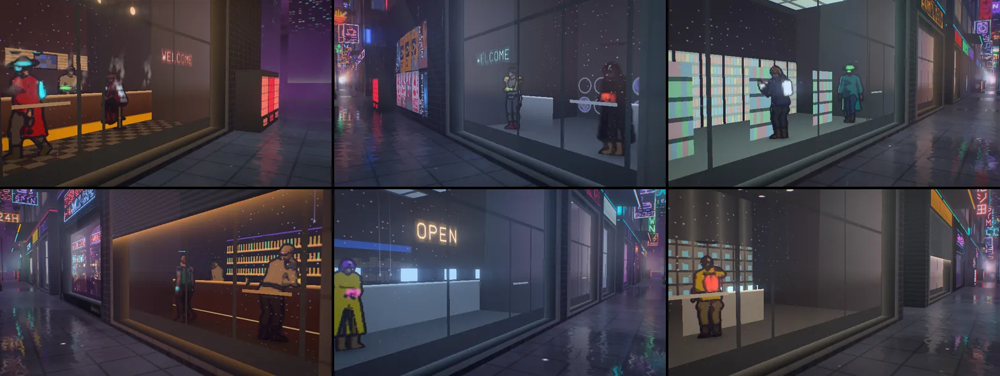
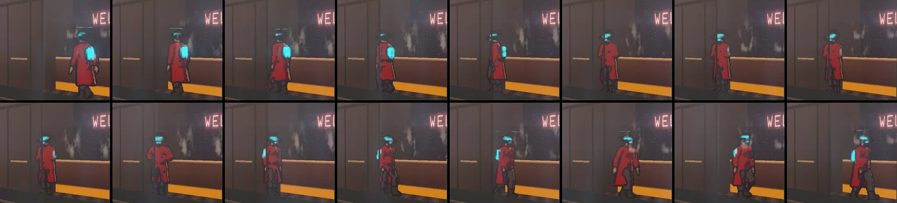

# Neon District — the people in the shops (2026-10-26)

The asks: "in neon district theme, is there any way we can make the people in the stores, gyms,
restaurants etc to feel more real. they are just flat now! we can use Blender mcp for design and
animation if needed and if that is a good idea", then "I guess we want them stylized as different
cyberpunk characters." In a second pass the same day: "I want them to be cell shaded and feel more
natural in the animation", and "can we keep improving the models to be more cyberpunky and well
made? see photo for inspiration" (three sheets of inked, flat-shaded concept art: pauldrons,
utility belts, harnesses, goggles, combat boots, mechanical fists, glowing canisters, long coats,
a heavy brute among slim figures). In a third pass: "the ncps needs to feel more smooth and less
hacky in their animation, when they turn around, and when they move", and "we need to have a
bigger variety of ncp design. so more different characters".

Before the first pass the people were signed-distance pictograms (`ndFigure`): a circle head, a
rounded-box body and straight capsule limbs, one dark fill with a rim. They stood on cards
parallel to the glass, and the game's camera sees every shop 30–88° off its window, so from the
street they were squeezed to a third of their width: a faint line. The first pass replaced them
with Blender-baked, relightable sprites of twelve cyberpunk characters; the second made them
cel-shaded and inked, kitted them out from the references, and loosened their motion; the third
gave the walkers a real turn (braking, stepping round, standing, setting off), cross-faded
every frame and view change, and widened the cast to 24 characters.


## What is there now

**A cast of cyberpunk characters** in three builds (a man of about 1.77 m, a woman of about
1.66 m, a heavy man of about 1.86 m), recoloured per person. Each role has one character or more,
picked by the person's seed:

| Role | Characters (clips) | Where |
|---|---|---|
| walker | a fixer (calf-length coat open below the belt, collar up, a lit visor, pauldrons); a netrunner (hood up with a lit edge, goggles and a respirator, crossed straps, lit soles); a brute (chrome arms, pauldrons, a mohawk, knee pads; arms folded at rest); a punk (spiky hair, goggles on the brow, a bomber with a lit zip, shorts, boots; hands on hips); a rider (a metal helmet with a lit visor slit and a crest, lit leg stripes, straps); a nomad (a wide-brimmed hat with a lit band, goggles and a respirator, a coat, a pack of glowing canisters) — `walk*` + `turn*` | crossing any room and turning at its ends |
| waiting | a corp fixer on her phone (`idleB`); a heavy guard reading the screen on his forearm (`idleC`) | the laundromat, the office |
| looker | a punk with a chrome arm, hands in pockets (`idleA`); a woman with a chrome arm, a bun and lit stripes down her cargo trousers (`idleD`) | the arcade |
| staff | a heavy street cook: headband, a cyber eye, a mechanical fist on the pan (`work`, `workStep`) | the noodle bar's counter |
| tender | a bartender with lit temple implants, polishing glasses (`tend`) | behind the bar |
| clerk | a clerk at the counter's terminal: a bun, an earpiece, a cyber eye (`terminal`) | behind the office counter |
| runner | lit leg stripes and soles, bracers, knee pads (`run`) | the gym's treadmills |
| player | spiky hair, headphones, lit stripes down the back (`arcade`); a woman in a jacket with a bob and headphones (`arcadeB`) | at the cabinets |
| monk | shaven, glowing implants, breathing with the game's breath (`lotus`) | Hale's calm room |
| diner | a courier on a stool with crossed straps (`sitEat`); a woman in a hoodie with a ponytail (`sitEatB`) | the noodle counter |
| patron | a long coat with a pauldron (`lean`); a heavy man with a mechanical fist (`leanC`) | the bar |
| lifter | a heavy cyborg: a mechanical fist under a pauldron, curls (`lift`) | by the gym's window |
| shopper | a scavenger with a pack of glowing canisters (`browse`); a corp man in a suit and visor (`browseA`) | the mart's and the boutique's shelves |




Each person gets their own skin tone, hair (about a third dyed in the street's neon), clothes,
glow colour, metal (steel, gunmetal, brass, gold, copper, black chrome) and leather (dark, black,
oxblood, olive canvas, tan) from their seed; staff (cook, bartender, clerk) wear their trade's
colours.

**Cel-shaded and inked.** The bake draws ink into the sprites as a comic inks a character: an
outline just outside every silhouette, contours where a nearer part passes in front of a farther
one (from a depth pass), sharp creases, and the borders between garments (never across a glowing
trim). The shader flats the rest: a lit tone and a cool shadow tone split by a hard terminator
under the lamps (the bake's occlusion closes creases into shadow), a hard rim where a surface turns
to the back wall, a small highlight on hair, metal posterised into three bands of the room mirrored
in it, glow flat and blooming, and the ink over everything.

**Motion.**

- *Walkers.* A walker sets off from the stand at one end of the room with a quarter turn (the head
  first, then the shoulders, then the hips, the feet stepping round) and a first step that picks up
  speed over half a step; walks; brakes over a short closing step at the far end (the trailing
  foot comes up beside the planted one), turns to face the street the same way, stands for their
  own 2.6–4.4 s (weight shifting, breathing, one slow look out of the window and along the room,
  the hands in a coat's pockets, a hoodie's pocket, folded, on the hips, in the belt or on a pack's
  straps) and turns on round to walk back. The turn is one baked clip that starts on the walk's
  frame and ends on it, so the walk runs straight into it and out of it; the shader moves the
  sprite by the same braking and starting law the bake used, so the feet stay planted throughout.
  The path is a whole number of strides, centred in the room, so the walk always reaches the turn
  on the frame the turn starts from.
- *Everything cross-fades.* Every clip blends the two frames either side of its clock (walks and
  runs read the nearest frame before, and ticked), and the two views either side of the camera's
  bearing blend over a band in the middle of each gap (they used to jump 35° at a time). The cook
  cross-fades between working the stove and stepping along the counter.
- *The rest.* The cook leans over the stove, stirs, tosses the pan, turns away to the shelf behind
  for a pinch of something and sprinkles it, and steps along the counter between spots (the step
  clip plays forward one way and backward the other, so the feet stay put). The bartender turns a
  glass on a cloth and holds it up to the light; the clerk types and glances up at the street; the
  guard taps the screen on his forearm and looks round. The diner hunches over the bowl, nods while
  chewing and glances up at the television. Every person plays their loops at their own pace
  (±12 %), every walker at their character's own speed (0.86–1.0 m/s).



**Authored in Blender, procedurally** (`scripts/blender/neon_district_people.py`, package
`neon_people/`):

- `rig.py`: rest skeletons for the three builds (C derived from A), forward kinematics for the
  spine, head and limbs, two-bone IK for planted feet and hands on a counter, and extras the body
  reads (the ponytail's and the coat's swing).
- `body.py`: the body as ellipsoids and round cones fixed to the bones (the Grainfields horse's
  distance-field kit), rebuilt from the posed skeleton for every frame, so joints stay whole; B and
  C derived from A by girth per region. Garments are the body regions they cover, inflated and cut
  at hems and cuffs; a coat's skirt hangs from the hips, flares, and opens at the front below the
  belt (a widening wedge). Gear: pauldrons of layered plates, belts and chest straps cut from the
  garment's own surface, pouches, goggles (on the brow or over the eyes), knee pads, bracers,
  mechanical fists with glowing seams, a pack with glowing canisters, combat boots with a shaft
  over the trousers; hair styles (short, buzz, undercut, mohawk, spiky, ponytail, bob, bun); head
  gear (visor, respirator, hood, collar, headphones, implants, a rider's helmet, a wide-brimmed
  hat); glowing trims; props.
- `clips.py`: the motion above, keyed with periodic splines; hands that must reach the mouth aim
  at the posed head; the walkers (`WALKERS`: build, stride, speed, hold style, clothes) each give a
  walk and a turn clip. A walker's clothes are symmetric, because a walk is mirrored for the other
  direction and a turn for the other end (a one-shoulder pauldron would swap shoulders mid-turn).
- `turns.py`: a walker's turn clip. The stop and the start are posed in the clip's world (the
  planted foot fixed, the body travelling by a constant deceleration or acceleration over half a
  step) and drawn relative to the travelling point; feet move between keys (ankle, yaw, pitch and
  the knee's pole blended together, so nothing jumps where a key hands over), the body turns with
  the head leading, the arms blend from the walk's swing into the hold's hands (FK into IK).
- `bake.py`: every frame meshed by surface nets (normals and class weights from the field,
  occlusion from the field), laid out as a grid of frames by views under an orthographic camera
  and rendered four times as data with Cycles (normal and occlusion, the class weights twice, depth)
  at twice the sheet's resolution; the ink drawn there; then packed:
  - `people.webp` (3360 × 2080, 84 × 26 cells of 40 × 80 px = 1 × 2 m): normal x, y (5 bits),
    coverage, 0.5 + 0.5 × shade (6 bits), shade 0 on the ink and 0.55 + 0.45 × occlusion elsewhere;
  - `people-masks.webp` (half size, two halves): skin, hair, top, 1 − 0.5 × bottom | chrome, glow.
  Alpha never drops below 0.5, so neither the WebP encoder nor a browser can drop the data of a
  transparent texel. Glow keeps its peak when halved, so a thin trim stays lit. Both sides stay
  within 4096 px.

Views are chosen for what the game's camera sees (it stands in the middle of the street, so every
shop is 30–88° off its window): front-facing clips from 20, 50 and 80° round the person, back-facing
ones from 100, 130 and 160°, walks from 15, 48, 132 and 165° (a walker is always seen within 60° of
their face or their back), turns from −75, −42, 42 and 75° (signed, drawn facing the street). An
inspection camera straight in front of a shop sees the nearest of these, slightly off. 2112 cells.

**In the shop shader** (`neon-district-people.js`, used by `shopInterior` in
`neon-district-shops.js`):

- A person stands on a card through their place in the room, square to the camera's line to
  them; the card hides what is behind it where the person is nearer than the room surface the ray
  hit, so the counter hides the legs of the staff behind it.
- The camera's bearing on the person (constant over the figure, so no seam) picks the two views
  either side; the clock picks the two frames either side (the distance walked for the walks and
  the cook's step, so the feet stay planted; a walker's turn by its own timeline; the breath for
  the monk). `readPerson` reads up to five cells in one loop (two frames by two views, and the
  cook's other clip faded over them), skipping any whose weight is nil.
- `walkerState` is the walker's timeline: turn out, walk, turn in, hold, each way, with the
  travel law of the turn clip and the walk's phase locked to the distance walked; scaled with the
  person, so a smaller person takes shorter strides.
- One `Loop` over the four slots and one uniform array of table rows (roles and their characters,
  view sets, clips and their turn timings, palettes) keep the shop fragment within its budget
  (about 107 KB of WGSL at High against a 112 KB gate; 97 KB before this pass).
- The sheets are loaded only on the tiers that trace rooms (Medium and up); before they arrive
  the shops are simply empty.

## Verified

- Playground on WebGPU (RTX 5080 Laptop), with the `shop=<trade>` inspection camera that follows
  a shop as the street scrolls: every trade from a game-like angle (three of each); time strips at
  10 frames a second of a noodle bar from up and down the street (both ends of the walk, the turn
  drawn straight and mirrored), a laundromat and a cook, read by eye and by the mean change between
  consecutive frames (no frame stands out; the only spikes found were far buildings scrolling into
  view outside); the game's own camera at three times. Consoles clean.
- Before rendering: the turn clips' joins checked numerically in Blender's Python (the walk into
  the turn, the turn into the hold, the hold's loop, the hold into the turn out and the turn out
  into the walk all meet within 0.1 mm), and the joints' accelerations through the turns stay in
  the walk's own range.
- `tests/unit/neon-district-shops-shaders.test.js`: the shop material built through the WGSL and
  GLSL node builders at High and Low (no throw or warning, no undeclared binding, no equal-edge
  smoothstep, budget), the sheets read once in the cell loop inside the slot loop at High and absent
  at Low.
- `tests/unit/neon-district-people.test.js`: the shader's table agrees with the sheet (every role's
  characters in order and evenly spaced, back roles behind the counter, front roles in front, view
  sets and clip rows, turn timings matching the travel law, every walk paired with its turn, the
  most seen roles with more than one character, cells inside the sheet, both images shipped, the
  sheet within 4096 px, the table within a uniform buffer).


## Traps found

- **An atlas read with `.grad()` needs a filterable placeholder.** The swappable texture nodes
  started on a `DataTexture` (nearest filtering by default), which three treats as unfilterable:
  no sampler declared, yet the gradient read emits one, and WebGPU rejects the pipeline. And three
  merges bindings by texture object, so two nodes on one placeholder became one binding (the masks
  would have read the normal sheet). Each sheet now has its own linear placeholder; recorded in the
  TSL skill notes.
- **Four unrolled figures quadrupled the shader**, and every per-role or per-clip lookup written
  as a select chain multiplied it again: one loop and one table instead. The cell reads are one
  loop too, so blending frames, views and clips added a few KB, not five copies of the reads.
- **A hand aimed at the mouth from the rest pose** went over the head of a seated or leaning
  person: aim at the posed head.
- **A coat's skirt as thigh tubes** read as puffy bloomers, and a closed long coat as a dress: a
  flared panel hanging from the hips, open at the front below the belt.
- **Ink at garment borders on both sides of a thin glowing trim** would cover it: no class-border
  ink where either side glows, no crease ink on glow.
- **Arms that hang straight with the elbow bent and the wrist straight** read as a waiter's tray in
  a walk: let the wrist trail the forearm and fold the elbow after the shoulder.
- **The old turn was a rigid spin**: a standing pose drawn only from the front, turned by the
  facing angle, so the view popped every 35° and the feet slid; and the walk froze mid-stride as it
  slowed (its frame follows the distance). A baked turn with the travel law shared between bake
  and shader fixes both.
- **A knee pole taken from the foot's yaw** jumped the knee by a centimetre where a turn key handed
  over (a foot's toe-out is not the leg's facing): blend the keys' own poles.
- **Mirroring a turn is not mirroring a pose.** A walk can be mirrored by the side the camera is
  on, but a turn mirrored that way turns the wrong way: the turn clip is drawn at the room's right
  end and mirrored at the left, and its views are signed.
- **Python's stdout is buffered in a background Blender**: the bake's per-clip lines arrive at the
  end; Cycles' "Saved" lines (unbuffered) are the progress to watch.

## Rebuilding

```
"C:\\Program Files\\Blender Foundation\\Blender 5.2\\blender.exe" --background --factory-startup ^
    --python scripts/blender/neon_district_people.py -- [--preview <dir>] [--only walkFixer,turnFixer]
```

About an hour for the whole sheet (a walker's turn clip takes about three minutes to mesh and
render); `--only` bakes a subset into a scratch folder without touching the shipped files. It
writes `public/textures/neon-district/people*.webp` and
`src/themes/neon-district/neon-district-people-atlas.js`.

## Not done

- No GPU timing (other sessions share both GPUs). By construction a person costs, per pixel of
  their card, three texture reads per cell read: two cells most of the time (two frames), four
  while the camera's bearing crosses between two views, five while the cook changes clip.
- The sheets are 8.1 MB to download (lossless; normals at 5 bits; 3.9 MB before this pass) and
  about 56 MB of GPU memory with mipmaps (about 34 MB before), fetched only on the tiers that trace
  rooms.
- People do not enter or leave through the shop door, and they do not talk to each other. Two
  walkers in one room never meet (one walker a room).
- No phone or integrated-GPU capture.
