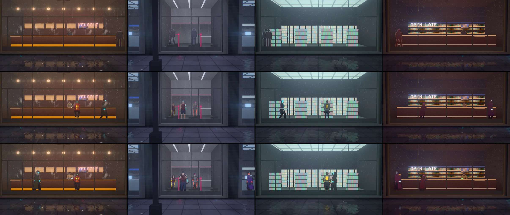
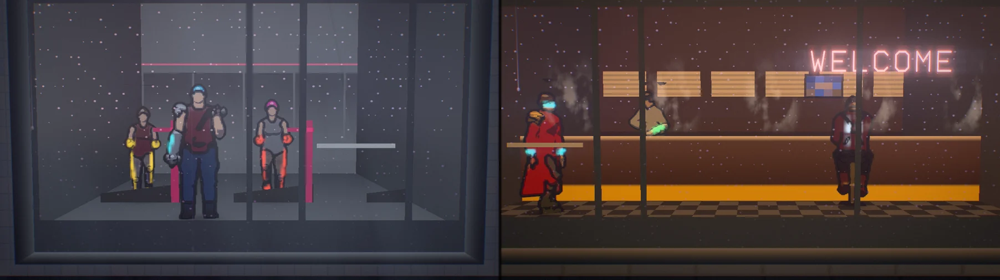
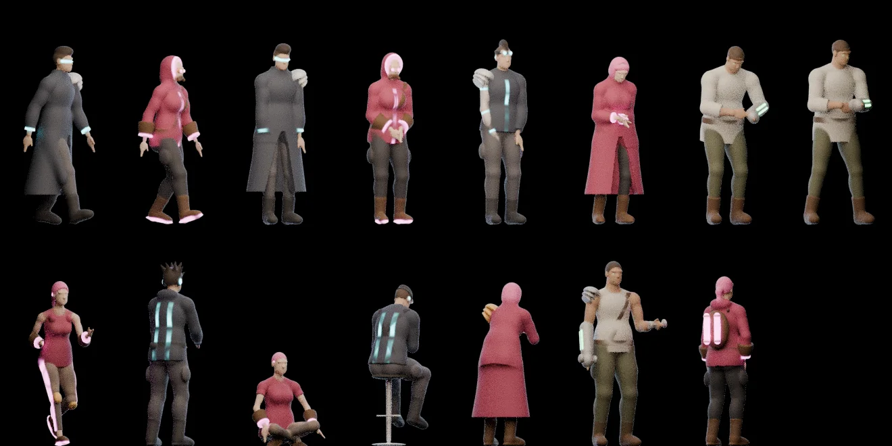
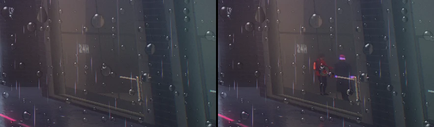

# Neon District — the people in the shops (2026-10-26)

The asks: "in neon district theme, is there any way we can make the people in the stores, gyms,
restaurants etc to feel more real. they are just flat now! we can use Blender mcp for design and
animation if needed and if that is a good idea", then "I guess we want them stylized as different
cyberpunk characters." In a second pass the same day: "I want them to be cell shaded and feel more
natural in the animation", and "can we keep improving the models to be more cyberpunky and well
made? see photo for inspiration" (three sheets of inked, flat-shaded concept art: pauldrons,
utility belts, harnesses, goggles, combat boots, mechanical fists, glowing canisters, long coats,
a heavy brute among slim figures).

Before the first pass the people were signed-distance pictograms (`ndFigure`): a circle head, a
rounded-box body and straight capsule limbs, one dark fill with a rim. They stood on cards
parallel to the glass, and the game's camera sees every shop 45–85° off its window, so from the
street they were squeezed to a third of their width: a faint line. The first pass replaced them
with Blender-baked, relightable sprites of twelve cyberpunk characters; the second made them
cel-shaded and inked, kitted them out from the references, and loosened their motion.





## What is there now

**A cast of cyberpunk characters** in three builds (a man of about 1.77 m, a woman of about
1.66 m, a heavy man of about 1.86 m), recoloured per person:

| Clip | Character | Where |
|---|---|---|
| `walkA`, `standA` | a fixer: calf-length coat open below the belt, collar up, a lit visor, a pauldron, belt and pouches, boots | crossing any room, resting at its ends |
| `walkB`, `standB` | a netrunner: hood up with a lit edge, goggles and a respirator, a chest strap, bracers, lit soles | crossing any room, resting at its ends |
| `idleA` | a punk: mohawk, goggles on the brow, bomber with a lit zip, a chrome arm under a pauldron, hands in pockets | standing in the arcade, looking round |
| `idleB` | a corp fixer: long coat, high collar, a sharp bob, a cyber eye, on her phone | waiting in the laundromat and the office |
| `work`, `workStep` | a heavy street cook: headband, a cyber eye, a mechanical fist on the pan | behind the noodle counter, the bar, the office counter; stepping along it |
| `run` | a runner: lit leg stripes and soles, bracers, knee pads | on the gym's treadmills |
| `arcade` | a gamer: spiky hair, headphones, lit stripes down the back | at the cabinets |
| `lotus` | a shaven monk with glowing implants, breathing with the game's breath | Hale's calm room |
| `sitEat` | a courier on a stool: goggles, crossed straps, lit back stripes, hunched over the bowl | at the noodle counter |
| `lean` | a long coat with a pauldron at the bar, a glass now and then | at the bar |
| `lift` | a heavy cyborg: a mechanical fist under a pauldron, a strap, curls | by the gym's window |
| `browse` | a scavenger: a pack of glowing canisters, goggles, bracers | at the mart's and the boutique's shelves |



Each person gets their own skin tone, hair (about a third dyed in the street's neon), clothes,
glow colour, metal (steel, gunmetal, brass, gold, copper, black chrome) and leather (dark, black,
oxblood, olive canvas, tan) from their seed; staff wear their trade's colours.

**Cel-shaded and inked.** The bake draws ink into the sprites as a comic inks a character: an
outline just outside every silhouette, contours where a nearer part passes in front of a farther
one (from a depth pass), sharp creases, and the borders between garments (never across a glowing
trim). The shader flats the rest: a lit tone and a cool shadow tone split by a hard terminator
under the lamps (the bake's occlusion closes creases into shadow), a hard rim where a surface turns
to the back wall, a small highlight on hair, metal posterised into three bands of the room mirrored
in it, glow flat and blooming, and the ink over everything.

**Motion.** Walks have 24 frames a stride and the slow loops 16–24, so nothing ticks. The walk's
arms hang and swing from the shoulder with the hands trailing, the elbow folding a moment after
the shoulder, the shoulders turning against the hips, the head level and forward, the coat's hem
trailing and swaying. Walkers set off, slow to a stop at the end of the room, stand in their own
clothes (hands in the coat's pockets, or in the hoodie's) while they turn to face the street and on
round, then walk back; each pauses for their own time. The cook leans over the stove, stirs, tosses
the pan, turns away to the shelf behind for a pinch of something and sprinkles it, and steps along
the counter between spots (the step clip plays forward one way and backward the other, so the feet
stay put). The diner hunches over the bowl, nods while chewing and glances up at the television;
the punk slouches with his hands in his pockets. Every person plays their loops at their own pace
(±12 %).

**Authored in Blender, procedurally** (`scripts/blender/neon_district_people.py`, package
`neon_people/`):

- `rig.py`: rest skeletons for the three builds (C derived from A), forward kinematics for the
  spine, head and limbs, two-bone IK for planted feet and hands on a counter, and extras the body
  reads (the ponytail's and the coat's swing).
- `body.py`: the body as ellipsoids and round cones fixed to the bones (the Grainfields horse's
  distance-field kit), rebuilt from the posed skeleton for every frame, so joints stay whole; B and
  C derived from A by girth per region. Garments are the body regions they cover, inflated and cut
  at hems and cuffs; a coat's skirt hangs from the hips, flares, and opens at the front below the
  belt (a widening wedge). Gear: pauldrons of layered plates, belts and chest straps cut from the
  garment's own surface, pouches, goggles (on the brow or over the eyes), knee pads, bracers,
  mechanical fists with glowing seams, a pack with glowing canisters, combat boots with a shaft
  over the trousers; hair styles (short, buzz, undercut, mohawk, spiky, ponytail, bob, bun); head
  gear (visor, respirator, hood, collar, headphones, implants); glowing trims; props.
- `clips.py`: the motion above, keyed with periodic splines; hands that must reach the mouth aim
  at the posed head.
- `bake.py`: every frame meshed by surface nets (normals and class weights from the field,
  occlusion from the field), laid out as a grid of frames by views under an orthographic camera
  and rendered four times as data with Cycles (normal and occlusion, the class weights twice, depth)
  at twice the sheet's resolution; the ink drawn there; then packed:
  - `people.webp` (2016 × 2112, 42 × 22 cells of 48 × 96 px = 1 × 2 m): normal x, y (5 bits),
    coverage, 0.5 + 0.5 × shade (6 bits), shade 0 on the ink and 0.55 + 0.45 × occlusion elsewhere;
  - `people-masks.webp` (half size, two halves): skin, hair, top, 1 − 0.5 × bottom | chrome, glow.
  Alpha never drops below 0.5, so neither the WebP encoder nor a browser can drop the data of a
  transparent texel. Glow keeps its peak when halved, so a thin trim stays lit.

Views: front-facing clips from 0, 35 and 70° round the person, back-facing ones from 110, 145 and
180°, the walks from 20, 55, 90, 125 and 160° (mirrored for the other side). 864 cells.

**In the shop shader** (`neon-district-people.js`, used by `shopInterior` in
`neon-district-shops.js`):

- A person stands on a card through their place in the room, square to the camera's line to
  them; the card hides what is behind it where the person is nearer than the room surface the ray
  hit, so the counter hides the legs of the staff behind it.
- The camera's bearing on the person (constant over the figure, so no seam) picks the view; the
  clock picks the frame (the distance walked for the walks and the cook's step, so the feet stay
  planted; the breath for the monk). The slow loops cross-fade between frames; walks, runs and steps
  read the nearest frame.
- One `Loop` over the four slots (the counter is composited at the third) and one uniform array
  of table rows (roles, clips, palettes) keep the shop fragment within its budget (about 97 KB of
  WGSL against 93 KB before the people; the first, unrolled version was 391 KB).
- The sheets are loaded only on the tiers that trace rooms (Medium and up); before they arrive
  the shops are simply empty.

## Verified

- Playground on WebGPU (RTX 5080 Laptop, Electron 38), every trade straight on, close up and
  from a game-like angle, with the `shop=<trade>` inspection camera that follows a shop as the
  street scrolls; a time strip of the noodle bar (the walker stopping, standing, turning and walking
  back); the game's own camera. Consoles clean.
- `tests/unit/neon-district-shops-shaders.test.js`: the shop material built through the WGSL and
  GLSL node builders at High and Low (no throw or warning, no undeclared binding, no equal-edge
  smoothstep, budget), the people read once in a loop at High and absent at Low.
- `tests/unit/neon-district-people.test.js`: the shader's table agrees with the sheet (every role
  a real clip with matching views, back roles behind the counter, front roles in front, clip rows,
  palettes, cells inside the sheet, both images shipped).



## Traps found

- **An atlas read with `.grad()` needs a filterable placeholder.** The swappable texture nodes
  started on a `DataTexture` (nearest filtering by default), which three treats as unfilterable:
  no sampler declared, yet the gradient read emits one, and WebGPU rejects the pipeline. And three
  merges bindings by texture object, so two nodes on one placeholder became one binding (the masks
  would have read the normal sheet). Each sheet now has its own linear placeholder; recorded in the
  TSL skill notes.
- **Four unrolled figures quadrupled the shader**, and every per-role or per-clip lookup written
  as a select chain multiplied it again: one loop and one table instead.
- **A hand aimed at the mouth from the rest pose** went over the head of a seated or leaning
  person: aim at the posed head.
- **A coat's skirt as thigh tubes** read as puffy bloomers, and a closed long coat as a dress: a
  flared panel hanging from the hips, open at the front below the belt.
- **Ink at garment borders on both sides of a thin glowing trim** would cover it: no class-border
  ink where either side glows, no crease ink on glow.
- **Arms that hang straight with the elbow bent and the wrist straight** read as a waiter's tray in
  a walk: let the wrist trail the forearm and fold the elbow after the shoulder.

## Rebuilding

```
"C:\\Program Files\\Blender Foundation\\Blender 5.2\\blender.exe" --background --factory-startup ^
    --python scripts/blender/neon_district_people.py -- [--preview <dir>] [--only walkA,work]
```

About 25 minutes for the whole sheet; `--only` bakes a subset into a scratch folder without
touching the shipped files. It writes `public/textures/neon-district/people*.webp` and
`src/themes/neon-district/neon-district-people-atlas.js`.

## Not done

- No GPU timing (other sessions share both GPUs); by construction the people add, per pixel of a
  shop room, four texture reads and a short shading term inside the figure's card only.
- The sheets add about 3.9 MB to the theme's download (lossless; normals at 5 bits), fetched only
  on the tiers that trace rooms.
- People do not enter or leave through the shop door, and they do not talk to each other.
- No phone or integrated-GPU capture.
