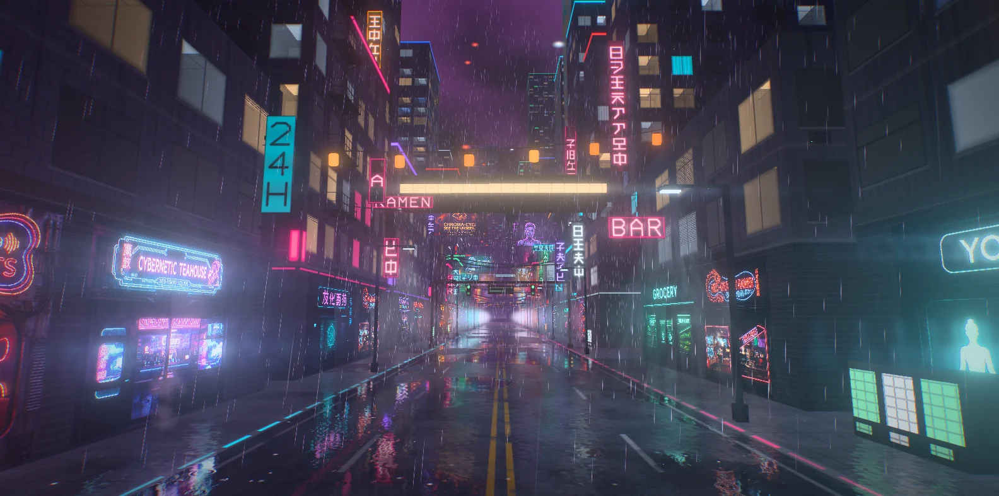
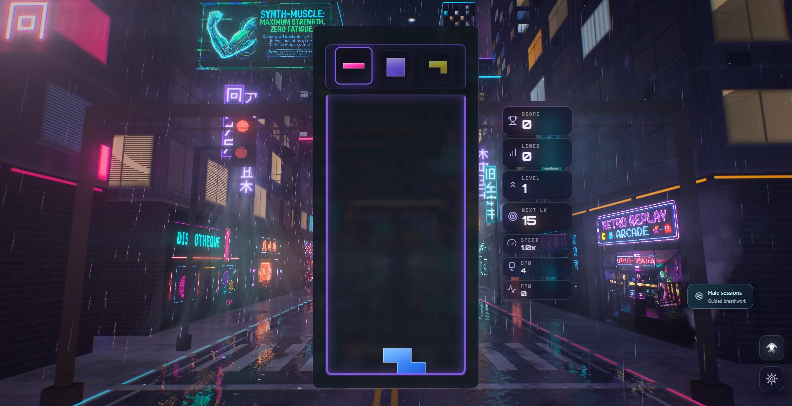
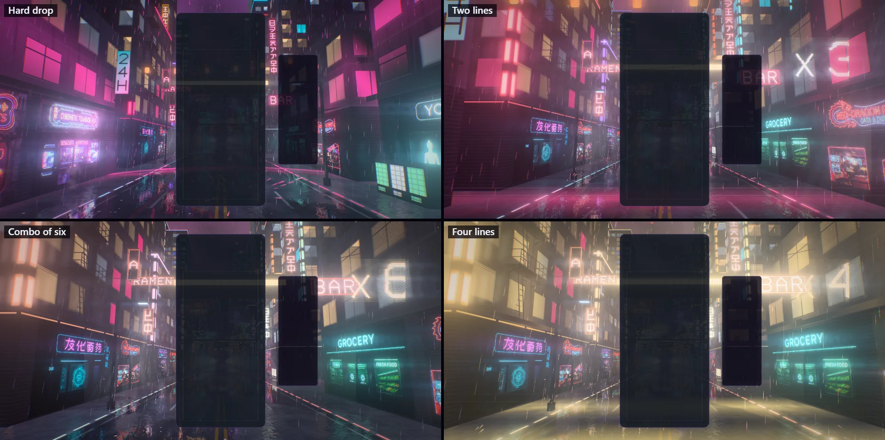
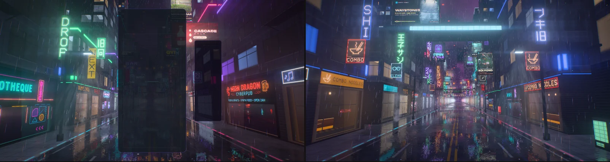
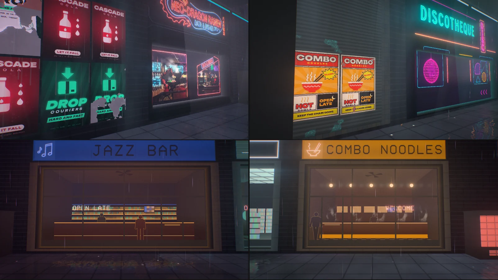
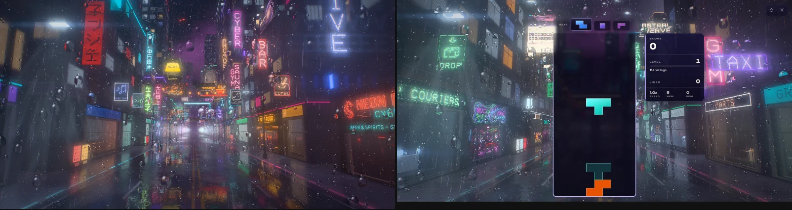
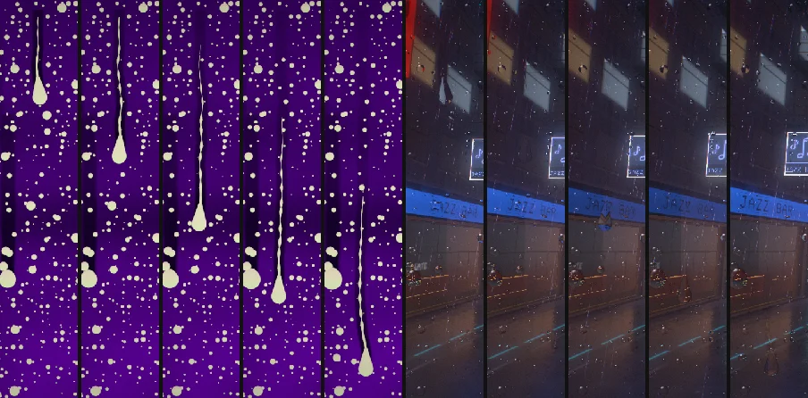
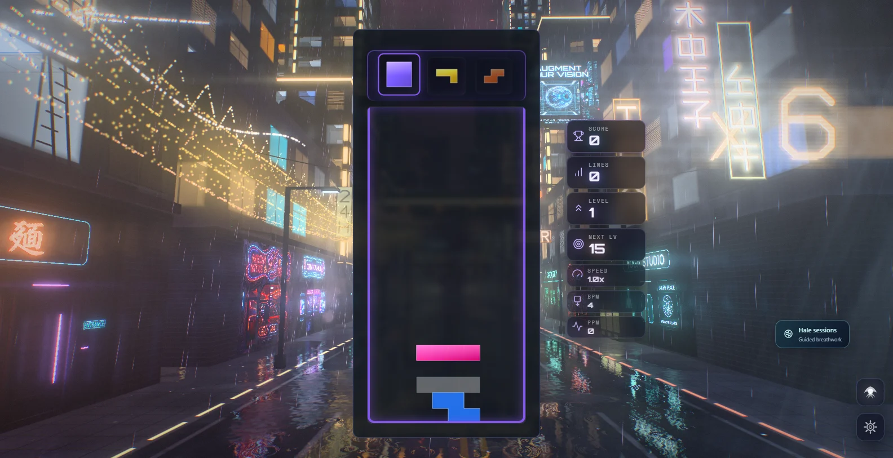
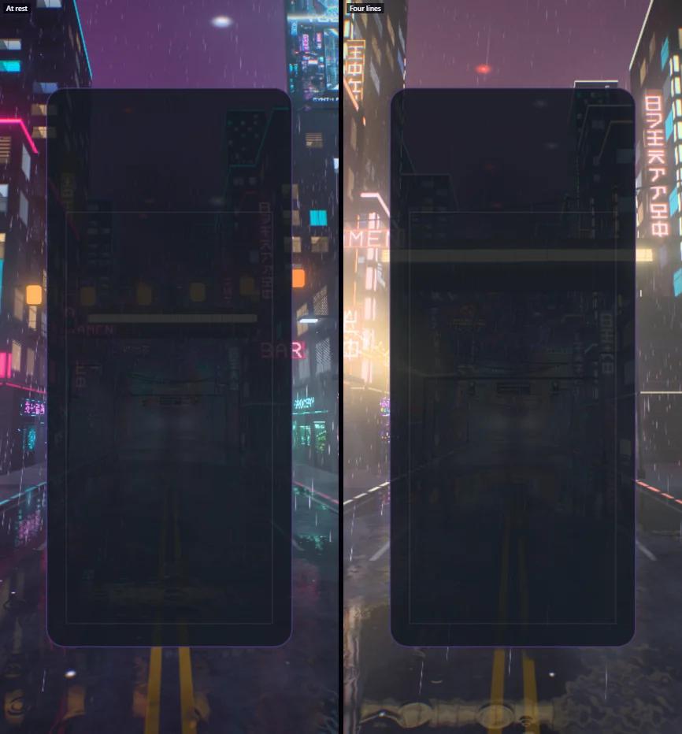

# Neon District — the rain canyon

Implemented 2026-10-05 on `feature/neon-district-masterpiece`, with Three.js 0.186.1. A
from-scratch rebuild: it replaces the earlier theme in full (the 9,600-line theme class, the
SynthCity materials and LOD chain, the pooled event effects, the post stack, the validation
script and the tests). The district keeps its identity — the rain, the wet street, the painted
shopfronts and billboards — and everything else is new. This document records the shipped
design and what was verified. It is a reference, not a backlog.

## The picture

A street canyon in the rain, seen from its centre line a little above head height, looking up
it. The city flows past for ever: painted shopfronts at the foot of the walls, blades of tube
neon over the pavement, a room behind every lit window, lanterns and cables across the road,
skybridges and signal gantries overhead, megatowers standing in the smog beyond the roofs. The
whole city stands upside down in the wet road.

The gameplay card covers the canyon's vanishing point, so the picture is built for what stays
visible: the walls sliding past on both sides, the street below, and whatever bursts out from
behind the card.

## The one idea

The district is a circuit and the board is its power source. Everything a player does on the
board is answered by light that starts at the board and travels through the street.

## Event language

| Event | Response |
| --- | --- |
| Piece lock | The piece lands in the street under the foot of the board, at its own column. A ring runs out through the puddles in the piece's colour and bends the reflections as it passes; a shell of light climbs the walls and switches dark windows on for a moment; the rain inside the shell lights up, so the shell reads as a dome; sparks skid out across the road and a comet runs down the kerb strips. |
| Hard drop | The same, harder: a wider ring, more sparks, a camera dip. |
| Line clear | The cleared rows fire out of the card as beams at their own heights. Then a wave bursts out of the vanishing point and rushes up the street at the viewer, one front per line: each sign flares as a front reaches it, the windows it passes stay lit, the kerb strips light, sparks kick off both kerbs, and the canyon's rays flood as it arrives. One line answers in the district's first accent, two in the second, three in both at once. |
| Combo | The district charges. More windows are lit, the trim on the towers climbs like level meters, the kerb strips chase faster, the city flows past faster, flying traffic speeds up and the palette warms from the level's accents to gold. A hologram beside the board counts the chain ("×3"), punched larger with each step. When the chain breaks the district browns out and drains. |
| Four lines / perfect clear | Blackout: every light in the district drops to a ghost for a fifth of a second, signs tearing. Then the wave comes back gold with four fronts, sheet lightning runs through the smog, and a drone-show dragon swims out of the haze, down the left wall beside the card and up over the camera. The district stays in overdrive while the dragon is in the street. |
| T-spin | The signs and screens glitch. |
| Level up | The district changes colours: five palettes, cycled (signal, harbour, arcade, lantern, ultraviolet). |

Combo here is the true consecutive-clear combo (one `ComboTracker` per player in
`NeonDistrictDirector`); the bus's `COMBO` event is cascade depth (ADR-0011). With several
boards on screen each lock lands under its own board, and the district charges to the longest
chain any board is holding.

## Shops and campaigns (2026-10-18)

The owner asked for better shopfronts and for neon and adverts that fit the game. Two changes
answer that.

**The shops are set into the walls.** Every block's ground floor is lined with shops, side by
side. Each is one flat quad, and its shader builds the depth behind it:

- The window and door are set back 0.3 to 0.55 m. The view ray is traced into that recess, so
  its jambs, soffit and threshold slide past in parallax and catch the shop's light.
- Wet glass stands at the back of the recess. At a glancing look it mirrors the far wall's neon.
  Up close, beads and runners sit on it and bend what is behind. Far off, where a bead would be
  smaller than a pixel, it is only wet.
- Behind the glass is the shop, interior-mapped like the rooms upstairs and furnished by trade
  (nine archetypes):
  - a noodle counter under pendant lamps
  - a laundromat's wall of turning drums
  - a mart's fridge wall and aisles
  - an arcade's cabinets
  - lit cubbies under spotlights
  - a bar's backlit bottles
  - a gym
  - a service counter
  - a calm room of round lamps for Hale and the sauna

The painted shopfronts keep their paintings. Their signs and walls stay flush, and their windows
and door (`neon-district-openings.js`) are set back behind the same wet glass. The generated
shops have more parts:

- a fascia that spells the name in tubes, a lit box or channel letters, with its animated tube
  logo
- tiled piers
- a framed glazing with a door and a hanging sign (OPEN, 24H, OPEN LATE, WELCOME)

About a fifth of the trade shops have a roller shutter part or all the way down. Light leaks out
under it, and a closed one is tagged and fly-posted.

**The district runs its own campaigns** (`neon-district-campaigns.js`). There are three
families, and every surface that advertises carries them:

- **District brands**: eight local businesses named for what a player does on the board:
  - Cascade Cola: "Let it fall"
  - Combo Noodles: "Keep the chain going"
  - Stack Savings: "Build on solid ground"
  - Drop Couriers: "Hard and fast"
  - Level Gym: "One more level"
  - Next Taxi: "Always one more coming"
  - Clear Optics: "See every line"
  - Spin Cycle: "Wash dry fold"

  Each has a mark, two colours and a slogan. Most have a branch on the street, so the noodle chain
  on the billboards has a noodle bar under them. Cascade Cola is in most vending machines.
- **Hale**: the breathing guide's campaign, the calm spot in a loud street. Its screens draw a
  ring in the space the advert leaves for it. The ring breathes on the game's breath (4 s in,
  6 s out, `breathFill`) and follows the guide's breath (`readBreathSignal`) while a session leads
  one. Hale's tube logo breathes the same way.
- **Serenity Transit**: travel posters for the game's other worlds and modes, each framed around
  a render of the world it sells:
  - worlds: Koi Pond, Sakura Twilight, Crystal Cave, Golden Forest, Midsommar, Ocean, Winter and
    Stillwater
  - modes: Infinity, Stillfall and Odyssey (Stillfall took the Waystones poster's place
    when that mode was removed, 2026-10-18)

The surfaces:

| Surface | What it shows |
| --- | --- |
| LED screens (15 a period) | A playlist of three adverts of one shape, each on for 9 to 14 s, changing with a wipe, a block dissolve or a slide. Travel posters drift a few percent as they show. Some hang high off the corners of the towers. |
| Roof boards | The rooftop scaffolds now face the street (they used to show the street their backs) and carry a printed campaign under three floodlights. |
| Paste-up posters | Hoardings and closed shutters, fly-posted two to five of one poster side by side, then the next. They are paper, lit by the street rather than glowing, wet, and some are torn. |
| Tube logos | Each campaign's mark bent in tube, animated frame by frame (drops falling, steam rising, coins stacking, a drum turning), over its name. They hang over most branded shops and on some walls. |
| Blades | About one Latin blade in six spells a campaign's word in its colour: NOODLES, TAXI, BREATHE and so on. |

The artwork is drawn by the atlas bake, not painted, so every campaign is one identity across
its billboard, poster, logo and fascia. No real company, film or game is named or drawn. No mark
is built from four squares or any other piece shape (`tetris_legal_review.md`). Two of the
December 2025 images left the atlases because they carry third-party marks:

- the Retro Replay arcade, whose sign shows another company's video-game characters
- the Aurelia Colonies advert, signed with a famous film company's name and logo

The user's other adverts stay in the screens' playlists.

## The street comes alive (2026-10-18, second pass)

The owner asked for the adverts, posters, shopfronts, neon signs and the shop rooms to feel more
alive. Everything below is a function of the world clock (and the breath), like the rest of the
district, so `seek(t)` still reproduces any frame.

**People in the shops.** Each room has up to four people. They are signed-distance silhouettes
(head, body, arms, legs that swing, or sitting cross-legged; `ndFigure`), in dark clothes in the
room's light, with a thin rim of it round them. Each stands on a plane at a fraction of the room's
depth: the ray meets that plane, and the figure hides whatever is behind it.

- **Staff** stand behind the counter, so the counter hides their legs: a cook, a bartender, a
  clerk. They shuffle along it.
- **Elsewhere at the back:** gym-goers run in place on the treadmills, arcade players sway at a
  cabinet, and Hale's visitor sits cross-legged and breathes.
- **Customers** cross the room near the window, pausing at each end and striding as they go.
- A shop with its shutter down is empty.

**Life in the rooms:**

- steam curling up off the noodle counter into the lamplight
- ceiling fans turning in the diner and the bar
- a wall television changing picture
- clothes tumbling in the running washer drums
- a fridge door with a failing tube in the mart
- attract modes on the arcade screens (rolling bars, a bouncing ball)
- scrolling rows on the office's queue screens
- Hale's round lamps brightening and dimming with the breath

**Neon.**

- One sign or fascia in three switches itself back on now and then (every 25 to 55 s): its
  letters light one by one, then it flashes twice and stays on. A lit box does it all at once.
- One blade in seven is two-tone and swaps colour every few seconds.
- Most lit-box blades carry marquee bulbs round their edge, the lit ones chasing.
- Some framed tube signs have a brighter run of light travelling round the frame.
- Some window signs blink.

**Adverts.**

- Every advert creeps in a little as it shows; travel posters, a little more.
- A gloss of light sweeps across each LED wall now and then.
- Most street screens run a ticker under the advert: its slogan in amber LEDs ("COMBO NOODLES ·
  KEEP THE CHAIN GOING", "SERENITY TRANSIT · NOW BOARDING: KOI POND", Hale's "INHALE 4 · EXHALE
  6"), or one of the district's own lines under the user's adverts.
- Text lines are now up to 48 characters.

**Posters.** Rain runs down the paste-ups in streaks that darken and shine the paper, and a torn
flap's edge stirs, catching the light and losing it.

**More worlds, more designs.** There are now 34 Serenity Transit world posters (26 new), each
framed around a render of its world from the docs captures. Seven layouts take turns, so no two
neighbours share one:

- vintage framed
- full-bleed with the name set vertically
- Swiss colour field with a line number
- art-deco arch with a sunburst
- duotone screen print
- boarding pass with flap letters
- porthole with orbiting text

Each poster's colours are sampled from its own image. Every brand has a second poster in a
different design (a bottle close-up, a comic strip, a type-only stack, a parcel label, a price
tag, a roof sign, an eye chart, a wall of washer doors). The mode posters have three layouts of
their own.

The billboard atlas is 4096 × 3584 (half size 2048 × 1792 on the low tiers). Adverts are dealt
by campaign family first:

- on the screens and roof boards: brands 42 %, transit 38 %, the user's adverts 12 %, Hale 8 %
- on the paste-up walls: transit 60 %, brands 40 %

About 26 of the 34 world posters are up in any one period of street. A final pass makes sure
every campaign is on at least one screen.

**Cost.** The first version of the rooms traced the whole room and its people for every pixel of
every shop quad. In-game at Ultra on WebGPU (RTX 3070, 1584 × 813, two alternating rounds) that
read about 79 fps with the shops against 95 without. Now the room is traced only where it can be
seen: through the glass (not the fascia, piers, reveal or a shutter), and near enough for its
detail to show. A person who is not there is skipped. The same A/B then read 129.2 and 130.6 fps
with the shops against 129.9 and 130.1 without, at Electron's frame cap. All shots of the pass
(every tier, forced WebGL2, the four-line overdrive, rooms, frame strips of the people, poster
walls, screens) have clean consoles on WebGPU.

## Rain on the glass (2026-10-19)

The owner asked for realistic raindrops on the screen, pointing at a DaVinci Resolve rain-on-lens
tutorial. The district is now seen through a pane of glass in the rain
(`neon-district-glass.js`), drawn in the post's one output pass, before the bloom is added:

- **Beads.** Drops of two sizes on a jittered grid. Each is born (a raindrop lands), sits, and
  shrinks as it evaporates, then another lands elsewhere in its cell (a cell's lifetime is 9 to
  23 s).
- **Runners.** Heavier drops, one per column, running down the pane in stick-slip runs, wiping a
  trail through the mist that grows back behind them (how they move: "How the water moves" below).
- **Mist.** Fine condensation, heavier toward the foot and the sides of the pane, softens the
  street behind the glass. On High and up it mixes toward a quarter-resolution Gaussian blur of
  the scene (`GaussianBlurNode`); on Medium it only lifts the darks. The trails wipe it, and it
  thins round the drops.
- **Optics.** Every drop is a small lens. The scene is sampled at an offset against the drop's
  outward normal, five drop radii at the rim, so the street is seen through it upside down and
  shrunk. The inside gathers a little light. The rim darkens where the light turns away, a glint
  coloured by the neon behind sits on the shoulder facing the lamps overhead, and the foot
  catches a little caustic.

Placement and switches:

- It stays off the board card and HUD (the post's calm zones).
- It has its own clock in the world's post state (`rainTime`), which holds still under reduced
  motion.
- Tiers: two layers of each kind on High, Ultra and Extreme; one on Medium; none on Low and
  Minimal (`POST_LOOK[tier].glass` and `glassBlur`).
- `?neonDistrictGlass=0` (game) and `glass=0` (playground) take it off for an A/B.

Written for this theme. The best-known real-time shader of this effect is licensed for
non-commercial use only, so none of its code is used.

Verified on WebGPU (RTX 3070): clean consoles at every tier, on forced WebGL2 and in the
four-line overdrive. In game at Ultra (1584 × 813, two alternating rounds) the street read 131.0
and 131.2 fps with the glass against 130.9 and 131.1 without, at Electron's frame cap.

### How the water moves (2026-10-19)

The owner liked the glass and asked for the dripping and the water running down it to look more
natural. The first runners slid in eight equal jerks, round, down the same sine-wave path every
run, and their trail beads moved with them. Now:

- **Each run is its own.** A run (16 to 30 s per column) has its own size, start height, path and
  kind. The drop gathers out of nothing where it starts and swells while it is pinned.
- **Stick-slip with an uneven rhythm.** Four runs in five rest at eight heights jittered so every
  slip is its own length. In each rest the drop breaks loose at its own moment, eases into the
  slide and stops short; heavier drops slide faster. It swells while pinned and is thinner after a
  slip, having left water behind. From the last rest, near the foot of the pane, it slips out of
  the frame, and its trail fades over the rest of the run.
- **Heavy runs.** One run in five is a heavier drop that gathers, then goes the whole way in one
  run, gaining speed.
- **A teardrop.** The head is a circle joined to a smaller circle up the tail by the lines tangent
  to both, so it stays a true lens. At rest it is a slightly egg-shaped drop, fuller at the foot.
  Sliding, the tail stretches to nearly three radii and points up the way it came (along the
  path). As it stops it squashes and stretches for half a second.
- **A kinked path.** The path is a slow wander plus sharper turns between straight runs, where the
  water was held up. It stays inside the column, so a head is never cut off at a column edge.
- **Film, then beads.** Behind a slip a thin film of water necks between bead sites and swells at
  them, then breaks up within about half a second (behind a heavy runner, a few drop-lengths
  back). It leaves trail beads fixed to the glass where they were left, of uneven size and a
  little off the line, drying as the drop goes on. Where the drop rested it leaves a bigger
  bead.
- **It sweeps up beads.** A bead the head comes down over since it landed is taken up, and
  shrinks back in as that trail dries.
- **Beads land and creep.** A landing bead spreads past its size and settles back, and the
  heaviest beads slip a little way down their cell in a jerk or two.

All of it is still a function of screen position and time: no particles and no state. It shows
the same at any `seek` and holds still under reduced motion. A run's slips need no loop: each
rest height is the even split plus a jitter of under half a step, so the rests stay in order and
each slot reads only its own two rests.

`glassDebug=1` on the playground draws the glass alone: the drops pale, and the mist with
the trails wiped through it violet. It is how this pass was judged. Through the street the
drops are easy to lose; on their own their shapes and timing read at once.

Verified on WebGPU (RTX 3070): clean consoles on High and Medium, on forced WebGL2, and in game.
In game at Ultra (1584 × 813, two alternating rounds) the street read 130.7 and 131.0 fps with
the glass against 130.8 and 130.6 without, at Electron's frame cap.

## How it is built

| File | Role |
| --- | --- |
| `neon-district-core.js` | Three-free constants and maths shared by the plan, the choreography and the shaders: the street's dimensions, the scroll wrap, the lock shell and clear wave timings. |
| `neon-district-layout.js` | The city plan for one 320 m period, seeded and deterministic: blocks, towers, shopfronts, signs and what they spell, screens, hardware, cables, lamps, megatowers, and the glow map. |
| `neon-district-glyphs.js` | The sign-maker's alphabet: stroke lists for digits, Latin capitals and 28 characters of the district's own script, baked to a distance-field atlas. |
| `neon-district-atlas.js` | Generated cell table for the shopfront and billboard atlases. |
| `neon-district-tsl.js` | Hashes, the baked noise texture, the shared uniforms, the district's light (glow map, haze, lock shells, clear waves). |
| `neon-district-facades.js` | Every building: one instanced box each, the facade drawn in the fragment shader with interior-mapped rooms. |
| `neon-district-street.js` | The wet street: asphalt, paint, puddles, the planar mirror, rain rings, lock rings, kerb strips. |
| `neon-district-campaigns.js` | Three-free: what the district sells. The eight brands, Hale, Serenity Transit, the trade shops, the shop archetypes and their light. |
| `neon-district-shops.js` | The shops: painted shopfronts and generated shops, each a flat quad that traces its recess, wet glass and an interior-mapped room by trade. |
| `neon-district-openings.js` | Where each painted shopfront's windows and door are, so that part can be set back. |
| `neon-district-text.js` | Lines of text for the shaders: one row of glyph ids per line in an R8 texture. |
| `neon-district-logos.js` | Three-free: the tube logos as strokes in four channels (the tube and three animation frames), baked to a distance-field atlas. |
| `neon-district-signs.js` | Tube signs, billboard screens with playlists, tube logo signs. |
| `neon-district-prints.js` | Printed campaigns: floodlit roof boards and paste-up posters, lit by the street. |
| `neon-district-kit.js` | The street's hardware: awnings, vending machines, fire escapes, pipes, skybridges, gantries, tanks, masts, condensers, scaffolds. |
| `neon-district-lights.js` | Halos, street lamps and their cones, cables and lanterns, beacons, flying traffic. |
| `neon-district-weather.js` | Rain and steam. |
| `neon-district-sky.js` | The smog ceiling, the veiled moon, sheet lightning. |
| `neon-district-fx.js` | Sparks, row beams, the combo hologram, the dragon. |
| `neon-district-world.js` | Owns the uniforms, the parts, the camera rig and the choreography. Shared with the playground effect, so what is iterated there ships. |
| `neon-district-director.js` | Renderer-free: stages bus events per player and resolves one lock and one clear per frame. |
| `neon-district-composition.js` | Three-free: reads the live card, board and HUD rects and maps board columns and rows onto the screen. |
| `neon-district-post.js` | One scene pass, bloom, and one output pass. |
| `neon-district-theme.js` | Lifecycle, renderer selection, settings, layout watch, GPU-loss recovery, capture flags. |

Techniques worth knowing before changing it:

- **One node renderer on both backends.** `WebGPURenderer` on WebGPU, its WebGL2 backend
  otherwise (or `?forceWebGL`). There is no `ShaderMaterial`, so `neon-district` is off the
  dual-state allowlist. Nothing uses compute.
- **The city scrolls, the camera does not.** Every scrolling object carries a layout depth in
  one period and is drawn at `ndWrapZ(z + scroll)`. Objects leave 24 m behind the camera and
  re-enter inside the far haze, so the seam is never seen. Megatowers do not scroll. Every
  pattern laid along the street repeats in a whole number of periods, so the world drops eight
  periods from the scroll whenever it grows past that and nothing is anchored to it; the scroll
  stays small enough for a 32-bit float however long the session.
- **About thirty draws, and again in the mirror.** Each kind of thing is one instanced draw. A
  building is one instance of a five-quad box: bays, floors, window frames, mullions, sills,
  cladding, air-conditioning units and rain sheen are drawn in the fragment shader from the
  wall's own metres, and fade to their true average where a cell is smaller than a pixel.
- **Interior mapping.** Behind each lit window the view ray is intersected with a room (back
  wall, side walls, floor, ceiling), so rooms slide past in true parallax: furniture, a door or
  a picture on the back wall, a light panel in the ceiling, blinds or a curtain in some.
- **Nothing is lit by a light.** Every material shades itself (`MeshBasicNodeMaterial`). The
  district's light is the glow map (a 160 × 2 texture of what each stretch of each wall's signs
  throw, baked from the plan), the haze, the lamps' analytic pools and the gameplay pulses. That
  keeps the mirror's second render cheap and makes walls, road, rain, steam and hardware agree
  on the colour of every stretch of street.
- **The mirror.** On Medium and up a planar `reflector()` renders the district from the
  mirrored camera at reduced resolution with a mip chain. The street reads it sharp in the
  puddles and, on rough wet asphalt, as a short vertical run of taps at a blurred mip: the long
  streak under every sign. Rain, steam and the row beams live on layer 1, which the mirror's
  camera does not render. Low and Minimal mirror the glow map instead.
- **Closed form first.** Rain, steam, traffic, lock shells, clear waves, sparks, row beams and
  the dragon are functions of the world clock and event timestamps. Nothing is created at event
  time: events write numbers into ring-buffered uniform slots and one preallocated spark pool.
  `seek(t)` plus a fixed-step replay reproduces any frame, and a test proves the same state at
  30 and 240 frames a second.
- **The dragon is drawn with lines of drones**, as a drone show draws: four contours down the
  body, ribs round it, a sawtooth crest, four jaw lines with the lower pair hung open, whiskers,
  horns, a tail fan. Each drone's place is a function of the clock and its seat. It takes the
  lane beside the card when the camera can see that lane, and passes over the card when it
  cannot (a phone held upright).
- **HDR, single output.** The scene is scene-linear; a max-channel knee selects what blooms (no
  MRT), and one output pass does the lens fringe, the calm zones on the card and HUD, bloom,
  anamorphic streaks and canyon rays (the bloom dragged sideways, and radially out of the
  vanishing point), a hue-preserving filmic curve, grade, vignette, grain and dither. An iris
  closes as the district flares so its colours survive the surge. `usesMrtScenePass()` is
  false.
- **No MaterialX noise.** One tileable fBm texture is baked on the CPU with its own mip chain;
  every shared `Fn` carries `setLayout`.

Two shader lessons from this build are in the repo's TSL skill gotcha table: a per-instance
value read in the fragment stage is interpolated, so seeds are integers and are rounded before
they reach a hash; and a `floor()` of an exactly dividing quotient of such values needs a bias.

## Tiers

| Tier | Rooms | Mirror | Rain streaks | Sparks | Dragon drones | Bloom, streaks, rays | Scene MSAA |
| --- | --- | --- | --- | --- | --- | --- | --- |
| Minimal | flat panes | glow map | 1,400 | 96 | none | off | off |
| Low | flat panes | glow map | 2,600 | 160 | 900 | off | off |
| Medium | interior-mapped | 0.36 scale, 3 taps | 5,200 | 320 | 2,600 | on | off |
| High | interior-mapped | 0.5 scale, 3 taps | 9,000 | 512 | 5,200 | on | 4× |
| Ultra | interior-mapped | 0.6 scale, 5 taps | 13,000 | 768 | 8,400 | on | 4× |
| Extreme | interior-mapped | 0.75 scale, 5 taps | 18,000 | 1,024 | 12,000 | on | 4× |

Halos, lamp cones and steam are Medium and up. Low and Minimal load the half-size atlases.

## Assets

The shopfronts and billboards are two WebP atlases under `public/textures/neon-district/`
(about 1 MB each, with half-size copies), baked by `scripts/neon-district/build-atlases.mjs`
from the images in `scripts/neon-district/source-art/`. The bake is deterministic. The atlases
load off the frame: the district stands dark where they go and powers up when they arrive.

Everything else is generated: the facades, the signs' glyphs, the hardware (boxes and
cylinders merged at build time) and the noise. No model is loaded, and Blender was not needed.

The SynthCity texture set, the asphalt textures and the HDR environment the earlier theme read
are no longer used and were removed from `public/` (about 38 MB of the shipped build).

## Verification

- Unit tests: 84 new tests in four files (layout, glyphs and atlases 18; director and
  composition 19; world 29; theme 18). The three test files of the earlier theme were retired
  with it, `portable-theme-renderers.test.js` no longer lists Neon District, and the dual-state
  allowlist lost its entry. Whole suite: 552 files, 6,133 tests. Every Neon District test
  passes. On the build machine, which was busy with other sessions, between three and five
  time-budget tests in unrelated Odyssey and Stellar Drift files failed in the full run (a
  different handful each run); all of them pass when run on their own.
- Gates: lint ratchet (964 errors against a baseline of 1,070: removing the old theme took about
  a hundred with it; the baseline was left as it is), typecheck, production build with the
  boot-closure guard, dependency boundaries, theme lifecycle audit, IP-string gate and the Pages
  artifact check all pass. The palette gate fails on `main` and here for the same unrelated
  reason (Stillwater); Neon District scores 0/7 on it.
- Playground captures on WebGPU (RTX 3070 Laptop): rest, lock, hard drop, clears of one to three
  lines, a held combo, and the four-line blackout, wave and dragon, at High; rest at Minimal,
  Low and Medium; High and Low on the forced WebGL2 backend; a 430 × 932 portrait frame at rest
  and through a four-line clear. No console errors or warnings in any of them.
- In the real game (Electron, dev server, single player): the theme starts on WebGPU, aims its
  events at the live board, takes real hard drops and bus-injected clears, survives a live
  quality change (High to Medium) and lets go of its canvas when another theme takes over.
  Observed frame rate of the whole game at 1584 × 813: about 125 to 130 fps at High on the
  RTX 3070; on the integrated AMD GPU, 61 fps at High, 119 at Medium and 163 at Low (Low renders
  at 0.85 scale). The same harness measured the earlier theme at 42 fps at High on the RTX 3070,
  with its dynamic resolution already down to 1346 × 691.

Not verified: GPU cost per tier through the theme perf lane (the figures above are observed
frame rates, not ADR-0016 measurements, and they moved by tens of fps between runs); physical
phones; Ultra and Extreme in a capture (Ultra ran in game); local multiplayer and Infinity
layouts in a capture (their routing is unit-tested only); reduced motion in a capture; sessions
of several hours (the scroll rebase is unit-tested only).

**The shops and campaigns pass (2026-10-18):**

- **Unit tests.** New tests cover:
  - the shops: they line every block, never overlap, have valid openings, and every painting is
    dealt once a period
  - the campaigns: every brand with a shop has a branch, every campaign is on a screen or a wall,
    and every trade shop appears
  - screens: three different adverts of one shape, Hale's at most once
  - prints: never a ring advert, and every roof board sits on a scaffold
  - logos: the atlas and its animation table (16 logos)
  - every line of text spells with glyphs the atlas has

  The Neon District files pass. The whole suite: 995 files, 18,800 tests, all green except four
  tests that fail on `main` too (`tts-recorder-e2e`, `game-over-modal-result-compatibility`,
  `odyssey-level-briefing`, `records-view`).
- **Gates.** All pass: lint ratchet (575 against a baseline of 599, left as it is), typecheck,
  production build with the boot-closure guard, dependency boundaries, architecture fitness,
  IP-string gate, Pages artifact and release gates.
- **Playground captures on WebGPU (RTX 3070 Laptop).** Clean consoles at every tier from Minimal
  to Ultra, on the forced WebGL2 backend, in the four-line overdrive and in a hard drop. Close-ups
  covered a Hale screen breathing, poster walls, roof boards, logo signs and both Combo Noodles
  branches.
  - The first GPU run caught what software rendering could not. The generated shops and the
    screens had 11 and 9 separate instance attributes, and WebGPU allows 8 vertex buffers, so
    both pipelines failed on WebGPU only. Their instance data is now one interleaved buffer
    (`ndQuadGeometry(…, { interleave: true })`).
- **In the real game** (Electron, dev server, single player, RTX 3070, 1584 × 813): the theme
  starts on WebGPU with all 57 shops and logs no errors.
  - High: 129.6 fps.
  - Ultra: four alternating runs, with the new shops, logo signs and prints and without them,
    read 130.6 and 130.7 against 130.5 and 130.6 fps. That is Electron's frame cap (about 131 Hz
    here), so the new parts' cost is below what this can see. A single earlier Ultra reading of
    106 fps did not repeat.
  - These are observed frame rates, not perf-lane (ADR-0016) measurements.

## Reproduce

Run `npm run dev:playground`, then:

`/playground.html?effect=neon-district&t=30&quality=High&board=1`

Add `event=lock|drop|clear|quad|tspin|perfect|levelUp` with `eventAge=<s>`, and `combo=<n>`,
`level=<n>`, `lines=<n>`, `u=<0..1>`, `color=<hex>`. `demo=1` (without `t`) plays a looping
script. `parts=` draws only the named parts; `falseColor=1` bands the pre-tone-map peak;
`noPost=1` shows the raw scene; `forceWebGL=1` uses the WebGL2 backend. In the game:
`?neonDistrictTime=`, `?neonDistrictFixedDt=`, `?neonDistrictParts=`,
`?neonDistrictFalseColor=1`.

The theme icon is the two-line clear wave through the playground's icon lens
(`/playground.html?effect=neon-district&t=100&quality=High&icon=1&event=clear&lines=2&eventAge=0.8&combo=1`
in a square window), cropped to 74% of the frame around (0.5, 0.56), given a colour lift
(contrast 1.22, saturation 1.55, brightness 1.06) and baked as a 512 px circle. The same file is
kept at `public/assets/themes/neon-district-theme-icon.png`.

## Captured previews

