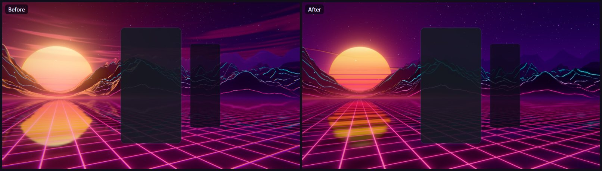
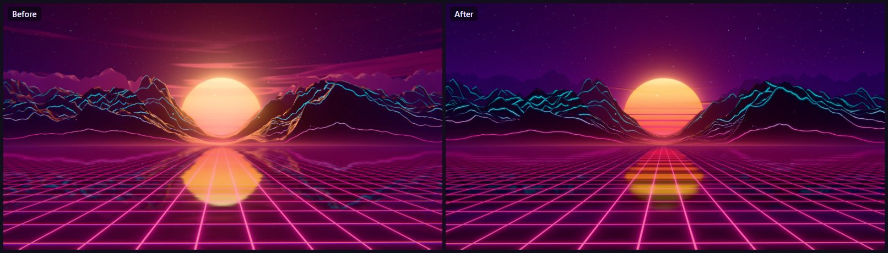
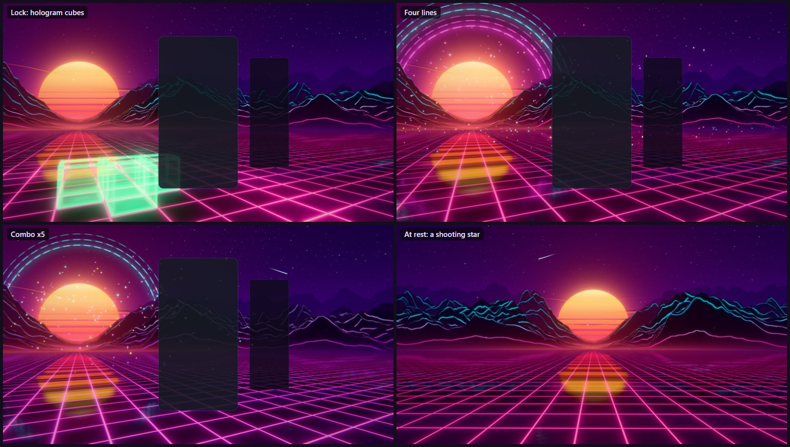
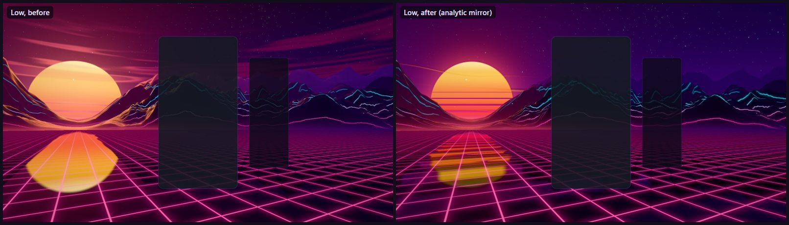
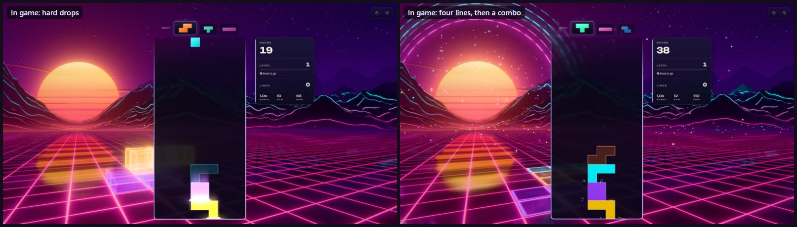
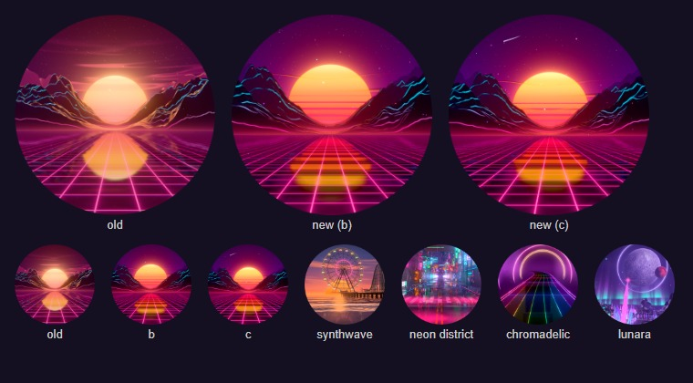

# Neon Dusk — the dusk pass

Implemented 2026-10-21 on `feature/neon-dusk-overhaul`, on top of the 2026-10-03 rebuild (one
TSL node-material path on three r186 `WebGPURenderer`; its evidence is in
`reports/neon-dusk-overhaul/`). The world, the composition, the event language and the draw count
are unchanged. This pass reworks how the picture reads. It is a reference, not a backlog.

## What was wrong

- **The sun** came out a pale peach disc, its slits barely visible: the face was authored at 2–2.8
  (far past the tone curve's shoulder, which whitens it), the glow around it was as bright as the
  face, so the slits showed glare instead of sky, and a wide bloom veiled a third of the frame.
  With the board on screen the yaw puts the sun near the frame's edge, where the sky-space disc
  stretched into an oval.
- **The sky** was a muddy rose: the stratus were smooth fBm blobs spread over the whole upper sky.
- **The mountains** had a glossy orange "plastic" glaze (a rim term that lit every facet half
  turned from the eye), and the far range was lighter than the sky behind it, so it read as lilac
  cloud. The scan lines were jagged lightning: the two finest terrain octaves were shorter than
  two vertex steps, so they only aliased, and the scan lines traced the aliasing.
- **The glass floor** mirrored the sun as a blurry blob and the scan lines as cyan smudges (the
  mirror was read a mip and a half down everywhere).
- The VHS edge split fringed every neon line in the corners into rainbows.

## What changed

| Part | Change |
| --- | --- |
| Sun (`neon-dusk-sky.js`, `neon-dusk-tsl.js`) | Drawn in the lens's image plane (`ndSunDisc`): a true circle wherever the yaw puts it. Built from `cameraViewMatrix`, so the reflector's mirrored camera measures its own round disc; the sign of the view-space up keeps the face the right way up there. Face authored saturated with low green, 1.2 (magenta base) to 1.7 (pale gold crown), over the part of the disc that clears the pass. Slits (`ndSunSlits`) start a third of the way up and widen toward the base, sliding slowly down. The halo hugs the rim and is dim inside the disc, so the slits show dusk. |
| Sky | Five stratus lenses (`STRATUS`): thin, tapered, wandering bars with lit undersides, gathered round the sun, each leaning to its own side so they stagger across it rather than ring it; across the disc they stand in front and dim it. A sparse layer of bright stars with a faint four-point flare. The gradient keeps its violet higher (so the ranges stand against it). |
| Mountains (`neon-dusk-mountains.js`) | Silhouettes that step back in tone, lit only a little by the sky. The backlit rim is only on facets fully edge-on and only near the sun's bearing (`edgeOn^16 · cos^16`). A warm glow in the air toward the sun at distance. Aerial perspective fades each range toward the colour of the sky right behind it (times 0.88), never past it, so the far range is a dark silhouette. Four ridged octaves per range (`RANGES[].octaves`): the mesh can hold no finer. Scan lines get a soft glow a few pixels wide. |
| Floor (`neon-dusk-floor.js`) | Ripples lying across the view ride the scroll and break the mirror's image into bars that run in toward the lens (the sun lies in the glass as a road of light). The reflector is read in five taps down the screen, crisp toward the horizon and up to two mips softer underfoot. Low and Minimal mirror the same round, slit sun analytically, soft-edged. At rest a soft band of light runs in along the grid every 11 s (`AMBIENT_PULSE`). |
| Locks (`neon-dusk-fx.js`) | Each cell of a locked piece stands up out of the glass as a hologram cube (glowing edges, a fill fading toward its top, a slow scan), pops with a small overshoot and sinks back to a lit tile as it rides the scroll. Same instanced draw: the plane became a unit box stretched in the vertex stage. |
| Ambient | Once in each 19 s window a shooting star crosses the sky (`AMBIENT_SHOOT_PERIOD`), at a time and on a path hashed from the window, so a seek lands on the same star. Neither the star nor the grid pulse runs under reduced motion (`u.ambient`). |
| Post (`neon-dusk-post.js`) | Bloom tighter and a little weaker (radius 0.22, knee 0.4, strength 0.64–0.74). VHS edge split at rest 0.0045 (was 0.012); the glitch's split is unchanged. |

The theme icon (`src/themes/neon-dusk/neon-dusk-theme-icon.png`, same bytes at
`public/assets/themes/`) is re-baked from the new world, and `docs/theme-screenshots/neon-dusk.png`
is the fleet validator's capture of it.

## Verification

- Unit tests: `tests/unit/neon-dusk-shaders.test.js` (new) builds every material through the WGSL
  and GLSL node builders at High (reflector) and Low (analytic mirror) and fails on a warning, a
  throw, an equal-edge smoothstep, a NaN literal, a stringified node, MaterialX noise or an
  undeclared texture binding; it also checks the sky (and Low's floor) read the view matrix. The
  sky's fragment stage is 22.6 KB of WGSL, the floor's 9.4 KB, the mountains' 8.1 KB.
  `neon-dusk-theme.test.js` gained a test for the ambient shooting star (fires, same star after a
  seek, none under reduced motion). Those two files and `theme-reduced-motion-batch-b.test.js`:
  21 tests, all passing.
- Gates: eslint on the theme, its playground effect and its tests (clean); `tsc --noEmit` (clean).
- Playground captures on WebGPU (1600 × 900): rest with the solo board and without; a lock at
  0.12, 0.4 and 1.2 s; two lines; four lines; a combo of five; a level-up; an ambient shooting
  star; Minimal, Low, Medium, High and Extreme; High and Low on the forced WebGL2 backend; upright
  430 × 852 with and without the board. No console errors or warnings in any of them.
- In the game (Electron, private dev server, single player, High, WebGPU): the theme starts, puts
  the sun in the free zone left of the board, takes real hard drops from the keyboard (the cubes
  stand beside the board), and shows a four-line clear and a combo driven through the live world.
  No console errors or warnings. `scripts/validate-all-themes.mjs --theme neon-dusk`: PASS, 0
  lifecycle failures, 0 console errors.
- Cost, playground at 1600 × 900, the same frame rendered 240 times in one task and waited on the
  queue, four interleaved rounds per arm on this laptop's discrete GPU: High 1.20 ms before, 1.07
  ms after (within noise); Low 0.24 ms before, 0.31 ms after. Not measured: the theme perf lane
  (ADR-0016), integrated GPUs, phones.

## Reproduce

`npm run dev:playground`, then `/playground.html?effect=neon-dusk&t=20&quality=High`. Add
`board=0` for the menu framing, `event=lock|clear|tetris|combo|levelUp` with `eventAge=<s>` (and
`piece=`, `x=`, `lines=`, `combo=`), `forceWebGL=1`, `noPost=1`. `t=12.4&board=0` shows the first
ambient shooting star.

The icon is the `board=0` frame at `t=20`, `quality=Extreme`, in an 840 × 840 window, cropped to
78 % of the frame height round its centre, lifted (`contrast(1.08) saturate(1.12)`) and clipped to a
512 px circle on a transparent ground.
