# Neon Dusk — the dusk pass

Implemented 2026-10-21 on `feature/neon-dusk-overhaul`, on top of the 2026-10-03 rebuild (one
TSL node-material path on three r186 `WebGPURenderer`; its evidence is in
`reports/neon-dusk-overhaul/`). The world, the composition, the event language and the draw count
are unchanged. This pass reworks how the picture reads. It is a reference, not a backlog.

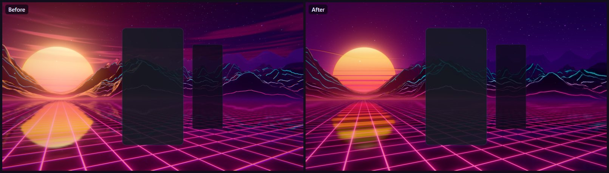

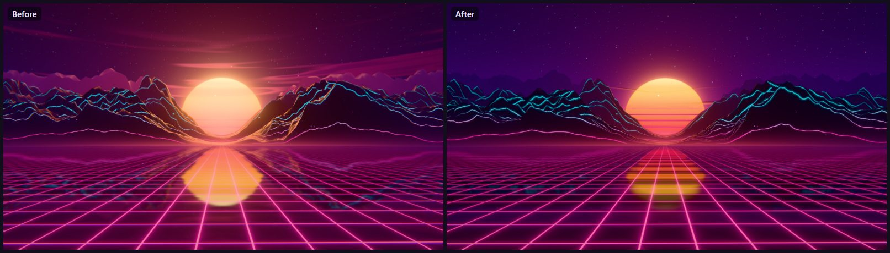

## What was wrong

- **The sun** came out a pale peach disc, its slits barely visible: the face was authored at 2–2.8
  (far past the tone curve's shoulder, which whitens it), the glow around it was as bright as the
  face, so the slits showed glare instead of sky, and a wide bloom veiled a third of the frame.
  With the board on screen the yaw puts the sun near the frame's edge, where the sky-space disc
  stretched into an oval.
- **The sky** was a muddy rose: the stratus were smooth fBm blobs spread over the whole upper sky.
- **The mountains** had a glossy orange "plastic" glaze (a rim term that lit every facet half
  turned from the eye), and the far range was lighter than the sky behind it, so it read as lilac
  cloud. The scan lines were jagged lightning: the two finest terrain octaves were shorter than
  two vertex steps, so they only aliased, and the scan lines traced the aliasing.
- **The glass floor** mirrored the sun as a blurry blob and the scan lines as cyan smudges (the
  mirror was read a mip and a half down everywhere).
- The VHS edge split fringed every neon line in the corners into rainbows.

## What changed

| Part | Change |
| --- | --- |
| Sun (`neon-dusk-sky.js`, `neon-dusk-tsl.js`) | Drawn in the lens's image plane (`ndSunDisc`): a true circle wherever the yaw puts it. Built from `cameraViewMatrix`, so the reflector's mirrored camera measures its own round disc; the sign of the view-space up keeps the face the right way up there. Face authored saturated with low green, 1.2 (magenta base) to 1.7 (pale gold crown), over the part of the disc that clears the pass. Slits (`ndSunSlits`) start a third of the way up and widen toward the base, sliding slowly down. The halo hugs the rim and is dim inside the disc, so the slits show dusk. |
| Sky | Five stratus lenses (`STRATUS`): thin, tapered, wandering bars with lit undersides, gathered round the sun, each leaning to its own side so they stagger across it rather than ring it; across the disc they stand in front and dim it. A sparse layer of bright stars with a faint four-point flare. The gradient keeps its violet higher (so the ranges stand against it). |
| Mountains (`neon-dusk-mountains.js`) | Silhouettes that step back in tone, lit only a little by the sky. The backlit rim is only on facets fully edge-on and only near the sun's bearing (`edgeOn^16 · cos^16`). A warm glow in the air toward the sun at distance. Aerial perspective fades each range toward the colour of the sky right behind it (times 0.88), never past it, so the far range is a dark silhouette. Four ridged octaves per range (`RANGES[].octaves`): the mesh can hold no finer. Scan lines get a soft glow a few pixels wide. |
| Floor (`neon-dusk-floor.js`) | Ripples lying across the view ride the scroll and break the mirror's image into bars that run in toward the lens (the sun lies in the glass as a road of light). The reflector is read in five taps down the screen, crisp toward the horizon and up to two mips softer underfoot. Low and Minimal mirror the same round, slit sun analytically, soft-edged. At rest a soft band of light runs in along the grid every 11 s (`AMBIENT_PULSE`). |
| Locks (`neon-dusk-fx.js`) | Each cell of a locked piece stands up out of the glass as a hologram cube (glowing edges, a fill fading toward its top, a slow scan), pops with a small overshoot and sinks back to a lit tile as it rides the scroll. Same instanced draw: the plane became a unit box stretched in the vertex stage. |
| Ambient | Once in each 19 s window a shooting star crosses the sky (`AMBIENT_SHOOT_PERIOD`), at a time and on a path hashed from the window, so a seek lands on the same star. Neither the star nor the grid pulse runs under reduced motion (`u.ambient`). |
| Post (`neon-dusk-post.js`) | Bloom tighter and a little weaker (radius 0.22, knee 0.4, strength 0.64–0.74). VHS edge split at rest 0.0045 (was 0.012); the glitch's split is unchanged. |

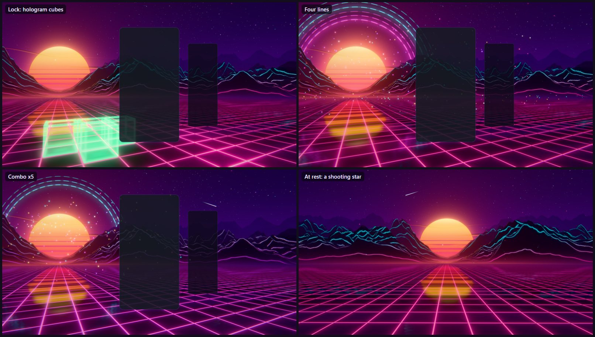

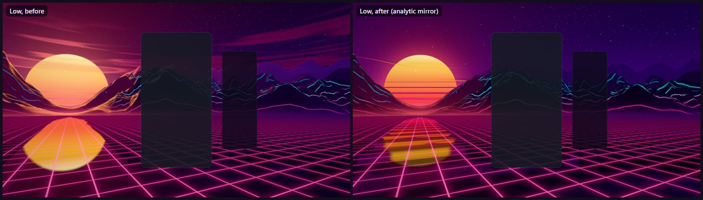

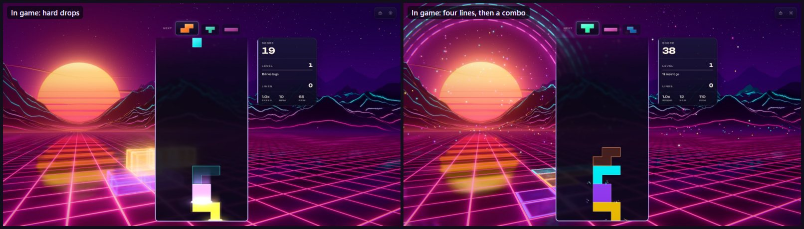

The theme icon (`src/themes/neon-dusk/neon-dusk-theme-icon.png`, same bytes at
`public/assets/themes/`) is re-baked from the new world, and `docs/theme-screenshots/neon-dusk.png`
is the fleet validator's capture of it.

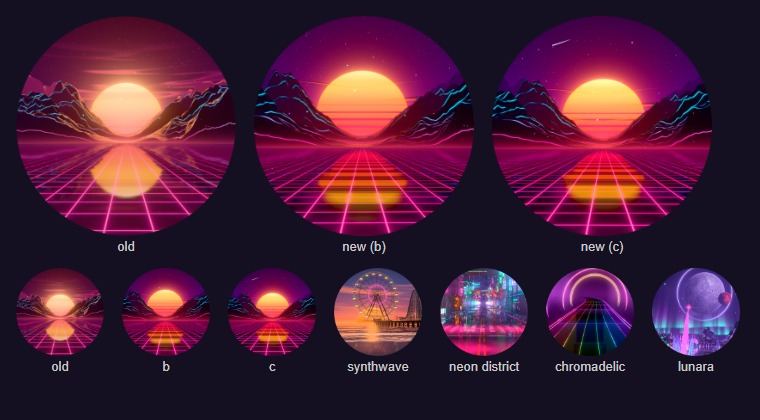

## Verification

- Unit tests: `tests/unit/neon-dusk-shaders.test.js` (new) builds every material through the WGSL
  and GLSL node builders at High (reflector) and Low (analytic mirror) and fails on a warning, a
  throw, an equal-edge smoothstep, a NaN literal, a stringified node, MaterialX noise or an
  undeclared texture binding; it also checks the sky (and Low's floor) read the view matrix. The
  sky's fragment stage is 22.6 KB of WGSL, the floor's 9.4 KB, the mountains' 8.1 KB.
  `neon-dusk-theme.test.js` gained a test for the ambient shooting star (fires, same star after a
  seek, none under reduced motion). Those two files and `theme-reduced-motion-batch-b.test.js`:
  21 tests, all passing.
- Gates: eslint on the theme, its playground effect and its tests (clean); `tsc --noEmit` (clean).
- Playground captures on WebGPU (1600 × 900): rest with the solo board and without; a lock at
  0.12, 0.4 and 1.2 s; two lines; four lines; a combo of five; a level-up; an ambient shooting
  star; Minimal, Low, Medium, High and Extreme; High and Low on the forced WebGL2 backend; upright
  430 × 852 with and without the board. No console errors or warnings in any of them.
- In the game (Electron, private dev server, single player, High, WebGPU): the theme starts, puts
  the sun in the free zone left of the board, takes real hard drops from the keyboard (the cubes
  stand beside the board), and shows a four-line clear and a combo driven through the live world.
  No console errors or warnings. `scripts/validate-all-themes.mjs --theme neon-dusk`: PASS, 0
  lifecycle failures, 0 console errors.
- Cost, playground at 1600 × 900, the same frame rendered 240 times in one task and waited on the
  queue, four interleaved rounds per arm on this laptop's discrete GPU: High 1.20 ms before, 1.07
  ms after (within noise); Low 0.24 ms before, 0.31 ms after. Not measured: the theme perf lane
  (ADR-0016), integrated GPUs, phones.

## Reproduce

`npm run dev:playground`, then `/playground.html?effect=neon-dusk&t=20&quality=High`. Add
`board=0` for the menu framing, `event=lock|clear|quad|combo|levelUp` with `eventAge=<s>` (and
`piece=`, `x=`, `lines=`, `combo=`), `forceWebGL=1`, `noPost=1`. `t=12.4&board=0` shows the first
ambient shooting star.

The icon is the `board=0` frame at `t=20`, `quality=Extreme`, in an 840 × 840 window, cropped to
78 % of the frame height round its centre, lifted (`contrast(1.08) saturate(1.12)`) and clipped to a
512 px circle on a transparent ground. (Superseded 2026-11-20: the living pass re-baked it, below.)

# The living pass (2026-11-20)

Asked for: a full audit, then the theme raised to one of the game's most striking: varied over
time, an effect of its own for every event with the biggest moments the most spectacular, smooth
and readable. Built on `feature/neon-dusk-masterpiece`. The composition, the sun, the glass and
the mood wheel of the dusk pass are kept; this pass builds on them.

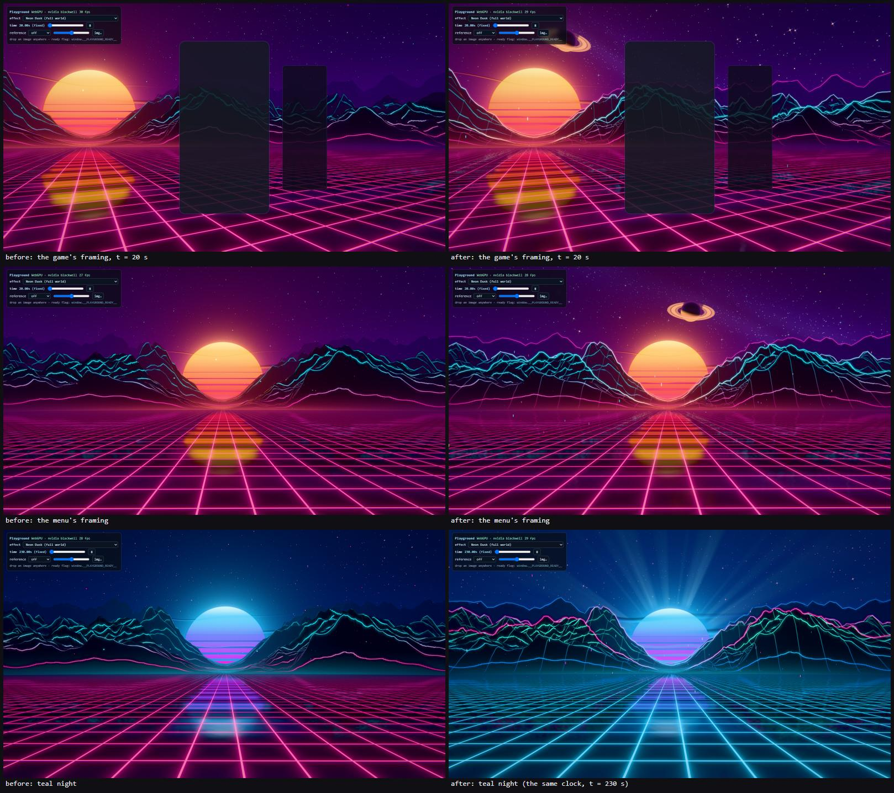

## What the audit found

Judged from captures of all five moods, every event at two ages, Low, Minimal, WebGL2 and portrait
(the "before" set), not from the code:

- **Every event was the same instrument.** A double, a quad, a twist, a back-to-back, a perfect
  clear and a level-up were all "dashed halos leave the sun" at different strengths. A single
  showed nothing for over a second (its floor wave waited 1.25 s below the horizon); a hard drop
  was a slightly stronger ripple far out on the glass.
- **Nothing changed but the colour.** Five good palettes, but the grid stayed hot pink and the
  ridges cyan in all of them, so "teal night" was a blue sky over the same floor. Beside the
  moods: one grid pulse every 11 s and one shooting star every 19 s.
- **The upper sky was empty**: an even sprinkle of similar stars over a gradient, the stratus
  bars hairlines, nothing in the open sky right of the board.
- **The ranges had no ridgelines.** The scan lines are cross-sections at fixed distances; they
  never trace a crest, so the skylines themselves were dark edges.
- **The dust** was a dozen visible specks.
- Kept as they were: the sun and its slits, the composition solver, the glass and its sun road,
  the lock holograms, the surge's four acts, the post chain.

## What changed

| Part | Change |
| --- | --- |
| Moods (`neon-dusk-moods.js`) | A mood now also sets the grid (near, far), the scan lines (foot, crest), the ridgelines and where a hot hand swings each of them (`swing()`: the short way round the colour wheel). Magenta dusk keeps its pink grid and cyan ridges; violet twilight has a violet grid; teal night a cyan grid under hot pink ridgelines; ultraviolet midnight a violet grid under mint ridges; amber dawn an orange grid under gold ones. |
| Clocks (`neon-dusk-clock.js`, new, three-free) | Beside the moods (105 s), five **airs** on a 76 s period: clear, cloud bars, deep sky, haze, lattice. The **sky turns** about a pole above the frame (a turn in 40 min, a level a step on top). A **ringed planet** rises beside the pass, arcs over the sun and sets (560 s; down for a quarter of it). The **sun rides** ±1.1° in the pass. **Happenings**: in each 27 s window one may come, drawn from the window's hash (a seek lands in the middle of the same one): a meteor shower, a comet, a satellite, lights racing out along the grid, a flight of gliders. |
| Sky (`neon-dusk-sky.js`) | Stars in the sky's own turned frame, on lattices of equal-area cells, each star's image sized in pixels and its brightness dealt steeply (a few bright, a dust of faint). The **galaxy's band** as points crowded by a density, with its own glow and one dust rift. The **planet**: a dark globe with a lit crescent toward the sun, bands, and rings its shadow cuts, measured along its own world axes so the glass mirrors the same planet. The **sunburst** (thin rays fanned round the disc), the **lattice** (the dome's grid overhead, running with the floor's), cloud bars that swell into slats in the cloud air. Event layers behind uniform branches: halos, the triangle, the twins, laser beams, the scan bar, meteors (a packed table), a comet. Fragment stage 43.8 KB of WGSL (22.6 before); the gate's budget is 96. |
| Ridgelines (`neon-dusk-ridges.js`, new) | One neon line along each range's skyline: the mountains' build hands over each range's crest as the rest camera sees it, and a ribbon is widened in the image square to the line's own run (the same width on screen at any distance and slope), drawn a little toward the eye along its own sight line so its own slope does not cut it. Warm beside the sun, a slow shimmer, pulses of light running out from the pass. One additive draw; the glass mirrors it. |
| Mountains (`neon-dusk-mountains.js`) | A wire net over the scan lines: the floor grid's own x lines carried up the slopes. Scan colours from the mood. |
| Floor (`neon-dusk-floor.js`) | The grid in the mood's colours, a glint where its lines cross, a hard drop's **square** shock (the grid's own metric), racers along the lines, a calmer mirror in the still airs. |
| FX (`neon-dusk-fx.js`) | A hard drop's pillar of light. The dust restyled as short upright dashes kept low over the glass (as squares, the near ones floated up among the stars as confetti). |
| Flight (`neon-dusk-flight.js`, `neon-dusk-glider-model.js`, new) | Five gliders out of the sun, through the pass and over the lens, a line of light behind each. The hull is modelled in **Blender** (`scripts/blender/neon_dusk_glider.py`, headless; 98 triangles): a faceted delta dart exported with an edge code a corner, so only its real creases light, never a triangulation's diagonal. Two instanced draws, parked at no size. |
| World (`neon-dusk-world.js`) | Drives all of it; the event table below; a run's end and the next run's start. |
| Theme (`neon-dusk-theme.js`) | Hears `gameOver` and the mode manager's `modeStarted` / `modeStopped`. |

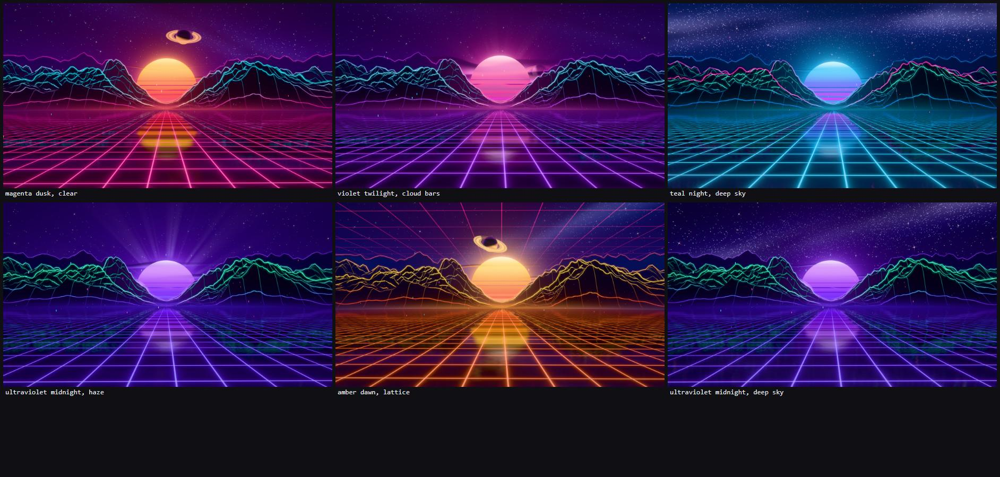

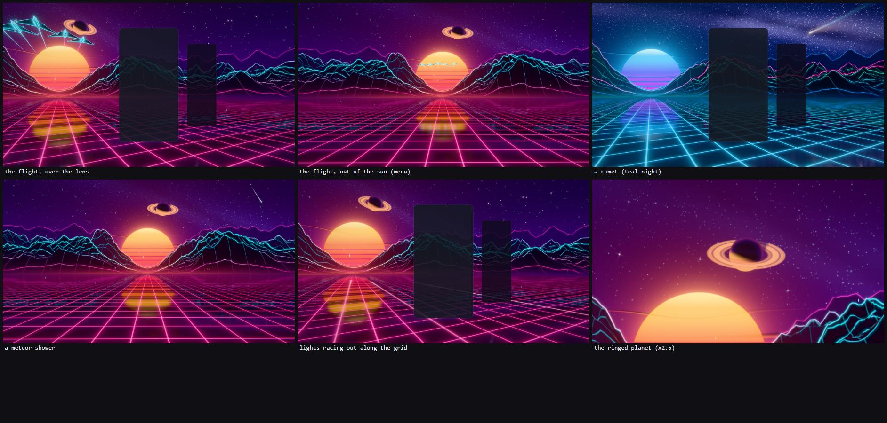

## An instrument for every event

| Event | What plays |
| --- | --- |
| Lock | the piece's hologram rises far out and glides in (kept); a ripple |
| Hard drop | a pillar of light strikes up where it landed; a square shock runs out along the grid lines |
| Single | a pulse of light runs out along the ridgelines from the pass, at once; the glass's wave (now 0.6 s out, was 1.25); the ranges' scan |
| Double | + a dashed halo leaves the sun |
| Triple | + three laser beams fan up out of the pass |
| Quad | the sunburst: rays thrown across the sky, a five-beam crown, the pixel storm, the tape slips |
| Twist | the neon triangle stands round the sun and spins home, an echo a line cleared |
| Back-to-back | the sun's twins: a cyan and a magenta ghost slide out and fold back, farther each streak; a double scan |
| Cascade | a volley of meteors, one more a wave; the palette swings |
| Combo | the sun's slits light one by one from its base (the chain's meter); they go out when it breaks |
| Perfect clear | the coronation: the slits close and the disc burns gold, rays stand round it, seven gold beams crown it, every ridgeline is gilded from the pass outward, meteors fall, the glass breathes out |
| Level | the scan bar climbs the whole sky, the ranges light far to near, lights race out along the grid, the mood steps |
| Run's end | the sun goes down behind the pass, the stars come out; the next run is its sunrise |

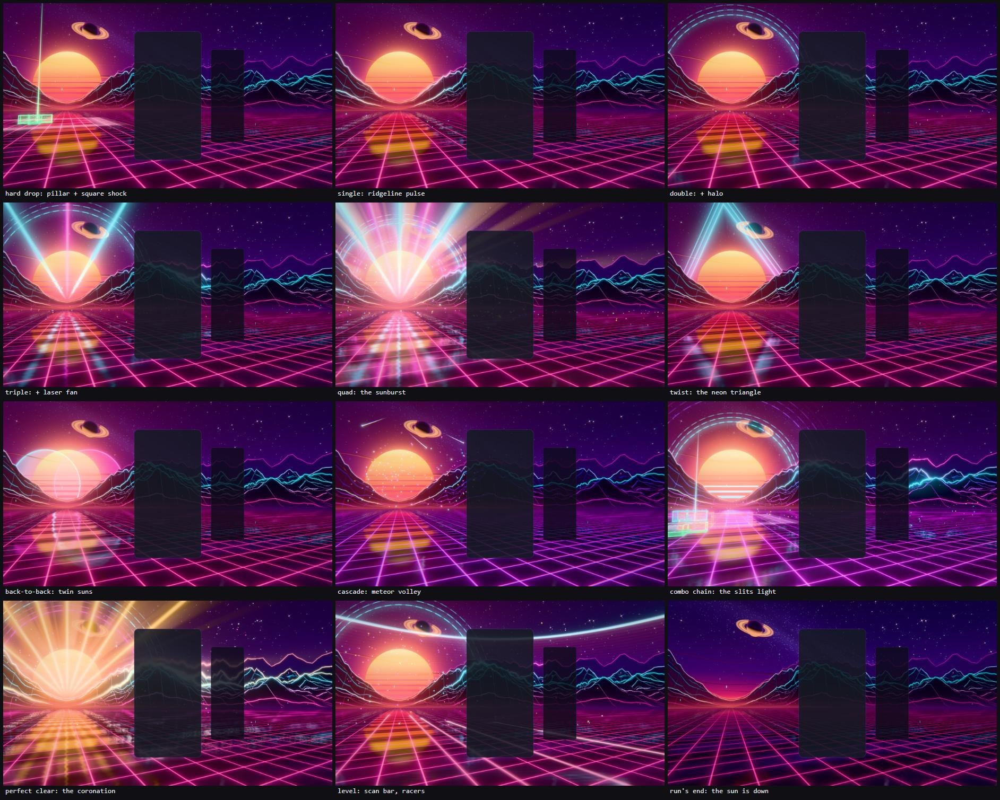

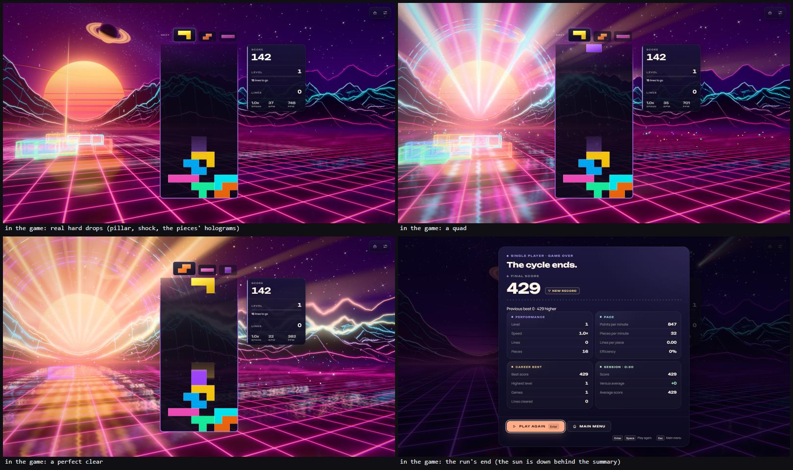

Reduce flashing holds the sunburst and the scan bar back where the world writes them (ADR-0021;
both lines are in `tests/unit/reduce-flashing.test.js`). Reduced motion: no happenings, the slow
clocks at a fifth, beams and twins held near their middle, a third of the pixels.

## Verification

- Tests: `tests/unit/neon-dusk-living.test.js` (new, 17: the clocks, each event's own instrument and
  no other's, the biggest moments the biggest, the happenings by the clock and after a seek, the
  sunset and sunrise, every layer inside its slots under a hot hand, the ridgelines on the
  skylines, the glider's hull, a flight's pass). Re-pinned with the reason in the test: the draw
  count (6 to 10), the twist and back-to-back's instruments, the shooting star's table, the mood
  step's last sliver (1e-3 to 2e-3). The shader gate builds every material, the new ones too, to
  WGSL and GLSL at High and Low. 134 tests in the theme's files and the reduce-flashing gate, all
  passing.
- Playground captures on WebGPU (1600 × 900), console clean in every one: the five moods and the
  five airs; every event; each happening; Minimal, Low, Medium; High and Minimal on the forced
  WebGL2 backend; 430 × 852 and 390 × 844 upright; 2200 × 900.
- In the game (headless Chrome, private dev server, single player, High, WebGPU): real hard
  drops from the keyboard, a quad, a twist, a back-to-back, a perfect clear and a level-up through
  the bus (the level moved the mood on), a stack played to the top (`gameOver` set the sun: night
  0.999), and the next run (sunrise). Only the browser's own audio and Steam-cloud warnings.
- Cost, playground at 1920 × 1080, 30 fps cap, the playground's GPU timestamps, main and the
  branch interleaved over three rounds on this laptop's discrete GPU: High 0.31 ms before, 0.37
  after; Low 0.20 before, 0.24 after. Not measured: an uncapped run, the peak of a quad or a
  perfect clear, integrated GPUs, phones, the theme perf lane (ADR-0016).

## Open

- Upright phones still put the board over the sun (the dusk pass's composition, unchanged): the
  triangle, the twins and the halos stand half behind the card there.
- The cloud-bars air is the quietest of the five; the bars are soft slats, not bold cut-outs.
- The wire net's lines run nearly upright on faces square to the lens.
- The planet's globe is 4.6° across; nobody has judged it in motion, nor the flight, nor a fever.
- Infinity, versus and local multiplayer layouts were not captured.

## Reproduce

`/playground.html?effect=neon-dusk&t=20&happenings=0`, then `air=0..4`, `t=` for the mood (105 s
each), `event=hardDrop|clear|quad|twist|b2b|combo|chain|perfect|levelUp|gameOver|sunrise` with
`eventAge=`, `happen=meteors|comet|satellite|racers|flight` with `happenAge=`, `planetAt=`.

The glider: `blender --background --factory-startup --python scripts/blender/neon_dusk_glider.py --
--out src/themes/neon-dusk/neon-dusk-glider-model.js [--preview <dir>]`.

The icon is the `board=0&hud=0` frame at `t=20&air=0&planetAt=70&happenings=0`, `quality=Extreme`,
in an 840 × 840 window, cropped to 78 % of the frame height round its centre, lifted
(`contrast(1.08) saturate(1.12)`) and clipped to a 512 px circle on a transparent ground.
