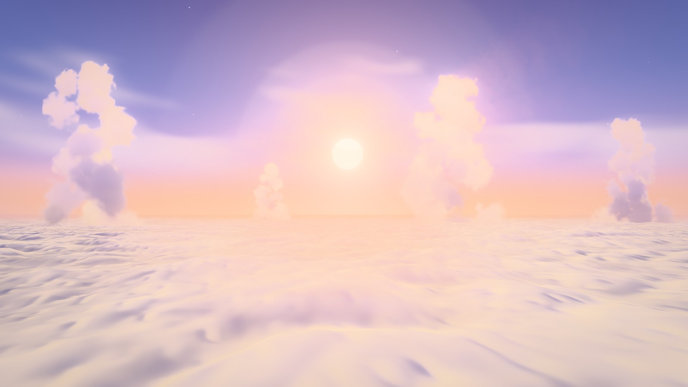
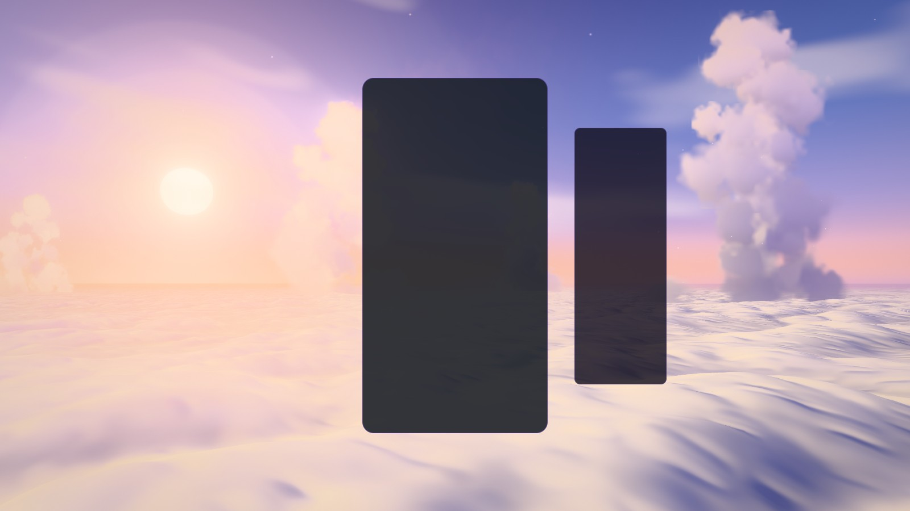
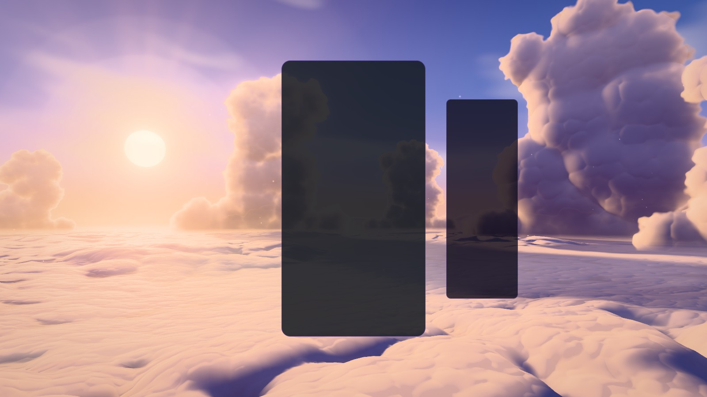
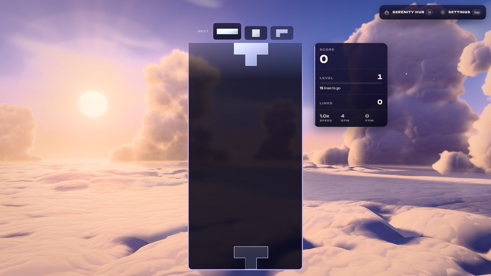
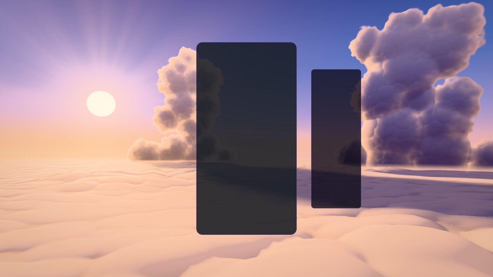
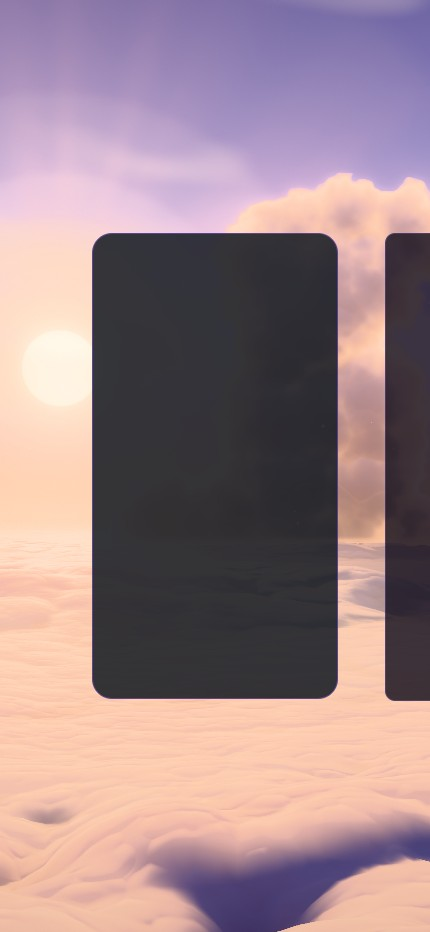
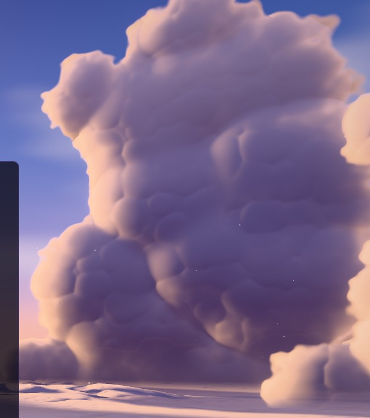

# Nimbus Veil — the golden-hour pass

Implemented 2026-10-21 on `feature/nimbus-veil-atmosphere`, with Three.js 0.186.1. A pass over
the 2026-08 rebuild ("golden-hour flight over a sea of clouds"), not a rebuild: the theme class,
the composition solver, the camera rig, the event wiring, the motes, sparkles and veils stay. The
cloud sea, the towers, the sky's light and the post's bloom and rays are new. This document
records what changed and what was verified. It is a reference, not a backlog.

## What was wrong

The cloud sea read as satin or snow dunes: billow noise makes ridges, not heads, and it was lit
almost flat, so nothing in the frame was darker than lavender. The towers were stacks of
camera-facing balls, each shaded on its own, so they read as smoke columns. Bloom started at a
max channel of 0.45 (threshold 1.0 with a 0.55 knee), so every lit cloud bloomed and the High tier
looked out of focus. The sky's glow ended at the horizon while the sea's haze did not carry it, so
the sea line was a ruled step, and the crepuscular rays were never visible.

| Before | After |
| --- | --- |
|  |  |
|  |  |

## The picture now

A sun 9.5° above a deck of cumulus heads. The heads are round, gold where they turn to the sun
and violet in their own shade, and every one throws a long shadow down-sun; the towers throw
lanes of shadow hundreds of units long across the deck toward the camera. Looking toward the sun
the thin edges of the heads glow and the far deck becomes a glare path. The towers are solid
cauliflower heaps with a burning rim where the sun stands behind them. The sky's glow, the sea's
haze and the towers' haze are one colour of air, so the sea line dissolves into the sky. Soft
sunbeams fan out from the sun, and a few distant cumulus banks stand on the horizon.

## How it is built

| File | Change |
| --- | --- |
| `nimbus-veil-tsl.js` | `nvDomes` / `nvDomesH`: cumulus heads as a field (below). `nvNoisedP`: value noise with derivatives, periodic along the scroll. `nvSunGlow` / `nvAir` / `nvApplyHaze`: one colour of the air for sky, sea and towers. `TOWERS` and `towerHalfWidth()` moved here (the sea needs them for the shadows). `RIG.height` 16 → 24, so taller heads never reach the lens. `SEA_WRAP` 4096 → 1920. |
| `nimbus-veil-cloudsea.js` | The deck: heaps (64-unit cells) carrying heads (20) under a mask that lets them tower or flatten, cauliflower (8) and fine (3) octaves in the normal only; self-shadow taps toward the sun; the towers' shadow lanes; the new light. |
| `nimbus-veil-cumulus.js` | Rewritten: one camera-facing card per tower drawn as a heap of billows (below). |
| `nimbus-veil-sky.js` | The shared glow, sunbeams, horizon banks. Below the horizon it returns `nvAir`, the colour the sea's haze ends in. |
| `nimbus-veil-post.js` | Bloom threshold 1.0 → 1.5, knee 0.55 → 0.45. The ray march takes light only near the sun and is skipped where no ray reaches. |
| `nimbus-veil-world.js` | `SEA_DETAIL` (per-tier sea detail), the light wave's path, more billows per tower. |

Techniques worth knowing before changing it:

- **Heads, not billows.** `nvDomes` puts one dome per jittered cell (profile `r·(1 − t⁴)`: a flat
  crown and steep flanks, radii varying two to one) and joins them with a smooth maximum (a
  log-sum-exp, the floor between heads as one more term). Its gradient is exact: the softmax
  weights blend each dome's own. Billow noise `|2n − 1|` gives ridges; this gives heads.
- **Periodic along the scroll.** Every octave's cell size divides `SEA_WRAP`, and the hashes take
  the cell index modulo the period, so the deck repeats exactly where the scroll wraps. The old
  field jumped every 26 minutes.
- **Shadows without a shadow map.** A ray from a deck point toward the sun climbs `tan 9.5°` per
  unit. Four taps along it (4, 11, 24, 45 units) read the field and compare. The swell and the
  mask change slowly, so they are carried to each tap along their gradients. The two near taps
  carry the heaps the same way, and the farthest leaves out the small heads: five field reads,
  not eight. Medium takes two taps, Low one, Minimal none.
- **Tower lanes, analytic.** The sun lies in the y–z plane, so a ray toward it meets a tower's
  plane at `z = tower.z`, at height `h + (p.z − tower.z)·tan 9.5°`. Inside `towerHalfWidth()` at
  that height and below the crown, the point is in the tower's shadow, softened by the sun's
  size. Seven towers cost a few operations each, on every tier.
- **The light.** Cloud tops scatter, so the sun's light has a floor under the slope term
  (`0.3 + 0.7·wrap`); that keeps the deck golden under a grazing sun while the shadows read
  against it. The sky's light is lavender-blue from above and rose from the horizon. Looking toward
  the sun, a forward lobe (`cos¹⁶`, plus `cos⁴⁸` for the core) times grazing makes the silver
  lining and the glare path.
- **Detail that knows its size.** Each octave fades by its footprint in pixels (`fwidth` of the
  field point, the geometric mean of the two axes). The small heads also fade past ~220 units, so
  their rows do not read as scales at a grazing view, while the heaps keep the far deck's form.
  The cauliflower and fine octaves drift slowly across the heads: the tops churn.
- **A tower is one card.** Its billows (a skirt, a leaning body, a turreted crown; `towerBillows()`)
  live in one `uniformArray`; each card loops over its slice. The outline is the deepest billow's
  signed distance, frayed by value noise; the normal is the soft-max blend of the billows' sphere
  normals, each billow standing at its own depth offset so the ones in front take the surface.
  Small domes (not value noise: its slope dies along every cell edge and draws bricks) swell each
  billow a little and bend the light. Past every billow's rim, in the fray, the normal is the
  nearest billow's outward direction; without it the fray faced the camera and drew a dark fringe.
- **One colour of air.** `nvApplyHaze` mixes toward `nvAir` of the LEVEL direction on that bearing
  (the colour of the sea line there, sun glow included), and the sky returns the same below the
  horizon, so nothing meets the sky with a step.

## Events

| Event | Response |
| --- | --- |
| Piece lock, combo, level up | As before: the sun pulses, the sea warms, glints burst from the sun. |
| Line clear, level up | The light wave now starts 1,100 units out, beyond the farthest tower, and rolls in to under the camera in three seconds, slowing as it nears so the band crosses the screen evenly. Each tower glows as the wave goes through it (far ones first), then the band crosses the deck, brightest on the crowns. |

| The wave reaches the far towers | …and the near one |
| --- | --- |
|  |  |

## Tiers

| Tier | Towers × billows | Shadow taps | Cauliflower | Fine | Horizon banks | Bloom, rays | Scene MSAA |
| --- | --- | ---: | --- | --- | --- | --- | --- |
| Minimal | 3 × 22 | 0 | off | off | off | off | off |
| Low | 4 × 28 | 1 | on | off | on | off | off |
| Medium | 5 × 34 | 2 | on | off | on | on (10 taps) | off |
| High | 7 × 44 | 4 | on | on | on | on (16 taps) | 4× |
| Ultra | 7 × 50 | 4 | on | on | on | on (18) | 4× |
| Extreme | 7 × 56 | 4 | on | on | on | on (20) | 4× |

Every tier keeps the towers' shadow lanes, the shared air and the sunbeams.

## Cost

Measured in the playground at 1920 × 1080 on an RTX 5080 Laptop GPU (WebGPU), by rendering 60
frames in one task and waiting for the queue: about 2–3 ms a frame at High against 1–1.7 ms
before, and about the same as before on Medium and below. Other sessions shared the GPU, and the
same build measured up to twice as slow from one run to the next, so these numbers say the order
of the change, not its exact size. The theme's dynamic resolution still covers slower GPUs. No
weak-GPU or phone measurement was made.

## Verification

- Playground captures (`?effect=nimbus-veil`, a private Vite server, a scratch Electron capture
  script) at rest, in game, during a line clear, at every tier, on a 430 × 932 portrait screen,
  and on the WebGL2 backend (`forceWebGL=1`); no warnings or errors in the console.
- The real game (`/?skipIntro=1&unlockAll=1`, Specific theme, single player): WebGPU at High,
  the layout watch puts the sun left of the board, no warnings or errors.
- `tests/unit/nimbus-veil-shaders.test.js` (new): every material and the post output build
  through the WGSL and GLSL node builders at High and Minimal without a warning, under 64 KiB a
  stage, with no NaN literal, no unassigned var read and no laid-out `nv_*` helper that captures a
  uniform. It also pins the scroll's seamless wrap, the deck's ceiling under the lens, the billows
  filling each tower's shadow profile, and the cards facing the rest camera.

 

## Left as it is

- Where a skirt billow stands in front of the body, a faint lit notch in the outline can show at
  a tower's base. It is a real gap in the heap, lit from behind, and mostly below the deck.
- The motes read as small specks; they were not part of this pass.
- The horizon banks are deliberately faint: most of the horizon is behind the towers or the card.
