# Nimbus Veil — the golden-hour pass

Implemented 2026-10-21 on `feature/nimbus-veil-atmosphere`, with Three.js 0.186.1. A pass over
the 2026-08 rebuild ("golden-hour flight over a sea of clouds"), not a rebuild: the theme class,
the composition solver, the camera rig, the event wiring, the motes, sparkles and veils stay. The
cloud sea, the towers, the sky's light and the post's bloom and rays are new. This document
records what changed and what was verified. It is a reference, not a backlog.

## What was wrong

The cloud sea read as satin or snow dunes: billow noise makes ridges, not heads, and it was lit
almost flat, so nothing in the frame was darker than lavender. The towers were stacks of
camera-facing balls, each shaded on its own, so they read as smoke columns. Bloom started at a
max channel of 0.45 (threshold 1.0 with a 0.55 knee), so every lit cloud bloomed and the High tier
looked out of focus. The sky's glow ended at the horizon while the sea's haze did not carry it, so
the sea line was a ruled step, and the crepuscular rays were never visible.

| Before | After |
| --- | --- |
| 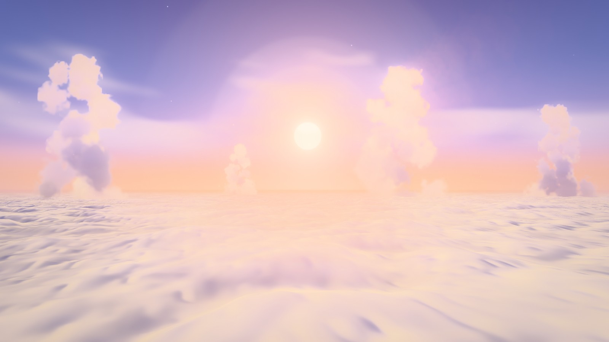 | 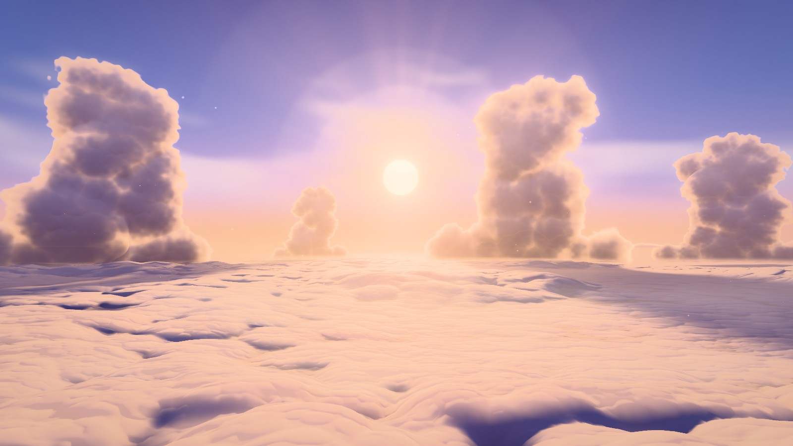 |
| 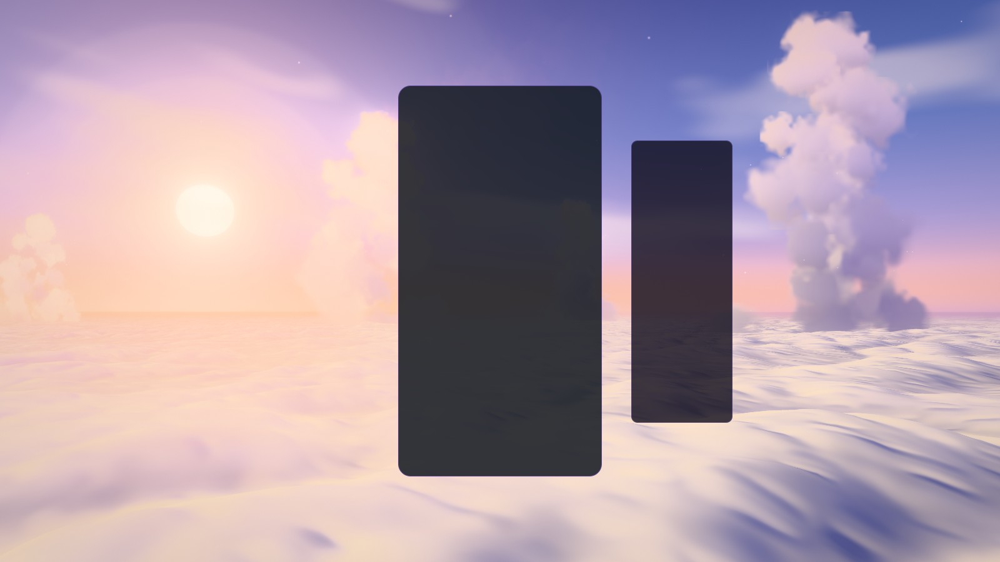 | 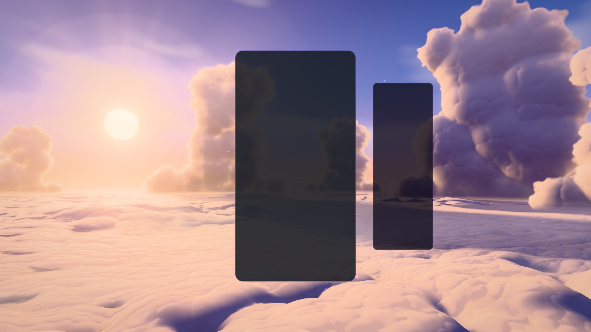 |

## The picture now

A sun 9.5° above a deck of cumulus heads. The heads are round, gold where they turn to the sun
and violet in their own shade, and every one throws a long shadow down-sun; the towers throw
lanes of shadow hundreds of units long across the deck toward the camera. Looking toward the sun
the thin edges of the heads glow and the far deck becomes a glare path. The towers are solid
cauliflower heaps with a burning rim where the sun stands behind them. The sky's glow, the sea's
haze and the towers' haze are one colour of air, so the sea line dissolves into the sky. Soft
sunbeams fan out from the sun, and a few distant cumulus banks stand on the horizon.

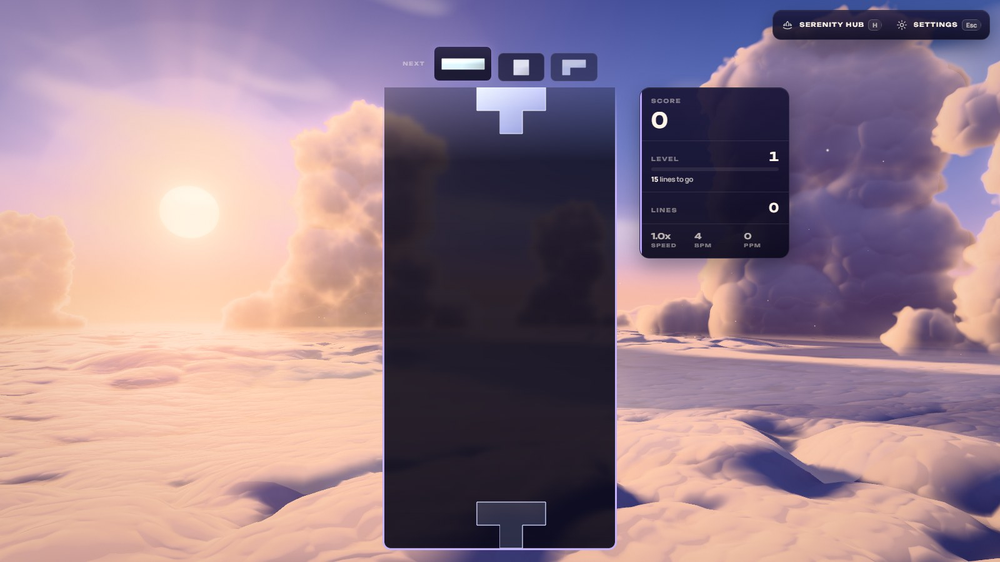

## How it is built

| File | Change |
| --- | --- |
| `nimbus-veil-tsl.js` | `nvDomes` / `nvDomesH`: cumulus heads as a field (below). `nvNoisedP`: value noise with derivatives, periodic along the scroll. `nvSunGlow` / `nvAir` / `nvApplyHaze`: one colour of the air for sky, sea and towers. `TOWERS` and `towerHalfWidth()` moved here (the sea needs them for the shadows). `RIG.height` 16 → 24, so taller heads never reach the lens. `SEA_WRAP` 4096 → 1920. |
| `nimbus-veil-cloudsea.js` | The deck: heaps (64-unit cells) carrying heads (20) under a mask that lets them tower or flatten, cauliflower (8) and fine (3) octaves in the normal only; self-shadow taps toward the sun; the towers' shadow lanes; the new light. |
| `nimbus-veil-cumulus.js` | Rewritten: one camera-facing card per tower drawn as a heap of billows (below). |
| `nimbus-veil-sky.js` | The shared glow, sunbeams, horizon banks. Below the horizon it returns `nvAir`, the colour the sea's haze ends in. |
| `nimbus-veil-post.js` | Bloom threshold 1.0 → 1.5, knee 0.55 → 0.45. The ray march takes light only near the sun and is skipped where no ray reaches. |
| `nimbus-veil-world.js` | `SEA_DETAIL` (per-tier sea detail), the light wave's path, more billows per tower. |

Techniques worth knowing before changing it:

- **Heads, not billows.** `nvDomes` puts one dome per jittered cell (profile `r·(1 − t⁴)`: a flat
  crown and steep flanks, radii varying two to one) and joins them with a smooth maximum (a
  log-sum-exp, the floor between heads as one more term). Its gradient is exact: the softmax
  weights blend each dome's own. Billow noise `|2n − 1|` gives ridges; this gives heads.
- **Periodic along the scroll.** Every octave's cell size divides `SEA_WRAP`, and the hashes take
  the cell index modulo the period, so the deck repeats exactly where the scroll wraps. The old
  field jumped every 26 minutes.
- **Shadows without a shadow map.** A ray from a deck point toward the sun climbs `tan 9.5°` per
  unit. Four taps along it (4, 11, 24, 45 units) read the field and compare. The swell and the
  mask change slowly, so they are carried to each tap along their gradients. The two near taps
  carry the heaps the same way, and the farthest leaves out the small heads: five field reads,
  not eight. Medium takes two taps, Low one, Minimal none.
- **Tower lanes, analytic.** The sun lies in the y–z plane, so a ray toward it meets a tower's
  plane at `z = tower.z`, at height `h + (p.z − tower.z)·tan 9.5°`. Inside `towerHalfWidth()` at
  that height and below the crown, the point is in the tower's shadow, softened by the sun's
  size. Seven towers cost a few operations each, on every tier.
- **The light.** Cloud tops scatter, so the sun's light has a floor under the slope term
  (`0.3 + 0.7·wrap`); that keeps the deck golden under a grazing sun while the shadows read
  against it. The sky's light is lavender-blue from above and rose from the horizon. Looking toward
  the sun, a forward lobe (`cos¹⁶`, plus `cos⁴⁸` for the core) times grazing makes the silver
  lining and the glare path.
- **Detail that knows its size.** Each octave fades by its footprint in pixels (`fwidth` of the
  field point, the geometric mean of the two axes). The small heads also fade past ~220 units, so
  their rows do not read as scales at a grazing view, while the heaps keep the far deck's form.
  The cauliflower and fine octaves drift slowly across the heads: the tops churn.
- **A tower is one card.** Its billows (a skirt, a leaning body, a turreted crown; `towerBillows()`)
  live in one `uniformArray`; each card loops over its slice. The outline is the deepest billow's
  signed distance, frayed by value noise; the normal is the soft-max blend of the billows' sphere
  normals, each billow standing at its own depth offset so the ones in front take the surface.
  Small domes (not value noise: its slope dies along every cell edge and draws bricks) swell each
  billow a little and bend the light. Past every billow's rim, in the fray, the normal is the
  nearest billow's outward direction; without it the fray faced the camera and drew a dark fringe.
- **One colour of air.** `nvApplyHaze` mixes toward `nvAir` of the LEVEL direction on that bearing
  (the colour of the sea line there, sun glow included), and the sky returns the same below the
  horizon, so nothing meets the sky with a step.

## Events

| Event | Response |
| --- | --- |
| Piece lock, combo, level up | As before: the sun pulses, the sea warms, glints burst from the sun. |
| Line clear, level up | The light wave now starts 1,100 units out, beyond the farthest tower, and rolls in to under the camera in three seconds, slowing as it nears so the band crosses the screen evenly. Each tower glows as the wave goes through it (far ones first), then the band crosses the deck, brightest on the crowns. |

| The wave reaches the far towers | …and the near one |
| --- | --- |
| 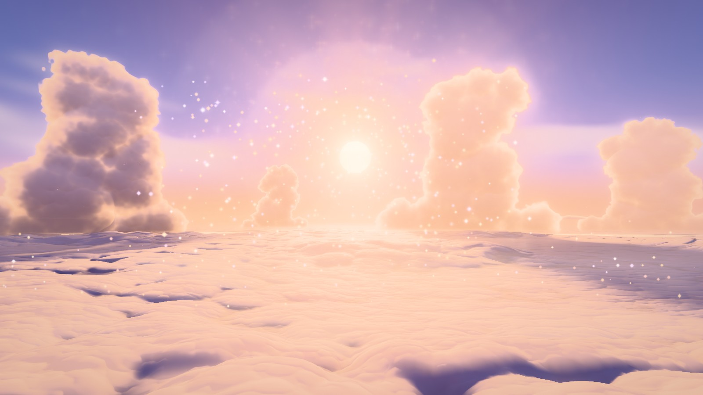 | 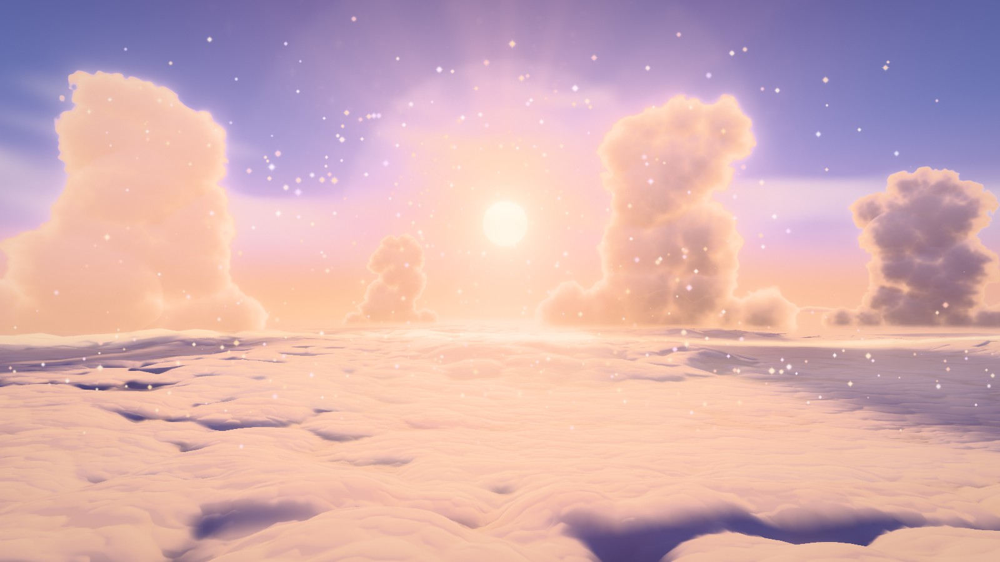 |

## Tiers

| Tier | Towers × billows | Shadow taps | Cauliflower | Fine | Horizon banks | Bloom, rays | Scene MSAA |
| --- | --- | ---: | --- | --- | --- | --- | --- |
| Minimal | 3 × 22 | 0 | off | off | off | off | off |
| Low | 4 × 28 | 1 | on | off | on | off | off |
| Medium | 5 × 34 | 2 | on | off | on | on (10 taps) | off |
| High | 7 × 44 | 4 | on | on | on | on (16 taps) | 4× |
| Ultra | 7 × 50 | 4 | on | on | on | on (18) | 4× |
| Extreme | 7 × 56 | 4 | on | on | on | on (20) | 4× |

Every tier keeps the towers' shadow lanes, the shared air and the sunbeams.

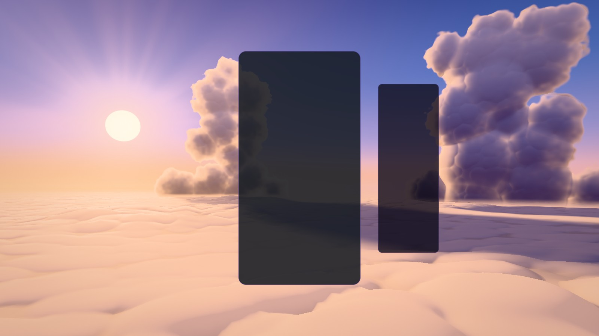

## Cost

Measured in the playground at 1920 × 1080 on an RTX 5080 Laptop GPU (WebGPU), by rendering 60
frames in one task and waiting for the queue: about 2–3 ms a frame at High against 1–1.7 ms
before, and about the same as before on Medium and below. Other sessions shared the GPU, and the
same build measured up to twice as slow from one run to the next, so these numbers say the order
of the change, not its exact size. The theme's dynamic resolution still covers slower GPUs. No
weak-GPU or phone measurement was made.

## Verification

- Playground captures (`?effect=nimbus-veil`, a private Vite server, a scratch Electron capture
  script) at rest, in game, during a line clear, at every tier, on a 430 × 932 portrait screen,
  and on the WebGL2 backend (`forceWebGL=1`); no warnings or errors in the console.
- The real game (`/?skipIntro=1&unlockAll=1`, Specific theme, single player): WebGPU at High,
  the layout watch puts the sun left of the board, no warnings or errors.
- `tests/unit/nimbus-veil-shaders.test.js` (new): every material and the post output build
  through the WGSL and GLSL node builders at High and Minimal without a warning, under 64 KiB a
  stage, with no NaN literal, no unassigned var read and no laid-out `nv_*` helper that captures a
  uniform. It also pins the scroll's seamless wrap, the deck's ceiling under the lens, the billows
  filling each tower's shadow profile, and the cards facing the rest camera.

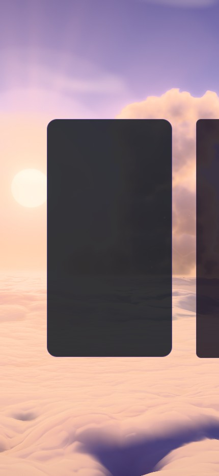 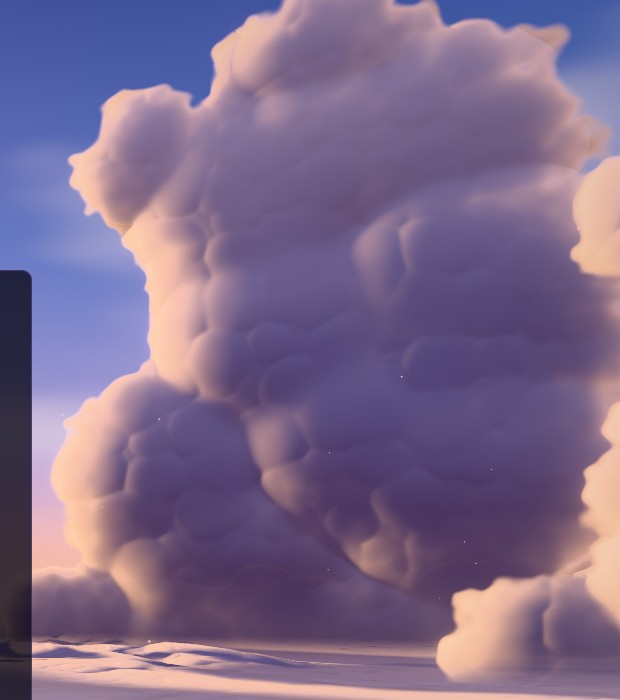

## Left as it is

- Where a skirt billow stands in front of the body, a faint lit notch in the outline can show at
  a tower's base. It is a real gap in the heap, lit from behind, and mostly below the deck.
- The motes read as small specks; they were not part of this pass.
- The horizon banks are deliberately faint: most of the horizon is behind the towers or the card.

## The living pass (2026-11-20)

The owner asked for an audit of everything the theme is made of and for it to be raised to one of
the game's most beautiful: varied over time, a distinct effect for every event with the biggest
moments the most spectacular, smooth, and easy to read. Worked on the branch
`feature/nimbus-veil-masterpiece` with three 0.187.0, judged on captures on the RTX 5080 Laptop
(WebGPU through a private headless Chrome, 30 frames a second) against a baseline of the same
queries taken before any change.

| Before | After |
| --- | --- |
| 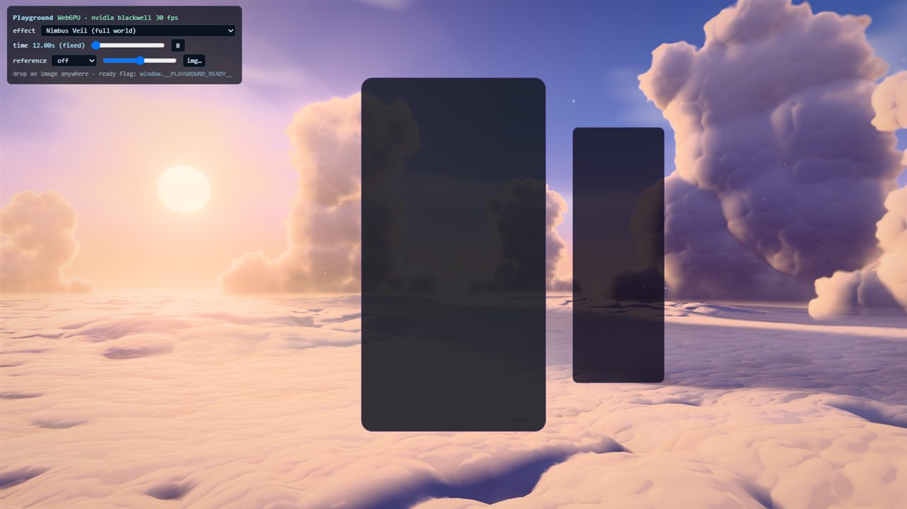 | 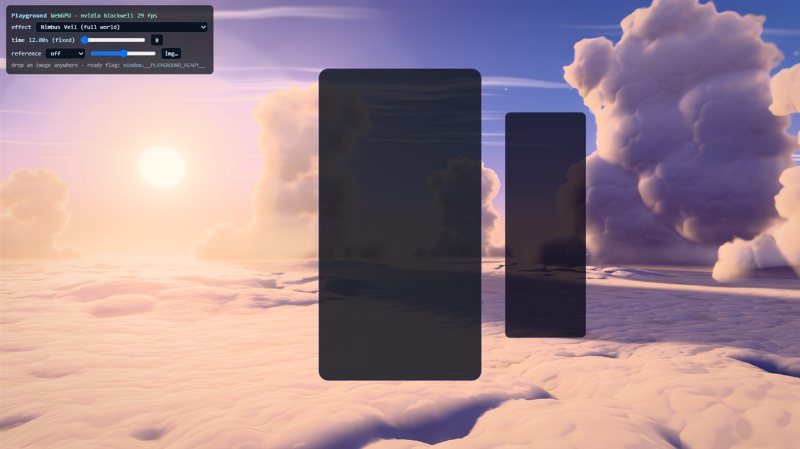 |
| 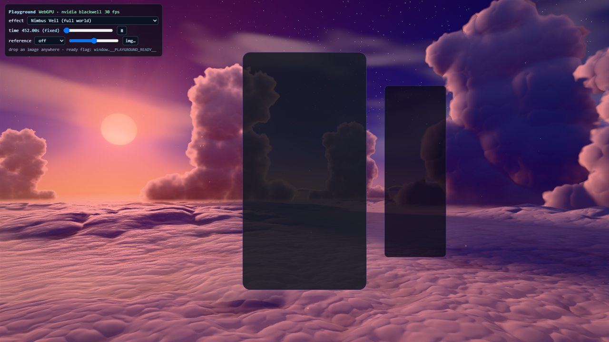 | 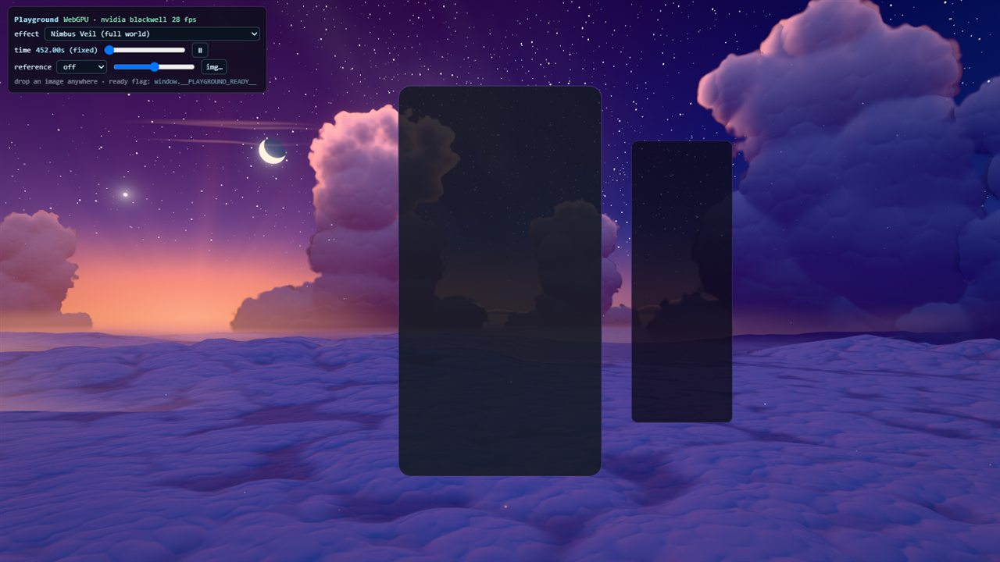 |

**What the audit found**, largest first:

- The sky over the horizon, most of the upper half of the frame, was nearly empty: a gradient, a
  flat sun disc and a smudge of cirrus read in (bearing, height), which has no perspective.
- Nothing changed by itself but the palette. The sun never moved, so the "blue hour" was a pink
  day with stars over it: the same disc in the same place throwing the same shadows.
- Every event was a mix of the same three things (a wave from the horizon, glints from the sun,
  a glow), so a back-to-back, a twist, a cascade and a perfect clear could not be told apart.
  A game over and a new run showed nothing at all.
- The veils of mist the theme is named for were all but invisible (a third opaque where their
  noise peaked and near nothing elsewhere), and that noise was stretched upright, not along the deck.
- The stars were one hashed grid, all of a size.
- The pieces were seven near-whites (from the theme's first, moonlit-void version): I, O, L and S
  could not be told apart by colour.
- Two events of one tick shared a wave slot (see "A bug this found").
- The stylesheet still carried about 180 lines for the DOM layers of the pre-2026-08 theme.

What was kept: the towers, the deck's field of heads with its shadows, the composition solver and
the camera, the way play builds the light (the surge, the waves' procession, the fever).

### Three clocks

**The hours move the sun.** The sun now rides an arc with the five moods (`sun` in
`nimbus-veil-moods.js`): 9.5° at the golden sunrise (the look the place was built for, unchanged),
14° in the pearl morning, 20° at the white noon, 5.5° in the rose evening, and 3.4° under the sea
line in the blue hour. So the melt into the blue hour is a sunset and the melt out of it a
sunrise. Its bearing never changes, which is what lets the deck's shadows stay analytic: the
shaders read `u.sunDir` and `u.sunTan` where they read constants. Three things follow the height
(`sunReach` in `nimbus-veil-world.js`): how much of the sun reaches the deck (`u.day`: none once
it has set, when the sky's fill rises instead), how far up a tower its light still reaches (the
deck goes into shade first and the high crowns hold the last light), and how strongly it lights
the high cloud from below. A level still steps the hour; the sun follows by its own slower ease,
so it glides to its new place while the colours lead.

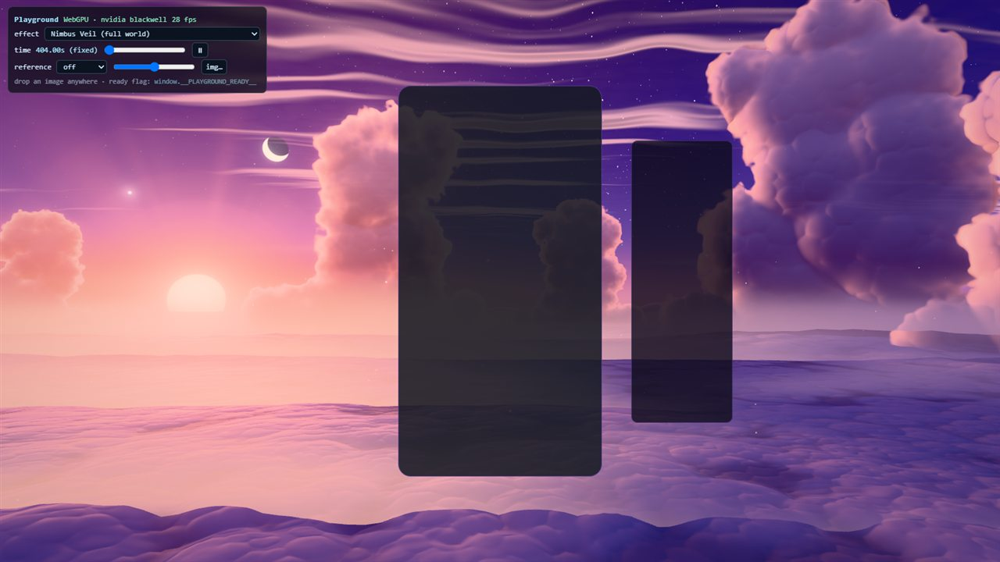

**The air turns beside them** (`nimbus-veil-weather.js`): five airs of 96 s against five hours of
110 s, so an hour meets a different air each time round (the pair repeats after 88 minutes).

| Air | What it is |
| --- | --- |
| fair | a few high wisps; the deck as it was |
| tails | mares' tails: long fibres of high cloud on a quick wind |
| mackerel | a rippled ceiling of small cloudlets, lit from below when the sun is low |
| beams | a broken ceiling: its shade drifts over the deck and the sun fans into beams |
| mist | the veils rise, the heads sink toward stratus, distance closes in |

Each sets seven numbers (`AIR_KEYS`): how much high cloud and of what kind, the veils, how high
the deck's heads pile, how strongly the ceiling breaks the sun, the haze's rate, the wind.

| Noon, mares' tails | Blue hour, a mackerel sky | Mist |
| --- | --- | --- |
| 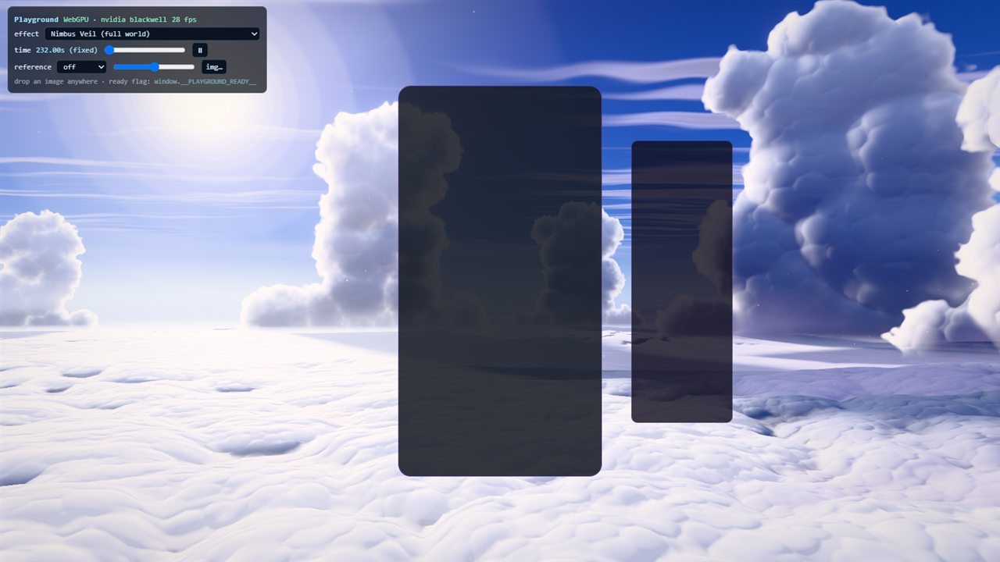 | 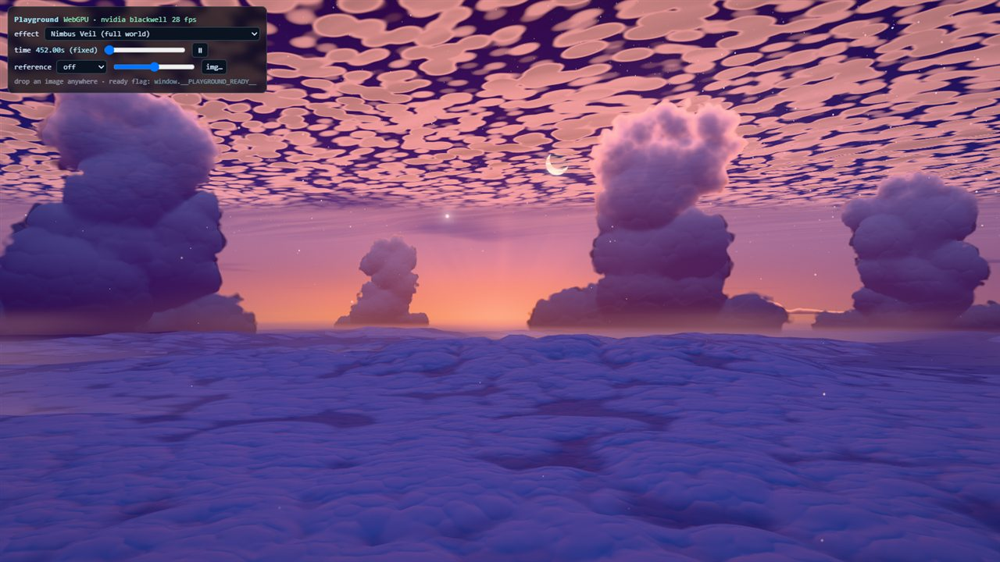 | 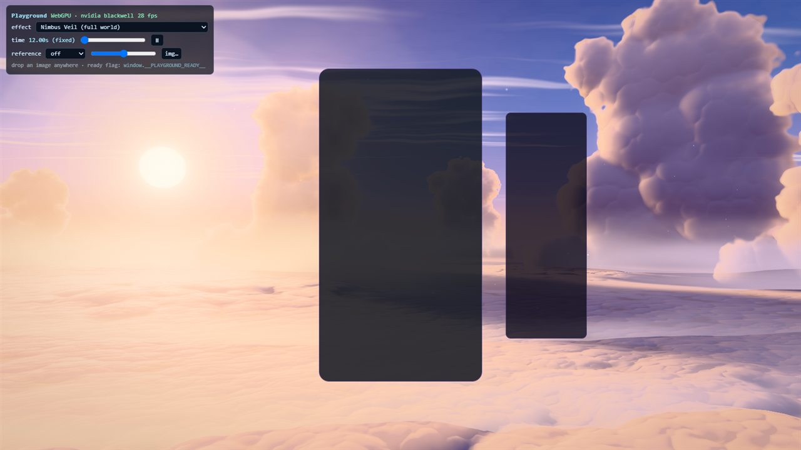 |

**And the sky has happenings of its own**, one to a slot of 36 s with about a quarter of the
slots quiet: albatrosses crossing the view edge to edge, the motes flashing toward the sun,
a tower that boils up, and after dark shooting stars and heat lightning inside a tower. Which one
a slot holds is a hash of its number and of the starlight at its start, and everything a
happening shows is a function of its age, so a seek, a replay and a rebuild land on the same sky
and nothing is "armed" or "fired".

| Albatrosses | Heat lightning in a tower |
| --- | --- |
| 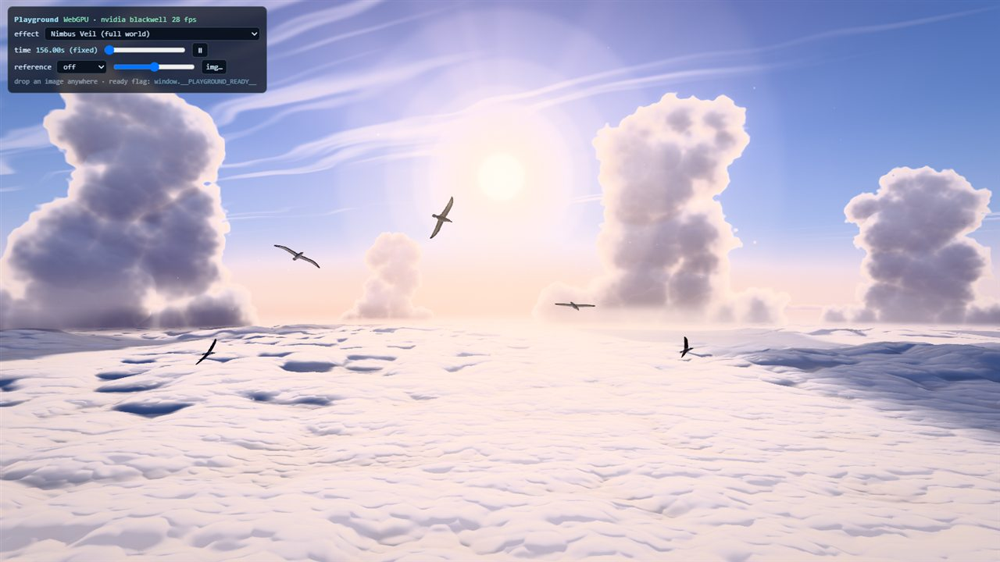 | 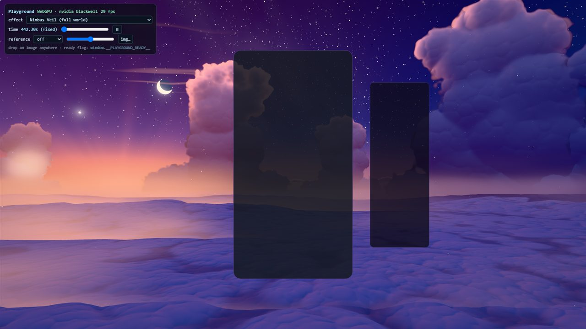 |

(The birds were first a skein of strokes drawn in the fragment; they were rebuilt the same day:
see "The albatrosses, and a night the stars own" below.)

### The scene

- **The high cloud** (`nimbus-veil-sky.js`) lies on a plane over the eye (`dir.xz / dir.y`), so
  its fibres and rows converge on the horizon. Fibres are one fbm stretched twelve to one along
  the wind; cloudlets are the deck's own dome field thresholded high. Each melts to a sheet where
  its cell is finer than a pixel. It is lit by its thinness, white-gold toward the sun, and from
  below once the sun is low.
- **The night** is behind one uniform branch: stars of two sizes with a few bright and most
  faint, the Milky Way, a young crescent with earthshine over the place the sun went down, the
  evening star.
- **The veils** are four long bands at four depths (one to four by tier), with a forward glow
  looking into the sun; the air sets their density.
- **The deck** takes the air's head height, the high cloud's drifting shade, deeper creases near
  the lens and a thin rim of light on every head between the eye and the sun.
- **The towers** climb slowly inside (the cauliflower field drifts up them) and hold the last
  light on their crowns after sunset.
- **The pieces** are seven hues, 30° or more apart: sun gold, ember, evening rose, shade violet,
  noon blue, corona green and a pearl (0 of 7 in the palette gate's bands).
- **The stylesheet**: the dead rules are gone, and the container's backdrop for the moment before
  the first frame is the first hour's sky, not grey.

### The events

Every event has an instrument no other event plays (pinned by "plays a different set of
instruments for every event" in `tests/unit/nimbus-veil-living.test.js`).

| Event | Instrument |
| --- | --- |
| Lock | A ripple of light spreads on the deck in the open stage beside the board, with a trough ahead of its crest and a few glints lifting from where it landed. A hard drop's is wider. |
| One to three lines | As many light waves, in echelon, rolling in from beyond the towers. |
| Four lines | Four waves on the deck and a wave of light crossing the high cloud overhead, the crowns lit. |
| Cascade | A ray from the sun for each wave, standing together. |
| Chain | Stepping stones of light on the deck down the sun's bearing, one more and one nearer with each clear (eight, at even steps down the screen). When the chain breaks the world breathes out and they go out from the nearest back. |
| Twist | A corona of mother-of-pearl round the sun, turning, and its colours in the cloud near it. |
| Back-to-back | A lantern lit at the heart of a tower, one more tower for each in the streak; the gold tide line that halts mid-deck (kept). |
| Perfect clear | The whole fan of rays at once, the spectrum rolling out over the deck and over the high cloud, every crown lit, and the air itself clearing to the horizon. |
| New level | Light climbs every tower from the deck to its crown while the towers surge, as the hour turns. |
| The run ends | The veil closes: the mist takes the towers, the light drains, and it stands so. |
| A new run | The veil lifts on a fan of rays. |

| Three lines | A cascade | A twist |
| --- | --- | --- |
| 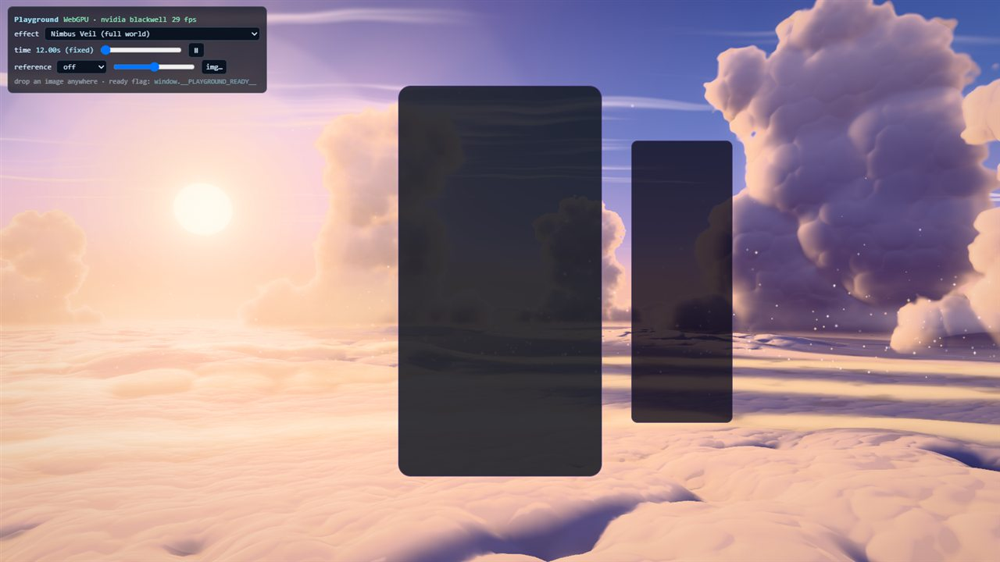 | 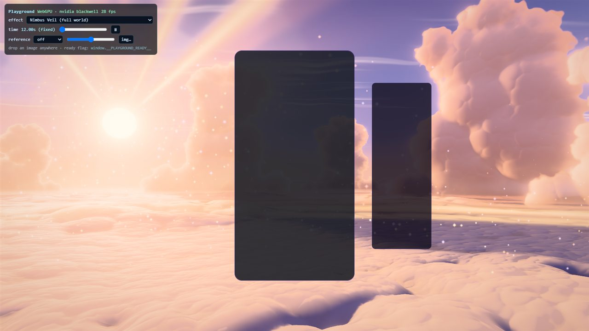 | 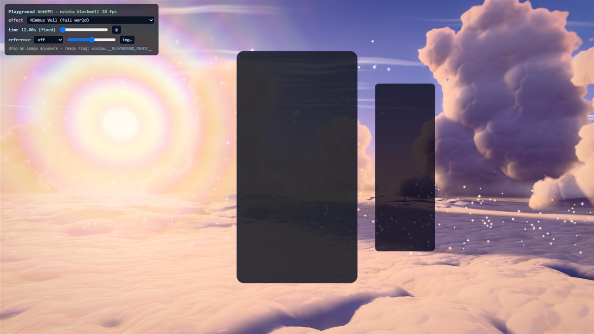 |

| A chain | A back-to-back streak, at night | A new level |
| --- | --- | --- |
| 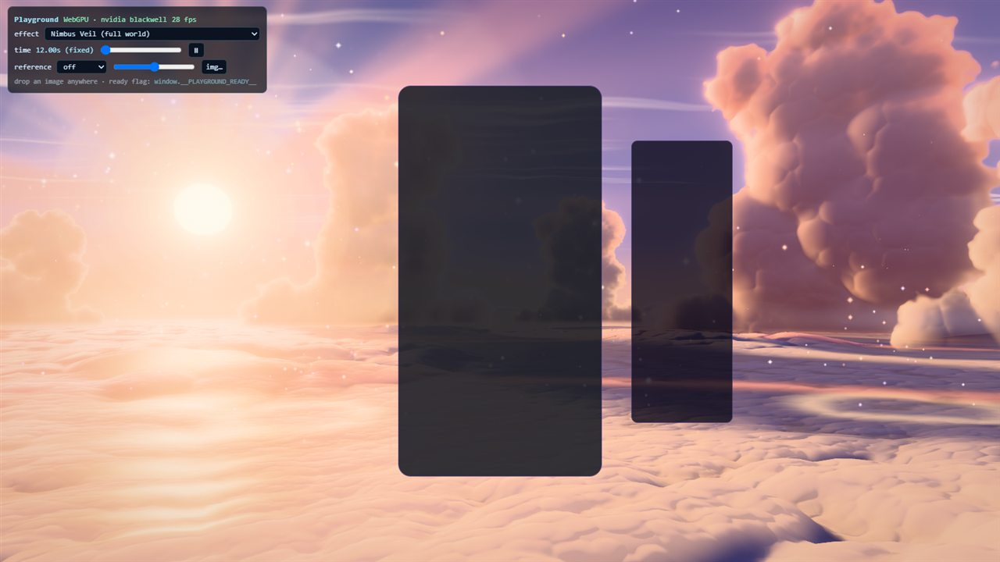 | 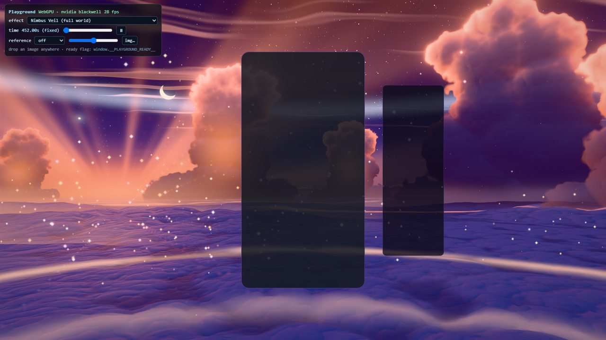 | 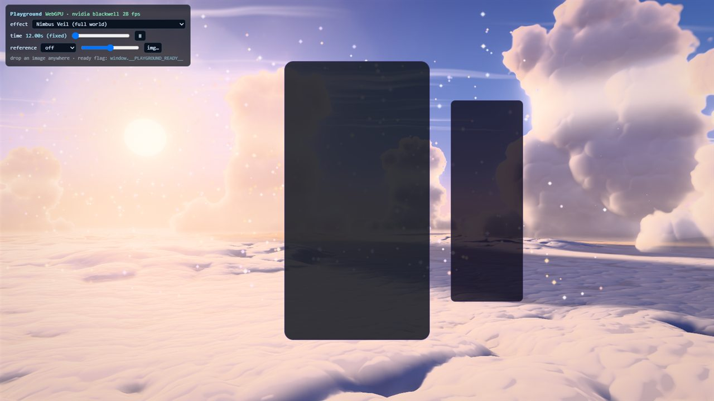 |

| A perfect clear | ...at night | The run ends |
| --- | --- | --- |
| 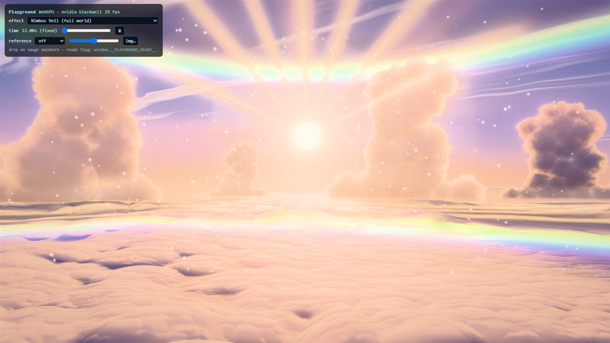 | 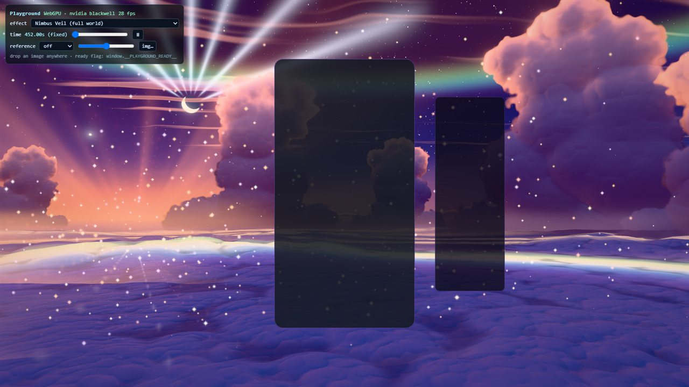 | 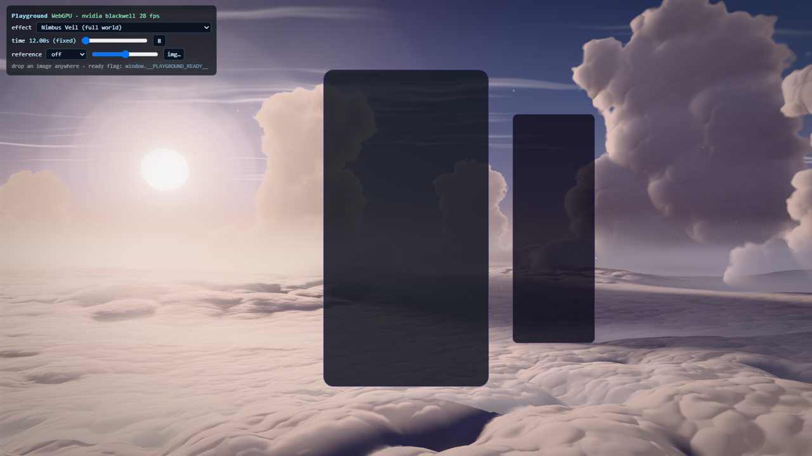 |

At night the rays and the corona stand round the moon (`setLamp`: the lamp hands over through
zero, so nothing jumps across the sky), and every event light is scaled to the hour (`lampInfo.z`,
0.4 once the stars are out).

**Taken back out: the halo.** The first version of this pass gave the chain a sun pillar, the
back-to-back a pair of sundogs and the perfect clear a ring with an arc. They worked, and they are
Parhelion's: that theme is an ice-halo display, and its catalogue entry lists exactly those. The
stones, the lanterns and the full fan replaced them, and `nimbus-veil-optics.js` now carries only
the rays and the corona, with a note saying why.

### Traps (each is a row in the skill's gotchas)

- **Bright on bright (#1762).** By day the deck and the glow round the sun are already as bright
  as any light added to them, so a white-gold wave, pillar or band was plainly in the uniforms
  and invisible in the frame. The event lights read by colour and shade now: a deep gold tint, a
  dark fringe at a band's shoulders, a trough ahead of a ripple, and the iris closing 13 % on the
  big moments (`focus`).
- **Light in front of the towers (#1432).** Rays drawn in the sky function stopped at every
  tower's outline. They are on an additive card that follows the lamp, drawn after the towers.
- **The ceiling's scale (#1433).** On the plane one unit is the layer's height, so the first
  tries drew ribbons the size of the sky, then a sheet with star-shaped holes, then a lattice of
  faint discs.
- **A bug this found (#1763).** Slots were handed to "the slot with the least light left", and
  an envelope with an attack is zero at age zero: four lines and their back-to-back, which land in
  one tick, shared a slot and one wave silently replaced the other. A slot still rising now
  counts as full. The old test compared two worlds that both lost the wave, so it passed.

### How it is built

| File | Change |
| --- | --- |
| `nimbus-veil-weather.js` (new) | The airs, the happenings' slots; three-free. |
| `nimbus-veil-optics.js` (new) | The card for the rays and the corona. |
| `nimbus-veil-moods.js` | A sun height per mood, `sunHeightAt`. |
| `nimbus-veil-sky.js` | The ceiling, the night, the wave over the high cloud. |
| `nimbus-veil-cloudsea.js` | Live sun, head height, cloud shade, ripples, stones, the spectrum, `ringLight`'s fringe. |
| `nimbus-veil-cumulus.js` | Live sun, last light, the climb, the surge, boil, lanterns, inner lightning. |
| `nimbus-veil-fx.js` | Four veils, the motes' flash. |
| `nimbus-veil-albatross.js`, `-flight.js`, `-model.js` (new) | The albatrosses: the draw, the flight, the Blender-built bird. |
| `nimbus-veil-world.js` | The three clocks, the lamp, every instrument, the veil at a run's end. |
| `nimbus-veil-post.js` | The closed veil's grade (`uDusk`). |
| `nimbus-veil-theme.js` | `gameOver` and the mode manager's start and stop reach the world. |
| `nimbus-veil-tetrominos.js` | The seven hues. |

Draws at High went from seven to eleven (two more veils, the albatrosses, the optics card).
There is no new texture, pass or render target.

### Tiers

Every tier keeps every instrument, the veils and the birds (pinned by "keeps every tier whole").

| Tier | Veils | Birds | Cloudlets | Ceiling octaves | Milky Way | Cloud shade on the deck |
| --- | ---: | ---: | --- | ---: | --- | --- |
| Minimal | 1 | 3 | fibres only | 2 | off | off |
| Low | 2 | 3 | fibres only | 2 | off | on |
| Medium | 3 | 4 | on | 3 | on | on |
| High and up | 4 | 5 | on | 3 | on | on |

(Birds: the most albatrosses a passage holds.)

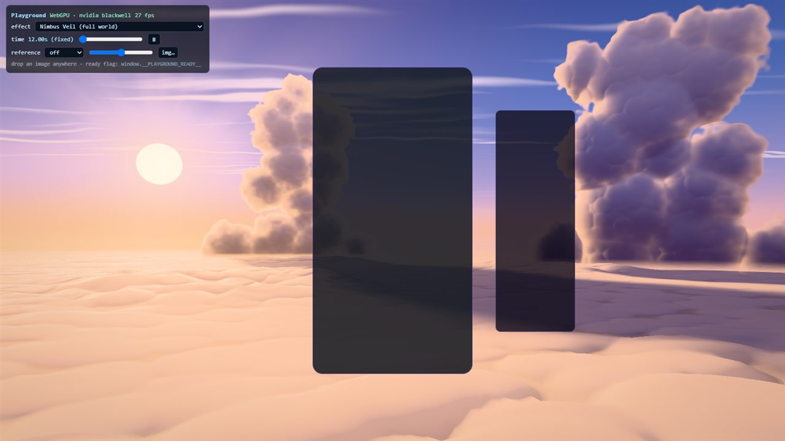

### Verified, and not

**Cost.** GPU time a frame from the playground profiler's timestamps (`profile=1&trackTimestamp=1`),
1600 × 900 at High, capped at 30 frames a second, old and new interleaved over three rounds (the
old code served from a detached worktree of the same commit): 0.71, 0.77, 0.77 ms before; 0.83,
0.83, 0.90 ms after in fair air; 0.91, 0.81, 0.99 ms under a mackerel sky; 0.94, 0.92, 1.05 ms
for the heaviest sky (night and mackerel). So about a tenth to a quarter of a millisecond on this
GPU. Each window held only seven timestamp samples, and the reading was taken before the halo was
taken back out and the stones and lanterns put in (which removed four terms from the optics card
and added a block on the deck behind a uniform test and one gaussian a tower pixel): it says the
size of the change, not its exact value. Not measured: an integrated GPU, a phone, an uncapped
frame rate.

**Captures.** A 36-frame set before the halo was taken out and a 22-frame set after it, each with
a clean console: every hour, every air, both mid-melts, every event by day and several by night,
the happenings, WebGL2 (`forceWebGL=1`), Minimal, Low, and a 390 × 844 portrait frame.

**The real game** (private headless Chrome, single player, real key presses, twice): WebGPU at
High, the dynamic resolution stayed at 1, a lock's ripple on the deck beside the board, the veil
closed behind the game-over card and lifted for the next run, the dawn's rays as the first board
appeared; the console held only the browser's audio and Steam-cloud lines.

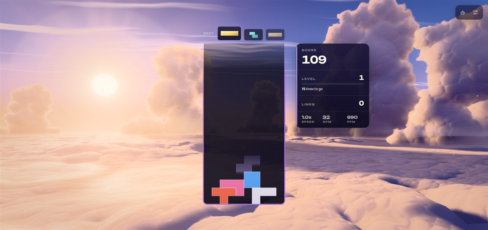

| WebGL2 | The veil lifts | Portrait |
| --- | --- | --- |
|  | 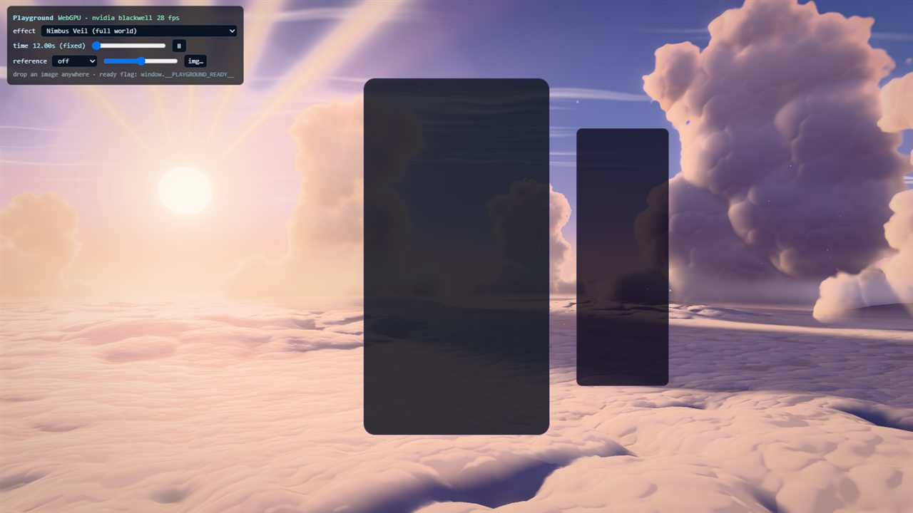 | 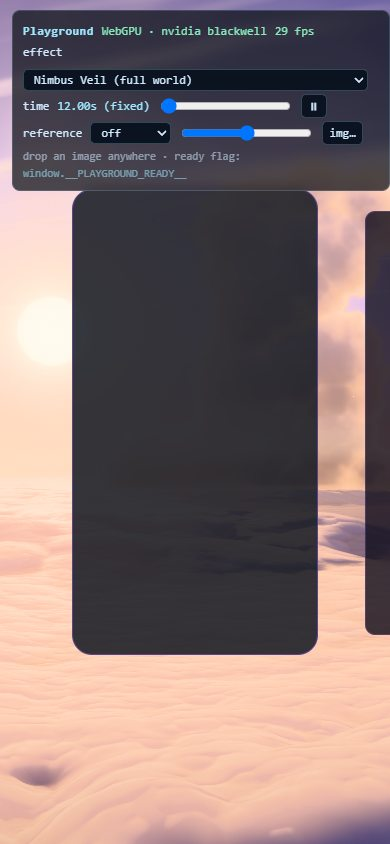 |

**Tests.** `tests/unit/nimbus-veil-living.test.js` (new, 31), and the three existing files with
four tests re-pinned on purpose (the sun no longer keeps its place; eleven draws; a burst is
called directly now that a cascade's instrument is its rays; a clear of n lines sends n bands):
63 in all. The shader gate walks the scene, so the new parts are built to
WGSL and GLSL at High and Minimal with the rest. Typecheck, lint, the lifecycle audit, the
boundary check, the palette gate, the registry, catalogue, camera-breath and reduce-flashing
tests pass.

**Not verified, and open** (the writer's doubts, not the owner's words):

- Nobody has watched it move: every judgement above is from stills. The waves' echelon, the
  stones going out and the sunrise are the things to look at first.
- A second run's dawn was not captured (the mode's title card was up at the moment the frame was
  taken); the first run's was.
- By day the chain's stones are quiet on the sunlit deck: they read, but they are the faintest of
  the instruments there. At night they are plain.
- In a portrait frame the board covers the middle of the picture, and at night the moon (and so
  the corona and the rays) stands behind it.
- The mackerel cloudlets are flat-toned discs: a stylised mackerel sky, not a modelled one.
- A perfect clear's spectrum is a bold thing in a quiet theme. It is the one moment allowed to be.
- The boiling tower's crown can leave the top of the frame when it is the tall tower on the right.
- The theme's icon was not re-baked; its world's first hour is unchanged.
- (Blender was not used in this pass; the birds' rebuild below is where it was.)
- Two-board and online layouts, Reduce motion and Reduce flashing were unit-tested and not
  captured.

### The albatrosses, and a night the stars own (2026-11-20, the same day)

Two things the owner asked for once the pass above was in the game: "fix the flying birds", and
"show the stars more during the night: now they are quite hidden by the upper clouds".

**The birds.** The skein was a chevron of quads with two strokes drawn in the fragment, beating
in step on a straight line a long way off: it read as a row of ticks. It is gone. What crosses the
view now is the bird of a sea without a shore: **albatrosses**, two to five on one course, one
behind the other (now and then one alone), on stiff wings three body-lengths across. No other
theme has them (the geese, cranes, swans, gulls, vultures, flamingos and owls are taken).

| By day | In the game | Close |
| --- | --- | --- |
|  | 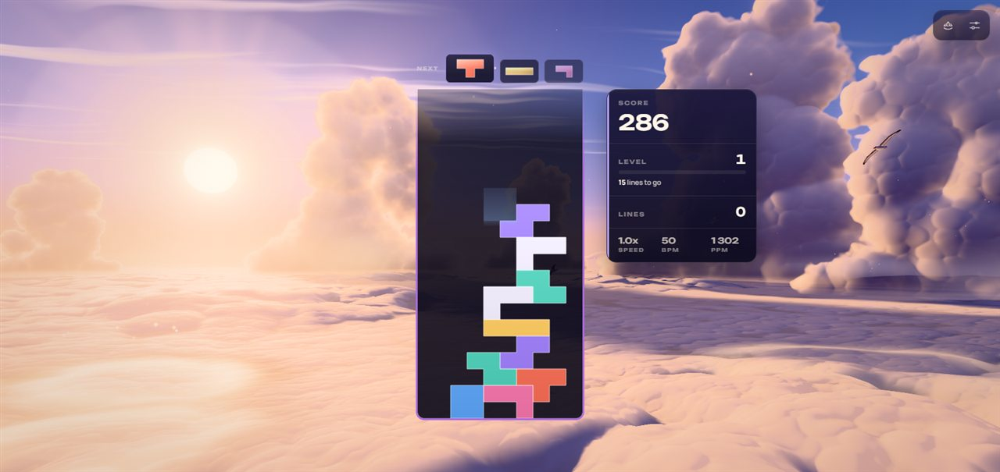 | 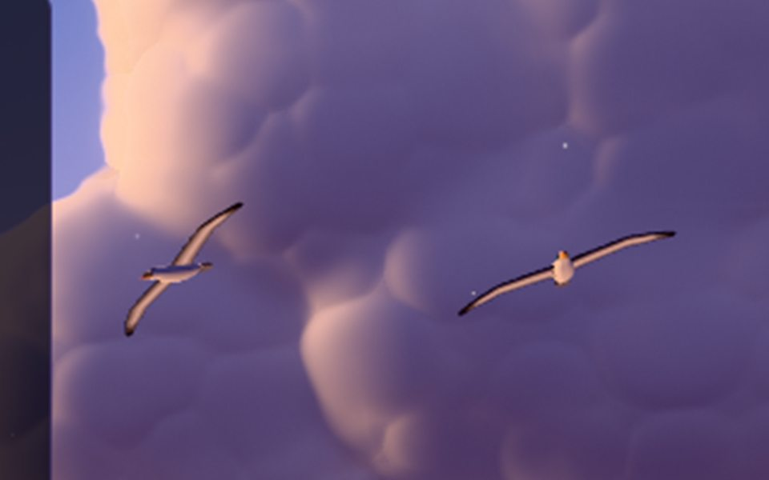 |

- **The model is Blender's** (`scripts/blender/nimbus_veil_albatross.py`, run headless; it writes
  `nimbus-veil-albatross-model.js`, numbers and no file to load: 322 vertices, 544 triangles).
  Long narrow wings that come to a point, a stout white body, a dark brow, a hooked straw bill, a
  short grey tail; white below with a dark margin, slate above with a saddle across the back. No
  skeleton: every vertex carries how much of the shoulder's and the wrist's turn and of the tail's
  fan and twist it takes, and the script's own twin of the vertex stage is held to the theme's by
  the vertices it writes out (`checks`). The script also renders the lineups it was judged by,
  each at game size (30, 50 and 90 px across, enlarged eight times).

  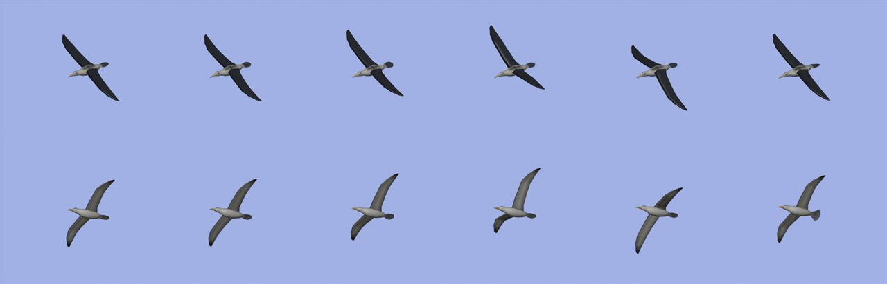

- **The flight is the way these birds really cross a sea** (`nimbus-veil-albatross-flight.js`,
  numbers only): a straight course over the deck from outside one edge of the view to outside the
  other at an even pace, and on it a long S, up one side with the belly shown and down the other,
  low over the cloud heads, with the back shown; banked into every turn by what the turn pulls,
  the wings bending up under the load at the bottom of a swoop and easing at the top, the tail
  fanning in the turns, and on some climbs three slow beats. A follower flies where its leader
  was a moment ago, in its own hand (a little early or late, wider or narrower), so the line comes
  in whole and evenly spaced and is a company, not one bird drawn five times. Three kinds of
  passage (overtaking the eye, coming toward it, abeam), either way; everything is a closed form
  of the happening's age, so a pinned capture and a seek land on the same birds. (The first
  course was laid in screen terms and the birds crawled and dashed: gotcha #1773.)
- **The light is the cloud sea's** (`nimbus-veil-albatross.js`, one instanced draw, three rows of
  four numbers a bird): the sun wrapped a little round the bird, the sky from above, the bright
  deck from below, a little sun through the thin flight feathers and along the outline of a bird
  that stands against it, then the deck's air. They are solid (they write depth: a cloud head can
  hide one, a veil drifts in front of it).
- **A bird against the sun stays a dark shape.** The first frames had a pale cream ghost there:
  with `noPost=1` the bird was a clean silhouette, and the post's bloom and sun rays, which are
  ADDED over everything, laid more light on it than it had. So a bird marks itself in the scene
  pass's alpha (`ALBATROSS_MASK`, its material writes the whole fragment) and the output pass
  keeps three quarters of the glare off whatever carries the mark (`GLARE_ON_MARK`; gotcha #900,
  the Waves theme's recipe, written again here: a theme imports no other theme). For the mark
  to survive, the three additive parts (the optics card, the motes, the sparkles) now add their
  light with an alpha of zero (premultiplied, a custom output) instead of adding 1 to the alpha
  over their whole card or square. Their look is unchanged (the cascade, twist, perfect and level
  frames were taken again and compared).

| Evening | Against the sun |
| --- | --- |
| 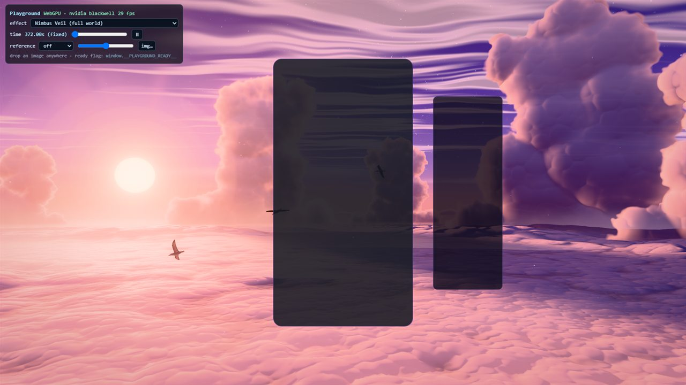 |  |

**The night.** Once the stars are out (`nightK`, from the starlight) the high cloud stands back:
there is less of it (its threshold rises, and a mackerel sky keeps only its taller cloudlets, so
the rows open), it is thinner, what stands overhead goes dark (only the cloud toward the afterglow
and low over it still burns), and seven tenths of the starlight a cloud covers shows through it.
The stars themselves are more and brighter (one cell in five of the fine layer, one in six of the
large). By day nothing changed.

| Blue hour, fair | Blue hour, a mackerel sky |
| --- | --- |
|  |  |

**Verified.** Captures with a clean console, WebGPU and `forceWebGL=1`: the birds by day, in the
evening, in mist, at High, Low and Minimal (three birds there), in a 390 × 844 portrait frame
(they pass behind the board card), a wingbeat in four frames, the same bird with and without the
post; the night under every air, at Minimal and on WebGL2. The real game (private headless
Chrome, single player, real key presses): three albatrosses crossed while pieces locked, WebGPU
at High, the dynamic resolution stayed at 1, the console held only the browser's audio and
Steam-cloud lines. `tests/unit/nimbus-veil-albatross.test.js` (new, 12): the model as decoded,
the pose twin, every passage of 48 slots on four screen shapes (in and out over an edge, an even
pace, no steep climb, a bank into every turn, clear of the deck's heads and of the lens), the
mark and the additive parts' alpha; the living tests' skein assertions are re-pinned to the
albatrosses. The shader gate builds the bird's material to WGSL and GLSL with the rest.

**Not verified, and open** (the writer's doubts, not the owner's words):

- Nobody has watched them move: the flight was judged from stills and from an eight-frame
  sequence two seconds apart. The S, the bank and the three slow beats are the things to look at.
- The birds are drawn 1.7 times life size and fly 27 to 124 units ahead of the eye (30 to 150 px
  across at 900 lines; 35 at the far end): chosen to read in this view, not measured against anything.
- A passage is one of the five happenings and comes as often as the skein did (about one slot in
  four by day). More often is one number (`HAPPEN_QUIET`, or a second slot for it).
- In a portrait frame the board card covers most of the course: the birds show above and beside it
  for a moment each.
- The cost was not measured again: five instances of 544 triangles and no new pass, texture or
  sample (the post reads the alpha of the sample it already takes).
- The night's high cloud is dimmer and sparser than it was. If the mackerel night was liked as a
  ceiling, `nightK`'s four numbers in the sky are where it is.

### Reproduce

```
playground.html?effect=nimbus-veil&maxFps=30&t=12&happenings=0             the first hour, fair
...&t=232  ...&t=342  ...&t=452                                             noon, evening, blue hour
...&t=404  ...&t=514                                                        sunset and sunrise, mid-melt
...&air=fair|tails|mackerel|beams|mist                                      hold one air
...&happen=albatross|glitter|boil|meteor|flicker                            hold one happening (age = t mod 36)
...&event=lock|hard|clear|quad|combo|chain|chainEnd|twist|twist0|b2b|perfect|levelUp|over|dawn|fever
   with eventAge=<s>, lines=, combo=, chain=, streak=
...&board=0   ...&quality=Minimal   ...&forceWebGL=1
```
