# Ocean — the reef canyon at the edge of the blue

Implemented 2026-10-11 on `feature/ocean-masterpiece`, with Three.js 0.186.1. A from-scratch
rebuild: it replaces the earlier theme in full (a 5,000-line lifecycle adapter, the atmosphere,
fish, rare-fauna, reef-dweller and gameplay-effect systems, 57 MB of imported models with their
Blender and TripoSR generators, the `ocean-reef-light` study effect, fourteen test files and
about eighty URL debug flags). Ocean keeps its identity — sunlit shallows over a coral reef,
kelp, fish, the large animals of the open sea — and nothing else. Nothing is loaded: every mesh
is grown in code and every texture is baked on the CPU or painted on the GPU. This document
records the shipped design and what was verified. It is a reference, not a backlog.

## The picture

The viewer rests in the mouth of a reef canyon, looking out and a little upward. Overhead the
surface rolls; the sky is seen through it in Snell's window, and past the window's edge the
surface turns into a moving mirror of the deep. The sun stands somewhere above the frame and its
light comes down through the water in shafts that wander, and the same light lies on the sand
and the coral as a net of caustics, each thread with a fringe of colour.

A garden of coral rises on either side of the board: branching coral, table corals on stalks,
brain corals with their maze, tube sponges, sea fans in lace and anemones that never keep still.
Kelp climbs the shoulders behind them, golden where the light comes through it; seagrass grows in
meadows along the sand channel. A silver school streams through the canyon's mid-water, its
flanks flashing as it turns; small bright reef fish keep to the coral heads; moon jellies hang in
the blue. And now and then something large comes out of the blue and passes high over the reef:
a humpback with her calf, a blue whale, a whale shark, mantas, a squadron of eagle rays, a
turtle, a school of hammerheads, a pod of dolphins, an ocean sunfish (see
[The large animals](#the-large-animals-2026-10-19)).

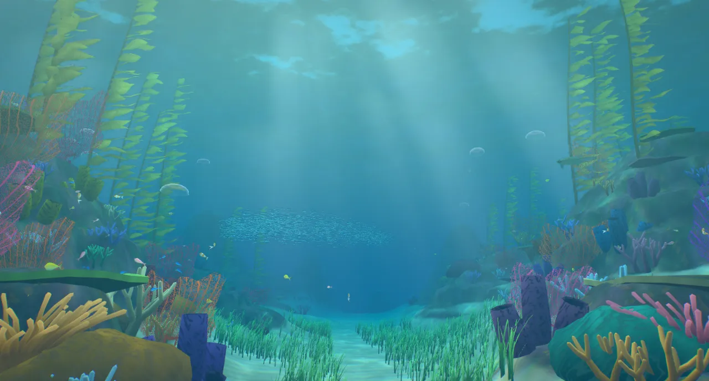

## The one idea

The light is ONE pattern. Every frame a small tileable target is painted with the caustic net
(two scales of it) in one channel and the broad mask of the shafts in another. Everything that
is lit looks its own point up along the sun's ray, at the place where that ray came through the
surface; the post stack's shaft march looks every step of its walk up the same way. So a shaft
stands exactly over the bright patch it lays on the sand, both move with the same water, and the
large animals' shadows (capsules along the sun's ray) cut the shafts and the sand alike.

## Event language

| Gameplay | What the sea does |
|---|---|
| Lock | The piece's light sinks from the card's edge on its side to the reef: a bright head with a wake of motes. Where it lands a ring of its colour runs out over sand and coral, a crown of sparks is thrown up, bubbles rise, sand lifts, and the fish nearby dart away (the reef fish into their colony). The colonies round the landing light up in the piece's colour and **hold** it. |
| Hard drop | Lands harder: a ring of pressure crosses the picture from the landing (it bends the image as it passes), more sparks, more bubbles. |
| Line clear | A current crosses the canyon, alternating sides: kelp and grass lean as its front passes and come back. The school draws out into a ribbon and streams across at the height of the cleared rows. The shafts flare. Every colony holding a colour **lets it go** as the front reaches it: a slow upward snow of beads in the colours of the pieces that fed it — the reef spawning. The cleared rows leave the card as sheets of bubbles carried off by the current. |
| T-spin | A ring of bubbles blown where the last piece went in, widening as it climbs, with a ring of light on the reef. |
| Four lines / perfect clear | The sea holds its breath (a third of a second); then one great shaft of light comes down over the board, the school winds itself round it in a spiral, the whole reef spawns at once, a ring of pressure crosses the picture, and the whale is called. A perfect clear also clears the water itself for a while. |
| Combo | The large animals are called in from the blue, one more with each step: at 2 a turtle, at 3 mantas (up to three), at 5 a whale far out, at 7 the whale comes through the canyon over the board, its calf under its flank, its shadow cutting the shafts — and it sings: shells of light run out through the water from it and set the plankton glowing. A pass, once called, finishes whether or not the chain holds. |
| Level up | The light steps one hour on from wherever the clock has carried it (eased over 3.6 s; a new run never turns it back, its first level-up steps on from there too), a long swell passes overhead (the surface's waves stand higher), and a ring of the new hour's light runs out over the whole canyon floor. **The light also moves on by itself, an hour every 100 s of the world's clock, whatever the level** (see below). |
| Game over / new run | The chain breaks and every held colour is let go; the hour stays. |

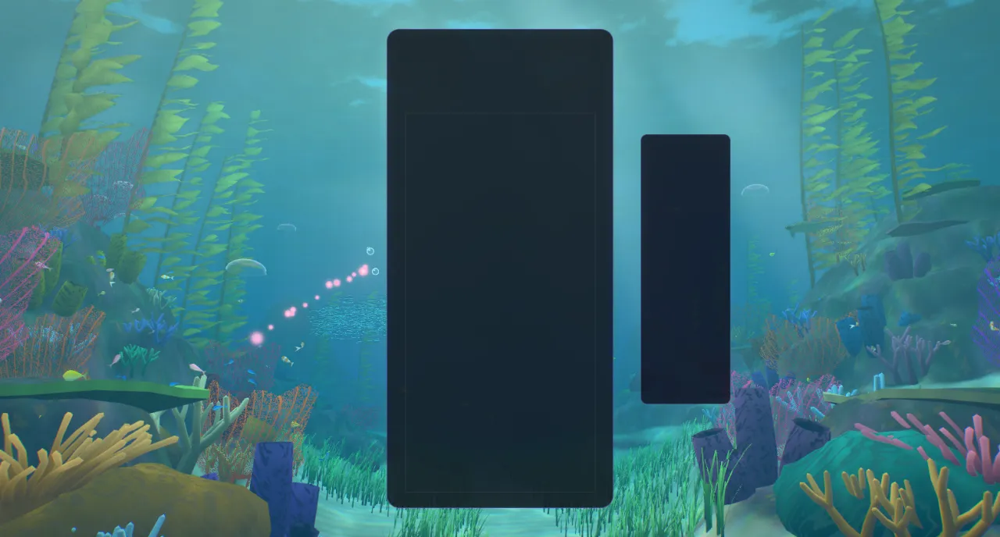
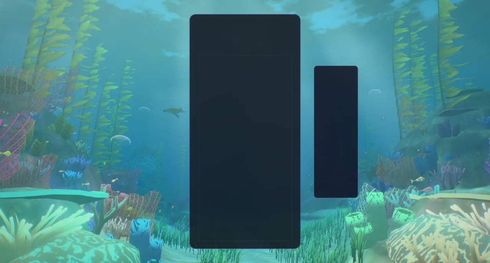
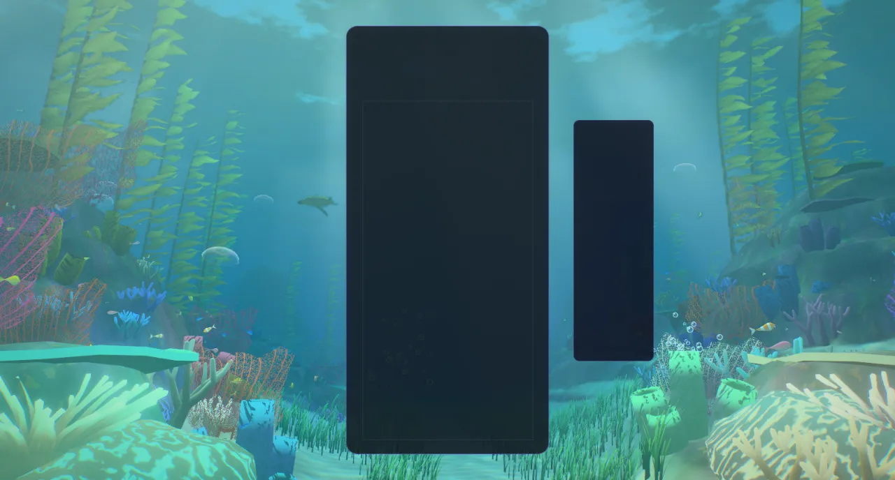
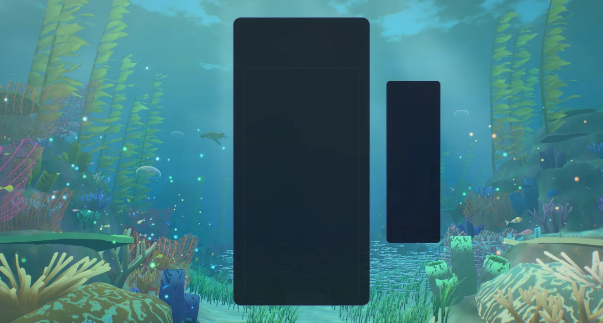
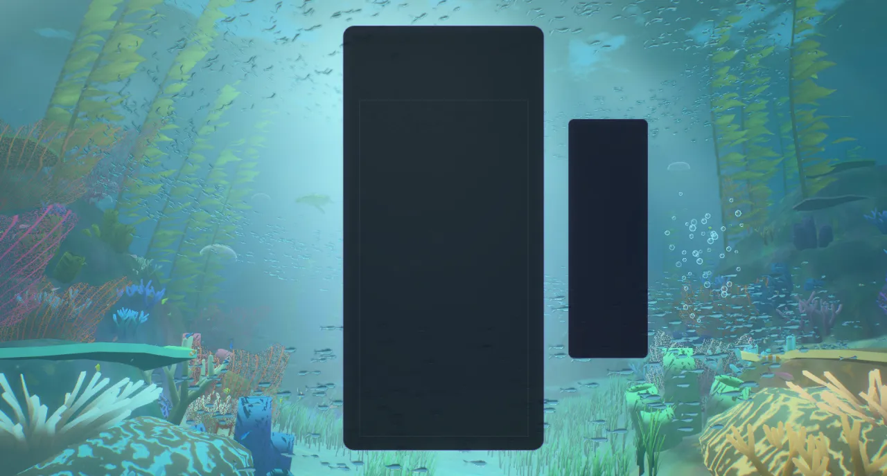
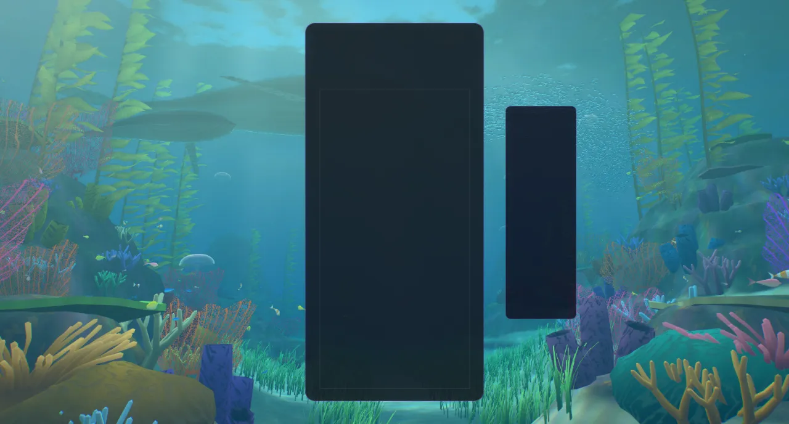

### The hours

Six hours on a wheel, in the order a day runs and in hue order, so no crossing goes through grey:
the high sun (turquoise water, the light right through it), the gold, the fire (sunset burning in
the window over violet water), the blue hour (indigo, the corals beginning to glow), the moon
(black-blue water, silver shafts, the reef fluorescing, the jellies' rims and the plankton
alight), first light (a rose sun on the other side, clear jade water). The place on the wheel is
`(level − 1) + clock / 100 s`: a new level turns it one whole hour and the clock turns it by
itself in every mode, the ones that never level included. Within an hour the light rests on that
hour's own colours for 15 % at each end and is on its way to the next for the other 70 %
(no hold-then-turn). Unit-tested in `tests/unit/ocean-hours.test.js` and
`tests/unit/ocean-world.test.js` (at a fixed level the light has moved within the first minute
and stands on the next hour one hour of the clock later).

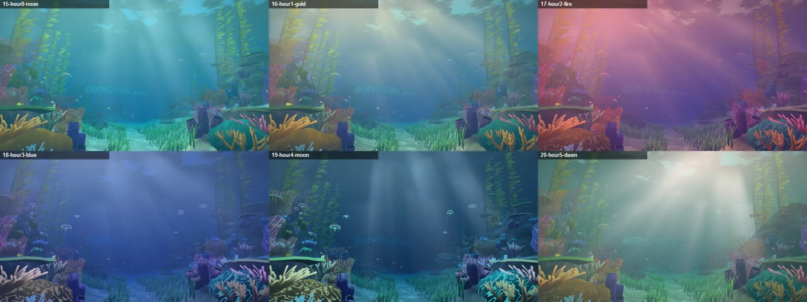

## How it is built

| Module | What it holds |
|---|---|
| `ocean-core.js` | Three-free numbers: the rig, the seabed's height function (a sand channel, two reef shoulders in crags and shelves, coral heads, far pinnacles, a soft ceiling 3 m under the surface), Snell refraction, the event tables' sizes and timings, the school's loop, the animals' lanes and passes. |
| `ocean-hours.js` | The six hours and the wheel. |
| `ocean-tsl.js` | The shared uniforms and TSL helpers: the water's colour along a direction (`ocBackdrop`), its absorption (`ocFog`), the light pattern pass and its lookups, the sea's light on a surface (`ocLight`), the animals' shadows, and the event loops (rings, held colours, currents, songs). |
| `ocean-surface.js` | The underside of the sea (Snell's window, the mirror of the deep past its edge) and the backdrop dome. |
| `ocean-seabed.js` | The seabed sheet: sand with ripples, reef rock with its crust, the caustic net read three times for its colour fringe. |
| `ocean-plan.js` | Where everything grows (seeded; a lower tier keeps the hero gardens). |
| `ocean-reef.js` | The six colony kinds, each one mesh grown in code and drawn instanced. |
| `ocean-flora.js` | Kelp (one curve per stand, blades on floats streaming downstream) and seagrass. |
| `ocean-fauna.js` | The silver school (a pure function of its uniforms and the startles), reef fish, moon jellies. |
| `ocean-creatures.js` | Reads the large animals' bodies (`assets/creatures.glb`, built in Blender from numbers) into geometries, once per page. |
| `ocean-visits.js` | Three-free: the cast, the sea's own schedule of visits (seeded, a pure function of the clock), their routes round the pinnacles and the poses along them. |
| `ocean-giants.js` | The large animals' one material: swum (five body plans) in the vertex stage, painted per kind, lit by the sea. |
| `ocean-fx.js` | The event pool (drift, home, bubble, bead, puff) and the marine snow. |
| `ocean-world.js` | The choreography; shared by the theme and the playground effect. |
| `ocean-post.js` | Shaft march (reduced-resolution `rtt`), pressure rings, fringe, calm zones over the card and HUD, bloom, sea filmic tone map, grade, grain. |
| `ocean-director.js`, `ocean-composition.js` | The fleet's gameplay director and layout reader (as in Stillwater). |
| `ocean-theme.js` | The lifecycle adapter (as in Stillwater; it waits up to 4 s for the creature pack, fetched while the renderer comes up). |

Everything is a function of the world clock and event timestamps (nothing is created at event
time), so `seek(t)` plus a fixed-step replay reproduces any frame. Rates that change with the
game (the school's pace, the flora's sway) are integrated on the CPU, never written as
`clock × rate`.

## Tiers

Every tier keeps the whole picture and every event. From Minimal to Extreme: the light pattern
256–768 texels, the seabed grid 0.42–1.3 of full, 3–6 wave trains, 30–140 % of the reef's
colonies, 8–38 kelp stands with 16–44 blades each, 260–3,000 tufts of grass, 380–4,400 fish in
the school, 50–380 reef fish, 0–14 jellies, 260–2,800 motes, a pool of 256–1,600 event motes. The
post: the shaft march 6–24 steps at a quarter to half resolution on every tier, bloom from
Medium up, MSAA and the chromatic fringe from High up, the animals' shadows in the shafts from
Medium up.

## Verification

- **Playground, WebGPU on the RTX 3070** (`?effect=ocean`, a scratch Electron batch under the
  shared GPU lock): about ninety frames over seven rounds of iteration, the last 28 of them the
  evidence in `ocean-overhaul/` — rest, the board, a lock's light falling and landing, ten locks
  held, a hard drop, a clear and the spawn after it, a t-spin, four lines, the whale, a manta, a
  turtle, a level-up, all six hours, the Low tier, the WebGL2 backend and a 430 × 852 portrait.
  Every console clean (only the harness's own Vite-socket and Electron notices).
- **Real game, WebGPU and WebGL2** (the in-game harness on a private dev server: skip the intro,
  pin the theme, real keyboard hard drops, then line clears, a chain, a LEVEL_UP and four lines
  through the app's own event bus): the theme ran, the locks left 8 held colours, the clears let
  them go, the chain called the turtle, three mantas and the whale, the level turned the light
  from the high sun to the gold, four lines brought the great shaft down (beam 1) with the school
  wound round the board (vortex 0.99). A live change to Medium rebuilt the world in place; leaving
  for Forest left no Ocean canvas. 131 fps at rest and during the quad on WebGPU, 130 on the WebGL2
  backend (High, the RTX, with peer sessions running: an observation, not a measurement). No
  warning or error from the theme (only Chromium's `powerPreference` notice).
- **The light by the clock alone, in the real game**: the in-game harness with `?oceanFixedDt=50`
  (about three seconds of the theme's clock to a wall second), no line clears and no level-ups,
  the world sampled every ~16 wall seconds: the HUD shows level 1 throughout, and the place on the
  wheel went 0.55, 1.11, 1.66, 2.22, 2.77, 3.32 — gold, gold, fire, fire, blue, blue. (The idle
  game topped out after about 80 s, so the last two frames show the game-over card over the blue
  hour.) A level-up adds an hour on top of that.

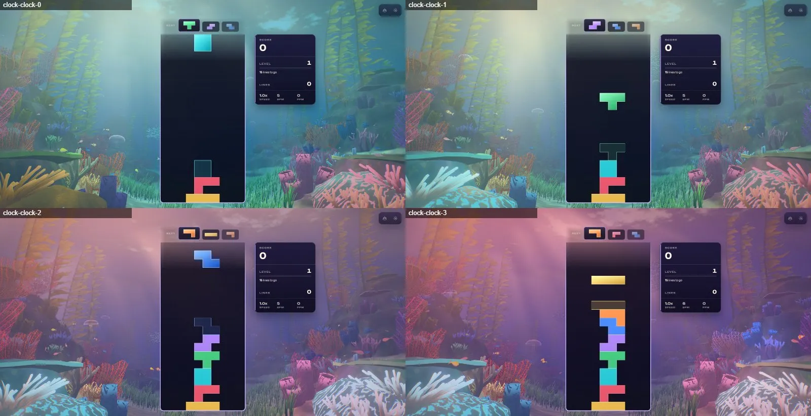
- **Lifecycle**: `node scripts/validate-all-themes.mjs --theme ocean` — PASS (0 lifecycle
  failures, 0 console errors, 0 process failures).
- **Unit tests** (new): `ocean-theme` (62, the adapter's contract), `ocean-director` (26),
  `ocean-composition` (12), `ocean-core` (18), `ocean-hours` (9), `ocean-plan` (12, the plan and
  the tiers), `ocean-meshes` (27, every grown mesh's winding, normals and triangle budget),
  `ocean-world` (18, the real world built in Node and driven through the theme's calls),
  `ocean-playground` (8). They found four real faults that no screenshot showed: the held-colour
  list could outgrow its uniform table under rapid locks (a crash on the next frame), the turtle,
  the mantas and the far whale popped into view at the ends of their passes, the school's loop
  dipped into the reef shoulder, and a far pinnacle stood up through the surface.
- **Static gates**: `lint:ci` (616 errors against a baseline of 807 — the old Ocean took 191
  pre-existing ones with it; the baseline is left as it is), `typecheck`.

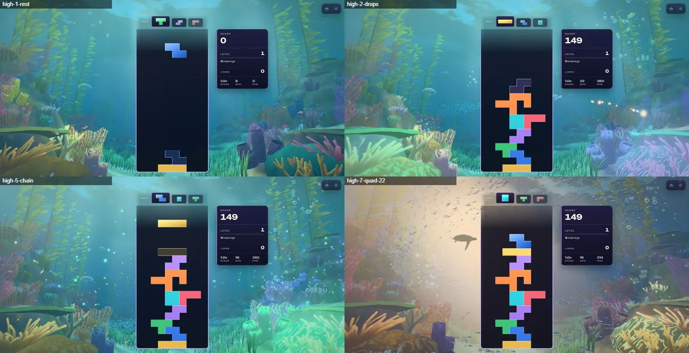

### Not verified, and what is open

- Nobody has watched it move: the pace of the school, the kelp, the currents and the passes are
  judged from stills, numbers and tests only.
- No perf-lane (ADR-0016) reading; nothing on an integrated GPU or a phone beyond the playground
  portrait frame. First-activation pipeline compile time not measured.
- The icon is my pick, not reviewed: the hero coral garden on the right shoulder (a pink anemone over
  branching coral), chosen from eight candidates at the picker's 80 px beside its neighbours
  (`?effect=ocean&t=20&quality=Extreme&hour=0.6&icon=1&iconFov=26&iconYaw=-0.62&iconPitch=-0.38`,
  840 px square, baked to the 512 px circle with saturation 1.35 and contrast 1.15). Both copies
  (`src/themes/ocean/` and `public/assets/themes/`) were replaced.

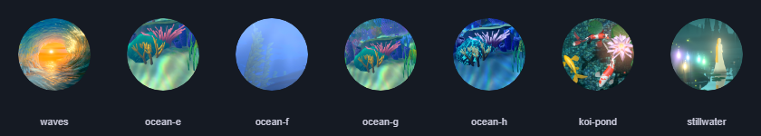
- The six hours' palettes, the hour's length (100 s) and the size of the event effects are my
  choices.
- Blender was not used in the overhaul itself: every mesh was grown in code. (Since 2026-10-19 the
  large animals are built in headless Blender from numbers; see
  [The large animals](#the-large-animals-2026-10-19). The live Blender session was left alone.)

## The large animals (2026-10-19)

Olov: improve the big sea creatures in the back; let them show up and swim there from time to
time, at varied times, with better models, better animations and more kinds and variants.

**What was wrong.** The three animals were grown in code (rings and flat fin sheets: a grey
lozenge of a whale), swum by a sine each, and came on a fixed rota (turtle, manta, far whale every
58 s). Worse, almost nothing the sea sent by itself could be seen: from the reef the kelp on both
shoulders, the reef rock and the card with its HUD leave only two windows to the open water, and
the far lanes (the far whale at 52 m) ran behind them. A capture showed a whale "in the water"
that was hidden behind the left shoulder's kelp the whole way.

**The cast.** Nine animals built in Blender from numbers (`scripts/blender/ocean_creatures_assets.py`;
one signed distance field per animal, smooth masses and airfoil-thick fins, meshed with Blender's
bundled openvdb, decimated, every vertex told its part, its place along the body, how far out
along its fin and where that fin turns from; one 630 KB GLB, `assets/creatures.glb`): a humpback
(with long knobbed white flippers, and often her calf), a blue whale, bottlenose dolphins, a whale
shark (broad flat head, ridges, spots and bars), scalloped hammerheads, an oceanic manta (white
shoulders, gill slits; one in six the black morph), spotted eagle rays (white rings and spots,
whip tails), a green turtle (some are hawksbills by their shell) and an ocean sunfish.

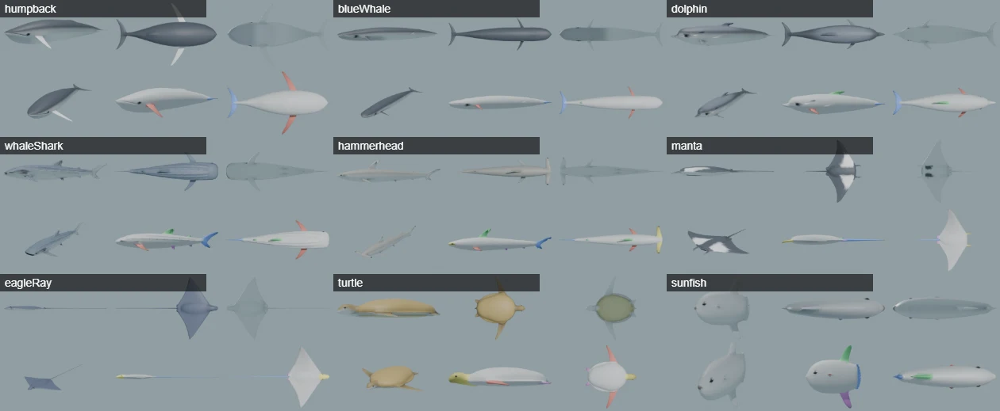

**How they swim.** One material for all nine (one pipeline, one instanced draw per kind), five body
plans in the vertex stage: whales beat up and down in a wave that grows toward the flukes, the
flukes pitching a quarter-beat behind and the long flippers sculling; sharks and the whale shark
sweep side to side with the head swaying against the tail; rays fly, a wave running out along each
wing and back across its chord while the body heaves against the beat; the turtle rows, its front
flippers sweeping down and back, up and forward and feathering as they turn; the sunfish sculls its
tall fins together. Every stroke swells and falls into glides on a slow cycle of its own (a rate
that never changes, so no phase jumps), every body bends into the turn it is swimming, and a pose
is a heading and an up carried along the route without twisting, so a manta can loop the loop.

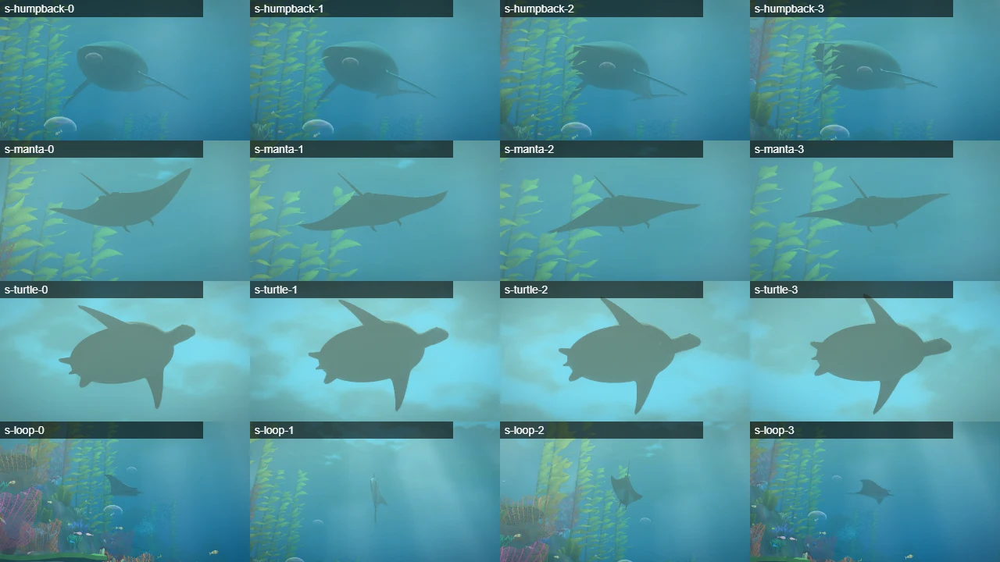

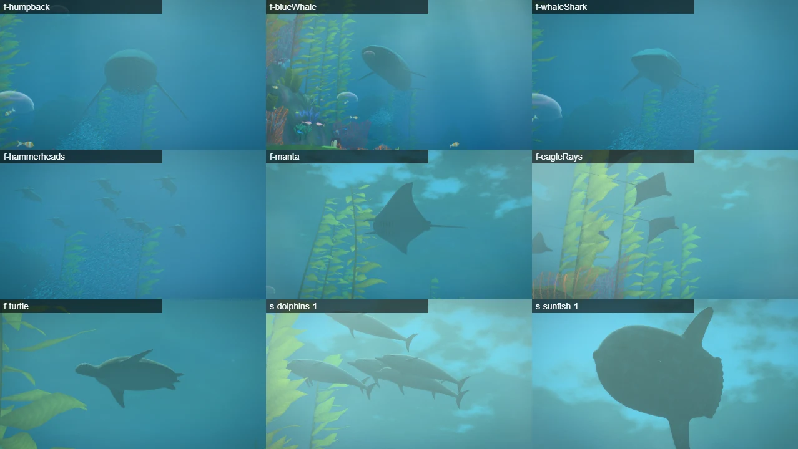

**When and where.** The sea's own visits follow a seeded, irregular schedule that is a pure function
of the clock (`ocean-visits.js` `planVisits`; a session draws its own seed, a rebuild in place hands
it on, a capture uses seed 1): twelve acts weighted so the rare ones stay rare (a blue whale, a
sunfish), gaps from a few seconds to over a minute, two in the water at once now and then, never
the same kind twice running, the first within 5-12 s. The lanes were chosen with a visibility
model (a ray test from the eye against the High tier's kelp stands, the reef and the card and HUD;
the test `ocean-visits.test.js` "in sight" keeps it): most acts come up a window's line of sight
out of the blue toward the reef, growing from a shape in the fog, then turn out through the kelp,
or swim away down one; the rest cross. Each act is in plain sight 10 to 33 s of its pass.
Routes are settled once when planned (lifted clear of the reef, one wide swerve round each
pinnacle in their way) and sampled into a table (planned a minute ahead, one a frame), so a frame
reads a pose in a few microseconds. The board's own calls (turtle 2, mantas 3, far whale 5, whale
over the board 7) are kept; the mantas' and the far whale's lanes were raised and brought in,
where they can be seen.

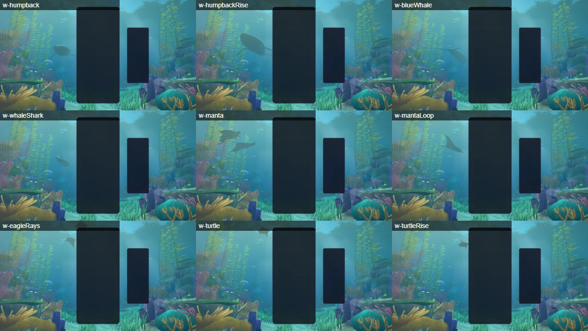

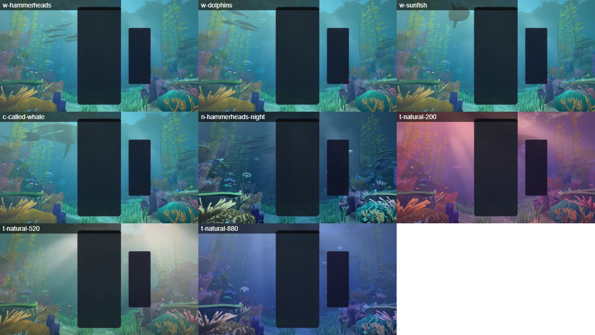

**Checked.** Unit tests (the schedule's spread, overlaps and rarity; every pose in the water, square
and never flipping; every act in sight; the pack's meshes, winding, parts and budget); WebGPU
captures of every act with no console errors; `validate-all-themes --theme ocean` PASS; the
production build with the boot-closure guard. **Not done:** a perf-lane reading and the real game
with a real board (the playground's board mock stands in); the visibility model knows the High
tier's kelp, so on Low and Minimal (fewer stands) the animals are seen more, not less. Playground:
`visit=<act>&visitK=|visitAge=&visitSide=&visitSeed=`, `visits=0|1`, `follow=<kind>&followFit=`.

## Second pass: the surface, the kelp, the reef, the water (2026-10-21)

Olov: improve the visuals, effects, atmosphere and graphics in the Ocean theme.

**What read as computer graphics** (1:1 crops of the playground at 1920 × 1080): the surface was a
flat teal ceiling with cyan blobs on it, more cloud than water; every kelp blade was lit by one
fixed normal, so a stand was one flat lime colour, like paper; the near colonies were smooth
plastic (sponges with large camouflage blotches, a brain coral with a few dark wiggles); the
caustic net on the sand was a soft grey fill; and the water in front of the eye was empty.

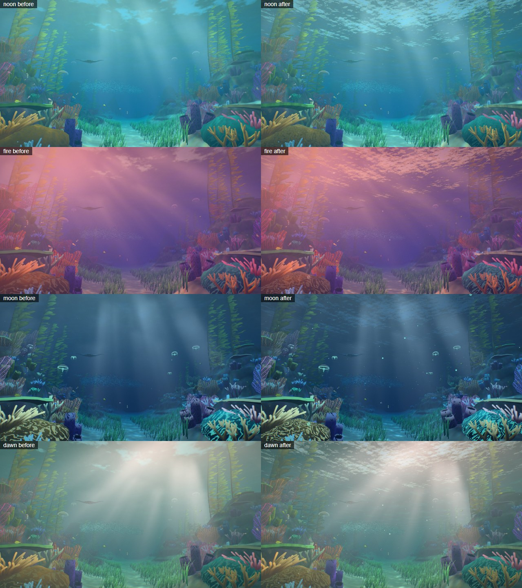

**The surface** (`ocean-surface.js`). The eye is 12.5 m down and the top of the frame meets the
surface at the edge of Snell's window, so the picture there is decided by how each facet is tilted.
The surface's slope is now read from the light pattern's caustic net itself (three reads a few
centimetres apart, at the level whose texels are about 9 cm on every tier): the net is the
surface's height, so each thread is a pair of facets, one turned into the window and one out of
it, and the bright facets overhead stand over the shafts and the net on the sand below them. Waves
settle by how many pixels a wavelength covers (`fwidth`), not by distance; what the pixels can no
longer draw blurs the window's edge instead. The window is opened per channel at three indices
(`DISPERSION`), so a facet's edge is fringed, and a thin rim of the low sky runs along every thread
that crosses the edge. The broadest chop, which made the blobs, is gone; the surface is seen through
a shorter, brighter column of water than its distance says. The moon hour's low sky is lifted a
little (the surface is the only reader of `horizon`) so at night the facets show as faint ripples.

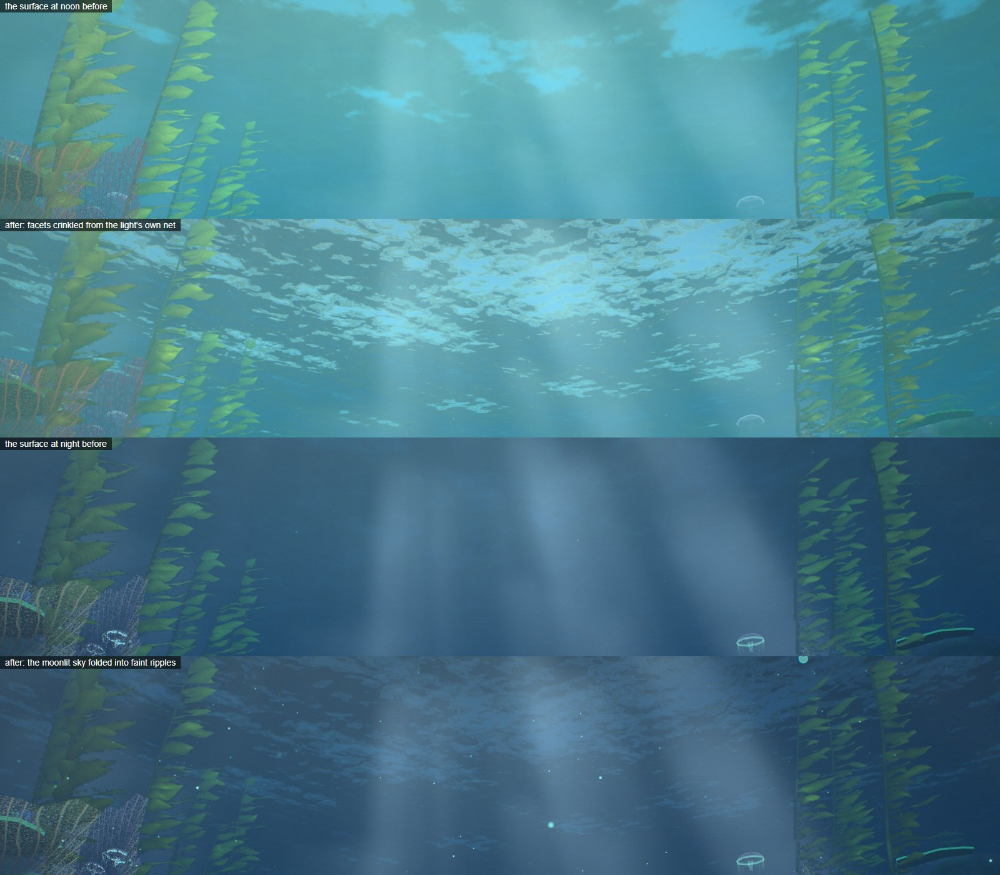

**Kelp** (`ocean-flora.js`). Each blade's face is worked out in the vertex stage from its own twist
and rise (`vKelpFace`) and shaded as a thin leaf: the face the eye sees takes the sea's light
(front-lit olive, edge-on dark), and a blade with the sun behind it lets the light through gold
(`KELP_THROUGH`), most of all looking up through it toward the sun. The water still takes the red
out at 10–25 m, so at noon the canopy is olive and gold-green, and at sunset it glows amber.

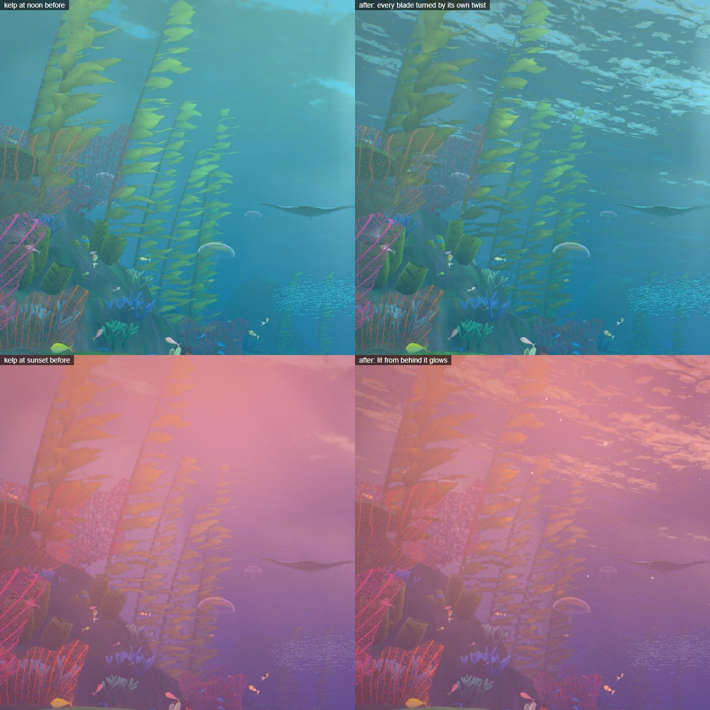

**The reef** (`ocean-reef.js`). Stone colonies carry the cups of their polyps (two noise reads
blended by which way the surface faces); a brain coral's maze is finer and every ridge has its
groove; a sponge's pores are small and many; a table's plate has a lattice and a pale growing rim;
every colony stands in its own shade where it meets the rock; and the water lights the edges a
colony turns away from the eye (a grazing sheen of the ambient colour), so it stands in the sea.

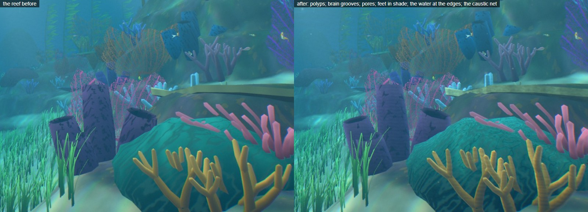

**The caustic net** (`ocCaustic` in `ocean-tsl.js`). Measured on the CPU, the net's mean is 0.23
and its median 0.19: read straight it was mostly a grey fill (threads 2.8 × the cells). It is now
read squared (gain `0.62 + 7·net²`, mean 1.19), so the threads stand about six times brighter than
the cells, on the sand, the reef and the kelp alike. The colour fringe's three reads moved from
8.5 to 4 cm apart: with the sharper net the old spacing turned rock and sand oil-slick.

**The water in front of the eye** (`createNearMotes` in `ocean-fx.js`, a new part `nearMotes`,
120–1,000 a tier). Specks of a few millimetres in a box just in front of the rest eye, drifting
with the current: in focus a few metres out they are points, sharp and bright where a shaft
crosses them (the shafts' own mask, forward scatter toward the light); nearer than that they are
the soft discs of a lens's blur (`NEAR_FOCUS` 9 m, `NEAR_APERTURE`) with a brighter rim, each
keeping a share of a point's light. At night some are plankton with a light of their own.

**Two shader faults the new gate found** (`tests/unit/ocean-shaders.test.js` builds every
material in the sea and the light pass through the WGSL and GLSL builders at High and Minimal, and
flags a var read before anything has assigned it):

- *The large animals' body plans.* `part`, `sgn` and `root` were shared nodes built before the
  `If`/`ElseIf` chain of body plans; WGSL assigned their vars inside the fishes' branch, so the
  rays, the turtle and the sunfish read zeros. **The turtle's flippers never rowed, the sunfish's
  tall fins never sculled, and the rays had no tail whip, curl or tuck** (since 2026-10-19; the
  strokes were reviewed in Blender's renders). They are vars made at the top of the stage now.
- *The colonies' rings.* One node for a colony's root fed both the held colours' varying and the
  rings' varying; its var was assigned inside the held colours' loop, so with no colour held (a
  level-up's ring at the start of a run) every colony took a passing ring's light as if it stood
  at the origin. Each varying makes its own now.

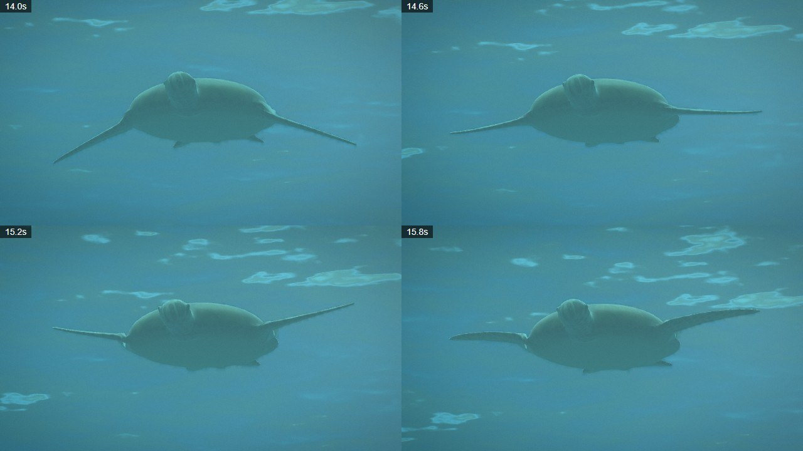

**Verified.** The playground on WebGPU (RTX 5080 Laptop, a scratch Electron batch on a private dev
server): all six hours at 1920 × 1080 with 1:1 crops, the board with a lock, a clear, four lines
and the whale, a 430 × 852 portrait frame, the Minimal tier and the WebGL2 backend; every console
clean. The before/after pairs are from a detached worktree at `origin/main` on its own server. The
Ocean suite (265 tests) passes, and `validate-all-themes --theme ocean` PASS. Frame cost at
2538 × 1544 on the RTX 5080 Laptop (120 frames in one task, the node frame advanced before each,
the queue drained; medians of three rounds interleaved with the baseline): High 5.10 → 5.42 ms,
Ultra 5.70 → 5.91 ms, Low 2.31 → 2.38 ms, about +3 to 6 %. **Not done:** a reading on an integrated GPU (this
laptop's Radeon 610M was left alone: captures have crashed an iGPU's driver on this project
before) or a phone; the real game with a real board; anyone watching the specks and the surface
move for long.

## Reproduce

Playground: `npm run dev:playground`, then
`/playground.html?effect=ocean&t=20&quality=High&board=1` plus
`event=lock|drop|clear|quad|tspin|perfect|levelUp|break`, `eventAge=<s>`, `lines=`, `row=`, `u=`,
`color=<hex>`, `combo=<n>`, `locks=<n>`, `pass=turtle|manta|whale|whaleFar&passAge=<s>`,
`visit=<act>&visitK=<0..1>|visitAge=<s>&visitSide=±1&visitSeed=<n>`, `visits=0|1`,
`hour=<place>` (0 high sun … 5 first light), `level=<n>`, `shafts=0`, `noPost=1`,
`parts=surface,seabed,...`, `icon=1` (+ `iconFov`, `iconYaw`, `iconPitch`, …). Theme flags:
`oceanTime`, `oceanFixedDt`, `oceanParts`, `oceanFalseColor`, `oceanForceWebGL`.
