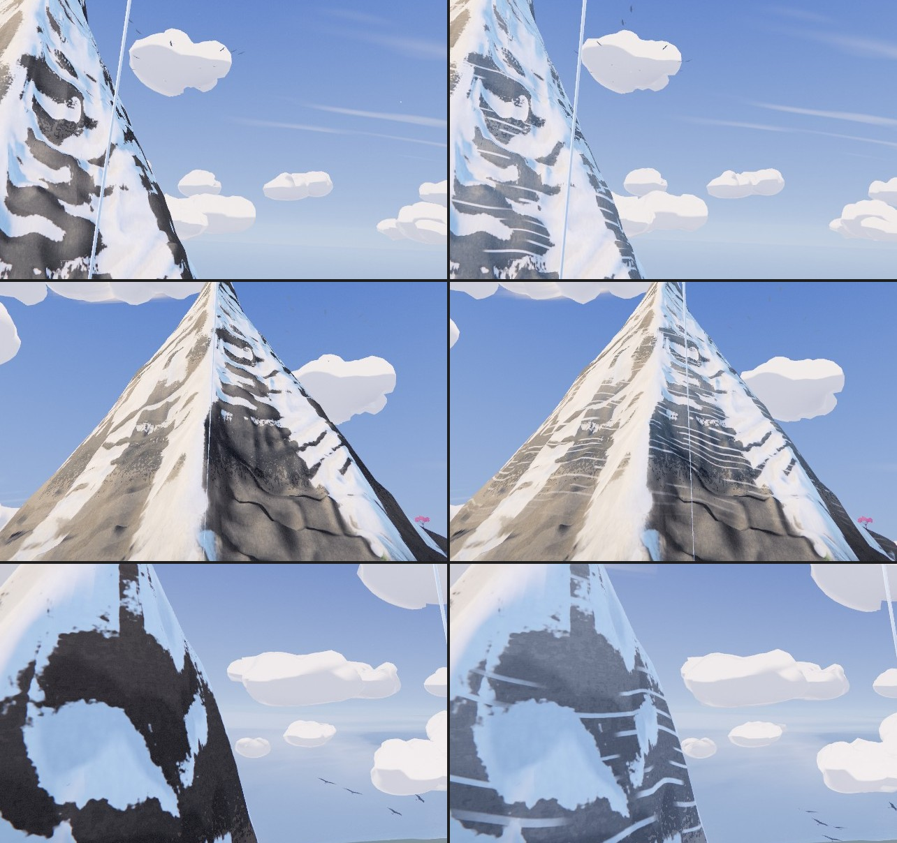
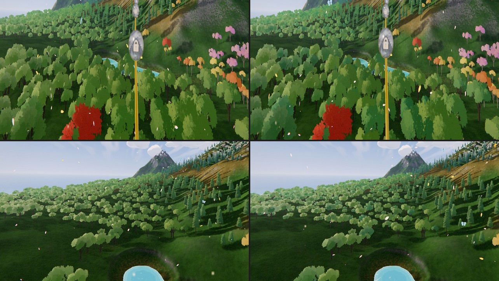
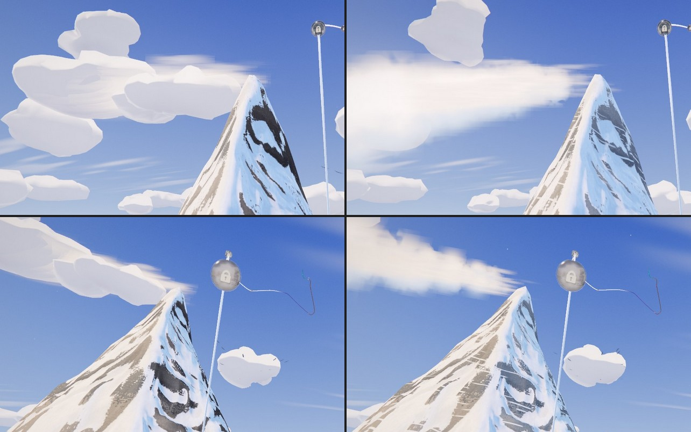
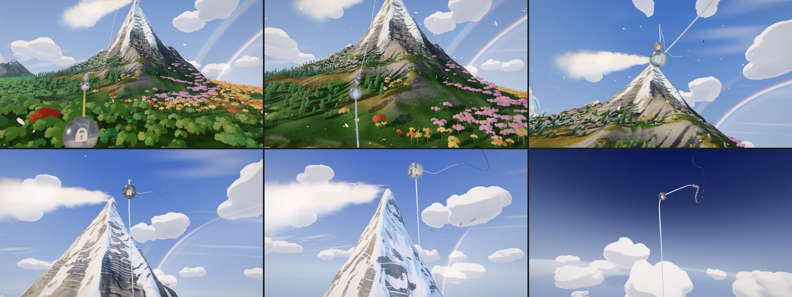
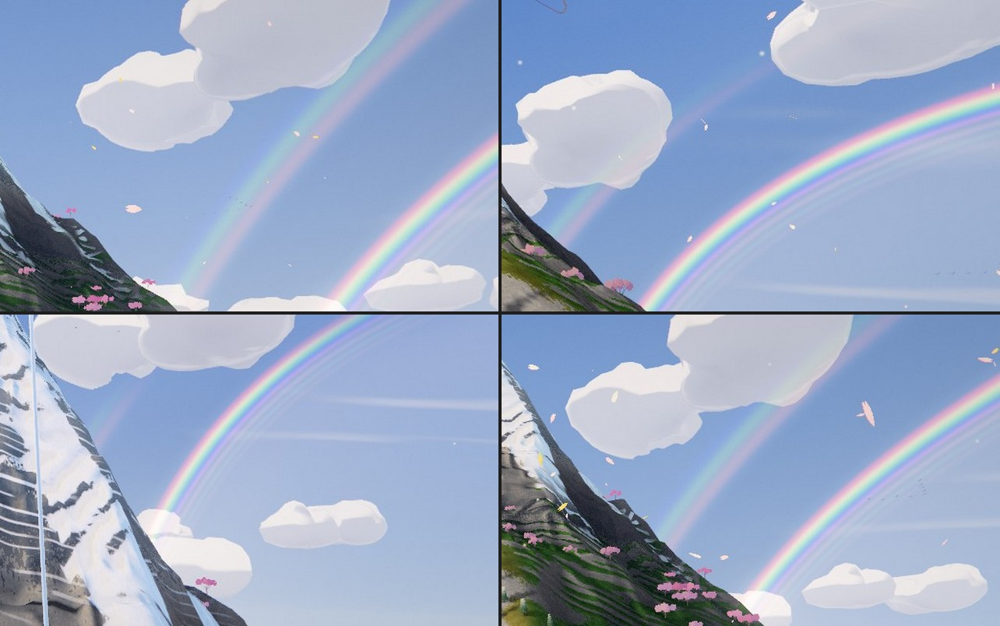
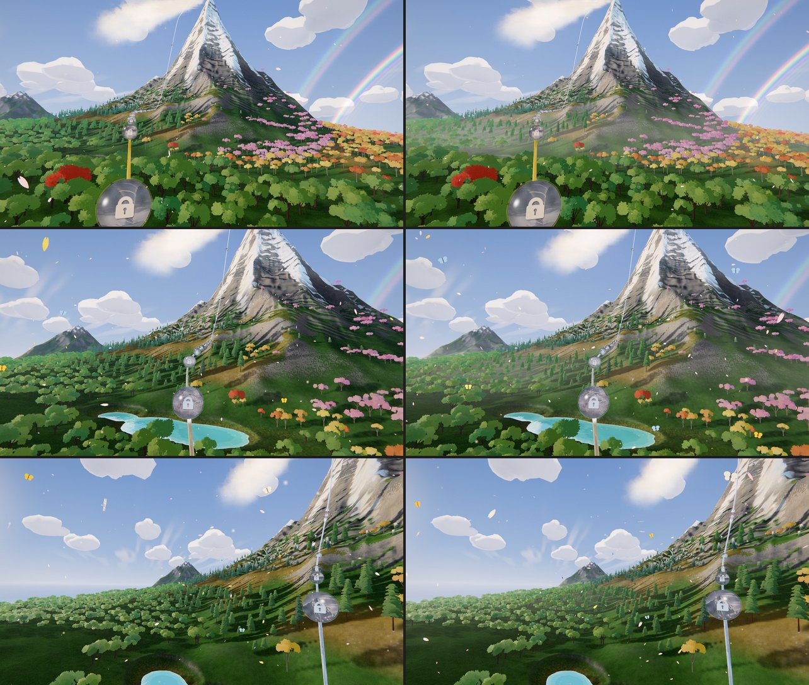
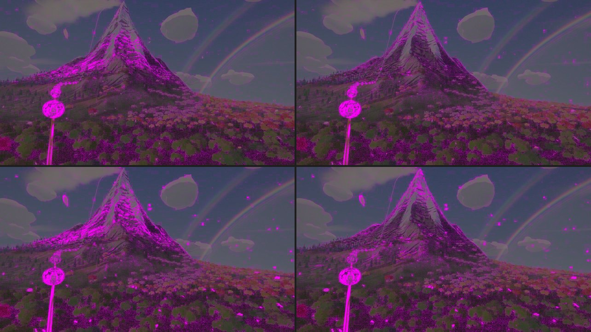

# Odyssey Act II — round three (2026-10-31)

Olov: *"what more do you think we should improve to make these chapters the most beautiful
chapters?"*, then *"Continue with whats recommended!"* and *"Now we need to continue improving the
clouds and all other things we had planned!"*

The recommended list, most first: the clouds; chapter 5's climb (a cloud layer, a deepening sky,
the summit's skyline, its rock); water that moves (the sea and the tarn, a waterfall and a
stream); birds made in Blender that come close; wind you can see; air and light (mist in the
hollows); the shore and the islands; polish (tree hues, flower drifts, boulders, a rain cloud over
the rainbow).

Records of the steps taken so far:

- The water: [ODYSSEY_WATER_PASS_2026-10.md](ODYSSEY_WATER_PASS_2026-10.md) (one water, clouds and
  the shore in the water, wind, windrows, each water its own pigment).
- The clouds: [ODYSSEY_CLOUDS_LOOKS_2026-10.md](ODYSSEY_CLOUDS_LOOKS_2026-10.md) (the Witness
  paint and the banks layout, now the default).

## §1. The summit's rock (2026-10-31)

Up close (the climb from p ~0.42 to 0.66) the summit's rock read as flat black paint: the crisp
snow decision (round two's `SNOW_CRISP`) leaves big islands of bare stone, and the measured mineral
shade (ambient 0.22, desaturated, the deep end of the references, chosen so the massif keeps a
shadow side) put the summit's shaded stone near black. Above ~600 u only (`SUMMIT_LEDGES`), so the
massif's flanks keep their measured shade:

- **Snow ledges.** Alpine rock is layered and each layer's top holds a line of snow. The layers
  DIP across the mountain, the slow jitter bends them, a warp of the layer coordinate spaces them
  unevenly, each layer takes its own hashed thickness, and value noise (only where a ledge can be,
  inside a branch) breaks each one into runs with bare gaps. Lines fade where they would crowd under
  ~2 px. A first cut bent by the atlas grain drew white worms; a second, level and even, a layer
  cake.
- **Sky in the shade.** Summit rock takes more of the sky (ambient 0.50, 55 % of its hue): open to
  the whole dome and the bounce off the snow round it, shaded stone is a slate, not black.
- Built as a value, not assigned: the ground's colour graph is built outside any `Fn`, where an
  `.assign()` is silently dropped (the TSL notes' trap).

## §2. The forest's hues (2026-10-31)

Every lowland broadleaf (`S1-shore-broadleaf`, most of the chapter 3-4 canopy) wore one lime: its
hue ramp's far end (`crownAlt`) was a darker shade of the same lime, so from the rail the forest
read as a carpet. The far end is now a deeper, cooler blue-green; each tree lands somewhere between
sunny lime and blue-green along the scatter's existing per-tree ramp (`FOREST_HUE_SKEW` keeps lime
the majority). Still one family, still inside the ramp the scatter test pins. A palette call the
round-two record left to the owner, taken under "do what you think will be most beautiful".

## §3. A stream, tried and removed (2026-10-31)

A snowmelt stream from the massif into the tarn (a ribbon draped along the steepest-descent path,
glacial water, a white cascade on the steep reach, a meander and pools on the gentle ones) was
built and shown. Olov: *"I really dont like the steam!"* It is removed, module and all. Don't bring
a stream or river back to the massif or the tarn without asking.

## §4. The summit's wind: a banner (2026-10-31)

Olov, with a capture of the climb: *"i am not sure about the top peak wind, that must be possible
to make more impressive? the wind at the top of the mountain."* The streamers (round two) read as
a short smear on the tip, and the banner cloud the field parked in the summit's lee (the `banner`
masses B1, B2) read as two ordinary clouds sitting beside it.

- **The banner plume** (`ODYSSEY_SUMMIT_PLUME`, a second layer in
  `composition/odyssey-summit-spindrift.js`): a summit in a gale flies a banner, cloud condensing in
  the lee of the tip and torn away downwind in a continuous plume. 230 soft billows, born a steady
  stream just downwind of and below the tip, torn off fast and carried ~940 u at ~55 u/s; lifting
  just off the tip, then sinking into the lee; spreading sideways and vertically as they go, each
  rolling in its own eddy; growing from 12 to ~90 u and fraying into wisps as they age. Each billow
  is lit from its top (the world's up, turned into the sprite's frame): sunlit white above, a cool
  sky-lit slate below, as the field's Witness paint does. Crisp, rounded billows: a first cut,
  softer and stretched, read as a smeared brush stroke.
- **The streamers** are now the speed cue over it: more (140), longer (330 u), faster (5.2 s),
  thinner and fainter.
- **The banner masses are gone** from the `banks` layout (the default): the plume replaces them.
- One group, so the board mounts it as before (`?odysseyNoSpindrift=1` still removes both layers).

## §5. The rainbow, all the way up, in a shower that is part of the world (2026-10-31)

Olov: *"the rainbow needs to be there all the time not just for a short while, so we need to
improve the rainbow and also add a rain cloud over the rainbow"*.

- **All the time** (`ANTISOLAR_WINDOW`, `world/odyssey-sky-optics.js`). Probed on the fade test's
  real camera: the bow is in frame at the shore orbs, over the meadows (p 0.20-0.21, 0.26-0.27)
  and through the WHOLE climb (p 0.32-0.69, a third to all of its arc), where the old window
  switched it off at p ~0.30. It now stands from the start of chapter 3 (fading in at p ~0.10-0.135,
  where none of it reaches the screen; a submerged eye sees the surface's own sky, never the dome)
  until the eye climbs out over the cloud deck at the departure. The fade test holds it full at
  L16, L21, L26, L29, L30 and L33, each of which looks at it.

**Three cuts of the shower before this one** taught what the bow needs:

1. A rain cloud painted on the sky dome (round heads on a flat base). *"the rain cloud feels too
   different compared to the other fluffy clouds, and when we transition into the next space
   chapter it fades away, we do not move above it like the other clouds"*. So the shower became
   part of the world: real cloud masses, rain and bow as world geometry.
2. Flat strips of fine streaks hanging between the masses. *"it does not feel connected to the
   clouds, and just look dark noisy and bad"*.
3. A soft column of rain under each mass, integrated in closed form (smooth, no noise). *"It feels
   like it makes the sky to grey, I just want a beautiful rainbow and the best possible visuals"*.

**The shower now** (`world/odyssey-shower.js`):

- **The clouds** are four masses in the cloud field (`showerCloudSpecs`, in the `banks` layout,
  replacing the bank and the middle-distance mass that stood opposite the sun, inside the 34k
  budget): the same sculptor and Witness paint, only a touch heavier (the storm term), their bases
  raised to 1150 so they stand just over the bow's crown from the meadows. The climb leaves them
  below with the rest.
- **The rain is not drawn.** One long, soft volume along the line, from the sea into the cloud
  base (`showerBowVolume`), only carries the bow: each pixel of its proxy hull integrates the rain
  along its view ray in closed form ((1 - r²) across the volume, exact along the chord), and that
  amount masks the bow. The sky stays clear blue; the arc stands whole where the rain would be.
- **The bow** (`bowSpectrum`, `bowSkyLight`, `ODYSSEY_BOW`): at the true angle round the antisolar
  point, the primary and the reversed secondary, plus three faint SUPERNUMERARY bands just inside
  the primary's violet edge (pink and green by turns, each fainter), the sky a little brighter
  inside the primary and a faint darkening in Alexander's band between the bows (the alpha of a
  premultiplied over). All light added, nothing greyed; softened a little by the air between.
- **Where** (`ODYSSEY_SHOWER`): a bow's 42° circle stands round a point 15° under the horizon, so
  the volume is a LINE across the antisolar bearing, ~1350 u out over the coastal strip, reaching
  ~1600 u either side. The layout test checks from the real camera that over 90 % of the bow's arc
  above the horizon lies in it from L16 and L21, and a leg of it from L29-L31.

## §6. Mist lying low, so the land stands in layers (2026-10-31)

Olov: *"Mist and depth in the air: soft haze lying in the valleys and hollows, so the forest and
hills stack in layers instead of reading flat."*

The air's haze grows with range and thins with height over ~650 u (`applyAerial`). From the
meadows the eye is only 60-100 u over the sea, so the forest in front, the hero's lower flank and
the far massif all hazed alike and read as one flat sheet. The old valley mist (item 7) only woke
once the eye climbed past 350-470 u, and on the climb the camera looks up, so it was never seen.

Two thin bodies of mist now lie on the land (`GROUND_MIST` in the renderer), both integrated along
the eye's ray, both skipped by a uniform gate (`uGroundMist`) under water and high on the climb:

- **A layer over the sea and the low land.** Its density falls with height over the sea (scale
  height 35 u), and the ray takes the mean of it the same way the air does. The feet of every far
  hill and the far forest by the shore stand in pale air while their tops stay clear.
- **Pools in the hollows** (`world/odyssey-valley-mist.js`, a 256² plate baked in ~13 ms on the
  main thread). The island's height is blurred wide (the land round each point); where the ground
  lies under that, the difference is how deep a pool it holds, up to 70 u. Pools thin out on
  steep ground, so mist settles on floors and benches, not on a long slope. Their edges are
  feathered. A fragment under a pool's top is veiled by the mist above it, on the slant the eye
  looks down through it. The tree crowns stand higher than the floor between them, so they stick up
  out of the mist.

**The look.** The mist is the sunlit air washed toward white, a touch cooler in the land's
shadow, with a glow toward the sun. It is never grey, and at most it veils half. It starts 150 u
from the eye (full by 1000 u), so the trees and the tarn in front stay crisp. Slow wisps drift on
the wind. Over the open sea it is laid at 40 %, so the water keeps its blue out to the horizon.
The mist lies nearer than the air beyond it, so its own colour is hazed by that air as well
(`mix(base, mix(mist, air, airW), w)`: the mist laid under the air, exactly). It is on the ground,
the forest, the tarn, the lake and the sea; the clouds and sky are untouched.

**Tuned by eye** at 30 fps, on live knobs since removed. Things tried and dropped:

- The first cut was a grey fog bank.
- Pools on all concave ground draped sheets up the slopes in front of the eye.
- Gating pools to flat floors only removed the band at the hero's foot, which is the best of it.

## §7. The mountain holds its shape as the rail moves (2026-10-31)

Olov: *"why does some of the shape of the mountain like change a bit as we move along the path, is
that something we can fix??"*

**Why it changed.** The ground is one clipmap: nine square rings round the point under the eye,
each twice as coarse as the one inside it. The massif is seen at 0.5-1.5 km, on the 12.8-51 u
rings, much coarser than the forms it carries: the relief has 8.8 u texels, and the summit's
sculpt has 1.8 u. In the outer band of each ring the vertices morph toward the next ring's
lattice. That morph was measured from the ring's snapped origin, which steps 2 cells at a time,
so every 25-51 u of travel the band jumped by a fifth. Each jump redrew the ridges and faces: the
rock and snow on them slid, and their light and shade changed.

**How it was measured.** One frame, held still (camera and clock fixed), with only the rings'
centre moved along the rail in 13 u steps, diffed step by step. The first two fixes below were
real defects but barely moved the measure. The geometry was the cause.

**What changed** (all in `odyssey-world-renderer.js`):

1. **The morph glides** (`clipmapXZ(..., continuousMorph)`). It is measured from the LOD centre
   itself, so it changes smoothly with the eye instead of in steps. It has to finish 4/gridN
   earlier to leave no cracks (`continuousMorphEndCeiling`, pinned for every quality tier). The
   32-cell water and cloud lattices have no such margin and keep the snapped morph.
2. **Each ring reads the height at its own spacing.** The relief and summit plates are
   mipmapped, and the ground's vertices read the mip that matches their spacing (the morph
   carries it smoothly). The geometry holds only the form it can draw, so that form does not
   change as the rings pass over it. Every other read stays on level 0, so the shading keeps its
   full detail.
3. **A finer lattice on High.** `gridN` 128 → 160: the spacing at a given range is about
   range / (gridN / 2), so the massif is drawn a fifth finer. That costs about 373k ground
   triangles, up from about 239k; the Low tier is unchanged. The sea and the cloud deck keep the
   spacing they were tuned on (`waterLattice: 128`).
4. **The paint follows the surface, not the lattice:**
   - the bands drawn by height (snow line, strata, summit ledges) read the height plates at the
     fragment;
   - the steep faces' side projections run on that height;
   - the macro slope and relief weight in the normals are read per fragment, no longer
     interpolated across 25 u triangles.

**The measure: changed pixels on the massif over 54 u of travel (4 steps), and how they come.**

| | massif pixels changed | how |
|---|---|---|
| before | ~11,000 | in jumps, every second step |
| continuous morph | ~10,600 | evenly, every step |
| + prefiltered heights | ~6,900 | evenly |
| + gridN 160 (shipped) | ~3,400 | evenly, mostly 1 px edges on the summit's ridges |

