# Odyssey Act II — chapters 3, 4 and 5 made stunning (2026-10-25)

**An audit, a plan in six steps, and the record of each step as it lands.**

Olov, with a screenshot of the chapter 4 meadow under the massif: *"Next i want to look into chapter
3,4,5 and how we can improve these to make it more impressive, the trees, the mountains, the
landscape, the surroundings, the birds, the rainbow, the air, the, clouds, the lod trees, the
lighting, the sun, the wind on top of the mountain, the atmosphere, the assets, the composition, the
pond, i want you to look into these chapters and see how we can improve them visually so they become
a visually stunning masterpiece environment for odyssey mode."*

Earlier plans this builds on: [ODYSSEY_OVERHAUL_ACT2_2026-10.md](ODYSSEY_OVERHAUL_ACT2_2026-10.md),
[ODYSSEY_MASTERPIECE_PASS_2026-10.md](ODYSSEY_MASTERPIECE_PASS_2026-10.md), and the Act II
forest, ground and cloud plans of 2026-08.

## The audit

24 live stations on the rail, from the shore (p 0.15) to the top of the climb (p 0.66), plus a
survey of how each system is built.

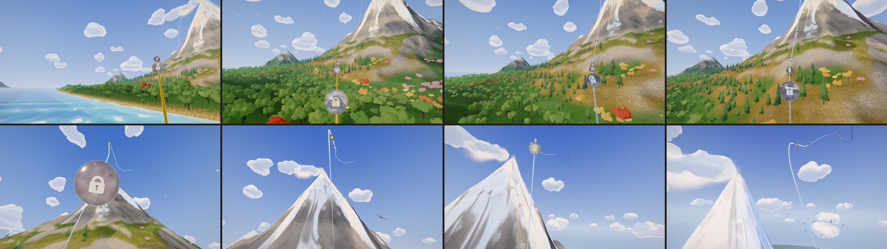

What held the act back, most first:

1. **Front light.** The world sun stood ~25° up, 110–175° off the camera's bearing for the whole
   act: the camera looks out at −80 to −120° through chapters 3–5, and the sun sat behind it. The
   massif read as a flat cone, its ridges painted rather than shaded. The back-lit terms (tree rims,
   cloud silver linings, the sea's sun road) never showed. Shadows are baked, so moving the sun was
   the owner's call.
2. **The summit.** From p ~0.38 to 0.58, almost half of chapter 5, the view is a smooth white cone:
   its flutes and couloirs are shaded only, and its texture smears down the steep faces.
3. **The trees.** Three quantised tones per crown, so the blossom and maple crowns read as paper
   confetti. Upslope conifers are bare cones, and slopes beyond ~1450 u carry no forest.
4. **The clouds.** Sculpted SDF masses lit from behind the eye read as stickers. The sky is one
   flat blue, with no haze toward the sun.
5. **Life.** The birds are specks. The summit's spindrift (56 quads) does not read in any capture.
6. **The pond.** Never visible from the rail: forest and hills hide it at every station.
7. **Set dressing.** Grass, rock and flowers are all painted into the ground: no grass, boulders
   or props.

**Constraints.** Act II GPU p50 must stay under 1.2 ms on Lane A (RTX 3070; baseline ~0.65). Lane B
(the Radeon 610M iGPU) is already over its 7 ms budget at ~10 ms. Each material costs ~40–45 ms
of cold pipeline compile.

## The plan

1. **Turn the sun** to the side, low and clear, and re-bake the shadows. *Done (§1).*
2. **The summit sculpted, and its wind.** Arêtes, rock faces and couloirs in the height field.
   Snow by slope and exposure with wind-scoured ridges, rock that does not stretch on steep faces,
   and a spindrift plume that reads. Varied framing for chapter 5's long stare. *Done (§2), the
   framing left for later.*
3. **Trees and the treeline.** Softer, back-lit crowns, ragged conifer silhouettes, a far ring of
   forest, and a transition from forest through krummholz and alpine meadow to rock and snow. A
   cheap band of real grass by the rail, in the wind. *Done (§3): the crowns' bands follow the
   sun, the trees cast baked shade, a painted far forest, the krummholz; the grass band dropped.*
4. **Clouds and air.** Dark bases, lit edges, a high cirrus layer, warm haze toward the sun, light
   shafts. *Done (§4): the cirrus and the warm air; the cumulus already had its bases and edges;
   shafts dropped (the sun is never in the rail's view).*
5. **Life.** Readable birds near the camera, butterflies, petals in the air. *Done (§5): petals and
   butterflies in the near air over the meadows.*
6. **The pond.** A sightline from the rail, and a mirror for the massif and the sky. *Done (§6): a
   tarn in the chapter-3 basin's meadow, in frame from L20 to L23, with a marched mirror.*

## §1. The sun turned to the side (2026-10-25)

**Choosing it.** Five suns, each captured at six stations on the live rail (bearing from +x toward
+z, elevation):

| | Bearing, elevation | Result |
|---|---|---|
| A | today's sun (127°, 25°) | flat |
| B | the same bearing at golden-hour height (12°) | as flat: the light's colour is the colour script's |
| C | side light (170°, 14°) | the massif has form and its shadow falls across the forest, but the rainbow is gone |
| D | three-quarter back light, in the frame | the most dramatic, but the face of the mountain goes into shadow |
| E | side light from the other side | keeps the rainbow, leaves the mountain dark |

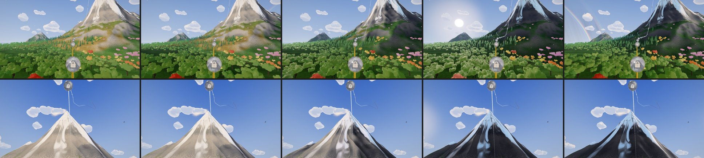

A second round between A and C (bearings 145–155°, 15–20° up) found the light that does both: one
flank lit and one in shade, the massif's shadow over the meadow, and the antisolar point far
enough round that the rainbow still stands at the right of the frame. The sun is now bearing 155°,
15° up (`ODYSSEY_WORLD_SUN`).

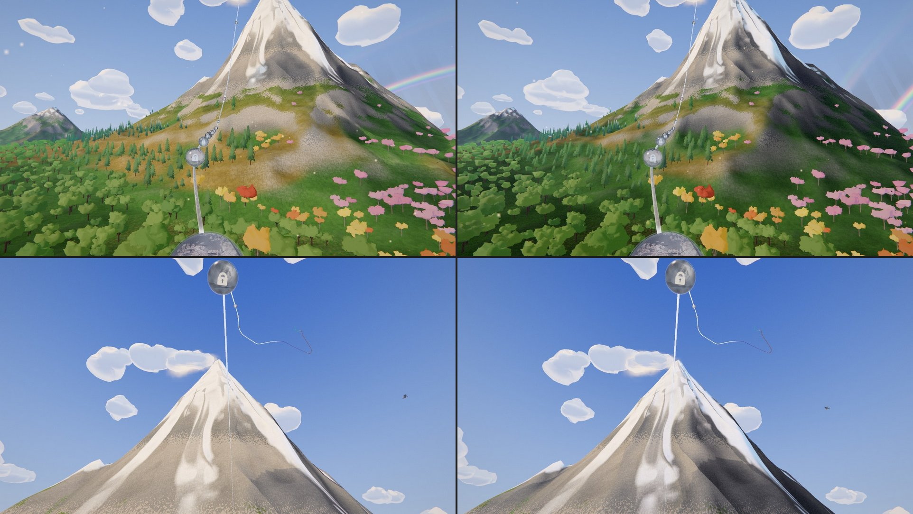

**What it changed:**

- The ground's sun-visibility bake re-bakes at load with the new sun. The golden hash of the
  shadow bake was re-pinned after the live check.
- Chapter 2's underwater shafts now slant in from the upper left.
- Along the shore (p ~0.18) the low sun now hangs in the sky ahead-left, over the sea.

**What it left alone:**

- The colour script's light stays clear white at altitude. A warmer sun there read as a "sand cone"
  on 2026-10-20, so the golden hour that B tried was not taken.
- **The Earth from orbit keeps the sun it was composed under** (`EARTH_SUN` in
  `composition/odyssey-orbit-earth.js`): its sunset timing, the aurora's place on the night side
  and the planetrise beside it. At the seam that sun is behind the eye either way.
- Chapter 6 points its own light at the black hole at runtime.

## §2. The summit sculpted, and its wind (2026-10-25)

**Why it took a bake of its own.** The terrain's height comes from baked plates: 17.6 u per texel
for the macro shape and 8.8 u for the ridged relief. The chapter 5 rail climbs a column in front of
the summit, from ~575 u away at p 0.34 to ~145 u at 0.68, and the summit sits at the centre of
every frame. At ~200 u, a 5 u ridge spans ~30 px at 1080p. The form that makes a summit read as
rock is finer than the plates could hold, which is why it had been painted on (the "flutes").

**The sculpt.** `odysseySummitSculpt(x, z)` in `world/odyssey-world-height.js` is a height delta
over the hero's top, exactly zero beyond 470 u from the apex. The cone's middle, the meadows, the
rail's clearances, the orbs' seats and the forest are untouched. It draws:

- a horn: the top ~200 u steepen, and the top rises 34 u;
- four arêtes: one runs straight down toward the climb (the camera views the summit from bearing
  ~90° the whole chapter, so the eye is led up it), and two form the left and right skylines. They
  meander, and carry towers and notches;
- faces hollowed between them, carved by couloirs that converge on the top;
- patches of rock ledges across the faces, and a fine ridged grain at ~14 u.

**Where it goes:**

- **GPU.** Its own plate, `bakeSummitSculptData`: 512² over a 1000 u square, ~2 u per texel.
  It holds the delta, its slope and its curvature, the curvature over a ~6 u stencil scaled like
  the relief's. Baked in the worker's plates lane. The ground adds it in the vertex shader, and its
  slope and curvature in the fragment, so the couloirs hold snow and the arêtes shed it through
  the existing snow rules.
- **CPU.** The same function joins `odysseyWorldHeight` and the baked height mirror (`total`), so
  the forest scatter, the shadow bake and every CPU height read see one summit.
- The painted flutes step back to 15% where the sculpt is.
- The forest visibility mask was re-baked: its stamp changed, the mask barely.

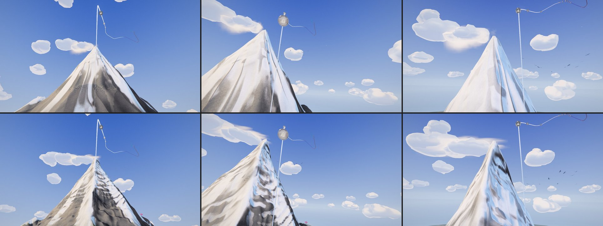

**Triplanar on the steep faces.** Projected only from above, the ground's material atlas streaked
down every steep face: the smeared plaster. Where the ground is steeper than ~27°, the atlas is
also projected from the two sides, blended by which way the face looks. It runs in a branch on
the slope with explicit-level fetches (the atlas has no mips), so flat ground pays nothing.

**The wind.** The summit's spindrift (`composition/odyssey-summit-spindrift.js`) was 56 round
sheets, which read as more cloud beside the banner. Each sheet is now a streamer:

- drawn out along the wind as it crosses the view (×2.6 long, ×0.5 thin), its grain running
  along it;
- 96 of them, crossing 230 u in 7.5 s instead of 175 u in 11 s, born along a wider crest.

The summit smokes into its banner cloud.

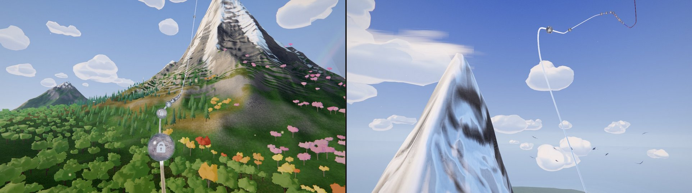

**Cost.** The world playground at 1080p with vsync off, four alternating rounds. With the summit in
view (p 0.50) it costs +0.10–0.15 ms over main: the summit fetch, and triplanar on the steep faces.
At p 0.30 it is within noise. The board was not re-measured on the iGPU lane; it cannot be
measured on this machine.

**Tests.** The golden hashes were re-pinned with a note: the height mirror now carries the sculpt,
and `bakeWorldTextureData` returns an eleventh buffer. The loader's fake worker posts the summit
plate. The forest visibility stamp was re-baked.

**Not done here (moved on).** Varied camera framing for chapter 5's long stare: the summit now
carries the view.

## §3. Trees, their shade, and the treeline (2026-10-25)

**The crowns went flat under the new sun.** The forest's three tone bands were placed for a sun 25°
up, where a canopy top computes a wrapped light of ~0.66. Turned to 15° (§1) a top computes ~0.56,
which fell between the lower band's end and the upper band's start: every top in the forest took
the mid tone. The four band edges now move with the sun (`FOREST_SUN_BAND_SHIFT` in
`world/odyssey-world-renderer.js`), so tops sit in the upper band again and neighbouring crowns
separate into the mosaic. The pastel species (gold birch, pink blossom) take the darker end of
their measured band (0.83 instead of 0.88), so they read less like paper cut-outs.

**The trees cast shade.** The sun bake marches the terrain only, so not one of Act II's trees cast
a shadow: every stand stood on sunlit grass, and the gaps between crowns were as bright as the
meadow. The trees are static, so their shade is baked once from the scatter
(`world/odyssey-forest-shade.js`). The bake runs in the worker's scatter lane, off the critical
path, and takes ~60-150 ms there. It produces one RGBA8 plate over the forest, 2048² at ~1.8 u,
mipmapped:

- **R, the sun shadow.** Each crown is a few spheres (a cone's taper for a fir, one ellipsoid for a
  broadleaf). Each sphere throws an ellipse stretched along the sun's bearing, landing where its
  ray meets the terrain. Under the 15° sun a 20 u pine's shadow runs ~60 u, so conifer slopes are
  striped with long shade. A fir's shadow is whole and sharp. A broadleaf's is leafy: its outline
  is pushed in and out by noise at the scale of its leaf masses, and light comes through the gaps,
  so a lone oak on the meadow throws dappled shade rather than a dark blob. A faint trunk shadow
  joins each tree's foot to its crown's.
- **G, the canopy cover:** the forest floor takes it as sky occlusion.
- **B and A, the crowns' colour,** premultiplied by the cover.

The ground takes the shadow on its direct sun and the cover on its sky light.

**The far forest.** Every tree sinks out of the draw across 1450-1650 u from the rail. Where the
forest went on past that, the ground beyond was a bare green plain. Across the same band, the
plate's cover now paints the canopy back onto the ground, read through the mips as density, in
the crowns' own mean colour (gold and red on the autumn side). The trees hand over to their own
painted mass.

**The treeline frays.** Above ~400 u the massif's flanks are steeper than the scatter's slope cap,
so the forest ended at a contour. The slope above it was bare ground straight to the rock. A sparse
second grid now places krummholz (`FOREST_KRUMMHOLZ` in `world/odyssey-forest-scatter.js`): dwarf
subalpine firs in islands, from 372 to 590 u. They are:

- eased in over the forest's own top edge and thinning with height;
- lower and broader the higher they grow;
- bent downwind by the summit's wind;
- snow-dusted near the top, by the fir's existing snow rule;
- clinging to slopes up to 1.25.

About 540 stand where the rail can see them. **They add no draw:** a dwarf fir joins a fir bucket
its chunk already holds, or it is dropped.

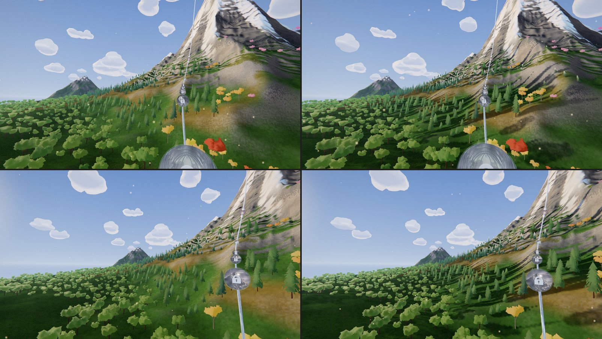

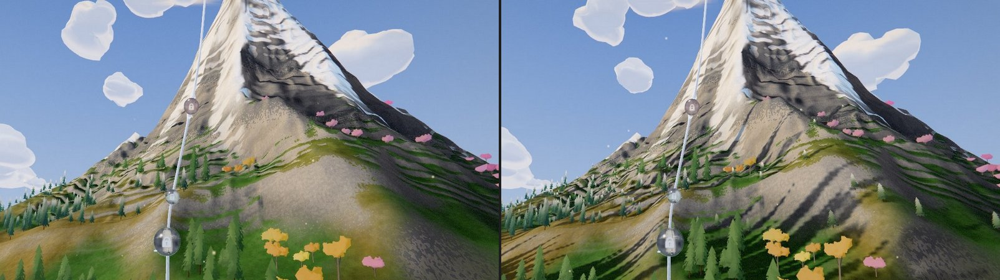

**Cost.** World playground at 1080p, vsync off, alternating rounds against main: +0.02-0.04 ms
at the forest stations (p 0.28), within noise at p 0.32 and 0.50. The shade plate is one more
fetch in the ground shader, ~21 MB of GPU memory with its mips. The krummholz adds no draws.

**Tests.**

- `odyssey-forest-shade.test.js` (new) checks:
  - an empty plate where no tree stands;
  - a fir's shadow lying away from the sun at its height's cotangent, and none toward the sun;
  - the cover and its premultiplied colour;
  - a broadleaf's shadow letting more light through than a fir's.
- The scatter suite gains a krummholz gate:
  - a fringe, not a second forest (under 12% of the trees);
  - firs only, inside the band, stunted;
  - never alone in a bucket.
- The carve tripwire now counts the forest it was calibrated on. The visibility suite measures
  the mask on the forest without the fringe.

**Not done here.**

- **A band of real grass by the rail.** The camera flies 30-100 u over the ground for all of
  Act II, where a blade is under a pixel. The ground's wind sweep already carries the meadow at
  that range.
- **Shade on crowns from their neighbours.** The plate is a ground plate.

## §4. Clouds and air (2026-10-26)

**What was there.** The cumulus field already has the cloud work the plan named: a cool core on
its bases, crease tones between the lobes, crowns that whiten, a Henyey-Greenstein silver lining
on masses toward the sun, and soft rims that dissolve into the sky behind. Under the side sun of
§1 its shade sides now show. What the act lacked was the air around the clouds. Between them the
sky was one gradient by elevation, the same colour whichever way the eye turned, with nothing
above the cumulus.

**A high cirrus layer** (`SKY_CIRRUS` at the dome in `world/odyssey-world-renderer.js`):

- The view ray meets a plane overhead, so the wisps run to the horizon in perspective.
- Value noise is stretched along the summit's wind and thresholded into streaks, gathered into
  patches and drifting slowly downwind.
- It fades out low and overhead.
- It is white, warming toward the sun.

From the chapter 5 climb the streaks cross the sky diagonally, in the same direction as the
summit's plume.

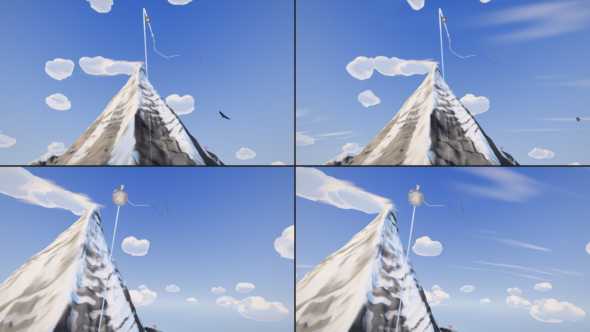

**Warm air toward the sun** (`warmAirFor`, `skyAirAt`). Low air seen toward a low sun is lit from
behind: the horizon on the sun's side now carries a broad warm lift, fading up the dome and round
to nothing at right angles to the sun. It is part of the air, not a decoration on the dome. The
dome, the aerial haze over land and sea, the cumulus haze, and the colour the world melts into at
its edge all read it through `skyAirAt`. So a distant ridge toward the sun takes the same veil as
the sky behind it, and the horizon keeps one colour at infinity.

The first cut drew it narrow in azimuth and reaching 20° up. Together with the sun's own round
halo it read as a column of light standing on the sea. Now it is a band, wide and gone by ~11°.

The cirrus is thinned in the sun's glare. Looking toward the sun, the eye looks along the wind,
so a wisp is seen end-on as an upright streak, and lit by the sun it stood there as a pillar.

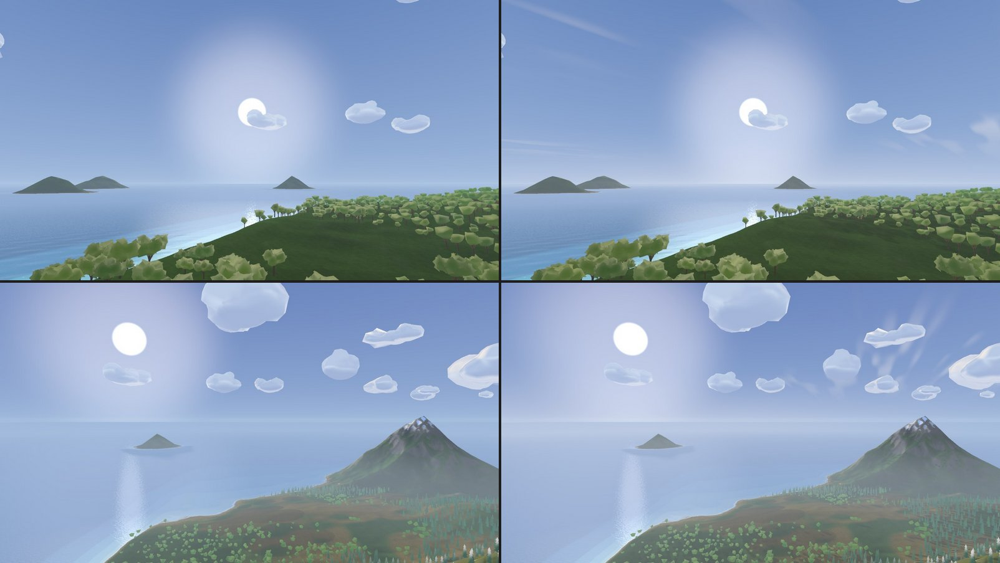

**Not done here.** Light shafts over land: the act flies with the sun behind-left of the eye the
whole way, so shafts would show only in the views the rail never takes. The underwater shafts
stay chapter 2's.

## §5. Life near the eye (2026-10-26)

**What was there.** The act already has its life, and all of it keeps its distance: gulls over the
surf, swallows ahead of the orbs, a goose skein across the massif, the eagle on the wall, the
summit kettle. All of them are specks at a few hundred units. The air motes are pin-points.
Over the meadows nothing living came near the eye.

**The meadows' near life** (`composition/odyssey-meadow-life.js`) is one opaque, alpha-tested
draw. It uses the air motes' technique: an instanced quad with no instance data, each one's place
following from its index and the clock in the vertex stage. They are world-anchored in a box that
wraps round the eye, so a glide streams through them with real parallax.

- **Petals.** There are 520 (240 on the lower tiers): pink and white from the blossom grove, and
  the odd gold leaf. They ride the breeze and sink slowly. Each tumbles: its width turns with the
  flip, and its face darkens as it turns from the light.
- **Butterflies.** There are 18, in an erratic three-axis weave close to the eye, in orange, white,
  blue and sulphur. Their wings beat in bouts between glides, each beat folding the wings toward
  the body. They are drawn at about three times life, because the eye flies 47-90 u over the
  meadow. One crossing the view is 35-90 px across.

Both live over p 0.19-0.36 and are gone before the climb. Near the lens they fade in by size, so
no big quad sits in front of the camera. **Bisect lever:** `?odysseyNoMeadowLife=1`.

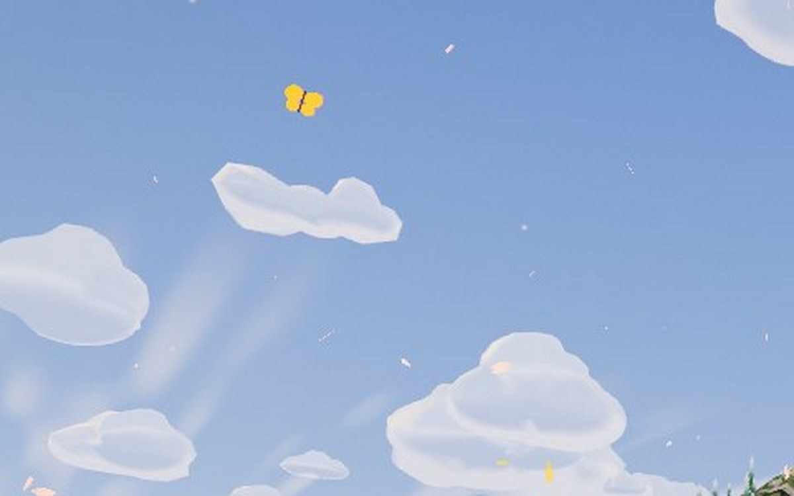

## §6. The pond (2026-10-26)

**Why a new one.** The audit's pond is the north lake, the act's only water above the sea. Probed
on the in-game camera at 26 stations, it is:

- **In frame but hidden through chapters 3-4.** It sits in the view, but behind the hero massif:
  0 of 339 lake points are visible at any of those stations.
- **Unblocked from p ≈ 0.56 up the climb, but under the frame.** By 0.68 it is whole, ~10° off the
  heading but ~40° below the eye, under the bottom of a frame that stares up at the summit.
  Chapter 5's framing is guarded by `odyssey-ch5-climb-framing`: the node underfoot and the way
  ahead stay in frame through the whole climb. A look down to the lake breaks both.

The world itself had already marked a place for water: the macro field has scooped "the Ch3
basin", an inland lake bowl, since Wave 2, and the One World never filled it.

**The tarn** (`ODYSSEY_TARN` in `world/odyssey-world-height.js`) is three lobes joined into one
bean in that basin's meadow, at the massif's foot.

- **Its site was scored on the real camera.** The scoring counted pond points in frame, unblocked,
  and with the hero in their reflection. It is in frame from L20 to L23 (p 0.246-0.30), 160-270 u
  out and 60-80 u below the eye.
- **The banks are set absolutely.** The bowl's floor sits just under the water and the waterline
  lands where the bank meets it, on meadow that rises at most ~7 u across the pond. The first site
  straddled the massif's foot; its west bank fell 25 u, and the ground shader turned that slope to
  rock, a grey crater round the water. It moved onto the flat.
- **It is carved on the sculpt plate.** The summit's ~2 u plate became one sculpt plate
  (`ODYSSEY_SCULPT_PLATE`, `bakeSculptPlateData`, 640² over 1,180 u) covering both, because the
  17.6 u macro plate cannot hold a pond's shore. The carve joins `odysseyWorldHeight` and the CPU
  height mirror.
- **Its meadow stays open.** No tree stands in the water or its clearing (1.55 × the tarn
  distance), so its banks show over the forest.

**The mirror.** The tarn's material marches the reflected view ray over the same plates the ground
draws:

- 24 growing steps, with one halving at the hit;
- a soft skyline, from the ray's closest pass over the land;
- a faint, fine ripple.

Where the ray meets the land it takes that land's colour by height, using the ground palette's
poles and the forest's cover. That colour is lit by its own slope under the baked sun, and hazed
by the distance it ran. Where the ray runs out, it takes the sky and the warm air of §4. The water
itself is dark green-blue and lighter over the bank.

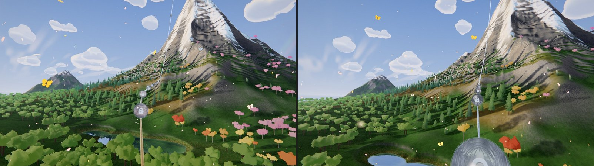

**Tests.**

- `odyssey-world-tarn.test.js` checks:
  - the carve is zero outside the lobes;
  - every disc edge is buried under meadow;
  - every lobe holds water;
  - the tarn sits inside the sculpt plate, and the plate's border is zero;
  - no tree stands in the clearing;
  - the rail stays more than 60 u over the water.
- The golden mirror hash was re-pinned, and the plate is now 640².
- The forest visibility mask is unchanged (its stamp held).

**What the mirror shows.** From these stations the reflected rays rise toward the massif's lower
flank and the hills beside it, so the tarn holds the sky and the far bank more than the summit. The
snow-capped reflection needs an eye looking along the tarn at the massif, which is the chapter 5
camera's direction but not its height.

## Cost of steps 3-6 together

Measured in the world playground at 1080p with vsync off, in alternating rounds against main,
with the machine in quiet mode, so the noise is large. The medians:

- **p 0.25 (the tarn in view): about +0.09 ms.** The tarn's march runs only on its own pixels.
- **p 0.50 (sky-heavy): about +0.1 ms.** This comes from the cirrus's three noise lookups per sky
  pixel, and the warm air in every aerial call.

The forest shade plate adds one fetch in the ground shader and ~21 MB of GPU memory. The tarn
adds one material, and its discs are culled out of view. The meadow life adds one draw, and is
hidden outside p 0.19-0.36. The krummholz adds no draws.

The board was not re-measured on the iGPU lane, which cannot be measured on this machine.

# Round two (2026-10-26)

Olov, after the six steps landed: *"I want to continue improving the landscape, the trees must
look better and what more do you suggest we improve in chapter 3, 4, 5? Do an audit and how can
we make this world impressive and a visually stunning masterpiece."* Then: *"Now start with what
you recommend!"*

## The second audit

22 live stations from p 0.15 to 0.66, close crops, and the tree roster on its audition board.

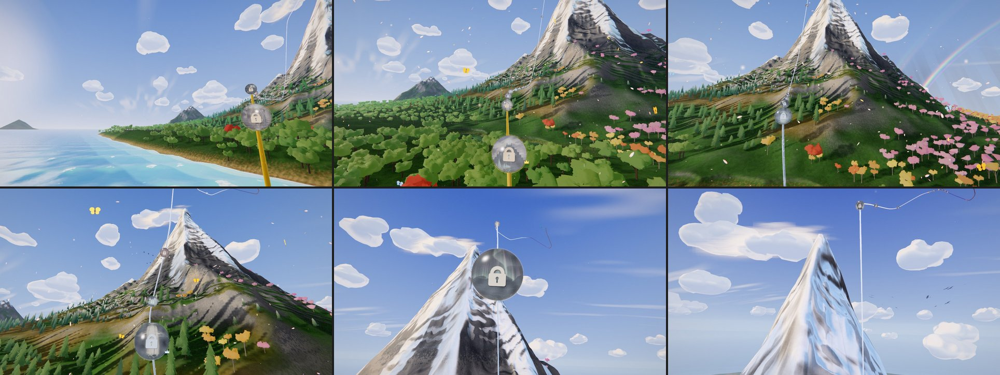

1. **The trees.**
   - The broadleaf crowns were faceted lime blobs with spiky leaf-plate fringes, so they read as
     crumpled paper, in rows of the same size.
   - The mid tier, which is most of what the rail sees, was a 20-triangle hull traced to the
     lobes. Every normal leaned toward one crown centre, so no mass ever turned its own shoulder
     from the light.
   - The autumn and blossom trees were flat folded cards. The far trees were floating kites.
2. **The summit up close.** It fills the frame for ~40% of the journey, and from 150-300 u its
   surface reads as smeared clay: soft blotches, dithered rock, blurry snow edges.
3. **The ground.** Greasy smudges on the slopes, a khaki band above the forest, meadows with no
   grass or flowers, nothing for scale (no boulders or outcrops).
4. **The clouds.** Small puffs, all one size, spread evenly ("cotton balls"). No big shapes on the
   horizon, no sense of rising above the clouds on the climb.
5. **Smaller things.** The tarn holds sky and hillside more than the mountain; the birds are
   specks.

The plan, in order of impact:

1. New broadleaf crowns.
2. The trees' light.
3. A crisp summit.
4. A painted landscape (grass strokes, flowers, boulders).
5. Big skies (cloud variety, a cloud sea under the climb).
6. Polish.

## §7. The puff crowns (2026-10-26)

**The rebuild.** The broadleaf crown is now a cluster of puffs (`buildBroadleafPuffs` in
`world/odyssey-forest-geometry.js`):

- a top puff and a ring round it, set on forked limbs;
- each a low icosphere turned its own way, nudged by noise and flattened underneath;
- its **own radial normals**, leaned up, so each mass is lit on its cap and dark on its belly;
- the seam where two puffs meet is the crease.

The occlusion channel darkens the lower puffs and every puff's belly. Wide species spread their
ring further and lower (`puffSpread`: maple 1.18, blossom 1.32), so they read as umbrellas rather
than lollipops.

| Tier | Triangles | Before |
|---|---|---|
| Hero | 6 puffs × 80, plus limbs and trunk (§10: 5 puffs and 5 florets) | the traced hull and the spiky fringe, at the same budget |
| Mid | 3 puffs × 20 | one 20-triangle hull |
| Far | one round hull at the cluster's centre | a squashed kite |

The traced crown stays one switch away (`setForestBroadleafStyle('traced')`, and
`?broadleaf=traced` on the audition board).

**The light.**

- Occlusion now moves both band thresholds (never the colour), so bellies and inner puffs fall
  into the shade tone.
- The leaf-clump dapple is retuned to ~2.5 u clumps inside each puff.
- A fourth, warm tone sits on each puff's open, up-facing cap, leaned toward the sun's side: the
  sun-kissed top of a painted canopy. It is keyed on the up-facing normal because the camera looks
  across the sun, so faces turned squarely to it are mostly hidden.

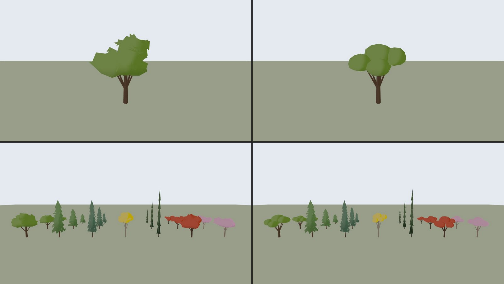

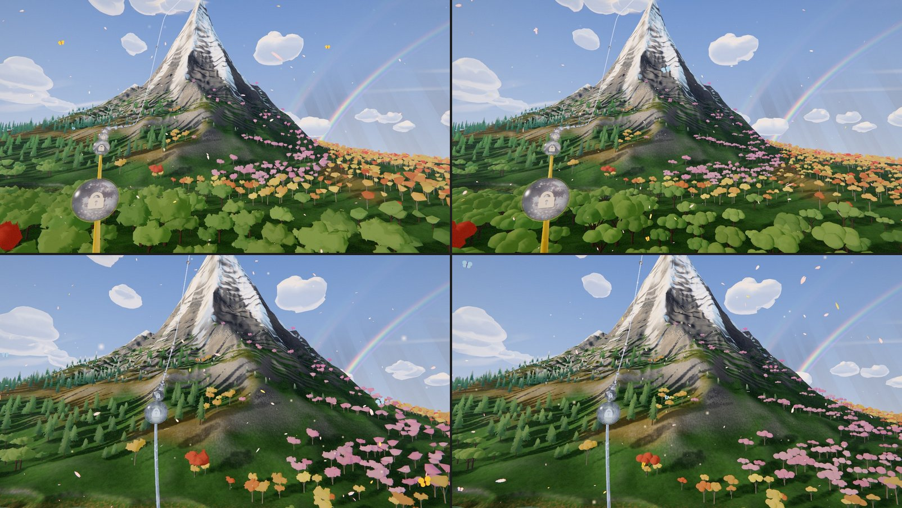

**Cost.** World playground at 1080p, vsync off, alternating with main: +0.03 ms at p 0.21 (the
forest-heavy station), within noise at p 0.27. The mid tier went from ~46 to ~72 triangles a tree,
inside its 90 budget.

**Tests.** A new test pins that every broadleaf crown is countable puffs, each lit from its own
centre. The traced-hull test now builds the traced style it guards.

## §8. A crisp summit (2026-10-26)

**Why it looked like clay.** The snow weight is a product of soft ramps: altitude with its
jitter, slope, the crest strip, the flutes. Across the summit it therefore sat between 0.3 and
0.7, so every fragment was part snow and part rock. From the climb at 150-300 u the peak read
as smeared clay and glossy melting ice.

**Snow is now a decision high up** (`SNOW_CRISP` in `world/odyssey-world-renderer.js`):

- The same cover is broken by the atlas grain, so the boundary interlocks.
- It is thresholded at 0.5 over an edge about a pixel wide (`fwidth`, clamped to 0.055-0.3).
- This ramps in from 560 to 680 u. Below that, the snowline's own soft wobble across the
  lowland peaks is unchanged.

The result is white snowfields and dark rock breaking through, with painted, jagged boundaries.
The cost is one `fwidth` and a few ALU.

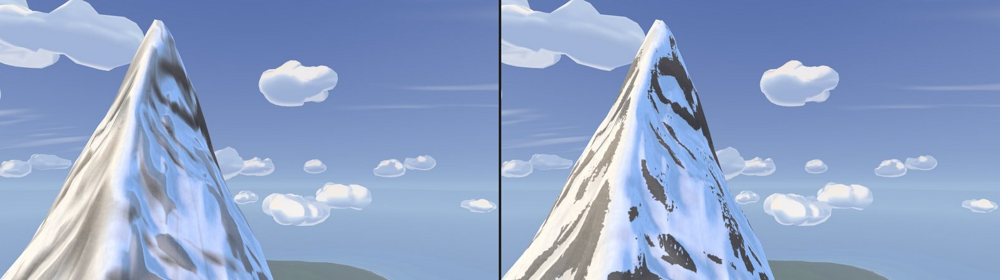

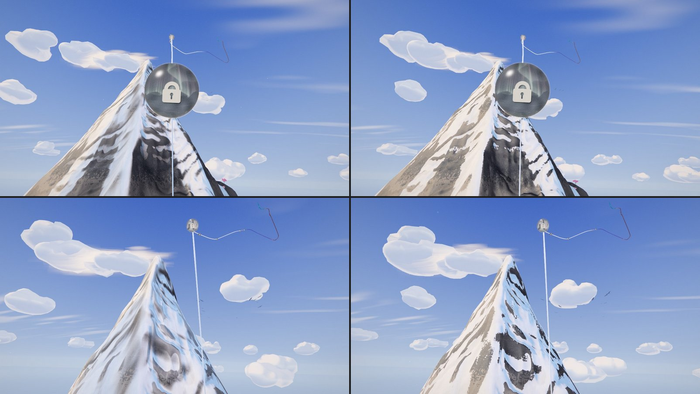

## §9. The flanks' rock, and two things tried and left out (2026-10-26)

**Crisp rock.** The same disease as the summit's snow, lower down. The slope ramp left the
massif's lower flanks part meadow, part stone: a grey-green smear. Above the shore lowlands
(`ROCK_CRISP_FROM`, 320-380 u), rock is now thresholded the same way: the atlas grain interlocks
an edge about a pixel wide. A flank reads as meadow or as scree patches.

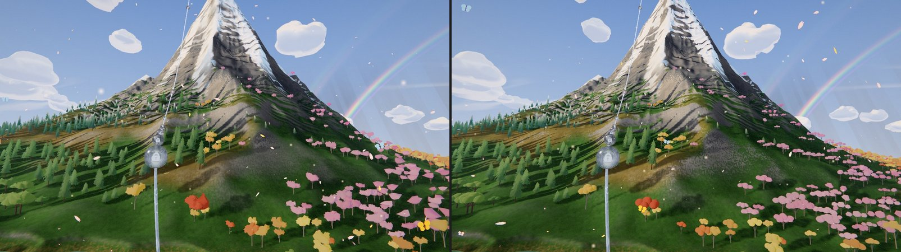

**Tried and left out:**

- **Towering cumulus on the horizon.** I added a `tower` role to the cloud sculptor (stacked
  primaries under a cauliflower crown), with two masses 3.3-4.3 km out either side of the massif.
  On the rail they read only as slightly taller puffs. Making them large enough to matter would
  lift their tops into the guarded hand-off to space, and the pair already broke the field's
  34,000-triangle budget. Reverted. The field's wide, low shapes are measured against the owner's
  references, so a change to the sky's character wants the owner's eye first.
- **Wildflowers painted into the meadow grass.** I tried hashed blooms in drifts, kept off the
  canopy and steep ground. The eye flies 50-90 u over the meadow and sees it at a grazing angle,
  so at 150-300 u the ground is compressed ~4:1 in depth. A dab small enough to be a flower falls
  under a pixel there, and the patch where it would show is below the frame. Reverted.

**Cost of round two so far** (§7-§9 together). World playground at 1080p, vsync off, four
alternating rounds against main, on a quiet machine: +0.05 ms at p 0.30 (the forest and the
flanks) and +0.01-0.03 ms at p 0.55 (the summit).

## §10. Leaf clumps and florets (2026-10-26)

**Why.** After §7 each puff was lit as one smooth ball. The form was right, but from the rail the
near crowns read as green balloons: nothing in them said "leaves".

**Leaf clumps** (`fvLeaf` and `LEAF_CLUMPS` in `world/odyssey-world-renderer.js`). Each crown
fragment finds the leaf clump it belongs to, in the shader, with no texture:

- The clumps are Voronoi cells on the puff's own sphere, charted from the fragment's normal
  (stereographically, from the bottom pole) and offset per tree. That is nine cells a fragment.
- The normal tilts away from its clump's centre, so every clump shades as a small dome of its
  own and catches the light on its upper edge.
- The seam between two clumps moves the band threshold toward shade (the occlusion grammar: never
  the colour), and each clump takes a small tone of its own, so neighbours separate by value
  rather than by an outline.
- Crowns only, and near ones: it fades out between 250 and 420 u, and fragments past that skip
  the search. Trunks keep their own normal.
- High tier only (`ODYSSEY_WORLD_QUALITY.leafClumps`, gated in JS). The low tier keeps the smooth
  puffs of §7.

The first cut (3 cells a unit, a strong tilt, a deep seam) quilted the crowns like a turtle's
shell. Softened to 3.6 cells, tilt 1.05, seam 0.17 shifted 0.13, and a threshold shift of up to
±0.06 per clump.

⚠️ **A trap in TSL's `hash`.** It turns its seed into a `u32`, and WGSL clamps a negative float to
0 there. The first seeds were built from signed cell coordinates, so every cell in half of each
puff's chart got the same point: a regular lattice of clumps. The cells are now shifted positive
and hashed as exact integers, one hash a cell (its low bits give the second coordinate and the
clump's tone).

**Florets** (the hero tier, `PUFF_FLORETS` in `world/odyssey-forest-geometry.js`). The hero crown
is now a top puff and four ring puffs of 80 faces, plus five small florets of 20 faces (about 0.4
of their host) seated high on the hosts' shoulders. A 42-vertex puff can only carry angular bumps
on its outline. A floret is a real bump with its own lit cap, so the crown's top scallops like
foliage. The hero tree stays inside its 560-triangle budget; the mid and far tiers are unchanged.

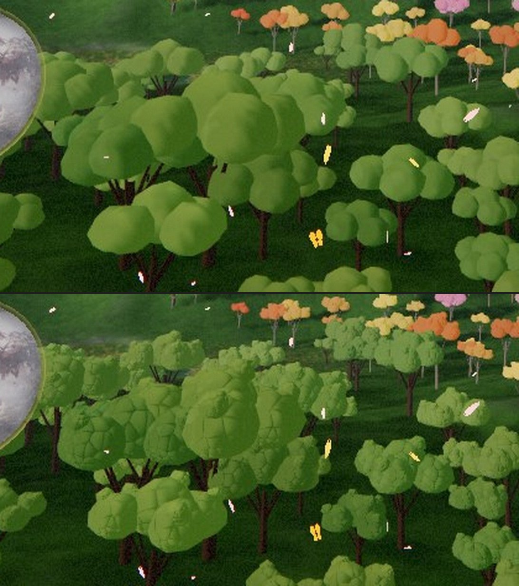

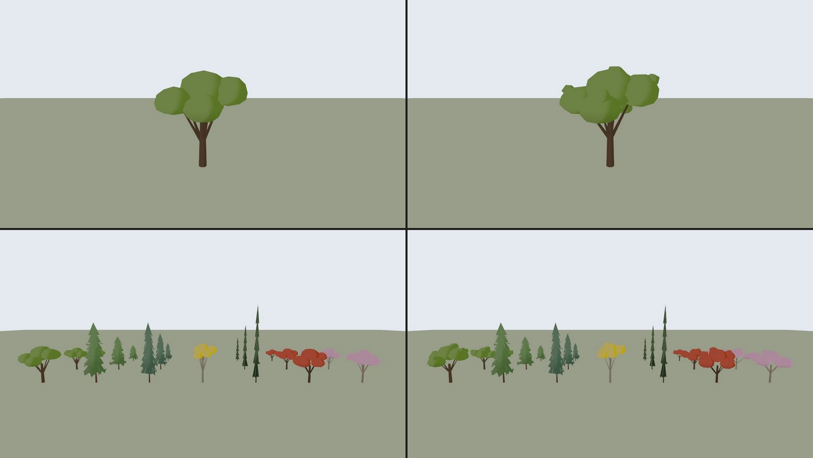

**Tried and left out:**

- **Stronger puff noise** (amplitude 0.15 with a second, finer octave). The bumps came out
  faceted, like rough rock. The noise stays gentle (0.11).
- **Florets on the puffs' sides.** At eye level on the audition board they stuck out like ears.
  They now sit at 45-60° up the host.
- **A crease in the occlusion**, darkening the vertices near a neighbouring puff's surface. At 42
  vertices a puff it smudged the masses together instead of folding them.

**Cost.** Other captures were running on the machine, so these are best-of rounds and noisier
than §7's. The leaf clumps, switched on and off on the same server for five alternating rounds:
+0.04 ms at p 0.21 (the forest station), nothing measurable at p 0.27. The florets add 20
triangles to a hero tree (500 against 480). Round two as a whole against main: about +0.1 ms at
p 0.21 (best of six).

**Tests.** The puff test now counts five 80-face puffs and five 20-face florets on the hero tier,
each lit from its own centre.

## §11. The mid and far trees as puff cards (2026-10-26)

**Why.** Olov: the low-detail trees "feel too much like really low polygon trees". Most of the
broadleaves the rail sees are on the mid tier (200-520 u from the rail) or the far tier beyond it.
A mid crown was three 20-face icosahedra and a far one a single 20-face hull, so they showed
hexagonal outlines and flat bellies. More triangles were not the answer: the forest sits near its
triangle cap, and the 18 the mid budget had left would have added ~43k triangles (~0.35 ms on the
integrated-GPU lane) for crowns still visibly faceted.

**Cards** (`FOREST_PUFF_CARD` in `world/odyssey-forest-geometry.js`, the shader half in
`world/odyssey-forest-cards.js`). Beyond the hero band each puff is a card:

- Two triangles with every corner at the puff's centre. The vertex shader turns the card to face
  the eye, sizes it from the puff's radius and the tree's scale, and moves it 0.7 of a radius
  toward the eye, so the limbs inside the puff stay hidden.
- The fragment shader draws the puff: a scalloped round outline (alpha to coverage, so the High
  tiers' MSAA smooths it) and the normal of the sphere behind each pixel, leaned up like a hero
  puff's. Everything else is the hero's shading: the bands, the warm cap, the leaf clumps within
  420 u.
- The scallops fade out as a card shrinks on screen (from a ~25 px radius to ~10 px), where a lobe
  would be under a pixel and could only shimmer.

A card costs 2 triangles where a puff cost 20, so the mid crown now carries the hero's whole
layout (five puffs and five florets) and the far crown five puffs:

| Tier | Before | Now |
|---|---|---|
| Mid | 3 icosahedra, 80 triangles a tree | 10 cards, 52 triangles |
| Far | one icosahedron, 20 triangles | 5 cards, 10 triangles |

Over the culled forest (~2,400 mid and ~1,700 far broadleaves) that is about 85k fewer
triangles, a fifth of the forest.

**Plumbing.**

- A card's corner and radius ride in its `normal` attribute, and its crown flag (2) in `aVert.z`.
- The vertex shader needs the tree's scale, and the forest is one vertex buffer short of WebGPU's
  eight, so the scale is packed into `aTrunk.w` beside the sun visibility (`FOREST_TRUNK_PACK`:
  the integer part is the scale, the fraction the visibility, kept off 0 and 1).
- The forest material is built twice from the same graph (`buildForestV2Material`): the shipped
  one, and the card one for the buckets whose geometry has cards. One more pipeline.
- The audition board draws the cards too, and `?broadleaf=solid` shows the solid puffs at every
  tier for an A/B.

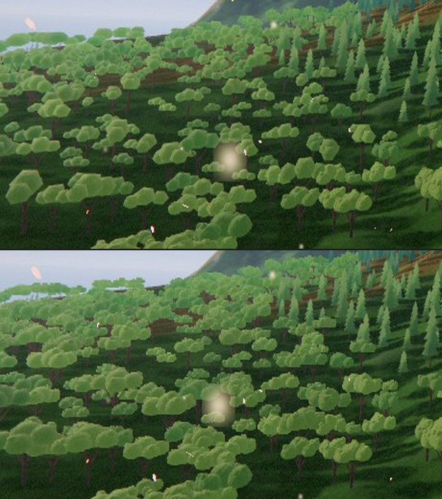

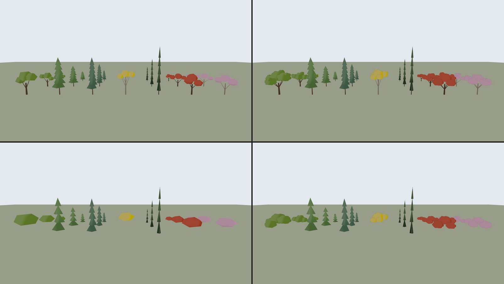

**Cost.** The world playground at 1080p, cards on and off on the same server, five alternating
rounds on a quiet machine, best of each: +0.01 ms at p 0.21, nothing at p 0.27, -0.02 ms at
p 0.30. Not measured on the integrated GPU, where the forest is vertex-bound and the saved
triangles should count for more.

**Tests.** A card test pins the layout (10 cards mid, 5 far), the shared centre, the corner
winding and the flag; a pack test pins the scale and visibility round trip. The solid-puff test
builds the mid tier with the cards off. The sanity tests (unit normals, the crown flag, the signed
volume) skip card vertices, which have their own contract.

## §12. The trees from scratch: leafy crowns (2026-10-26)

Olov asked how I would build the trees from scratch, without leaning on the earlier references and
notes, and then to "audit, and improve the trees in this way".

**The audit.** Measured against what makes painted and real trees read as alive:

- **Outline:** every crown was closed (solid puffs near, scalloped discs beyond): no gaps, no sky
  through the leaves.
- **Light:** each puff was lit as its own ball; nothing darkened the far side of the whole crown.
- **Against the light:** only a faint rim term.
- **Shade colour:** by an earlier rule, never cooler than the lit colour.
- **Branches:** limbs existed only to carry the puffs, and the puffs hid them.
- **Motion:** the whole tree swayed; no leaf ever moved.
- **Cost:** a hero tree was 552 triangles, and the forest is vertex-bound.

**The rebuild: every broadleaf crown is leaf cards** (`FOREST_LEAF_CARD` in
`world/odyssey-forest-geometry.js`, the shader half in `world/odyssey-forest-cards.js`):

- **A leaf atlas** (`world/odyssey-forest-leaf-atlas.js`), generated at load: four clumps of ~75
  pointed leaves, scattered over a disc with a solid body and a broken fringe. Its coverage is a
  distance, so the leaves' edge holds through every mip; each leaf has its own tone.
- **Cards at every tier,** seated on the puff layout so the crown keeps its masses: a hero crown is
  30 cards (five round each big puff's outer side, one a floret), a mid crown 10, a far crown 5:
  the same clumps, fewer and larger with distance, so the tiers agree.
- **One normal for the whole crown:** a card's normal comes from the crown's centre (its ellipsoid),
  with each clump's own dome on top, so the crown lights as one soft volume.
- **Twigs** (hero): from each limb's end to the cards of its puff, and a leader up the middle, so
  a branch shows through every gap.

A card's six vertices sit at its centre; the shader takes its corner from the vertex index (cards
first in the buffer), its size from its crown flag and the tree's scale from `aTrunk.w`, so no
vertex buffer is added.

**The light** (`LEAF_LOOK` in `world/odyssey-world-renderer.js`):

- **The sun's path through the crown:** from where a card sits, how much crown lies between it and
  the sun. A long path closes the card down to `openFloor`, a band-threshold shift of up to 0.45,
  so the crown has a real shadow side and a dark underside.
- **Each leaf's tone** moves the threshold a little, so neighbouring leaves separate by value.
- **Shade leans to the sky** (0.72, the solid forest's 0.55): a shadow lit by the sky is cool.
- **Against the light**, leaves with little crown between them and the sun glow through their own
  colour.
- **The leaves shake** a little on their own phase (5% of a card), fading out by 320 u.

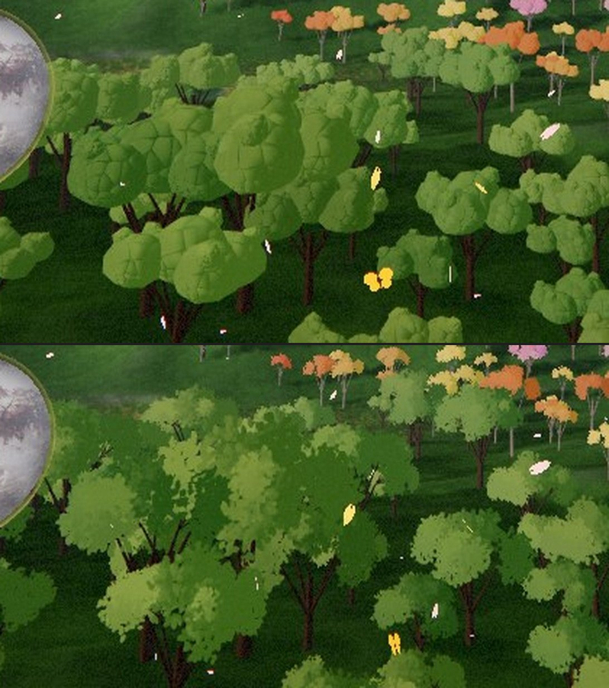

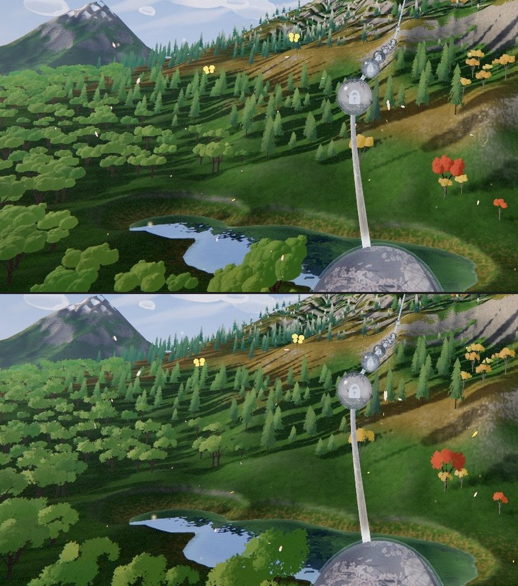

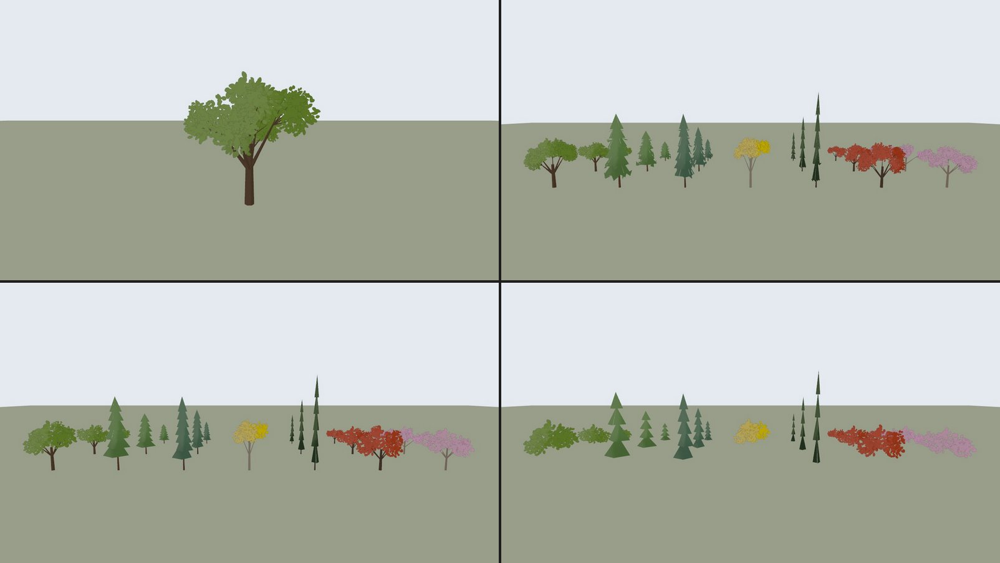

**Two bugs found on the way:**

- **Black bark.** The card material's bark drew black. Three's `normalWorld` is a shared variable
  whose assignment TSL writes where it is first built, and it was first read inside the leaf branch
  of a `select`, which TSL writes as an if/else. Bark read the zeroed variable, normalised it to
  NaN, and the rim and wrap terms went NaN. The crown's direction now rides its own varying. The
  §11 mid tier's bark had the same fault. Recorded in the TSL skill's gotcha table.
- **Limbs wound inside out**, since the puff builder (and the traced one it copied): the cull ate
  their outer faces and the inner ones drew. The old winding test measured a signed volume, which
  the closed puffs dominated; leafy bark is open tubes, so the test now checks that each bark
  triangle faces the way its normals do (100% for every style and species).

**Tried and left out:**

- **A rosette atlas** (leaves radiating from a hole in the middle): it read as flowers. The leaves
  are now scattered, the inner ones at any angle.
- **Three's own alpha test** for the coverage: it smooths with `smoothstep(0.5, 0.5 + fwidth(a),
  a)`, whose edges meet wherever the alpha is flat. The cards compute their own one-pixel edge and
  drop empty fragments through `maskNode`.
- **Three large core cards** in each hero crown, to darken its middle: they hid the branches the
  gaps should show, and cost 0.07 ms at the forest station.

**Triangles:** a hero broadleaf is 270 (was 552), a mid one 52 (was 80), a far one 10 (was 20).
Over the culled forest (~550 hero, ~2,400 mid and ~1,700 far broadleaves) that is about 240k fewer
triangles than the solid puffs, 155k of them on the hero tier.

**Cost.** The world playground at 1080p, leafy and solid crowns alternating on the same server,
best of four rounds, measured twice (the second on a busier machine): +0.22-0.24 ms at p 0.21
(the forest station, where the hero crowns fill the lower frame) and +0.02-0.03 ms at p 0.27 and
0.30. On this GPU that is overdraw: a leafy crown is a few cards deep, and cut-out cards lose most
of the early depth rejection. Two cuts are already in: the cards read the cloud shadow once a
vertex instead of twice a fragment, and skip the detail-texture dapple (the atlas is their clump).
Not measured on the integrated GPU, where the forest is vertex-bound and the 240k triangles saved
should count for more than the extra fill.

**Tests.** The card test pins the layout (30 hero cards, 10 mid, 5 far), the cards first in the
buffer six vertices each, a shared centre, a unit normal and a positive size; the atlas test pins a
solid body, a broken fringe and nothing past the rim; the winding test checks open bark by its
normals.

## §13. The conifers, leafy too (2026-10-26)

Olov: "give the pines the same leafy treatment".

**Needle sprays.** The leaf atlas gains a second row (`world/odyssey-forest-leaf-atlas.js`): four
needle sprays, each a branch arched across the tile with its ends drooping, hung with ~250 needles
(a quarter standing up off it). Its inner-shade channel is the spray's hanging underside. Needle
cards are never spun, only tilted a little and mirrored, so every spray hangs down.

**The pine and the fir** (`buildConiferNeedles` in `world/odyssey-forest-geometry.js`): the
lathe's cone (same heights, radii and droop), built from rings of needle cards on thinner tiers
than the lathe's (1.45x as many at hero, 1.25x at mid), so the spacing shrinks with the tree and the
top tapers to a point. A spray is never wider than its tier, and never so small that the tiers come
apart. At hero a second ring sits higher up each skirt, a tuft crowns the tip, the trunk runs up to
it and a branch reaches out to every other tier's sprays. The far tier keeps the lathe cone (a dark
spike at 520 u and beyond).

**The cypress** is too narrow for sprays (0.34 wide, 5.5 tall): a column of 22 levels of leaf
clumps (14 at mid) in a flame's profile, widest a third of the way up (`cardStyle: 'column'`).

**Mip thinning,** found on the mid firs: minified, a needle's distance averages with the sky around
it and drops under the 0.5 cut, so the distant sprays went to wisps on bare poles. The coverage cut
now drops 0.07 a mip level (from the card's own screen derivatives), so foliage keeps its mass at
range. It applies to the leaf clumps too (they fill out a little at distance). No measurable cost.

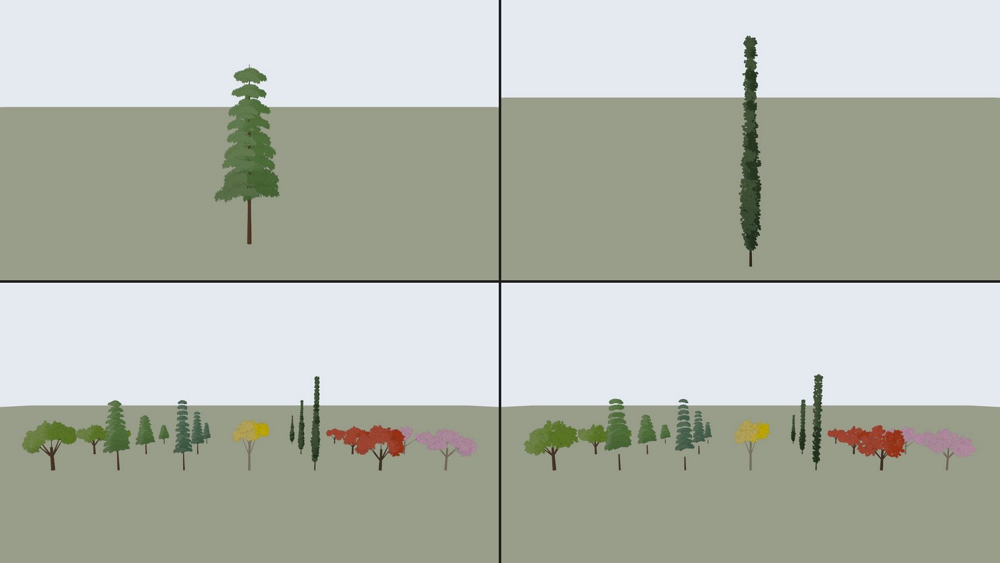

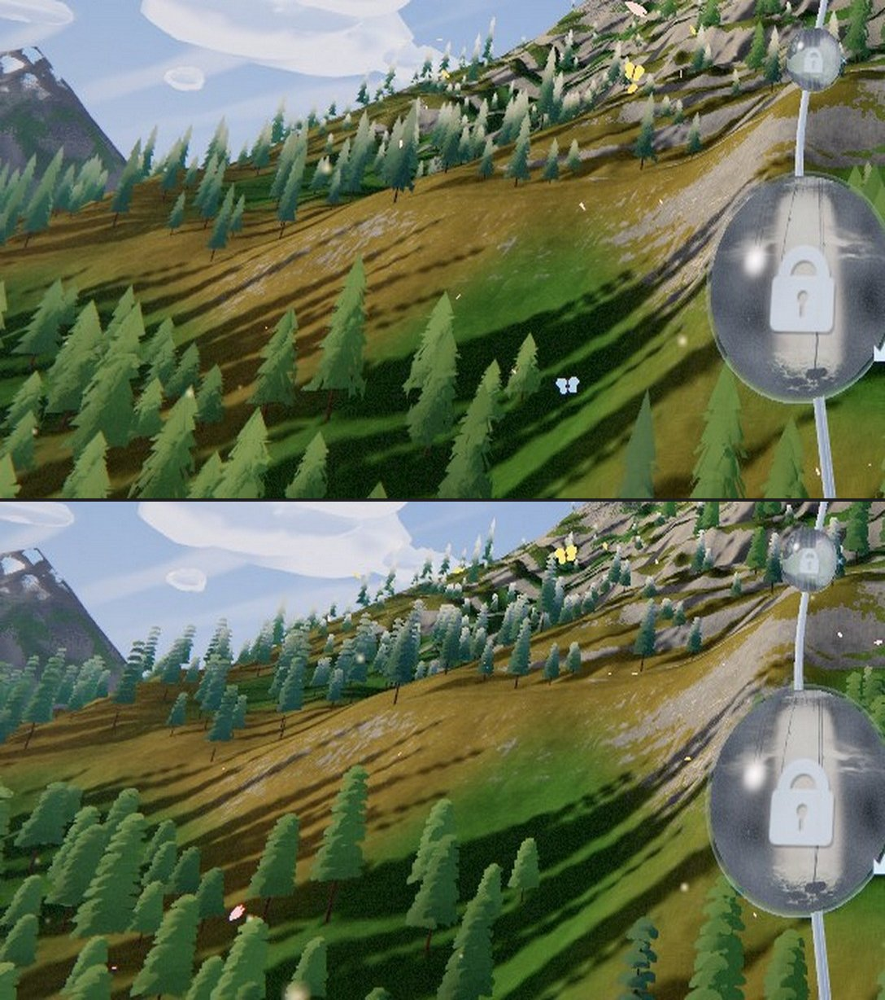

**Tried and changed on the way:**

- **One ring of sprays on the lathe's own tiers** read as a pagoda: stacked flat discs with
  daylight between them. Three rings per tier still did; thinner, more numerous tiers fixed it.
- **The cypress as sprays** was a bare pole with tufts.
- **Mid conifers with three sprays a ring and the trunk up to the tip** looked skeletal (and the
  thinning made it worse). Four a ring, no upper trunk at mid.
- **Hero conifers at seven-plus-three a tier and 1.7x the tiers** (100-odd cards) cost ~0.1 ms more
  at p 0.33 than five-plus-two at 1.45x, with no visible gain.

**Triangles:** a hero pine or fir is ~300-315 (the lathe: ~160), a mid one 74-82 (~35), a hero
cypress 110 (148). About 26k more than the lathe over the forest, against the 240k the leafy
broadleaves saved.

**Cost.** World playground at 1080p, leafy and solid crowns alternating on the same server, best
of three: +0.17 ms at p 0.27 and +0.13 ms at p 0.33 (the conifer slopes), on a busy machine. With
§12, the whole leafy forest is +0.2-0.4 ms at the forest station on this GPU. Not measured on the
integrated GPU.

**Tests.** The conifer card test pins the layout (needle cards at hero and mid, first in the
buffer, of the needle kind; the cypress's clump column; no cards at far); the atlas test now
checks both rows (a spray's middle band full, the sky above it open, nothing past the rim).
