# Odyssey — Blender birds over the island (2026-11-01)

Asked for by Olov: Blender-made birds for the island's flocks (chapters 3-4). Before, the gulls,
swallows and geese were one flat paper shape of 9 triangles, stretched per kind. Far away they
read as specks, but the gulls and swallows come close to the orbs, and next to the Blender eagle
they looked like cut-outs. The kettle beside the summit (chapter 5) was the same paper shape in
flat slate grey, and it turned out to be the biggest of all on screen, so it got the same
treatment: griffon vultures.

## How big they are

Measured on the real camera at 2560 x 1440 (wingtip to wingtip):

| Bird | Biggest | Typical | Where |
|---|---|---|---|
| Gull | 54 px | 20-40 px | L11-L17 (biggest at L16, p 0.207) |
| Swallow | 36 px | 7-25 px | L16-L24 (biggest at L24, p 0.310) |
| Goose | 35 px | 9-21 px | L11-L27 (biggest at L27, p 0.394) |
| Summit kettle | 80 px | 20-50 px | L27-L34 (biggest near p 0.62) |

That size decides the detail: enough triangles for the outline (a real wing with a wrist, a
body with volume, the bill, the tail) and the colours you can still see at 30 px. More would not
show.

## The birds

`scripts/blender/odyssey/odyssey_birds.py` builds all four in headless Blender (about a second)
and writes `src/rendering/odyssey/composition/odyssey-bird-models.js`: plain arrays in
the code, no download, no loader. The same script run again writes the same file.

- **Herring gull**: 296 triangles. White head, body and tail; pale grey back and wings with a
  white trailing edge; black wingtips with white spots; a white underwing; a yellow bill. Long,
  narrow wings.
- **Barn swallow**: 196 triangles. Blue-black back, rust-red forehead and throat, a dark band on
  the breast, pale belly; swept, pointed wings; a deeply forked tail with long streamers.
- **Greylag goose**: 326 triangles. A heavy grey-brown body with a barred back and flanks, a long
  neck, an orange bill, white under the tail; the pale grey forewing against dark flight feathers.
- **Griffon vulture** (the summit kettle): 388 triangles (328 before the polish below). Long,
  broad wings ending in six broad primaries ("fingers") with short slots at their rounded tips, a
  short square dark tail, a small pale head on a pale ruff; sandy brown body and coverts against
  blackish flight feathers.

Bodies, heads and bills are closed shapes. Wings and tails are single sheets, drawn from both
sides: each side has its own colours (the gull's white underwing, the swallow's buff, the goose's
grey).

## The wings move like wings

There is no skeleton. Each point of a wing knows how much the shoulder, the wrist and the wingtip
move it, and the game bends the wing at those two joints every frame. The shading turns with the
wing, so the light runs over it as it beats.

- **Gulls** glide most of the time with the wing bowed (arm up, hand down), and now and then beat
  a few slow strokes (2.6 a second).
- **Swallows** beat in fast bursts (6.5 a second) and glide between them with the hands swept back.
- **Geese** beat steadily and deeply (2.8 a second), each bird at its own pace.
- **Vultures** soar on held wings in a shallow V with the fingers curled up, and now and then give
  a slow beat or two (1.3 a second), as the old kettle did.

The outer wing always follows the inner a little later, as a real wing does. Where a joint bends,
the change is spread over a band that widens toward the back edge of the wing, so the skin bends
instead of tearing. A test checks every pose a bird flies: no edge stretches more than 1.13x, and
no part of a wing turns inside out.

## The light

The act's light, as on the eagle: the sun from behind the camera on the backs and the near wings,
the sky from above, the ground below bounced up under the wings (sea and sand under the gulls,
meadow under the swallows), a thin rim of sky on the edges, and the haze with distance as before.

A far bird needs to be darker than the sky behind it to be seen. The first try lit the geese's
pale bellies and underwings in full sun, and the far skein against the sky almost vanished (the
old dark cut-outs had read). So when a bird shrinks under about 14 px it slowly darkens toward its
outline (the geese most, the gulls least) and loses its rim. Close birds keep their full colours.
The far skein now reads as well as before.

## The summit kettle

The same thermal, lanes, bank, window and flag (`?odysseyNoBirds=1`); the same wingspan (11.4
units). The birds now take the act's light like the others: the sun on their sandy backs, dark
flight feathers, the fingers showing against the sky and the cloud. Far off they read better than
the old flat grey shapes did.

## What stayed the same

The flight paths, the windows, where the flocks fly, the bank into turns and the flag
`?odysseyNoFlights=1` are unchanged. The gulls and geese are drawn a little larger (wingspan 4.6
and 6.6 units, were 4.2 x 1.12 and 6.0) so the slimmer, real shapes cover about the same pixels.

## Smoothness

Still no hitch: all three flocks are built when the board is made and compiled with it. They are
three draws (one per flock), but all share one material, so there is one shader and one pipeline.
Checked in the game: the pipeline count stays the same as each flock appears (gulls at p 0.14,
geese at 0.155, swallows at 0.21).

- Draws: 3 (was 1), one pipeline (as before). The summit kettle: 1 draw, 1 pipeline (as before).
- Triangles: 12 gulls x 296 + 12 swallows x 196 + 9 geese x 326 = 8,838 (was 297); the kettle 12 x
  388 = 4,656 (was 108; 3,936 before the polish). Each flock is only drawn while its window is open.
- Code: the models add about 30 KB to the bundle.

## Tests

- `tests/unit/odyssey-blender-birds.test.js` (new): the models' sizes and triangle budgets, shapes
  facing outward and wings facing up, the joint weights, the colours each bird is known by, every
  pose without tearing or turning inside out, the outer wing lagging, each kind's rhythm, the
  shared material and vertex-buffer limit, the vultures' soaring, and both materials (the
  flights' and the kettle's) built for WebGPU and for the WebGL2 fallback without warnings.
- `src/rendering/odyssey/composition/odyssey-summit-birds.test.js`: unchanged, passes.
- `tests/unit/odyssey-act2-life.test.js` and `odyssey-act2-fade-out-of-view.test.js`: unchanged
  checks, updated for the three draws.

## Not done

- No legs (tucked in flight), no calls.

## GPU timing (lead, 2026-11-01 evening)

Timed with the birds, deer and fish together on the RTX at full speed (2560x1440, High, two rounds,
main against this work at the same stations: p 0.095 and 0.11 the fish, 0.168, 0.194 and 0.22 the
deer, gulls and swallows, 0.31 the swallows and geese, 0.62 the summit kettle). GPU time per frame
was within 0.07 ms of main at every station (for example 2.10 ms both at L15, 1.18 against 1.11-1.18
ms at the kettle), so the new animals cost nothing measurable there.

## Polish (2026-11-01 evening)

Seen in the game at p 0.62: when a vulture raised a wing toward the eye, its six primaries showed
as thin dark spikes with open gaps all the way in, a black comb, more like a hand than feathers.
A griffon's fingers are broad, touch at the base and taper to rounded tips, with only short,
narrow slots between them.

- The solid hand now reaches further out (one more station), so the fingers are shorter and
  broader.
- Neighbouring fingers share their edge out to 45 % of their length, so there is no slot there.
  Beyond it each finger narrows to a rounded tip, opening a short, narrow slot.
- The fingertips curl up half as much (they read as a fan from below).
- 388 triangles (was 328). The wing still bends without tearing (worst stretch 1.04x), and the
  script still writes the same file on every run. The gull, swallow and goose are unchanged:
  checked at game size from below, from behind and from the side, nothing was wrong.

## Natural flight (2026-11-03)

Asked for by Olov: "I want them to feel natural and move in a smooth and natural way". This
pass is about how the gulls, swallows, geese, summit vultures and the eagle move. The models,
where they fly and when they show are the same.

### What looked wrong (worst first)

Measured on the game's own CPU twins of the vertex stage, sampled at 60 Hz, and at 240 and 960
Hz to find corners (a smooth motion shows the same worst acceleration at both rates; at a
corner it grows about 4x). Seen in Blender (strips, onion skins, wingtip paths) and in the game.

1. **Swallows flipped and spun.** On half of their lanes the figure-of-eight's sideways phase
   let the path's horizontal speed fall to nothing twice a lap. The bird then pointed straight
   up and its heading spun round in a frame or two (up to 94 rad/s; one lane 720 rad/s in a fine
   probe). Their bank also sat on a hard limit 35 % of the time, with a corner each time.
2. **The wingbeat had corners.** It was plain sine waves. The tip's curl was `max(sin, 0)`: its
   speed jumped at the bottom of every stroke (acceleration 4.2x at the finer rate). The hand's
   fold and the arm's sweep jumped in acceleration (jerk 4x). Down and up took the same time at
   the same tip speed. Seen from the side the tip went straight down and came back up behind: a
   pendulum with a hook, not a loop. The body did not move at all.
3. **Beats started anywhere.** A gull's beat faded in over 0.9 s from whatever point of the
   stroke the clock was at, so it grew out of the glide as a shiver. The ramp was a smoothstep of
   a sine (a jump in acceleration where it starts).
4. **The vultures beat a quarter of the time** (28 %), and between beats they were rigid: one
   fixed bank, wings and fingers still. Griffons in a thermal almost never beat.
5. **The eagle had corners too** (it is the biggest bird on screen: up to 124 px at p 0.445). Its
   beat shapes were cosines and half sines joined at the bottom of the stroke: the fingers' bend
   and the hand's twist jumped in speed there (4.1x and 4.7x). Its downstroke took 55 % of the
   beat, and a bout started at the top of a stroke straight from the glide.
6. **The skein was rigid.** The V never changed its spacing (11.09-11.15 u), and every goose beat
   at its own rate, so the phases were random.

### What changed

- **The beat is keyframed in Blender.** `odyssey_birds.py` keys each bird's beat on an Empty
  (custom properties lift, sweep, bend, fold, curl and heave on cyclic Bezier F-curves with
  auto-clamped handles), samples what Blender evaluates and fits a five-term Fourier series per
  channel. It writes `composition/odyssey-bird-beats.js`. The series is smooth at every order and
  has no seam; the worst gap to Blender's curve is 0.005 rad. The vertex stage evaluates it from
  one sine and one cosine. What the keys say:
  - the arm beats down in 40-44 % of the beat, fully spread and a little forward;
  - after the bottom the wrist flexes: the hand folds back and trails low while the arm rises,
    then reaches out again before the top;
  - the hand lags the arm; the tip bends up under the downstroke and trails on the way up;
  - the body rises while the wings beat down (highest just after the bottom of the stroke).
- **Bouts start and end at mid-upstroke** (`birdBoutAt` in the rig, for the gulls and the
  vultures; the eagle's bouts the same). There the beat's pose is the glide's, so nothing
  lurches. The weight eases in over 0.3 beat and out over 0.4, with a C2 ramp. Each bird has its
  own clock, and each bout its own number of beats.
- **Gulls** beat in bouts of 3-5 every 8-14 s (14 % of the time). Between them the bowed wings
  flex softly on the air.
- **Swallows** beat on the straights of their eight and glide swept through its turns (41 %).
  Their eight's sideways phase stays within 0.8 rad of a true lemniscate, so the path never runs
  straight up.
- **Every bird banks softly**: linear for small turns, easing into its limit with no corner, and
  read 0.1 s ahead, so a bird rolls into a turn as it starts it.
- **Tails fan and twist into the turn.** Each tail point carries a tail weight (in the plumage
  buffer's w, so no extra vertex buffer). The swallow's streamers open the most.
- **The skein beats as one wave**: one rate, each rank 0.16 of a beat after the one ahead, a
  little drift of its own. Its spacing breathes slowly (10.0-12.3 u) and weaves a little.
- **The vultures soar.** One bout of 2-3 slow beats every 55-95 s per bird (2 % of the time).
  Between, each tilts in and out of its bank (about ±4.5°) and pitches a little on its own slow
  clock, its wings flex and its fingers bend with the air, and its tail twists against each tilt.
- **The eagle** follows Blender-keyed shapes too (height, fold, push; 44 % of the beat down), and
  its bouts start and end at mid-upstroke.

### The numbers

| | before | after |
|---|---|---|
| Swallow heading, worst turn rate | 94 rad/s | 5.4 rad/s |
| Swallow bank on its limit | 35 % of the time, a corner each time | soft limit, no corner |
| Worst corner in a wing channel (accel at 960 Hz / 240 Hz) | 4.2 (curl); jerk 4.1 (fold, sweep) | 1.02 (jerk 1.33) |
| Worst corner in the eagle's joints | 4.7 (hand twist), 4.1 (fingers) | 1.00 (jerk 1.10) |
| Tip's downstroke share, tip speed down/up: gull | 46 %, 1.04 | 45 %, 1.17 |
| ... swallow | 45 %, 0.93 | 37 %, 1.38 |
| ... goose | 47 %, 1.07 | 46 %, 1.17 |
| Tip loop seen from the side (per mille of span²): gull, swallow, goose, vulture | 28, 35, 25, 12 | 59, 62, 40, 21 |
| Body rising against the beat (share of the span) | none | 1.5-2.4 % |
| Vultures beating | 28 % | 2 % |
| Vulture bank | fixed 0.32 rad | 0.32 ± 0.08 rad, smooth |
| Skein spacing | 11.09-11.15 u | 10.0-12.3 u, at most 0.07 u/s² |

The swallow's 5th harmonic (32 Hz) is above what 60 Hz sampling can see, so the corner check
compares 240 Hz with 960 Hz. Steady wing speeds are a little higher than before (the quicker
downstroke): the gull's hand peaks at 14 rad/s (was 10).

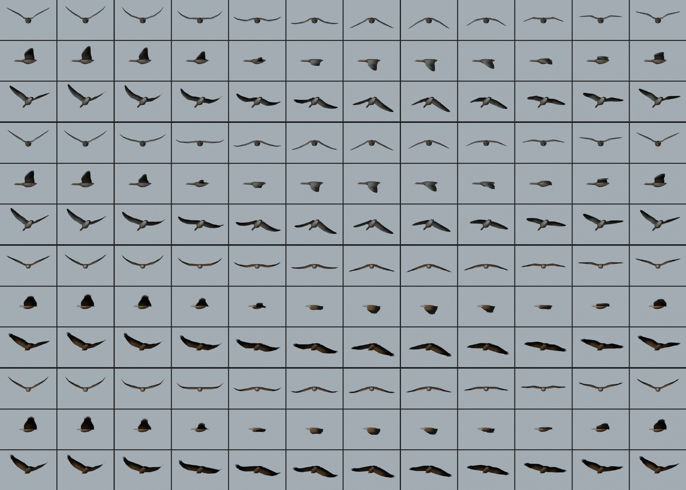

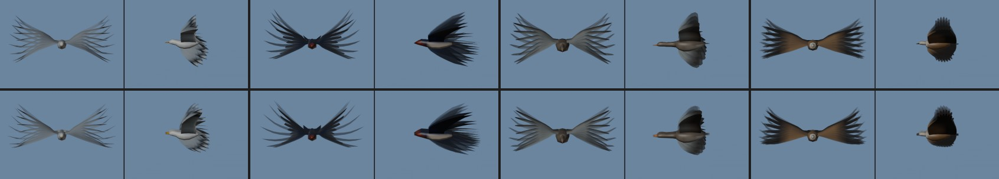

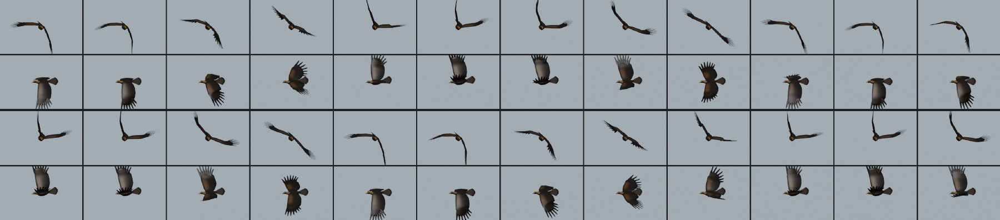

### Cost

The same draws (3 flights, 1 kettle), one pipeline each, and the same attribute layouts (the tail
weight rides in the plumage buffer's w): 7 vertex buffers for the flights, 6 for the kettle. The
flights read their beats from one uniform array (54 vec4). The vertex stage does a little more
work per vertex: the series, the bout, and three more path samples for the bank's lead. Nothing
is written per frame but the clock and the reveals, as before. The levers `?odysseyNoFlights=1`,
`?odysseyNoBirds=1` and `?odysseyNoEagle=1` are unchanged.

### Tools

- `scripts/blender/odyssey/odyssey_birds.py` writes the models and the beats (run it after
  changing a key).
- `scripts/blender/odyssey/bird_motion_export.mjs` samples the game's CPU twins to JSON
  (`--comp` points at another copy of the composition folder, for a before/after).
- `scripts/blender/odyssey/odyssey_birds_review.py` renders strips, onion skins, wingtip paths
  and clips from that JSON, and saves a review .blend: every bird flying its clip (absolute shape
  keys, one per frame), a loop of its beat with its wingtip path, the eagle on its own rig with
  every joint keyed, and the keyed beat Empties (the Graph Editor shows the easing).
- The playground: `?effect=odyssey-birds&bird=gull|swallow|goose|vulture|eagle&lane=0&view=34&t0=8`
  follows one bird with the game's own draws; `?t=` gives phase-locked frames.

### Tests

`tests/unit/odyssey-blender-birds.test.js` keeps the old checks on the new beat (no tearing over
every pose flown, the tail's fan and twist included; the hand lags the arm; each kind's rhythm)
and adds: no corner in any wing channel, the heave, the tail, the bank or the vultures' roll,
through beats and glides; the downstroke under half the beat, a wingtip loop, the body rising
against the beat; gull bouts that start and end at mid-upstroke; swallows that never point up and
bank softly; the skein's wave and breathing; vultures that soar; the eagle's joints without a
corner.

### The butterflies

The meadows' butterflies (composition/odyssey-meadow-life.js) are flat cut-outs facing the eye.
Their wings' width was |cos| of the clock: it hit closed with a speed and bounced straight back,
a corner every beat. The wings' elevation now swings smoothly from flat to nearly closed above the
back and down again (the width is its cosine, never below 0.15), and the body bobs 0.12 u with each
beat, rising as the wings come down. A test checks both have no corner.

### Left as it was

- The models' design (checked at game size in the first pass). The gulls near L16 are often
  seen close to edge-on and read as thin white lines; that is the angle, not the motion.
- The flight paths and their siting. Only the swallows' eight changed shape a little, inside the
  same clearances (the fade-out and clearance tests pass).
- No head held steady: the head rides on the body, which now bobs 1-2 cm (under a pixel).

## Visibility (2026-11-03)

Asked for by Olov ("the heron is very hard to see!", then "start the visibility check"): does a
player on the rail see each bird, and see what it is?

### How it was measured

The real game in Chrome at 2560 x 1440, parked at the orbs and the glides where each bird is
seen, the board's clock and the camera frozen. Each moment was shot twice, with the flock and
without it (hidden after its own update), so the pixels that differ are the birds alone (two
shots of the same frozen moment differ in 0 pixels). Each bird's pixels are found round its
projected place:

- its **extent** (the longer side of its box) and its cover in pixels;
- its **contrast** against what it covers, |L bird - L ground| / L ground, and its **Delta E**
  (CIE Lab, the mean colours);
- whether trees or terrain hide it.

How long each is in frame comes from the same cameras over a minute or two of the clock. It
**reads** when its extent is at least 24 px and its contrast at least 0.35 or its Delta E at
least 20. 124 pairs of shots (gulls at L11-L16, swallows L17-L24, geese L11-L27, the kettle L27-L33,
the eagle L26-L28 and the glide after, butterflies L18-L23).

### What it found, and what changed

| | extent median | at least 24 px | contrast | Delta E | reads (every bird seen) | a bird that reads in the shot |
|---|---|---|---|---|---|---|
| Gulls, before | 19 px | 34 % | 0.37 | 15 | 22 % | 52 % |
| Gulls, after | 24 px | 51 % | 0.42 | 16 | 35 % | 61 % |
| Swallows, before | 8 px | 6 % | 0.49 | 15 | 5 % | 21 % |
| Swallows, after | 12 px | 13 % | 0.54 | 17 | 12 % | 25 % |
| Geese, before | 9 px | 7 % | 0.24 | 12 | 7 % | 11 % |
| Geese, after | 13 px | 12 % | 0.34 | 14 | 11 % | 11 % |
| Summit vultures, before | 21 px | 44 % | 0.51 | 24 | 43 % | 60 % |
| Summit vultures, after | 25 px | 52 % | 0.53 | 25 | 51 % | 65 % |
| Eagle (unchanged) | 54 px | 89 % | 0.66 | 29 | 89 % | 89 % |
| Butterflies (unchanged) | 45 px | 89 % | 1.32 | 59 | 79 % | 100 % |

Nothing hid them for long: 0-3 % of the birds in frame were behind trees or terrain. In frame
(of the time at the stations where each lives): gulls 77 %, swallows 93 %, the skein 42 % (it
crosses once every 52 s), the kettle 92 %, the eagle 63 %.

- **Far birds washed into the air.** The geese and the kettle at L27-L29 (500-800 u) took on the
  haze of their true distance, but they are drawn 4-5 times life, so they stood in more air than
  birds of their size would. They faded toward the sky's own colour. A bird under ~24 px across
  (was 14) now darkens toward its silhouette (the geese most) and takes on less of the air, as a
  far bird against the sky is a dark shape. The skein's contrast doubled at the far stations
  (0.16-0.31 -> 0.32-0.38).
- **Too small.** Gulls are drawn 1.25x (5.75 u, 4.1 times life), swallows 1.54x (2.0 u), geese
  1.3x (8.6 u) and the vultures 1.2x (13.7 u: now 1.24x the eagle, as a griffon is to a golden
  eagle). Beside their neighbours the scale still holds: the swallows stay small birds of the
  meadow, the gulls bigger, the vultures bigger than the eagle.
- **Gulls edge-on.** They bank a little more into their turns (gain 0.16 -> 0.20), so more of the
  time they show their wings; the black of the hand begins a little further in, the herring
  gull's mark at range.
- **The skein reads as a skein.** One goose is still a speck at 6-14 px, but all nine are in
  view, in a V 80-160 px wide (400 px at L27): a skein of geese, which is what it is.

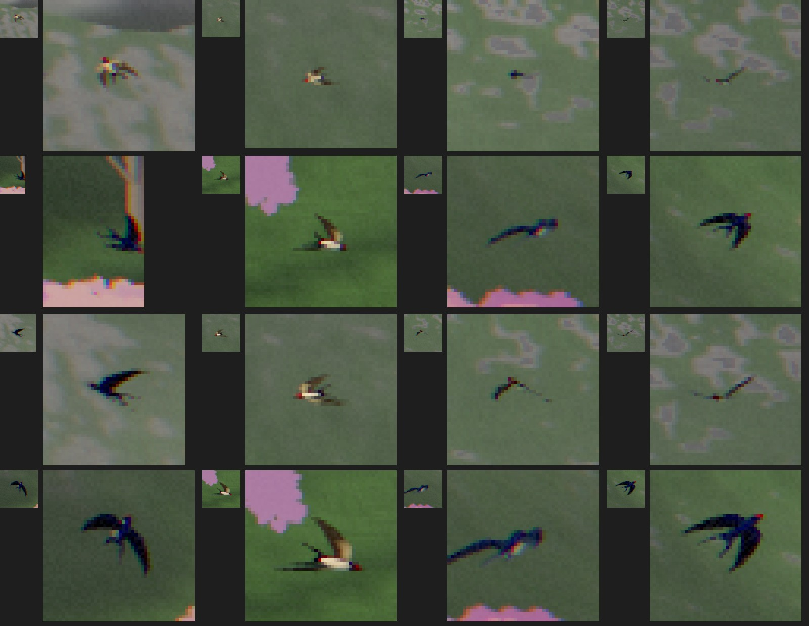

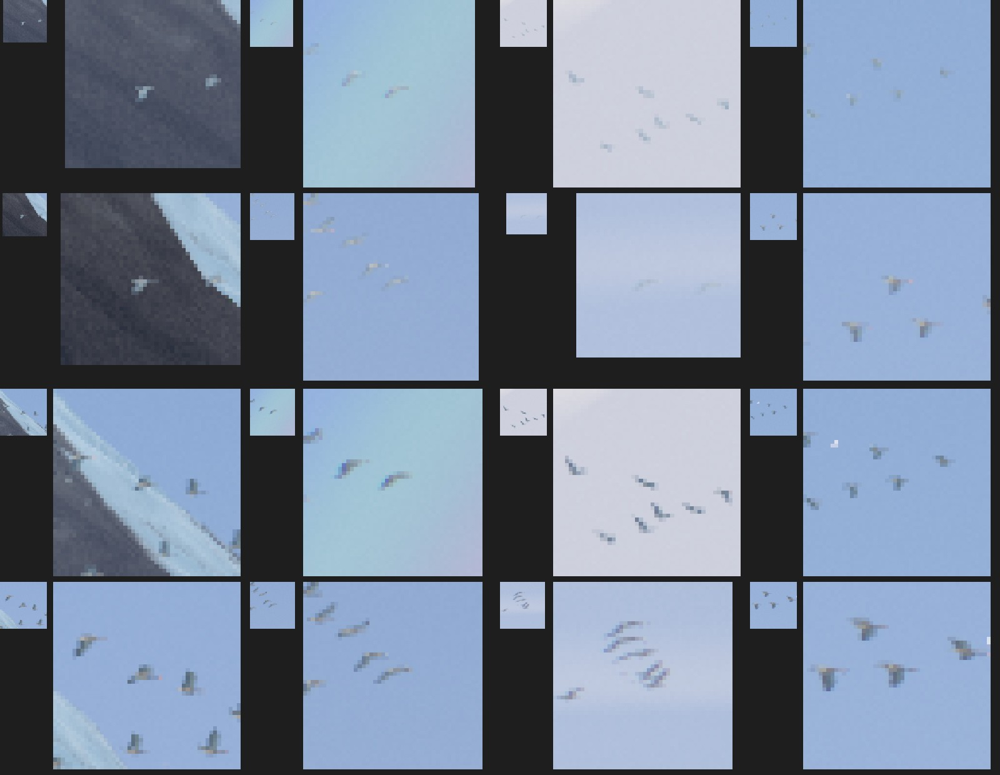

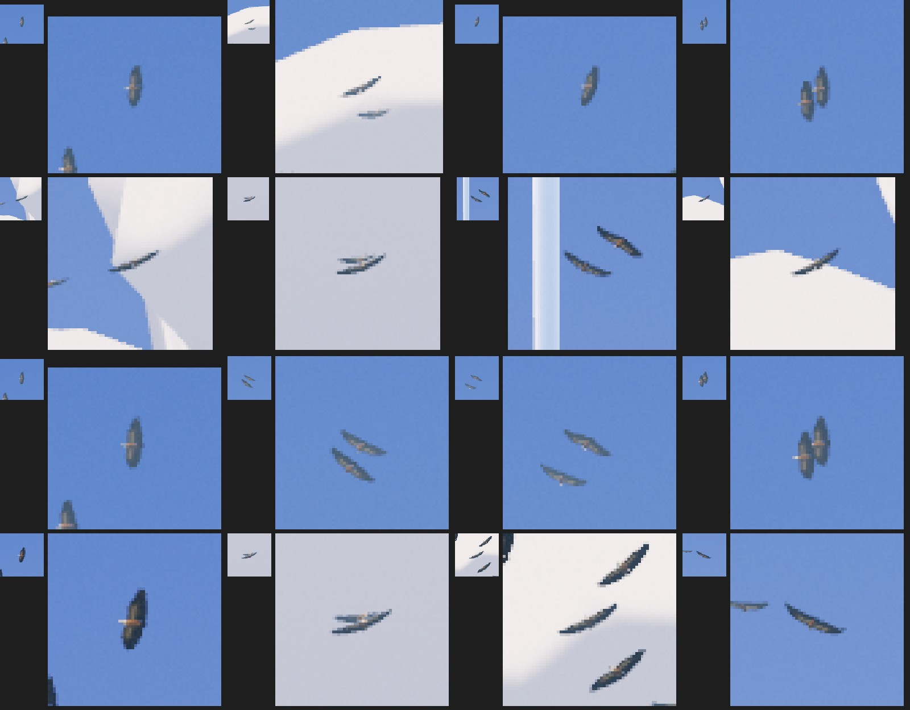

### Verdicts

- **Eagle**: reads (yes). **Butterflies**: read (yes).
- **Summit vultures**: read from L31 up (73-98 %); at L27-L29 the far kettle is a ring of dark
  soaring shapes (16-20 px), which it is meant to be until the climb brings it near.
- **Gulls**: read at L15-L16 (100 %); at L11-L14 the parties are 190-230 u off and often against
  grey hills: a white or grey shape, seen as a gull about half the time.
- **Swallows**: small dark birds darting over the meadow (the biggest in a shot 22 px, was 15);
  they read as swallows at L24, elsewhere as a shape.
- **Geese**: a skein (a shape that names itself), single birds specks.

### Left for the owner

- **Swallows nearer.** Their parties are as near the rail as their siting allows: 20 % nearer
  brings them within 14 u of the rail and 17 u of the eye, for 15-20 % more size. Options: (a)
  leave them as a small hunting party; (b) let one swallow now and then sweep low past the orb,
  15-25 u from the eye and gone again (barn swallows hunt round people this way); (c) a third,
  nearer party along the meadow edge of L19-L23.
- **The skein nearer.** It crosses 400-800 u off at L11-L24 (moved north in October to clear the
  wall's rail). Options: (a) leave it; (b) a second, lower skein that crosses nearer at L19-L24.
- **Gulls at L11-L14.** Their first party could hunt 20-30 u nearer the shore orbs.

## The swallow fly-by (2026-11-03)

Asked for by Olov after the visibility check ("start the swallow fly-by"): the meadow's
swallows hunt 60-200 u off the rail and read as specks. Now, now and then, one barn swallow sweeps
up the meadow past the orbs where they live (L16-L24), close to the eye, and is gone. It is the
moment a player sees "a swallow".

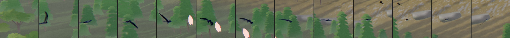

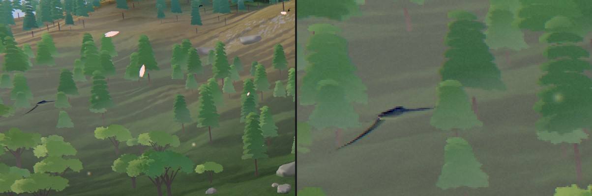

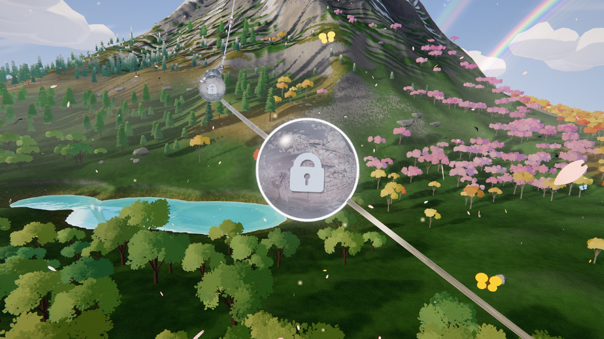

### Where it flies

- One route, in the world, flown on the board clock: it comes in from far behind L16 (out of
  every frame), runs up the meadow on the LEFT of the orbs' seats, 6 u under the eye. The rail's
  glide camera runs ~13 u to the right of the seats, so the left keeps clear of it. It swerves out
  hard at L16, L19 and L22, as if snapping an insect, goes on past L24, then climbs and swings away
  west, out of every frame again.
- Each seat's camera is its orb's rail point + (0, 1.8, 10.2), looking at the orb, 55-75 u over
  the meadow. Every seat L16-L24 sees each pass: the swallow comes in big at the left edge and
  dwindles into the meadow ahead.
- The route is a cubic B-spline (C2) through points 20 u apart, so the speed is even (35-39 u/s)
  and the path and the bank have no corner. It was built from the seats: a guide line left of
  them, smoothed, resampled, the swerves pushed out (the `route` in
  composition/odyssey-swallow-flyby.js).
- Clear of every seat's eye by 15.4 u or more (16-29 u at its nearest to each), of the glide
  camera by 20 u, of the rail and the orbs by 18 u, of the ground by 42 u and 8 u over the tree
  crowns. Its start and its end are out of frame for every seat and for every glide camera while
  the swallows are drawn.

### When

A pass every 90-190 s (140 on average), each at a time of its own. A pass is shown only if it
STARTS with the camera in the meadow (L16-L24). A pass already under way when the board wakes, or
begun with the camera elsewhere, stays hidden all through. So the swallow never appears in view;
it enters and leaves out of frame. Once begun, it flies to its end even if the camera leaves, and
the swallows' draw stays on until it does.

**The board stays clear.** A level is played in its own theme, with this world parked and hidden
(OdysseyMode `_parkOdysseyBoard`), so a pass can never cross a board card or the gameplay HUD.
Over the map it keeps to the left half of the frame (the orb panel docks on the right) and passes
under the top HUD only as a speck.

### How it flies

The same barn swallow and keyframed beat as the flock. In bursts it gives a few quick beats, and
it glides with its wings swept through each banked swerve (about 40 % beating over a pass). It
banks up to its soft limit (1 rad) in the swerves, rolling up to 8.7 rad/s, a swallow's flick, and
smooth. Its tail fans and its streamers show as it banks.

| | measured |
|---|---|
| Speed | 35-39 u/s |
| Corner in the path / the bank (acceleration at 960 Hz over 240 Hz) | 1.005 / 1.002 (jerk 1.13) |
| In frame per pass, by seat | L16 11.8 s, L17 10.8, L18 9.5, L19 8.5, L20 7.5, L21 6.2, L22 4.8, L23 3.4, L24 1.5 |
| Over 30 px (its span), by seat | 1.0-1.4 s at every seat |
| Biggest, in the game (extent, L17 / L19 / L22) | 56 / 40 / 27 px; its span 55-64 px |
| Contrast and Delta E there | 0.50-0.72 and 19-31: it reads (a flock swallow was 8-12 px) |

**Size.** It comes into frame 40-50 u from the eye. It passes nearer (16-20 u), but then it is
beside the camera, out of frame. The rail runs up-left from each orb and the glide camera runs on
the right, so a route that kept 15 u from all of them can only enter from the left edge. Seen
from below instead (flying 2 u over the eye), it is a dark forked silhouette against the pale sky,
but smaller (38 px at most); from above, as now, it is bigger, its blue-black back over the
meadow. The model holds at this size (196 triangles; in Blender at ~230 px only the head-on body
shows facets), so it was not refined.

### Cost and levers

One more instance in the swallows' own draw: the same model, shader and pipeline. It adds a
route uniform array (44 vec4) and one uniform. Nothing is written per frame but the clock and one
flag. `?odysseyNoSwallowFlyby=1` drops it (the URL parameter catalog lists it); `?odysseyNoFlights=1`
drops it with the flocks.

### Review

The review .blend (scripts/blender/odyssey/odyssey_birds_review.py with the exporter's `flyby`
clip) holds one pass in world space at game size. The bird is keyed along its route, the route is
drawn as a curve in the viewport, and there is a camera at each seat L16-L24 looking at its orb.
Look through `seat-L19` and scrub frames 150-200.

### Tests

`tests/unit/odyssey-swallow-flyby.test.js`:
- the clearances (eye, orbs, glide camera, rail, ground, crowns);
- every seat sees a pass, and its ends are out of every frame;
- the passes 90-190 s apart, each inside its period;
- the arming (shown only if begun in the meadow, never popping in mid-pass);
- an even speed with no corner in the path or the bank;
- bursts and glides;
- one more instance in the draw, and none with the lever.

### Left for the owner

- **Bigger.** It could cross the top of the view above the rail at two or three seats (L19, L22).
  It would then be about 25 u off in the frame (~95 px), 15 u from the next seat's eye. That is a
  stronger moment, over the middle of the view.

## Staged for the orb close-ups (2026-11-20)

Asked for by Olov: "We need to improve some of the birds, animation and composition in odyssey
mode as well." The audit below found that the composition was the part that failed, and why.

### What a player actually looks at

A player rests in an orb's **close-up**: the eye 10 u south of the orb and 2 u over it, looking
at it, so due north and about 12 degrees down, with the HUD along the top 75 px of the frame and
the orb's panel over its right fifth. Every earlier pass sited the birds, and measured them,
against the **travelling rail camera** (the tests' "parked view" is that camera stopped at the
orb's park, not the close-up the board then moves to). The two are different pictures.

Measured in the real game (headless Chrome, 1920 x 1080, High, the orb's own selection flow, a
save with 40 orbs cleared): for each seat, over 208 s of the board's clock, the share of the time
a bird of the kind is in the part of the frame the UI leaves free, and how big the biggest is
(wingtip to wingtip, pixels).

| | before | after |
|---|---|---|
| Gulls, L11-L13 | 100 %, 37-49 px, up at the top right | 100 %, 90-97 px |
| Gulls, L14 / L15 / L16 | 84 % / 25 % / 0 (behind the panel) | 100 %, 92-117 px |
| Geese, L11-L27 | 0-6 % (under the HUD, 12 px) | 94 % at L12 (17 px), 65 % at L18 (25 px), 41 % at L22 (41 px), 32 % at L24 (57 px), 21 % at L26-L27 (94-99 px) |
| Eagle, every seat | 0 (20-50 degrees over the top of the frame) | 100 % from L12 to L24 (21 to 74 px), 96 % at L26 and 92 % at L27 (120 px) |
| Vultures, L28 / L29 / L30 | 0 / 0 / 0 | 100 %, 78-100 px |
| Vultures, L31-L33 | 100 %, 44-77 px, up under the panel | 100 % at L31-L32 (72-80 px), 70 % at L33, on the open left |
| No bird at all in frame | L25, L26, L27, L29, L30 | none |

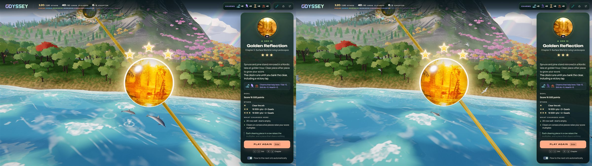

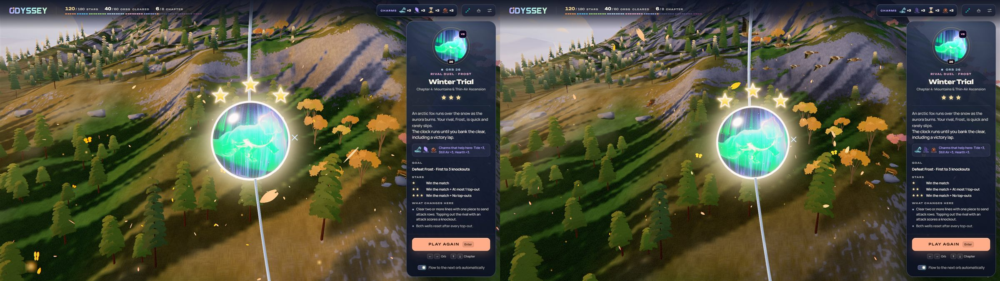

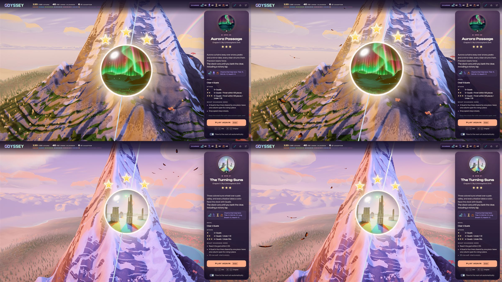

### How each kind is sited now

A close-up looks north into rising ground, so what it shows of the air is a wedge: from the
ground up to about 15 degrees over the eye, between the rail (which runs up the left of the
frame on the shore and the meadow, and straight up the middle at the wall) and the panel. Each
kind was put into that wedge by search or by hand in a siting lab (below), under clearances from
the rail, every seat's eye, the ground, the water and the tree crowns.

- **Gulls** (`ODYSSEY_FLIGHTS` gulls, `sites`): twelve loops chosen from some 3,800 tried, each
  given by its numbers. Some skim the water under the rail (seen from above, white on blue),
  some wheel over the beach and the forest's edge. They are drawn 7.3 u across (5.75): 5.2 times
  life, as the goose, the eagle and the vultures already were. Their loops' drift is 8 u (22).
- **Geese**: the line was 200-500 u north and 150-230 u over the eyes. It now crosses low along
  the foot of the wall, under the rail where the rail starts up it. Two skeins fly it (nine and
  seven geese, `skeins`), half a period apart, the second 30 u north and 8 u higher: one minute
  a crossing, 31 u/s. Both ends of the line are outside every close-up's frame.
- **The eagle**: its thermal stood at (-96, 612, -616). It now turns low over the forest's edge
  at the foot of the wall, west of the rail (the rail is a hundred units overhead there), under
  the skeins' line. From the shore it is a speck turning at the massif's foot that the journey
  walks up to.
- **The vultures**: the kettle was a ring round the summit at one height. It is now a column
  (`heightSpread` 255 u either side of its middle, fourteen birds) that leans as the wall does
  (`lean`), west of the rail: a thermal filled from its foot to its top, so every seat of the
  climb has two or three birds at its own height.
- **When they are drawn**: all four come in with the shore itself (the breach, where the whole
  island appears), so nothing grows in view on the way; each goes between two orbs neither of
  whose close-ups, nor the rail camera, has it in frame.

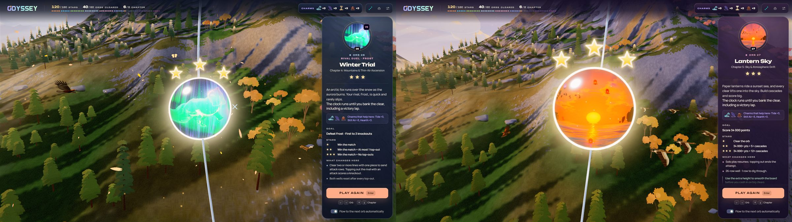

### The goose, rebuilt for the near view

The skein used to be 9-35 px a bird; now the wall's first seats see a goose 100-220 px across,
from level with it and from above, and at that size the old model was a smooth, paddle-winged
toy. `odyssey_birds.py` builds a finer one (814 triangles, was 326): a long tapered hand, the
bar of pale covert tips across the wing, the flight feathers told one from the next (every other
station a shade paler), the back's bars, the white band over the tail, a rounded head with its
eye, a heavier bill. The hinges and their bands are unchanged, so the keyed beat fits as it did
(worst stretch 1.32, squash 0.58). The gull, the swallow and the vulture are byte for byte what
they were.

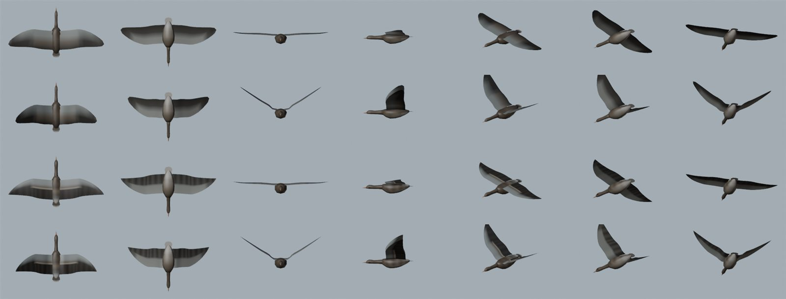

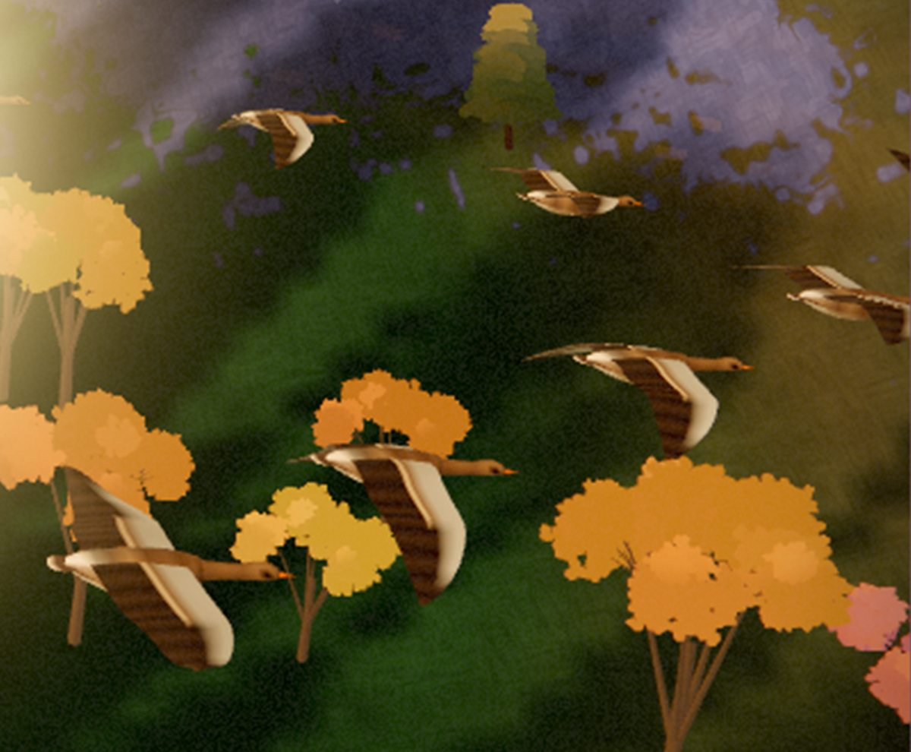

**The light.** Near, in the afternoon's low sun, plumage lit by the sun's colour alone lost its
own (the grey forewing went cream, a griffon's sand orange). The sun on feathers now keeps its
brightness and half its hue (`BIRD_SUN_HUE` in odyssey-bird-rig.js: feathers are lit by the whole
sky as well as the disc). By day nothing changes.

### Tools

Scratch tools of the session (recipes, not files in the repo):

- **The game's own view**: the real game in a private headless Chrome over CDP, a save seeded
  with `odysseyState.completeLevel` for orbs 1-40, then `boardController.travelToLevel(id)` (the
  real selection flow, ending in the close-up), the board clock set with `board.time = t`.
- **The audit**: run in the page at each seat: the three bird modules imported, every bird's
  place over 208 s projected with the live camera's own matrices, tallied in the free frame.
- **The siting lab** (node): the seats' cameras dumped from the game, the CPU height mirror, the
  forest's tree list and the live rail. It reproduced the game's audit to the pixel before it
  was used to search. The eagle's first search weighted the wrong seats and put it at the
  frame's left edge; looking at the frames, then a hand-placed thermal under the climbing rail,
  did better than the search.

### Tests

- `tests/unit/odyssey-bird-staging.test.js` (new, 16): for each kind, what every seat it is
  meant for sees in the free frame (share of the time, how many, how big), through the seat's
  own lens and the narrowest; the clearances; that no goose appears or goes inside a close-up;
  that no window fades with a bird in a seat's frame or the rail camera's; and that every orb
  from L11 to L33 has a bird of 24 px or more in its free frame nine tenths of the time (L33
  six tenths).
- Twelve older tests pinned the old places, sizes and windows and were re-pinned on purpose
  (`odyssey-act2-life`, `odyssey-act2-fade-out-of-view`, `odyssey-blender-birds`,
  `odyssey-summit-birds`); one of them (a gull's bout) read a bout already under way at clock 0
  as a start, which the new seeds exposed.

### Not verified, and left for the owner

- Nobody has watched the new staging move for long: it was judged from stills, the audit's
  numbers, one eight-frame strip and the playground's beat strips.
- **Cost** was not measured again. The eagle (one skinned draw) and the vultures (one draw, 14 x
  388 triangles) are now drawn from the shore, not only near their old windows; the geese are
  16 x 814 triangles (were 9 x 326). No new material, pipeline, texture or pass.
- The west end of the skeins' line lies in the travelling rail camera's frame over the meadow (as
  the old line's did): a goose sets out there 650-980 u off, a speck in the haze.
- The skeins pass 9-12 u over the eagle's thermal. They never touch; from the south they cross
  the same patch of the frame for a second or two a crossing.
- At L33 the vultures are in frame two thirds of the time (the column's top); L34 has none.
- A close-up's lens is the one the camera carried there (57-75 degrees by orb): the numbers above
  are for arriving from the orb before.
- The swallows (13-28 px from their seats, with the fly-by), the pond's swans and heron, and
  the butterflies were not touched.
- Gulls are still small birds in a big picture at most moments (30-60 px seen obliquely); the
  biggest moments (150-200 px) happen at the frame's edges.

## The swallow, rebuilt for the near view (2026-11-21)

The owner, from a phone, of birds "flying up from below quite close to the pond": "They need to
be modelled better." They were the meadow's barn swallows: the fly-by (which comes in at the left
edge of every seat from L16 to L24, 35-45 u off, 25-35 px across at 1080p, over the tarn at L17)
and the two hunting parties further off. The old model was a six-sided prism under a navy that
read black, so from above, which is how a seat sees them over the meadow, they were flat black
cut-outs.

`odyssey_birds.py` builds a new one (514 triangles, was 196; the swallow's budget in the test is
now 600, like the goose's 900):

- **The body**: ten sides (was six), deep in the chest, a short neck and a domed head a little
  wider than it; a short wide bill; the eye on each side.
- **The colours**: a steel blue above that reads blue in the sun, with a gloss along the back;
  the blue cap comes down to the eye, and the rust is the throat and a small forehead patch, not
  the whole face; the dark breast band; the cream belly and vent.
- **The wings**: glossy blue coverts over blackish-brown flight feathers told one from the next
  (every other station a shade lighter); below, buff coverts and grey flight feathers.
- **The tail**: the fork, streamers wide enough to show, and the row of white spots (faint from
  above, full from below, so it never reads as a martin's white rump).

The hinges and their bands are as they were, so the keyed beat fits as before (worst stretch
1.33, squash 0.21). The gull, the goose, the vulture and the beats are byte for byte what they
were.

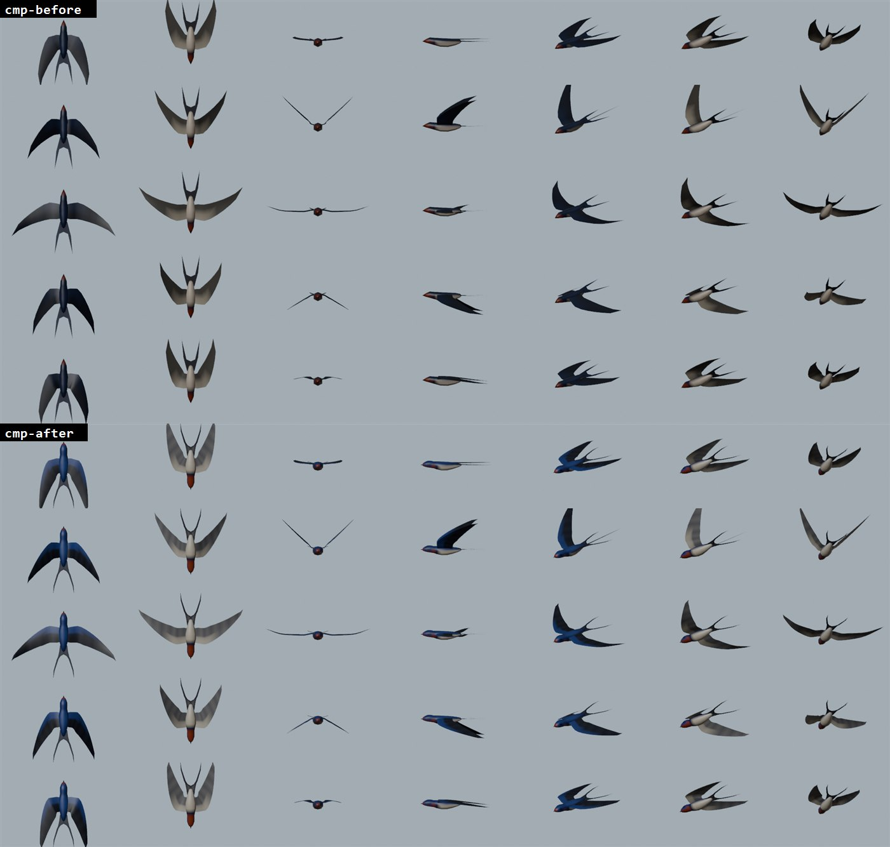

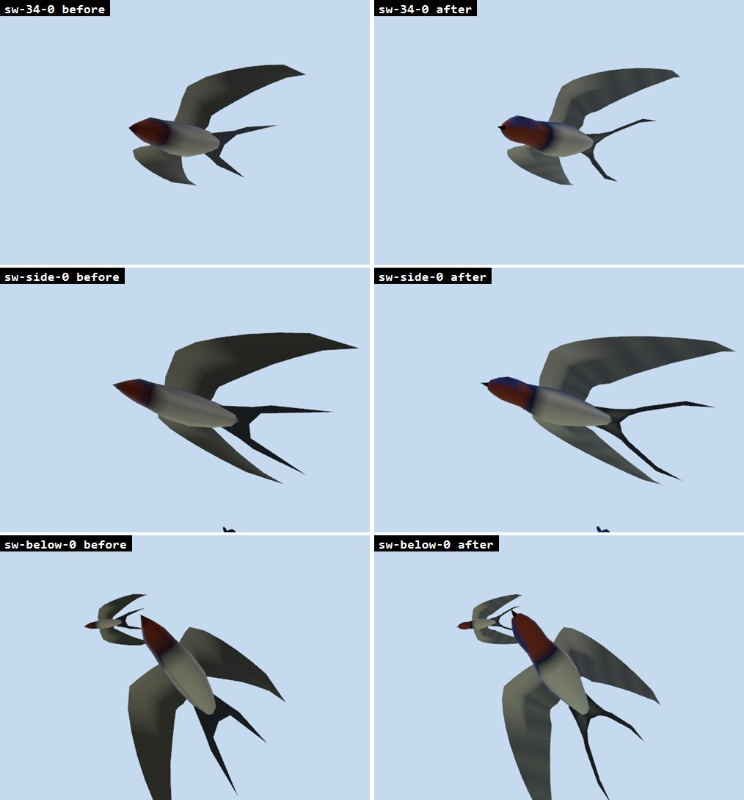

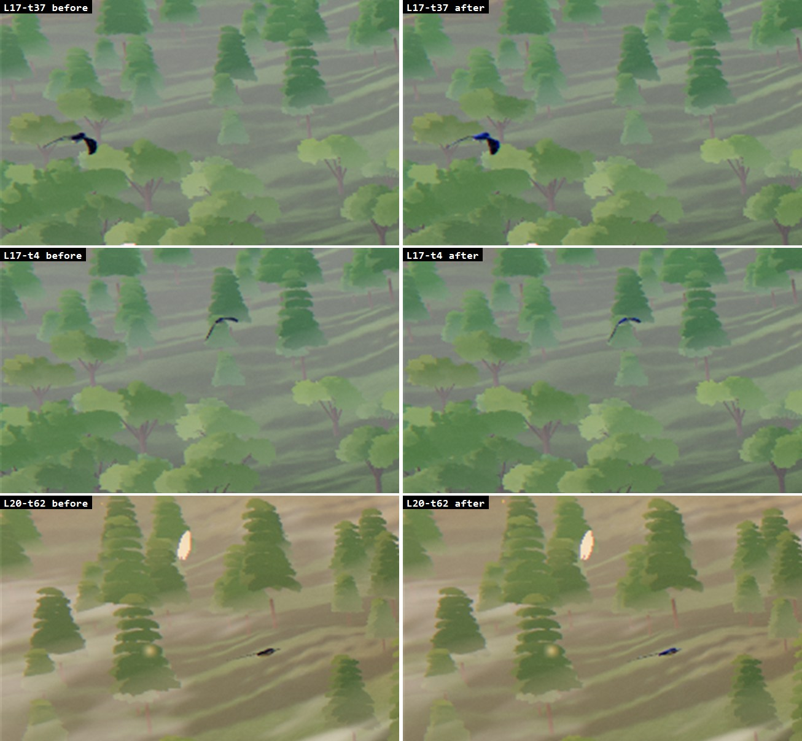

**How it was checked.** Close-ups in the bird playground (`?effect=odyssey-birds&bird=swallow`,
five views, WebGPU and WebGL2, console clean), then the real game in a private headless Chrome:
the board clock frozen by a getter on `boardController.time`, set just before a pass starts (so
the fly-by arms at the seat), then to chosen moments of the pass. The seat-by-seat numbers above
come from projecting `swallowFlybyPositionAt` with each seat's live camera.

**Not changed:** where the swallows fly, their size, the beat, the shader. On a phone the fly-by
is still a small bird (about 30 px as it comes in); this pass changes what it looks like, not
how big it is.

**Cost:** the same one draw; 13 swallows (12 and the fly-by) x 514 triangles, about 6.7 k
(were 2.5 k). No new material, pipeline, texture or pass.

## The gust's fieldfares (2026-11-22)

The owner, from a phone, of "brown colored birds or flying animals flying up from below and then
down to the trees" in the mountains: "They need to be modelled better in Blender." They were not
the swallows. They were the birds of the turn's wake (`world/odyssey-turn-wake.js`): as the
cloud shade crosses the rail between the island's last orb and the mountains' first, a gust lifts
three parties of eleven birds out of the broadleaf crowns, and they rise over the forest, wheel
once and settle into trees downwind. Each bird was one quad in the leaves' draw, cut by the alpha
test into two wings and a body in one flat dark brown, always facing the camera: from the rail
camera they read as brown boomerangs, 40-80 px across on a phone, beside the Blender gulls,
swallows and geese.

**The bird.** `odyssey_birds.py` builds a fifth bird, a **fieldfare** (*Turdus pilaris*), 602
triangles: a flock thrush that lifts out of autumn trees in loose parties, brown as the owner
saw them. A plump body of twelve sides, a round grey head with a yellow bill tipped dark; the
chestnut back and scapulars between the wings, the blue-grey crown and nape, the pale grey rump
over a black square tail; the rust-orange breast spotted black (the spots on every other point of
each ring, offset ring by ring), the spotted buff flanks, the white belly; brown coverts over dark
grey-brown flight feathers above, and below the white underwing a fieldfare flashes with every
beat. A keyed beat (5.2 a second, the broad hand folding on the upstroke) and a new pose, the
**bound**: between bursts a thrush draws its wings in for a moment. The script checks the bound
with the beat and the glide (worst stretch 1.33, squash 0.22, like the swallow's swept glide).
The other birds and their beats are byte for byte what they were.

**The draw.** `world/odyssey-wake-fieldfares.js`: one instanced opaque draw of the Blender bird,
a child of the wake's leaf mesh (shown, hidden and compiled with it; the world's prewarm reveals
every descendant). The leaves keep their draw, now leaves only. Each bird flies the route it
always flew (`turnWakeBirdAt`), and the rest follows from that route in closed form:

- it faces along its velocity (the route's derivative), leaning toward the hop where the route
  rises straight out of the crown; its climb and dive are held softly (toward 0.85 and -0.6 rad,
  never reached, so the body never stops turning with a corner);
- it banks by its sideways acceleration (the route's second derivative), but only once it has the
  speed to turn on its wings (8-22 u/s): a bird lifting out of a crown or dropping into one is
  level;
- it beats hard as it climbs out, then flies in bursts of four or five beats and half-second
  bounds with the body dipping; it glides in on spread wings and flutters into the next crown. The
  reasons to beat are joined as 1 - (1 - a)(1 - b)(1 - c) on C2 ramps, not by a max, so the wings
  never change pace with a corner;
- its tail spreads as it lifts and brakes and twists with the bank.

Lit by the land's own light (the world renderer's `lightAt`: the sun as it falls on that place
under the drifting and the turning shade), the sky above, the forest bounced up under the wings,
then the world's own air. Same size in world units as the cut-outs (3.6-4.8 u across).

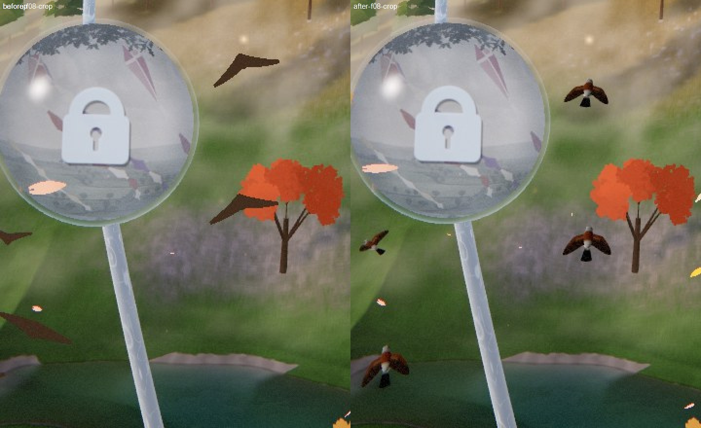

**How it was checked.** The Blender previews; the bird playground (four views on WebGPU and one on
WebGL2, console clean); then the real game in a private headless Chrome, 600 x 1300 portrait at 30 fps:
boot with `?skipIntro=1&unlockAll=1&odysseyDebug=1`, close the journey card, `settleAt(0.232)` on
the rail camera and move its `targetPosition` to 0.262 over five seconds, as a scroll does; the
gust lets go at p ~0.25 and the wake is in the air for ~16 s. The same run on a main build gives
the before. Console: only `THREE.Clock` deprecated, which main prints too.

**Tests.** `odyssey-wake-fieldfares.test.js`: the route and its true velocity and acceleration,
the frame (right-handed, never flipping, climb and dive and bank within their limits, level at
lift-off), no corner in the turn, the bank or any wing channel, the rhythm (beats out of the
crown, bursts and bounds on the way, the glide in, the flutter), and the draw built clean for
WGSL and GLSL. `odyssey-blender-birds.test.js` now holds the fieldfare with the other four
(budget 650, facing, hinge weights, its plumage, its skin over every pose it flies).

**Cost.** 33 birds x 602 triangles, about 20 k, one more draw and pipeline, drawn only while a
wake is in the air (~16 s a crossing); the leaves' draw lost 33 quads. Not GPU-timed.

**Left for the owner.**
- They read smaller than the cut-outs although their span is the same: a flat chevron always
  showed its whole span to the eye, a bird seen from behind with its wings up or drawn in shows
  less. Larger is one number (`WAKE_FIELDFARES.span`); they are already about ten times life
  beside the trees.
- The species is my choice (a fieldfare: brown, a flock bird of autumn trees).
- The leaves the same gust throws are unchanged; against the bright sky some read as dark flecks.
