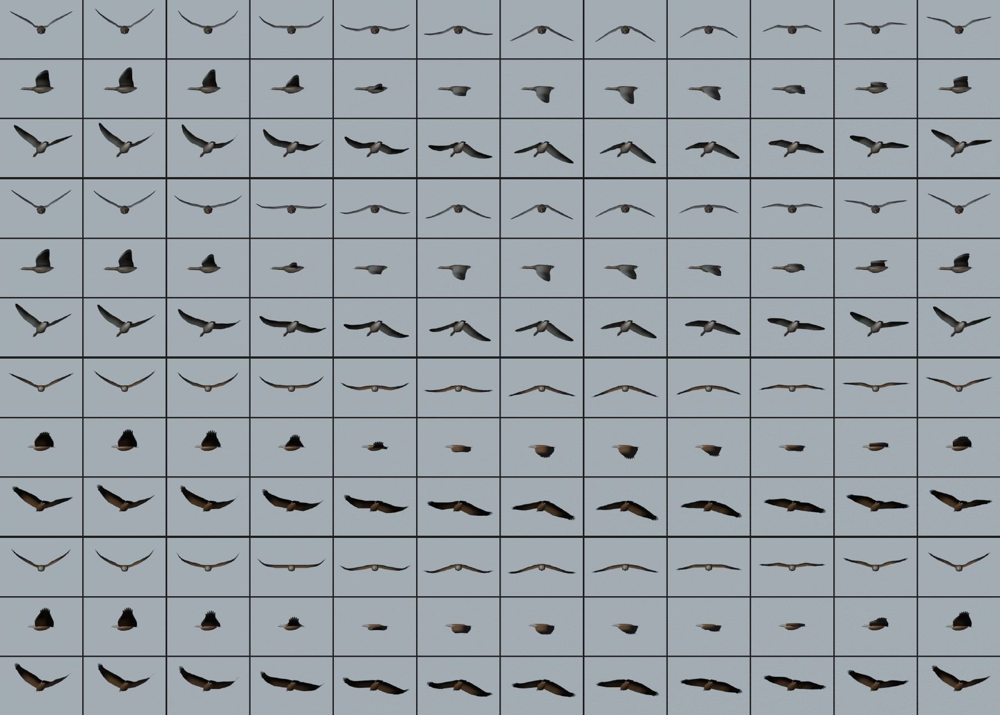
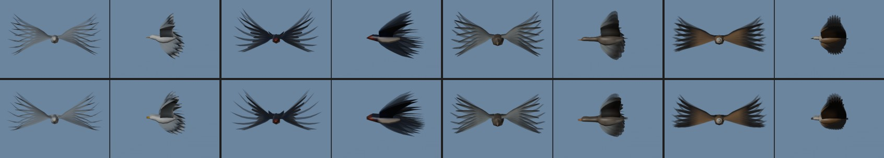
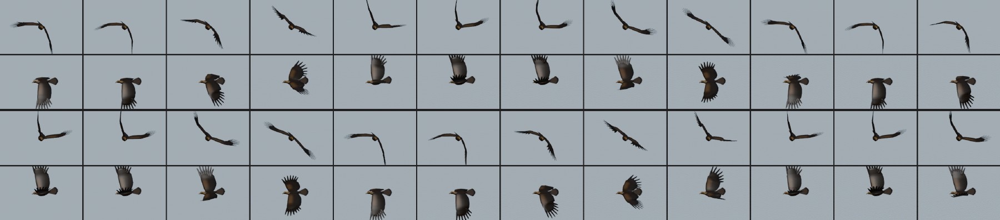
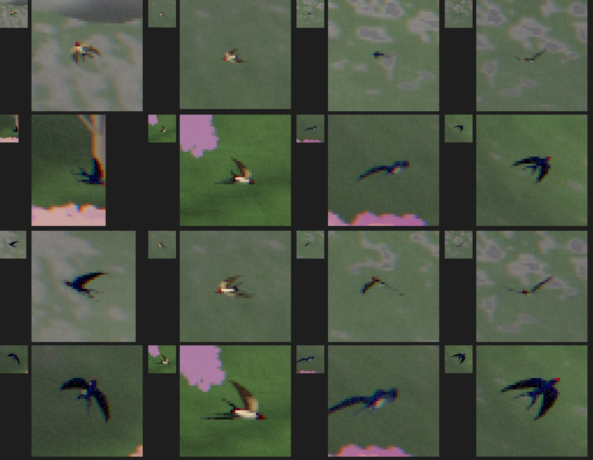
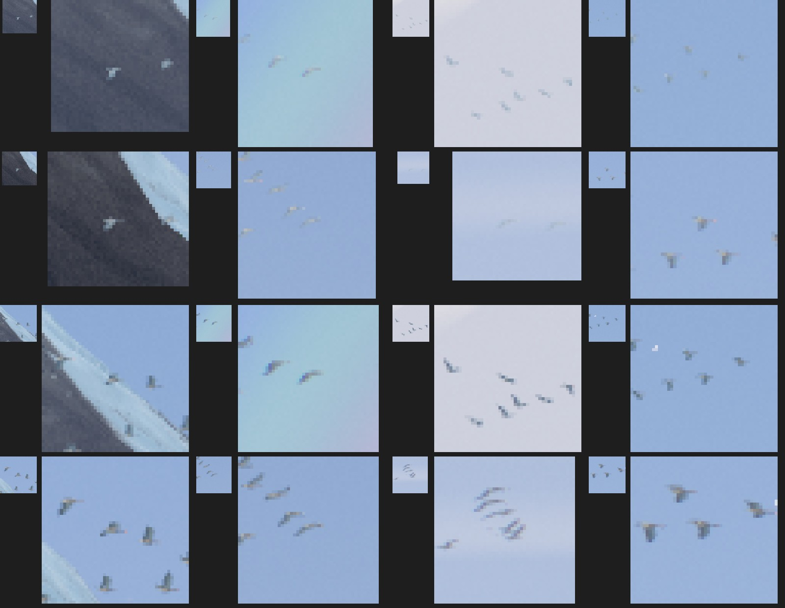
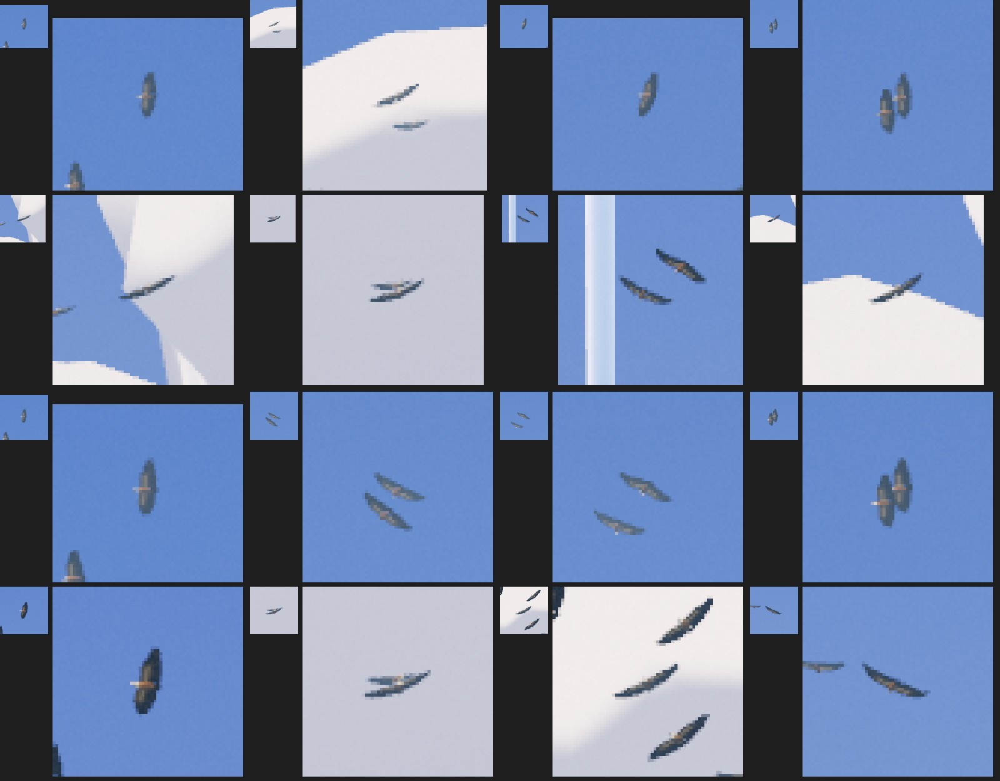
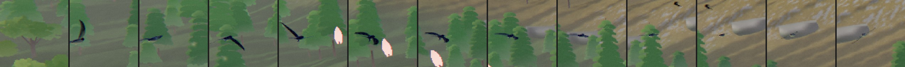
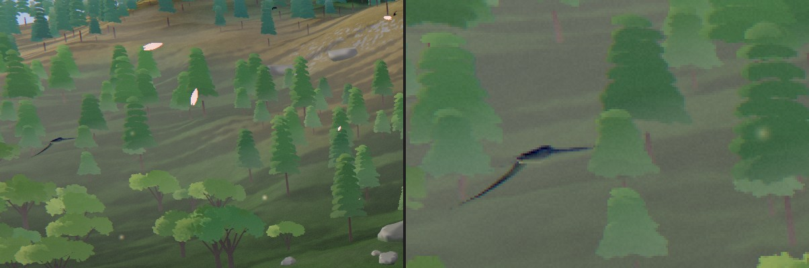
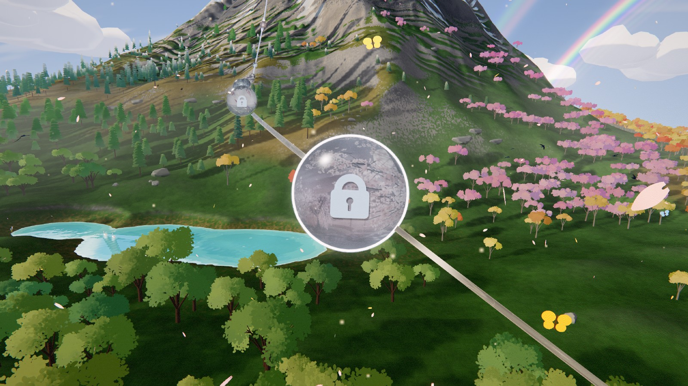

# Odyssey — Blender birds over the island (2026-11-01)

Asked for by Olov: Blender-made birds for the island's flocks (chapters 3-4). Before, the gulls,
swallows and geese were one flat paper shape of 9 triangles, stretched per kind. Far away they
read as specks, but the gulls and swallows come close to the orbs, and next to the Blender eagle
they looked like cut-outs. The kettle beside the summit (chapter 5) was the same paper shape in
flat slate grey, and it turned out to be the biggest of all on screen, so it got the same
treatment: griffon vultures.

## How big they are

Measured on the real camera at 2560 x 1440 (wingtip to wingtip):

| Bird | Biggest | Typical | Where |
|---|---|---|---|
| Gull | 54 px | 20-40 px | L11-L17 (biggest at L16, p 0.207) |
| Swallow | 36 px | 7-25 px | L16-L24 (biggest at L24, p 0.310) |
| Goose | 35 px | 9-21 px | L11-L27 (biggest at L27, p 0.394) |
| Summit kettle | 80 px | 20-50 px | L27-L34 (biggest near p 0.62) |

That size decides the detail: enough triangles for the outline (a real wing with a wrist, a
body with volume, the bill, the tail) and the colours you can still see at 30 px. More would not
show.

## The birds

`scripts/blender/odyssey/odyssey_birds.py` builds all four in headless Blender (about a second)
and writes `src/rendering/odyssey/composition/odyssey-bird-models.js`: plain arrays in
the code, no download, no loader. The same script run again writes the same file.

- **Herring gull**: 296 triangles. White head, body and tail; pale grey back and wings with a
  white trailing edge; black wingtips with white spots; a white underwing; a yellow bill. Long,
  narrow wings.
- **Barn swallow**: 196 triangles. Blue-black back, rust-red forehead and throat, a dark band on
  the breast, pale belly; swept, pointed wings; a deeply forked tail with long streamers.
- **Greylag goose**: 326 triangles. A heavy grey-brown body with a barred back and flanks, a long
  neck, an orange bill, white under the tail; the pale grey forewing against dark flight feathers.
- **Griffon vulture** (the summit kettle): 388 triangles (328 before the polish below). Long,
  broad wings ending in six broad primaries ("fingers") with short slots at their rounded tips, a
  short square dark tail, a small pale head on a pale ruff; sandy brown body and coverts against
  blackish flight feathers.

Bodies, heads and bills are closed shapes. Wings and tails are single sheets, drawn from both
sides: each side has its own colours (the gull's white underwing, the swallow's buff, the goose's
grey).

## The wings move like wings

There is no skeleton. Each point of a wing knows how much the shoulder, the wrist and the wingtip
move it, and the game bends the wing at those two joints every frame. The shading turns with the
wing, so the light runs over it as it beats.

- **Gulls** glide most of the time with the wing bowed (arm up, hand down), and now and then beat
  a few slow strokes (2.6 a second).
- **Swallows** beat in fast bursts (6.5 a second) and glide between them with the hands swept back.
- **Geese** beat steadily and deeply (2.8 a second), each bird at its own pace.
- **Vultures** soar on held wings in a shallow V with the fingers curled up, and now and then give
  a slow beat or two (1.3 a second), as the old kettle did.

The outer wing always follows the inner a little later, as a real wing does. Where a joint bends,
the change is spread over a band that widens toward the back edge of the wing, so the skin bends
instead of tearing. A test checks every pose a bird flies: no edge stretches more than 1.13x, and
no part of a wing turns inside out.

## The light

The act's light, as on the eagle: the sun from behind the camera on the backs and the near wings,
the sky from above, the ground below bounced up under the wings (sea and sand under the gulls,
meadow under the swallows), a thin rim of sky on the edges, and the haze with distance as before.

A far bird needs to be darker than the sky behind it to be seen. The first try lit the geese's
pale bellies and underwings in full sun, and the far skein against the sky almost vanished (the
old dark cut-outs had read). So when a bird shrinks under about 14 px it slowly darkens toward its
outline (the geese most, the gulls least) and loses its rim. Close birds keep their full colours.
The far skein now reads as well as before.

## The summit kettle

The same thermal, lanes, bank, window and flag (`?odysseyNoBirds=1`); the same wingspan (11.4
units). The birds now take the act's light like the others: the sun on their sandy backs, dark
flight feathers, the fingers showing against the sky and the cloud. Far off they read better than
the old flat grey shapes did.

## What stayed the same

The flight paths, the windows, where the flocks fly, the bank into turns and the flag
`?odysseyNoFlights=1` are unchanged. The gulls and geese are drawn a little larger (wingspan 4.6
and 6.6 units, were 4.2 x 1.12 and 6.0) so the slimmer, real shapes cover about the same pixels.

## Smoothness

Still no hitch: all three flocks are built when the board is made and compiled with it. They are
three draws (one per flock), but all share one material, so there is one shader and one pipeline.
Checked in the game: the pipeline count stays the same as each flock appears (gulls at p 0.14,
geese at 0.155, swallows at 0.21).

- Draws: 3 (was 1), one pipeline (as before). The summit kettle: 1 draw, 1 pipeline (as before).
- Triangles: 12 gulls x 296 + 12 swallows x 196 + 9 geese x 326 = 8,838 (was 297); the kettle 12 x
  388 = 4,656 (was 108; 3,936 before the polish). Each flock is only drawn while its window is open.
- Code: the models add about 30 KB to the bundle.

## Tests

- `tests/unit/odyssey-blender-birds.test.js` (new): the models' sizes and triangle budgets, shapes
  facing outward and wings facing up, the joint weights, the colours each bird is known by, every
  pose without tearing or turning inside out, the outer wing lagging, each kind's rhythm, the
  shared material and vertex-buffer limit, the vultures' soaring, and both materials (the
  flights' and the kettle's) built for WebGPU and for the WebGL2 fallback without warnings.
- `src/rendering/odyssey/composition/odyssey-summit-birds.test.js`: unchanged, passes.
- `tests/unit/odyssey-act2-life.test.js` and `odyssey-act2-fade-out-of-view.test.js`: unchanged
  checks, updated for the three draws.

## Not done

- No legs (tucked in flight), no calls.

## GPU timing (lead, 2026-11-01 evening)

Timed with the birds, deer and fish together on the RTX at full speed (2560x1440, High, two rounds,
main against this work at the same stations: p 0.095 and 0.11 the fish, 0.168, 0.194 and 0.22 the
deer, gulls and swallows, 0.31 the swallows and geese, 0.62 the summit kettle). GPU time per frame
was within 0.07 ms of main at every station (for example 2.10 ms both at L15, 1.18 against 1.11-1.18
ms at the kettle), so the new animals cost nothing measurable there.

## Polish (2026-11-01 evening)

Seen in the game at p 0.62: when a vulture raised a wing toward the eye, its six primaries showed
as thin dark spikes with open gaps all the way in, a black comb, more like a hand than feathers.
A griffon's fingers are broad, touch at the base and taper to rounded tips, with only short,
narrow slots between them.

- The solid hand now reaches further out (one more station), so the fingers are shorter and
  broader.
- Neighbouring fingers share their edge out to 45 % of their length, so there is no slot there.
  Beyond it each finger narrows to a rounded tip, opening a short, narrow slot.
- The fingertips curl up half as much (they read as a fan from below).
- 388 triangles (was 328). The wing still bends without tearing (worst stretch 1.04x), and the
  script still writes the same file on every run. The gull, swallow and goose are unchanged:
  checked at game size from below, from behind and from the side, nothing was wrong.

## Natural flight (2026-11-03)

Asked for by Olov: "I want them to feel natural and move in a smooth and natural way". This
pass is about how the gulls, swallows, geese, summit vultures and the eagle move. The models,
where they fly and when they show are the same.

### What looked wrong (worst first)

Measured on the game's own CPU twins of the vertex stage, sampled at 60 Hz, and at 240 and 960
Hz to find corners (a smooth motion shows the same worst acceleration at both rates; at a
corner it grows about 4x). Seen in Blender (strips, onion skins, wingtip paths) and in the game.

1. **Swallows flipped and spun.** On half of their lanes the figure-of-eight's sideways phase
   let the path's horizontal speed fall to nothing twice a lap. The bird then pointed straight
   up and its heading spun round in a frame or two (up to 94 rad/s; one lane 720 rad/s in a fine
   probe). Their bank also sat on a hard limit 35 % of the time, with a corner each time.
2. **The wingbeat had corners.** It was plain sine waves. The tip's curl was `max(sin, 0)`: its
   speed jumped at the bottom of every stroke (acceleration 4.2x at the finer rate). The hand's
   fold and the arm's sweep jumped in acceleration (jerk 4x). Down and up took the same time at
   the same tip speed. Seen from the side the tip went straight down and came back up behind: a
   pendulum with a hook, not a loop. The body did not move at all.
3. **Beats started anywhere.** A gull's beat faded in over 0.9 s from whatever point of the
   stroke the clock was at, so it grew out of the glide as a shiver. The ramp was a smoothstep of
   a sine (a jump in acceleration where it starts).
4. **The vultures beat a quarter of the time** (28 %), and between beats they were rigid: one
   fixed bank, wings and fingers still. Griffons in a thermal almost never beat.
5. **The eagle had corners too** (it is the biggest bird on screen: up to 124 px at p 0.445). Its
   beat shapes were cosines and half sines joined at the bottom of the stroke: the fingers' bend
   and the hand's twist jumped in speed there (4.1x and 4.7x). Its downstroke took 55 % of the
   beat, and a bout started at the top of a stroke straight from the glide.
6. **The skein was rigid.** The V never changed its spacing (11.09-11.15 u), and every goose beat
   at its own rate, so the phases were random.

### What changed

- **The beat is keyframed in Blender.** `odyssey_birds.py` keys each bird's beat on an Empty
  (custom properties lift, sweep, bend, fold, curl and heave on cyclic Bezier F-curves with
  auto-clamped handles), samples what Blender evaluates and fits a five-term Fourier series per
  channel. It writes `composition/odyssey-bird-beats.js`. The series is smooth at every order and
  has no seam; the worst gap to Blender's curve is 0.005 rad. The vertex stage evaluates it from
  one sine and one cosine. What the keys say:
  - the arm beats down in 40-44 % of the beat, fully spread and a little forward;
  - after the bottom the wrist flexes: the hand folds back and trails low while the arm rises,
    then reaches out again before the top;
  - the hand lags the arm; the tip bends up under the downstroke and trails on the way up;
  - the body rises while the wings beat down (highest just after the bottom of the stroke).
- **Bouts start and end at mid-upstroke** (`birdBoutAt` in the rig, for the gulls and the
  vultures; the eagle's bouts the same). There the beat's pose is the glide's, so nothing
  lurches. The weight eases in over 0.3 beat and out over 0.4, with a C2 ramp. Each bird has its
  own clock, and each bout its own number of beats.
- **Gulls** beat in bouts of 3-5 every 8-14 s (14 % of the time). Between them the bowed wings
  flex softly on the air.
- **Swallows** beat on the straights of their eight and glide swept through its turns (41 %).
  Their eight's sideways phase stays within 0.8 rad of a true lemniscate, so the path never runs
  straight up.
- **Every bird banks softly**: linear for small turns, easing into its limit with no corner, and
  read 0.1 s ahead, so a bird rolls into a turn as it starts it.
- **Tails fan and twist into the turn.** Each tail point carries a tail weight (in the plumage
  buffer's w, so no extra vertex buffer). The swallow's streamers open the most.
- **The skein beats as one wave**: one rate, each rank 0.16 of a beat after the one ahead, a
  little drift of its own. Its spacing breathes slowly (10.0-12.3 u) and weaves a little.
- **The vultures soar.** One bout of 2-3 slow beats every 55-95 s per bird (2 % of the time).
  Between, each tilts in and out of its bank (about ±4.5°) and pitches a little on its own slow
  clock, its wings flex and its fingers bend with the air, and its tail twists against each tilt.
- **The eagle** follows Blender-keyed shapes too (height, fold, push; 44 % of the beat down), and
  its bouts start and end at mid-upstroke.

### The numbers

| | before | after |
|---|---|---|
| Swallow heading, worst turn rate | 94 rad/s | 5.4 rad/s |
| Swallow bank on its limit | 35 % of the time, a corner each time | soft limit, no corner |
| Worst corner in a wing channel (accel at 960 Hz / 240 Hz) | 4.2 (curl); jerk 4.1 (fold, sweep) | 1.02 (jerk 1.33) |
| Worst corner in the eagle's joints | 4.7 (hand twist), 4.1 (fingers) | 1.00 (jerk 1.10) |
| Tip's downstroke share, tip speed down/up: gull | 46 %, 1.04 | 45 %, 1.17 |
| ... swallow | 45 %, 0.93 | 37 %, 1.38 |
| ... goose | 47 %, 1.07 | 46 %, 1.17 |
| Tip loop seen from the side (per mille of span²): gull, swallow, goose, vulture | 28, 35, 25, 12 | 59, 62, 40, 21 |
| Body rising against the beat (share of the span) | none | 1.5-2.4 % |
| Vultures beating | 28 % | 2 % |
| Vulture bank | fixed 0.32 rad | 0.32 ± 0.08 rad, smooth |
| Skein spacing | 11.09-11.15 u | 10.0-12.3 u, at most 0.07 u/s² |

The swallow's 5th harmonic (32 Hz) is above what 60 Hz sampling can see, so the corner check
compares 240 Hz with 960 Hz. Steady wing speeds are a little higher than before (the quicker
downstroke): the gull's hand peaks at 14 rad/s (was 10).

### Cost

The same draws (3 flights, 1 kettle), one pipeline each, and the same attribute layouts (the tail
weight rides in the plumage buffer's w): 7 vertex buffers for the flights, 6 for the kettle. The
flights read their beats from one uniform array (54 vec4). The vertex stage does a little more
work per vertex: the series, the bout, and three more path samples for the bank's lead. Nothing
is written per frame but the clock and the reveals, as before. The levers `?odysseyNoFlights=1`,
`?odysseyNoBirds=1` and `?odysseyNoEagle=1` are unchanged.

### Tools

- `scripts/blender/odyssey/odyssey_birds.py` writes the models and the beats (run it after
  changing a key).
- `scripts/blender/odyssey/bird_motion_export.mjs` samples the game's CPU twins to JSON
  (`--comp` points at another copy of the composition folder, for a before/after).
- `scripts/blender/odyssey/odyssey_birds_review.py` renders strips, onion skins, wingtip paths
  and clips from that JSON, and saves a review .blend: every bird flying its clip (absolute shape
  keys, one per frame), a loop of its beat with its wingtip path, the eagle on its own rig with
  every joint keyed, and the keyed beat Empties (the Graph Editor shows the easing).
- The playground: `?effect=odyssey-birds&bird=gull|swallow|goose|vulture|eagle&lane=0&view=34&t0=8`
  follows one bird with the game's own draws; `?t=` gives phase-locked frames.

### Tests

`tests/unit/odyssey-blender-birds.test.js` keeps the old checks on the new beat (no tearing over
every pose flown, the tail's fan and twist included; the hand lags the arm; each kind's rhythm)
and adds: no corner in any wing channel, the heave, the tail, the bank or the vultures' roll,
through beats and glides; the downstroke under half the beat, a wingtip loop, the body rising
against the beat; gull bouts that start and end at mid-upstroke; swallows that never point up and
bank softly; the skein's wave and breathing; vultures that soar; the eagle's joints without a
corner.

### The butterflies

The meadows' butterflies (composition/odyssey-meadow-life.js) are flat cut-outs facing the eye.
Their wings' width was |cos| of the clock: it hit closed with a speed and bounced straight back,
a corner every beat. The wings' elevation now swings smoothly from flat to nearly closed above the
back and down again (the width is its cosine, never below 0.15), and the body bobs 0.12 u with each
beat, rising as the wings come down. A test checks both have no corner.

### Left as it was

- The models' design (checked at game size in the first pass). The gulls near L16 are often
  seen close to edge-on and read as thin white lines; that is the angle, not the motion.
- The flight paths and their siting. Only the swallows' eight changed shape a little, inside the
  same clearances (the fade-out and clearance tests pass).
- No head held steady: the head rides on the body, which now bobs 1-2 cm (under a pixel).

## Visibility (2026-11-03)

Asked for by Olov ("the heron is very hard to see!", then "start the visibility check"): does a
player on the rail see each bird, and see what it is?

### How it was measured

The real game in Chrome at 2560 x 1440, parked at the orbs and the glides where each bird is
seen, the board's clock and the camera frozen. Each moment was shot twice, with the flock and
without it (hidden after its own update), so the pixels that differ are the birds alone (two
shots of the same frozen moment differ in 0 pixels). Each bird's pixels are found round its
projected place:

- its **extent** (the longer side of its box) and its cover in pixels;
- its **contrast** against what it covers, |L bird - L ground| / L ground, and its **Delta E**
  (CIE Lab, the mean colours);
- whether trees or terrain hide it.

How long each is in frame comes from the same cameras over a minute or two of the clock. It
**reads** when its extent is at least 24 px and its contrast at least 0.35 or its Delta E at
least 20. 124 pairs of shots (gulls at L11-L16, swallows L17-L24, geese L11-L27, the kettle L27-L33,
the eagle L26-L28 and the glide after, butterflies L18-L23).

### What it found, and what changed

| | extent median | at least 24 px | contrast | Delta E | reads (every bird seen) | a bird that reads in the shot |
|---|---|---|---|---|---|---|
| Gulls, before | 19 px | 34 % | 0.37 | 15 | 22 % | 52 % |
| Gulls, after | 24 px | 51 % | 0.42 | 16 | 35 % | 61 % |
| Swallows, before | 8 px | 6 % | 0.49 | 15 | 5 % | 21 % |
| Swallows, after | 12 px | 13 % | 0.54 | 17 | 12 % | 25 % |
| Geese, before | 9 px | 7 % | 0.24 | 12 | 7 % | 11 % |
| Geese, after | 13 px | 12 % | 0.34 | 14 | 11 % | 11 % |
| Summit vultures, before | 21 px | 44 % | 0.51 | 24 | 43 % | 60 % |
| Summit vultures, after | 25 px | 52 % | 0.53 | 25 | 51 % | 65 % |
| Eagle (unchanged) | 54 px | 89 % | 0.66 | 29 | 89 % | 89 % |
| Butterflies (unchanged) | 45 px | 89 % | 1.32 | 59 | 79 % | 100 % |

Nothing hid them for long: 0-3 % of the birds in frame were behind trees or terrain. In frame
(of the time at the stations where each lives): gulls 77 %, swallows 93 %, the skein 42 % (it
crosses once every 52 s), the kettle 92 %, the eagle 63 %.

- **Far birds washed into the air.** The geese and the kettle at L27-L29 (500-800 u) took on the
  haze of their true distance, but they are drawn 4-5 times life, so they stood in more air than
  birds of their size would. They faded toward the sky's own colour. A bird under ~24 px across
  (was 14) now darkens toward its silhouette (the geese most) and takes on less of the air, as a
  far bird against the sky is a dark shape. The skein's contrast doubled at the far stations
  (0.16-0.31 -> 0.32-0.38).
- **Too small.** Gulls are drawn 1.25x (5.75 u, 4.1 times life), swallows 1.54x (2.0 u), geese
  1.3x (8.6 u) and the vultures 1.2x (13.7 u: now 1.24x the eagle, as a griffon is to a golden
  eagle). Beside their neighbours the scale still holds: the swallows stay small birds of the
  meadow, the gulls bigger, the vultures bigger than the eagle.
- **Gulls edge-on.** They bank a little more into their turns (gain 0.16 -> 0.20), so more of the
  time they show their wings; the black of the hand begins a little further in, the herring
  gull's mark at range.
- **The skein reads as a skein.** One goose is still a speck at 6-14 px, but all nine are in
  view, in a V 80-160 px wide (400 px at L27): a skein of geese, which is what it is.

### Verdicts

- **Eagle**: reads (yes). **Butterflies**: read (yes).
- **Summit vultures**: read from L31 up (73-98 %); at L27-L29 the far kettle is a ring of dark
  soaring shapes (16-20 px), which it is meant to be until the climb brings it near.
- **Gulls**: read at L15-L16 (100 %); at L11-L14 the parties are 190-230 u off and often against
  grey hills: a white or grey shape, seen as a gull about half the time.
- **Swallows**: small dark birds darting over the meadow (the biggest in a shot 22 px, was 15);
  they read as swallows at L24, elsewhere as a shape.
- **Geese**: a skein (a shape that names itself), single birds specks.

### Left for the owner

- **Swallows nearer.** Their parties are as near the rail as their siting allows: 20 % nearer
  brings them within 14 u of the rail and 17 u of the eye, for 15-20 % more size. Options: (a)
  leave them as a small hunting party; (b) let one swallow now and then sweep low past the orb,
  15-25 u from the eye and gone again (barn swallows hunt round people this way); (c) a third,
  nearer party along the meadow edge of L19-L23.
- **The skein nearer.** It crosses 400-800 u off at L11-L24 (moved north in October to clear the
  wall's rail). Options: (a) leave it; (b) a second, lower skein that crosses nearer at L19-L24.
- **Gulls at L11-L14.** Their first party could hunt 20-30 u nearer the shore orbs.

## The swallow fly-by (2026-11-03)

Asked for by Olov after the visibility check ("start the swallow fly-by"): the meadow's
swallows hunt 60-200 u off the rail and read as specks. Now, now and then, one barn swallow sweeps
up the meadow past the orbs where they live (L16-L24), close to the eye, and is gone. It is the
moment a player sees "a swallow".

### Where it flies

- One route, in the world, flown on the board clock: it comes in from far behind L16 (out of
  every frame), runs up the meadow on the LEFT of the orbs' seats, 6 u under the eye. The rail's
  glide camera runs ~13 u to the right of the seats, so the left keeps clear of it. It swerves out
  hard at L16, L19 and L22, as if snapping an insect, goes on past L24, then climbs and swings away
  west, out of every frame again.
- Each seat's camera is its orb's rail point + (0, 1.8, 10.2), looking at the orb, 55-75 u over
  the meadow. Every seat L16-L24 sees each pass: the swallow comes in big at the left edge and
  dwindles into the meadow ahead.
- The route is a cubic B-spline (C2) through points 20 u apart, so the speed is even (35-39 u/s)
  and the path and the bank have no corner. It was built from the seats: a guide line left of
  them, smoothed, resampled, the swerves pushed out (the `route` in
  composition/odyssey-swallow-flyby.js).
- Clear of every seat's eye by 15.4 u or more (16-29 u at its nearest to each), of the glide
  camera by 20 u, of the rail and the orbs by 18 u, of the ground by 42 u and 8 u over the tree
  crowns. Its start and its end are out of frame for every seat and for every glide camera while
  the swallows are drawn.

### When

A pass every 90-190 s (140 on average), each at a time of its own. A pass is shown only if it
STARTS with the camera in the meadow (L16-L24). A pass already under way when the board wakes, or
begun with the camera elsewhere, stays hidden all through. So the swallow never appears in view;
it enters and leaves out of frame. Once begun, it flies to its end even if the camera leaves, and
the swallows' draw stays on until it does.

**The board stays clear.** A level is played in its own theme, with this world parked and hidden
(OdysseyMode `_parkOdysseyBoard`), so a pass can never cross a board card or the gameplay HUD.
Over the map it keeps to the left half of the frame (the orb panel docks on the right) and passes
under the top HUD only as a speck.

### How it flies

The same barn swallow and keyframed beat as the flock. In bursts it gives a few quick beats, and
it glides with its wings swept through each banked swerve (about 40 % beating over a pass). It
banks up to its soft limit (1 rad) in the swerves, rolling up to 8.7 rad/s, a swallow's flick, and
smooth. Its tail fans and its streamers show as it banks.

| | measured |
|---|---|
| Speed | 35-39 u/s |
| Corner in the path / the bank (acceleration at 960 Hz over 240 Hz) | 1.005 / 1.002 (jerk 1.13) |
| In frame per pass, by seat | L16 11.8 s, L17 10.8, L18 9.5, L19 8.5, L20 7.5, L21 6.2, L22 4.8, L23 3.4, L24 1.5 |
| Over 30 px (its span), by seat | 1.0-1.4 s at every seat |
| Biggest, in the game (extent, L17 / L19 / L22) | 56 / 40 / 27 px; its span 55-64 px |
| Contrast and Delta E there | 0.50-0.72 and 19-31: it reads (a flock swallow was 8-12 px) |

**Size.** It comes into frame 40-50 u from the eye. It passes nearer (16-20 u), but then it is
beside the camera, out of frame. The rail runs up-left from each orb and the glide camera runs on
the right, so a route that kept 15 u from all of them can only enter from the left edge. Seen
from below instead (flying 2 u over the eye), it is a dark forked silhouette against the pale sky,
but smaller (38 px at most); from above, as now, it is bigger, its blue-black back over the
meadow. The model holds at this size (196 triangles; in Blender at ~230 px only the head-on body
shows facets), so it was not refined.

### Cost and levers

One more instance in the swallows' own draw: the same model, shader and pipeline. It adds a
route uniform array (44 vec4) and one uniform. Nothing is written per frame but the clock and one
flag. `?odysseyNoSwallowFlyby=1` drops it (the URL parameter catalog lists it); `?odysseyNoFlights=1`
drops it with the flocks.

### Review

The review .blend (scripts/blender/odyssey/odyssey_birds_review.py with the exporter's `flyby`
clip) holds one pass in world space at game size. The bird is keyed along its route, the route is
drawn as a curve in the viewport, and there is a camera at each seat L16-L24 looking at its orb.
Look through `seat-L19` and scrub frames 150-200.

### Tests

`tests/unit/odyssey-swallow-flyby.test.js`:
- the clearances (eye, orbs, glide camera, rail, ground, crowns);
- every seat sees a pass, and its ends are out of every frame;
- the passes 90-190 s apart, each inside its period;
- the arming (shown only if begun in the meadow, never popping in mid-pass);
- an even speed with no corner in the path or the bank;
- bursts and glides;
- one more instance in the draw, and none with the lever.

### Left for the owner

- **Bigger.** It could cross the top of the view above the rail at two or three seats (L19, L22).
  It would then be about 25 u off in the frame (~95 px), 15 u from the next seat's eye. That is a
  stronger moment, over the middle of the view.
