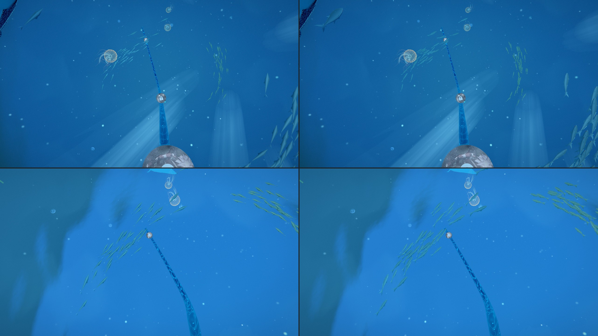
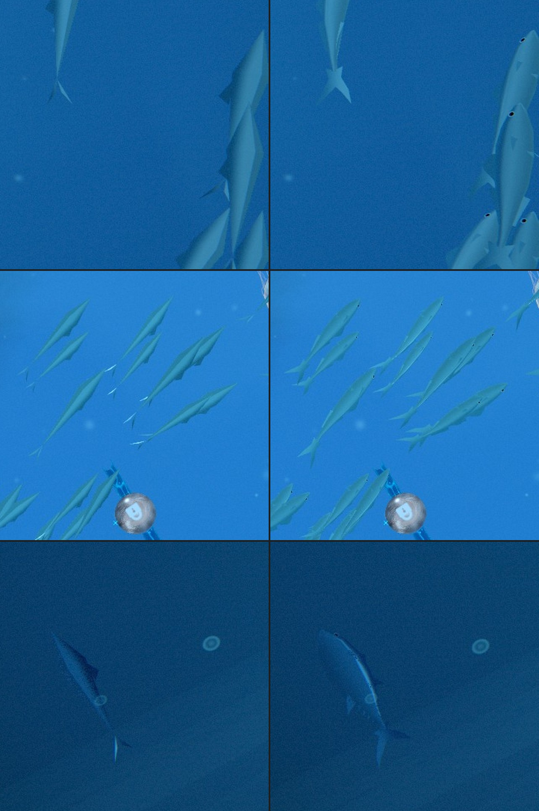
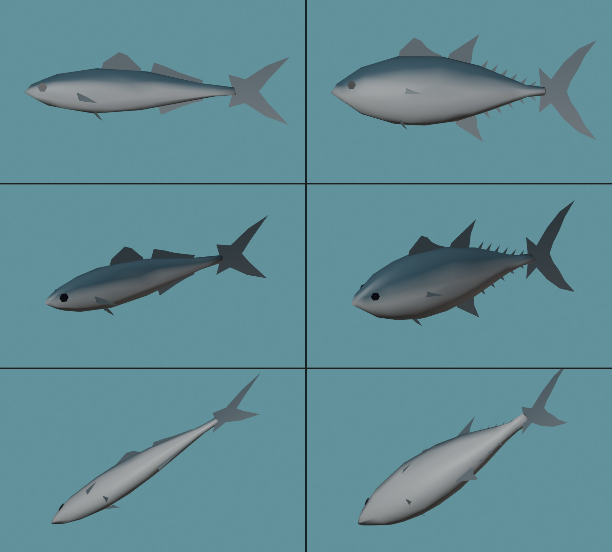
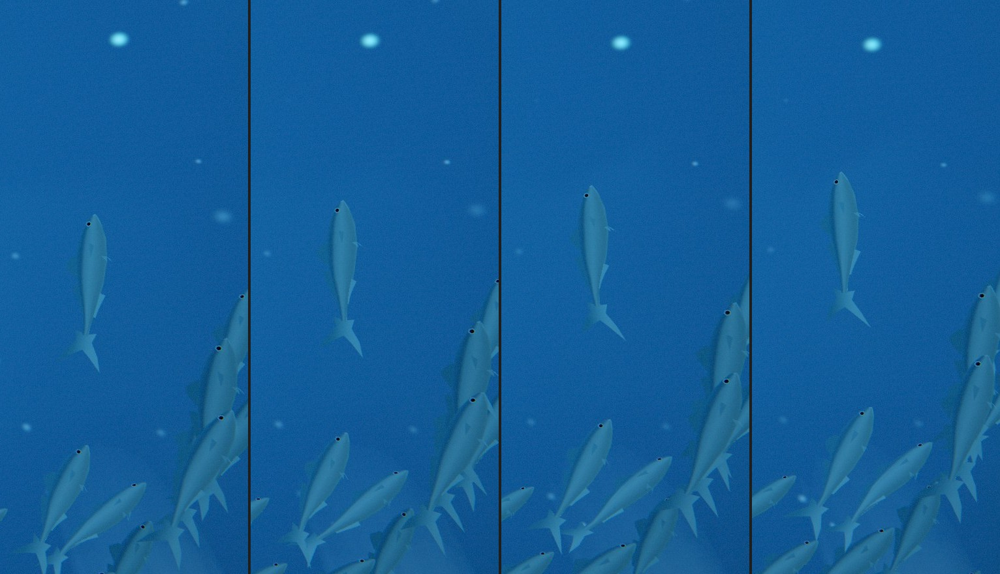
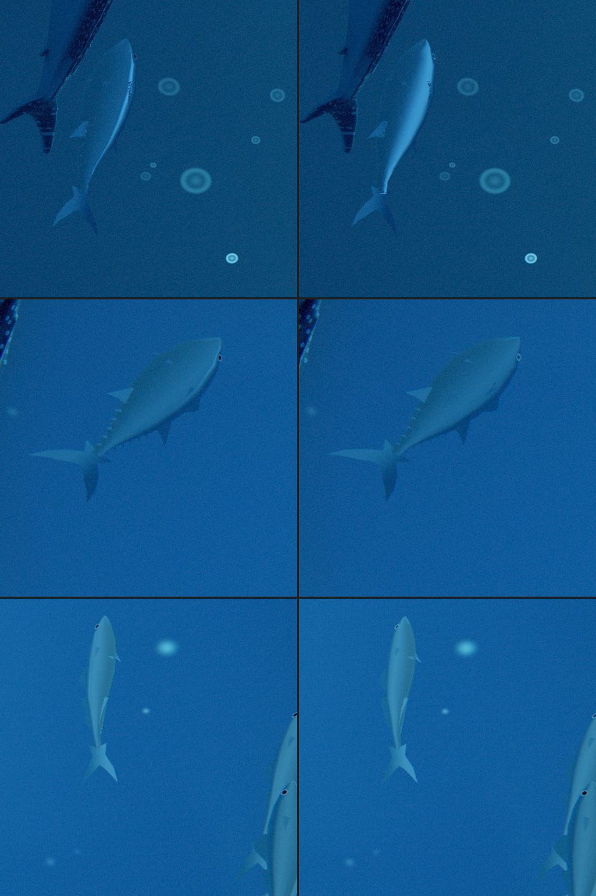
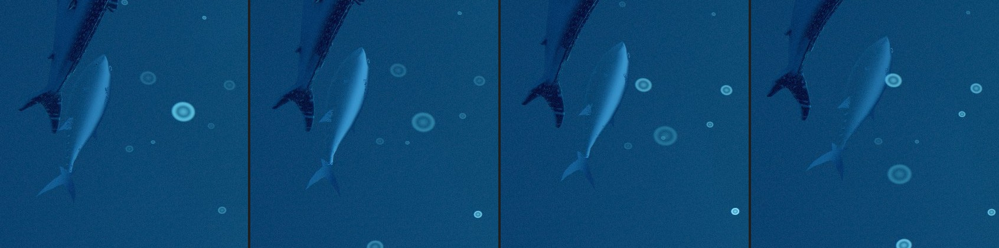

# Odyssey chapter 2: fish modelled in Blender (2026-11-01)

The four fish schools of the deep ocean climb were one code-built hull of 11 triangles. Up close
(the schools wheel overhead and round the rising eye) they read as faceted slivers. Olov agreed to
fish made in Blender. Now there are two:

- **a schooling jack** for the three schools: a slim, flattened body, a pointed snout, a big eye, a
  spiny first dorsal fin and a long second one with its mirror (the anal fin) below, small side
  fins, a thin tail stock and a deeply forked tail;
- **a tuna** for the big cruisers (the fourth school): a deep, round body that narrows to a thin
  keeled tail stock, a tall first dorsal, sickle-shaped second dorsal and anal fins, a row of small
  finlets above and below the tail stock, longer side fins and a sickle (moon-shaped) tail.



*Left: before. Right: after. Top: p 0.095, bottom: p 0.11, 2560 x 1440, the same moment of the
clock in both (the station script's clock is repeatable).*



*Close crops at game size, before (left) and after (right): a near school, a school passing the
rail, a tuna.*

## How big they are in the game

Measured on the real rail camera at 2560 x 1440 (a fish's length on screen):

| | nearest seen | typical |
|---|---|---|
| school 1 (silver, f 0.30) | 250 px at 30 u | 95-100 px at 65 u |
| school 2 (teal, f 0.55) | 200 px at 39 u | 60-95 px |
| school 3 (gold, f 0.84) | 160 px at 56 u | 50-75 px |
| cruisers (tuna) | 280 px at 50 u | 140-190 px |

So the fish needed a few hundred triangles, not a dozen.

## The models



Built by `scripts/blender/odyssey/odyssey_fish.py`, headless:

```
blender -b --factory-startup --python scripts/blender/odyssey/odyssey_fish.py -- \
    [--out src/rendering/odyssey/world/odyssey-fish-hulls.js] [--preview <dir>]
```

- Each body is a dense loft (56 sections of 32 points, 3,584 triangles) along drawn profiles (back
  line, belly line, width). Blender's Decimate (collapse, mirror-symmetric) brings it down to the
  count the game size needs. Smooth normals.
- Fins are thin sheets with their roots sunk into the body. The eye is a small disc laid on the
  body's surface (a ray cast), with a dark pupil and a paler iris.
- The script writes a plain JS module of arrays (`odyssey-fish-hulls.js`, 26 KB). No file is
  fetched and nothing loads late. The same script writes the same file every time.
- `--preview` renders both fish from six sides, plus a sheet at game size blown up with hard
  pixels (`images/odyssey-fish-2026-11-01/blender-game-size.jpg`).

| hull | triangles | of which body | vertices |
|---|---|---|---|
| old code-built hull | 11 | 11 | 33 |
| jack (school) | 214 | 156 | 156 |
| tuna (cruiser) | 301 | 228 | 229 |

Each vertex also carries how far along the fish it is (nose 0 to tail tips 1), how far up its
side (belly 0 to back 1), how loose it is (fin roots 0 to trailing edges 1) and what it is (body,
fin, eye).

## In the game

`src/rendering/odyssey/world/odyssey-fish.js` (moved out of the world renderer, which now calls it).

- **Still one draw.** Both hulls sit in one geometry. Each fish keeps its own hull and folds the
  other one to a point, which draws no pixels. One pipeline, built with the world, as before. It
  is now drawn in one pass instead of three's two (back faces, then front faces, for a two-sided
  see-through material), so the draws per frame went from 2 to 1.
- Per frame: 150 fish, 57,750 vertices through the vertex stage, 33,840 triangles that draw (the
  other hull's 43,410 fold away to nothing).
- **Unchanged:** the four schools' paths, counts, sizes, colours, the dark back and pale belly,
  the flank flash, the 1->2 steam rule (`behindSteamDepth`), the 1->2 fade-in by size, the
  see-through-the-surface rules after the breach (`seenFromAbove`), the draw order (after the
  sea, before the jellies).

### The swim

A real fish's body wave, in the vertex stage (no bones):

- the wave starts at mid-body and grows toward the tail, so the forked tail sweeps widest;
- the head yaws a little the other way (the recoil);
- the jack beats in a wave about one body long; the tuna's body stays stiff and its beat lives
  at the tail stock and the sickle tail, slower;
- the fins' trailing edges lag a quarter beat;
- a small roll goes with each fish's slow swerve (a fish leans into its own turns).



### Shading

- The normals are the model's own, bent by the same wave, so the light slides along the flank as
  the body flexes. I checked the old way (normals from screen-space slopes) on the new model:
  every triangle showed as a flat patch. The real normals look smooth.
- The back darkens upward to a fairly crisp back line. The line is softened by its own size on
  screen, so the edge of a fish seen from below does not freckle.
- The flank flash is kept to the silver flank that faces the eye. On the first try a smooth flank
  seen almost edge-on flashed as a bright hairline along every fish's edge, and on the back of the
  tuna. Fixed. (A last hairline on the tuna was fixed at its cause the same evening: the flash now
  uses an upright mirror, see "Polish".)
- The body's inside faces are not drawn. When they were, they fought the outside faces along
  every edge and left dark specks.

## Checks

- `tests/unit/odyssey-ch2-fish.test.js` (new): the hull data (each body closed, wound outward,
  mirror-symmetric, inside the old hull's length, every baked value in range, triangle budgets),
  one geometry and one draw under eight vertex buffers, the swim (grows to the tail, head
  opposite, tuna stiffer), the material builds for WebGPU and the WebGL2 fallback without a
  warning, and the world draws it by the sea's rules.
- Every test that builds the world passes (34 files, 408 tests), plus typecheck, eslint, the
  ts and lint ratchets, depcruise and the architecture fitness check.
- Live game, 2560 x 1440, p 0.08 / 0.095 / 0.11 and a frame series: no console errors.

## Not done

- **No sea turtle.** Chapter 2 already has the whales, the whale shark, the manta, the jellies
  and four schools; at p 0.08 a frame often holds most of them at once. A turtle would crowd it.
- No new URL lever: the fish are not new. (`?odysseyFish...` does not exist; to compare, check out
  the commit before this one.)
- ~~The tuna's finlets show as a fine serrated edge at game size; on a tuna seen from below and
  side-on, a pale line still runs along the flank just under the dark back.~~ Fixed the same
  evening: see "Polish" below.

## GPU timing (lead, 2026-11-01 evening)

Timed with the birds, deer and fish together on the RTX at full speed (2560x1440, High, two rounds,
main against this work at the same stations: p 0.095 and 0.11 the fish, 0.168, 0.194 and 0.22 the
deer, gulls and swallows, 0.31 the swallows and geese, 0.62 the summit kettle). GPU time per frame
was within 0.07 ms of main at every station (for example 2.10 ms both at L15, 1.18 against 1.11-1.18
ms at the kettle), so the new animals cost nothing measurable there.

## Polish (2026-11-01 evening)

Olov: *"The tuna show a thin pale line along their sides."*



*Left: before. Right: after. The clock is frozen (the same moment in both), 2560 x 1440 crops at
2x. Top: a tuna seen from below and the side (p 0.08). Middle: a tuna side-on (p 0.095). Bottom: a
near jack (p 0.095).*

**What drew the line.** I switched the shading terms off one at a time on a frozen frame (the flash,
the light, the colour) and drew each term on its own. The line was the **flank flash**, and only it.
The flash treated the skin as a curved mirror. A round body acts like a chrome pipe: it reflects the
bright surface along one thin strip, right where the flank turns toward the back. On a tuna seen
from below and the side, that strip landed just inside its edge as a pale hairline.

**The fix, at the cause.** A real fish's silver is a layer of tiny upright mirrors in the skin,
standing parallel to the body whatever the curve of the flank over them. (That is how a silver fish
hides in open water.) So the flash now uses the fish's own sideways direction as its mirror. It
still rolls with the fish and bends with the swim, but it ignores the curve of the skin. Three
things change:

- A flank now lights as a whole, softly, and melts into the belly and the back: no hairline.
- The flash is how much brighter the mirror's light is than the water behind the fish. A fish seen
  from straight below sends you water as bright as what is behind it (the camouflage), so it stays
  a dark shape. It flashes only when a roll or swerve tips the flank up toward the surface, and it
  fades as the fish rights itself.
- The tuna's flash is now 0.4 of a jack's (it was the same). A big, slow fish holding a roll
  otherwise glared.



**The audit (both fish, in motion, from below and side-on):**

- **Freckled side fins (fixed).** The tuna's side fins (pectorals) sweep back along a flank that
  keeps widening behind them. Half of each fin lay almost in the skin, and the two fought over which
  was in front, so the fin drew as a freckled patch. The Blender script now lifts every free point
  of the side fins at least 0.05 off the body, so each fin leaves the body at a clear angle. A test
  holds it: the old model fails it with a fin point 0.003 off the skin.
- **Finlets (softened).** Smaller: 0.10 and 0.09 instead of 0.13 and 0.12. Seen edge-on they had
  drawn a dotted line along the tuna's back; now they read as a light serration.
- **Eyes (kept dark).** The new flash would have whitened the whole eye disc at some angles. The
  eye keeps only a faint glint.
- **Left as is:**
  - A jack seen from below shows its anal fin edge-on as a slightly lighter line along the belly.
    That is the real fin, and it was there before.
  - A few pixels of the tuna's first dorsal fin show edge-on at the top of its head.
  - Nothing sparkled or popped in the frames, and the console stayed clean.

Same counts as before: 214 and 301 triangles, one draw, no new pipeline (the flash change only
reworks the shader's terms). New tests: the side fins keep off the flank, and the flank flash comes
from the upright mirror in both the WebGPU and the WebGL2 shader.

## The school moves as one (2026-11-03)

Part of the sea-motion pass (docs/ODYSSEY_SEA_MOTION_2026-11.md, section 2). The hulls are
unchanged; how the fish move is new:

- Each fish points where it goes: its heading is its path's own velocity. It used to sway ±14
  degrees on its own clock while sliding along the path, up to 50 degrees sideways.
- The school follows its leaders: its meander, rise and fall and surge of pace are laid out along
  the ring, so every fish swims the path of those ahead. A turn and the flank flash run back through
  the school as a wave.
- No two fish meet: the rest places are relaxed apart at build time (91 of 150 fish used to pass
  through a neighbour; now none does).
- The tail beat follows the pace (its phase is the distance swum), and the body bends and leans
  into the curve it swims.

`fishPoseAt` is the CPU twin of the vertex stage; tests/unit/odyssey-ch2-sea-motion.test.js reads it.
