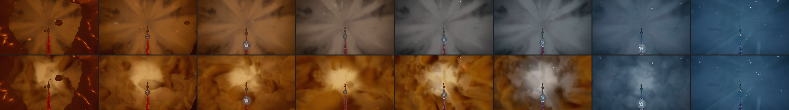
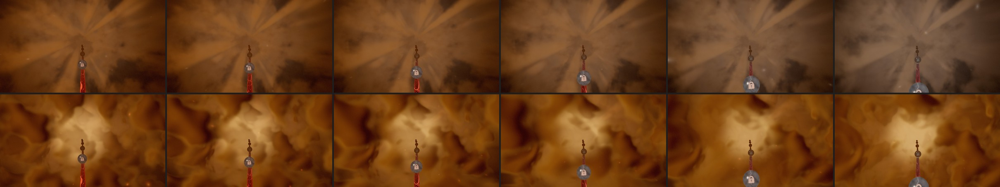
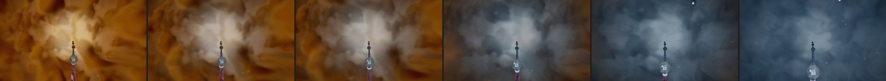

# Odyssey — Chapter 1: Genesis (2026-10)

**Status: LANDED on `feature/odyssey-ch1-genesis`.** The owner's brief: improve Earth Core's
visuals and atmosphere "in the best way you can think of" — "this amazing start of Odyssey mode".
Builds on the [Act I rebirth plan](ODYSSEY_ACT_I_REBIRTH_PLAN_2026-08.md)'s light language (ONE warm
key below — the lava — and darkness-gated response; painterly softness) and on the masterpiece and
seamless passes (the First Heart on the rail, basalt bundles, fissure fields, the lit steam shaft).

## 0. What the opening looked like (captured, main `bbdf5390`)

- The lava lake: a flat saturated red sheet with soft dark blotches — a texture, not a lake. Its
  fine structure disappeared at the grazing opening angle, and the entry basin is mostly molten
  by design, so up close it was uniform.
- The cavern: the vault was black with ember squiggles right down to the lake's far edge — a
  night sky, a ruler-straight horizon, and a black band (the vault BELOW lake level, visible
  beyond the lake's 180 u rim). Nothing showed that the lava is the light of the place.
- The climb: the vault's veins read as flat orange stickers; a 74° teal BOW-TIE fanned out of
  the frame centre on every climbing frame (the "crack at the crown" selected every azimuth
  within ~37° of one axis); sparks were round dots.
- The steam: beige-grey mud between the fire and the water.

## 1. What changed

| Change | Where | What the player sees |
|---|---|---|
| **The lake lights the cavern** | `createVolcanoBackgroundTSL` | the walls glow with the lake's light just above and just below lake level (the black band becomes the glowing far shore), fading with height and breathing with the lake's surge; a faint long tail warms the upper vault the climb looks into. The darkness-gated veins recede where it glows. |
| **The lake mirrors the lit walls** | `createLavaFloorTSL` | grazing sheen in the walls' warm glow (was blue-black obsidian); the far lake hazes into lake-lit air (was near-black smoke) — floor, air and wall read as one chamber |
| **Crust plates on the melt** (High) | `createLavaFloorTSL` + `lavaPlateField` | irregular dark floes jostling on the melt, seams from hairline cracks to wide molten gaps glowing orange with yellow-white cores, open molten rivers where it runs hottest; faded out before grazing range (no aliasing); seams quench silver → teal with the veins |
| **Glowing cracks** | vault veins | a thin hot yellow-orange core in a soft red halo (the same ridged field), not flat orange blobs |
| **The crack at the crown** | vault | a narrow, jagged, rock-bridged fissure round the zenith — the First Heart sits in it — faint early, widening with the ascent |
| **Sparks with speed** | `createRisingEmbers` | each spark stretched along its velocity projected off the view axis (risers up, splash sparks on their arc), up to 3.2× side-on; gold, not white (stretched white-hot sparks read as snow) |
| **Golden steam** | `odyssey-steam-quench.js` | the warm half is amber/gold (shadows 0.34/0.17/0.08, gold STEAM_WARM, less whitening while warm); the pearly flash still peaks at the crossover |

## 2. Verification

- Chapter captures (WebGPU, High, settle 3500) at every step; no console errors.
- Seam 1→2 luma gate: PASS, maxStep 43.1 (the steam ramp's own step; 42.6 before this pass). The
  climb sits at luma 17–22 (thinner veins alone had dropped it to ~14 and pushed the step to 44.6 —
  the long glow tail fixed that).
- Earth Core tests, the TSL build test and the steam/cloud-bank tests pass.

## 3. Performance

Lane A (RTX 3070, High 1080p, GPU p50 ms; `baseline / baseline-repeat`), the Genesis branch vs
main `bbdf5390`, alternating per station:

| Station (p) | Main | Genesis | Draws |
|---|---|---|---|
| 0.003 — the opening (the lake) | 0.85 / 0.85 | 0.92 / 0.92 | 56 → 56 |
| 0.02 — the climb | 1.11 / 1.05 | 1.18 / 1.05 | 56 → 56 |
| 0.051 — the steam | 1.11 / 1.11 | 1.18 / 1.18 | 70 → 70 |

About one timer tick (~0.066 ms, 6–8 %) at each station, no new draws or materials. The crust
plates (18 hashes per lake fragment) are High-only — Medium/Low (Lane B) compile the old lake
graph; the vault's crack/glow terms (3 baked-noise lookups, 2 exp) are on every tier.
JSONs: `repos/odyssey-gpu/perf-baseline/ch1g-1/`.

## 4. Open items

- ~~The First Heart is still a radial sprite~~ — DONE (follow-up, `ce0aaf8b`): a living flame
  seen from below — tongues licking out from a white-hot core on their own flicker, curling as
  they reach, coloured white-hot -> gold -> orange -> deep red, beating a slow lub-dub every 2.4 s;
  the seam quench shrinks the tongues and walks the ramp down. Same sprite, same draw.
- ~~The floating molten geodes are low-poly "potatoes"~~ — DONE (`ce0aaf8b`): `shapeMoltenBoulder`
  shapes the pockets' and the lake geodes' spheres in place into lumpy, pitted volcanic bombs
  (deterministic multi-scale Perlin; closed shell, welded seam normals, UVs kept). Seam 1->2 PASS
  (42.9).
- ~~The steam is warm tan rather than truly luminous gold~~ — DONE (2026-11-01, §5 below): the
  climb is now golden steam with billows, depth and a glowing heart, inside the same seam gate.

## 5. The golden climb (2026-11-01)

The owner's ask: make the last stretch of the climb (chapter-local ~0.8-1.0, p ~0.052-0.065) a
luminous, golden steam with shape and depth, while it still hides the hand-over to chapter 2.

### What the player saw

From p ~0.045 the steam fills the frame. It was one flat tan haze with a starburst of straight
rays from the centre (it read as a zoom blur) and dark stains. From p ~0.058 the hue started to
leave gold, so p 0.058-0.065 was brown-grey, then grey at the boundary. Nothing in it moved
toward you, so the climb had no depth. The sparks had already turned white-blue.

### What changed

| Change | Where | What the player sees |
|---|---|---|
| **Decks of vapour you climb through.** Three horizontal sheets of billows at fixed heights above the eye (10 u apart). The view ray meets each sheet (no ray march); they are laid front to back. Near sheets are big and fast, far ones small and slow. They fade in far away and out before they reach the lens, and they rise slowly (0.9 u/s), so a parked eye still sees steam streaming up. | `steamDecks` in `odyssey-steam-quench.js` | real parallax: billows open out past you as you climb |
| **Billows lit by the lava below.** Each billow has a bright flank toward the lava's light and a lee that falls to deep ember (not brown). Thin vapour glows with the light above; a thick billow in front of it stands a little darker. Far sheets sink into the lit air between them. | same | shape and depth instead of a flat haze |
| **A light at the end of the climb.** A white-gold heart at the zenith. The sheets are thinner along the vent's axis, so billows cross the light rather than block it. The gaps show lit air that brightens toward the light (the old dark shell behind bright billows read as camouflage). | same | the steam glows; the eye climbs toward light |
| **Gold to the end, then the sea's light breaks through.** The hue turn is narrower and later (warmth 0.475-0.53, was 0.46-0.64), and it starts at the light ahead and reaches the vapour round the eye last, broken up by the billows. At the boundary the heart is pearl white while the near billows are still lava-lit; just after, blue spreads outward. | same | gold from p 0.045 to ~0.064; the turn reads as fire meeting water, not as grey fog |
| **Brighter highlights, same average.** The exposure ceiling is 9x the luminance cap (was 3.6x) and the soft shoulder starts at 1.5 (was 0.7), so the heart and lit flanks can glow while the average stays on the seam's brightness ramp. | same | luminous, not dim tan |
| **Sparks stay embers.** The rising embers and near sparks whiten into steam flecks when the steam itself turns (`uFlecks` = 1 − `steamQuenchWarmHue`), not with `uSeam` (local 0.70-0.86). | `earth-core.js` | gold sparks rising and dying in the gold steam |

Unchanged on purpose: the shell's opacity (density curve, alpha), the window widths, the scene fog
weight and `behindSteamDepth`. The decks only change the shell's colour. At the boundary the shell is
still fully opaque, and the sea's life is still drawn behind it and arrives whole as it clears.
No new draws, materials or textures: it is the same one shell draw.

### Verification

- **Seam 1→2 luma gate** (`odyssey-chapter-capture.mjs --seam=1-2 --settle=6000`, then
  `odyssey-seam-luma.mjs`): **PASS, maxStep 29.5** (main before this pass: 23.9; the 43.1 in §2 was
  an older layout). The curve, before → after: p 0.0409 32.6 → 37.1, 0.0469 45.6 → 49.7,
  0.0529 59.9 → 67.4, 0.0589 73.1 → 78.8, 0.0649 79.7 → 82.6, 0.0689 71.1 → 71.3. The steepest step is
  now the rise into the steam (0.0469 → 0.0529); the step down after the boundary is −28.1.
  A first cut had the pearl heart brighter (boundary 87.1, step −39.5); it is dimmed by a third while
  the hue turns.
- Captures (WebGPU, High, 1600x900, 30 fps cap, a frozen clock for before/after): no console errors
  or WebGPU validation messages.
- **WebGL2** (`?forceWebGL=1`) p 0.054, 0.0635, 0.0649, 0.067: the same look, console clean.
- Tests: `odyssey-steam-quench.test.js` (new: the shell builds for WGSL and GLSL, no unassigned
  reads), the Earth Core environment / drawable budget / shaft / lake tests, the world carry test,
  the TSL build test, the act I arrivals and ocean visitors tests: all pass.

### Cost

One full-screen draw as before; the decks add 18 value-noise lookups per steam pixel (about as
many hash calls as the shell already did).

Measured on the RTX at full speed (Balanced, 2560x1440, High, two rounds, GPU time per frame):

| p | before | the golden climb |
|---|---|---|
| 0.052-0.065 (the decks show) | 1.5-1.8 ms | 2.2-2.8 ms (+0.65-0.9) |
| 0.067-0.070 (the exit murk) | 1.8 ms | 2.4-2.6 ms at first; 1.8 ms after the switch below |

Two changes followed (same day):
- **The decks only run where they can show.** A uniform switch (`uDecksOn`) skips their noise
  while the steam is thin or has become the exit's murk, where they never showed. That gave back
  the ~0.7 ms over p 0.066-0.09.
- **Decks per quality tier** (`STEAM_DECKS_BY_TIER`): High 3, Medium 2 (the iGPU lane), Low none
  (the vapour as it was, with its old highlight settings). The hue's later turn and the sparks
  that stay embers are on every tier.

### Tried and dropped

- Round "pouch" billows (a cell field of domes, lit as spheres): hard faceted creases, read as bubble
  wrap.
- Crisper value-noise billows (a fourth octave, a tight edge): torn-paper camouflage.
- A dark shell showing between bright billows: camouflage again; the gaps are now lit air.
- A ring-shaped hue turn (centre first, a sharp radius): a visible porthole; the turn is now broad
  and broken by the billows.

### Open

- Light shafts from the lava rising through the steam were not added; the lit flanks and the heart
  carry the light. They would need a short march per pixel.
- The near deck is soft (it is close); fine detail lives in the far decks.
- p 0.0652-0.0658 (half a second of travel) still passes through a brownish grey at the edges while
  blue spreads from the centre.
