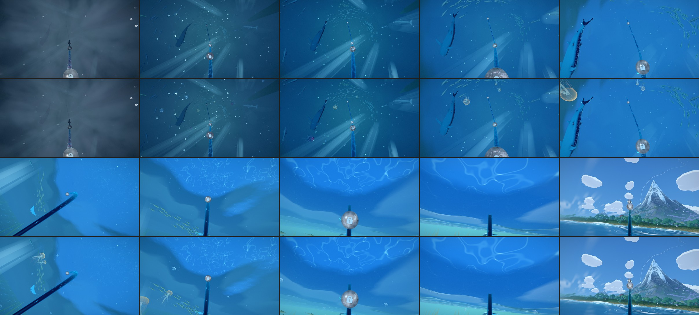
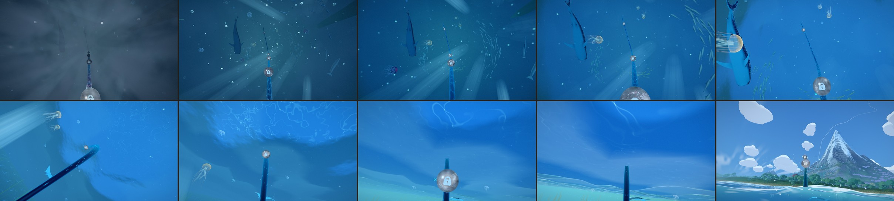
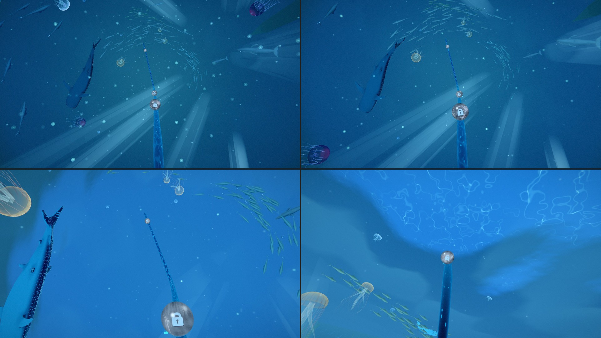
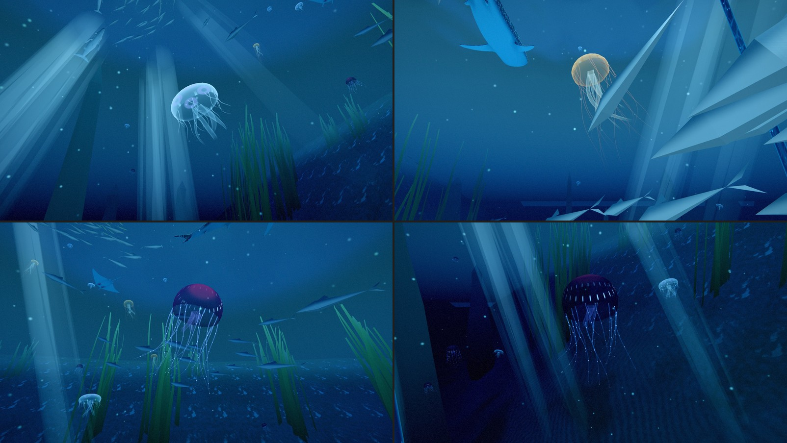
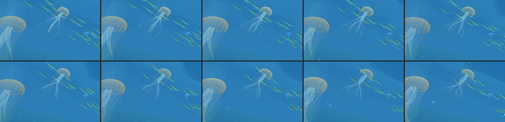
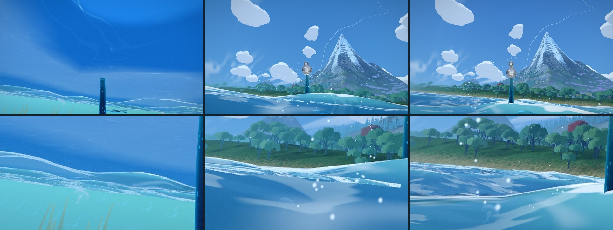

# Odyssey chapter 2: jellyfish in the open water (2026-11-01)

Chapter 2 (Deep Ocean, p 0.0649 -> 0.1427) is the climb from the sea floor up through open water to
the breach. Its big animals (whale shark, manta, mother and calf) swim long loops and are in frame
only part of the time, so between their passes the water read as "atmospheric but sparse"
(docs/ODYSSEY_CHAPTER_AUDIT_2026-10-22.md). Jellyfish were on the research list and never tried
(docs/ODYSSEY_OVERHAUL_ACT1_2026-10.md §5).

## What changed

A drift of 29 jellyfish now hangs in the water the climb passes through. They are drawn in one
draw call (`world/odyssey-jellyfish.js`), and where each one lives and how it moves is a small pure
module (`composition/odyssey-jellyfish-drift.js`).

**Three kinds**, chosen to sit in the chapter's blues:

- **Moon jellies** (15): flat, glassy pale-blue domes with four lilac rings, a fringe of short fine
  tentacles and four short frilly arms. Through the whole column.
- **Sea nettles** (6): amber bells with rust stripes, long cream arms that twist round each other and
  long fine rust tentacles. The upper half, toward the light. The warm accent, as the gold fish
  school is.
- **Lanterns** (8): small dark deep-sea bells with a crimson crown, a ring of small blue lights that
  a wave runs round now and then, and tentacles with a few blue sparks. The deeper middle of the
  climb, where the water is darkest and their light reads.

**How they move.** Each jelly beats: the bell squeezes in fast (a quarter of the beat) and relaxes
slowly, its rim pulling in and down and its eight rim lobes rippling. It glides up its own axis on
the squeeze, coasts, and sinks back between beats, so it bobs where it hangs. Its axis leans a
little and turns slowly, so over a few minutes it drifts round a small loop (1.5-5 u from its
centre). Bigger bells beat slower. The tentacles and arms lag behind the bell: each point down a
strand sits where its root was a moment earlier, so every beat's surge runs down them and they
trail through the turns. They also sway slowly. Everything is a function of the clock alone. The camera passes them; they
never move with it.

**Where.** The places came from a search on the real rail camera (the same camera the tests use),
over the drift up the ocean from eight clock phases and at the orb parks. It kept every jelly:

- in reach of the frame somewhere on the climb, a few at a time;
- clear of the eye (at least 8 u, or three bell radii), the rail, the orbs and the big animals'
  routes;
- under the surface and above the sea floor;
- never in front of an orb or the rail ahead on screen.

Only 8 of the 29 pass near the climb (16-30 u from the eye at their closest). The rest come no
nearer than 33-85 u: small glowing bells high in the column or along the water.

**The sea's rules**, as the fish and the visitors keep them:

- They are there from the 1->2 boundary, behind chapter 1's steam: they are drawn before the
  steam's shell and write their depth behind it, so the steam covers them and lets them through as
  it clears. Nothing fades in as it thins.
- After the breach they stay drawn while any jelly in view still shows through the surface, seen
  with the sea's own reflection and the water's absorption (`throughSurfaceNode`), and they leave
  by fading into the water or leaving the frame. Under the water that changes no pixel.

## Measured (real camera, 8 clock phases, the climb at the drift's pace)

From the end of the dense steam to the breach (1,488 frames):

| | |
|---|---|
| frames with no jelly in frame | 0 |
| frames with two or more | 99.9 % |
| frames with one at least ~40 px tall (of 900) | 93 % |
| jellies in frame on average / at most | 5.2 / 8 |
| over an orb or the rail ahead | 0 of 8,934 sightings |
| orb parks 6, 8, 9 (two or more) and 10 (one or more) | 100 % of the clock |

"In frame" means the bell is at least ~8 px tall and near enough to read through the water (up to
~135 u looking up into the light, ~85 u looking along the water).

## Pictures

## Honest notes

- **Looks good:** the close-ups. The moon jelly reads as a moon jelly (its four rings, its fringe),
  the sea nettle's amber bell and long arms read well, and the lanterns glow in the dark water. On
  the climb they give the water depth: small bells high up, a few passing close at the frame's
  edges.
- **Restrained by design:** at full frame most jellies are small (10-40 px). On a contact sheet they
  nearly vanish; at full size they read. If Olov wants more of them, the place to start is a few
  more near passes, not more far ones.
- **The lanterns are the strongest colour** (crimson crowns). They are few and in the darkest water,
  but if they feel too loud the crown colour is one number (`JELLY_LOOK.accent`).
- **The lanterns' tentacles** carry small blue sparks; up close they can read a little like a string
  of lights.
- **The last ~5 u under the surface** (p 0.132-0.135) has one or two jellies, faint against the
  bright shallows; the manta owns that stretch.
- **An orb close-up** (after choosing an orb) was not scored, as for the big animals: the camera
  there is not the rail camera. Every jelly keeps 10 u from every orb.
- The places were scored on today's rail camera. If the chapter 2 camera changes, the test will say
  which limit broke.

## Tests

`tests/unit/odyssey-ch2-jellyfish.test.js` (new):

- the beat: fast in, slow out, the glide, the bob, bigger bells beat slower;
- the material builds for WebGPU (WGSL) and the WebGL2 fallback (GLSL) with no warnings, and no
  value is read before it is set;
- one draw of one small mesh (under eight vertex buffers);
- on the real camera: never empty water, two or more almost always, a near one for most of the climb,
  never a crowd, a few at every orb park, never over an orb or the rail;
- clear of the eye, the rail, the orbs, the sea floor and the surface; out of the big animals' way
  and apart from each other (600 s of clock);
- the breach: the glide from orb 10 to orb 11 (24 clock phases, two paces) never switches them off
  while one is in frame and would still show through the surface;
- the world: one mesh, behind the steam, after the sea and the fish, there from the 1->2 boundary and
  never on the cavern side.

## Cost

One more draw call and one more pipeline (built with the world). 29 jellies x 801 vertices
(~23,000 vertices, ~27,600 triangles). The shader places every vertex from the clock (three
evaluations of the jelly's motion per strand vertex). The fragment cost is small: translucent,
mostly a few pixels each. No textures. No CPU work per jelly under the water; above it, a check per
jelly per frame until none in view still shows. Not timed on the GPU (captures only, kept cool).
