# Odyssey chapter 6: a space masterpiece (2026-10-31)

Olov: *"how can we make chapter 6 less clutterly and more visually impressive? I want a more epic
visually experience in chapter 6."*, then *"Now start improving this chapter so it becomes a space
masterpiece experience. You can start working on all steps."* Along the way:
- *"I guess the black hole in the black hole theme looks like the gargantua in interstellar."*
- *"And remember, chapter 7 are 'inside' the black hole."*
- *"why do we need this neon line into the black hole, cant just the orb path go into the black
  hole???"*
- *"how can we make the galaxy more impressive? can we be inspired from the galaxy theme?"*
- *"The galaxy feels to much as a photo right now! We can do better so it feels like in the galaxy
  theme! and can we have it a bit more down to the left????"*

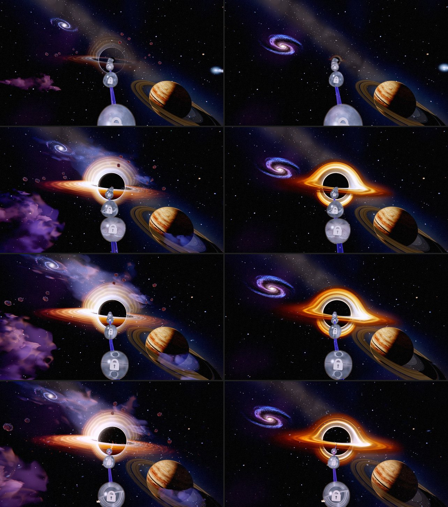

## 1. A sky, not a crowd (`CH6_AMBIENT`, cosmic-expanse.js)

From ~p 0.81, one frame held all of these at once, so nothing led and nothing was big:
- the black hole, the ringed giant and the galaxy;
- a lumpy violet gas field, drawn over the giant's lower half;
- a garland of twelve red rocks round the hole;
- near dust like falling snow, glitter in the disk's plane, and a comet.

The layers that only added noise are no longer built: the gas field (the dome's painted Milky Way
and nebulosity carry the colour), the rock garland, the near dust and the disk glitter. The far fine
dust stays for parallax, the streaks for the pull, and the comet. `?odysseyCh6Clutter=1` (or
`options.ambient`) builds them all again for a side by side. Tests that cover those layers build
with `CH6_AMBIENT_ALL`.

## 2. The black hole, traced (odyssey-gargantua-lens.tsl.js, odyssey-gargantua-gas.js)

The hole (chapter 6's omen and chapter 7's Gargantua) was painted from parts:
- a black sphere and a thin ring mesh;
- two torus arcs standing in for the disk's far side;
- a flat band for the disk.

Up close it read as a target of glowing hoops. It is now the Black Hole theme's hole, re-derived for
Odyssey (theme code is never imported): one material that traces every view ray through
Schwarzschild spacetime. The photon path x'' = -(3/2) h² x / |x|⁵ is stepped symplectically inside
a bounding sphere, with the closed-form bend outside it. Everything that makes Gargantua read comes
out of the bend:
- the far side of the disk arching over the shadow and tucked under it;
- the thin photon ring;
- the brighter approaching side (beaming);
- the glowing gas (a Gaussian sheet integrated in closed form along each step).

The disk is the theme's gas texture (re-baked in steps), sheared Keplerian and lit by a blackbody
ramp.

**What is different from the theme.** The theme's material is the whole sky; here the sky is
already drawn and the board's post lens bends it, so the lens draws only the hole's light, on a
sphere round it, premultiplied:
- **Escaping rays:** what is behind shows through what the gas leaves of it.
- **Rays that fall in:** the chapter's own black shadow sphere shows through what the near gas
  leaves, so chapter 7's window into the singularity (on that sphere) still opens.
- **One shadow edge:** Rs = shadow radius / (3√3/2), so the traced edge and the sphere are the
  same circle.
- **The disk's plane:** the disk pivot's, the pose the painted band had.
- **Its glowing gas:** at 0.55 of the theme's, so the haze does not wash past the disk.
- **The painted hole:** `?odysseyPaintedHole=1` builds it again.

**Chapter 7 is inside the hole.** The 6→7 hand-over changes nothing: both chapters use the same
lens round the same shadow, in the same pose. Until 2026-11-02 the eye had to stay outside the
lens's march sphere (~4.5 shadow radii out), which it left at ~12.9° of hole, and the dive was handed
to painted parts (a razor ring on the silhouette, a flat band, embers). The traced hole now carries
the whole dive: see "The dive" below.

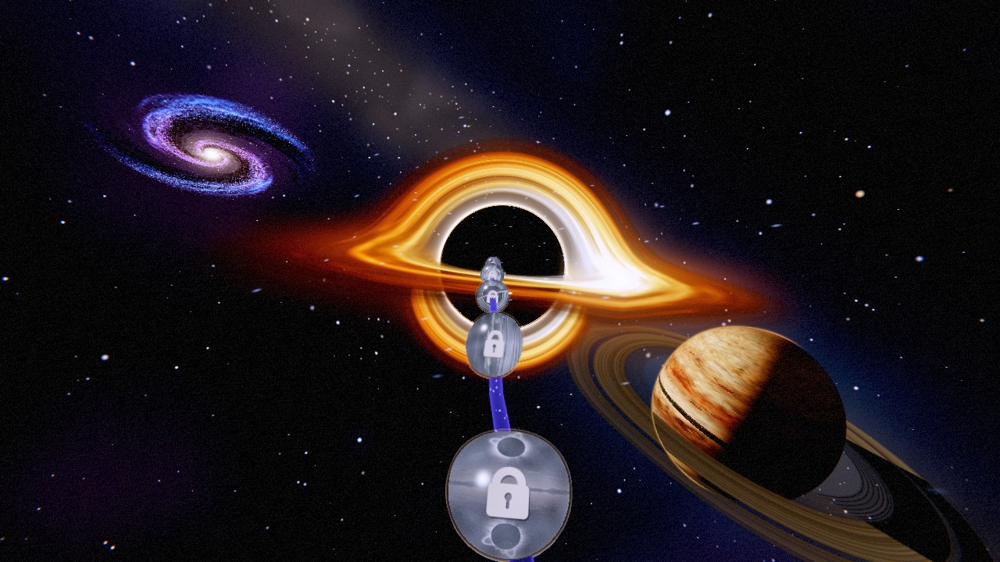

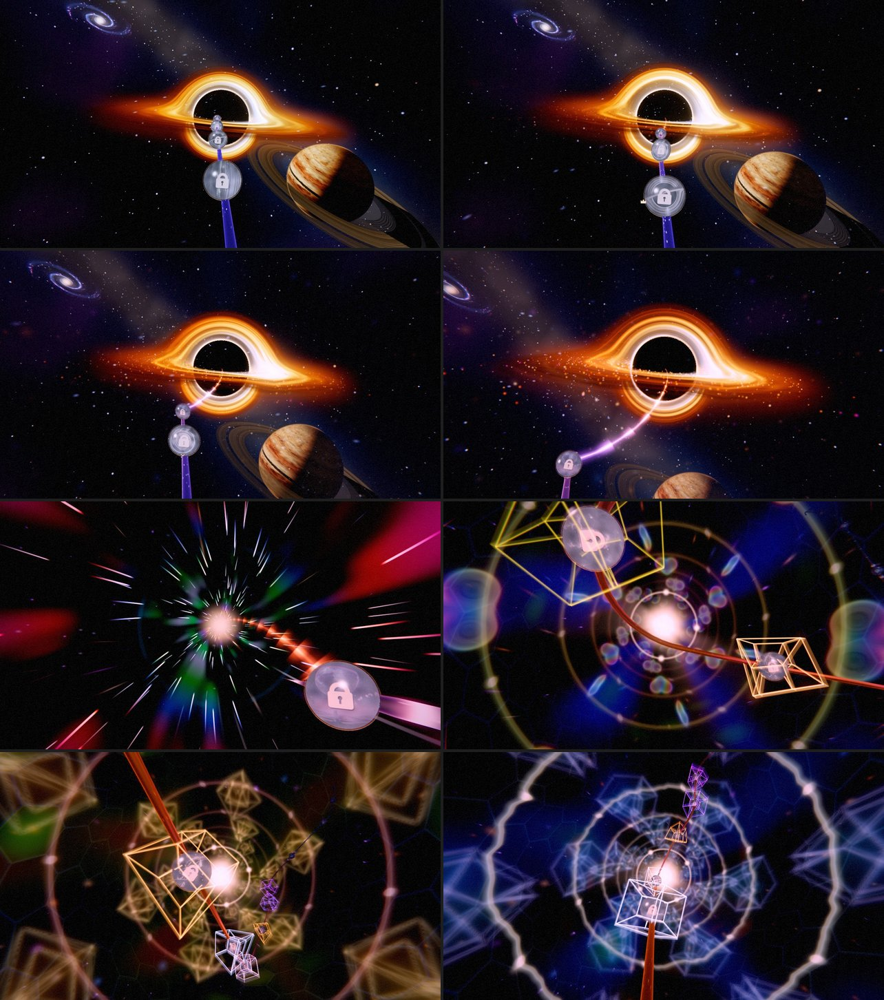

## 3. The orb path goes into the hole (odyssey-path-inflow.js, createPathInflowTSL)

Through chapter 6 the rail ends at chapter 7's first orb (the mouth), and the inflow carries it on
into the hole's centre. The inflow was a neon thread:
- a hot white core in a glow four times its width;
- heating to the disk's amber;
- flaring white at the photon ring.

It is drawn as the rail now:
- **Shape:** the ribbon's chapter-6 recipe, read across the strip as across a tube; the rail's own
  width (outerRadius 0.4, coreTail 1, thinning only with distance); a gentler curve (pitch
  0.42 → 0.15).
- **Colour:** an indigo body, the lavender line along its middle, the violet haze shell out to two
  radii, stardust riding in.
- **Blending:** blended over what is behind, like the rail, and swallowed into the dark toward the
  centre.

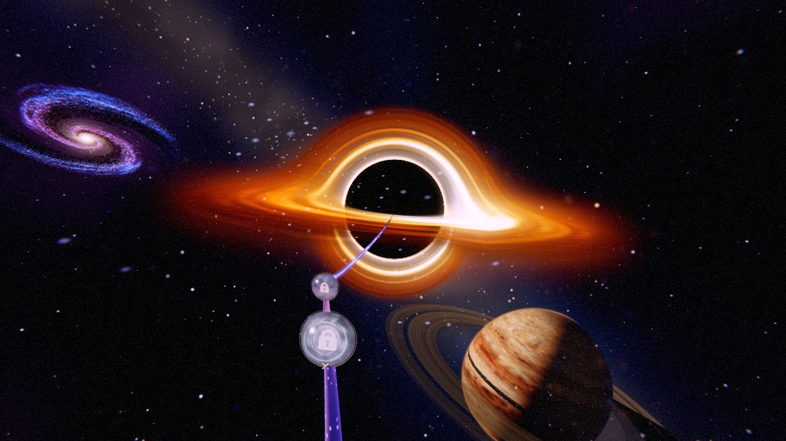

### The rail itself runs into the hole (2026-11-02)

The owner: "i dont like that neon line going from our path towards the black hole, can we extend
the length of that chapter slightly and use the orb path going into the black hole instead of this
neon line?"

**Why there was a line.** The black hole hangs on the camera's own aim, 900 units ahead
(`GARGANTUA_LOCK`). Through chapter 6 the rail is drawn only to the mouth orb, chapter 7's first
(odyssey-path-horizon.js).
- Up to p ~0.86 the camera looked at the rail ahead, so the rail and its orbs climbed into the
  middle of the hole.
- On the last approach, the camera's look-ahead ran on past the mouth into chapter 7's bend.
- By the mouth the aim was 31 degrees off the rail. The hole, which follows the aim, slid away from
  the rail, and the stream had to bridge the gap. Measured on the real camera: the mouth projected
  inside the hole's shadow up to p 0.86 and outside it from p 0.865 on.

**The fix: the camera never aims past where the rail is drawn** (`RAIL_END_AIM` in
OdysseyCameraController.js).
- As the look-ahead reaches the mouth, the aim is held on the mouth, eased in over 0.008 of
  progress.
- So the rail runs straight into the centre of the hole all the way to the mouth. Through the
  plunge the mouth orb waits at the hole's centre with the rail leading in.
- The hold lets go round the moment the way on is revealed inside the hole: from 0.010 before that
  starts to 0.004 after it ends. The reveal alone was too quick a swing. The seam continuity test
  holds the 6->7 crossing under its limits for eye, target and aim.

**The stream is off.** `?odysseyPathInflow=1` brings it back to compare.

**The chapter's length is unchanged.** Holding the aim did what the extra length was meant to do,
and every orb keeps its place.

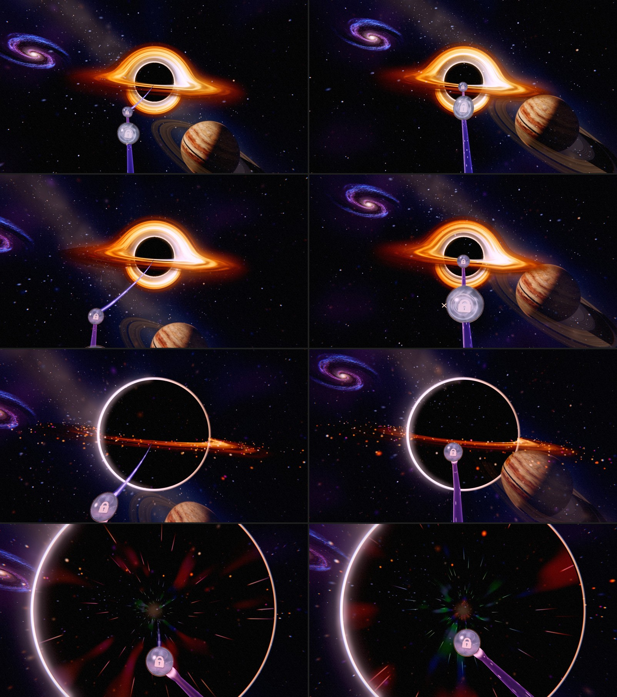

Tests: `tests/unit/odyssey-rail-into-hole.test.js`, on the real camera:
- the mouth stays inside the hole's shadow (within 0.6 of its radius) for the last 0.03 of the
  approach;
- the aim is within 2.5 degrees of the mouth on the last stretch;
- the hold is zero far from the hole and lets go inside it.

### The dive (2026-11-02)

The owner: "can we extend the length of that chapter slightly and use the orb path going into the
black hole instead of this neon line? Can you investigate that and really improve this visual
experience."

**What a film of the 48 → 49 trip showed** (the trip that dives: orbs 49 and 50 both park inside):
- **A static approach.** The hole is camera-locked, so it held its 8.3° from orb 48 to the mouth.
  For ~1.2 s the frames were the same picture.
- **A flat dive.** At ~12° the traced hole gave way to painted parts in one frame. The bent light
  went flat exactly as the hole filled the frame.
- **A short plunge.** From 8° to swallowing the frame took ~0.4 s.

**1. The hole looms on the way in** (`CH7_APPROACH`, odyssey-black-hole-fall.js).
- Its size is one approach from just before orb 48's park (`runIn` 0.0095 of progress) to the
  horizon.
- The eye closes on it at a steady pace, so it grows as one over the distance:
  sin α = sin(rest) / (1 − c·w).
- That gives ~14° at the mouth and on without a pause.
- From `landFrom` (60°) it eases onto the horizon's 72°, with the pace matched at the join.
- The old growth (u^1.9 from the chapter line) started from a standstill.
- The hole grows as the hero's scale (`poseGargantua`), so the post lens grows with it.

**2. The traced hole carries the dive** (`GARGANTUA_LENS_CARRIER`, odyssey-gargantua-lens.tsl.js;
`CH7_TRACED_HOLE`).
- **The march already worked with the eye inside its sphere.** It starts at the eye. In this
  model the shadow's edge stays on the black sphere from any distance (a ray is captured when
  |x × v| < 3√3/2, and from the eye that is the sphere's own angle).
- **The carrier was the problem.** The sphere that carries the fragments was drawn front faces
  only, and from inside there are none.
- **The carrier now shrinks to stay 120 u ahead of the eye.** That is behind the rail and the orbs
  (the mouth orb is never more than ~80 u out) and in front of the shadow's near surface (never
  nearer than 150 u).
- **Each fragment writes the depth of its own light** (`depthNode`): on the shadow's surface where
  the ray meets the shadow, at the ray's closest approach to the hole elsewhere. So the gas giant,
  nearer than the hole, now hangs in front of the disk. The carrier's depth had drawn the disk
  over it while the giant covered the shadow.
- **No gas within reach of the eye.** From inside the disk's radius, a physical disk is a floor
  across half the frame. The gas is cut off from 0.7 to 0.85 of the eye's distance from the hole
  (the painted band's own 0.85).
- **The disk's gas fades as the disk sweeps past** (the fall's `band`, the lens's new `gas`
  uniform). The photon ring rides the silhouette out of the frame and goes between 58° and 70°.
  The painted parts are drawn only with `?odysseyPaintedHole=1`.
- **Two artefacts that only show from inside, fixed:**
  - *A sawtooth along the gas.* Whether a crossing of the disk lies in front of the hole was
    judged at each march step's start, so the call flipped a whole step at a time. It is now
    judged at the crossing and eased across the closest approach. Halving the step halved the
    teeth, which is how it was found.
  - *Stair-stepped gas when magnified.* The gas's level of detail now reads the light's own path
    length rather than the eye's distance to the hole. Where a texel would cover more than 1.5 px
    along its long side, the gas is read through a cubic B-spline.

**3. The trip lingers** (`CH7_PLUNGE_TRAVEL`).
- **The run-in** weighs 3 (`runInDwell`) and gives a trip across it 1 s more (`runInExtraMs`).
- **The plunge** gets 3 s (was 2.6 s).
- **A beat at the rim:** where the hole is 50° (its rim and the ring crossing the frame's edges),
  a Gaussian weight of 70 over 0.00035 of progress.
- **The measure** is integrated once per layout into a table (it no longer has a closed form).
- **The 48 → 49 trip now runs 4.9 s:**
  - the hole visibly growing from ~0.5 s;
  - the mouth at 1.8 s;
  - 40° → 60° over 0.56 s (was 0.37 s);
  - inside at 3.3 s;
  - the fold by 4 s.
- No orb moved: the chapter is "longer" in time, not in path.

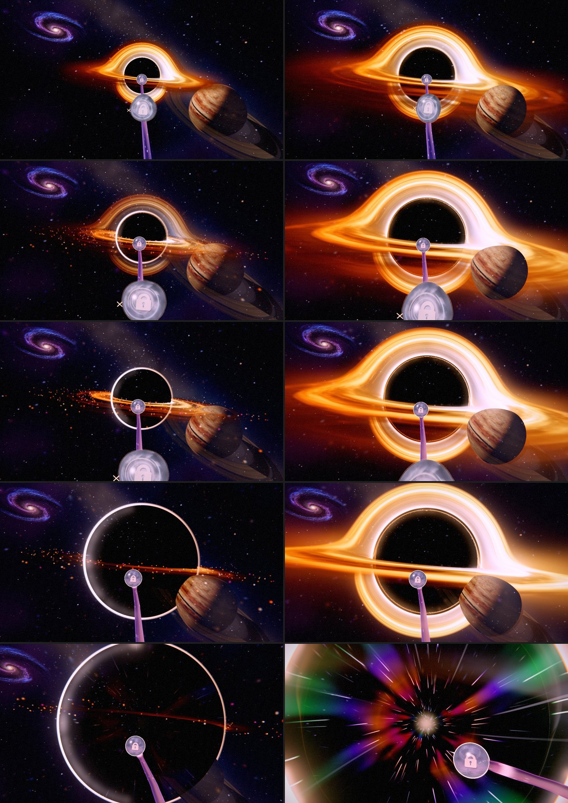

Not done: stretching the rail and orbs as they cross the rim. They never cross it: the rail runs
into the hole's middle, in front of the shadow, and the hole closes round it, so a stretch would
read as a glitch rather than as gravity. The bent light around the rim does that job.

Tests: `tests/unit/odyssey-hole-dive.test.js` covers:
- the approach: rest before it, ~14° at the mouth, no pause or jump, the landing's pace matched;
- the hole posed bigger on the run-in;
- the traced hole on and the painted parts off through the dive;
- the carrier 120 u ahead of the eye, with the hole unmoved;
- the trip's marks: over a second to the mouth, half a second at the rim, under 5.5 s.

### After the dive: the tunnel, the giant and the orbs (2026-11-02)

The owner picked these from the follow-up list: "The tunnel right after the dive", "The gas giant
goes slightly see-through over the hole as chapter 6 fades out" and "The nearest orb looks
egg-shaped at the bottom edge of the screen".

**The tunnel takes the hole's own light** (`CH7_JOURNEY_PALETTE`, black-hole-transcendence.tsl.js).
- **Before.** The warp tunnel streamed the colours of every world the journey crossed: ember,
  ocean, island green, snow, aurora, violet, amber, neon pink. After the traced dive they read as
  garish blobs of green and pink once the warp's zoom blur smeared the walls.
- **Now.** The same eight bands hold two families:
  - the disk's gas as it heats: ember, amber, gold, near white;
  - the cool of the lensed starlight round the shadow: plum, violet, indigo.
- **The walls** are a shade lower (filaments 0.12, was 0.15), so the streaks carry the light. The
  structure, the starbow at speed, the fold and the exit are unchanged.

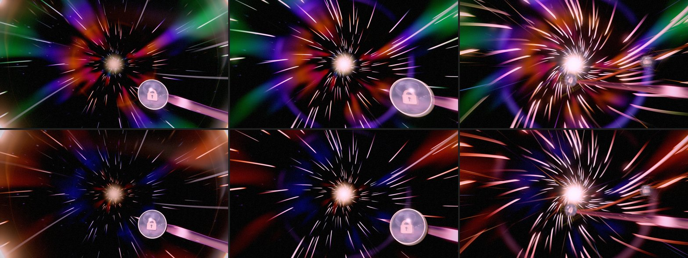

**The gas giant stays solid on the way in** (cosmic-expanse.js).
- **Why it showed through.** Its materials fade with the chapter (the `earth` entry in the
  chapter's own fades; the giant carries that legacy name). Through the 6->7 crossfade it hung
  half see-through beside the growing hole (0.53 at p 0.870), with the disk and the shadow showing
  through it.
- **Now.** Through the chapter's second half it keeps its own opacity. The growing shadow covers
  it from ~0.878 and it leaves the frame's foot by ~0.880, while the chapter is still drawn to
  ~0.885, so it never pops. Its rise at the chapter's start keeps the weight.
- **One trap.** The chapter's own fade (`setOpacityScale`) writes after the environment manager,
  every frame, so a hold written earlier in the update loses to it.

**The orbs draw round on screen** (`roundOnScreen`, odyssey-orb-round.tsl.js).
- **Why the egg.** A flat projection stretches a ball off the view's centre by 1 / cos θ along
  the line from the centre. The orb the eye has just left, close and at the frame's foot, read as
  an egg (~1.2 : 1).
- **The fix.** The glass shell, the halo and the world window squeeze their vertices about the
  orb's centre, in view space, by cos θ along that line. The orb draws round anywhere in the
  frame; its width, depth and shading are untouched.
- **The glass's centre.** The glass is instanced, so its centre rides in a new instanced
  attribute (`aCentre`), written with each instance matrix.
- **Opt-in.** The glass takes the squeeze with `createGlassShellTSL(uTime, { roundOnScreen: true })`
  (the board's); the playground's orb design keeps the plain shell.

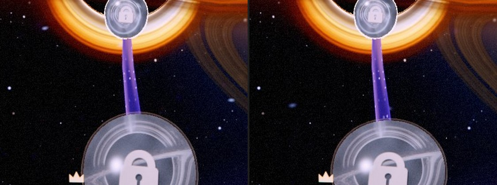

Tests:
- `tests/unit/odyssey-orb-round.test.js`: the egg was > 1.12 : 1, it is now within 3 % of round,
  its width is kept, and an orb at the centre is untouched;
- `cosmic-expanse-environment.test.js`: the giant whole late in the chapter, by the weight early;
- `LevelNodeManager.test.js`: the centre rides with the bob.

### Space that moves past you (2026-11-02)

The owner: "Can we improve the particles in space?"

**Why space felt like a backdrop.** After the clutter pass (§1) chapter 6 kept two star shells
(1,700-2,300 u out) and a far fine dust (120-1,300 u). From the rail all three are fixed points: a
glide between orbs moved nothing but the planet. The near dust that used to move was dropped because
it read as falling snow.

**The near field** (`odyssey-space-motes.js`, `CH6_AMBIENT.motes`):
- **Sparse, at many depths.** 240 soft motes in a 130 u box that travels with the eye. Each one is
  fixed in the world and wraps to the box's far side when it leaves; faded at the box's faces and
  within 17 u of the eye, so a wrap or a near pass is never seen.
- **Streaked by the eye's speed.** On a glide each mote stretches along the eye's motion as seen on
  screen (a 0.11 s shutter, up to 6 u), its light spread over the length. The streaks point out
  from the heading, so the glide reads as flight. At rest they are soft points.
- **Pulled toward the hole.** From 0.056 before the mouth to 0.021 before it the field drifts toward
  the hole at up to 9 u/s and warms from starlight to the disk's amber. Gone by 0.003 before the
  mouth: the dive keeps its own light.
- **Not snow.** No fall; cool blue-white, faint violet and pale gold; most dim and small (a power
  law), large ones dimmer (defocus), 7 % glints that breathe slowly.
- **In** after the Earth falls away (0.012-0.03 into the chapter, `SPACE_MOTES_STAGE`), and with
  the chapter's crossfade.
- One draw, 240 quads.

The stars were left as they are: the stellar ramp (Wave 5) already gives them seeded classes,
colours and a galactic band.

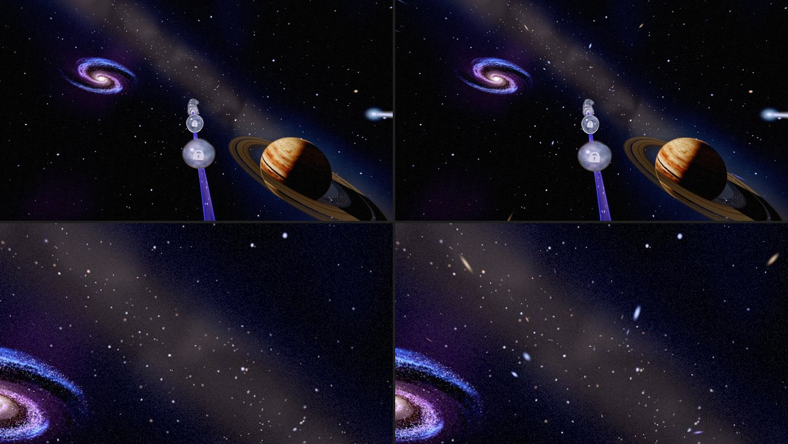

Tests: `tests/unit/odyssey-space-motes.test.js` covers:
- the field is seeded, sparse and mostly small;
- it tracks the eye's speed, ignoring a cut;
- it flows toward the hole and hides without a camera;
- it comes in after the Earth and is gone before the mouth.

## 4. The galaxy, as the Galaxy theme draws one (odyssey-spiral-galaxy*.js)

It was one quad painted with a 2D spiral: thin rings of blue with pink dots. It is now the Galaxy
theme's galaxy, re-derived.

**The disc** (galaxy-disc.js in its thin-disc form) is shaded per view ray in the galaxy's own frame:
- **Old disc:** the warm light of the old stars.
- **Arms:** two logarithmic arms of young blue light, torn into clumps along their own spiral.
- **Nurseries:** pink knots on the arms' trailing edges.
- **Dust:** feathered lanes on their inner edges that take the blue first.
- **Bar and bulge:** the bar, and the bulge in closed form, split at the midplane so the lanes
  cross its near side.

It uses the theme's tileable four-channel noise, re-baked in steps with its own mip chain.

**The suns** (galaxy-stars.js) were added after *"feels too much as a photo"*:
- 12,000 on High (5,000 on Low), in the theme's four populations (arms, disc, bulge, halo);
- each one point of light, never under a pixel (what the clamp adds in area it pays back in light);
- twinkling, the old ones streaming round and brightening as they cross an arm (the density wave).

**Placement:**
- **Seat:** the disc faces +Z, so the chapter seats and turns it as it did the quad (the galaxy at
  infinity, `GALAXY_SKY_SEAT`).
- **Size:** 10° now, from 7°.
- **Position:** lower left of the frame (ndc ~(-0.53, 0.33) at 16:9, from ~(-0.5, 0.65)), inside
  the frame at 4:3 too.
- **Before the planetrise ends:** while the view leans over the Earth it may wait past the left
  edge; the framing test checks it from there on.

`?odysseyCh6PaintedGalaxy=1` builds the quad again.

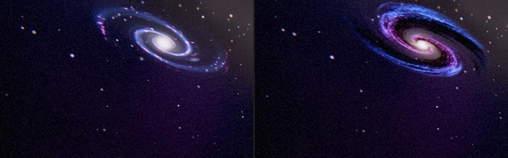

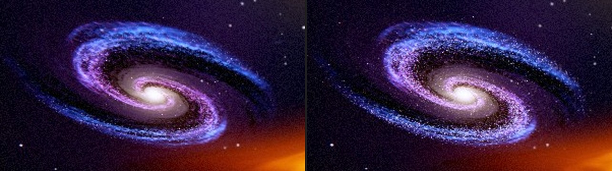

## 5. The aurora from orbit (2026-11-02)

The first thing seen in space. At p 0.745-0.78 the eye is in orbit over the Earth's night side,
and its aurora read as blocky green walls with stepped edges over a broad green smear. At
p 0.735, the same curtains edge-on on the limb, it read better.

**Which layer.** The Earth's backdrop (`composition/odyssey-orbit-earth.js`). Its curtains are
three folded sheets round an oval, walked along each view ray through the shell they stand in.
The gas giant's own aurora crown (`odyssey-planet-aurora.js`) has been off by default since the
ringed giant, and `cosmic-expanse*.js` only gates the giant's crown, so neither is involved.

**Why it was blocky:**

- **A sheet lit only where it was crossed.** The march lit a sheet where two steps fell on
  opposite sides of it. At every fold the ray runs along the sheet and then misses it, so the
  light switched off within one pixel: the hard vertical "walls".
- **A broad glow summed at the march's steps.** It smeared green under the walls and banded along
  the limb. The cloud tops under the oval took a green glow at 0.16 on top of it.
- **The rays and patches came from the lattice noise.** Its interpolation steps showed, and the
  patches switched sections of curtain on and off.

**What it is now** (`ORBIT_EARTH_AURORA.look`):

- **One exact path per step.** Each step adds the integral of the sheet's Gaussian profile over
  that step: the erf difference between where the step starts and ends, or the plain profile
  where the ray runs along the sheet. A sheet seen edge-on, crossed, or just missed changes
  smoothly, so every edge is soft. The sheets are thinner (0.0021 rad, was 0.0028) and the march
  takes 32 steps (was 28). The broad glow is gone, and the ground glow is down to 0.035.
- **Fine rays.** Smooth sines along the oval (integer frequencies, so the oval's seam joins), bent
  a little by the folds, drifting slowly. The two finest fade with distance (0.1-0.24 radii), so
  toward the limb they never crawl below a pixel.
- **Green low, red-violet high.** A soft bright lower border, green falling off with height, and
  a faint crimson-violet glow above it.
- **Calm.** Broad, slow patches that dim a stretch of curtain without ending it. A parked clip over
  3.5 s drifts without flicker.

The arrival is unchanged: the schedule (`ORBIT_EARTH_SCHEDULE.auroraIn` / `auroraOut`) and the
darkness gate in `cosmic-expanse.js` are untouched, and the oval stays fixed under the sun.

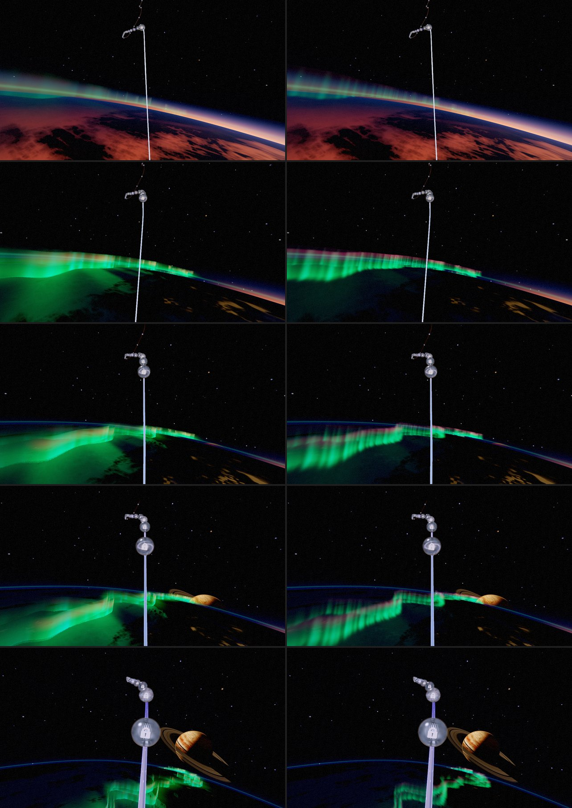

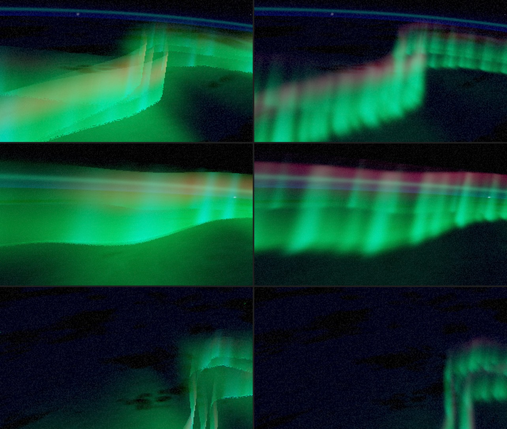

**The seam's light.** The frame's mean luma (0-255) before and after:

| p | 0.725 | 0.735 | 0.745 | 0.755 | 0.76 | 0.7725 | 0.785 |
|---|---|---|---|---|---|---|---|
| before | 57.0 | 25.5 | 21.4 | 21.1 | 21.2 | 15.5 | 10.9 |
| after | 57.0 | 24.5 | 16.1 | 16.3 | 17.1 | 14.0 | 10.9 |

The green smear was a third of the night side's light. Without it the darkening runs more evenly
into space, with no new step.

**Cost.** Four more march steps, and one erf (a `tanh`) per sheet per step, on the rays near the
oval only. The broad glow and its exponentials per step are gone.

**Tests** (`tests/unit/odyssey-orbit-earth.test.js`). `orbitAuroraSheetPath` is the shader's
twin. A clean crossing gets the analytic path (sqrt(pi) w / rate). Crossing, running along the
sheet and just missing it meet without a jump. The erf's slope at 0 matches the plain profile,
so the switch between the two forms is seamless.

## 6. One hero at a time (2026-11-02)

The owner: "a more well compositioned chapter 6".

**What was there.** From p ~0.78 to 0.81 every orb showed one picture: the galaxy upper left, the
ringed giant lower right, the rail between them. Then the black hole rose between the two, and all
three filled the frame.

**Why the camera.** The giant and the galaxy keep their seats (the owner placed the galaxy by
hand), and a giant flyby was tried and left out. The three heroes lie on one diagonal through the
hole, so any frame with the hole in its middle holds all three. Only the view can choose.

**One view per orb** (`CHAPTER_6_SHOTS` in `OdysseyCameraController.js`), in the keyframed language
of chapters 3-5. A parked orb shows exactly its key, and the glide to the next orb is the pan.

| Orb | View | Turn, tilt, lens (deg) |
|---|---|---|
| L35-L38 | the planetrise over the Earth's limb, unchanged | 0 |
| L39 | the ringed giant near the middle, on a long lens; the galaxy out of frame | +20, −8, −10 |
| L40 | turning to the galaxy; the giant leaves at the lower right | −6, +5, −8 |
| L41 | the galaxy and the Milky Way's band; the giant out of frame | −22, +10, −6 |
| L42 | the black hole rises, right of the galaxy; the giant sunk to the corner | −10, +10, −4 |
| L43 | the hole, a little closer to the middle | −6, +8, −2 |
| L44 | settling onto the rail | −2, +5, 0 |
| L45-L48 | the rail into the hole, unchanged | 0 |

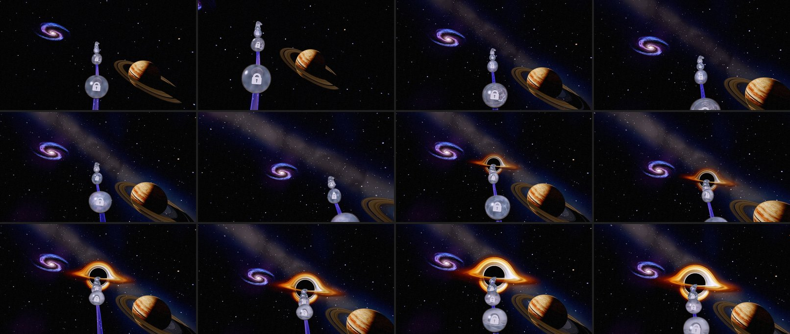

**Calm.** The largest pan is L39 to L40 (26° of turn and 13° of tilt). On the real controller,
in the game's 1.5 s trip after an orb, its turn peaks at 44°/s. Chapter 3's largest orb pans, on
their ~0.9 s glides, peak at 68-80°/s. In the opening sweep, chapter 6's peak turn rate is
unchanged (99°/s, at the 5->6 seam).

**What stays as it was:**

- The planetrise orbs (L35-L38). The rise ends in the glide to L39, so the view is already turning
  to the giant as it clears the Earth.
- From L45 on the keys are zero, so these are untouched:
  - the rail running into the middle of the hole (`RAIL_END_AIM`; its test watches from p 0.841);
  - the hole's hand-off to chapter 7's lock (p 0.845-0.849);
  - the 6->7 seam and the dive.

**Not done: the hole alone at the end.** On L45-L48 the giant is still under the hole's disk at
the lower right. There the aim must hold the rail's end, which runs into the middle of the hole.
The giant sits 33° off that aim, and a modest long lens only pushes it into the corner. To clear
it would take one of:
- moving the giant;
- fading it as the hole's light grows;
- a long lens through the last orbs, which changes the dive's scale on screen.

All three are the owner's call.

**Tests.**

- `odyssey-ch6-one-hero.test.js` (new), on the game's camera and the real chapter environment:
  - the keys sit on the orbs and are zero through the planetrise and from L45 on;
  - the giant near the middle at L39, with the galaxy out of frame;
  - the galaxy near the middle at L41, with the giant out of frame;
  - the hole rising at L42-L43, with the giant sunk below 0.85;
  - the orb underfoot and the next orb in frame at every turned view;
  - pans of at most 6° per 0.001 of progress, still at each orb, and no step in the camera.
- `odyssey-ch6-hero-framing.test.js`:
  - "all three heroes in frame" now holds at the entry and on the run into the hole;
  - the giant's in-frame check skips the turned views;
  - the hole's path-riding checks are measured on the rail's own frame. The hole's place never
    depends on the aim (its orb-eye check), and the keys are zero before the hand-off.

## Draw order in space

stars (-0.95) → galaxy disc (-0.9) and suns (-0.89) → the ringed giant (-0.8 / -0.75 / -0.7) → the
Earth's backdrop (-0.5) → everything at 0 and above (the orbs, the rail, the hole's lens).

## Tests

- **tests/unit/odyssey-space-masterpiece.test.js:**
  - the gas, the galaxy grain and the suns plan are seeded and in range;
  - the traced shadow is the chapter's own;
  - the lens, the galaxy disc and suns, and the inflow all build for WGSL and GLSL without a word.
- **The bisect levers and the environment tests:** the new default, with the old layers opt-in.
- **The framing test:** the galaxy's frame check now starts after the planetrise.

## Not done yet

- ~~**One hero per stage.**~~ Done 2026-11-02 up to L44 (§5). On the last orbs, L45-L48, the giant
  still hangs lower right, under the hole's disk (§5 has why, and the options).
- **The giant flyby:** tried 2026-11-01 and left out. A nearer seat (same rise, shrunk to the same
  angle) sank it out before the hole's light, but from chapter 5's eye it showed over the Earth's
  limb before its rise and came inside the Earth's near disc
  ([ODYSSEY_FINALE_AND_SMOOTHNESS_2026-11.md](ODYSSEY_FINALE_AND_SMOOTHNESS_2026-11.md) §5).
- ~~**The plunge's painted band** could take the traced gas's look.~~ Done 2026-11-01: the band is
  the traced disk's own gas, drawn flat (same doc, §4).
