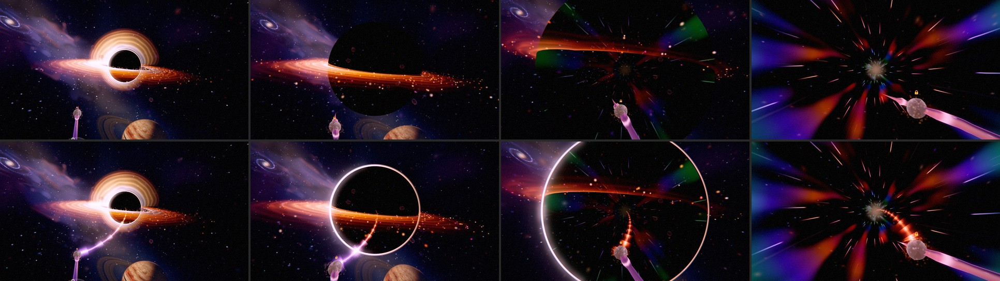
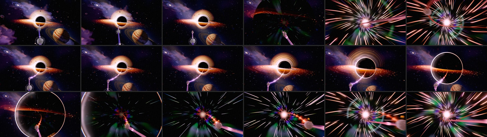

# Odyssey — Chapter 7: The Fall (2026-10)

**Status: LANDED on `feature/odyssey-ch7-fall`.** The owner's brief: "the black hole floats right
next to the journey — I want to be sucked into the black hole and have amazing warp effects while
inside." Follows the [seamless pass](ODYSSEY_SEAMLESS_PASS_2026-10.md). **2026-10-23:** the path
flows on into the hole, the photon ring stays on the shadow's edge all the way in, and the plunge
takes a second instead of seven frames (§6).

## 0. Why the black hole floated (read before changing ch7)

Gargantua is **camera-locked**: re-seated ~913 u ahead of the eye every frame
(`GARGANTUA_LOCK`, `resolveGargantuaLockPosition`). That is deliberate — an earlier world-parked
hero slid out of frame on ch7's hairpin (p 0.878–0.893) and two near-vertical kinks
(0.925–0.935, 0.940–0.953) and left the chapter ~75 % black (ODYSSEY_CHAPTER_BY_CHAPTER_IMPROVEMENT_PLAN
§ch7). A world point at the lock pose leaves the frame by p 0.89 and sits behind the camera from
0.90 to 0.926. So the fix is **not** to un-lock it: the lock stays, and the fall is authored on top.

## 1. The fall — one pure schedule

`src/rendering/odyssey/transitions/odyssey-black-hole-fall.js` — `resolveBlackHoleFall(progress,
chapterPositions)` — is read by the hero pose, the window shader, the post lens/bloom and the
camera framing, so they cannot drift apart. Local ch7 progress (0 = level 49, 1 = ch8 start):

| Beat | Local | What happens |
|---|---|---|
| The pull | 0 → 0.072 | angular radius 8.3° → ~35° (u^1.9), eases onto the view axis by 0.072 |
| Disk-plane crossing | 0.033 → 0.081 | the band's tilt sweeps +0.10 → −0.14 rad through edge-on: a razor line across the hole |
| The horizon | → 0.105 (just before level 50, at 0.14) | the shadow reaches 72° (wider than the frame's corners); its surface has become the window onto the interior (portal 0.46 → 1 of u) |
| Inside — the warp | 0.11 → 0.82 | the warp tunnel fills the view; band, fold arcs and embers gone; void dome and far stars stop drawing |
| The exit | 7→8 window (0.82 → 1 and on) | the vanishing point glides onto the Retrosun and the tunnel's mouth opens from it, the city and its sun through it |

**The dive is at level 49 (2026-10-22).** Olov: *"I dont want to see any of the path behind it
before we really get into the black hole."* Spread over levels 49–52 (horizon at local 0.44), the
fall left levels 50–52 and the rail between them in front of the growing hole, drawn across its
face, and the rest of the journey was laid out before the eye was inside. The whole plunge now
happens on the glide from level 49 (the mouth: chapter 6's rail runs into the hole's centre) to
level 50. Every stage keeps its order and shape, scaled by one factor (0.105 / 0.44) onto a
horizon just before level 50. The path past level 49 is laid out only once the eye is wholly
inside (`resolveBlackHoleInsideProgress`, read by `odyssey-path-horizon.js`), finishing at level
50, so levels 50 onward all lie inside the tunnel. The camera's pull, roll and widening FOV are
unchanged: they build inside the warp and settle before the city.

**Keeping the rail visible:** the hero recedes along the view axis just enough to keep the
shadow's near surface ≥ 150 u from the eye (`resolveBlackHoleFallDepth`), and is scaled so it
subtends the scheduled angle. The rail and level nodes (within ~100 u) always draw in front.

**The disk:** its outer edge is held in front of the eye (≤ 0.85 of the hero's distance). At its
physical 4.8 shadow radii it passed behind the camera once the hole outgrew ~12° and its face
became a cream floor under half the frame (bench capture).

## 2. The singularity window (`createSingularityWindowTSL`)

The shadow's own material: opaque, depth-writing, fade-exempt — the same pipeline state as the
black shadow it replaced, alpha-tested from creation (the exit mouth), so nothing changes at
runtime (ADR-0020). Black while `uPortal` = 0.

The tunnel is computed from the **view ray** in the shadow's local frame (+Z to the eye, XY the
screen), not from geometry: a ray at angle θ from the axis meets a unit-radius tunnel at depth
cot θ. On that:
- 56 angular streak lanes, per-lane speed and dash, scrolling toward the eye; a spiral twist that
  grows with the warp;
- accretion filaments: 2 baked-lattice fetches, stretched along the tunnel on **log** depth (cot θ
  crowds everything into the centre; its log spreads features evenly across screen radius);
- the **journey palette** — ember, deep ocean, island green, snow, aurora, nebula violet, accretion
  amber, neon — banded on log depth and zooming outward (an 8-texel sRGB texture);
- the exit light dead ahead (it becomes the Retrosun);
- the mouth (`uOpen`, rad): alpha-tested away, with a blazing rim that fades as it widens (at full
  width a fixed rim was a huge bright circle — a +20 luma spike in the 7→8 gate); the tunnel walls
  dim as it widens so brightness eases into the darker city.

Cost per pixel: one atan2 (+1 for the mouth), two hashes, two lattice fetches, one palette fetch.

## 3. Post and camera

- **Post:** the lens target publishes `portal`; the lens variant's in-shadow bloom mask (0.06)
  lifts with it so the tunnel's light blooms. A uniform in the existing variant — no new variant.
  The lens's chromatic aberration gives the streaks their rainbow fringes for free.
- **Camera:** new framing key `rollDeg` (applied about the view axis after `lookAt`); chapter 7's
  resolver reads `resolveBlackHoleFallCamera`: roll up to 14° and +6° FOV, sin-shaped from the
  chapter's start to where the 7→8 window opens — exactly zero at both seams (the city's stage
  alignment needs an unrolled basis). Roll is zeroed under `prefers-reduced-motion`
  (`setOdysseyCameraReducedMotion` hook).

## 4. Verification

- Playground bench `src/playground/effects/ch7-fall.effect.js` (`?effect=ch7-fall&orbit=0&t=8&fallT=…`):
  the real environment, path and camera; no post.
- In game (WebGPU, High): seam 6→7 maxStep 38.9 PASS; 7→8 −21.4 PASS; a 17-station luma sweep
  through ch7 (`--seam=7-8 --offsets=…`) stays within the gate (approach 14 → 34, the black frame
  dip 22, inside 30–46, exit 45 → city 32). No console errors.
- `tests/unit/odyssey-black-hole-fall.test.js` pins: at rest before ch7, monotone growth, inside
  before level 50 (the dive at level 49, since 2026-10-22), near surface ≥ 150 u, the disk
  crossing, roll/FOV zero at both seams, reduced motion.

## 5. Performance

Lane A (RTX 3070, High 1080p, GPU p50 ms; `baseline/baseline-repeat`), the fall branch vs main
`bbdf5390`, alternating per station on a quiet machine:

| Station (p) | Main | The fall | Draws |
|---|---|---|---|
| 0.88 — the pull (6→7 crossfade still drawing ch6) | 0.72 / 0.79 | 0.79 / 0.79 | 53 → 53 |
| 0.91 — at the horizon | 0.39 / 0.39 | 0.39 / 0.39 | 30 → 30 |
| 0.94 — inside the tunnel | 0.39 / 0.39 | 0.39 / 0.39 | 30 → 24 |

Neutral: within one timer tick (~0.066 ms) at every station. Inside, the window replaces the void
dome, far starfield, disk, fold arcs and embers (−6 draws); the window shader costs no more than the
fill it replaces. JSONs: `repos/odyssey-gpu/perf-baseline/ch7fall-1/`.

## 6. The path flows into the hole (2026-10-23)

Olov: *"now it feels like the orb path just quits before we go into the black hole, i want this to
be a seamless experience, almost like as the black hole is a huge black hole orb on the path that
we gets sucked in to."*

**What the player saw** (filmed in game on the 48 → 49 trip, the one that crosses the plunge;
orbs 49 and 50 both park inside the tunnel at p 0.8941):

1. **The rail stopped short.** It ends at the mouth orb (49) through chapter 6, and the hole is
   camera-locked ~900 u ahead. The two met on screen only from orb 48's view: on the glide on, orb
   49 slid to the bottom of the frame while the hole held the centre, and the rail ended half a
   frame below it.
2. **The hole lost its rim.** The photon ring lay in the plane through the hole's centre, which is
   the shadow's edge only while the hole is small (a sphere's silhouette is its circle of tangent
   points, R cos α across and R sin α nearer the eye). From ~20° the shadow hid the razor, and the
   ring's opacity was also turned down past 12°, so the plunge was a flat black disc.
3. **The plunge took seven frames.** A trip eases (cubic in-out) over 900 + 2600·Δp ms, and the
   plunge (mouth to inside, p 0.8709 → 0.8808) was the middle third of a 984 ms trip, where the
   ease runs fastest: **~120 ms**. Filmed at ~110 ms a frame, the whole plunge fell between two
   frames.
4. **A ghost of the ring across the shadow.** Through the 6 → 7 seam both the omen's and
   Gargantua's lens targets fed the post lens each frame, so its smoothing settled between them (a
   lens radius of 0.38 for a shadow of 0.59 at p 0.877). The bloom mask and the bend sat inside the
   hole. Invisible while the two holes were one size, it showed once the ring stayed lit.

**What changed:**

- **The inflow** (`odyssey-path-inflow.js`, drawn by `createPathInflowTSL` in
  `odyssey-path-renderer.tsl.js`, owned by `OdysseyPathRenderer.setInflow`). From the mouth orb a
  stream of the rail's light winds into the hole's centre. It is rebuilt every frame from where
  the orb and the hole really are (`OdysseyBoardController._updatePathInflow`, after the
  environments pose the hole: chapter 6's omen until chapter 7's Gargantua takes the shadow
  over), so it stays attached whatever the camera, the hole or a free look does.
  - **Shape:** it leaves the orb along the rail (only while the rail heads for the hole on screen),
    then follows a logarithmic spiral, counter-clockwise on screen (the disk's sense). It bends
    gently on the way and swirls into the centre, and packets riding it at an even pace slow and
    crowd near the centre. Every point is nearer the eye than the shadow's near surface, so it
    draws over the shadow into the middle of the disc while the disk band, orbs and rail occlude it.
  - **Light:** the rail's own (the 6/7 recipes) heats to the disk's amber, flares white where it
    crosses the photon ring, then reddens and dims toward the centre.
  - **When:** drawn from the end of the 5 → 6 seam (where the rail has retracted to the mouth) and
    handed over to the real rail across its reveal inside the hole (`resolveOdysseyPathReveal`, now
    shared with the horizon). The rail itself now ends within ~4.5 u of the mouth orb, inside its
    glass (`ODYSSEY_PATH_HORIZON.railSoft`). Its 15 u taper had read as a stub of rail going the
    wrong way.
- **The ring on the silhouette** (`updateBlackHoleTranscendenceEnvironment`): the photon ring sits
  R sin α nearer the eye and is scaled by cos α, a hair in front of the tangent points. Its profile
  is drawn in toward the shadow as the hole grows (`uRazor`, `CH7_GARGANTUA.photonRazor`), so it
  stays a razor where it sweeps past the frame's edges. It is no longer dimmed. When the exit's
  mouth opens it returns to the centre plane for the 7 → 8 swell, as before; at that swap it is
  past the frame's edges or behind the shadow. The lensed halo still fades by ~19° (the amber
  flood).
- **The plunge takes its time** (`CH7_PLUNGE_TRAVEL`, `plungeTravelMeasure`, in
  `odyssey-black-hole-fall.js`). Every path travel eases in a measure where the plunge weighs 12×
  open path (smooth shoulders over 0.004 p), so it slows there. A short trip through it gets
  2.6 s more (fading out for trips longer than 0.04 p, which have seconds of their own). The 48 →
  49 trip, filmed in game:

  | | Trip | Approach to the mouth | Plunge (mouth → inside) | Inside → park |
  |---|---|---|---|---|
  | Before | 0.98 s | 0.41 s | ~0.12 s | 0.45 s |
  | After | 3.58 s | 1.25 s | 1.04 s | 1.30 s |

  The hole looms while the inflow draws the eye in, grows over a second as the ring sweeps out,
  and once past the inside point the eye picks up speed through the tunnel (the warp drive's
  throttle follows it). Reduced motion still cuts. Scrolling by hand is not slowed.
- **One hole feeds the lens** (`OdysseyBoardController._feedBlackHoleLens`): the omen's target is
  skipped once Gargantua's shadow is live. Measured live: lens radius = shadow radius within 0.01
  at every station of the plunge.

**Verification** (WebGPU, High, RTX): live captures (the game loop running, parked 2.5 s per
station — the chapter-capture harness renders one frame per station, so the post lens's
smoothing never settles there) at p 0.8618 → 0.879, and the real trip filmed from orb 48 (37
frames). The 7 → 8 exit is unchanged (the mouth's rim and the Retrosun). No WebGPU errors.

Guards: `tests/unit/odyssey-hole-inflow.test.js` (on the real camera: the inflow runs from the
mouth into the middle of the hole through the whole trip, in front of the shadow, unbroken; its
weight and hand-over; the strip never flips; the plunge gets > 0.9 s of the 48 → 49 trip on the
real camera controller; the measure inverts and leaves other trips alone; the ring's inner edge on
the silhouette within 0.4°; one hole feeds the lens).

**Cost:** one additive strip (128 points, 256 vertices), drawn from the end of the 5 → 6 seam to
the reveal inside the hole. Per frame, while drawn: O(128) arithmetic and a 7 KB vertex upload.

## 7. Open items

- **The lensed halo** still fades out by ~19° (the amber flood at the 6 → 7 gate). With the ring
  on the silhouette, a silhouette-seated halo that thins as it grows could keep Gargantua's look
  further in. Measure the gate's luma first.
- **Scrolling through the plunge** by hand moves at the player's speed. Easing the scroll there
  would be resistance, not pacing; leave it unless asked.
- Quality tiers: the window costs the same on every tier today (it is cheap — §2); Low could drop
  the second lattice octave.
- The in-game `settings.reducedMotion` toggle is not yet plumbed to the camera (only the OS
  media query is honoured).
