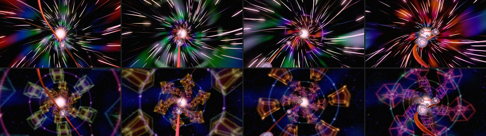
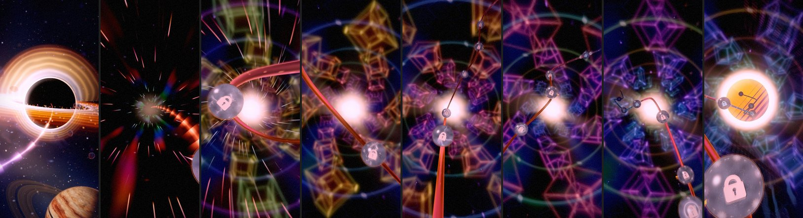
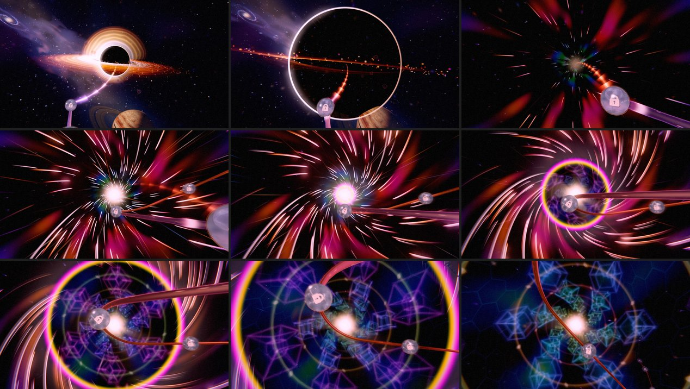
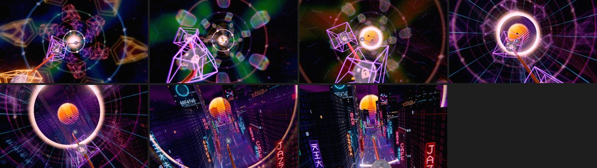
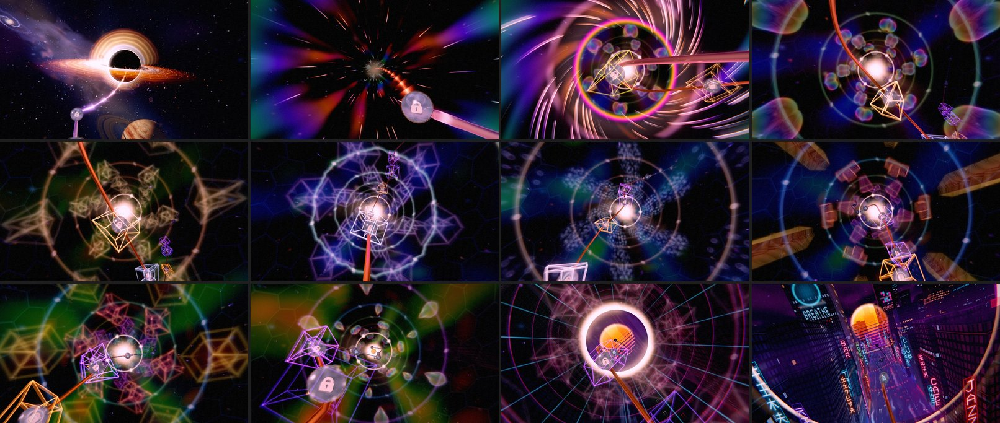
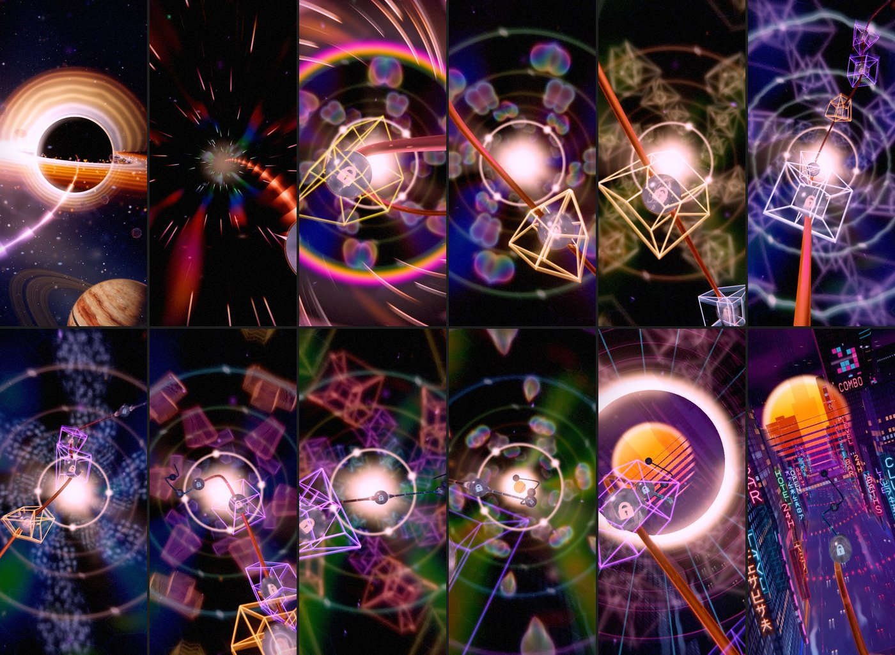

# Odyssey — Chapter 7: the other dimension (2026-10-26)

**A plan in five steps, and the record of each as it lands.** Olov: *"When this is done i want to
focus on the black hole chapter 7, i want it to feel like we are in another dimension within this
chapter. I want it to be visually stunning, trippy and an amazing feeling travelling through this
chapter. How do we improve the black hole to be a visually stunning other dimension experience?"*
Follows [the fall](ODYSSEY_CH7_FALL_2026-10.md), which this keeps: the dive into Gargantua at orb
49 and the exit onto the Retrosun.

## What the player saw

The dive at orb 49 works. From just before orb 50 to the exit (p ~0.881 to ~0.945; orbs 49 to 56
park inside), the eye was in one hyperspace tunnel of streaks: radial streak lanes, the journey's
colours in bands, the light at the end. It looked almost the same from orb to orb, and read as
"going fast", not as "somewhere else".

## The plan

The black hole is a door, not a tunnel. The eye falls through the horizon, the streaks last only
for the fall, and then it comes out into a space with rules of its own. Every orb sits in a
different room of it, and travelling between orbs is watching it fold from one room to the next.

1. **The other dimension itself.** The space that replaces the streak tunnel. *Done (§1).*
2. **The crossing.** At the horizon reality turns inside out in a slow wave from the centre; the
   streaks bend into a spiral and freeze into hanging strands of light. *Done (§2).*
3. **A room per orb.** Each stretch borrows its orb's mood (Fluid Dreams, Nebula Flow, Chiral Gold,
   Voltage Storm, Murmuration, Serenity Warp, Kaleidosonic, Chromatic Impasto); the space's shapes,
   colours and motion change between rooms. *Done (§3).*
4. **Impossible objects along the path.** Tesseracts round the parked orbs, the path's light
   echoing in time, the light at the end seen several times over in a ring. *Done (§4), but for
   the echoes (left out: the space is rich enough).*
5. **The way out.** The space's lines straighten into the city's neon grid. *Done (§5).*

Rules for all of it: no flashing; brightness within the seam gates; reduced motion stops every
spin and breath; one shader on the hole's existing window (no post pass); the lower tiers do less.

## §1. The other dimension (2026-10-26)

`chapter-environments/odyssey-fold-space.tsl.js` (`foldSpaceColour`, `CH7_FOLD`), drawn by the
hole's window shader (`createSingularityWindowTSL`) once the fall's new `fold` envelope rises
(`CH7_FALL.foldFrom` 0.11 → `foldTo` 0.20 local: just after the eye is wholly inside, and whole
before orbs 49 and 50 park at local ~0.26). The streak tunnel still carries the eye through the
fall.

**What it is.** A corridor you fly down, made of light:

- **Tesseracts.** Four-dimensional cubes, drawn the way they usually are (a cube within a cube,
  their corners joined), turning inside out: the inner cube grows through the outer while the outer
  shrinks, as a hypercube does turning through the fourth dimension. They tumble in this one too,
  and their faces are tinted glass.
- **The kaleidoscope.** The space round the axis is folded into six mirrored wedges, so every
  tesseract stands in a ring of mirror images, and the corridor twists slowly with depth.
- **Gates.** Beaded rings of light round the axis, between the rings of tesseracts.
- **Walls** of dark glass panes far beyond (a few glow like lanterns), a faint iridescent nebula
  in the depths, and soft beams turning round the light at the end.
- The axis is kept clear, so the path, its orbs and the light at the end stay in the open.
- **The dust** (`corridor-violet-dust`) drifts as motes of light in the fold and streaks only
  while the eye glides between orbs (the warp drive's punch). It streaked everywhere inside before,
  which read as hyperspace.

**How.**

- Everything is a function of the view ray in the hole's frame, as the tunnel was. The eye sits on
  the corridor's axis, and travel moves it down the axis by the warp drive's phase.
- **The tesseracts are marched, as glow only.** Everything is light, so nothing is hit and nothing
  occludes: each step adds the light of whatever is near.
  - The glow's width is an angle (distance over depth), so a crystal passing close stays crisp. A
    width in world units blurred the near ones into blobs.
  - A ray's distance from the axis grows as t sin(θ), so only the stretch through the tesseracts'
    shell is marched, and a ray toward the light is not marched at all.
  - Far from a tesseract its bounding sphere stands in, so the frames are built only near it.
- **The gates and walls are met analytically.** They are axisymmetric, so they need no march. In
  the (radius, depth) half-plane a ring is a point and the ray a unit line, so the ray passes a ring
  at |dz| sin(θ) exactly.
  - The gates were first marched. On the Low tier the march then ran out of steps before reaching
    them.
  - Lengthening the shortest step instead skipped the thin edges and striped every tier.
- **One name per pane.** The walls' panes are named by their place round the turn reduced by a
  whole turn. atan's cut moves the grid by a whole lattice step, and a hash of the raw position
  gave a seam of mismatched panes.

**The trap that cost a capture.** The window shader now branches on `uFold` (uniform `If`s: the
walls take a screen derivative). The light at the end is shared by the tunnel and what follows it,
and it was first built inside the tunnel's branch, then read after both branches. That washed the
plunge out in a pale salmon (p 0.879), while the fold itself never ran. Root-pinning it before the
branches fixed it. `unassignedReads` in the new test catches it: it fails on the unpinned shader.

**Cost** (playground bench, 1080p, vsync off, RTX 3070; `?odysseyCh7Fold=0|1` holds the fold off
or on for A/B):

| | Frame |
|---|---|
| The streak tunnel | 0.32 ms |
| The fold, High (32 steps) | ~1.1 ms |
| The fold, Low (14 steps) | ~0.9 ms |

The march's steps per tier are `CH7_QUALITY_TIERS.foldSteps` (High 32, Medium 22, Low 14). Most
rays leave the shell early, so the step count moves the cost less than its fixed part does.

**Checked:**

- In game (WebGPU, High) at 1280 × 720 and 432 × 960, from orb 49 to the exit.
- In the playground on High, Medium, Low and the forced WebGL2 backend.
- No WebGPU warning or error in any console.

**Tests** (`odyssey-ch7-fold.test.js`):

- the fold is nothing until the eye is inside, whole before the first orbs park, and grows without
  a step;
- the march steps down per tier;
- the tesseracts stay off the axis;
- the window builds on WGSL and GLSL with the fold in it, a real loop, no unassigned reads.

`black-hole-environment.test.js` now pins the dust's two lives: motes at rest in the fold, streaks
on a glide.

## §2. The crossing (2026-10-26)

The fold no longer crossfades in: it **opens from the centre in a widening wave**
(`CH7_CROSSING` in `black-hole-transcendence.tsl.js`). The wave's angle from the axis is the fall's
`fold` (now `foldFrom` 0.11 to `foldTo` 0.24 local, still whole before orbs 49 and 50 park). Inside
it is the fold; outside, the tunnel.

- **The front** is the rim of a lens: a thin edge of light split into its colours across its width
  (violet in, red out). A faint halo just outside it shows the tunnel as its own negative. It is
  lit only while the wave is under way and sweeps out past the frame's edges once.
- **The streaks wind into a spiral** as the fold arrives (the tunnel's twist grows with it), and
  **hold still**. The tunnel now travels on its own phase (`uTunnelPhase`), which follows the warp
  drive until the fold begins and then freezes; the fold travels on. Back out of the fold, the
  streaks move again.
- The front was first a wide pale band. It read as a fog ring, not a moment, and lit the frame:
  luma 55 against 35 around it.
- **Measured** (frame luma, 0–255): 40 → 58 → 53 → 41 → 31 over p 0.8835–0.8935. The largest
  step is +18 per 0.0025, under half the 6 → 7 seam's own 38.9.

## §3. A room per orb (2026-10-26)

`transitions/odyssey-fold-rooms.js` (`CH7_FOLD_ROOMS`, `resolveFoldRoom`) is one pure function of
progress. Each room is anchored where its first orb parks (`resolveFoldRoomAnchors`, from the live
presentation layout), and the space morphs from one room into the next across the middle 60 % of
the way between their orbs.

**The rooms:**

| Orbs | Theme | Crystals | Light |
|---|---|---|---|
| 49, 50 | Fluid Dreams, Nebula Flow | soap bubbles | iridescent, deep blue depths |
| 51 | Chiral Gold | diamonds | gold, dark depths |
| 52 | Voltage Storm | tesseracts | electric blue; the gates crackle into crawling arcs |
| 53 | Murmuration | swarms of motes in wheeling rings | silver-violet |
| 54 | Serenity Warp | glass tetrominoes (T, L, I, S) | a rainbow of pieces |
| 55 | Kaleidosonic | tesseracts | the whole colour wheel |
| 56 | Chromatic Impasto | bubbles | paint colours over a strong nebula |

**The crystals.** `crystal(kind, ...)` in `odyssey-fold-space.tsl.js` draws them:

- One shape per uniform branch, so only the room's shape (and, while morphing, the next one's)
  is ever evaluated.
- **Diamonds:** an octahedron's edges, by its symmetry three segments in one octant, round a
  smaller one turning inside it.
- **Tetrominoes:** one solid piece each, lit from its outer skin only. Lit by its distance's
  absolute value, the two blocks' shared face glowed inside and showed the cells.
- **Bubbles:** a thin skin whose hue swirls over the surface like a soap film.
- **Motes:** each nudged off its lattice point. On the bare lattice they lined up in rows.

**The morph.** While the space morphs, the old room's crystal shrinks away inside the new one's,
which grows out of it, and their light crossfades. Mixing the two distances dimmed both.

**The march.** It starts each ray a fixed random fraction of a step in (keyed by direction, so
the pattern holds on the scene). Regular steps through a glowing surface printed stripes on the
tetrominoes' faces.

**The trap, again.** Shared inputs built first inside one shape's branch read as zero in the
others (`unassignedReads` caught it in the test). They are root-pinned at the top of `crystal`.

## §4. Impossible objects (2026-10-26)

- **A hypercube round every orb inside the hole** (`odyssey-fold-hypercubes.js`, driven by the
  board's `_updateFoldHypercubes`, since only the board knows where the orbs are).
  - A true four-dimensional cube: 16 corners rotated in the x-w, y-w, z-w and x-y planes, then
    projected in perspective from a point out along w, so its inner cube swells through the
    outer.
  - Its 32 edges are ribbons turned to the eye, built on the CPU each frame and drawn additive.
  - Each is in its orb's room light (`foldHypercubeCages`). They fade near the eye (a cage sweeping
    through the lens lifted the frame to luma 56–58), fade far off, leave as the mouth opens, and
    hold still under reduced motion.
- **The light seen many times.** Bent round the hole, the light at the end is seen again on a thin
  Einstein ring round it, four times over, the images turning slowly.
- **Left out:** the path's light echoing in time. The space has enough going on.

## §5. The way out (2026-10-26)

**The final room** has no orb of its own. It is anchored at 0.907 of the chapter: just past orb
56, as the mouth opens onto the city. In it:

- the walls' hexagonal panes straighten into squares, the city's neon grid, magenta round the turn
  and cyan along the way;
- the walls stop twisting;
- the crystals go magenta and the nebula fades.

So for the last stretch the eye flies down a synthwave tunnel through the portal's rim onto the
Retrosun, and the city takes over from there as before. The hypercubes are gone by then.

## The whole chapter

**Measured** (frame luma every 0.0025 from p 0.866 to 0.966; 1280 × 720, High):

- through the rooms, 30–45, against the tunnel's 34–44;
- the crossing peaks at 58;
- the way out stays 35–51.

**Cost** (playground bench, 1080p, RTX 3070): 1.1–1.3 ms a frame inside, against the tunnel's
0.32. The swarm room is the dearest. The hypercubes are a few hundred vertices, built on the CPU.

**Checked:**

- in game on WebGPU, High, at 1280 × 720 and 432 × 960, from orb 48 into the city;
- in the playground on High, Medium, Low and the forced WebGL2 backend;
- no WebGPU warning or error in any console.

**Tests** (`odyssey-ch7-fold.test.js`, 16):

- the fold's schedule;
- the rooms: every orb once, in order, anchored where it parks; its own room unmixed there; the
  morph with no step; the way out last;
- the hypercube: 32 edges joining corners that differ in one coordinate, four at each corner; it
  breathes, bounded, and is a cube at rest;
- the cages: fades and colours;
- the ribbons: additive, no depth;
- the march per tier and the tesseracts off the axis;
- the window builds on WGSL and GLSL, a real loop, no unassigned reads.

`black-hole-environment.test.js` pins the dust's two lives.
