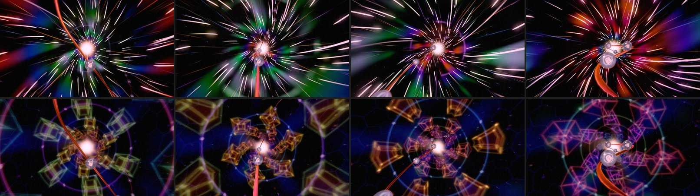
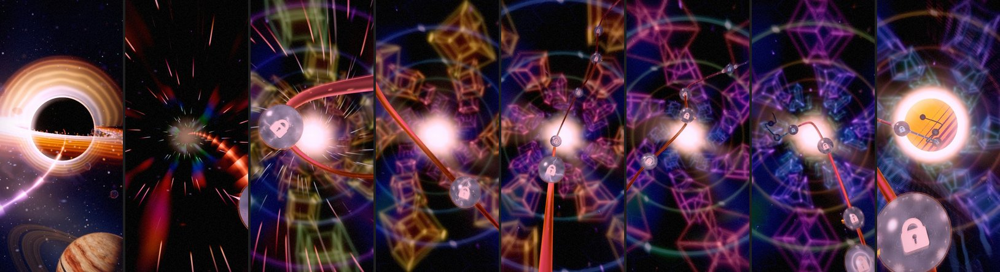
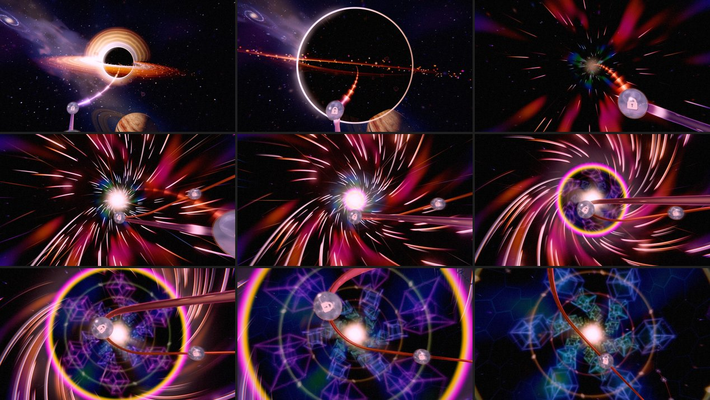
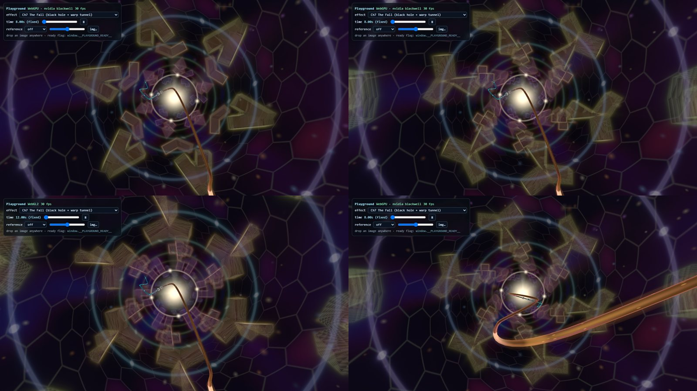
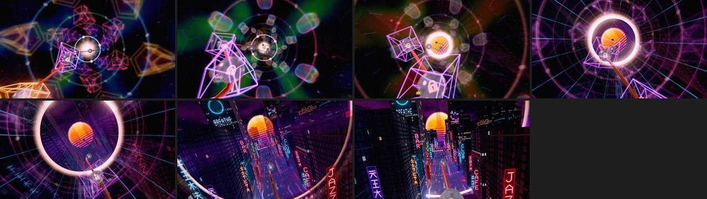
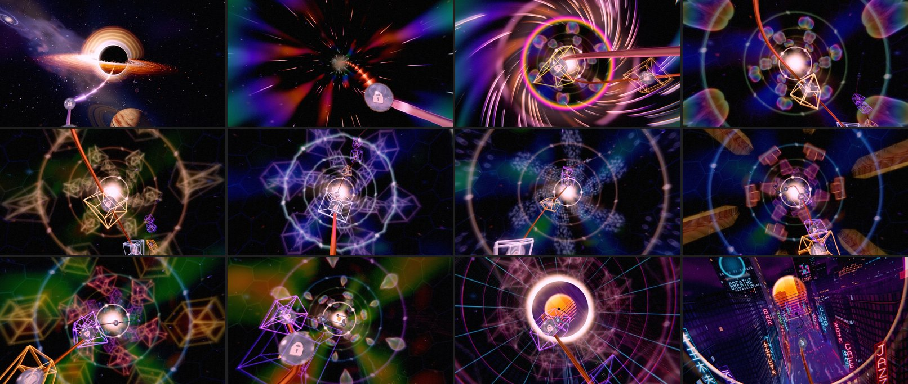
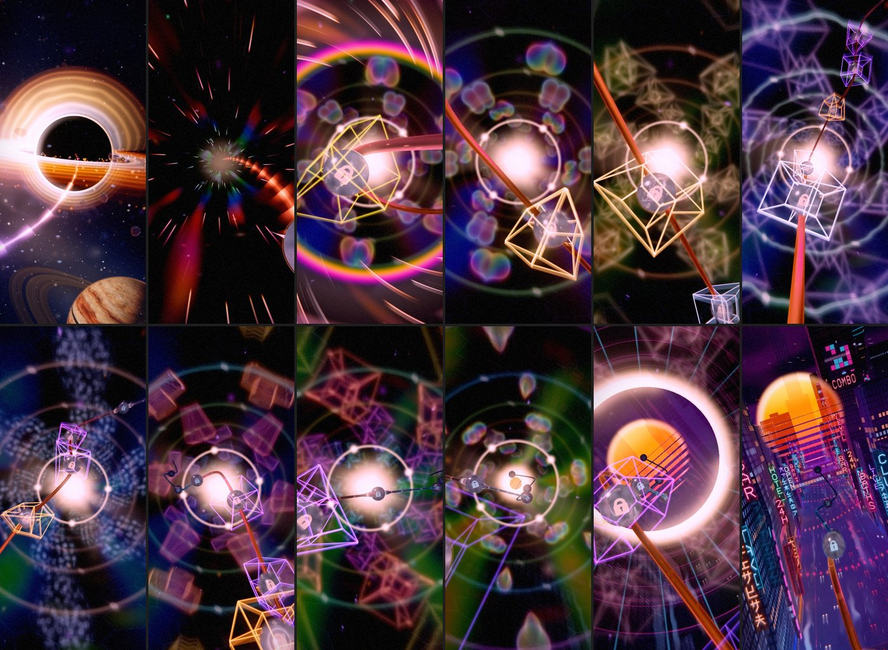

# Odyssey — Chapter 7: the other dimension (2026-10-26)

**A plan in five steps, and the record of each as it lands.** Olov: *"When this is done i want to
focus on the black hole chapter 7, i want it to feel like we are in another dimension within this
chapter. I want it to be visually stunning, trippy and an amazing feeling travelling through this
chapter. How do we improve the black hole to be a visually stunning other dimension experience?"*
Follows [the fall](ODYSSEY_CH7_FALL_2026-10.md), which this keeps: the dive into the great hole at orb
49 and the exit onto the Retrosun.

**2026-11-17: the corridor of §1, §3 and §5 is gone.** The fold is now eight places, one for each
room, behind a ring of starlight that closes after the horizon: see
[§6](#6-eight-places-the-masterpiece-pass-2026-11-17). §2 (the crossing) and §4 (the hypercubes)
stand as written.

## What the player saw

The dive at orb 49 works. From just before orb 50 to the exit (p ~0.881 to ~0.945; orbs 49 to 56
park inside), the eye was in one hyperspace tunnel of streaks: radial streak lanes, the journey's
colours in bands, the light at the end. It looked almost the same from orb to orb, and read as
"going fast", not as "somewhere else".

## The plan

The black hole is a door, not a tunnel. The eye falls through the horizon, the streaks last only
for the fall, and then it comes out into a space with rules of its own. Every orb sits in a
different room of it, and travelling between orbs is watching it fold from one room to the next.

1. **The other dimension itself.** The space that replaces the streak tunnel. *Done (§1).*
2. **The crossing.** At the horizon reality turns inside out in a slow wave from the centre; the
   streaks bend into a spiral and freeze into hanging strands of light. *Done (§2).*
3. **A room per orb.** Each stretch borrows its orb's mood (Fluid Dreams, Nebula Flow, Chiral Gold,
   Voltage Storm, Murmuration, Serenity Warp, Kaleidosonic, Chromatic Impasto); the space's shapes,
   colours and motion change between rooms. *Done (§3).*
4. **Impossible objects along the path.** Tesseracts round the parked orbs, the path's light
   echoing in time, the light at the end seen several times over in a ring. *Done (§4), but for
   the echoes (left out: the space is rich enough).*
5. **The way out.** The space's lines straighten into the city's neon grid. *Done (§5).*

Rules for all of it: no flashing; brightness within the seam gates; reduced motion stops every
spin and breath; one shader on the hole's existing window (no post pass); the lower tiers do less.

## §1. The other dimension (2026-10-26)

`chapter-environments/odyssey-fold-space.tsl.js` (`foldSpaceColour`, `CH7_FOLD`), drawn by the
hole's window shader (`createSingularityWindowTSL`) once the fall's new `fold` envelope rises
(`CH7_FALL.foldFrom` 0.11 → `foldTo` 0.20 local: just after the eye is wholly inside, and whole
before orbs 49 and 50 park at local ~0.26). The streak tunnel still carries the eye through the
fall.

**What it is.** A corridor you fly down, made of light:

- **Tesseracts.** Four-dimensional cubes, drawn the way they usually are (a cube within a cube,
  their corners joined), turning inside out: the inner cube grows through the outer while the outer
  shrinks, as a hypercube does turning through the fourth dimension. They tumble in this one too,
  and their faces are tinted glass.
- **The kaleidoscope.** The space round the axis is folded into six mirrored wedges, so every
  tesseract stands in a ring of mirror images, and the corridor twists slowly with depth.
- **Gates.** Beaded rings of light round the axis, between the rings of tesseracts.
- **Walls** of dark glass panes far beyond (a few glow like lanterns), a faint iridescent nebula
  in the depths, and soft beams turning round the light at the end.
- The axis is kept clear, so the path, its orbs and the light at the end stay in the open.
- **The dust** (`corridor-violet-dust`) drifts as motes of light in the fold and streaks only
  while the eye glides between orbs (the warp drive's punch). It streaked everywhere inside before,
  which read as hyperspace.

**How.**

- Everything is a function of the view ray in the hole's frame, as the tunnel was. The eye sits on
  the corridor's axis, and travel moves it down the axis by the warp drive's phase.
- **The tesseracts are marched, as glow only.** Everything is light, so nothing is hit and nothing
  occludes: each step adds the light of whatever is near.
  - The glow's width is an angle (distance over depth), so a crystal passing close stays crisp. A
    width in world units blurred the near ones into blobs.
  - A ray's distance from the axis grows as t sin(θ), so only the stretch through the tesseracts'
    shell is marched, and a ray toward the light is not marched at all.
  - Far from a tesseract its bounding sphere stands in, so the frames are built only near it.
- **The gates and walls are met analytically.** They are axisymmetric, so they need no march. In
  the (radius, depth) half-plane a ring is a point and the ray a unit line, so the ray passes a ring
  at |dz| sin(θ) exactly.
  - The gates were first marched. On the Low tier the march then ran out of steps before reaching
    them.
  - Lengthening the shortest step instead skipped the thin edges and striped every tier.
- **One name per pane.** The walls' panes are named by their place round the turn reduced by a
  whole turn. atan's cut moves the grid by a whole lattice step, and a hash of the raw position
  gave a seam of mismatched panes.

**The trap that cost a capture.** The window shader now branches on `uFold` (uniform `If`s: the
walls take a screen derivative). The light at the end is shared by the tunnel and what follows it,
and it was first built inside the tunnel's branch, then read after both branches. That washed the
plunge out in a pale salmon (p 0.879), while the fold itself never ran. Root-pinning it before the
branches fixed it. `unassignedReads` in the new test catches it: it fails on the unpinned shader.

**Cost** (playground bench, 1080p, vsync off, RTX 3070; `?odysseyCh7Fold=0|1` holds the fold off
or on for A/B):

| | Frame |
|---|---|
| The streak tunnel | 0.32 ms |
| The fold, High (32 steps) | ~1.1 ms |
| The fold, Low (14 steps) | ~0.9 ms |

The march's steps per tier are `CH7_QUALITY_TIERS.foldSteps` (High 32, Medium 22, Low 14). Most
rays leave the shell early, so the step count moves the cost less than its fixed part does.

**Checked:**

- In game (WebGPU, High) at 1280 × 720 and 432 × 960, from orb 49 to the exit.
- In the playground on High, Medium, Low and the forced WebGL2 backend.
- No WebGPU warning or error in any console.

**Tests** (`odyssey-ch7-fold.test.js`):

- the fold is nothing until the eye is inside, whole before the first orbs park, and grows without
  a step;
- the march steps down per tier;
- the tesseracts stay off the axis;
- the window builds on WGSL and GLSL with the fold in it, a real loop, no unassigned reads.

`black-hole-environment.test.js` now pins the dust's two lives: motes at rest in the fold, streaks
on a glide.

## §2. The crossing (2026-10-26)

The fold no longer crossfades in: it **opens from the centre in a widening wave**
(`CH7_CROSSING` in `black-hole-transcendence.tsl.js`). The wave's angle from the axis is the fall's
`fold` (now `foldFrom` 0.11 to `foldTo` 0.24 local, still whole before orbs 49 and 50 park). Inside
it is the fold; outside, the tunnel.

- **The front** is the rim of a lens: a thin edge of light split into its colours across its width
  (violet in, red out). A faint halo just outside it shows the tunnel as its own negative. It is
  lit only while the wave is under way and sweeps out past the frame's edges once.
- **The streaks wind into a spiral** as the fold arrives (the tunnel's twist grows with it), and
  **hold still**. The tunnel now travels on its own phase (`uTunnelPhase`), which follows the warp
  drive until the fold begins and then freezes; the fold travels on. Back out of the fold, the
  streaks move again.
- The front was first a wide pale band. It read as a fog ring, not a moment, and lit the frame:
  luma 55 against 35 around it.
- **Measured** (frame luma, 0–255): 40 → 58 → 53 → 41 → 31 over p 0.8835–0.8935. The largest
  step is +18 per 0.0025, under half the 6 → 7 seam's own 38.9.

## §3. A room per orb (2026-10-26)

`transitions/odyssey-fold-rooms.js` (`CH7_FOLD_ROOMS`, `resolveFoldRoom`) is one pure function of
progress. Each room is anchored where its first orb parks (`resolveFoldRoomAnchors`, from the live
presentation layout), and the space morphs from one room into the next across the middle 60 % of
the way between their orbs.

**The rooms:**

| Orbs | Theme | Crystals | Light |
|---|---|---|---|
| 49, 50 | Fluid Dreams, Nebula Flow | soap bubbles | iridescent, deep blue depths |
| 51 | Chiral Gold | diamonds | gold, dark depths |
| 52 | Voltage Storm | tesseracts | electric blue; the gates crackle into crawling arcs |
| 53 | Murmuration | swarms of motes in wheeling rings | silver-violet |
| 54 | Serenity Warp | glass polycubes (corners, jacks, gates) | a rainbow of glass |
| 55 | Kaleidosonic | tesseracts | the whole colour wheel |
| 56 | Chromatic Impasto | bubbles | paint colours over a strong nebula |

**The crystals.** `crystal(kind, ...)` in `odyssey-fold-space.tsl.js` draws them:

- One shape per uniform branch, so only the room's shape (and, while morphing, the next one's)
  is ever evaluated.
- **Diamonds:** an octahedron's edges, by its symmetry three segments in one octant, round a
  smaller one turning inside it.
- **Polycubes:** seven cubes in one solid each, lit from its outer skin only (lit by its
  distance's absolute value, the bars' shared faces glowed inside and showed the cubes). A
  corner (three arms of two from one cube), a jack (six arms round a centre) or a gate (an arch
  two cubes tall). Until 2026-11-12 the room was built of the game's own pieces (T, L, I, S);
  these shapes are solid in depth or bent out of a plane, so no view of one is a game piece.

*Playground `effect=ch7-fall`, 1280 × 720, 30 fps cap: `p=0.9351&t=8` before and after, the same
room on WebGL2 (`forceWebGL=1&t=12`), and `p=0.9310` as the swarms give way to it. No console
messages.*
- **Bubbles:** a thin skin whose hue swirls over the surface like a soap film.
- **Motes:** each nudged off its lattice point. On the bare lattice they lined up in rows.

**The morph.** While the space morphs, the old room's crystal shrinks away inside the new one's,
which grows out of it, and their light crossfades. Mixing the two distances dimmed both.

**The march.** It starts each ray a fixed random fraction of a step in (keyed by direction, so
the pattern holds on the scene). Regular steps through a glowing surface printed stripes on the
glass shapes' faces.

**The trap, again.** Shared inputs built first inside one shape's branch read as zero in the
others (`unassignedReads` caught it in the test). They are root-pinned at the top of `crystal`.

## §4. Impossible objects (2026-10-26)

- **A hypercube round every orb inside the hole** (`odyssey-fold-hypercubes.js`, driven by the
  board's `_updateFoldHypercubes`, since only the board knows where the orbs are).
  - A true four-dimensional cube: 16 corners rotated in the x-w, y-w, z-w and x-y planes, then
    projected in perspective from a point out along w, so its inner cube swells through the
    outer.
  - Its 32 edges are ribbons turned to the eye, built on the CPU each frame and drawn additive.
  - Each is in its orb's room light (`foldHypercubeCages`). They fade near the eye (a cage sweeping
    through the lens lifted the frame to luma 56–58), fade far off, leave as the mouth opens, and
    hold still under reduced motion.
- **The light seen many times.** Bent round the hole, the light at the end is seen again on a thin
  Einstein ring round it, four times over, the images turning slowly.
- **Left out:** the path's light echoing in time. The space has enough going on.

## §5. The way out (2026-10-26)

**The final room** has no orb of its own. It is anchored at 0.907 of the chapter: just past orb
56, as the mouth opens onto the city. In it:

- the walls' hexagonal panes straighten into squares, the city's neon grid, magenta round the turn
  and cyan along the way;
- the walls stop twisting;
- the crystals go magenta and the nebula fades.

So for the last stretch the eye flies down a synthwave tunnel through the portal's rim onto the
Retrosun, and the city takes over from there as before. The hypercubes are gone by then.

## The whole chapter

**Measured** (frame luma every 0.0025 from p 0.866 to 0.966; 1280 × 720, High):

- through the rooms, 30–45, against the tunnel's 34–44;
- the crossing peaks at 58;
- the way out stays 35–51.

**Cost** (playground bench, 1080p, RTX 3070): 1.1–1.3 ms a frame inside, against the tunnel's
0.32. The swarm room is the dearest. The hypercubes are a few hundred vertices, built on the CPU.

**Checked:**

- in game on WebGPU, High, at 1280 × 720 and 432 × 960, from orb 48 into the city;
- in the playground on High, Medium, Low and the forced WebGL2 backend;
- no WebGPU warning or error in any console.

**Tests** (`odyssey-ch7-fold.test.js`, 16):

- the fold's schedule;
- the rooms: every orb once, in order, anchored where it parks; its own room unmixed there; the
  morph with no step; the way out last;
- the hypercube: 32 edges joining corners that differ in one coordinate, four at each corner; it
  breathes, bounded, and is a cube at rest;
- the cages: fades and colours;
- the ribbons: additive, no depth;
- the march per tier and the tesseracts off the axis;
- the window builds on WGSL and GLSL, a real loop, no unassigned reads.

`black-hole-environment.test.js` pins the dust's two lives.

## §6. Eight places (the masterpiece pass, 2026-11-17)

**Why.** The audit of the whole journey ranked chapter 7 near the bottom: *"dim, every room rings
round a white centre"*. The fold of §1–§5 was one kaleidoscope corridor whose crystals changed from
orb to orb; eight orbs of it did not feel like eight rooms, and the frame after the horizon was a
radial streak tunnel, the one picture of the dive that could have been any game's hyperspace.
Sections 1, 3 and 5 above are the record of that corridor; this section is what stands now.

### The places

`chapter-environments/odyssey-fold-places.tsl.js` and one file each in `fold-places/`. Each is a
function of the view ray in the room's own frame, and no two put their horizon or their way ahead
in the same spot.

| Orbs | Place | What it is | How it is drawn | Its happening |
|---|---|---|---|---|
| 49, 50 | The tide | an ocean of liquid colour overhead, a black mirror below, a low light on the horizon between them, threads of light standing from the one into the other | planes met exactly; the mirror is the same lookup at a longer path | a great swell comes in from far off |
| 51 | The lattice | beams of gold in an endless lattice wound about the way ahead, a second one wound the other way through its squares | walked; light summed by step length | a bright wave runs out along the beams |
| 52 | The nave | a pointed vault over a polished floor, a storm behind tall windows (blue-white on one side, violet on the other), shafts of its light across the nave | met exactly (a convex cross-section; the floor by unfolding the ray); the shafts by eight samples asked the window's own shape | a swell of light down the windows, an arc down the ridge |
| 53 | The flock | veils of motes of light over a dusk horizon and its water | walked plane by plane, every mote at one place in the room | a wave of light runs through the flock |
| 54 | The stairs | endless flights of glass stairs in three families that do not agree on which way is down, their steps climbing for ever | sphere-traced; the face from the distance's own parts | the steps melt into ramps and form again, the three families' glasses changed places |
| 55 | The jewel | the inside of a cut gem; in every facet one of the worlds the journey has crossed (lava, the deep sea, the island, the mountains, the Earth from orbit, the stars) | met exactly, three throws from facet to facet | one world's light floods every facet |
| 56 | The paint | strokes of thick paint hanging in the dark, each its own pigment | walked plane by plane, nearest first, each stroke hiding what is behind it | a wet gleam runs down every stroke |
| (none) | The hall | the way out: a round tube whose lines sway, straightening into a hall with the city's neon grid and lit squares | met exactly | a pulse runs down the lines toward the city |

Orbs 49 and 50 parked at one place on the rail (both sat inside the 6 → 7 seam), so they shared
the first room. Since §7 every orb has its own park and room: orb 50 has the cradle.

**Values.** The Odyssey's post (chapter 7's bloom and grade) lifts everything about two stops. The
first version of every place, tuned on the bare playground, came out as a pale pink wash in the
game. A place is authored dark (grounds near 0.005, bodies under 0.15, only lines and lights near
1) and judged only through the post: `effect=ch7-fold-places` mounts the real post for that.

### The last ring of starlight

`chapter-environments/odyssey-closing-sky.tsl.js`, in the window where the warp tunnel's streaks
were. Inside a black hole the light of everything outside is still falling in after the traveller,
bent round until the whole sky is one ring. As the hole's own rim passes the frame's edges, the
sky the journey came through (its stars drawn out into arcs, the Milky Way's violet on one side,
the disk's amber on the other, a razor of gold on its inner edge) comes in behind it as one ring
and closes on the middle of the view, over the dark the eye is falling into. Where it closes to a
point the fold opens (the crossing of §2, from the same point).

- The ring's radius is the fall's (`CH7_FALL.ringFrom/ringTo/ringEase`), set inside the tail of
  the plunge's slow travel: closed later, the whole closing was crossed in a fifth of a second.
- The dust no longer streaks through the plunge (streaks out of the middle of the view made it a
  hyperspace tunnel again); it streaks only on a glide inside the fold.

### A room opens in its own time

Between two orbs of one chapter the journey does not glide: the scenery's progress JUMPS to the
next orb and the camera swings across (only a trip that changes chapter travels the rail). Keyed on
progress alone, the next room cut in on one frame. What is shown now follows where the eye is on
the clock (`advanceFoldShow` in `transitions/odyssey-fold-rooms.js`): the next room opens through
this one from its door (a different spot of the view for every room) in a widening wave, over 1.5 s,
with the crossing's rim of split light at its front. Each pixel walks only the place it shows (a
per-pixel branch: the places take no screen derivative), so a room half open costs what a whole
one does. The way out alone stays keyed on progress: the hall opens in step with the rail.

### The room is held in the world

The fold is drawn from the view ray, so it used to follow the gaze exactly: when the eye turned,
the room turned with it, like a picture pasted on the lens. The room now keeps an orientation of
its own (`CH7_FOLD_HOLD`, `followFoldRoom`): the eye turns freely within 5 degrees of it, the room
follows more firmly out to 22 and is never left more than 30 behind. So the look-around looks
about IN the room, a swing between orbs swings the room past, and where a room comes to rest
depends on how the eye came in. Locked to the view under reduced motion; eased onto none for the
hall, which must run straight into the mouth.

### The way out

- The hall opens from where the mouth will be and straightens as the mouth widens
  (`CH7_FOLD_STRAIGHTEN`); the mouth's rim is the edge of a lens, the city's light split into its
  colours across it; the city's light pours in along the hall's walls from the mouth.
- **It takes its time** (`CH7_EXIT_TRAVEL` in `odyssey-black-hole-fall.js`). The trip from orb 56
  to orb 57 ran about a second, and the way out was the 0.3 s in its middle. Travel now weighs it
  as it weighs the plunge: the trip runs ~3.8 s, about 1.6 s of it from the hall opening to the
  mouth passing the frame's corners.

### Alive

`transitions/odyssey-fold-clock.js`, one pure function of the world clock that every place reads:
three moods (turns of 53, 89 and 149 s, never in step: a hue, a light's warmth, which world a
facet shows), one happening in every 44 s at a different place in each slot, 15 s long, rising and
falling without a step, a count of the happenings that have been (what one leaves changed), and the
fold's own travel (the drive's steps summed without a wrap: the
places are not periodic along the way). Besides those, every place moves on its own: the tide
flows, the lattice winds, the storm crawls behind the glass, the flock drapes, the stairs climb,
the gem turns. All of it is still under reduced motion; the two frame-wide brightenings (the
nave's swell, the jewel's flood) go through `flashScale`.

### Cost

The playground's own GPU timer (`effect=ch7-fall&p=<park>&profile=1&trackTimestamp=1&maxFps=30`,
1707 × 1067, High, an RTX 50-series), the old fold against the places, at each room's park:

| p | Before | After |
|---|---|---|
| 0.882 (after the horizon) | 0.79 ms | 0.08 ms |
| 0.8941 (orbs 49, 50) | 0.75 ms | 0.14 ms (the tide) |
| 0.8967 (orb 51) | 0.85 ms | 0.75 ms (the lattice) |
| 0.9093 (orb 52) | 0.95 ms | 0.19 ms (the nave) |
| 0.9225 (orb 53) | 0.89 ms | 0.82 ms (the flock) |
| 0.9351 (orb 54) | 0.79 ms | 0.40 ms (the stairs) |
| 0.94175 (orb 55) | 1.48 ms | 0.40 ms (the jewel) |
| 0.9484 (orb 56) | 0.71 ms | 0.30 ms (the paint) |
| 0.9525 (the way out) | 1.61 ms | 0.10 ms (the hall) |

No room costs more than the corridor did, and most cost a half or less: four are met exactly, and
the corridor walked its crystals, gates and walls for every pixel of every room. By pixel count
that is 0.2–1.7 ms at 1440p against 1.4–3.3 ms.

Frame luma (0–255, every 0.0025 of progress, High): the rooms 37–70 (they were 27–45), no spike;
the largest step in the fold's own stretch is the first room opening at the crossing.

Tier gating: the walks take the tier's steps (`CH7_QUALITY_TIERS.foldSteps`: 32, 22, 14; the
lattice never fewer than 20).

### Traps met

- **Judged without the post, two stops too bright** (above).
- **Progress jumps between orbs of one chapter**: anything keyed on progress alone cuts there.
- **The drive's phase wraps**: the old tunnel's rates were chosen so it could; a place that is
  not periodic along the way would be thrown elsewhere on one frame. The fold sums the steps.
- **A glint is a point**: a specular term at a low power lit a whole facet of the jewel as a pale
  wedge.
- **A march of fourteen steps cannot pass four beams**: the Low tier's lattice was four beams and
  the dark; it has a floor of twenty.

### Tests

`tests/unit/odyssey-ch7-fold.test.js` (re-pinned to the places: the schedule, the ring, eight
rooms that are eight places, the hold, the hypercubes, the eye's line kept clear, the window on
both backends with no unassigned read and no screen derivative) and
`tests/unit/odyssey-fold-alive.test.js` (the clock, a room opening in its own time, the fold's
travel across the drive's wrap, the way out's share of its trip).

## §7. The fold is longer (2026-11-17)

**Why.** The owner, after §6: *"can we make inside the black hole longer and spread out the orbs
more so it is a longer experience inside the black hole!!!"* From the end of the plunge to the
city the drift took about a minute; orbs 49 and 50 shared a park, and between orbs 49 and 56 the
rail ran 139 u (gaps of 0, 7, 32, 33, 32, 17 and 17 u), each trip a progress jump and an 0.8 s swing.

**Why not more progress.** Progress `p` is arc length over the whole journey, and hundreds of things
are placed by it (chapter boundaries, seams, every chapter's scenery, the camera's hairpins, the
forest mask, goldens). Giving chapter 7 a larger share of `p` would move all of chapter 8 and every
seam schedule after it. Instead the rail inside the hole is **longer in the world than its share of
progress**, and chapters 1–6 and 8 keep today's `p → world` to the bit.

### The longer rail

- **The schedule** (`transitions/odyssey-fold-stretch.js`, pure): between chapter 7's local
  0.5678 and 0.79 (p 0.9220 to 0.9420) a unit of progress covers `rate` = 8.8 times the world it
  covers elsewhere, eased up over a 0.0025 shoulder at each end so the eye's world speed never
  steps. `foldStretchMeasure` (progress plus the extra world, closed form) is the **world
  measure** that travel, the wheel, the drift, the warp drive and the rooms run on;
  `foldStretchReach` returns its target unchanged, to the bit, wherever a reach does not touch
  the stretch.
- **The curve** (`odyssey-path-stretch.js`, `OdysseyFoldStretchedCurve`): a `CatmullRomCurve3`
  that is `super` everywhere outside the stretch (same points, same tangents, same arc lengths)
  and inside it a section of 4096 samples: the rail leaves today's line, climbs a wide spiral
  (radius solved by bisection so the section is exactly as long as the schedule says, 396 u where
  today's line is 50 u) and rejoins it, C1 at both joins, turning at most ~2.5° per world unit. A
  plain `baseCurve` over the same points carries today's frames: the camera's path table is built
  on it (frames carried along a longer middle would come out turned after it, and chapter 8's
  camera would twist), and inside the stretch the frame is a rotation-minimising one turned
  (eased) from today's normal at its start to today's normal at its end (`foldFrameAt`).
- **The A/B ends.** The start is after the camera's 6 → 7 hairpin chord (which reads the rail up to
  p ≈ 0.9213) and after orb 49's park; the end is before orb 56's park and before the 7 → 8 seam's
  settling (p 0.9427). Inside that window nothing but chapter 7 reads the rail.
- **The rail tube** takes extra rings inside (`railSamplePlan`), so a ring is as far from the next
  in the world as anywhere else; outside, today's rings with today's frames.
- `?odysseyFoldStretch=0` lays today's rail through chapter 7 too (A/B captures).

### The orbs

Orbs 50–55 stand one even step of the world measure apart (`FOLD_LEVEL_POSITIONS_BY_ID` in
`src/core/odyssey/data/odyssey-layout.js`): **69 u between every two orbs from 49 to 56**, 485 u in
all (3.5 times the old walk). Orbs 49, 56 and 57 and the chapter boundaries do not move. Every orb
has its own park and its own room; orb 50 (Nebula Flow) has a new place, **the cradle**
(`fold-places/fold-cradle.tsl.js`): pillars of dark dust rising out of a glowing nebula in layers,
rimmed in gold by a light behind them, young stars lit at their tips (its happening: the stars at
the tips ignite). The order from the horizon builds toward the exit: the tide, the cradle, the
lattice, the nave, the flock, the stairs, the jewel, the paint, the hall.

The path's reveal during the dive was laid out to the first node past the inside point (orb 50,
0.8835); it keeps that end (`ODYSSEY_PATH_HORIZON.revealBy`), so the dive lays the way on out as
it did.

### The time inside

- **A ride between two orbs** (`foldRideBetween`: both ends inside the fold) rides the rail instead
  of jumping: the board's trip time plus `CH7_FOLD_TRAVEL` (70 000 ms per unit of world measure, at
  most 4.2 s), eased in the world measure so the eye moves at an even world speed through the
  stretch's ends. The dive (48 → 49) and the way out (56 → 57) are not rides and keep their time to
  the millisecond.
- **The room opens during the ride** (`advanceFoldShow`, `CH7_FOLD_OPENING`): what is shown follows
  the eye, eased (0.22 s) and never faster than 1.1 rooms a second, so the next room opens through
  this one from its door as the eye travels toward its orb (about 1.3–1.9 s into a 3.4 s ride). A
  jump of the progress (the map, a return from a game) opens it over about a second; a jump of more
  than a room opens the eye's room straight through over 1.4 s, never through the rooms between.
  The way out alone opens exactly as far as the eye has travelled toward the mouth, as before.
- **The wheel and the drift** move the same world speed as elsewhere, so they take 8.8 times the
  progress-time in the stretch (`odysseyScrollPace`, the camera's auto-drift).
- **The post's rush** is calmed on the rides (`CH7_FOLD_RUSH_CALM`: 65 %, eased in after orb 49's
  park): a ride is a breath of speed, not the hyperspace streaks. Through the dive it is not touched.

| Measured in the game (1707 × 1067) | Before | After |
|---|---|---|
| Trips 49 → 50 … 55 → 56 (seven) | 0.81–0.83 s each, 5.8 s in all | 3.37–3.44 s each, 23.8 s in all |
| Trip 56 → 57 (the way out) | 4.34 s | 4.33 s (computed: 3777 ms both) |
| The dive 48 → 49 | 5.51 s | 5.53 s (computed: 4942 ms both) |
| Every trip from 49 to 57 | 10.1 s | 28.1 s (2.8 ×) |
| Idle drift from the inside point (0.8808) to the city (0.9609) | 63.5 s | 147.4 s (2.3 ×) |
| ...of it from orb 49's park (0.8941) to the city | 51.4 s | 135.3 s (2.6 ×) |
| ...of it through the stretch (0.922 to 0.942) | 13.1 s | 96.9 s |

### Cost

The playground's GPU timer (`effect=ch7-fall&p=<park>&profile=1&trackTimestamp=1`, uncapped,
15 s windows of ~88 samples, 1707 × 1067, High, an RTX 50-series), p50 per room at its park:

| Room | Before | After |
|---|---|---|
| after the horizon | 0.088 ms | 0.093 ms |
| the tide (orb 49; and orb 50 before) | 0.155 ms | 0.172 ms |
| the cradle (orb 50, new) | — | 0.512 ms |
| the lattice | 0.839 ms | 0.848 ms |
| the nave | 0.202 ms | 0.202 ms |
| the flock | 0.957 ms | 0.978 ms |
| the stairs | 0.437 ms | 0.451 ms |
| the jewel | 0.434 ms | 0.440 ms |
| the paint | 0.395 ms | 0.331 ms |
| the hall | 0.115 ms | 0.114 ms |

Every room costs what it did; the cradle (walked, a layer per ~0.42 of the tier's steps, at least
six) sits between the nave and the lattice. The section adds about 230 rings (~2,000 vertices) to
the rail's tubes. The curve's section table (4096 samples) is built once, on first use.

### Proof that nothing outside chapter 7 changed

- Curve points and tangents, the camera's path frames (position, tangent, normal, right) and the
  rail tube's vertices are identical to the bit outside the stretch (`odyssey-fold-longer.test.js`;
  in the game, 1960 samples of each and every ring outside the stretch, max difference 0).
- The dive filmed in both builds from the same world clock: the same lens, ring and timing frame
  for frame; inside the hole only what moved differs (orbs 50 and 51 and their cages no longer
  stand by the ring; the rail ahead bends away to the spiral).
- Stations either side of both seams (0.80–0.87, 0.9615–0.99) match main but for animation.
- The forest visibility stamp is sampled on `baseCurve` and is unchanged.

### Traps met

- **Frames carried along a longer middle turn everything after it**: parallel transport over the
  spiral added a twist (holonomy) to every frame of chapter 8, and the 7 → 8 seam's eye stepped.
  The table is built on `baseCurve`; the stretch's own frame is twisted to meet today's at its end.
- **three's `computeFrenetFrames` calls `getTangentAt`**, which the subclass overrides: today's
  frames come from a plain curve, never `super`.
- **A float reach is not a float reach**: `p + (target − p)` is not `target` to the bit; the
  look-ahead keeps `target` itself wherever the stretch is not touched.
- **The closing sky's look drifts with the session** (§6's ring, not this pass): its winding has a
  term `time × turn` sheared across the ring, so after half an hour of play the ring's arcs read
  as fine concentric rings rather than the violet and amber halves. A/B films must set the
  environment manager's clock (`environmentManager.time`) to the same value in both builds.

### Tests

`tests/unit/odyssey-fold-longer.test.js` (new: the schedule, the curve, frames and rail rings to
the bit outside, the section's length and joins, the frame's turn, the orbs' even world spacing and
own parks, ride times of 2.5–4 s, the dive and the way out untouched, an even world speed, the
wheel's pace, the rush calm, the path reveal). Re-pinned: `odyssey-ch7-fold.test.js` (nine rooms,
one per orb, the cradle), `odyssey-fold-alive.test.js` (the shown room follows the eye; a
fold ride touches the travel measure), `odyssey-scroll-pace.test.js` (the wheel's pace read in the
world inside the stretch) and `odyssey-unique-themes.test.js` (orb 55 halfway between its
neighbours in the world, no longer in progress).
