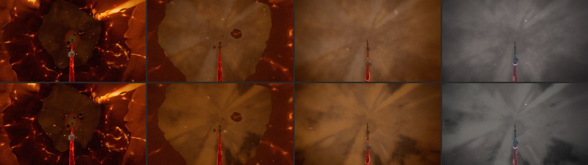
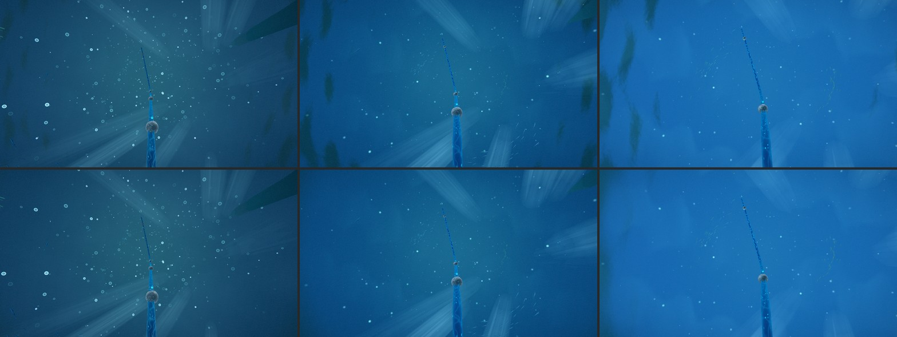
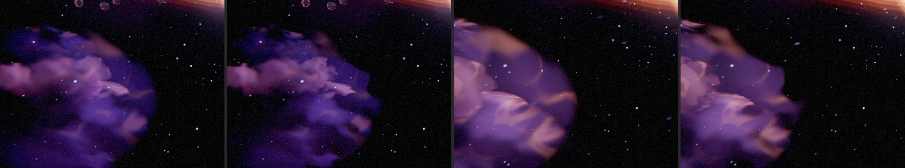
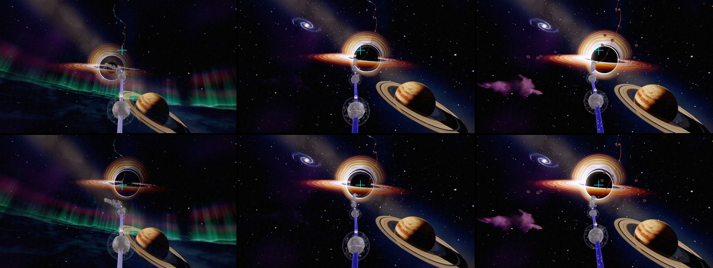
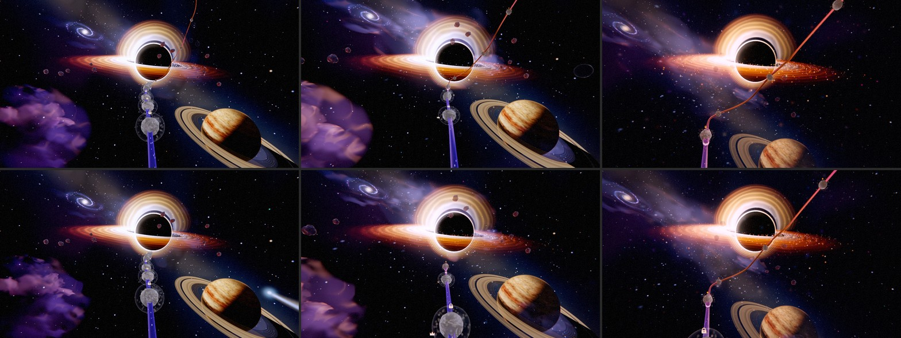
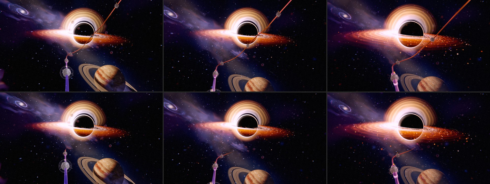
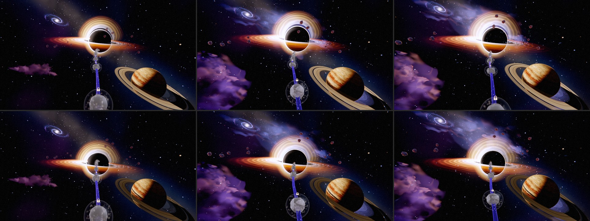
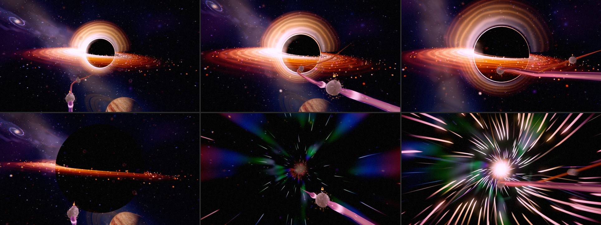
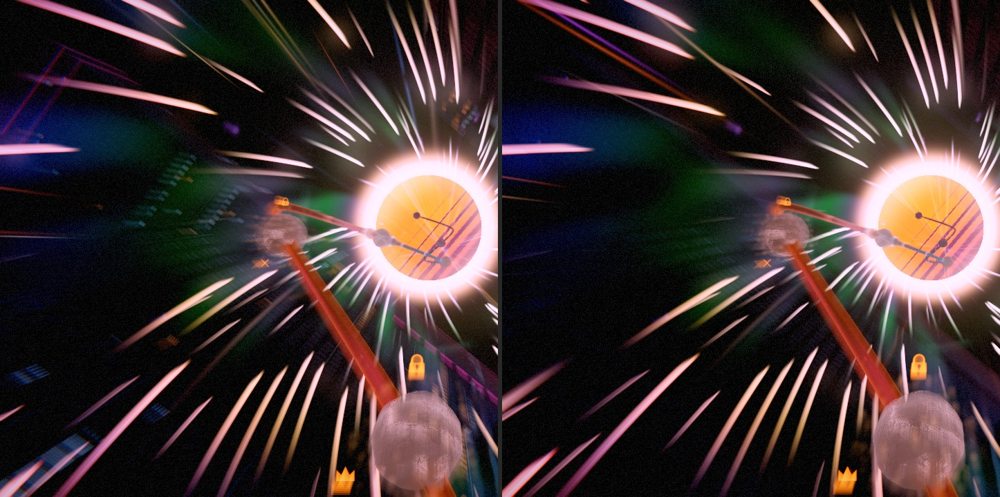

# Odyssey chapter audit — 2026-10-22

**A record.** Olov: *"I love odysseymode how it looks! But now i want you to continue to audit all
chapters in odyssey mode to really make sure the environments, visuals and graphics in odyssey
mode feels amazing!"* This followed the same day's chapter 6 pass, *"it feels like the black hole
drifts, i want it to be locked at the journey path we are moving on"*. That pass is recorded in
[ODYSSEY_CH6_COMPOSITION_2026-10.md](ODYSSEY_CH6_COMPOSITION_2026-10.md#2026-10-22--the-hole-rides-the-path)
and summarised below.

## How it was run

- **Gallery.** All eight chapters were captured in the real game. Each chapter had eight
  stations (local 0.02, 0.15, 0.30, 0.45, 0.60, 0.75, 0.88, 0.98), phase-locked
  (`--time 9 --env-time 30`). Settings were WebGPU, High, 1280×720 and pixel ratio 1, using a
  preload-patched copy of `scripts/odyssey-chapter-capture.mjs` against a private dev server.
  That makes 64 frames before and 64 after, with no console or WebGPU errors in either set.
- **Bisects.** The harness's `--hide=<name>` flag found which mesh owns a defect. Pixel
  statistics (mean colour, luma p10/p50/p90 of a region) decided what was flat and what was
  merely dim. Each fix was re-captured at its stations before moving on.
- **Seams.** Each touched seam was captured (`--seam`) and scored with
  `scripts/odyssey-seam-luma.mjs` before and after.

## What the gallery showed

| Chapter | Read | Verdict |
|---|---|---|
| 1 Earth Core | A great lava-lake opening and a lit shaft. Then, from local ~0.6, a flat olive "hole" up the shaft and featureless brown, then grey, fog for the last quarter. | **Fixed** (the steam) |
| 2 Deep Ocean | Atmospheric shafts and marine snow, but dark blurred blades at the frame's edges through the deep half. They read as smudges on the lens. | **Fixed** (the far ceiling) |
| 3 Surface World | A coherent stylised island: the cone, the flowers and the rainbow. An autumn crown near the lens at 0.6–0.75 is a saturated red blob. | Style; left |
| 4 Mountains | Holds up. The climb looks up the face at the end of the chapter (known: L27/L28). | Left (camera-rig item) |
| 5 Sky | The summit snow is a smooth white plaster cone at close range. The departure, twilight and aurora are lovely. | **Open** (see below) |
| 6 Space | Strong composition. The hole drifted against the rail, and the near nebula read as a cotton ball. | **Fixed** (both) |
| 7 Black Hole | A strong approach and warp. The city's lit window grids showed over the tunnel at local ~0.88, before its mouth opens. | **Fixed** |
| 8 Urban | Holds up: the neon canyon, the signs and the Retrosun. | Left |

## The fixes

### Chapter 1 — the steam climbs toward light (`composition/odyssey-steam-quench.js`)

The shell's average brightness is pinned to the cavern's (the luminance cap that keeps the 1→2
seam smooth), so the fix had to add form, not light. Pixel statistics found three causes of the
olive, flat look:

1. **A per-channel `min(0.96)` before exposure.** Where the eye looks up the shaft, the aperture,
   rays and billows sum past it. Red clipped first while green kept rising, so the fire-lit
   vapour came out tan and olive: a flat plateau exactly where the light should be. It is now a
   luminance soft shoulder that keeps the hue.
2. **A hard post-exposure ceiling.** The whole opening sat above it, compressed ~5×. It is now a
   knee, and the headroom went from 2.4× to 3.6× the cap.
3. **Too little structure for the exposure to keep.** Several changes:
   - darker smoke in the gaps (sooty ember on the warm side, sea-teal on the cool side) with less
     density lift (0.5 → 0.35)
   - backlit rims on the billows
   - rays that are visible (0.16–0.40, they were 0.05–0.15)
   - stronger streaming wisps (the climb's motion)
   - a hot core dimmed by the billows in front of it
   - less of the structureless broad aperture glow

   The added light is folded into the exposure reference (`STEAM_QUENCH_LIGHT_SHARE` 1.08), so
   the frame's median holds: local 0.6/0.75/0.88/0.98 measured 25/56/78/85 before and
   26/55/76/88 after.

A bisect showed that from local ~0.66 the next act's deep-ocean world draws behind the shell (by
design: the steam hides the hand-off), and that the grade only starts leaving chapter 1 at the
very end (`seamProgress` is smootherstepped), so neither was the olive's source.

**1→2 seam:** maxStep 29.7 → **25.9** luma per 0.01 p (limit 45). The climb's whole curve is
within ~3 luma of before.

### Chapter 2 — the far ceiling is calm (`world/odyssey-world-renderer.js`, water underside)

Hiding meshes one at a time found the blades in the water's own underside. Snell's window test
read the full swell normal on a ceiling 200–400 u away, so the swell pushed patches back and forth
across the 0.60–0.72 threshold. Waves that far off average out. The window's normal now flattens
toward vertical between 40 u and 180 u of **3-D** eye distance (the column looks straight up, so
the horizontal range overhead is ~0). Near the surface, the rippled rim and the caustic light are
untouched. **2→3 seam:** maxStep 36.1 before and 36.1 after, identical. The 1→2 seam was
re-scored after it: 25.9.

### Chapter 6 — the hole rides the path; the near nebula frays (`chapter-environments/cosmic-expanse.js`, `odyssey-nebula-field.js`)

- **The hole** (the earlier pass, recorded in the ch6 doc). It is placed in the spine's frame at
  the progress the eased eye stands at (`resolveOmenPathPlace`, and the camera controller's new
  `followProgress` published by the board). It holds one place against the rail all chapter and
  lands exactly on chapter 7's lock. In game it now stays on a fixed screen mark at every station.
  Before, it slid round the mark.
- **The nebula.** Its silhouette came from the first gas octaves, which are smooth across the
  whole mass, so its edge drew an oval. One more lattice octave (one texture fetch per nebula
  fragment) now erodes the outer shell only, by (1 − thickness), so the rims tear into lobes and
  wisps and the heart is untouched.

### Chapter 6 — the rail vanishes into the hole (`odyssey-path-horizon.js`)

Olov, on landing day: *"hide the path beyond chapter 6 so it seems to vanish into the hole"*. From
chapter 6 the rail past the 6→7 boundary (chapter 7's hairpin climb, and chapter 8 beyond it) drew
as a thin line up and across the hole's side. It is the real path, but it read as the journey
going past the hole, and the hole cannot sit on it.

`resolveOdysseyPathHorizon(progress, chapterPositions, levelPositions)` is one schedule of the
eye's progress. The board feeds it each frame to the ribbon (`OdysseyPathRenderer.setHorizon`:
its radius collapses past the horizon over a 0.006 p taper, in the shared `ribbonRadius`, so the
body and the haze shell stay one) and to the nodes (`LevelNodeManager.setPathHorizon`: they
scale out by the same weight and are culled past it):

- **Chapters 1–5:** nothing is hidden. Across the 5→6 seam the far rail retracts to the boundary,
  a thin far line shortening in the dark departure.
- **Through chapter 6:** the rail ends a taper past the boundary node (chapter 7's first, which
  sits on it). The rail runs up into the middle of the hole and tapers out there, and no node
  beyond it is drawn.
- **Nothing past the mouth until the eye is inside** (fourth pass, the same day). Olov: *"I dont
  want to see any of the path behind it before we really get into the black hole."* The rail
  stays ended at level 49, the mouth, until the eye is wholly inside the hole
  (`resolveBlackHoleInsideProgress`). Then the rest of the journey is laid out, up the tunnel and
  on to the city, finishing at level 50. Chapter 7's plunge moved to the glide from level 49 to
  level 50 for this ([ODYSSEY_CH7_FALL_2026-10.md](ODYSSEY_CH7_FALL_2026-10.md)), so levels 50
  onward all lie inside the tunnel.

  The second pass went on one node at a time (parked on a node, the rail to the next). But with
  the hole growing over levels 49–52, levels 50–52 and the rail between them stayed in front of
  it, drawn across its face. The glide onto level 52 also laid out the rest of the journey before
  the eye was inside: measured, orbs 51–57 drew over the hole at p 0.905, while the eye was
  inside only from p 0.912. (The first pass had laid the whole climb out on the glide into
  level 49, across the face of the glowing hole.) Measured after: until the eye is inside (p
  0.8808), the only path seen over the hole is the stretch the eye travels, ending at level 49.

Guard: `tests/unit/odyssey-path-horizon.test.js`. It checks that:
- the plunge sits between the mouth and the next node;
- nothing is hidden before chapter 6 or once the eye reaches the node inside the hole;
- every chapter 6 node and the mouth are drawn, and nothing past them is, until the eye is inside;
- the way on is laid out by the next node, sweeping, never a step;
- without node positions it still waits for the inside.

In game: no line or nodes past the hole at local 0.30–0.93. At level 49 the hole's face is clear
and the rail ends at the orb. The hole holds its place against the rail through chapter 6 (within
0.017 of the frame from p 0.80 to the hand-over), lands exactly on chapter 7's lock (0.004, 0.050
for both) and is dead centre (0.000, 0.000) from p 0.877 through the dive.

**Into the centre** (third pass, the same day). Olov: *"So does the path go in to the center of the
black hole now?"* It did not: on the real path camera the rail's drawn end met the shadow 0.8–1.1
shadow radii below its centre all through chapter 6, at the rim, because the hole hung in the
upper-centre third (chapter 7's lock: 150 u up, 26 u right at 900 u). The lock now sits where the
rail's end points (29 u up, 4 u right), and chapter 6's seat (`OMEN_SPINE_ANCHOR`) is re-solved
from it on the real camera (856 u along, 80 u below the tangent, 39 u right; it was 871 / 42 up /
51). The end stays within ~0.26 radii of the centre from p 0.78 to chapter 6's last node, where it
is 72 u away and slides to the lower inside of the shadow. The hole now hangs near the middle of
the frame, the hand-over still lands exactly, and chapter 7's fall starts closer to the centre it
drifts to. Guard: `odyssey-ch6-hero-framing` ("runs the rail into the middle of the hole"; 0.94
radii on the old placement).

### Chapter 7→8 — no city windows over the tunnel (`urban-dreams.tsl.js`)

The nearest towers fade in under the warp tunnel. Their window grids drew over its streaks before
the city was meant to be seen, an open item from the ch8 overhaul. The facade's lights (windows,
trim, ledges) are now multiplied by `seamReveal`, the 7→8 carry's mouth schedule that the signs,
lanterns, skybridges and traffic already ride. Chapter 8 proper is unchanged, because
`seamReveal` is 1 outside the window. **7→8 seam:** maxStep 20.5 before and 20.5 after, at a
station outside the window.

## Tried and reverted

**Chapter 5's summit, wind crust and glints.** Close-range sastrugi (a normal tilt plus a
crest/trough value shift) and view-dependent ice glints were tried on the near snow, gated by a
3-D footprint. Two results:

- At a believable amplitude the crust was invisible, because the snow sits in the ACES shoulder,
  where a ±5 % change is one or two display levels.
- Exaggerated to prove it was active, it drew as a regular ladder of horizontal stripes.

The camera is 100–300 u from the cone at these stations, too far for glints. Reverted.
**The real lever is the snow's place on the tone curve.** It is white enough that its lit detail
is compressed away. Moving it means re-balancing the mountain's exposure from afar and the 5→6
seam, a pass of its own.

## Still open

- **Chapter 7's hole loses its glow on the approach.** *Rim done 2026-10-23*
  ([ODYSSEY_CH7_FALL_2026-10.md](ODYSSEY_CH7_FALL_2026-10.md) §6): the photon ring was not only
  dimmed, it sat in the centre plane where the shadow hid it from ~20°; it now rides the
  silhouette, a razor all the way in. The lensed halo still fades out by ~19° (the amber flood).
- **Chapter 5's summit** — see above.
- **Chapter 2's mid-water** is atmospheric but sparse. The whale shark and manta pass on their own
  clocks (38 s / 64 s) and are not in every frame; a frozen-clock gallery shows the water without
  them.
- **Chapters 3–5's painted style** (tree crowns, sticker clouds) is a style, not a defect; left.

## Cost

- **Steam quench:** ALU only (a luminance dot, two soft shoulders, a rim band). It is one
  full-screen layer that exists only across the 1→2 window.
- **Nebula:** +1 lattice texture fetch per nebula fragment (the masses' additive hulls).
- **Water underside:** one `length` and one `normalize`/`mix` per ceiling fragment, inside the
  submerged branch.
- **Facades:** one multiply.
- **Chapter 6 hole:** one spine-frame evaluation per frame on the CPU (it was a cached point).
- **Rail horizon:** one smoothstep per ribbon vertex (two draws). On the CPU, one scalar per frame,
  plus the node buffers' re-upload while the horizon moves (only across the two seams).

No new draws, pipelines or textures. GPU timings were not taken: the machine's GPUs are shared by
parallel sessions, and these deltas are below what an interleaved A/B can resolve under that load.

## Verification

- Tests: `tests/unit/odyssey-ch6-hero-framing.test.js` (the path lock; it fails on the old
  placement at the first station, 0.35 off the lock), `tests/unit/odyssey-camera-controller.test.js`
  (`followProgress` names where the eased eye stands) and `tests/unit/odyssey-path-horizon.test.js`
  (the rail's horizon).
- All 200 Odyssey test files pass except `odyssey-level-briefing`, which fails identically without
  these changes. `odyssey-forest`'s bake-budget timing test failed under load and passes alone.
- `tsc`, the ts and lint ratchets, the architecture fitness ratchets and `depcruise` pass. The
  two lint errors in `OdysseyBoardController.js` (no-nested-ternary at lines 1437 and 4590) are
  pre-existing.
- Seams: 1→2 PASS (25.9), 2→3 PASS (36.1, unchanged), 7→8 PASS (20.5, unchanged).
