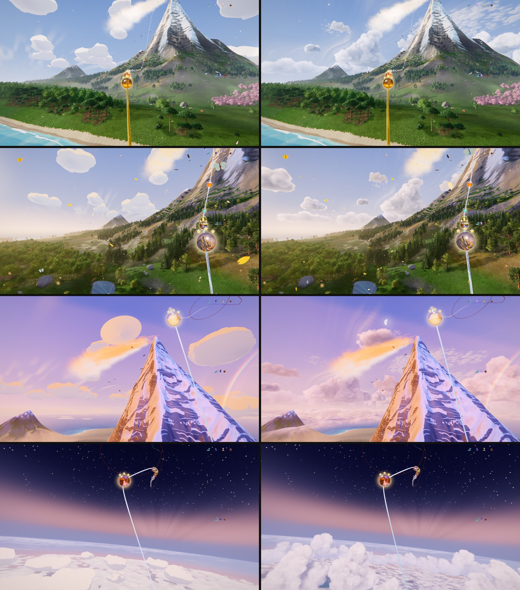

# Odyssey — the sky, from a clean slate (2026-11-24)

Olov: *"Let's take the visuals in Odyssey Mode to a world-class standard by completely overhauling the clouds … Disregard
any previous instructions or implementations for the clouds and start with a clean slate … rich, organic silhouettes
with varied scales and zero obvious repetition, built across multiple altitude layers … luminous, natural light
interaction … gentle, natural drift so they frame key vistas … without obstructing the camera."*

The flat sheet, the hero clouds, the hull field and its looks, the summit's cap and the mesh floor are gone (about
930 lines of the renderer and eight files); they are in git history.

## What was wrong (20 frames of the running game, before any code)

- Opaque hulls with one hard outline: smooth potatoes, faceted up close, the same from every side.
- One tone in light and one in shade, no depth, no light through an edge: cut-outs on the sky.
- All at one height, so no parallax; the floor below the climb read as snow dunes or pack ice.

## The approach

**A cloud is a volume, sculpted and lit offline, traced in its own box.** A real-time march cannot afford the light a
cloud scatters inside itself; but this world's sun never moves, so that light is solved once in Blender's Python and
stored with the shape. The game only walks to the cloud's skin, which costs little, and reads the light.

| Layer | What | Where |
|---|---|---|
| High sky | cirrus and altocumulus, each on its own shell, on the dome | `world/odyssey-high-clouds.js` |
| Giants | towers far behind the island, the scale of everything else | `world/odyssey-cloud-composition.js` |
| Fair | the day's heaps, west, north and east, few and well apart | the same |
| Wall | banks all round the horizon, near and far by turns, gone as the climb leaves them | the same |
| Cap | lens clouds standing in the summit's lee through the evening | the same |
| Floor | the sea of clouds under the climb: traced shelves over a soft bed | the same, `world/odyssey-cloud-sea.js` |

### The shapes (`scripts/blender/odyssey/odyssey_clouds.py`, package `clouds/`)

18 clouds in seven kinds, each grown the way one grows: masses on one condensation level throwing billows, those
throwing smaller ones, melted together, warped, roughened, their base flat and ragged, loose scraps round their
outline. Kept as true distance fields (96 x 64 x 96 each, one 3D atlas). With each go its light, on a coarse grid: the
sun's, several orders of scattering, for four turns of the shape; the sky's; the sea's; how deep in the body a place is.

### The tracer (`world/odyssey-cloud-material.js`)

Every cloud is a box and all of them one draw, far to near. A ray strides through clear air by the distance field, slows
at the skin, and gathers light. A tiling billow noise carves the skin at two sizes (edges at every scale) and climbs, so
the clouds boil slowly. A far cloud takes few steps. What is going thin lets light through.

### The composition (`world/odyssey-cloud-composition.js`)

Each storey is laid in lanes down the one wind. A cloud is born small at a lane's head, grows, drifts and is eaten away
at its foot; its next turn is another shape, size and facing, so none is ever seen twice. The lanes leave the rail's
own line and the summit's sky open. Held by tests over two hours of weather: nothing within 190 u of the rail, nothing
over the summit, no step larger than a cloud's own pace, and by orb 34 the climbed eye stands above every top.

### The light

The sun, the hour's and the evening's colours, the air and the departure are the world's own nodes, so the clouds turn
peach, rose and violet with the land. Bright crowns, cool undersides, a burning edge toward the sun, and the last of them
standing in the horizon's own haze. The waters reflect them (`world/odyssey-water-clouds.js`).

## Tiers and cost (`CLOUD_TIERS`)

The same clouds on every tier; a tier walks fewer steps, drops the finest billows below High, and on the lowest two draws
every second or third shelf of the floor.

GPU, clouds and floor on against off (RTX 5080 laptop, 1080p, 30 fps cap, headless Chrome, best of four interleaved
rounds; an indication, not an ADR-0016 claim; this GPU flips between two clock states about 3x apart, so only rounds in
the same state are compared; **the integrated GPU was not measured**):

| View | High | Medium | Low |
|---|---|---|---|
| meadow (p 0.19) | 0.31 ms | 0.18 ms | 0.14 ms |
| mountain (p 0.46) | 0.41 ms | 0.30 ms | 0.26 ms |
| climb (p 0.60) | 0.63 ms | 0.30 ms | about 0.3 ms |
| departure (p 0.68) | 0.76 ms | 0.65 ms | about 0.4 ms |

(The last two on Low are estimates: no round of both kinds fell in the fast state.) Download: `clouds.dat` 8.1 MB,
`sea.png` 2.3 MB, `high.png` 0.6 MB. GPU memory: 17 MB of 3D textures.

## Checks

WebGPU at High, Medium and Low, WebGL2 at High and a portrait frame: no validation error, no TSL warning. New suite
`odyssey-clouds.test.js` (21 tests); the evening, climb, act-gate, shower, lint and bake suites were fitted to it.

## Left open (owner's calls)

- High on the integrated GPU is unmeasured; `CLOUD_TIERS` is the dial (`steps`, `floor`).
- The ground's drifting cloud shadows are still the old noise field: they share the wind, not the clouds' own shapes.
- `clouds.dat` is 8 MB; halving the SDF grid would halve it at some cost to the near clouds' edges.
- Chapter 6's nebula still uses the old sculptor (`odyssey-cloud-field.js`), and the bake loader keeps its unrequested
  cloud-field lane and that sculptor's old spec table (its own tests read them): a clean-up, not a cost.

## Changing it

- A cloud: its builder in `clouds/sculpt.py`, then
  `blender -b --factory-startup -P scripts/blender/odyssey/odyssey_clouds.py -- volumes` (two minutes). The high sky:
  `-- high`; the floor's bed: `-- sea`.
- Where and how many: `CLOUD_LANES`, `CLOUD_WALL`, `CLOUD_CAP`. The look: `CLOUD_LOOK` (the skin), `CLOUD_WORLD` (the
  light, in the renderer), `HIGH_SKY`.
- Look at it: `playground.html?effect=odyssey-clouds&only=tower&az=-100&el=-6`.
- `?odysseyWorldNoClouds=1` takes them all away; `?odysseyNoCloudSea=1` the floor's bed.
