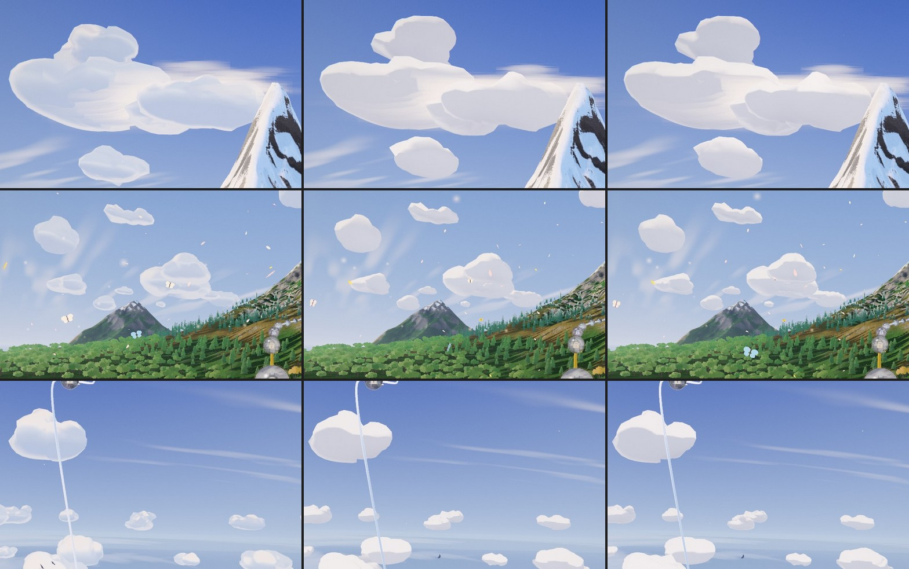
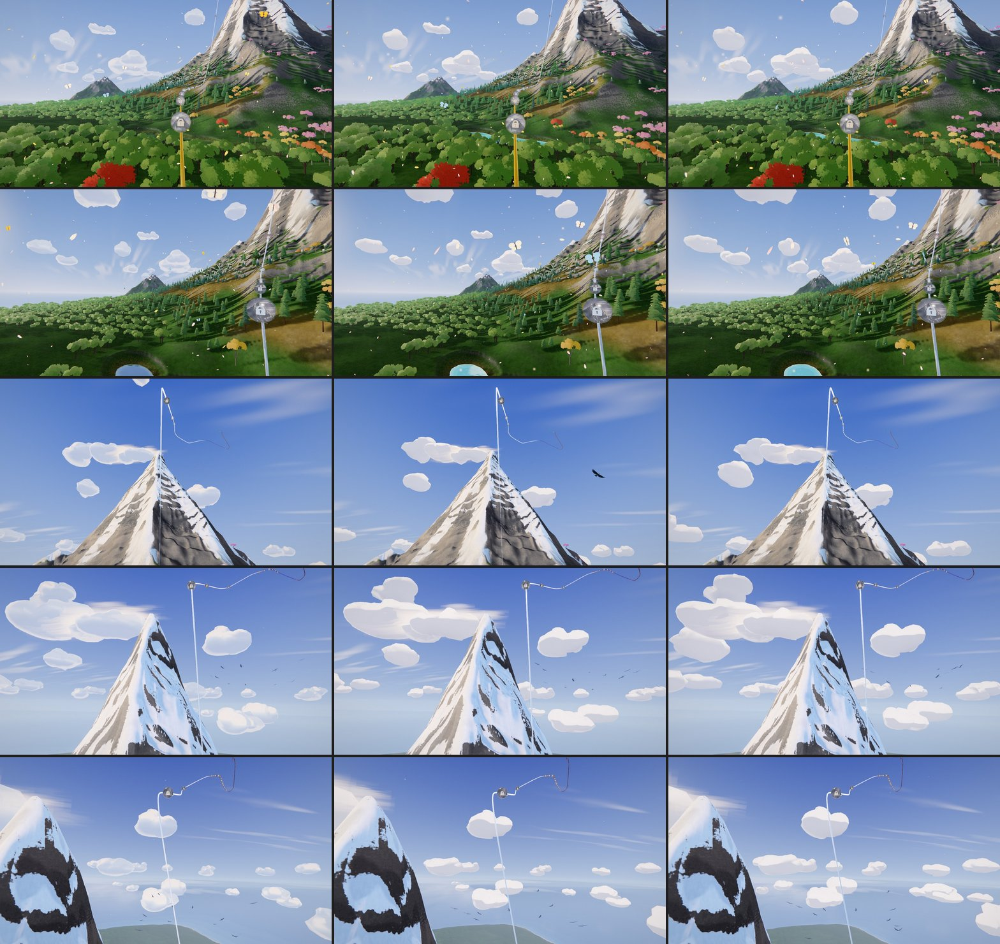

# Odyssey Act II — the clouds repainted and gathered (2026-10-31)

Olov, after the second Act II pass: the clouds were the weakest thing left on screen, then
*"Now we need to continue improving the clouds and all other things we had planned!"*

The field (sculpted SDF masses, `world/odyssey-cloud-field.js`) and its composition were built
against the owner's Witness frames ([ODYSSEY_ACT2_CLOUD_FIELD_PLAN_2026-08.md](ODYSSEY_ACT2_CLOUD_FIELD_PLAN_2026-08.md)).
This pass keeps the sculptor and changes how the masses are painted and where the small ones sit,
as switchable looks (`world/odyssey-cloud-looks.js`, `?odysseyCloudLook=today|light|banks`).

## What was wrong

Full-resolution crops of the live rail (p 0.22 to 0.64):

- **Glass bubbles.** The paint layers a drawn edge, a crease line and a soft rim that fades to the
  sky behind it. Together they drew every lobe's outline inside the silhouette and let the sky
  through the rim: from the meadows the clouds read as translucent glass.
- **Flat inside.** Measured (`cloudlum`: sky = clearly blue pixels, cloud = bright low-saturation
  ones, in the upper frame): the references' clouds span luma p10/p90 171-180 / 241-247; ours
  190-199 / 216-229. A first repaint that only nudged the shipped terms (wrap, bands, shade tone,
  a lift on the lit side) moved those numbers by a few levels: the grade's shoulder caps bright
  clouds near 230, and the shipped terms do not add form.
- **An even sprinkle** of same-sized puffs.

## The Witness paint (look `light`, style `witness`)

One solid body in two soft tones (`cfWitness` in the field material):

- the tone follows how high a fragment sits in its mass, how it turns to the sun, a little of its
  own lobe's cap (each lobe lit from its centre, the sculptor's `aLobe`), how far it faces down and
  how deep in a fold it lies;
- white with a touch of sun where lit, a slate-blue taken from the sky over the face where shaded;
- the sunward edge a little brighter than the body (light through the thin rim), and only the last
  pixel or two melting toward a bright sky-white: enough to round a far hull's polygon corners,
  never enough to see the sky through the cloud;
- 70 % of the field's aerial haze, so far clouds stay clouds.

Tried on the way: a strong per-lobe term (lit from below, most of what the climb sees is cloud
belly, so the sky went grey), and a narrow two-tone (flat paper). The balance below kept the
first solid version's brightness with a light lobe cap.

## The banks layout (look `banks`, the default)

The satellites gather toward their cluster's centre and grow (1.4x), the middle distance and the
horizon row grow (1.22x, 1.42x), and each cluster's smallest puff is dropped (its hull would only
hide inside the bank). A grown horizon cloud is held just under the angular size at which the field
would promote it to the near tier, so the field stays inside its 34k-triangle budget (33,580).
Every grown mass clears the live rail by its role's margin (`odyssey-cloud-looks.test.js`).

## The choice

Today, `light` and `banks` across chapters 3-5 (columns). `banks` is the default: big, solid
cumulus, fewer tiny puffs, the sky still mostly blue. `?odysseyCloudLook=today` restores the
field as it was for an A/B.

