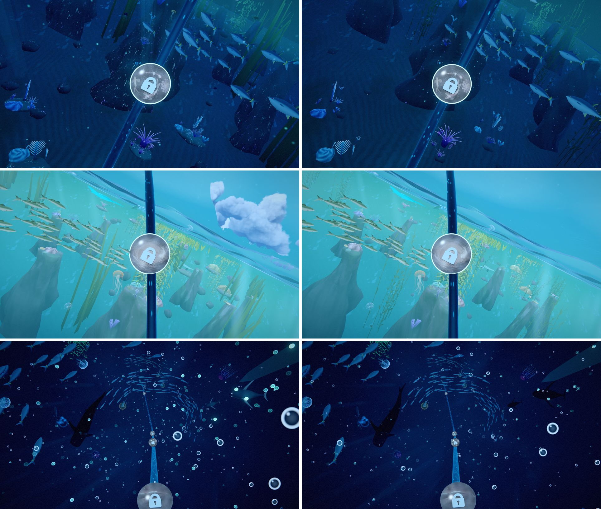
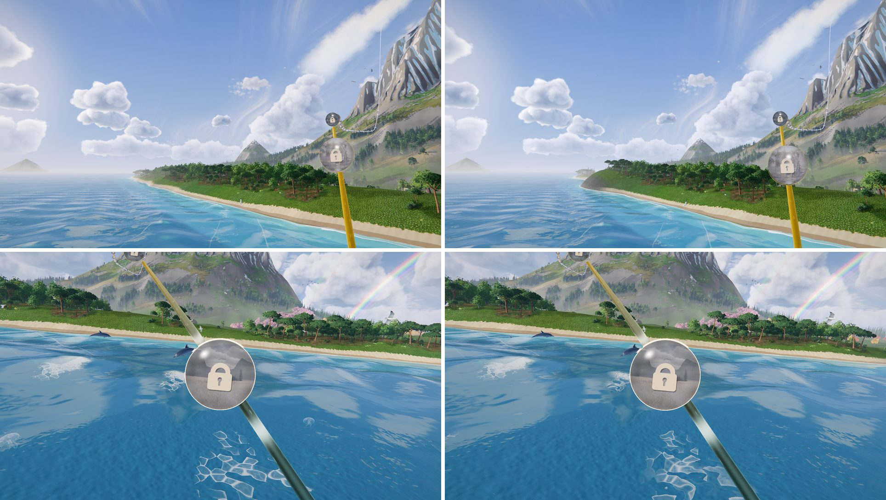

# Odyssey — the coast and chapter 2's reef (2026-11-25)

Olov, after the mountain: *"Continue with 1. The coast and 2. The chapter 2."*

Both were judged from the real game first: chapter 2's orbs 6-10 and the rail at p 0.08, 0.10 and 0.12; the
coast's orbs 11-15 and the rail at p 0.14-0.17 (WebGPU at High on a software GPU, headed under a virtual display,
1920 x 1080, the board clock pinned at 40; gotchas #1208, #1209). What the frames showed, what it came from and
what changed follow.

## Chapter 2

| Seen | From | Now |
|---|---|---|
| A cloud cut off by the sea's surface at orb 10, the eye 5 u under it | the sky's cloud volumes draw after the transparent water and were hidden only once the eye was wholly under (`uSubmerged` 0.999) | hidden from 0.08: the moment the eye is in the water (`skyClouds.update`, the renderer). The Snell window draws the sky the eye sees from below |
| Rocks and coral mounds hanging over open water on the flank | each was seated by its centre on a 45-degree slope, its downhill side in the air | seated on the lowest bed under its footprint (`bedUnder`, odyssey-ocean-reef.js); a colony's mound is a smooth swell (`MOUND_ROUGH` 0.12) sunk past its waist, its height its own, and its coral seats on the mound's real top |
| "Flecks": the deep rock covered in streaks of light | the living lights were a threshold of a noise plane sheared up the walls | round spots, one at most to a 3.6 u cell of the face's nearest plane (`spotCell`, `spotShare` 0.46), each on its own clock and colour, gone past 150-240 u; the rock's edges carry the water's cold light (`rockRim`), so a stack in the dark still turns |
| The sea stacks as turned posts, cut flat, coral on top like a stump's | the lathe stepped in at a fixed count of ledges and was banded in colour every few units of height; the crown was a flat cap | no terraces and no bands: the profile swells and pinches by the stack's own noise (undercuts, a waist), colour in patches, and the crown a worn dome with knobs (`STACK_FORM`); the crown's coral seats on it (`stackCrownAt`). The tower keeps its low crown, where its kelp forest stands |
| The shelf's kelp as planks leaning in the water | each frond was one flat tapering ribbon | a stalk (two crossed ribbons, so never edge-on) that wanders and leans as it rises, with 17 blades off it by turns, reaching out and up and turned out of its plane (`buildKelpGeometry`, odyssey-ocean-forms.js) |
| The bubbles of the 1-to-2 carry as drawn rings, many of them big | the world's specks become bubbles with the specks' own 0.5-1.1 u size and a lit core | a third of that size, capped tighter near the lens, a thin rim brighter on top and a highlight fleck on one side |

## The coast

The shore every orb from the sea looks at was the contour of one smoothstep in z, so it was ruler straight from one
side of the frame to the other, and the beach had one width all along it: about 10 u of sand on a slope of ~38
degrees, a kerb.

- **It bends** (`ODYSSEY_SOUTH_COAST`, odyssey-world-height.js). The shelf's z moves by the sum of four compact
  bends along x: a cove at x -760 (+32 u inland), a point at -490 (-42 u, out to sea), a bay at 290 (+48 u) and a
  point at 560 (-32 u). The move is whole from the shore inland and fades out to sea across z -70..-200, so the
  deep flank keeps its form.
- **Its beaches follow the bends.** Within 28 u of the sea's level a cove's ground is laid back (its slope x 0.25
  at the waterline, a smooth function back to the ground's own at 28 u, and only 0.3 of the relief there): a wide
  beach and wide shallows. A point's is stood up (x 1.5): a narrow strand, the grass and the rock near the water.
  Sand from the waterline to 6 u over the sea: 18-25 u across in the bay and 17-20 u in the west cove, 4-6 u on the
  west point, against 7-15 u all along before (the table below).
- **The landing is left as it was** (x -340..90). The glade's deer, the wild horses and the authored pines stand
  on that bank and the reef is planted on that slope. A shallow cove at the landing was tried: it put a deer
  3.7 u over the sea and a hero pine on the sand. A laid-back beach face there (the dry sand only, up to 6-8 u)
  was tried too: it widened the sand by a few units and tilted the ground under the nearest deer past its
  footing. **Open for the owner:** the landing's own beach stays steep and straight unless the herd's ground may
  move.
- **The whitecaps' lace** read as broken glass near the eye: a net of closed polygons, straight walls, sharp corners
  (`SEA_CAPS`). The lace is bent further by the ripples (0.18 -> 0.42), its walls fall off softly (`soft`), and a
  wall shows only where the foam holds, in patches a cell or two across (`holds`): a torn fringe of threads and
  gaps.

| x | -800 | -700 | -600 | -500 | -400 | -200 | 0 | 200 | 300 | 400 | 500 | 600 |
|---|---|---|---|---|---|---|---|---|---|---|---|---|
| shore z before | -194 | -193 | -192 | -183 | -186 | -192 | -208 | -201 | -196 | -193 | -206 | -223 |
| shore z now | -223 | -220 | -187 | -155 | -171 | -192 | -208 | -231 | -242 | -217 | -185 | -192 |
| sand before (u) | 9 | 9 | 9 | 7 | 9 | 8 | 13 | 9 | 8 | 8 | 13 | 15 |
| sand now (u) | 20 | 17 | 8 | 4 | 6 | 8 | 13 | 24 | 25 | 18 | 9 | 14 |

(Sand: the width of the ground from the waterline to 6 u over the sea, the relief included, measured along z.)

## What moved with it

- Regenerated from the new height field: the forest's rail visibility stamp (`scripts/bake-forest-visibility.mjs`)
  and the bakes' goldens. The forest's rock keep-outs (`FOREST_ROCKS`) came out the same.
- The west point first reached x -280 and put a new neighbour beside one of the landing wood's giant pines (the
  forest's spacing by size, its test); it stands at -490 now and reaches -340.
- The reef's plan keeps its random draws: a mound's height is a golden-ratio step, not a draw, so every colony,
  rock and frond after it is where it was.

## Checks and cost

- **The real game**, before and after, at every station above; the WebGL2 backend (`forceWebGL=1`) and the Low tier
  at orbs 8 and 11 (the Low tier builds no rock lights, as before). No WebGPU validation error and no TSL warning in
  any console (the WebGL2 run logged two menu themes' prefetch timing out on the software driver, nothing of the
  world).
- **Tests**: every Odyssey suite (283 files, 3,267 tests), among them the reef's (its sites against the animals'
  routes, the fish and the rail; its seating; its counts), the forest's (no tree on the sand, its spacing, its
  heroes), the herd's and the horses' ground, the rail's clearance, the bakes' goldens and the shaders built to WGSL
  and GLSL.
- **Gates**: the lint ratchet at its baseline (418 errors, none new), the IP-string gate and the architecture fitness
  check.
- **Cost, not measured on a GPU** (this session had none; ADR-0016):
  - the shelf's kelp: 98 triangles a frond against 32, 236 fronds on High (110 on Low): +15.6k triangles, still one
    instanced draw;
  - the reef's stacks: 19 sides and 25 rows against 17 and 18, +2.7k triangles in a mesh of 62k;
  - the rock's lights: three small hashes (High only) in place of one texture read; the rim one term;
  - the lace: one more read of the detail texture it already binds, inside the caps' branch only;
  - the height field: one short sum and a smoothstep in the macro bake; no new texture.

## Changing it

- The coast's line: `ODYSSEY_SOUTH_COAST.bends`, its beaches `band`, `cove`, `point`, `reliefKeep`. Then
  regenerate what is pinned to the height field (as for the mountain: `FOREST_ROCKS`, the visibility stamp, the
  goldens) and run the reef's, the forest's and the animals' suites.
- The stacks: `STACK_FORM`; the rock's lights: `spotCell`, `spotShare`, `spotFar`, `rockRim` in `OCEAN_SCENERY_LOOK`.
- The lace: `SEA_CAPS.bend`, `soft`, `holds`.
