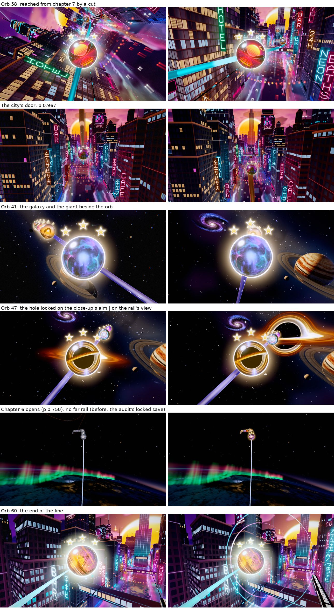

# Odyssey — chapters 6 to 8, the audit acted on (2026-11-25)

Olov, after the audit (docs/ODYSSEY_DEEP_CHAPTERS_AUDIT_2026-11.md): *"Now start the implementation in the proposed
order"*. The plan's first five steps are done; its sixth, the owner's calls, is left open (below).

## 1. The city's close-ups no longer roll (C1, a bug)

A cut that lands in an orb's close-up (every trip with reduced motion, any zero-length trip) ran no follow frame at
its new place, so the camera kept the up of the place it came from: reaching a city orb from the fold rolled the
city about 70 degrees. The teleport's frame now takes the up of the freshly snapped framing whenever the camera is
not following the rail (`OdysseyCameraController.update`). A test cuts from a chapter 7 orb to a chapter 8 orb and
holds the camera's up within 5 degrees of the city's (it measured 70.5 before).

## 2. The city's door (C4, N2)

In the city the follow eye sits back along the city's level forward, not along the rail; where the rail drops ~23
degrees out of the fold into the city (p 0.955-0.972) its reach behind the followed point climbed to the eye's
height and passed over the lens, a pipe hanging from the top of the frame onto the orb. The eye now lifts, along
the city's up, by what keeps the rail between it and the followed point 3 u under it (`_railOverEye`,
`RAIL_UNDER_EYE`); 0 almost everywhere. A test holds the rail within 15 u of the lens under the eye across the 7-8
seam. (Thinning the rail near the eye, as Act II does, was tried first: it narrowed the pipe but also every rail in
chapters 7 and 8's close-ups, and left it hanging over the spire.)

## 3. Chapter 6, a journey (S1, S2)

- **Every close-up its own picture.** A close-up looked along the rail turned a fixed 40 degrees and the rail runs
  almost straight to the hole: eight close-ups, one picture. Each orb now stands beside the hero of its stretch of
  the chapter (`odyssey-ch6-close-ups.js`, `CH6_CLOSE_UPS`), the orb still in the middle: the planetrise orbs keep
  the rail's view; then the ringed giant beside the orb, further out at each orb as it falls behind; then the
  galaxy; then the black hole beside the orb, the rail running from the orb into it, larger at each orb. The
  chapter publishes where its heroes hang (`group.userData.heroPlaces`, from its build) and where the hole stands
  for an eye at a given progress (`omenAt`: it rides the rail).
- **The hole beside the orb, not behind its glass.** In a close-up the hole locked onto the close-up's own aim, so
  it stood behind the orb with its disk as wings on the glass. Chapter 6's omen now keeps its place in a close-up
  and chapter 7's great hole locks to the rail's view (`resolveCloseUpLockCamera`), both eased by the board's
  `closeUp` weight over the camera's swing so leaving a close-up never jumps; the fall's portal still hands the
  lock to the live gaze.
- **The dust off the hole's shadow.** The near space dust (SPACE_MOTES) between the eye and the hole read as stars
  inside it; a mote is veiled where it lies over the shadow's disc, as the eye sees it (`shadowKeep`, `shadowEdge`).

## 4. The end of the line (C5)

The journey's last orb was a dot in the street with nothing to mark it. Two rings of light stand upright round the
end of the rail, facing down the boulevard, dashes running round them in turn, and a faint beam rises from the
street through them into the sky (`createNeonTerminus`, every tier). The city's hologram of the Earth, a glass
sphere in a world where glass spheres are the orbs, is drawn as a projection: lines, the land's dots and interlaced
scan lines, its rim faint.

## 5. The small things

- **The far rail (S3).** Across the 5->6 seam the far rail's retract ran to a seam past chapter 6's start, so the
  fold's rail drew as a red hairline with its orbs as beads over the chapter's opening; it ends a quarter seam
  before the chapter now (`ODYSSEY_PATH_HORIZON.retractEarly`).
- **Grain in the dark (J6).** The film grain keeps a fifth of itself in the darkest tones; in deep space it was
  louder than the black it sat on.
- **Crossing signs (C9), in part.** Tube signs hung on one wall no longer cross in the street (a blade is moved past
  the one it would cross, or left out, with every draw still made, so the rest of the city is planned as it was).
  The audit's example, "NEATHS" at orb 58, is not that: two blades one behind the other along the wall, seen at a
  glancing angle from the close-up, and it is still there.
- **Left as they are:** the orbs' warm fringe far off (J3) is the locked orb's chapter-tinted rim, dimmed, a few
  pixels wide at that size, not an alpha fault; the fold portal's square stars (F2) are not traced to a resolution
  yet; **the aurora's hard end (S5) is still open**: testing the Earth aurora's march gate at more points along a
  ray (the first suspect) left the frame identical to the pixel, so the edge comes from elsewhere in the march
  (odyssey-orbit-earth.js) and wants its own look in the playground.

## Open: the owner's calls

From the audit's plan, step 6, untouched: rain on the lens and more neon spill on the facades (C6); one rail and
node language across chapter 7's rooms (J2's geometry, F1); the orb's size from one node to the next (J1).

## Checks and cost

- **The real game**, before and after, at the audit's stations and at the city's door (p 0.960-0.973), the journey's
  end (p 0.990-0.999) and the close-ups reached across chapters; the WebGL2 backend (`forceWebGL=1`) and the Low
  tier at orbs 47, 58, 60 and p 0.750, 0.967. Every capture with the save applied (the audit's seed never reached
  the board; `updateProgress` now). No WebGPU validation error and no TSL warning in any console.
- **Tests**: every Odyssey suite (285 files, 3,308 tests), among them the new close-up, door and chapter 6 framing
  tests, the path horizon's, the planetrise's, the black hole's, the city's plan and shaders.
- **Gates**: the lint ratchet, the IP-string gate and the architecture fitness check.
- **Cost, not measured on a GPU** (this session had none; ADR-0016): the city's eye lift samples the rail four
  times a frame in the city only; the close-ups' aim is computed once per orb selection; the dust's veil is one dot
  and one smoothstep per mote; the terminus adds three draws in the city (two rings, a beam, 300 triangles); the
  grain one smoothstep.
