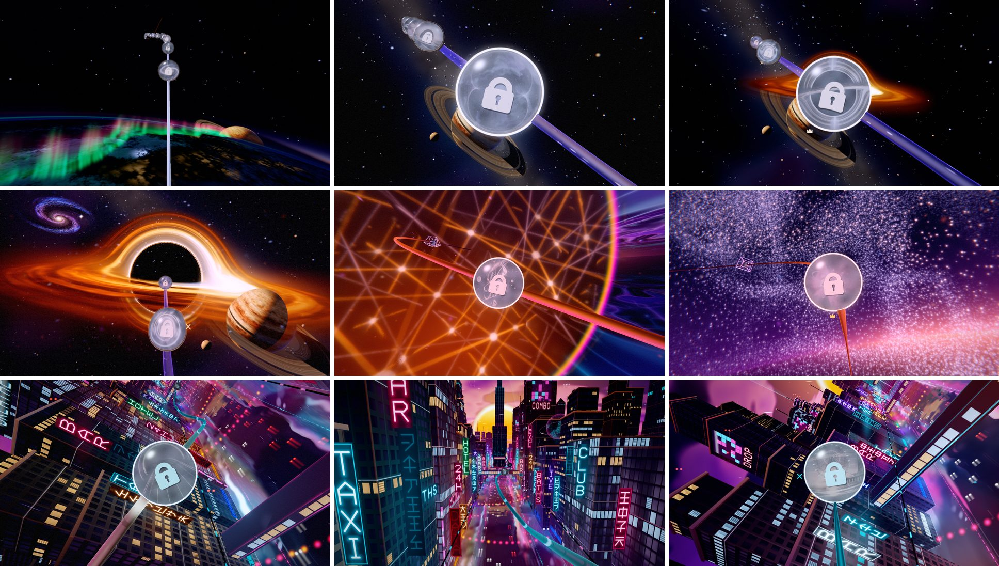
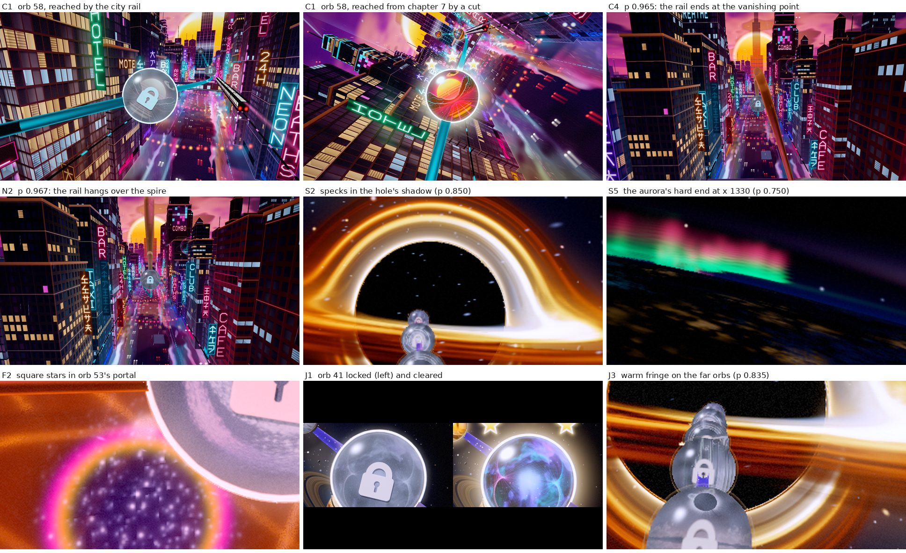

# Odyssey — chapters 6 to 8, judged from the pixels (2026-11-25)

Olov: *"Start the audit of chapters 6-8"* (space, the black hole and its fold, the city). Nobody had looked at them
since the journey masterpiece pass (2026-11-17); their records still listed open items (below).

This is an audit only. No code changed. **Acted on the same day** (the plan's steps 1-5): see
docs/ODYSSEY_DEEP_CHAPTERS_2026-11.md.

## How it was judged

- **The pictures.** The real game in a headless browser on a software GPU, headed under a virtual display with the dev
  server's reload socket stubbed (gotchas #1208, #1209); 1920 x 1080, WebGPU at High, the board clock pinned at
  `t = 40`. Chapter 6 holds orbs 35-48 (p 0.7543-0.8618), chapter 7 orbs 49-56 (0.8709-0.9484), chapter 8 orbs 57-60
  (0.9609-1). 30 frames:
  - 17 orb close-ups (`travelToLevel(id, { travelDuration: 0, focusDuration: 0 })`, waiting until no chapter load is
    pending): 35, 37, 39, 41, 43, 45, 47, 48; 49, 51, 53, 55, 56; 57, 58, 59, 60;
  - 13 rail views, every seam among them: p 0.750, 0.760, 0.790, 0.820, 0.850; 0.870, 0.880, 0.910, 0.940; 0.960,
    0.965, 0.980, 0.995.
  No WebGPU validation error and no TSL warning in any console.
- **Three critics**, one a chapter, judged their frames only (no code, no docs), each through form and composition,
  surface and rendering, and a painter's eye. **A sceptic** then tried to refute every merged finding from the same
  frames and six it had not been shown (p 0.835, 0.925, 0.990, 0.967, and orbs 56 and 60 forty frames later). Only then
  were causes traced in code, with probes in the running game.
- **What the capture got wrong, and how it was checked.**
  - Three frames came out black (orb 56, orb 60, p 0.965). They did not reproduce, pinned or not: inside the fold and
    the city a trip between neighbouring orbs rides the rail through dark crossings, and the still caught one. The
    settled frames replace them.
  - The capture's save seed never reached the board, so every orb was drawn locked. The critics' "grey badge" orb (J1)
    is mostly the locked style: with the save applied (`updateProgress`) the same orbs are coloured glass with their
    stars (see the findings image).
  - The film grain and the edges' colour fringing come and go between frames: the adaptive quality strips both
    (`setPostQuality`) after sustained GPU load, which a software GPU always is. What a capable GPU shows is the
    grainy state.

## The audit

Merged from the three critics; Sev is the highest a critic gave, the verdict and its severity the sceptic's.

### Across the three chapters

| # | Finding | Sev | Verdict |
|---|---|---|---|
| J1 | The parked orb is an opaque grey badge, not glass: flat 10-12 px white rim, nothing behind it shows through, its size jumps between neighbours | 3 | WEAKENED (2): the grey is the locked style; the rim and the size jumps stand (rim radius 191/147/149/166/192 px across orbs 49-56; 257 against 201 at 35/37) |
| J2 | The rail has no fixed identity from chapter to chapter | 3 | WEAKENED (2): a colour a chapter is theming. What stands is chapter 7's geometry: a thick tube and a 2 px cable carrying the next nodes, a needle end in mid-air (p 0.880), a stub ending in mid-air (orb 51) |
| J3 | Far orbs fuse into "caterpillars" with a warm brown fringe | 3 | WEAKENED (2): the 6-8 px warm fringe is real (RGB ~69/47/35 between black sky and a cool body, p 0.835 too); the fusing is perspective |
| J4 | Chapter 7's next nodes are editor bounding boxes | 3 | REFUTED: tesseract cages, the fold's own motif |
| J5 | Cream glyphs float by the orbs | 2 | REFUTED: save-state badges |
| J6 | Grain louder than the sky, colour fringing at the edges | 2 | WEAKENED (2): the film grain's high-pass std is 5.4-5.6 on space's black (its mean luma ~5) when at full strength; the fringing ~5 px in the corners |

### Chapter 6, space

| # | Finding | Sev | Verdict |
|---|---|---|---|
| S1 | The eight orb close-ups are one picture: the orb dead centre, the rail out of the bottom-right corner, the planet and its moon lower left, the upper right empty | 3 | CONFIRMED (2): the upper-right block is 95-100 % under luma 20 in all eight; the planet's centre stays within x 747-785, y 673-808 from orb 39 to 48. Only the hole's arrival moves the chapter |
| S2 | Specks inside the black hole's shadow; at orbs 47-48 the orb sits on the shadow and the disk becomes wings on it; at orb 45 the hole is cropped | 3 | CONFIRMED (2): ~18 specks in the shadow at p 0.850, ~25 streaks at 0.835 |
| S3 | A dark-red wire with grey beads arcs over the chapter's first frames | 3 | WEAKENED (1-2): the far rail of chapter 7 (the fold, in its red) and its orbs, seen from 0.750; an unshaded hairline |
| S4 | The ringed planet is a fixed prop with blocky texels | 2 | WEAKENED (2): the 2-3 px texels when large (p 0.820) stand; the black shadow on the rings is physical |
| S5 | The opening aurora ends on a hard vertical edge; the Earth is a blotchy camouflage | 2 | CONFIRMED (2): the green drops from 75 to 0 within 20 px at x 1330 (p 0.750, 0.760) |
| S6 | A galaxy sliver cut by the corner (p 0.790) | 1 | WEAKENED (1) |

### Chapter 7, the fall and the fold

| # | Finding | Sev | Verdict |
|---|---|---|---|
| F1 | Past the horizon a lake with doors to unrelated rooms, not a descent: the palette and the brightness swing frame to frame | 3 | WEAKENED (2): the numbers hold (luma 17.8 -> 62.4 from p 0.880 to orb 49; the warm share 87/66/16/16/72/86/97/12/27/49 %); "a room for every orb" is the fold's design, so the rest is taste |
| F2 | Tile seams in orb 55's star field; square stars in orb 53's portal | 3 | CONFIRMED (2) for the portal (8-10 px square tiles); orb 55's straight lines are the Jewel's facet edges |
| F3 | Past the horizon (p 0.880) an empty dark frame | 3 | WEAKENED (2): dark by design; a beat with nothing to read |
| F4-F7 | The rail skewering the orb; a "capsule" placeholder; a stock montage; grainy lattice edges | 2 | REFUTED: the rail runs through every orb by design; the capsule is one of the Cradle's pillars; taste; the grain (J6) |

### Chapter 8, the city

| # | Finding | Sev | Verdict |
|---|---|---|---|
| C1 | Orbs 57 and 60 (the city's first and the journey's last) look steeply down with the camera rolled 30-45 degrees: no horizon, towers across the frame; the last image of the journey reads as vertigo | 4 | CONFIRMED (3): it holds forty frames later. **Traced below: a stale camera up after a cut** |
| C2 | Mirror-written signs in those frames | 3 | WEAKENED (1-2): one real mirrored letter (the back of HOTEL's sign); the rest is C1's roll |
| C3 | From above, the wet street's reflection is smeared blobs with hard ragged contours | 3 | CONFIRMED (2): fine at street level; C1's view |
| C4 | At the chapter's first moment (p 0.965) the rail is a 45 px tube ending in an open cut at the vanishing point, over the avenue | 3 | CONFIRMED (3) |
| N2 | A moment later (p 0.967) the rail is a ~75 px tube hanging from the top edge onto the orb, over the spire; hairpins under the orb and at p 0.940 | 3 | NEW (sceptic, 3) |
| C5 | No terminus: the last orb is a 45 px dot mid-street with nothing marking it, while the city's 400 px hologram of the Earth outshines it | 3 | PART CONFIRMED (2) |
| C6 | It does not read as rain-soaked: a clear synthwave dusk, a drizzle, no mist or splashes, almost no neon spill on the facades | 3 | WEAKENED (2): it rains (streaks 1.3-2.4 % of the sky); the weak spill stands (red 32 within 15 px of LEVEL, 11 at 20-40 px) |
| C7 | No arrival beat: p 0.960 and 0.965 are one shot; every rail view one centred avenue | 2 | WEAKENED (1-2) |
| C8 | Hard near-black patches on the rail (orbs 58, 59) | 2 | WEAKENED (1-2): building shadows wrapping the tube; only their value is harsh |
| C9 | Signs collide (NEON over BATHS reads "NEATHS", orb 58) and repeat (BAR three times) | 2 | PART CONFIRMED (2) |
| C10 | The spire is see-through at the chapter's start (p 0.960); the same for a pillar entering the Cradle (p 0.925) | 2 | WEAKENED (1-2): a fade-in caught halfway (correlation with the sun's stripes behind it 0.71 at 0.960, 0.31-0.34 later) |
| C11-C12 | The near wall's windows fight the orb; pairs of light dots read as eyes; stair-stepped cables | 1-2 | REFUTED / WEAKENED (1): taste; the "eyes" are real but minor |
| N1 | A bare avenue at p 0.990 (no signs, spire, globe or rain) between dressed orbs | 3 | NOT REPRODUCED: captured again with the same route, the avenue is fully dressed |

What the critics and the sceptic said must not be lost:
- chapter 6: p 0.850's composition (the rail straight into the hole, the galaxy upper left against the planet lower
  right); the hole and the galaxy; the Earth-and-aurora bridge from the climb; the diagonal Milky Way; one light from
  the upper left on planet, moon and orb; a picture of its own in every orb;
- chapter 7: p 0.870's hero shot (the lensed disk, the rail rising into the shadow); the ring portals that show the
  next world, orb 51's looking back; the Tide's marbled sky and sea with its pillars of light; the Lattice; the Paint;
  highlights that never clip;
- chapter 8: p 0.995's composition (the avenue to the gridded spire on the sun, framed by COMBO and DROP); the puzzle's
  own billboards (COMBO, DROP, LEVEL, BREATHE); neon streaked down the wet avenue; the dark value structure with the
  sun at the vanishing point; the toon edges, the forest of signs, the monorail's tail lights; orbs 58 and 59's framings.

## Causes, traced

- **C1 (with C2, C3): the roll is a stale camera up.** A close-up in chapter 8 is framed along the rail in the city's
  own frame (`_focusFramingFor`, ODYSSEY_FOCUS_ALONG_RAIL: the stage's up, since the city stands on a near-vertical
  rail), and `focusOnNode` places the camera from that view direction but never sets the camera's up: it keeps
  `followCameraUp`, which only the follow camera's per-frame update writes. A trip that **cuts**
  (`travelToPosition(p, 0)`, what reduced motion does for every trip, and any zero-length travel) sets the position and
  switches straight to the close-up, so no follow frame runs at the new place. Probed in the game at orb 58:
  - reached from chapter 7 by a cut: camera up (0.598, 0.799, 0.06), the city's up (-0.002, 0.348, 0.937), about 70
    degrees apart: the city rolled;
  - reached on the city's rail (from orb 59): camera up = the city's up, the same view direction: level.
  The re-seat after a level (`_seatRevealOrb`) runs `settleAt` first and is not affected. So players with reduced
  motion see it whenever they jump into the city from another chapter; with the glide, the follow frames on the way
  set the up. Fix: give
  `focusOnNode` the frame's up (it is already passed for chapter 8) for the camera itself, or settle one follow frame
  before a cut's close-up; a test that a cut to a chapter 8 orb leaves the camera's up within a few degrees of the
  stage's.
- **C4, N2: the rail at the city's door.** At p 0.965-0.967 the follow camera sits where the rail drops out of the
  fold's exit into the city and bends; the rail's near reach crosses the lens (ODYSSEY_PATH_CROSS_SECTION's screen
  ceiling holds it to a fraction of the frame, but it is the nearest thing there). The path's control points at the
  7 -> 8 seam and the follow camera's offset there, not a shader.
- **S2: the specks are the near space dust.** SPACE_MOTES (odyssey-space-motes.js: 240 soft motes in a 130 u box that
  travels with the eye, `renderOrder` 2, no depth write) lie between the eye and the hole, so over its black shadow
  they read as stars in front of a hole. Physically they are in front; the picture reads wrong. Fix: dim the motes
  where they lie over the shadow's disc on screen (the hole's centre and radius are known to the lens), or keep the
  field out of the cone toward the hole.
- **S3: the far rail.** Projected from p 0.750, the rail at p 0.89-0.92 runs from the orb chain up off the top of the
  frame, and its loops through the fold beyond: the ribbon is collapsed past the path horizon but held at the cross
  section's pixel floor (`minPixels` 1.2), with the fold's orbs on it. Fix: let the horizon fade the ribbon's opacity
  to zero rather than its radius to the floor, or hide what lies past it until the dive lays it out.
- **S5: the aurora's arc ends on screen** (likely; to confirm). odyssey-planet-aurora.js: the ribbon strips' arc
  appears to end inside the frame at this seam (x 1330) with no fade at its ends.
- **J6: the film grain at full strength.** The post's grain (`_baseGrain` 0.012, odyssey-tsl-pipeline.js) is the same
  in space's black as in a lit frame, where it is louder than the sky (std 5.4-5.6 on a mean of ~5). The capture saw
  it come and go only because the adaptive quality strips it under load. Fix: scale the grain down in the darks.
- **J3: the warm fringe.** The far orbs' glass is drawn with a bright rim over a transparent edge, and the bloom and the
  chapter's warm grade carry a 6-8 px amber skirt round each against black space (level-node-manager.tsl.js, the orb's
  rim and its alpha at the silhouette). To confirm in the playground with the bloom off.
- **F2: the portal's preview is low resolution** (likely; to confirm). The ring portal in a fold room shows the next
  place; in orb 53 its stars are 8-10 px tiles, which looks like the preview's own resolution
  (odyssey-fold-places.tsl.js and the room in fold-places/).
- **C5: the decoy.** The city's hologram of the Earth (createNeonHologram, urban-dreams.js) is a large glass sphere in
  a world where glass spheres are the orbs; at p 0.995 it is the brightest round thing in the frame.
- **C9: the signs** (to confirm in the neon plan). Neighbouring signs' outlines are evidently not kept apart (NEON
  over BATHS), and the sign words repeat from a short list.
- **C10: a fade-in** (the sceptic's reading; to confirm). A world's geometry entering at a chapter's start appears to
  fade its opacity in; a still taken in that window shows a see-through spire (city) or pillar (the Cradle).

## What the records still list as open

Checked against the frames:
- **Chapter 6:** the ringed giant under the hole's disk on the last orbs (owner's call, CH6_SPACE_MASTERPIECE §6): the
  frames agree (S1, S2 at orbs 47-48). "Early space sparse, the hole the same picture for seven orbs"
  (JOURNEY_MASTERPIECE §2): S1 confirms it is still so.
- **Chapter 7:** the lensed halo fading by ~19 degrees (CH7_FALL §7) was written for the painted hole; the traced hole
  carries the dive now and p 0.870 shows no such fade. The longer fold has now been seen on WebGPU (this audit), still
  not on real hardware.
- **Chapter 8:** rain on the lens, proposed and not built (OVERHAUL_CH8): C6's "not rain-soaked" is its argument. The
  longer city is seen on WebGPU here, not on real hardware; no iGPU reading for the city yet.
- **Seams:** "the first chapter 8 frames dominated by chapter 7's motifs" (MASTERPIECE_PASS, October) no longer holds:
  p 0.960 and 0.965 are wholly the city.

## The plan, most visible first

1. **C1, a bug: the city's close-ups rolled after a cut.** Set the camera's up in `focusOnNode` from the framing's up
   (or settle a follow frame before a cut's close-up), with a test. It is what every reduced-motion player sees on
   arriving in the city, and the journey's last image.
2. **C4 and N2: the city's door.** Keep the rail's near reach out of the lens at p 0.96-0.97 (the seam's control points
   or the camera's offset there), so the chapter opens on the avenue and the spire.
3. **S1 and S2: chapter 6 as a journey.** Let the planet pass and fall behind and the hole grow from a point (the
   owner's call on the giant, already open), seat the orbs beside the hole rather than on its shadow at orbs 47-48,
   and keep the near dust off the shadow.
4. **C5: a terminus for the last orb**, and the hologram globe made to read as a hologram (lines, not glass), or moved.
5. **Small and cheap:** the far rail past the horizon (S3), the aurora's ends (S5), the grain in the darks (J6), the
   orbs' warm fringe (J3), the fold portal's resolution (F2), the colliding signs (C9).
6. **The owner's calls:** rain on the lens and more neon spill (C6); a rail and node language kept across chapter 7's
   rooms (J2's geometry, F1); the orb's size from one node to the next (J1).

## Changing it

The stations, the critics' briefs and the probes (the camera's up, the far rail's projection) were run from a scratch
copy of the capture harness (gotchas #1208-#1210); to see the roll, travel to orb 58 from any chapter 7 orb with
`travelDuration: 0`, or with reduced motion on.
