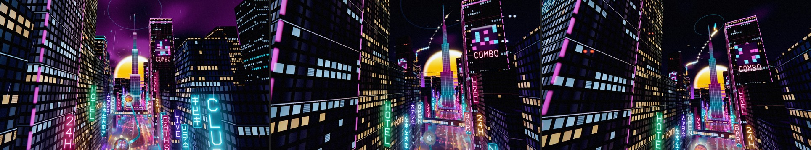
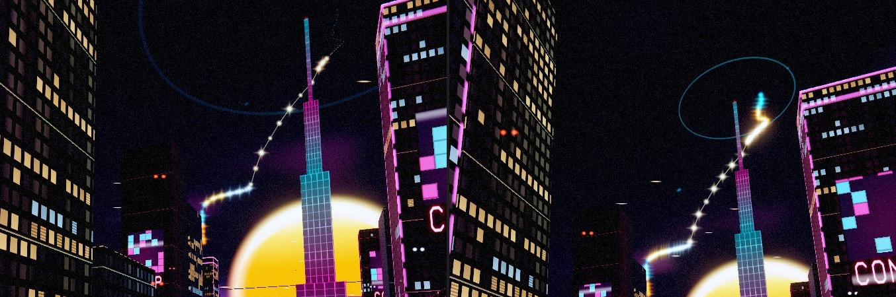
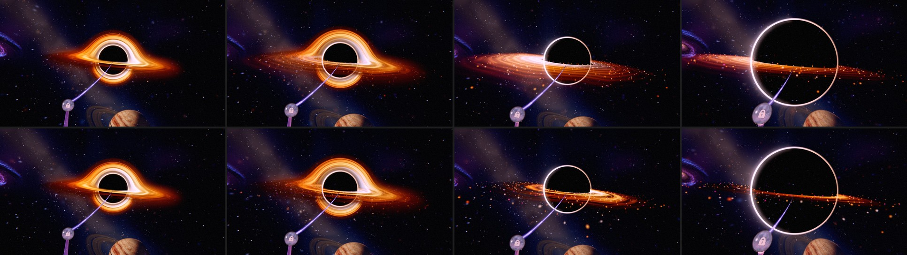
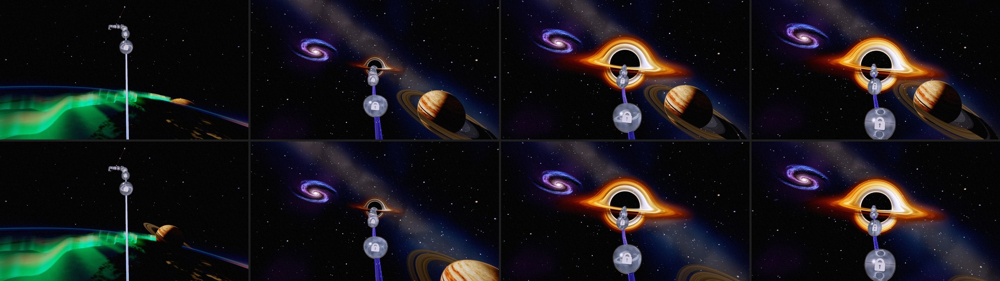
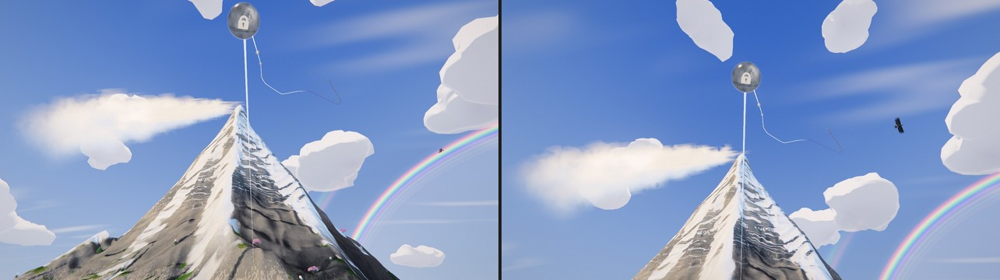

# Odyssey: the GPU check, smoothness, and the recommended improvements (2026-11-01)

Olov: *"Now you can run full speed GPU on lenovo balanced mode and also work with the smoothness and
implement all improvements in the recommended order"*. The order recommended:

1. an ending for the journey;
2. one look for the black hole on the dive into chapter 7;
3. the ringed giant flying by in chapter 6;
4. the end of chapter 1's climb;
5. the first mountain orbs (27-28);
6. chapter 2's open water.

Items 4 and 6 (the steam, the jellyfish) are in progress on their own branches and land separately.

## 1. The GPU check (full speed, Lenovo Balanced mode)

**Setup:**
- RTX 5080 Laptop in Balanced mode (the GPU capped at 80-95 W), High tier, WebGPU.
- 2560 x 1440 at pixel ratio 1, uncapped (the display paces Chromium at ~182 fps here).
- Production builds of main (250e2ba0) and the commit before the space pass (4f85eb98), served side by side.
- 16 stations through chapters 3-7, each held 6 s; two interleaved rounds.
- The space stations also ran a third arm, main with the old painted hole and galaxy
  (`?odysseyPaintedHole=1&odysseyCh6PaintedGalaxy=1`), to price the traced hole and the galaxy.

**Result: High holds the display's full rate everywhere.**
- Every station presented at ~182 fps, frame p95 6.0-6.3 ms in every arm.
- The GPU's own time per frame (timestamps, p50) was 0.3-3.0 ms against a 5.5 ms budget.
- It drew 19-31 W of its 95 W.

| Where | before the pass | main | main, painted hole and galaxy |
|---|---|---|---|
| Chapters 3-5 (p 0.18-0.72) | 0.5-2.2 ms | 0.85-2.6 ms | — |
| Chapter 6 (p 0.76-0.80) | 1.3-2.2 ms | 1.0-2.1 ms | 0.9-2.1 ms |
| Chapter 6, the hole up (p 0.83-0.87) | 0.5-0.9 ms | 1.05-1.5 ms | 0.3-0.6 ms |
| Chapter 7, the fold (p 0.90) | 3.0 ms | 3.0 ms | 3.0 ms |

- **The pass's cost:** +0-0.35 ms in chapters 3-5 (the finer mountain mesh and the mist), and
  +0.7-1.0 ms for the traced hole and the galaxy.
- **The heaviest station** is chapter 7's fold at ~3 ms, unchanged by the pass.
- One round of chapters 3-5 on main read high (p95 up to 6 ms). The GPU drew up to 95 W during
  that round only, which points to other work on the machine; its frame cadence still held.

## 2. Smoothness

The feel probe (`scripts/odyssey-feel-probe.mjs`, run in an off-screen window) played Odyssey the
way the owner does (Extreme, cap 144):
- the map's opening;
- 6 s idle;
- a 40 s scroll through the whole journey;
- glides to orbs 39, 49, 57 and 13.

It ran on both builds, two rounds each: the first launch with a fresh profile, the second reusing it.

| | map opens | frames over 20 ms after the reveal | worst | travel and glides |
|---|---|---|---|---|
| before, 1st launch | 1.79 s | 7 | 49 ms | 0-2 missed frames, worst 19 ms |
| main, 1st launch | 1.66 s | 9 | 49 ms | 0 missed, worst 11 ms |
| before, 2nd launch | 0.97 s | 0 | 20 ms | 0 missed, worst 11 ms |
| main, 2nd launch | 1.02 s | 0 | 17 ms | 0-1 missed, worst 17 ms |

**What this means:**
- **The space pass added no stutter.**
- **The map is smooth** while scrolling and gliding through all eight chapters.
- **The one visible stutter left is on a first launch only:** 7-9 frames of 35-49 ms in the two
  seconds after the map appears.
  - No main-thread task shows in those frames (no long animation frames), but ~60 shader
    pipelines are compiling in the background then.
  - Turning the off-screen render warm off (`?odysseyBgWarm=0`) or compiling one chapter at a time
    (`?odysseyPrewarmConcurrency=1`) did not remove them.
  - They are the One World's compile, which item 2.15 of the loading plan moved after the reveal
    on purpose: it is ~2 s of driver work, and the map opened that much later when it ran first.
  - A second launch hits the shader cache and has none.

**Left as it is (an owner call):** hold the loading cover on the very first launch until that
compile ends (about 2 s longer once; later launches unchanged).

## 3. The journey in the sky (item 1)

The journey had no ending in the world:
- The finale clock already lights the city from the spire and then lets a third of it gutter out.
- The board computed a journey-end ramp (`journeyEnd`, the last 18 % of chapter 8: orb 59 to 60),
  but nothing read it.

At the end of the rail it now ends under the stars:
- **The sky clears.** The smog thins from its gaps to wisps over a clear night (`uClear` on the
  sky dome), and the rain, already thinned by the finale, stops.
- **The journey is drawn in the sky:** one star for every orb, in its chapter's orb colour, joined
  in the order played (`shared/odyssey-journey-constellation*.js`).
  - **Its shape** is the path's own: the orbs' places seen from the side that shows the path
    widest, so it climbs from the Earth's core (lower left, by the sun) to the city (upper right,
    by the spire's needle).
  - **The line draws itself** from the first orb to the last over 8 s as the eye arrives, each
    star flaring as the line reaches it. It is taken back once the eye leaves, and is whole at once
    under reduced motion.
  - **Before the campaign is done** the figure is the player's progress: finished orbs shine
    (brighter for more stars) and the rest are a faint thread to come.
  - **Once every orb is done** the eye arriving at orb 60 also lifts a little more to the sky
    (`JOURNEY_END_LOOK`, 7 deg, in the camera and in the arrival shot).
- **How it is drawn:**
  - The stars are one instanced draw at infinity in the city's frame, never under a pixel (the
    clamp's extra area is paid back in light), with a cross of light on a three-star orb.
  - The line is one instanced draw of screen-space segments.
  - Both are added light, behind the towers.
- **The data:** the board hands the chapters the orbs' places and progress
  (`LevelNodeManager.getJourneyChart`, `ChapterEnvironmentManager.setJourneyChart`) whenever
  progress changes.

**Tried and left out:** looking much further up (22 deg) once the journey is done. From the street
the view up was mostly tower walls leaning in, with the sky a thin wedge.

**Trap:** a three.js Group's `renderOrder` sorts its children as a group ahead of everything else,
so the sky dome painted over the stars. The order goes on the meshes.

The other chapter 8 item (the nearest towers' windows showing through chapter 7's tunnel) was
already done: the facade's lights wait for the tunnel's mouth (`N.seamReveal`).

## 4. One gas through the dive (item 2)

Chapter 7 hands the traced black hole to painted parts at 8.5-12 deg of hole (CH7_TRACED_HOLE),
because the eye must stay outside the lens's march sphere. The painted band then turned the hole
into a broad cream disc with ruled lanes. The band is now the traced disk's own gas, drawn flat:
- **The same shading:** `createBand()` on the lens calls the same `shadeDisk` (the gas texture,
  the Keplerian shear, the blackbody ramp, the beaming) with the same uniforms.
- **The same extent:** the traced disk's own, from the faint plunge glow to past the outer edge.
- **Light:** 1.35 of the gas alone, for the corona the traced front also carries.

So the hand-over changes the bend and nothing else. The arch of lensed light over the top goes with
the bend, which up close has nothing left to draw. Carrying the painted fold arcs on past the
hand-over was tried: they brought back a ruled, target-like halo, so they stay off.

## 5. The ringed giant's flyby (item 3): tried, left out

**The idea, in one place in the world** (the owner's rule):
- Bring the giant's seat nearer, along its line from the planetrise's rail point, and shrink it
  by the same factor.
- From the rise it would then be the same planet in the same place on the sky.
- Nearer, it would sink out past the lower right as the black hole's light comes up.

At 0.22 of the distance it did sink out by p ~0.83. But two things the owner already approved broke:
- **It peeks over the Earth early.** From chapter 5's lower eye a nearer giant shows above the
  Earth's limb before its rise, even at half the distance (the planetrise test pins this).
- **It comes in front of the Earth.** It moves inside the Earth's near disc
  (`ORBIT_EARTH.nearRadius`), so the Earth no longer hides it.

Hiding it would need a deeper, faster rise; the owner asked for the slow one. The giant keeps its
seat; `PLANET_WORLD_SEAT` records why.

## 6. Orb 28 framed (item 5)

From orb 28's stop the orb sat at the top edge of the frame (ndc y 0.84), the eye looking up the
face at it:
- It is parked at chapter-local 0.125, between the face shot (out by 0.10) and the climb's lift
  (in from 0.17).
- A small tilt up (`CHAPTER_5_SHOTS.ledge`, 13 deg) now comes in just before it and hands over to
  the lift, so orb 28 sits in the upper half (0.45).
- Orb 27's stop is unchanged. It parks at 0.112, just past the 4->5 seam, and keeps the geese's
  crossing up the wall in view (`odyssey-act2-fade-out-of-view.test.js`).
  - Bringing the whole lift in earlier did frame orb 28, but it tilted that view off the geese, so
    the tilt starts after it.
- `tests/unit/odyssey-ch5-climb-framing.test.js` pins orb 28 below 0.6; it failed at 0.85 on the
  old camera.

## Tests

- **tests/unit/odyssey-journey-constellation.test.js:**
  - the figure climbs from the first orb to the last inside its patch of sky;
  - every star sits above the horizon;
  - the light follows progress;
  - the drawing runs only at the end, is taken back, and is whole under reduced motion;
  - both draws build for WGSL and GLSL.
- **tests/unit/odyssey-space-masterpiece.test.js:** the band spans the traced disk and builds for
  both backends.
- **black-hole-environment.test.js:** the disk's gas still begins outside the photon ring.
- **tests/unit/odyssey-ch5-climb-framing.test.js:** orb 28 framed.
