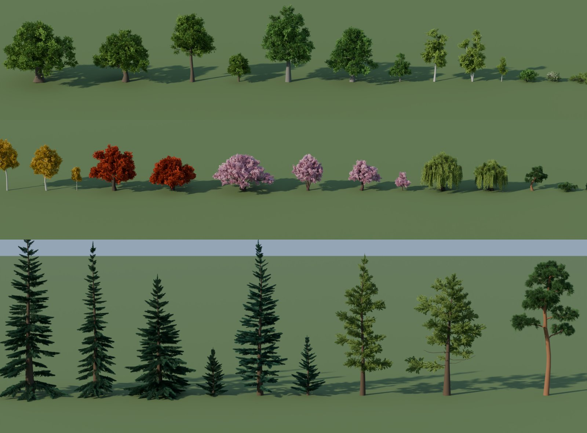
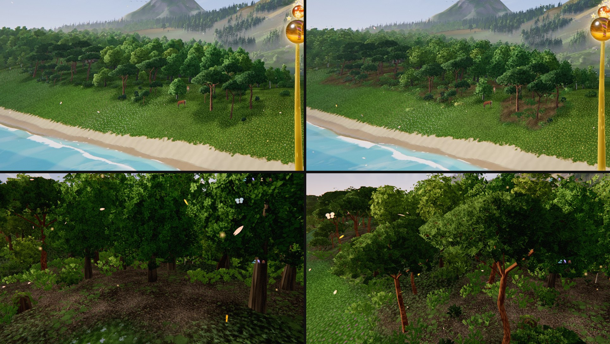

# Odyssey — the forest, from a clean slate (2026-11-24)

Olov: *"We need to take the visuals in Odyssey Mode to the next level by completely rethinking the
trees — their design, look, variety, composition, and placement across the island. Disregard any previous
instructions or approaches for the trees and start with a clean slate … using Blender MCP to craft them"*,
and later: *"we should have no trees on the sand on the seaside"*, and *"continue with the meadow grass still
runs under the Greenwood, so ferns and litter there would be the natural next step."*

The old forest (seven species, one even scatter, seven thousand lines of code) is gone; its files are in
git history before this change. What replaces it is a composition, 54 specimens grown and photographed in
Blender (46 trees and shrubs, 8 of the floor), two materials, a planting that follows the land, and a floor.

## What was wrong (read from 22 frames of the running game before any code)

- An even scatter at one spacing: no wood had an inside, no meadow an outside, no tree mattered.
- Pads of leaves on sticks: one silhouette a species, no limbs, no crown to look into.
- Gold, red and pink trees mixed one by one into the green: confetti, not places.
- Cherries climbing the rock in rows; conifers as separate pegs on the slopes.

## The composition (`world/odyssey-forest-composition.js`)

Every wood has a place on the journey and a reason in the land.

| Place | What grows | Why |
|---|---|---|
| **Landfall** | stone pines, old ones leaning to the sea, juniper under them | a gate the rail flies through, the beach left clean |
| **Greenwood** | oak and beech, birch at its edge, hazel and thorn round it | the dark closed mass left of the rail: depth, and a wall to the meadow |
| **The meadow** | open; three great oaks, a birch clump | breathing room: the horses, the light, the view to the tarn |
| **Waterside** | birch and willow in clumps on the far bank, a bent pine on the islet | the tarn framed, its near bank open so the water shows |
| **Blossom** | one river of cherry down a fold to the meadow | one place to look at, with bays and strays, not a sprinkle |
| **Goldwood** | aspen in clones, each clone one colour; maple stands; islands of spruce | the east, read from the climb as a mosaic |
| **Slopes** | spruce, fir and larch in tongues up the fall line, Scots pine on the ribs | lines that climb with the eye; lit chutes between |
| **Treeline** | stunted spruce, dwarf pine, old larch, silver snags | a frayed edge, smaller and lower the higher |
| **Taiga** | spruce and birch in stands | the far west and north |

A **community** says who lives in a wood by role: giants, canopy, edge, young, shrub, and who stands alone in
its open ground. **Cover** says how deep into the wood a place is. 32 **heroes** are placed by hand.

Held from the owner's earlier words: no autumn up the mountain (2026-11-17), the horses' meadow open, the
red maple kept as a single accent by the tarn and in stands on the east.

## The planting (`world/odyssey-forest-scatter.js`)

A wood is planted as one grows: heroes, then giants in its heart, then the canopy as close as crowns allow,
then its edge, the young that fit, the shrubs thick along the edge, and last the few on the grass. Every tree
keeps the ground its own crown needs, so spacing follows size. Kinds gather in patches; a wood has gaps.

Where nothing stands, each with a test:

- **the sand by the sea** (`FOREST_BEACH`: nothing has its foot within 8.4 u of the sea's height anywhere near
  the water; the ground paints sand to 6.7 u at the most), the waters, the north beach;
- the 60 rocks and every place the deer, horses, ibex and drinkers set foot (`odyssey-forest-keepouts.js`);
- the air the rail and the eagle fly through.

## The trees (`scripts/blender/odyssey/odyssey_forest.py`, package `forest/`)

46 specimens, 20 species, in ages and habits (a great oak, a wide one, one drawn up by the wood, a young one).
Authored the way one is blocked in: the crown's masses first, a limb to each, then twigs grown into each mass
(space colonisation), then foliage on the twigs' ends. The foliage is modelled leaf by leaf: lobed oak, beech,
birch rhombs, aspen, maple, five-petalled blossom, spruce boughs hung with shoots, pine brushes, larch rosettes,
cypress flames, willow whips. Blender photographs each spray into the leaf atlas (coverage, the leaves' facing,
their light) and every far specimen from 16 sides, and ray-casts the sky each spray and each bark vertex sees.

## The floor (`world/odyssey-forest-floor.js`)

The ground under a wood is a wood's.

- **Where.** Read off the trees that stand, not off the plan: each crown's ground, spread over 24 u, summed. A shut
  wood has a floor, a lone oak has none. Baked with the scatter as a 512 px plate: how much floor, and whose (needles,
  blossom, the gold side). The same on every tier.
- **What lies there** (`FLOOR` in the renderer; `scripts/blender/odyssey/odyssey_floor.py`): leaf litter, sticks, moss
  cushions and seedlings, 46,000 leaves modelled and photographed from above. Broadleaf woods lie in tan leaves, needle
  woods in duff and more moss, the gold side in its own leaves, and under the cherries the grass stays, strewn with
  petals. Coming in from the meadow: grass, then low green plants, then leaves, so no wood has a brown line round it.
  The meadow's flowers and wind bands stop there, and the low sun comes down to it in long flecks.
- **What grows there.** About 2,400 plants on High: lady ferns in drifts where it is shut, bracken where the light comes
  in under the edge (green in the west, copper on the gold side), a mossy log or stump here and there. They keep off
  the trunks, the rocks, the animals' ground, the horses' meadow, the water and the sand, and none is drawn past 330 u.
  A log lies along its slope. Here and there one stands in a fleck of sun.

## How they are drawn

- **Near and middle** (`odyssey-forest-material.js`): one draw a place, whatever grows there. A tree's shape is
  pulled from one small texture in the vertex shader (gotcha #709). A card turns to the eye rolled to the way
  its twig grows.
- **Far**: the picture nearest the eye's direction, of sixteen, blended, lit as the near ones are.
- **The light** is a grove's: the normal of the mass a spray belongs to plus the photographed leaves' own; the
  sun's way through the crown; the sky each spray sees; and the neighbours: `shadeTop` (how high up a tree their
  shade reaches, along the sun) and `open` (the sky its foot sees), worked out at planting. The wind, the day's
  turn, the clouds' shadows, the mist and the hour reach it as they reach the ground.
- **The shade plate** reads each specimen's own crown (`shade`), so the shadows on the grass are its own.

## Tiers (`FOREST_TIERS`)

The same trees in the same places. A tree's tier is fixed by how near the eye that rides the rail ever comes, so
nothing pops. Low keeps 58 % of the trees. Without MSAA a leaf's edge is cut at the half (`edgeCut`).

## Checks and cost

- The real game: WebGPU at High, Medium and Low, WebGL2 at High, a portrait frame; no WebGPU validation error and
  no TSL warning in any console.
- Tests: the forest suites are new (73, the floor's 12 among them), and every system that shares the ground passes against the new forest
  (animals, birds, boulders, tarn, bakes, day's turn, shaders built to WGSL and GLSL).
- **GPU** (RTX 5080 laptop, 1080p, frame capped at 30, headless Chrome with the board's own timestamp ring, p 0.245,
  forest on against off, best of interleaved rounds; an indication, not an ADR-0016 claim: DVFS moves it, and the
  integrated GPU was **not** measured):

| Tier | forest before | forest now | whole frame before | now |
|---|---|---|---|---|
| High | 0.65 ms | 1.5 ms | 1.46 ms | 2.31 ms |
| Medium | 0.38-0.58 ms | 0.39 ms | 1.08-1.28 ms | 1.09 ms |
| Low | 0.16 ms | 0.20 ms | 0.79 ms | 0.83 ms |

- **The floor** on top of that (same measure): High +0.15-0.17 ms for its plants (31,700 cards against the trees'
  315,000, nine more draws) and about +0.03 ms for the ground's two fetches; Medium 1.06 ms the whole frame; Low
  0.83 ms. The ground's fragment shader now binds 15 of WebGPU's 16 textures (a test holds the limit).
- The scatter takes ~0.5-0.7 s and the shade plate ~0.3 s in the bake worker (0.26 s together before), beside a
  1.3 s plates lane, and both are kept in the bake cache.
- Download: `far.png` 5.4 MB, `leaves.png` 1.9 MB, `floor.png` 0.29 MB, the models 0.47 MB (the old models were 0.1 MB).

## Left open (owner's calls)

- High's cost on the integrated GPU (the lane was not available). `FOREST_TIERS.High` is the one dial.
- The bark is three tiles; a closer camera would want more.
- Retired with the old forest: `?odysseyWorldForestV1`, `?odysseyWorldForestPaint`,
  `?odysseyWorldProceduralTrees`, `?odysseyForestGreens` and the gpu-split `forest-v1` lane.

## Changing it

- A tree: edit its builder in `forest/trees.py`, then
  `blender -b --factory-startup -P scripts/blender/odyssey/odyssey_forest.py -- models` (seconds), and
  `-- far models` when a far tree's shape changed (about six minutes).
- A wood: `FOREST_MASSES`, `FOREST_GLADES`, `FOREST_HEROES`, `FOREST_BLOSSOM`, `FOREST_COMMUNITIES`.
- The look: `FOREST_LOOK`; the colours: `odyssey-forest-species.js`.
- The floor: its paint is `FLOOR`, its plants `forestFloorSites`, its photograph `odyssey_floor.py` (about 20 s; the
  shader's `FLOOR.mean` must be the picture's own mean, which it prints and a test holds).
- Look at it: `playground.html?effect=act2-tree-audition&only=oak&lod=hero` (also `&grove=1`, `&lod=far`).
