# Odyssey: animals on the island's ground (2026-11-01)

Nothing living walked on the island in chapters 3-5. Now a small herd of red deer grazes the glade
on the rise above the chapter-3 shore: three hinds, a yearling and a calf at its mother's side.

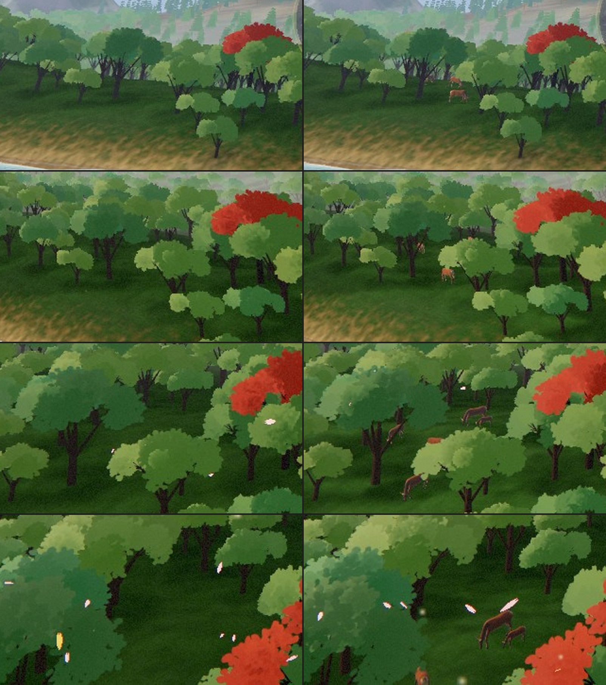

Left: before (`?odysseyNoDeer=1`). Right: after. Rows, top to bottom: L11, L14, L15, L17 (crops of
1600x900 shots, enlarged 2.5x).

## Choosing the place (the scouting numbers)

The rail camera flies high over the island: 63-172 m above the ground under it in chapters 3-4, and
170-350 m from L27 on. So the nearest open ground it ever sees is 120-200 m away, and always in the
lower part of the frame. Measured on the real rail camera with the real terrain and both forest tiers
(`tests/unit/helpers/odyssey-camera-rig.js`, `odysseyWorldHeight`, the forest scatter):

| Candidate | Seen from | Distance | Withers height at 1440p, 1x / 2x / 3x |
|---|---|---|---|
| Red deer, the glade above the chapter-3 shore | L11-L15 without a break, L17 | 120-240 m | 8-17 / 16-34 / 24-51 px |
| Red deer, the open ground at the massif's foot (z -430..-470) | only the L17-L19 glide, at the frame's bottom edge | 160-210 m | 6-11 / 12-22 / 18-33 px |
| Ibex on the massif's wall (L22-L26) | L22-L26, bottom edge of the frame | 130-170 m | 10-15 / 20-30 / 30-45 px (for a 1.3 m animal) |
| Ibex or chamois on the climb (L27-L28) | L27 only | 190-330 m | 5-9 / 10-18 / 15-27 px |

(The first row is the hind's withers, 1.16 m; the others are for a 1.3 m-shoulder animal.) The glade
wins: it is in view the longest (five
orbs, from the breach to L15, then again at L17), it is open grass on a gentle slope (under 0.4), it
faces the camera as the camera comes in from the sea, and the sun is behind the camera's shoulder.
The climb was ruled out: from L26 on the camera rises away from the rock, so ibex there would be
specks.

The deer are drawn at three times life, like the act's other life (the gulls, the butterflies). Their
withers are then 24-27 px tall at 1440p from the sea-side parks (L11-L14), 40 px at L15 and 51 px
at L17. From the sea some of them stand behind trees; at L15 and L17 most of the herd shows.

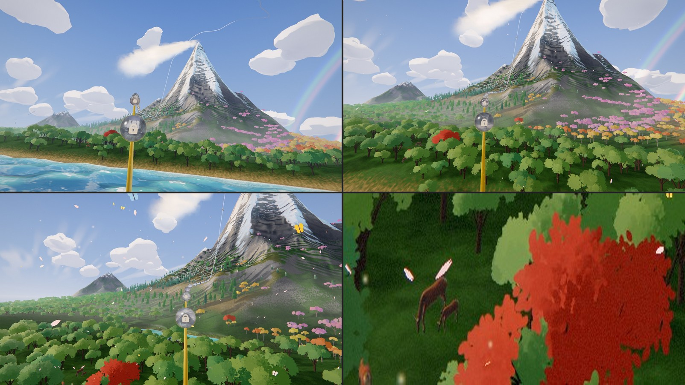

## The model

`scripts/blender/odyssey/red_deer.py`, headless Blender, rebuilds `assets/chapter-03/deer/red-deer.glb`
byte for byte. A red deer hind at real size: 1.16 m at the withers, built from rounded shapes,
1,786 triangles (1,798 after the polish below), skinned to 25 bones (spine, neck, head, ears,
four-bone legs, tail). The legs are a little thicker than life so they stay solid lines when drawn
small. The coat is painted into the vertex colours: red-brown body, greyer neck and legs, a pale
rump patch and belly, dark hooves and nose.

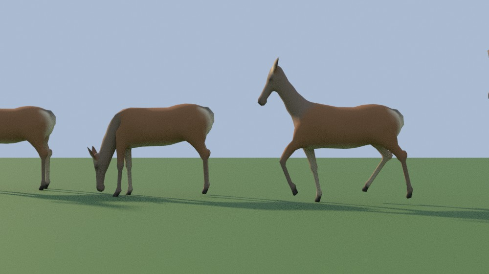

## Their life

- Every deer has its own clock (a seeded schedule that repeats every ~5 minutes). Their places come
  from the clock alone; the camera passes them.
- A hind keeps to her own two or three spots in the glade. She grazes with her head down, takes a
  step or two between bites, lifts her head to look round now and then, and every minute and a half
  or so walks a few paces to her next spot (turning on the spot first).
- The calf stays at its mother's flank, a quarter of a second behind her.
- The walk is a four-beat walk whose rhythm follows the distance walked, so the hooves do not slide.
- Feet on the ground: the body tilts with the slope, the legs hang plumb, the body is set down until
  its highest standing hoof touches the ground, and every other standing leg bends just enough to
  bring its hoof onto the ground too. The tests measure the result: standing hooves within 14 cm of
  the ground on a 3x hind (under half a pixel at these distances), and no hoof ever digs in.

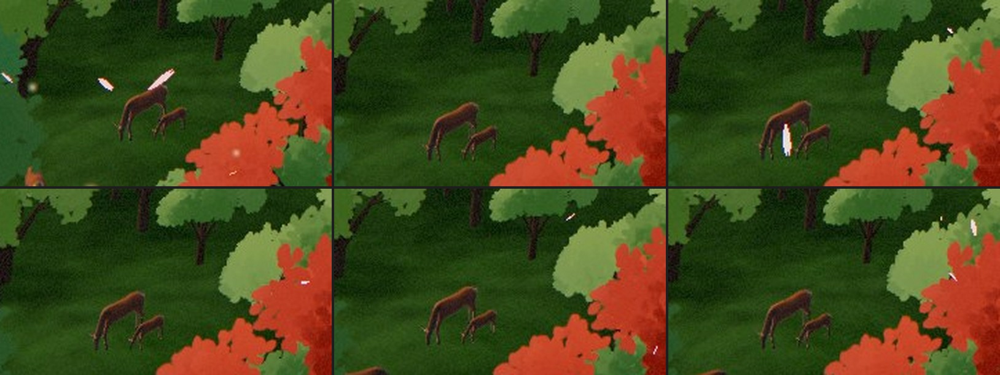

## Light and shadow

The act's light: the world's low sun, the sky from above (softened toward warm air so a red coat in
shade stays brown, not purple), the green of the meadow from below, a little sky on the outline,
and the air between them and the eye. A soft shadow lies under each deer on the slope.

## No popping, no hitch

- They are drawn from p 0.08 (deep in chapter 2, under the sea) to p 0.26 (after L17, when the glade
  has left the frame). The test checks that the eye is far under water at the start and that every
  deer is out of the frame at the end, at every clock phase.
- The eagle's lifecycle: the model is fetched as chapter 2 begins, compiled while the board is idle,
  and only then drawn. If it fails to load, the island is exactly as it was.
- Turn it off with `?odysseyNoDeer=1`.

## Cost

- 2 draws: the whole herd is one instanced draw (5 x 1,786 = 8,930 triangles), plus one draw of 5
  soft shadows.
- Posing the herd costs about 0.05 ms a frame on the CPU; a 17 KB table goes to the GPU each frame.
- No new pipelines after the first compile.

## Tests

`tests/unit/odyssey-ground-animals.test.js`: the model and its skin; both shader backends (WGSL and
GLSL) build cleanly; hidden until ready; every deer on dry grass under 0.45 slope, clear of trunks
and low crowns in both forest tiers; hooves on the ground; the deer keep apart; a grazing muzzle
reaches the grass; the herd in view at L11-L17 with the pixel sizes above; never appearing or
leaving in view.

## Left for later

- A stag (antlers would be one or two pixels thick at this size and would flicker).
- Ibex on the massif: only worth it if the camera ever comes close to the rock. (Done lower down,
  2026-11-02: "Ibex on the rock band" below.)

## Polish (2026-11-01 evening)

The owner, up close: "The deer's head looks a bit horse-like. A slimmer muzzle, bigger ears and the
pale rump patch would fix it." Changed in the Blender builder (the rebuild is still byte for byte):

- **The head** is a deer's wedge now, not a horse's box: 0.34 m from the poll to the nose instead of
  0.40, deep at the cheek and the eye and narrowing to a fine nose, with a forehead and brows over
  large eyes (the eye line). It is a little smaller against the neck (the top of the neck is a touch
  thicker).
- **The ears** are bigger broad ovals with a rounded tip (21.5 cm long, 11 cm wide), set high on the
  poll and angled well out to the sides.
- **The rump patch**: everything on the buttocks that faces back, from just above the tail down toward
  the hocks, is a pale cream, with a slightly darker edge round its top and sides; the short tail on
  it is cream with a thin dark stripe along its top. A pale chin too. In the game the pale is creamier
  than before (it was a tan).
- Because the face is shorter, the grazing pose swings the neck a little lower (so the muzzle still
  reaches the grass); everything else (rig, weights, poses, herd, places) is as it was.
- 1,798 triangles (was 1,786). All the deer tests pass unchanged (hooves, places, sizes, no pop).
- Not done: spots on the calf. By September a red deer calf has mostly lost them, and at 15-25 px
  they would only read as noise.

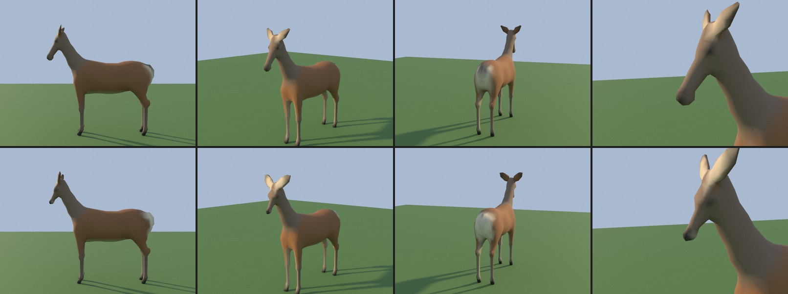

In the game, before (left) and after (right), the same moments (the clock pinned): L17 three times,
then L15 (2560x1440, crops enlarged 2x):

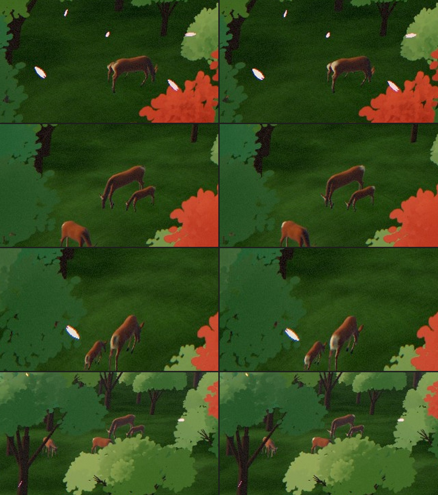

Closer (L17, enlarged 4x): the rump patch now shows round the tail, the heads are finer.

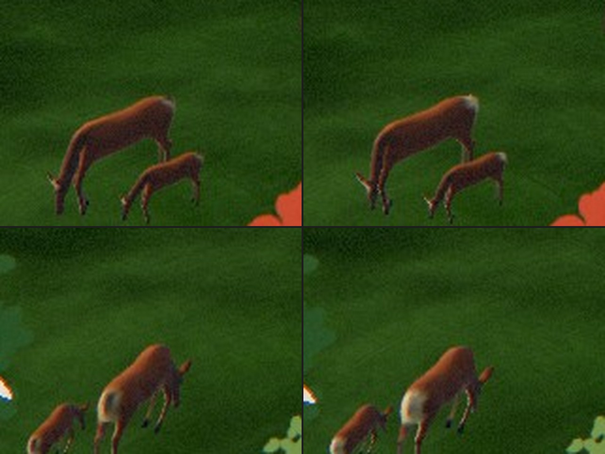

### The orb card and the herd (lead, 2026-11-01 evening)

Checked with the screen as the owner sees it: 2560x1600 at 150 %, Odyssey started the way a click
starts it, the map reached with its Map button, the UI left on.
- The orb card sits on the right of the screen. On the rail at orb 15 the herd is at the lower left;
  at orb 17 it is near the bottom middle. The card never covers it.
- After clicking orb 15 or 17, the camera frames the orb close-up and the herd is out of frame to the
  left, so nothing covers it there either.

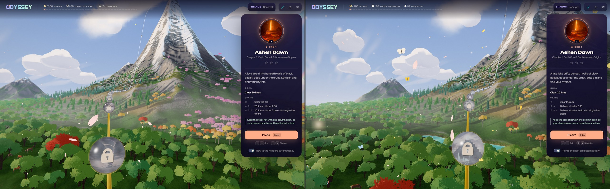

## GPU timing (lead, 2026-11-01 evening)

Timed with the birds, deer and fish together on the RTX at full speed (2560x1440, High, two rounds,
main against this work at the same stations: p 0.095 and 0.11 the fish, 0.168, 0.194 and 0.22 the
deer, gulls and swallows, 0.31 the swallows and geese, 0.62 the summit kettle). GPU time per frame
was within 0.07 ms of main at every station (for example 2.10 ms both at L15, 1.18 against 1.11-1.18
ms at the kettle), so the new animals cost nothing measurable there.

## Design and motion pass (2026-11-02)

The owner: "We really need to improve the look and design and animation and movement of the deer! I
want it to move in a more natural and smooth way when eating, walking, turning, looking etc."

### The audit (before)

Watched at game size (30 fps clips at L15 and L17 with the board clock pinned, so the same moments
can be compared) and measured on the game's own CPU twin of the herd over every deer's whole loop:

1. **Hooves slid while bearing weight.** The legs were swung by angles, not planted: a standing hoof
   moved up to 0.7-1.3 of the deer's drawn size over a stance (2-4 m on a 3x hind), most at the
   start and end of every walk.
2. **Pops.** A leg fix-up that switched on and off made joints jump: 285-744 frames a loop where a
   joint turned faster than 6 rad/s, the hooves up to 41 rad/s in single frames.
3. **Turning on the spot like a turntable.** 10-17 s a loop of the body turning while hardly
   moving, up to 4.3 rad/s; at L15 a hind spun about 180 degrees in place before walking off (top row
   of the L15 image below).
4. **The calf** hung at a fixed place beside its mother and was swung round her when she turned, at
   up to 12 m/s.
5. **A hinge for a neck.** Two neck bones: the head went down to graze and came up like a lever; no
   jaw, no breathing; grazing was a held pose with a small nod; ears and tail barely moved.
6. **The body.** Thick legs (to stay visible), a straight barrel with no waist, small eyes, little
   shading on the coat.

What a red deer does (and what the new motion follows): a four-beat walk, the hooves lifting left
hind, left fore, right hind, right fore, each on the ground about 60 % of the stride and planted
while it bears weight; the head nods with the fore feet; it turns by walking a curve with the body
following the head, or, for a sharp turn, by stepping the forehand round its hind legs; the head goes
down to graze over a second or two, crops in small nods and sways and chews; it looks up ears first,
then the head, then the neck; the tail and ears flick.

### What changed

**The model** (`scripts/blender/odyssey/red_deer.py`, still rebuilt byte for byte): 27 bones (three
neck bones and a jaw), a deeper chest, a tucked-up waist, rounder quarters, longer, slimmer legs with
clearer knees and hocks, larger eyes in a dark rim, a darker back line, a paler belly and darker lower
legs. 2,098 triangles (was 1,798). The neck's root blends into the chest over a longer band so the
bend down to graze is a curve over the withers.

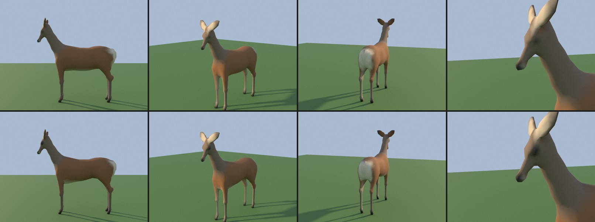

**The motion** (`composition/odyssey-deer-herd.js`, rewritten). Procedural, not baked Blender
cycles: the deer walk on a sloping glade along curves of any length and turn by any angle, so baked
cycles would have to be stretched, blended and corrected for the ground anyway (that is where foot
sliding comes from). Instead:
- **Paths.** Walks are curves that leave the way the deer faces, with a smooth start and stop (no
  instant start or stop); a turn too sharp for a curve is first made on the spot by pivoting round the
  hind legs, never faster than 0.7 rad/s. Grazing steps are short, slow curves.
- **Feet.** A footstep planner walks each deer through its loop once when the herd loads (about 10 ms
  a deer, one deer per task so it never holds a frame) and records every hoof's steps. While the deer
  moves, the hooves lift in the four-beat order as the ground goes by (shorter, quicker steps when
  it moves slowly); where each one lands is where it should stand half a stance later; when it stops,
  the hooves settle under it with a step or two. A planted hoof never moves.
- **Legs** reach their hooves with a two-segment solve each (the knees fold back, the hocks forward,
  each never past about 110 degrees), the hoof flat on the ground while planted and flicked back in
  the swing.
- **Body** rides on the feet: height, pitch and roll from the ground under them, carried a little
  lower in a walk, hips and shoulders rolling with each step, breathing, a slow shift of weight while
  it stands.
- **Head and neck** move through the three neck bones; every change (head down to graze, up to look)
  is eased over 1-2 s on a curve that cannot jump, however short the segments. Grazing crops with
  small nods and sways and the jaw chews; it chews the cud now and then with the head up. A look turns
  the ears first, then the head, then the neck down its length. Ears swivel and flick, the tail
  flicks.
- The calf has its own spots next to its mother's (a fixed slot at her side swung it round her).

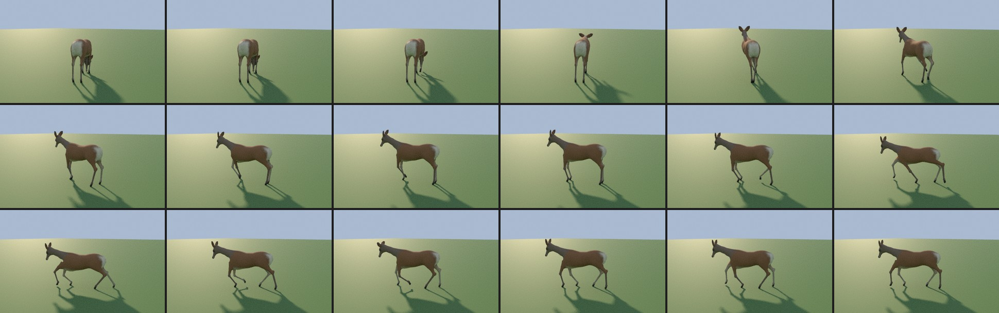

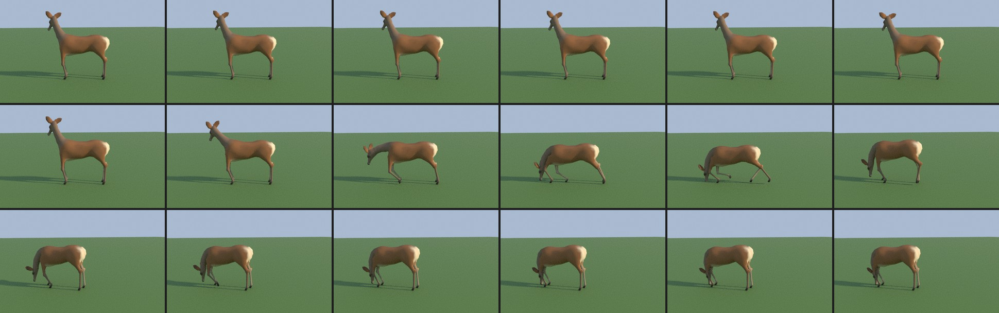

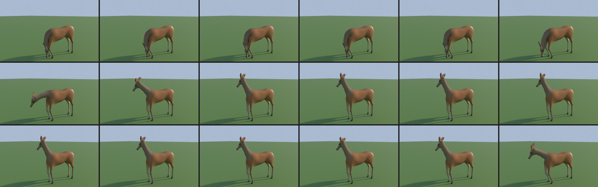

In the game, before (top row) and after (bottom row), one frame a second, the same moments of the
board clock (2560x1440, crops enlarged):

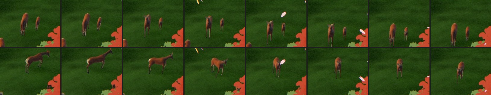

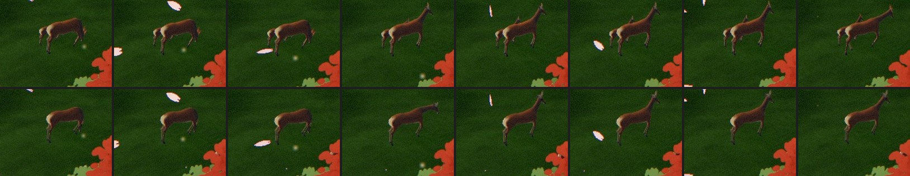

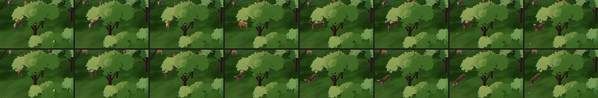

### Numbers (after, every deer's whole loop at 30 fps)

| | before | after |
|---|---|---|
| A weight-bearing hoof's slide (share of the drawn size) | 0.7-1.3 | under 0.05 in 99 % of frames, 0.16 at worst |
| Fastest leg joint | 38-41 rad/s (pops) | 10-14 rad/s (a walk's swing) |
| Fastest spine, neck or head joint | (part of the pops) | about 3 rad/s (the head going down to graze) |
| Turning on the spot | up to 4.3 rad/s, spun | at most 0.64 rad/s, stepped round |
| Turning in a walk | | at most 0.23 rad/s (curves) |
| Body acceleration | | at most 2.7 m/s^2 |
| Walk order kept | | 89-100 % of lifts |
| CPU per frame (whole herd) | ~0.05 ms | ~0.03 ms |

Still two draws (5 x 2,098 = 10,490 triangles plus the shadows), no new pipelines after the first
compile, the same places, sizes and no-pop windows, `?odysseyNoDeer=1` as before. New tests in
`tests/unit/odyssey-ground-animals.test.js`: no hoof slides, every joint smooth through every change
of state, smooth starts and stops, turns walked or stepped round (never spun), the four-beat order,
the loop's seam, walks leaving the way the deer faces.

## Life at the pond (2026-11-02)

The owner agreed to: "Life at the pond. It's on screen from orbs 20 to 23. A pair of white swans
glides across it, leaving V-shaped wakes ... A grey heron stands in the shallows, stalks slowly and
now and then strikes. A hind and her calf from the herd sometimes come down to drink at the bank."

### Where, with numbers

Scored on the real rail camera (`odyssey-camera-rig.js`, the terrain, the forest's crowns as
spheres):

- **When it is in view.** Nearly the whole tarn is in frame and unblocked while the rail glides
  from L18 to L19 (p 0.23-0.267). It leaves the frame at the L19-L21 parks (p 0.269-0.272). It comes
  back at L22 and L23 (p 0.278-0.30), but only its west lobe.
- **So everything lives on the west side:**
  - the swans' route runs through the west and middle lobes;
  - the heron keeps to the west lobe's south-west shallows;
  - the drinkers come down to the west lobe's bank.
- **Why that bank.** The bowl's rim is steep (0.5-0.9) almost all round. Its gentlest crossing is
  on the west side, about 0.6.

At 1440p, drawn at three times life:

| | Distance | Size at 1440p |
|---|---|---|
| A swan (3.4 u long) | 190-320 u | 13-22 px long |
| The heron (3.1 u tall) | 190-310 u | 12-20 px tall |
| The hind (withers 3.5 u) | 200-325 u | 13-22 px |

They are smaller than the glade's deer (24-51 px), but white on turquoise, a grey stroke on the
bank and a red-brown pair over the water all read.

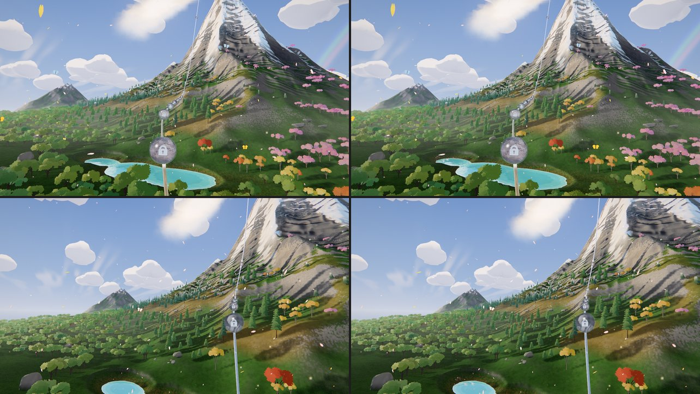

### The models

`scripts/blender/odyssey/pond_birds.py`, headless Blender, writes `assets/chapter-03/pond/swan.glb`
and `heron.glb`. It uses the red deer's method: a distance field of ellipsoids, round cones and
tubes, its left half meshed, decimated and mirrored, then painted and skinned.

- **The mute swan:**
  - 1,300 triangles, 6 bones (the root, four neck bones, the head);
  - the hull cut at the waterline, the arched wings and raised tail;
  - the neck in an S, an orange bill with its black knob.
- **The grey heron:**
  - 1,150 triangles, 11 bones (the root, three neck bones, the head, and each leg's thigh, shin and
    foot);
  - the body tilted up at the front, a white neck, a black crest and eye stripe, a yellow dagger
    bill;
  - long yellow legs, 1.9x thicker than life so they stay lines when drawn small.

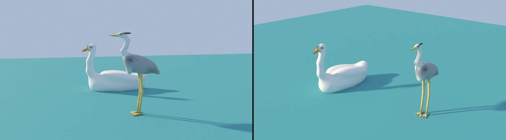

### Their life (`composition/odyssey-pond-life-motion.js`)

Everything follows the board clock and is fixed in the world. The camera only passes them.

- **The swans** glide round one closed, smooth route through the deep water at ~0.95 u/s, the speed
  breathing slowly. The second swims 8.5 s behind the first and 2.6 u to its left. On their own
  loops each:
  - looks round;
  - dips its head under to feed;
  - or turns its neck back over the wing to preen.

  The neck sways a little all the time. The hull sits 0.2 u under the water, and the water hides
  the cut.
- **The heron:**
  - Stands mostly still, as herons do, its head turning slowly.
  - Leans into a slow stalk now and then, and sometimes strikes: a crouch, the neck shot out and
    down in 0.18 s, held, drawn back over 1.5 s.
  - Every 40-70 s walks a few slow steps to its next spot. Each foot is planted where it lands
    while the body passes over it, and a two-segment leg solve reaches it; the heel bends back.
    The body turns from the way it stood to the way it walks over the first step. It stands
    facing the way it came.
- **The drinkers** are a second, small herd (`ODYSSEY_TARN_DEER`): the glade's deer model, rig,
  paths and footsteps, created again (`createOdysseyDeer({ herd })`). A hind and her calf keep to
  the ground west of the tarn. A third of their five-minute loop they stand at the bank grazing,
  which here is drinking: the head down to the water at the waterline. The calf keeps spots beside
  its mother's and walks a little slower, so it follows her down a few seconds behind.

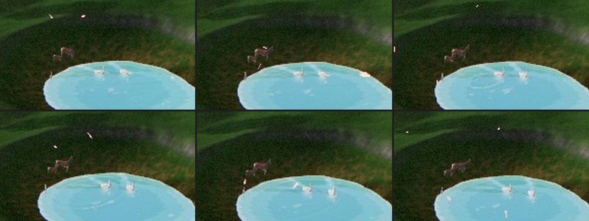

### The wakes and the swans in the water

The tarn's own water draws them (`TARN_WAKE` in the world renderer). Each frame the swans' places
and velocities go to the world (`setTarnSwans`).

- **The wake.** Behind each swan is a soft V at the Kelvin angle (~19.5°). Its arms are a few short
  crests that travel outward, widening and fading over ~34 u, with a small bow wave round the
  breast. They tilt the water, so they show in its reflection and glints, and they lift it a little
  toward white.
- **The swans in the water.** The reflected ray's nearest pass to each swan's body and neck gives
  a soft white shape under it, broken by the pond's ripple.
- **The tarn stays the turquoise pool it is.** With no swans the water is unchanged.

### No popping, no hitch

- **Drawn from p 0.09 to 0.34.** The eye is far under the sea when the window opens. As it closes,
  every swan, the heron and the drinkers' spots are out of frame (tested at every clock phase).
- **The deer's lifecycle.** The models are fetched as chapter 2 begins, compiled while the board is
  idle, and only then drawn. If they fail to load, the act is as it was.
- **Turn it off** with `?odysseyNoPondLife=1`.

### Cost

| | Triangles | Draws |
|---|---|---|
| The swans | 2 x 1,300 | 1 |
| The heron | 1,150 | 1 |
| The drinkers | 2 x 2,098 | 2 (the herd's draw and its shadows) |

- **Pipelines.** Two new: the birds' material, built per species. The drinkers reuse the deer's.
- **The tarn.** Its water gains the wake and the mirror term for two swans, on its own pixels only.
- **CPU.** Posing three birds and two deer each frame. The tables are written in place: no new
  per-frame allocation.

### Tests (`tests/unit/odyssey-pond-life.test.js`)

- **The models:** the skeletons, the skins (weights sum to 1, every index in the skeleton), and
  both shader backends (WGSL and GLSL) building the birds' draw cleanly.
- **The draw:** hidden until ready, drawn only in the window, the wakes sent to the world and
  withdrawn.
- **The swans:**
  - never leave the water: the whole hull over water 0.6 u deep or more, all the loop;
  - keep apart;
  - turn and change speed calmly;
  - the head under water only when dipping.
- **The heron:**
  - its feet in the shallows;
  - a planted foot never slides;
  - its legs reach their feet.
- **The drinkers:**
  - reach the water's edge, never deeper than the fetlocks;
  - cross the gentlest stretch of the rim (under 0.75);
  - their standing hooves on the ground;
  - clear of trees and the boulders.
- **The camera:**
  - swans in frame for most of the L18 -> L19 glide and a quarter of the time at L22-L23;
  - the heron and the bank in frame there;
  - the sizes above;
  - never appearing or leaving in view.

### Design and motion pass (2026-11-02)

The owner asked: "are the animals designed so they are visually stunning and animates so that the
animation and movements feels natural and smooth?" They were not yet. The first swan read as a pool
float with a straight neck, and the heron as a grey blob on yellow stilts. Nobody had watched them
move up close.

**A way to watch them.** The playground effect `odyssey-pond-life` shows the game's own poses with a
camera that follows one animal:

- `animal=swan0|swan1|heron|hind|calf`;
- `view=34|side|front|back|top|game`;
- `t0=` sets where on the animal's clock to start, and `?t=` gives phase-locked frames.

All the clips below are its frames.

**The models** (`pond_birds.py`), rebuilt from reference proportions:

- **The mute swan.** The body is long, low and tapers to both ends, with the tail lifted to a point.
  The neck is a deep S that arches forward at the top, the head held with the bill angled down. The
  orange bill is black at its base and carries the black knob. The wings are raised and arched over
  the back ("busking"): the two humps of the fluffed scapulars make the heart-shaped back seen from
  behind. The wings are their own bones (9 bones, 1,598 triangles).
- **The grey heron.** It is slender and upright, the body held up at ~35°. The neck is folded into an
  S and hunched into the shoulders. It has a dagger bill, a white face with the black stripe from the
  eye to the long crest plumes, a grey back with black shoulder patches, dark primaries, a streaked
  pale front and hanging breast plumes. The legs are thinner than before but still 1.55x life, so
  they read (12 bones, 1,338 triangles).

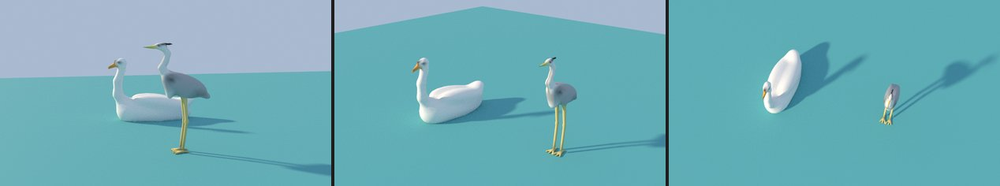

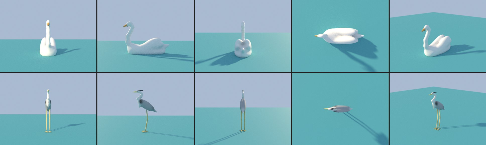

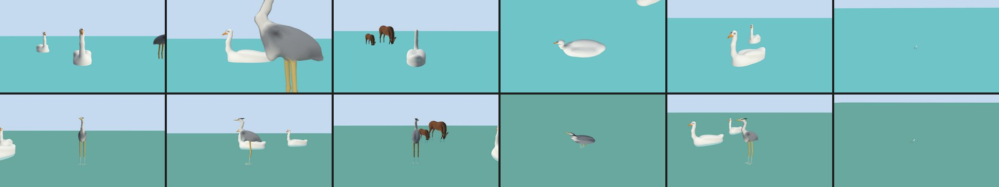

At game size (L22 and L23, 4x crops, before left, after right), the swans show their S necks and
raised backs, and their V wakes trail behind:

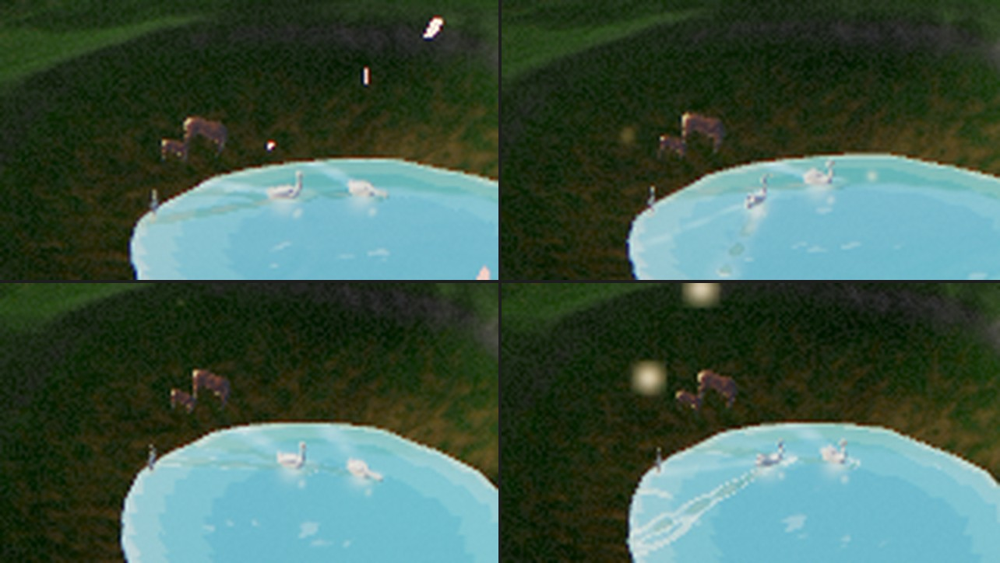

**The motion** (`odyssey-pond-life-motion.js`):

- **Necks are posed by segment angles.** Each pose (rest, a swan's dip or stretch, a heron's stalk,
  coil and shot) gives every neck segment its angle in the bird's plane. Each bone takes the change
  less what its parents already turned, so the chain always bends as one curve. The head keeps its
  own pitch whatever the neck does: level while the heron stalks, the bill down to feed or strike.
- **The swans:**
  - The paddle strokes give a slight surge, bob and rock, at each swan's own rate.
  - They lean into turns.
  - The neck sways, the motion travelling down it.
  - A look is a turn, a hold and a turn back, each eased.
  - Feeding reaches the neck forward and down until the head is under, the body tipping forward.
  - Preening swings the neck back over the wing.
  - Once a loop each swan sits back, opens its neck upright, and lifts and beats its wings twice.
  - Every event is eased in and out, and each swan has its own timing.
- **The heron:**
  - It breathes, and turns its head in small, quick, eased steps between holds, settling to the
    front before and after a walk.
  - It stalks one deliberate step at a time: it lifts a foot, carries the body over it, sets it
    down and pauses (0.7-1.9 s, different every time). The trailing foot comes up beside the other
    at the end.
  - While the body moves under it, its head stays still in the air. A few iterative steps on the
    neck angles hold the head back by exactly what the body has moved; the head glides on in the
    pause. In the tests the head moves less than a fifth as far as the body during a step.
  - The strike leans in, draws the neck into a tight coil, shoots it out and down in 0.2 s (eased at
    both ends), holds, and draws back.
  - Some strikes are followed by a quick, dying head shake.
- **The drinking deer.** The head comes down to the water over ~2 s on the herd's own eased curves.
  It was already smooth, and was left as it was.

Before (top) and after (bottom), the same moments of each clock:

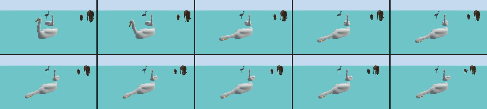

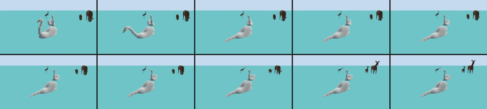

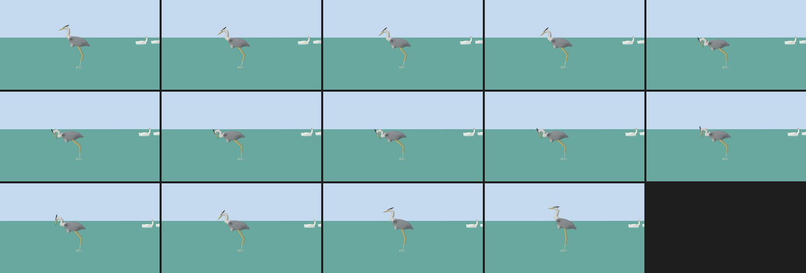

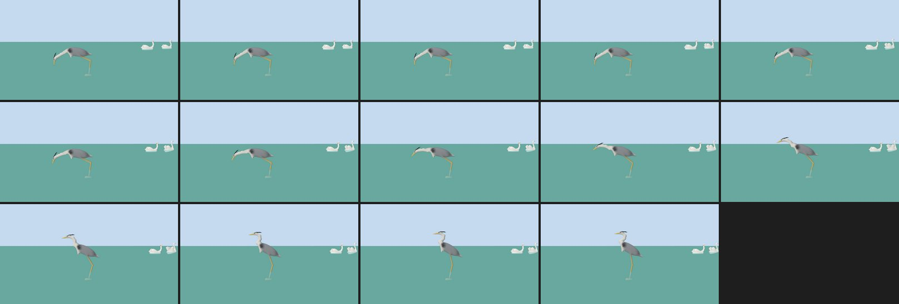

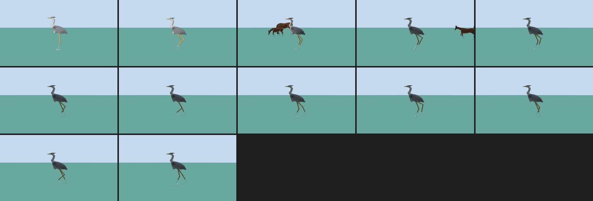

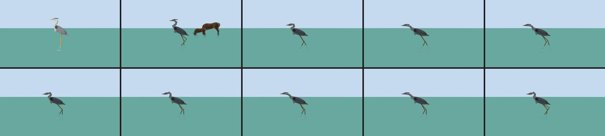

The other behaviours, after:

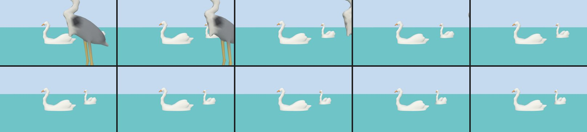

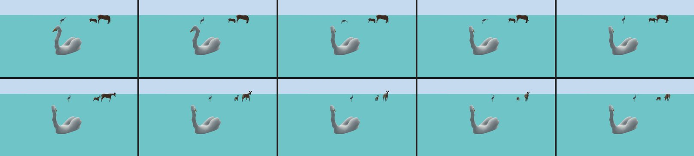

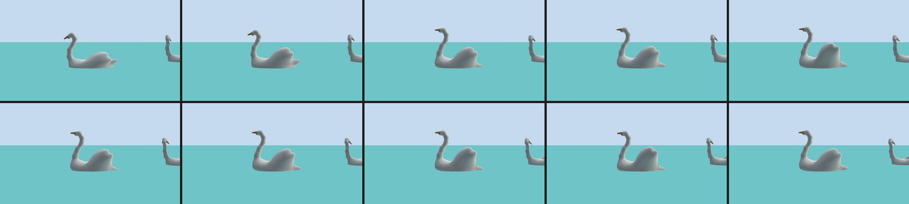

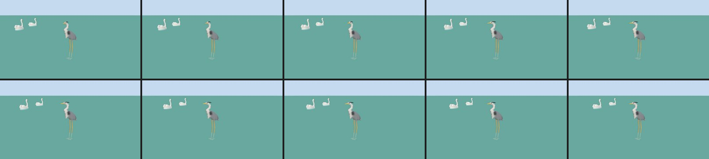

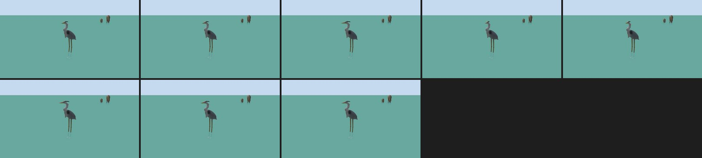

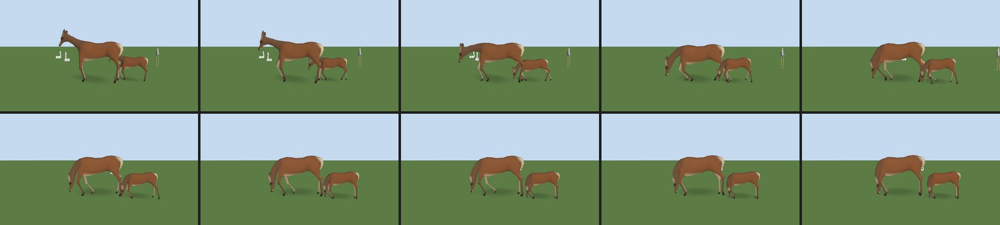

**Tests** (added to `tests/unit/odyssey-pond-life.test.js`):

- the new skeletons;
- a dipping swan's head goes under the water;
- no swan bone turns faster than 6 rad/s at 30 fps (the wing beat is the fastest);
- the heron's head stays still during its steps (it moves under 0.2 of the body's travel);
- no heron bone turns faster than 12 rad/s outside the strike's shot, nor 30 rad/s in it (eased,
  never a jump).

The paddle surge is allowed in the calm-speed test (under 0.5 u/s²).

### Natural motion pass (2026-11-03)

The owner: "I want us to keep improving the design, movement and animations of all animals in
odyssey mode, i want them to feel natural and move in a smooth and natural way!!!"

**How it was measured.** The game's own pose code was sampled at 60 Hz over both swans' and the
heron's whole loops. For every bone the probe measured its world rotation's speed, acceleration and
jerk; for the body, its path's speed and acceleration; for the heron's planted feet, their slip and
height. The motion was then skinned on the CPU and rendered in headless Blender as:

- motion strips;
- onion skins, with the 60 Hz paths of the head and feet drawn as curves.

**The audit, worst first:**

1. **The swans' heading jittered.** The route was a table of straight pieces, so the heading
   turned in small steps: 220 rad/s² of angular acceleration at the root, 99 % of the time. It drew
   a jagged path in the onion skin.
2. **The mate cusped round the west turn.** It swam a fixed 2.6 u to the lead's side, and inside
   the tight turn its offset line folded back: up to 14 u/s and 930 u/s².
3. **The heron spun before walking.** It turned up to ~2.5 rad toward its next spot within its
   first step, at up to 4.6 rad/s, and its planted foot slid with the body (no sideways reach).
4. **The heron's legs jolted** (230-280 rad/s² at the thigh and shin). It had three causes: the
   foot's lift started on a steep curve; a trailing leg pulled straight hit the reach limit and
   kinked; and a planted foot slipped up to 0.02 u a frame.
5. **A preen only twisted the neck about its own length.** A yaw of an upright neck cannot bring
   the bill to the wing.
6. **The heron never caught anything**, and its coil before a strike was quick (0.8 s).

**What changed** (`odyssey-pond-life-motion.js`):

- **The route.** Places and tangents now come from the Catmull-Rom spline itself, through a dense
  arc-length table.
- **The mate** follows the lead's own line, 8.5 s behind, wandering slowly up to 1.1 u to either
  side.
- **A swan turns head first.** Its upper neck looks into the bend the route takes ~2.5 s ahead.
- **Each paddle stroke** is a quick push and a long glide (two harmonics, not a sine). The neck
  gives a little at its base against the surge, so the head rides steady.
- **The heron's walk is a list of moves.** Each one lifts one foot and sets it down while the body
  is carried.
  - It first turns toward its next spot in small stepped turns of at most ~0.5 rad. A foot is
    re-placed with each one, and the body never spins.
  - Then it stalks one step at a time, the head held still while the body moves under it.
  - At the end the trailing foot closes up.
  - Each leg also reaches sideways (a roll at the hip), so a planted foot stays put while the body
    turns over it.
- **The lift** follows sin^2.5, which starts and ends gently. Near full stretch the leg's reach
  eases off instead of stopping dead.
- **The preen** arches the neck back over the body and bends it to one side. The bill works at
  the wing in small eased nibbles.
- **The strike:**
  - a slow 1.5 s coil, the neck drawn tight and low;
  - the shot (0.24 s, eased at both ends), the hold, the return.
  - **Half the strikes come up with a fish.** It is a new small silver part of the heron model on
    its own bone, held crosswise in the bill. It grows in while the bill is under the water.
  - **Then the swallow:** the head tips up, the neck gulps twice and the fish is gone (its bone
    drawn at size 0). The model is now 13 bones and 1,336 triangles.

**The numbers** (60 Hz, whole loops; the worst value; "a99" means 99 % of frames are below it):

| | before | after |
|---|---|---|
| Swan root, angular acceleration (a99 / worst) | 221 / 357 rad/s² | 0.8 / 3.4 rad/s² |
| Swan root, jerk (worst) | 42,800 rad/s³ | 197 rad/s³ |
| The mate's speed (worst) | 14.5 u/s | 1.22 u/s |
| The mate's acceleration (worst) | 927 u/s² | 2.9 u/s² |
| Heron body, turning (worst) | 4.6 rad/s | 1.2 rad/s |
| Heron thigh and shin, angular acceleration (worst) | 278 rad/s² | 29 rad/s² |
| Heron thigh and shin, jerk (worst) | 21,300 rad/s³ | 820 rad/s³ |
| Heron planted foot, slip (worst, per frame) | 0.020 u | 0.009 u |

The fastest moves left are deliberate: the strike's shot (the upper neck at up to 26 rad/s, eased
at both ends) and the swans' two wing beats in a stretch.

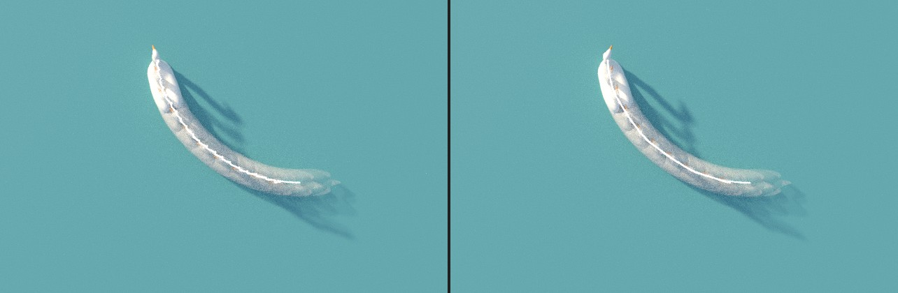

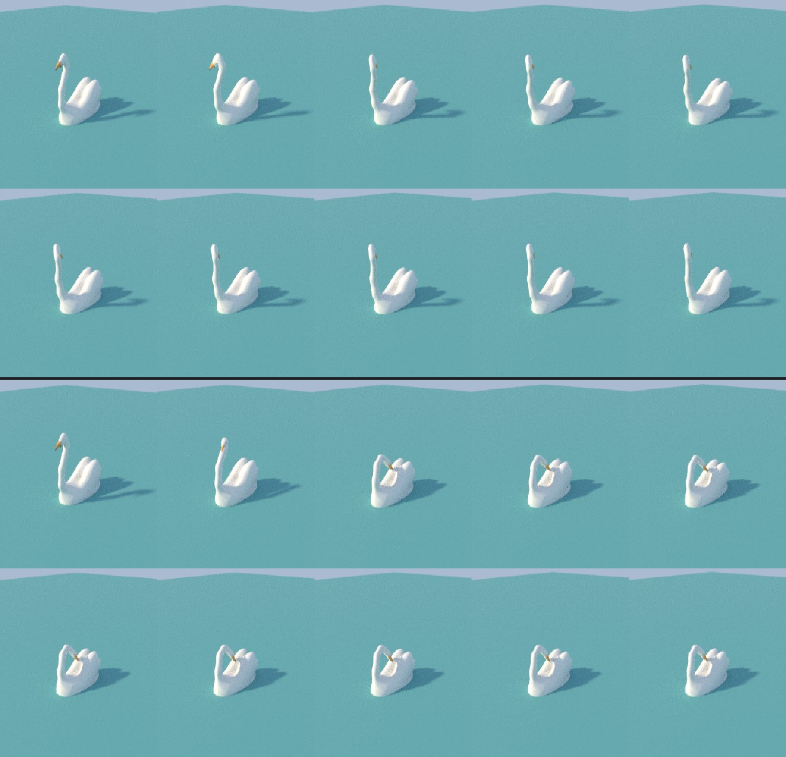

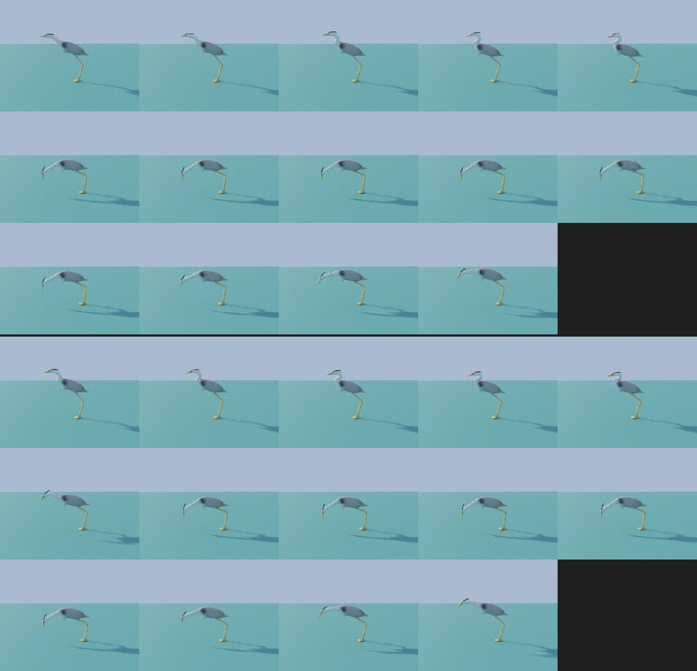

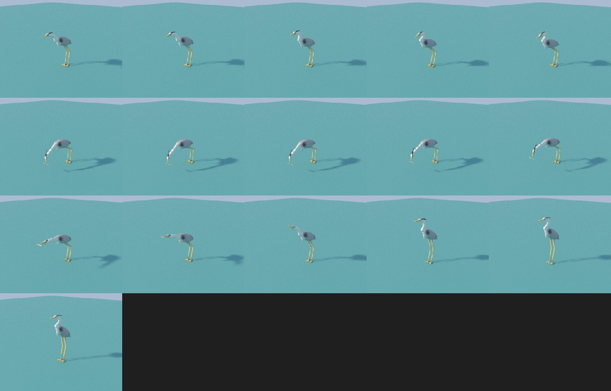

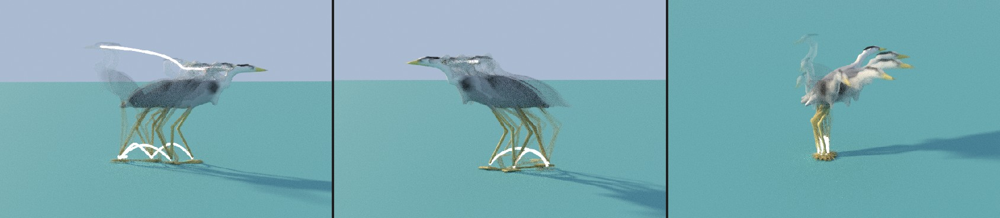

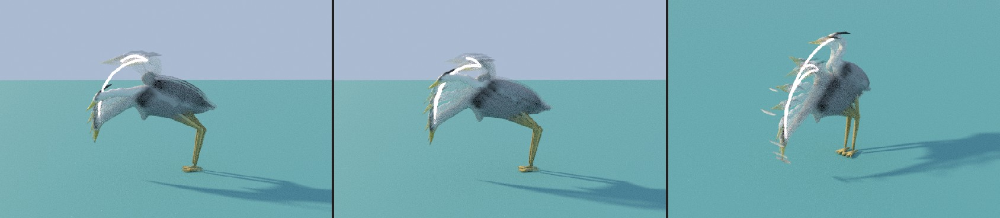

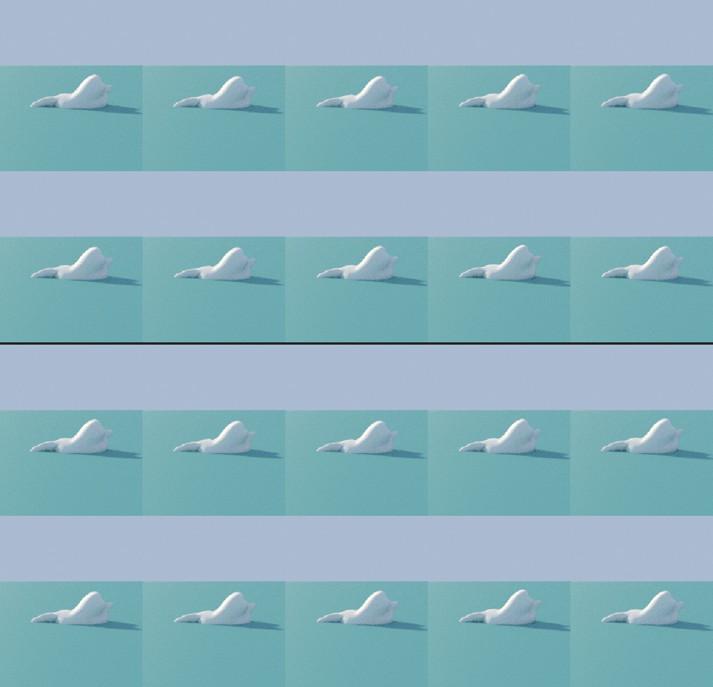

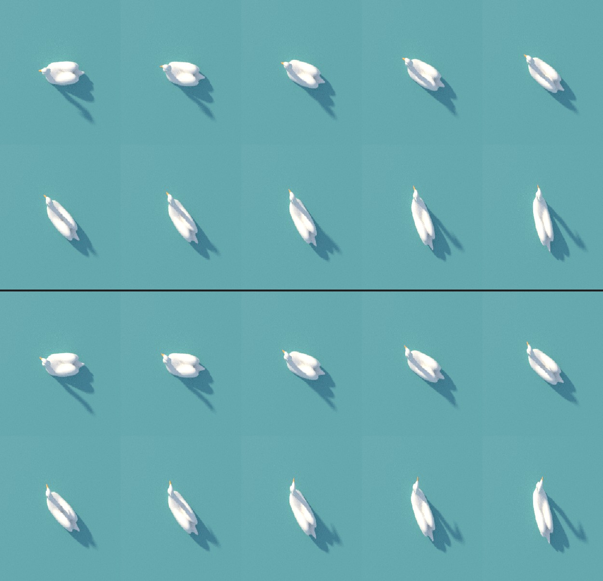

At game size (L22, 4x; the 2026-11-02 shot left, this pass right) the swans, the heron and the
drinkers read as before:

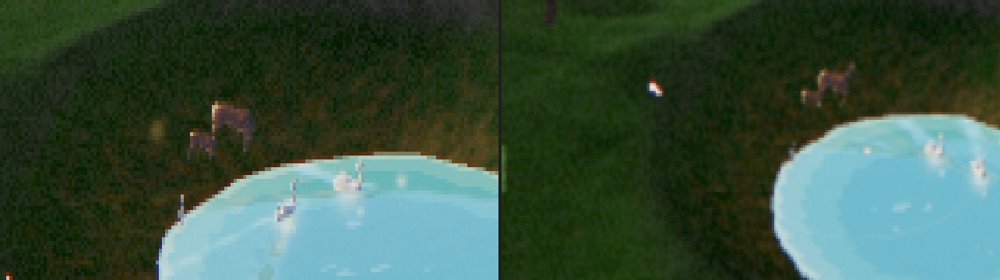

**Tests** (`tests/unit/odyssey-pond-life.test.js`, 15):

- the swans' heading acceleration stays under 3 rad/s² at 60 Hz, and the mate's speed under 1.4x
  the glide;
- the heron never turns faster than 1.2 rad/s;
- a fish appears only with the bill down, and is gone again within 5 s;
- the fish is its own skinned part;
- the leg reach eases off near full stretch without a kink.

**Left as it was:**

- **The drinking deer.** Their motion is the deer code's, which another helper owns.
- **Up-ending.** The swan's hull is cut flat at the waterline, so tipping it up would show the
  cut.
- **The wake's crests** keep their travel speed; their strength already follows the swan's speed.

### Visibility (2026-11-03): the heron seen, and flying

The owner: "the heron is very hard to see!" Then the visibility check of every animal
(the shared method in the visibility brief). The heron, then the swans and the drinkers.

**How it was measured.** Real-game shots in Chrome over CDP (`cstations.mjs`, 2560x1440, PNG),
the board clock frozen, the camera's breathing off, each shot taken twice: with the animal and
with its mesh hidden. The pixels that differ (more than 0.08, in a body of them, the biggest
blob and 2 px round it) are the animal. Its shadow and wake are not in it: the heron casts
none, and a swan's wake and mirror image stay in both shots. Contrast is
|mean Y animal - mean Y ground| / mean Y ground (linear luminance); dE is the mean CIE76 colour
difference (Lab, D65). "Longest" is the farthest two of its pixels. Time in frame is from the
rail camera in node (`odyssey-camera-rig.js`) over the whole loop.

#### The heron

**Before** (three times life, at its south-west spot): a 4-6 px wide stroke at the water's edge,
10-11 px at the start of the L18 -> L19 glide and 22 px at L22-L23, at the very foot of the
frame there. Its grey matched the shallows and its white the bright water.

**What changed, in order, measured after each:**

1. **Contrast.** A darker slate back (0.16, 0.18, 0.22), a whiter face, neck and crown sides
   (0.94), a black shoulder patch and darker primaries, a yellower bill. Against the low sun the
   edges of its feathers light up, most on white (a sun rim; the sun is behind it from the rail).
   At 4-6 px wide this alone moved little (dE about the same, contrast mixed): it was too thin.
2. **Size: 4.2 times life** (1.4x the pond's 3.0). It stands 26-30 px tall at the parks and 17-25
   px through the glide. Beside the swans and the hind it still looks like a heron of its size
   (below).
3. **Where, inside the west lobe.** Its round now starts on the lobe's north shore, which every
   view of the pond sees (in frame 100 % of the loop at p 0.235-0.255 and at L22-L23, higher in
   the frame there than the old spot), and keeps the south-west shallows as its second place.
4. **The flight**, every two or three minutes (two a loop: 115 s and 164 s apart).

| Heron | p 0.235 | p 0.245 | p 0.255 | L22 | L23 |
|---|---|---|---|---|---|
| Before, longest (px) | 10.5 | 11.0 | 18.1 | 22.0 | 22.4 |
| Before, contrast / dE | 1.97 / 26 | 0.77 / 28 | 0.44 / 33 | 0.14 / 32 | 0.15 / 28 |
| Contrast step only, longest / dE | 11.0 / 25 | 14.0 / 27 | 18.1 / 36 | 22.0 / 32 | 23.5 / 29 |
| After, south-west spot, longest | 16.5 | 20.4 | 25.7 | 28.9 | 27.0 |
| After, south-west, contrast / dE | 1.40 / 30 | 1.46 / 32 | 0.97 / 38 | 1.34 / 38 | 1.26 / 32 |
| After, north shore, longest | 18.0 | 21.1 | 25.1 | 32.3 | 33.1 |
| After, north shore, contrast / dE | 1.36 / 27 | 1.22 / 27 | 1.95 / 32 | 1.23 / 31 | 0.80 / 33 |
| In flight over the bank, longest | 23.0 | 26.5 | 32.2 | 37.2 | 36.2 |
| In flight over the bank, contrast / dE | 2.3 / 29 | 2.7 / 30 | 3.2 / 32 | 6.0 / 35 | 6.9 / 35 |
| In flight over the water, longest | 22.8 | 26.7 | 36.2 | 40.7 | 37.4 |
| Reads? before | stroke | stroke | shape | shape | shape |
| Reads? after | shape | shape / heron | heron | heron | heron |

Trees and terrain hide it at none of these stations. At p 0.265 only the north shore is in frame
(59 % of the loop). Its flights are in frame 100 % of their air time at every station but p 0.265
(55 %); the second one leaves from the south-west shallows below the parks' frame and flies up
into it.

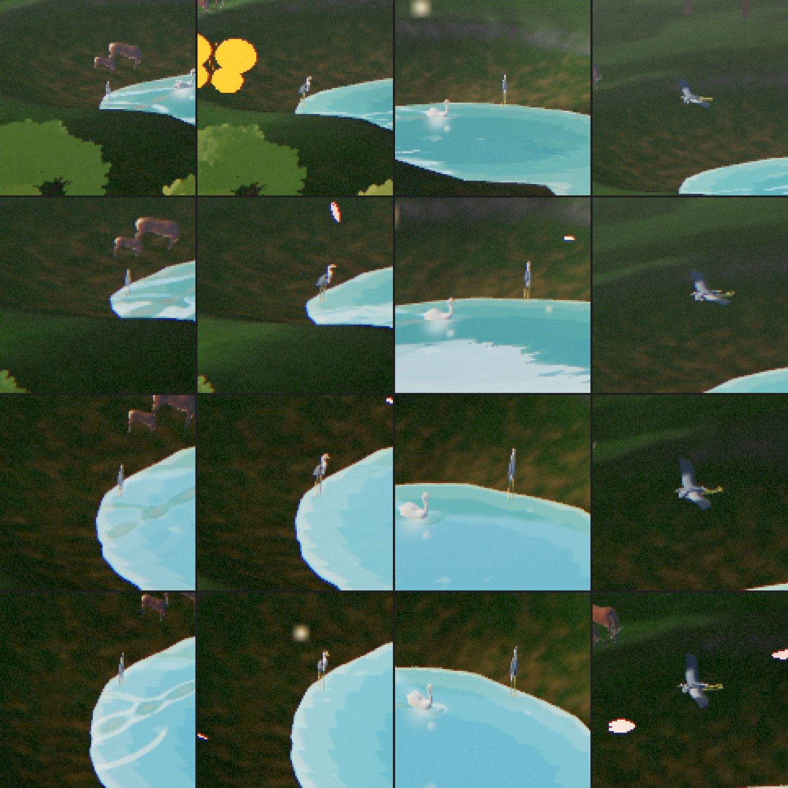

**The flight** (`odyssey-pond-life-motion.js`, `HERON_FLIGHT`):

- **The wings.** `pond_birds.py` builds open wings for it: broad and rounded, bowed down at the
  hand, pale grey coverts and black flight feathers, 1.85 m tip to tip (times 4.2). Each has an
  arm and a hand bone. Standing, they are drawn at size 0, so it looks as it did. As it takes
  off they grow and unfold, the arm swung back and the hand folded forward at first.
- **Keyed in Blender.** Nine channels (along the path, height, crouch, the shoulder's stroke, the
  forward sweep, how open, body pitch, the neck, the legs) are keyframed on an Empty with Bezier
  keys and auto-clamped handles, and sampled at 30 Hz into
  `composition/odyssey-heron-flight-keys.js` (generated; `--flight-out`). The game reads them
  cubic between samples.
- **The take-off:** a crouch, the wings open, three deep beats to rise, the legs reaching down
  and then trailing.
- **In the air:** two slow beats (about 1.4 a second), a glide with the wings a little raised,
  the neck drawn back into a tight S, the legs straight out behind, the body level. It follows a
  curved path, its heading the path's way over 3 u (so the spline's knots never jerk it), banked
  into its turns as a bird flies them (tan bank = speed x turn rate / g, at life size; at most
  0.38 rad). Its feet stay 2 u and more over the bank it crosses; at most 1.4 m up (5.9 u).
- **The landing:** braking beats with the wings swept forward, the body flared up, the legs
  reaching for the water, a give as it lands, the wings folding away, then two quick steps to
  settle (its head carried with them).
- **The two flights:** from the north shore round over the west bank to the south-west shallows
  (34.5 u), and back over the water (35.4 u). The 6.6 s flight is a calm one, about 12 u/s.
- **Smooth:** in the air its body and neck turn at most 2.5 rad/s, its legs 5 rad/s (as they
  swing back and forward again) and the wing bones 11.8 rad/s (the beats). Its heading turns at
  most 1.8 rad/s. In its walks and stands nothing changed.

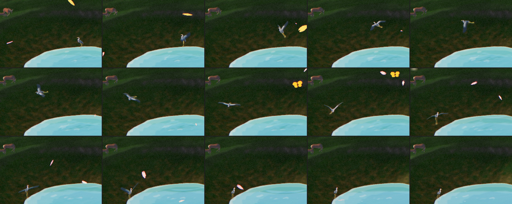

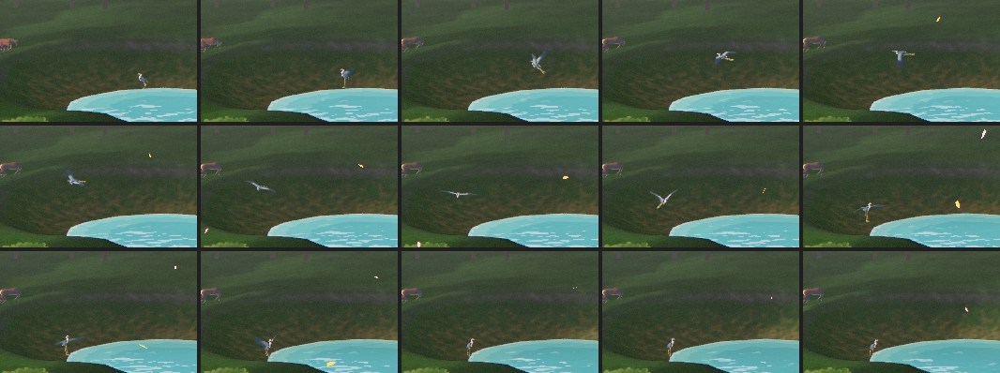

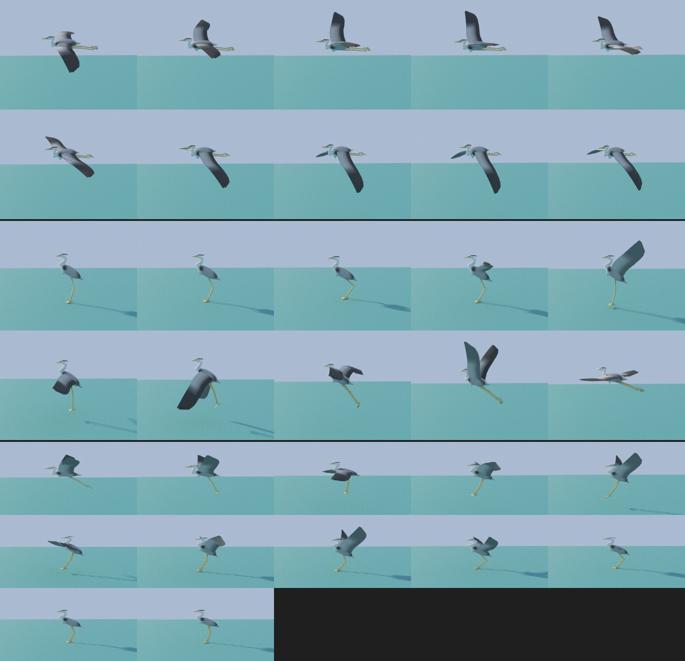

#### The swans

Measured the same way (their bodies only). They are white on pale turquoise, so their luminance
contrast is low (0.04-0.6) and their colour difference carries them. One change: a little warmer
white (a mute swan's cream), less of the water's teal bounced up into its underside, and a
smaller sun rim (0.45). Their size is unchanged (three times life).

| Swans (both) | p 0.235 | p 0.245 | p 0.255 | L22 | L23 |
|---|---|---|---|---|---|
| Longest (px) | 16 | 18-19 | 22-27 | 22-28 | 19-26 |
| dE before | 22-23 | 22 | 23 | 20 | 19-20 |
| dE after | 22-24 | 22-23 | 24 | 20-21 | 20-21 |
| Reads? | shape | shape | swan | swan | swan |

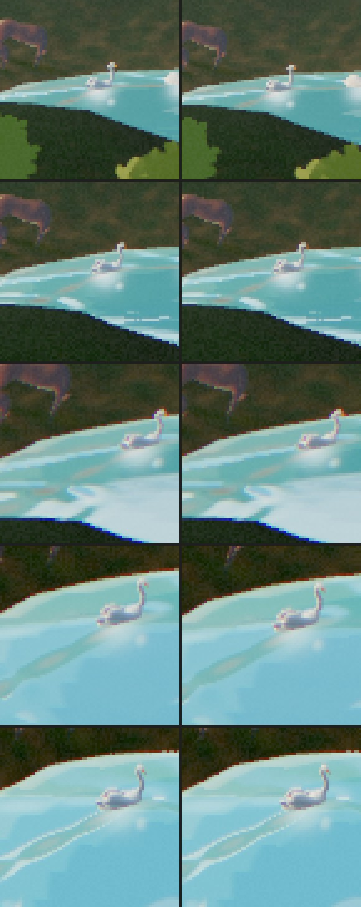

#### The drinkers

The deer helper measured them (the hind a speck at L15-L17, the calf a shape) and asked for
1.2x: `ODYSSEY_TARN_DEER.scale` is now 3.6. At that size the calf's middle spot moved 2 u east
(to -365.5, -438.1), so it keeps to gentle ground (slope 0.67, under the 0.75 gate) and its
standing hooves meet the bank (0.07 of its size, under 0.1). The hind's spots are as they were
(slope 0.62, hooves 0.07).

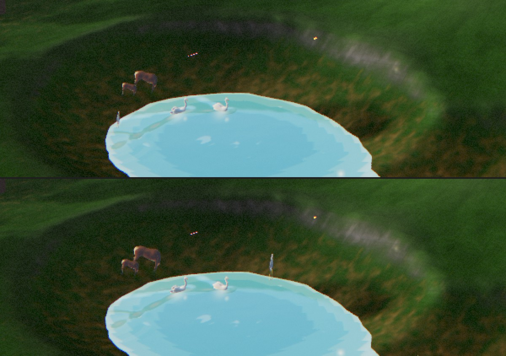

**Scale beside each other.** The heron stands a little taller than a swan's raised head (in
life they are about the same) and the hind stays the largest. It reads as one pond.

**Cost.** The heron is 1,656 triangles (was 1,336: +320 for the wings) and 17 bones (was 13), in
the same single instanced draw. No new texture, pass or pipeline. In a flight, the CPU adds a few
path lookups and four ground heights a frame. The sun rim is a few shader instructions.

**Tests** (`tests/unit/odyssey-pond-life.test.js`, 16): the heron's 17 bones (fish, then the
four wing bones); its walks and stands as before; the wing bones under 14 rad/s; its heading
under 2.2 rad/s in the air; two flights a loop, 90-180 s apart, the wings at size 0 whenever it
is not flying, its feet over 1 u clear of the water and the bank, at most 8 u up; the flights in
frame at L22-L23 (over 70 % of their air time); none of them in frame as the window closes.

**For the owner:**

- **A darker reflection under the heron** on the water would part it from the shallows a little
  more. It needs a third row in the tarn's mirror (the world shader). Not done.
- **The swans at 1.2x** (with their wake and mirror numbers) would bring them over 24 px through
  the whole glide and keep their size beside the heron. Not done: they read at the parks.
- **The flight is calm** (about 3 m/s at life size): slower than a real heron's cruise (8-10 m/s),
  so the beats look deep and slow. A faster one would cross the view in two seconds.

### Left for later

- **The drinkers' timing** follows their own five-minute loop, so a given pass may find them on the
  ground above the bank rather than at the water.
- **The swans' paddling feet** are not drawn: under the turquoise they would not show.

## Ibex on the rock band (2026-11-02)

The owner, on the animals pass: ibex, "but further down, not at the snowy top". A buck, two nannies
and a kid now live on the shelf at the top of the grey rock band at the massif's foot, east of
where the rail climbs the face. They graze, look round, walk short curves and, now and then, leap.

### Not at the top: why

The first scout looked at the summit's rock from the chapter-5 climb, with the new climb views.
I measured every rock point the climb can see, on the real rail camera with the real terrain:

| | Biggest 3x buck at 1440p (shoulder) | Distance | Where in the frame |
|---|---|---|---|
| L27-L28 | 10-14 px | 280-390 m | middle |
| L29-L30 | 15-19 px | 245-285 m | bottom edge |
| L31 | 21 px | 224 m | bottom edge |
| L32-L33 | 25-30 px | 171-188 m | bottom-left corner |

- No ledge reads from more than one orb: none is 18 px or more from two parks.
- The 25-30 px figures come from the frame's edge, where the lens stretches things.
- Nothing is against the sky from any climb park. The camera rises away from the rock.

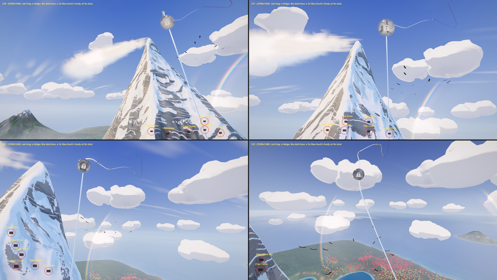

### Choosing the place

The second scout covered the lower rocky ground: the boulder outcrops on the slopes, the massif's
foot wall, and the rock bands between the forest and the snow.
- **The boulders** are 300-700 u from the rail at every park, so 5-15 px.
- **The foot wall** is the only place in view for several orbs. Its rock band (slope 1.0-1.2,
  which the ground paints grey) runs along the massif's foot at about (-150, -560). Above it lies a
  shelf of gentler ground (slope 0.3-0.5) that can hold an animal's feet.
- **The trees.** The shelf has a few. The spots keep clear of their trunks and low crowns, in both
  forest tiers.

| Park | Buck (3x, 0.93 m shoulder) at 1440p | Where in the frame |
|---|---|---|
| L17-L18 | ~11 px | right of the middle |
| L19-L21 | 13 px | the middle, low |
| L22 | 19 px | right |
| L23 | out (the view turns west) | |
| L24 | 25 px | lower right |
| L25 | 28 px | lower right |

The nannies are about four fifths of the buck's size; the kid a little under half. That is short of
the hope (25 px or more, mid-frame, for several orbs): they read at 25-28 px from two orbs and are
smaller from the others. They are drawn from p 0.179 to 0.348. At both ends they are out of the
frame at every clock phase.

### The model

`scripts/blender/odyssey/alpine_ibex.py` (headless Blender, rebuilt byte for byte) makes
`assets/chapter-04/ibex/alpine-ibex.glb`. It uses the red deer's method and meshing:
- **Body.** A stocky, deep-chested goat on short, sturdy legs, with a short thick neck and a short,
  broad head carried steep. It is built at a nanny's size: 0.79 m at the withers.
- **Horns.** One model serves all four. Every horn vertex carries its root (`_horn`), and the game
  scales each horn about its root per animal:
  - the buck's great backward sweep, about 0.85 m along the curve;
  - a nanny's short horns;
  - the kid's buds.
- **Skeleton.** The deer's own 27 bones, so the deer's herd code poses the ibex unchanged.
- **Coat.** A grey-brown summer coat, darker down the fronts of the legs, along the back and on the
  chest; a pale belly; dark hooves, nose and eyes.
- **Size.** 2,192 triangles.

### Their life, and the leap

Each ibex keeps to two or three spots on the shelf, with the deer's life between them:
- planned footfalls, so a planted hoof never slides;
- walked curves and stepped turns;
- grazing with small nods and a chewing jaw;
- looks that turn the ears, then the head, then the neck.

The new thing is **the leap** (in `odyssey-deer-herd.js`; deer never leap):
- **Before:** the ibex looks to where it will land and turns to face it on the spot.
- **Crouch:** the body sinks, then springs.
- **Flight:** a straight line at a steady speed, on an arc whose height grows with the distance.
  - The hooves leave together, the fores a moment first, and ride the arc folded up.
  - The body tips nose up off the rock and nose down to land, held to about 17°.
- **Landing:** the fores first, on the spots the planner chose; every hoof stays planted. The body
  gives with the landing.

The buck and each nanny leap between two of their spots once a loop (5-9 u at three times life),
and the kid hops twice near its mother.

### Light, popping, cost

- **Light and shadow:** the deer's, with a contact shadow under each animal that fades while it is
  in the air.
- **No popping, no hitch:** they come in the deer's way. They are fetched as their window nears,
  compiled while the board is idle, and only then drawn. The ibex runs that lifecycle itself
  (`tick`), so the board edit is an import, a create, a tick and a dispose.
  - Turn them off with `?odysseyNoIbex=1`.
- **Cost:** two draws (4 x 2,192 = 8,768 triangles, plus the shadows), no new pipelines after the
  first compile.
  - Posing the group takes about 0.06 ms a frame on the CPU (measured with the full height
    function; the game reads the faster height mirror).
  - Planning the footfalls takes about 11 ms an animal, once, one animal per task.

### Tests

`tests/unit/odyssey-ibex.test.js` checks:
- **The model:** the deer's skeleton, the horns riding the head, and the triangle budget.
- **The shaders:** both backends build cleanly.
- **Lifecycle:** hidden until ready.
- **The ground:** every animal on the standable shelf by the rock band, clear of the trees.
- **The feet:** the hooves bearing weight where the plan put them (99 % within 0.07 of the drawn
  size). In the air the hooves stay out of the rock (under 0.2).
- **Spacing:** the animals keep apart.
- **The leaps:** all four hooves leave, the arc rises, and all four land planted near the landing.
- **The camera:** in view at L19-L25 (but L23) at the sizes above, and never appearing or leaving in
  view.

The deer's tests pass unchanged: the leap only runs for a member that asks for one.

### Left for later

- ~~**Rock under their feet.**~~ Done: the perch rocks (below). The shelf is grass, just above the
  grey band; the band itself, at slope 1.0-1.2, is too steep for the leg solver.
- **A dark buck.** In late autumn the buck's coat darkens almost to black. At these sizes, darker
  would read as a hole in the grass.

### Design and motion pass, and the perch rocks (2026-11-02)

The owner asked whether the animals are "visually stunning" and move "natural and smooth". For the
ibex the answer was not yet, so this pass reworked the model and the motion and gave them rocks.

**The model** (`alpine_ibex.py`, still rebuilt byte for byte; 2,184 triangles).
- **The horns** were a segmented, oversized scythe. Each is now one smooth arc: thick at the root,
  tapering to a point, rising off the forehead and sweeping back over the neck toward the
  shoulders, a little outward. Eleven transverse ridges knot the front face. They are 0.73 m along
  the curve on the buck; the nannies' are short and thin, the kid has buds.
- **The buck has a short beard.** Like the horns, it is scaled per animal about its own root
  (`_horn` w = 2), so it is the buck's only.
- **Stockier:** a deeper chest and barrel, a thicker neck, thicker legs, a shorter tail.
- **The coat:**
  - dark brown on the lower legs all round and down the fronts of the forelegs;
  - a dorsal stripe from the withers to the tail, a band along the lower flank, and a dark chest
    and throat;
  - a pale belly and inner legs; the tail, hooves, nose and eyes near black.
  - The darks are deep enough to survive the screen's gamma: the first coat's "darker brown" was
    lost in it.

**The perch rocks** (`ODYSSEY_PERCH_ROCKS` in `world/odyssey-boulders.js`): three rocks set by hand
on the shelf:
- a broad boulder for the buck (1.8 u proud of the slope at its middle, 3 u on its downhill face);
- a low slab and a low step for the nannies.

They are the world's own boulders: the same shapes, material and tiers, seated by the same rule,
but standing prouder and leaning less, so there is a top to stand on. They are never dropped by
the forest or rail rules; the boulder tests hold them clear of both. `buildPerchTops` lays each
rock's mesh into a fine height grid, and the ibex's hooves stand on the rock the eye sees
(`createIbexGround`).

**Their life on the rocks.**
- **The buck** keeps to his boulder: he stands and looks round from the top. Twice a loop he leaps
  down to graze, and back up.
- **Each nanny** leaps onto her rock and down again.
- **The kid** hops about near its mother.
- **On a perch** (a spot marked `[x, z, 1]`) an animal stays put: no grazing steps off the top, more
  looking round, and turns on the spot about its middle.
- **Roaming:** grazing ibex roam about half as far from a spot as the deer (`roam`), so they stay
  off the rocks' edges.

**The leap, reworked:**
- **Gather:** the haunches drop (nose up) before the push.
- **Push and flight:** the take-off and a tucked flight on the arc.
- **Landing:** the fores take the weight first (nose down), the body gives quickly, and it comes back
  up more slowly as the hinds come under. The feet then settle.

**How the motion was filmed.** The game's own solver poses the animals on the CPU, frame by frame.
`alpine_ibex.py --motion` renders those pose tables in Blender, close up, with the terrain and the
perch rocks, for every behaviour:
- the stand, grazing, walking;
- the kid's hop;
- the buck's leap.

**Tests** (`tests/unit/odyssey-ibex.test.js`):
- On its rock an animal's weight-bearing hooves stand on the rock's top, within 0.08 of its drawn
  size, and at least three of the four are on the rock.
- Every perch stands proud of the shelf.
- Eight leaps, each leaving and landing on all four hooves.
- The earlier checks still hold: hooves, spacing, trees, sizes from the rail, and never popping.
- The deer's tests pass unchanged.

**Left for later.** At 13-28 px the coat's markings read mostly as dark legs. The flank band and
the dorsal stripe show only up close.

## Wild horses on the meadow (2026-11-02)

The owner agreed to: "A band of wild horses on the open meadows (chapters 3-4). Most of the time they
graze and wander, with a foal beside its mother. Now and then they run in a wide arc across the
meadow with a little dust, a moment you catch from the path."

### Choosing the place (the scouting numbers)

Measured on the real rail camera (`tests/unit/helpers/odyssey-camera-rig.js`), the real terrain and
both forest tiers, every 10 m over the island, for every orb park of chapters 3-4 and the glides
between them. A cell counts as open meadow when it is dry, its slope is under 0.3, it is clear of the
boulders, the tarn and the rail's ground track, and it is more than 3 m outside the inner 60 % of every
crown. The withers of a 3x mare are 4.1 m tall.

| Open ground | Seen from (withers at 1440p) | Room for a run |
|---|---|---|
| East of the rail: a long band of grass at z -350..-315, x -145..+10, and a corridor at z -430..-415 south of a copse | L11-L12 (21-25 px), L13 (26), L15-L16 (29-36), L17-L18 (39-49), the L18-L19 glide | yes: an oval round the copse, ~400 m |
| Round the tarn (its kept-open clearing) and west of it | L17-L18 (29-42 px), L22-L24 (34-37) | yes, but the pond animals live there |

The east meadow wins: it is in view at seven chapter-3 parks, and it leaves the tarn to the pond's
animals. L14 does not see it, and chapter 4's parks (L19-L26) do not either. So in practice the
horses are a chapter-3 sight (the band's window runs to p 0.29, just past L21).

**The catch, seen in the game:** the "open meadow" is a glade among scattered trees. From the rail
(63-172 m up, looking across), the crowns in front hide much of the grass. The horses show in the gaps
(L16, L17, L18 best; at L15 one or two), not as a herd on open grass. The scouting counted the ground,
not the crowns between it and the eye.

### The model

`scripts/blender/odyssey/wild_horse.py` (headless Blender, rebuilt byte for byte) builds
`assets/chapter-03/horses/wild-horses.glb`. It holds two meshes on the deer's pipeline (a signed
distance field polygonised, decimated and mirrored):
- A stocky wild mare of the Przewalski / Konik type: 1.38 m at the withers, a big straight head, a
  short upright mane, a full tail. 2,396 triangles.
- A leggy foal: 1.04 m at the withers. 1,796 triangles.

Each has its own 29-bone skeleton (the deer's bones, plus a three-bone tail). The vertex colours are
masks (pale, points, black, sky seen), and the coat is a tint per horse: bay, dun or grey.

### Their life (`composition/odyssey-horse-band.js`)

- **Five adults and two foals.** The lead mare (dun, with a dun foal), a grey mare, a bay mare (with a
  bay foal), a dun mare and a bay stallion.
- **Two grazing places:** the west and the east end of the open band. Each horse has its own two spots
  in each. It grazes there like the deer: head down, slow steps along short curves, a look round, a
  walk to its other spot.
- **The foals** keep to spots at their mothers' sides. About every minute or two a foal trots out to
  its own open playground, sometimes bucks (both hinds kicked up and back), looks round and trots back.
- **The runs.** Twice in the 300 s loop the band runs.
  - At 118 s the heads come up, each horse turns toward the way out, and the band sets off in a loose
    file behind the lead mare. The foals run at their mothers' flanks. They go the long way round the
    copse: down the west side, along the south corridor, up the east side, to the east place
    (~400 m, 22-26 s).
  - At 262 s they canter straight back along the band to the west place (9-12 s).
  - The horses keep one west-to-east order in both places and set off in that order, so no one
    overtakes another.
- **Speed.** A run speeds up over 4.6 s and slows over 4.6 s. The gait follows the speed: walk, trot,
  canter, gallop. The top speed is a slow gallop, 7 m/s at life size (21 m/s drawn).
- **Gaits** (`ODYSSEY_HORSES.gaits`): a four-beat walk, a two-beat trot (diagonal pairs), a three-beat
  canter and a four-beat gallop, both leading with the left fore. Their footfall timings, stride rates
  and stance shares blend smoothly with the speed.
- **The feet.** A footstep planner like the deer's walks each horse through its loop once at load
  (60 steps a second). It lifts each hoof when its timing comes round and lands it where it should
  stand half a stance later. A planted hoof never moves. The plan also keeps the stride phase, which
  the pose reads.
- **The pose** is the deer's (two-segment legs, the body riding on its feet, three neck bones), plus
  the gaits' own motion:
  - the trot's bounce;
  - the canter's rocking and the neck's pump;
  - the body carried lower at speed, and the neck stretched;
  - the tail streaming in a run and swished at flies while grazing (a wave down its three bones);
  - a grazing foal splays its fores a little.

### Light, shadow, no popping

- The deer's light (the world sun, the sky softened toward the warm air, the meadow's green from
  below, a little sky on the edges, the air), and a soft shadow on the slope under each horse.
- Drawn from p 0.08 (deep under the sea) to p 0.29. The test checks that the eye is under water at the
  start and that every horse, at every moment of the loop, is out of the frame round the end.
- The deer's lifecycle (`driveOdysseyHorses`): fetched and planned as chapter 2 begins, compiled while
  the board is idle, then drawn; a failure leaves the act as it was. Off: `?odysseyNoHorses=1`.

### Cost

- 3 draws: the mares (5 x 2,396), the foals (2 x 1,796) and the shadows. 15,572 triangles.
- One instanced attribute a draw (the coat is an index picked in the shader). WebGPU allows 8 vertex
  buffers a draw, and three colour attributes went over it on the first try.
- CPU: posing the band costs about 0.1 ms a frame. Planning the feet takes ~120 ms in all, one horse a
  task (12-28 ms each), so it never holds a frame. A 6.8 KB table goes to the GPU each frame.
- The bake-loader ratio test, the perf-budgets gate, the entry-hold and async-build budgets still pass.

### Tests (`tests/unit/odyssey-wild-horses.test.js`)

- **The models:** two meshes, 29 bones, within their triangle budgets.
- **The shaders:** all three build for WGSL and GLSL, in at most eight vertex buffers.
- **The clock:** every loop exactly 300 s (so the band's runs stay together), two runs minutes apart.
- **The gait maths:** a four-beat walk, diagonal pairs in the trot, rate and stance share moving
  smoothly with the speed.
- **The ground,** every horse at every moment of its loop, runs included:
  - dry grass under 0.36 slope;
  - clear of trunks and low crowns in both forest tiers, of the boulders, of the tarn
    (distance > 1.5) and of the rail's track (> 30 m);
  - hooves that bear weight planted (99 % within 0.08 of the drawn size), never dug in;
  - the horses apart, each foal within 40 m of its mother;
  - every horse, the foals too, reaching the band's speed.
- **The camera:** in the frame at L11, L15-L18 at the sizes above; never appearing or leaving in view.

### Left for later / owner decisions

- **The crowns hide the band** much of the time (see above). Options:
  - (a) thin the forest scatter over the meadow band (a clearing like the tarn's), so the grass is
    really open from the rail;
  - (b) move the band to the tarn's clearing, shared with the pond's animals (seen from L17-L18 and
    L22-L24);
  - (c) keep it as a glimpse through the trees.
- **Dust.** The runs have no dust trail yet (the brief's "a little dust"). It would be a small additive
  puff per hoof landing at gallop speed, fed from the plan's footfalls.
- **The mother and foal** graze on their own spots side by side, not tied to each other. A foal
  following its mother step by step would read better up close.
- The runs are scheduled in the loop (every ~2.5 minutes). They are not timed to the rail's
  arrivals.

### Design and motion pass, and the open meadow (2026-11-02, later)

The owner asked: "are the animals designed so they are visually stunning and animates so that the
animation and movements feels natural and smooth?" The answer for the horses was "not yet". This
pass is the recommended work: an open meadow, the look, the motion, and the dust.

**The meadow is open now** (`world/odyssey-meadow-clearing.js`). The forest scatter keeps it open
the way it keeps the tarn's meadow open:
- no tree in its core, but for a few lone trees (3.5 % of sites);
- a treeline that thins at the rim;
- an outline of four overlapping ellipses pushed in and out by a low noise, so it is not a cut
  circle.

It covers both grazing places, the long run round the copse, and the rise between the band and the
rail's view, where the crowns hid it.
- It removes 40 trees on High and 16 on Low. The scatter reports them (`meadowCleared`), and the
  boulders still keep clear of them, so not one rock moves or appears.
- Measured with crown ellipsoids on the real rail camera (first outline; the final one is a little
  larger), the share of the band in view and not
  behind a crown went up on High: L15 18 → 62 %, L16 47 → 74 %, L17 37 → 49 %, L18 43 → 83 %,
  L11 45 → 54 %. On Low: L15 70 → 91 %, L18 72 → 99 %.
- Only L10-L18 see it; no later orb looks at it.
- The forest visibility mask needs no re-bake: its stamp covers only the rail and the terrain.
- The golden bakes do not include the forest. The forest's shade plate is built from the scatter
  at load, so it follows the clearing.
- Turn it off with `?odysseyNoMeadowClearing=1`.

**The look.**
- The model (`wild_horse.py`) has muscle masses under the skin: the shoulder blade, triceps,
  quarters, hamstrings and the long back muscle.
- The head is a refined wedge: a flat forehead, round jowls, a faint dish, a smaller muzzle with
  flared nostrils and a dark tip, and wider-set eyes.
- The mare has a thick, upright mane, a forelock and a fuller tail. The foal has a brush mane and
  a bottle-brush tail.
- A new `_hair` attribute carries four masks: hair, flutter, muscle definition and leg bars.
- The shader uses those masks for:
  - muscle relief, strongest in the sun;
  - a streaked, sheened mane and tail;
  - a grey's dapples (soft light rounds in a darker net over the barrel and quarters);
  - a dun's faint, uneven leg bars and dark dorsal stripe;
  - a bay's black points.
- The mane, forelock and tail tips move with the gait: they bob twice a stride at a trot and once
  at a canter, stream back in a run, and sway a little while the horse stands.
- Mare 2,998 triangles (was 2,396), foal 2,086 (was 1,796).

**The motion.** Filmed up close and in slow motion (`src/playground/effects/odyssey-horses.effect.js`,
`?effect=odyssey-horses&t=<board s>&horse=<0-6>&view=side|three|front|rear|band`), and measured
on the plan:
- **The gallop** was a pace in disguise: it landed lateral pairs (RF and RH, then LH and LF). A hoof
  whose turn came round while it could not lift lost that turn, and reach-limit lifts took over the
  rhythm. Now a hoof's turn waits until it can lift, a turn that falls inside its own lift is
  dropped, and the reach limit follows the stance's length. It is a transverse gallop on the left
  lead (RH, LH, RF, LF) in more than 90 % of strides, with a moment of flight in each.
- **The walk** never leaves the ground. Before, it was briefly airborne (9 % of one walk).
- **Standing forelegs** folded about 1 rad at the knee. The grazing dip tipped the body nose-down,
  which lifted the hips out of the hind legs' reach, sank the whole horse and bunched the shoulder
  (the "fin" at the withers). Now the head reaches the grass by the neck alone. A fore leg bearing
  weight stands on a straight knee, with the shoulder and elbow taking the give, and folds its knee
  only in the air. A hoof left out under a horse that has stopped steps in at once.
- **The wheel before a run** was a 6-9 s pivot on the spot. Now it is a quick wheel (2.2 rad/s at
  most) after the heads come up.
- **The trot** carries the head up and steady. Its diagonal pairs lock only after a stride or two.
  The adults pass through the trot in about a second, and the foals' play trots are short, so it
  is left at that.

**Dust.** Soft, world-anchored puffs rise where a hind hoof struck at a canter or gallop. Each
fades over 1.9 s, at most 12 a horse. It is one extra draw of camera-facing quads, posed from the
plan's footfalls; none rise while the band grazes.

**Cost.** 4 draws (mares, foals, shadows, dust), 19,162 triangles plus up to ~84 dust quads. The
pose is about 0.1 ms a frame on the CPU, as before.

The meadow before (left, `?odysseyNoMeadowClearing=1`) and after (right), from every orb that sees
it: L11, L13, L14, L15, L16, L17, L18 (the clock pinned to a grazing moment):

The model before (left) and after (right), and at game size (before above, after below):

Close up in the playground, before (top row of each) and after (bottom row), the same board times:
the gallop (0.12 s apart), the wheel before a run, grazing, and a foal's buck:

**Tests** (`tests/unit/odyssey-wild-horses.test.js`), added this pass:
- the walk keeps at least two hooves down;
- the gallop lands in its order, with flight;
- the standing fore knee is straight;
- the clearing holds every horse and every puff, has a ragged edge, keeps only a few lone trees in
  its core, and leaves the boulders exactly as they were;
- dust rises only in a run.

### Natural motion pass (2026-11-03)

The owner: "I want us to keep improving the design, movement and animations of all animals in
odyssey mode, i want them to feel natural and move in a smooth and natural way!!!"

**How it was judged.**
- The game's own CPU twin (`composition/odyssey-horse-band.js`) was sampled at 60 Hz over the whole
  300 s loop for every horse. I measured:
  - the root path (acceleration, jerk, vertical, turn rate);
  - every joint (angular velocity and acceleration);
  - the hooves in stance (slip, float, dig);
  - the footfall order per gait;
  - the foals' distance from their mothers;
  - the band's spacing.
- The same poses were skinned on the CPU in headless Blender
  (`scripts/blender/odyssey/horse_motion_review.py`). It renders motion strips, onion skins and the
  hooves' paths against the body, and builds a review .blend that can be scrubbed.
- Close-up strips came from the playground in the browser (WebGPU), with the game's own shader.
- Electron is blocked on this machine today, so there are no rail-station captures in this pass.

**What looked least natural, worst first, and what changed.**

1. **The gallop jolted and the knees popped.**
   - The body's height jumped 4-7 cm from frame to frame (vertical spikes of ~420 m/s^2, life size)
     and sank 22 cm low. The fore knee flipped between its two leg-solve answers (6,300-8,900
     rad/s^2).
   - Now the body's "drop" (how much it lowers so the hooves reach the ground) is averaged over a
     few moments either side, so the body rides the strides in one swell.
   - The hind hooves land under the hip at speed, the strides at a canter and gallop are shorter
     and quicker, and the canter's rocking is lighter.
   - The fore leg's knee folds only in the air. Its fold eases out by the stance share, and the
     elbow is solved for that knee, so the hoof always lands where the plan put it. Deep in a
     gallop's stance, the knee takes what the elbow can not.
2. **Corners in the path.**
   - Paths were read as a chain of straight pieces, which made spikes of 50-100 m/s^2 in the runs.
     A run turned 90 degrees at the band's west end at full speed (3 u radius).
   - Now the path comes from the curve itself.
   - A run has a racing-line speed profile: it speeds up and slows at a horse's rate (1.6 m/s^2)
     and eases off into a bend (at most 4 m/s^2 sideways), then the profile is smoothed.
3. **Foals did not stay with their mothers.**
   - Before: 5-5.5 m away on average, more than 6 m away 23-30 % of the time, never suckling.
   - Now each foal keeps a place by its mother's hip. It walks to her, or trots when it has drifted
     far, predicting where she will be when it arrives.
   - It goes round her, never through her, and moves before she steps onto it.
   - It suckles at her flank, head to tail, while she stands grazing, and plays (out and back,
     sometimes a buck) only onto open grass clear of the rocks.
   - In a run it ends beside her on its running side.
4. **Turning on the spot.**
   - Before: 43-73 s of every 5 minutes, with grazing steps spinning at the start (4-7.5 rad/s)
     and a stumble in the wheel before a run.
   - Now steps and walks curve from the way the horse faces to where it goes, and pivot only for
     more than ~60 degrees. The wheel before a run is a firm 1.5 rad/s pivot, and the curve takes
     the rest.
5. **The walk's order.**
   - The four-beat lateral sequence now holds in more strides (3-5 of 12-17, was 0-3 of 8-12).
     Each walk starts with the left hind.
   - The trot lands its diagonal pairs (7-13 diagonal against 0-1 lateral, was 1-2 against 0-1).
6. **Life at rest.**
   - A dozing mare stands with her head about her withers and one hind leg cocked on its toe, the
     hip on that side dropped.
   - A head toss now and then while a head is up.
   - A suckling foal wags its tail.

**Numbers, before -> after** (the worst over each group's loop; life size):

| | adults | foals |
|---|---|---|
| Root acceleration (m/s^2) | 50-102 -> 6.6-8.2 | 72 -> 6.6-8.6 |
| Root jerk (m/s^3) | 2,986-6,146 -> 657-812 | 4,293-4,335 -> 636-813 |
| Vertical acceleration (m/s^2) | 418-434 -> 68-81 | 409-434 -> 58-59 |
| Fastest turn of the body (rad/s) | 4.2-7.5 -> 1.6-2.0 | 3.6-4.5 -> 1.6-1.8 |
| Leg joints, fastest (rad/s) | 52-56 -> 42-46 | 60-61 -> 45-46 |
| Leg joints, acceleration max / 99.9 % (rad/s^2) | 6,332-7,872 / 2,063-2,230 -> 4,396-5,411 / 1,719-1,789 | 8,310-8,935 / 2,555-2,777 -> 5,693-5,825 / 2,305-2,386 |
| Neck, acceleration max (rad/s^2) | 142-263 -> 120-133 | 158-164 -> 126-137 |
| Hoof in stance: slip 99 % / dig | 0.04 / 0 -> 0.04 / 0 | 0.06 / 0.01 -> 0.06 / 0.01 |
| Turning on the spot (s per 5 min) | 43-53 -> 28-38 | 52-73 -> 52-55 |
| Foal from its mother: mean, share beyond 6 m | | 5.0-5.5 m, 23-30 % -> 2.3-2.4 m, 3 % |

**Kept as they were:**
- where the band lives, its world-anchored clock and runs, the window (never popping);
- the model, the draws, the eight-buffer limit;
- `?odysseyNoHorses=1` and `?odysseyNoMeadowClearing=1`.

Planning the feet takes ~150 ms in all (one horse a task). The pose costs about 0.1 ms a frame on
the CPU, as before; it now takes the drop at five moments instead of one, with no new allocation.

**Tests** (`tests/unit/odyssey-wild-horses.test.js`): all pass. Bounds changed with notes, at the
measured values:
- a run may last up to 40 s (it eases into bends);
- gallop strides at full speed, at least 10;
- foals may spend up to 5 % of walking time on fewer than two hooves, and 2 % airborne (a quick
  pivot hops);
- a mother and her foal may brush (under 4.5 % of the time); every other pair keeps the strict gap.

**Left:**
- A foal still brushes its mother for about 3 % of the time: in a pivot, at a run's start, or
  suckling at her flank.
- The trot still takes a stride to settle its pairs when it starts from a walk.
- The walk's lateral order holds in about a third of the strides (the walks are short; they
  start and stop within a few strides).

## Hoofed motion pass: the red deer and the ibex (2026-11-03)

The owner, on all the animals: "I want them to feel natural and move in a smooth and natural way".
This pass measured the red deer (the glade herd and the two drinkers at the tarn) and the ibex,
fixed the worst first, and measured again. Their places, their schedules, their cost and their
levers are unchanged; the deer and the ibex share one solver (`composition/odyssey-deer-herd.js`),
so most fixes reach both.

### How it was measured

A node probe posed every animal through its whole loop at 60 Hz with the game's own solver and the
real ground, and read:
- each bone's angular speed, acceleration and jerk (from the pose table's quaternions);
- the body's acceleration and jerk, in body sizes per second squared;
- the hooves in stance: height over the ground (float, sink) and slip;
- the walk's duty factor (the share of the stride a hoof stands).

The motion was also filmed: the same pose tables rendered close up in headless Blender, with the
hoof paths drawn as tubes. The coat and the rocks were judged in the game's own shaders, in a new
playground page (`?effect=odyssey-ibex`, below).

### The worst first, and what changed

| # | What was wrong | Before | After |
|---|---|---|---|
| 1 | Ibex leap: the body pitched about 0.3 rad in one frame at the take-off and the landing; its speed jumped there | body bones up to 1,157-1,290 rad/s² (19 rad/s); body 220-368 sizes/s² | 35-42 rad/s² (2.8 rad/s); 55-98 sizes/s² |
| 2 | Knees and hocks: at a deep fold the bend wrapped past pi and the leg flipped for a frame | single-frame leg pops on the tarn's bank | gone |
| 3 | Hooves lifted and landed with a jump in speed (a sine lift, a sine curl) | deer legs up to 905-1,029 rad/s², jerk 78-93k | 369-525, jerk 19-35k |
| 4 | The body jumped up as a hoof lifted (the hoof let go of the body in the swing's first frames) | glade body p99 14-21, max 76-121 sizes/s² | p99 5.3-7.3, max 22-55 |
| 5 | Tarn drinkers: a sharp crest of the bank under a swinging hoof jolted the body; the lift asked a leg for more than it could reach | body bones 281/292 rad/s²; hoof float p99 0.058/0.074, max 0.106/0.150 | 29/40 rad/s²; float p99 0.053/0.058, max 0.096/0.125 |
| 6 | Ibex leap: a fore stepped during the push and landed in the air; the push dipped below the crouch and came back up; a walk's carriage lowered the body as the push began | a dangling fore, a hitch, a drop | none |
| 7 | Ibex coat: at game size the markings read as dark legs only | | the markings a deep chocolate, broader |
| 8 | Perch rocks darker than the scree round them | 69-88 (screen value, lit side) | 80-102, the scree 81-93 |

(Sizes are the animal's drawn size; legs are the deer's, the ibex's legs went from 2,729-3,851 to
1,732-2,021 rad/s², their jerk from 300-430k to 140-220k; the walks' duty factors stayed 0.66-0.71.)

**The leap** (`deerLeapAt`) is now one smooth curve from the gather to the settle:
- The body's travel along the leap gathers speed in the push and sheds it in the landing's give
  (`leapShare`); the height follows quintic curves that match the flight's speed and its curvature
  at both ends.
- The crouch is as deep as the push needs to reach the speed it leaves with (up to a sixth of the
  size). The push runs up past standing, legs straight (`LEAP_REACH`), where the hooves leave the
  rock; the landing meets the rock the same way and gives deeper the faster it lands.
- Through the leap the body rides the line it flies, not its hooves (they leave and land one pair
  after the other); its pitch leans back as the haunches gather, follows the arc, and leans
  forward to land, each part easing in and out.
- No step starts during a leap's gather and push.

**The walk and the stand:**
- A hoof's lift and curl rise and fall with no jump in speed (64 u³(1-u)³, sin²).
- The body leans on a hoof less over its last 0.3 s of stance and again over the end of its swing,
  continuously, so it never jumps when a hoof lifts; landing, a hoof takes the say it will have
  standing.
- The legs' reach and the knee's fold are clamped softly.
- A hoof in the air counts for the body as the line between where it left and where it lands; the
  hoof itself keeps clear of the ground below it.
- The jaw's cropping no longer kinks.

**The coat and the rocks:**
- The ibex's darker coat (`odyssey-ibex.js`, and the paint in `alpine_ibex.py`, rebuilt byte for byte)
  is a deep chocolate instead of near black; the flank band and the dorsal stripe are broader; the
  backs of the lower legs are lighter.
- The perch rocks (`ODYSSEY_PERCH_ROCKS`) are the scree's dry grey, with less lichen.

### The playground page

`?effect=odyssey-ibex&t=<board s>&ibex=<0-3>&view=side|three|front|rear|rail&dist=<u>&p=<progress>`
draws the herd as the game does, on the real world (ground, scree, perch rocks) in its own light.
`view=rail` looks at the herd from the rail's ground track at progress `p`; with `dist`, from that
far along the same line.

### Tests

- `tests/unit/odyssey-ibex.test.js` adds a leap check at 60 Hz over every leap: the root's angular
  acceleration under 80 rad/s² and the body's under 130 sizes/s² (the old solver: 1,165 rad/s²).
- The deer's motion limits (`odyssey-ground-animals.test.js`) and every other check pass unchanged.

### Left for later

- The hooves still float a little before they lift (p99 0.03-0.06 of the size): the planner leaves
  a trailing hoof down a moment longer than the leg can reach. A planner change, not a pose one.
- On a perch rock's faceted top a hoof's tilt can step when a turn carries it over a facet edge
  (one leg spike per loop for a nanny).
- The ibex's leg speeds in the push stay high (a real leap's push is quick too).
