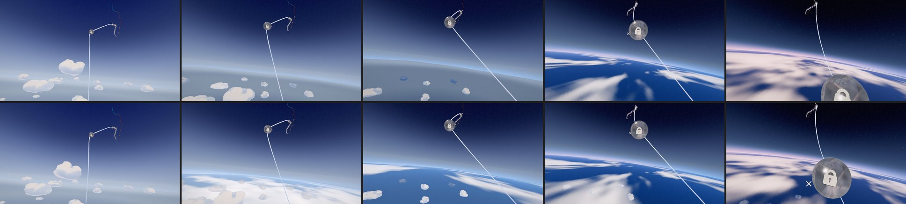
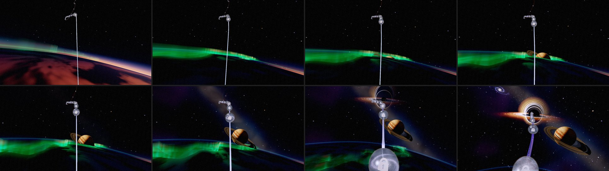
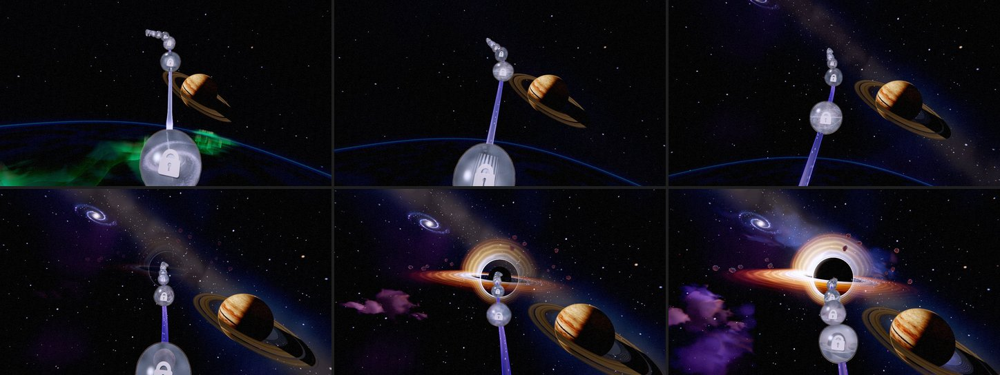
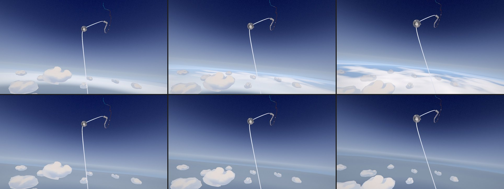
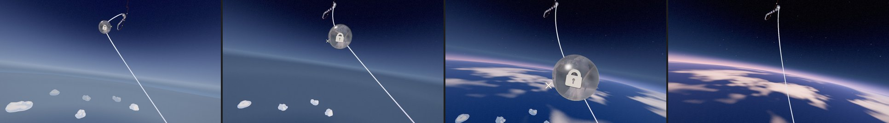
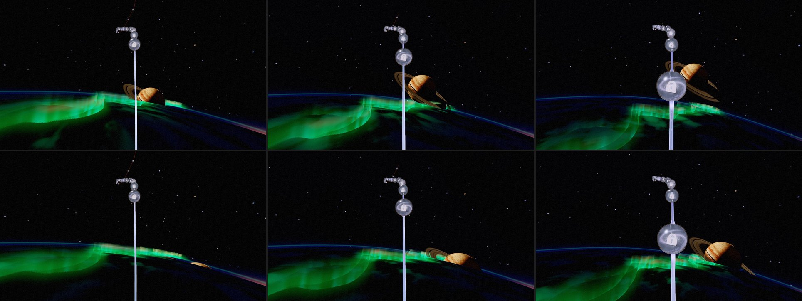
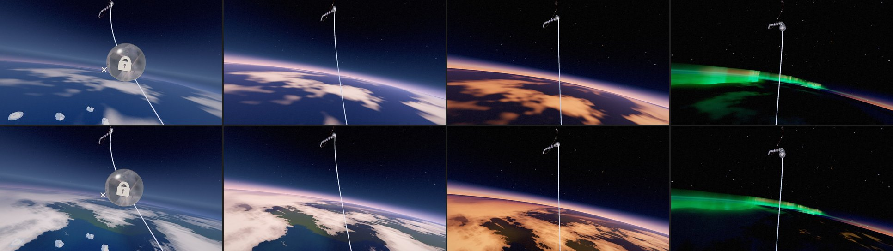
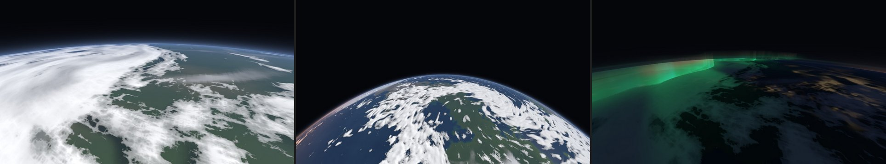
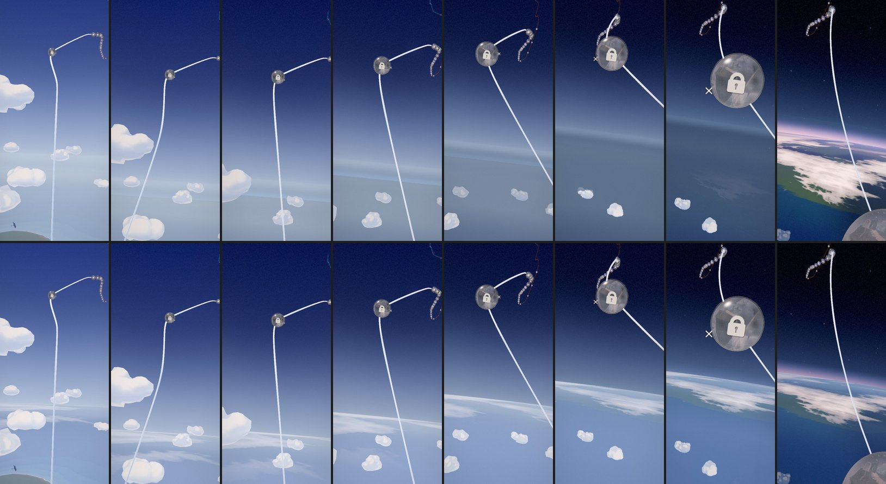
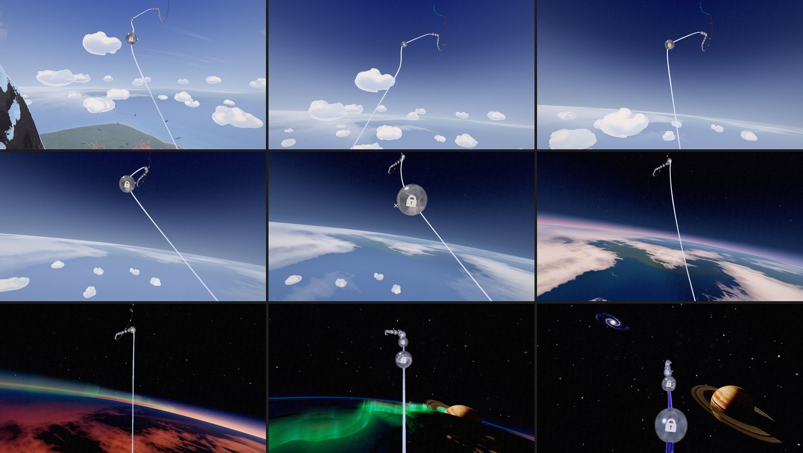

# Odyssey — the journey into space (2026-10-24)

**A plan in five steps, and the record of each as it lands.** Olov: *"I am still not happy with
the transition from the clouds into the space, are we not supposed to get over the clouds, not
having the clouds fade away right in front of us? And how can we improve the reveal of the planet,
and other space things and also really make the Aurora to fit into all of this. I think there is
potential to really improve this visually to make it become a visually perfect journey into
space."*

## What the player saw

The journey's own idle drift from late chapter 5 (p 0.64) into chapter 6, live, a frame every
5 s. Chapters 5 and 6 drift at 4.2 × 0.55 ≈ 2.3 u/s, halved within 0.03 of the boundary
(p 0.7543), so the passage takes about four minutes.

- **0:00–1:50, the clouds.** The rail rises only ~150 u through this stretch (the eye from
  y ~990 to ~1140), while the cumulus stand from ~830 to ~2030. The eye stays among them. As the
  sky went black the departure first thinned their paint (from p 0.59), then shrank each mass
  toward its own centre until it was gone (p 0.695–0.73). So the clouds dissolved in front of the
  eye and never sank below it. Only past the boundary, when everything was already the void's
  colour, did the world shrink away beneath the eye.
- **~1:50, the aurora.** It rose as a wall of curtains across the horizon, just beyond a flat,
  dark band of cloud (the cloud bank's horizon band). It was still up on the left when the black
  hole arrived at ~2:40.
- **~1:50, the planet.** It faded in at a fixed seat, low right, in front of the aurora and on top
  of the cloud band. Nothing said it was huge and far away.
- **2:30–3:00, the rest of space.** The Milky Way, the nebula and the black hole faded in one
  after another while the aurora was still up.

## The plan

1. **Climb above the clouds.** *Done (§1).*
2. **A round Earth below.** One curved planet replaces the flat dark band, the straight limb line
   and the shrinking flat world: the cloud sea on it, a thin glowing atmosphere at its edge, and
   an orbital sunset along that edge. As the eye climbs, the limb curves and drops, and the Earth
   sinks out of the bottom of the frame instead of vanishing. The dusk light on the cloud tops
   belongs here too (see §1, *Moved to step 2*). *Done (§2).*
3. **The aurora on Earth's night side, seen from above.** Green ribbons lying on the curved night
   side, curtains rising toward the eye, following the curve; it slides away with the Earth and is
   gone before the black hole arrives. One aurora: the airglow line and the green light on the
   clouds come from it. *Done (§3).*
4. **The planet rises over Earth's edge.** No fade: a thin sunlit crescent and the tips of the
   rings first, then the whole ringed body clears the curved horizon over ~20–30 s of drift.
   *Done (§4).*
5. **Then deep space, one thing at a time.** As the Earth falls away, the stars, the Milky Way and
   the nebula come up, then the black hole grows, each in clear sky. *Done (§5).*

Step 1 stands alone; step 2 is the backbone of steps 3 and 4. Each is iterated in the playground
first and checked on the live drift (`scratchpad odyssey-drift.cjs` + `sky-probe.js` in the
2026-10-24 session; the recipe is the ch2 drift probe's).

## §1. The climb above the clouds (2026-10-24)

**What changed.**

- **The eye climbs.** From late chapter 5 the world shrinks toward the sea-level point beneath the
  eye. A world shrunk by `s` about that point looks exactly like the same world seen from `1/s`
  times as high, since a perspective view has no scale. So the near cumulus sink below first, the
  far ones after, the island falls away and the horizon drops
  (`world/odyssey-world-act-gate.js` `worldClimbScale`, driven by the board through
  `setClimb`). The climb opens 0.22 of the sky chapter before the act edge (p 0.665, after the orb
  at 0.653) and runs to the visibility gate (p 0.7765), where the world is a speck straight down,
  as the old post-boundary recession left it. It is even in the logarithm of the height (a
  smoothstep of it): each doubling takes about as long as the last. It replaces the recession
  (`worldDepartureRecede`, `worldRecedeScale`).
- **Every world material shades in the climb's frame.** The materials were written for an
  identity group, and their haze, detail and fades all measure distances. A shrunken world shaded
  on its shrunken distances looks like a model, with crisp distance and little haze. So inside
  `createOdysseyWorld`, `positionWorld` and `cameraPosition` are three's nodes taken into the
  group's own frame (`inClimbFrame`): there the world keeps its size and the eye stands as high as
  the climb has taken it. Outside the climb the frame is the world frame. The ground lattice
  centres on the rail's track in the same frame.
- **The sky dome keeps its size.** It is in the world group and only looks along directions, so
  `setClimb` counter-scales it; shrunk with the rest it would come into view as a ball below the
  eye.
- **The world ends in the sky.** The sea is drawn out to the camera's far plane (a straight cut)
  or, high in the climb, to the clipmap's square, and the dome shows the sky below the horizon
  past it. Through the departure the far sea fades with the world and the dome with the horizon,
  so in the climb the sea read as a grey slab with a pale band beyond it. Over the last stretch
  before the drawn edge the sea and the ground now take the dome's own colour for their
  direction (`meltIntoSky`), so the cut and the square's corners vanish into the haze and the
  limb glow sits just above. It runs in a uniform branch only while the departure runs, so the
  rest of Act II pays nothing for it and keeps its horizon.
- **Removed:** the atmospheric thinning (`worldAtmosphericThin`, `setAtmosphericThin`, the field's
  paint collapse and its shrink) and the departure's shrink of each mass to nothing
  (`uFieldGone`). The masses keep their size and their sculpted paint, and fade with the horizon
  as before.
- **The playground follows the game:** `?effect=odyssey-world&p=0.70` pins the rail and runs the
  board's departure (the colour fade and the climb) from the same functions; `&climb=0` leaves it
  out for an A/B.

**Measured.** The eye's height over the sea, against the tallest cumulus top (1,743 over the sea), eye heights from the live drift:

| p | eye over the sea | the climb (×) | as seen from |
|---|---|---|---|
| 0.665 (climb opens) | 743 | 1 | 743 |
| 0.69 | 774 | 1.6 | 1,274 |
| 0.7037 (orb 34) | 793 | 3.0 | 2,342 |
| 0.7238 | 826 | 8.3 | 6,835 |
| 0.7543 (the boundary) | 875 | 33 | 29,192 |
| 0.7765 (the gate) | 909 | 50 | 45,435 |

On the live drift the cumulus are seen sinking below the horizon from ~0:40 to ~1:20
(p 0.677–0.715). The frame's mean brightness follows the old curve to within ~4 luma at every
station (the climb is a touch brighter at p 0.714–0.718, where the far sea now melts into the lit
horizon), so the departure's smooth darkening and the 5→6 seam are as they were. Console clean
(WebGPU, RTX 5080 Laptop).

**Not changed (steps 2–5).** The cloud bank's horizon band, the aurora, the airglow line, the
planet's reveal and the rest of space are as they were. From ~1:25 the frame looks as before.

**Moved to step 2: the dusk light.** Gold, then rose light on the cloud tops as the eye rises
needs a keyframe between the colour script's `cloud-deck` and `edge-of-space`, and that breaks two
of the script's tested rules: every air horizon converges on one blue hue, and only the two
declared seams may turn the hue fast. It belongs with the orbital sunset, where the light is
designed with the Earth.

**Tests.** `odyssey-world-act-gate` (the climb: full size until it opens, which is after the sky
begins to deepen; above every cumulus top by orb 34 on the real camera; even in the logarithm of the
height with no step; a speck at the gate; fractions survive a re-layout; driven by the board).
`odyssey-world-climb` (new: the point beneath the eye holds still while the rest draws in; the sky
dome keeps its size; identity outside the climb; the ground, the sea, the sky and the cloud field
build on WGSL and GLSL with nothing said, nothing stringified, and no var read before it is
assigned). `odyssey-world-lints` (every material reads positions and the eye in the climb's frame;
the cloud field's offset is the drift and the breath). `odyssey-ground-lever` follows the melt.

**Cost.** No new draws, pipelines or textures. A few multiply-adds per world fragment for the
climb's frame; the melt only while the departure runs.

## §2. The round Earth below (2026-10-24)

**What changed.**

- **One planet below the eye** (`composition/odyssey-orbit-earth.js`, `createOrbitEarth`). It is
  one exact sphere, solved per view direction in Earth radii with the eye at the origin, and drawn
  on a backdrop sphere round the camera. A ray meets it where `(k d.y)² > h(2 + h)`. The altitude
  of the ray's closest approach is negative exactly inside the disc, and that one number
  anti-aliases the limb and drives the rim.
  - **The surface** is a sea of cloud: broad weather systems, clear ocean between them, and detail
    octaves that fade where they fall under a pixel. It is white in sunlight, orange then red
    along the terminator, dim slate at night, and it sinks into the air toward the limb.
  - **The rim** is a thin band of air just outside the limb: blue on the day side, red under blue
    where the sunset meets the limb, deep blue at night, with a faint airglow line.
- **Its schedule** is `orbitEarthAt(p)`, in fractions of chapter 6's span, so a re-layout carries
  it.
  - It arrives over the world from the horizon down (p 0.690–0.712), its limb at the flat
    world's own horizon dip (5.4°). See *The seam, reworked* below.
  - The eye keeps climbing: the limb dips to ~12° by the boundary and ~45° as the Earth sinks out
    (p 0.807–0.818).
  - The sun sets at the eye (it crosses the horizon at p ≈ 0.735, is −7° at the boundary and −18°
    later), so the terminator comes in over the horizon ahead and passes under the eye. The
    journey flies into the night.
  - The view leans down 26° on a lens 8° wider (`resolveJourneyFraming`), so the Earth and the
    next orbs both fit. It is held to p 0.766 and back on the rail by p 0.799.
- **This is the dusk light moved from §1.** The gold, then rose, light lands on the Earth's cloud
  sea (p 0.70–0.736), designed with the sunset, not as a colour-script keyframe. The script's
  horizon and seam rules are untouched.
- **It replaces three things:**
  - the cloud bank (`odyssey-cloud-bank.js`, a flat dark band painted above the horizon);
  - the world dome's straight limb line, whose glow and airglow now yield to the Earth's rim
    (`setEarth`);
  - the flat world under the planet. The world's surfaces show the Earth in place and its clouds
    go into it (see *The seam, reworked*); once they have (p 0.722), the board switches the world's
    surfaces, cumulus, heroes and forest off, and nothing on screen changes.
- **Draw order.** The Earth is the nearest thing in the sky: in front of everything in space,
  behind the journey.
  - It draws at renderOrder −0.5: after the sky domes, before every transparent thing at 0 or
    above.
  - While the world shows it, its backdrop sits at 1,650 u, behind the world (it shows only past
    the world's drawn edge; the world shows the Earth on its own surfaces).
  - Once it covers the world it comes in to 320 u, inside every far hero (every part of the giant
    is ≥ ~600 u away while the Earth shows) and outside any orb seen over its disc.
  - A depth-only twin (`occluder`) marks the disc in the depth buffer. So the star shells, the
    nebula, the giant's rings and the black hole are hidden behind the planet by depth, whatever
    their own draw order.
  - **Found on the way:** at renderOrder 0.5 the Earth was drawn after the orb glass (transparent,
    renderOrder 0), so an orb passing over the disc lost its glass shell. That happens when orb 36
    passes at p 0.775. Drawn at −0.5, the orbs and the rail's glow stay in front.
- **Playground:** `?effect=odyssey-orbit-earth&p=0.755` shows the game's own height, sun and aurora
  at that progress, looking along the rail's bearing. `alt`, `sunEl`, `aurora`, `pitch` and `yaw`
  override them.

### The seam, reworked (2026-10-24, same day)

Olov, on the first version: *"now the earth just pops in and does not feel connected to the world
with the clouds … feel totally disconnected to the world with mountains ocean and clouds."*

**What the player saw** (the drift, p 0.689–0.718, top row below):

- The climbed world had become a grey slab. Its sea was one hazy grey-blue plane with a straight,
  kinked drawn edge under the horizon glow, and the shrunken cumulus read like rocks lying on it.
- At p 0.712 the Earth appeared whole, in one frame: a saturated blue planet with large white
  weather. It had faded in behind the world's sea, hidden by depth, and showed only when the world's
  surfaces were switched off.

**What changed.** There is no switch any more. The world becomes the Earth in place:

- **The Earth's look is one function of the view direction** (`earthLook` in
  `odyssey-orbit-earth.js`), on one shared state. Its backdrop draws it, and while it arrives the
  world's own materials draw it too (`orbitEarthOver`).
- **It comes in from the horizon down.** A front sweeps from its limb to the nadir as it arrives
  (`frontSin`, p 0.690–0.712, eased so it crosses the frame's lower half by ~0.700). Behind the
  front, and a little ahead of it, the world's sea and ground show what the Earth shows in that
  direction (`meltIntoSky`): the world's own air just ahead of the front, the planet behind it.
- **It arrives in the world's air.** Just behind its front it wears exactly the colour the world
  gives its far sea and sky there (`hazeFor`, the world's own shader expression), and clears
  within a few degrees behind the edge (`veil`). The planet comes up out of the haze line as the
  line rolls toward the eye.
- **The cumulus stay real clouds.** They are not melted by the front. They stay in front of the
  Earth and lit over it (the departing world's fade toward the void no longer greys them while the
  Earth is there), and the climb takes them down below the eye. Only once they are small
  (p 0.703–0.722, `cloudsAway`) do they go into the Earth, melting into what it shows behind
  them, never into the sky in front of the eye.
- **Only then is the world switched off** (`covers`, p 0.722), under a planet that already looks
  exactly as it does. Only then does the Earth come in to 320 u with its disc in depth, before the
  ringed giant's reveal at 0.725.

**Measured.**

- The frame's mean brightness runs smoothly through the seam: 115, 122, 98, 89, 83 at
  p 0.689, 0.699, 0.706, 0.711, 0.717.
- The largest step left in 0.68–0.735 is the sunset darkening the Earth's day side around
  p 0.73: −79 luma per 0.01 p, over ~15 s. The pop version measured −150 there.
- The world's materials build clean on WGSL and GLSL with the Earth's look inside them
  (`odyssey-world-climb`).
- The Earth's look runs only in a uniform branch while the Earth is there, so the rest of Act II
  pays nothing for it.

**Tests.** `odyssey-orbit-earth` pins the new contract:

- it arrives from the horizon down, wearing the world's air until its front has crossed the
  frame's lower half;
- it takes the world's clouds into it only after that;
- it covers the world only once they have gone and it has fully arrived, before the giant shows;
- it stays behind the world while the world shows it, and comes near with its disc in depth once
  it covers.

## §3. The aurora on the night side (2026-10-24)

**What changed.**

- **One aurora.** It is the Earth's: an oval round a pole that lies toward the night (opposite the
  sun's bearing). Its near arc passes ~3.4° of arc ahead of the eye and curves away to the limb on
  both sides. There are three folded sheets, the poleward ones fainter and each with its own folds.
  The old chapter-6 aurora bridge (`cosmic-expanse-aurora.js`) is removed.
- **The sheets are surfaces, not a fog.**
  - Each view ray is walked through the shell where the curtains stand (28 steps), and each sheet
    is crossed where its signed distance changes sign.
  - Each crossing is lit by its height: a sharp green foot, a body dying upward, a faint crimson
    top.
  - Its rays run along the oval, so a curtain seen side-on shows them upright, field-aligned.
  - It is lit over the path the ray spends inside a sheet of the given width, so a curtain seen
    edge-on brightens.
  - A faint glow gives the sheets their thickness (the ray just past a fold's silhouette still
    passes through the curtain's edge), and a soft shoulder holds the hue.
  - The aurora also greens the cloud under it.
- **Timing.** It lights at dusk (p 0.731), is whole from 0.745 to 0.761, and is gone by 0.773, as
  the black hole grows.
- **First live pass, and what fixed it.** The near arc ran under the eye, just above the curtain
  tops, so the curtains smeared into screen-tall green streaks: a wall over the lower half of the
  frame, its far arc burning white. Four changes fixed it:
  - the arc moved ahead of the eye (`poleArc` 0.375 → 0.41);
  - each sheet is crossed instead of marched as a volume (16 steps had widened every thin sheet
    over a whole step);
  - the screen-column streaks were dropped;
  - the light gets a lower ceiling (`shoulder` 0.65 → 1.4, `gain` 520 → 170).
- **Cost control.** A ray whose stretch through the shell never comes within the oval's reach of
  its mean radius skips the march. The shell is thin, so the stretch's two ends and its middle
  bound it.

## §4. The planetrise (2026-10-24)

**What changed.**

- **The geometry.** The Earth's limb always lies below the level line, and the ringed giant's seat
  lies above it (+4–7° through the passage). A giant that never moved could therefore never be
  behind the Earth.
- **Its one move.** Before its rise it hangs at ONE point 27° straight below its seat, as seen from
  the rail at the rise's middle, at the same distance, behind the limb (`planetBelow`).
  - It rises on one arc about that rail point to its seat over p 0.742–0.772
    (`orbitEarthAt().planetRise`, `resolvePlanetRisePlace`).
  - It is turned with the arc (`resolvePlanetRiseTurn`, its pole and its light), so it rises
    looking as it will hang.
  - It moves by progress alone, so an orb close-up never moves it.
  - Then it holds its one place, as Olov asked on 2026-10-20 ("placed in space on 1 place").
- **The summit fade** (p 0.725–0.75) now runs while the giant is behind the Earth, so no fade is
  ever seen.
- **The Earth is in front of it.** Its air rim and the aurora's curtains draw over the rising giant
  (§2's draw order).

**Measured** (the real camera leaning over the Earth, `odyssey-planetrise.test.js`, and the live
drift):

| p | what the player sees |
|---|---|
| 0.725–0.748 | the giant is hidden, its top ≥ 2° below the limb |
| ~0.748 | its top and the tips of its rings come over the edge, behind the aurora's curtains (aurora at full) |
| ~0.760 | its body is clear of the limb |
| 0.772 | it is in its seat, 13° clear |

The emergence takes ~24 s of the live drift; the whole rise ~57 s.

**Then (§5).** The Milky Way, the gas and the black hole's light used to arrive on the space gate
(p 0.754–0.773), under the aurora and the planetrise; they now come up after them, one at a time.

**Tests.**

- `odyssey-orbit-earth` (new) pins:
  - the schedule: the Earth arrives and leaves with no step, the limb only dips, the sun sets
    before the boundary, the aurora is lit at dusk and whole after sunset, and the giant rises
    once while the aurora is up;
  - the draw order: before the orb glass, at its backdrop radius while the world shows, in front
    of the far heroes with its disc in depth once it covers;
  - the planet and its depth twin building on WGSL and GLSL with nothing said and no unassigned
    reads.
- `odyssey-planetrise` (new) checks, on the real camera and the real chapter 6:
  - the giant is hidden behind the limb from its reveal to its rise;
  - it comes over the edge while the aurora is at full, and is clear when the rise ends;
  - it is always farther than the Earth's front radius, and every orb seen over the disc nearer.
- `odyssey-ch6-hero-framing`: the giant hangs at one point below the limb, rises on one arc only
  upward, by progress alone, then holds one place and one pole.
- `odyssey-seam-camera-continuity`: the seams' framings carry the Earth's lean.
- The cloud bank's and the aurora bridge's tests went with them.

**Cost.**

- The Earth is one transparent draw (fragment ~27 KB WGSL) plus a depth-only twin while it covers
  the world.
- The aurora's march runs only while it is lit, and only for rays near the oval.
- Gone: the cloud bank's draws and the aurora bridge.

## §5. Deep space, one thing at a time (2026-10-24)

**What the player saw.** On the real camera, the Milky Way (painted into the void dome, so it came
up with the dome), the black hole's light, its debris and the gas all began in the same 0.005 of
progress, p ~0.755–0.760, under the aurora at its height and the rising planet.

**What changed.** `DEEP_SPACE_BEATS` (in `cosmic-expanse.js`), in fractions of chapter 6's span
past the boundary, stages what is in space after the Earth's beats:

| Beat | p | What comes up |
|---|---|---|
| The Milky Way | 0.772–0.788 | the dome's painted cosmos (a new `uGlow` on the dome raises it out of its floor, so the dome still owns the background, near-black, from the boundary) and the far star tier, a share of which is seated in its band |
| The gas | 0.782–0.801 | the nebula field and sprites, and the disk light that paints them |
| The black hole | 0.789–0.822 | its disk, rings and halo (`uReveal`) and its debris, which glittered alone in the dark before |

- The hole's shadow and its lens are there from the boundary, as before: a void at the rail's end
  that bends the stars before it lights.
- It all starts after the aurora is out (0.773) and the planet has risen (0.772), as the Earth
  falls away.
- Between the aurora and the Milky Way the sky is clear and dark: stars, the risen giant and the
  sinking Earth.
- Headless callers (a chapter-local progress) still see the chapter whole.
- Chapter 7 seats the same baked sky with its glow at 1.

**Measured** (the live drift, before and after, from p 0.745):

- Brightness is the same to p 0.756.
- Space then stays darker while it waits: luma ~11–18 against ~17–24 before.
- The two converge by ~0.815.
- No step is added. The largest step in both runs is the same near orb leaving the frame at
  0.769.

**Tests.** `odyssey-deep-space-beats` (new) pins:

- the beats by progress: whole without a layout, monotone, starting after the aurora and the
  planetrise, each once the one before is under way;
- the real chapter 6 on the game's camera: dark and clear before the Milky Way (the dome opaque,
  its glow 0, no far stars, no gas, the hole unlit, no debris); the Milky Way before the gas, the
  gas before the hole's light; the whole sky up after;
- the dome's glow building on both backends.

## §6. No pop at the seam, the planetrise in the open, the climb taken slowly (2026-10-25)

Olov, with three screenshots: *"From one second to another this white pops up from nowhere, I want
this seamless transition that have no popping, it should feel like one scene drifting from the sky
out in space. And i dont like the reveal of the planet that i marked in red in the attached photo,
we can do better there. And when scrolling with the mouse pad it gets a rapid speed when it goes up
the mountainside, pass the clouds out in space!!"*

Judged on the live game: stations parked at fixed progress and the journey's own drift, from the
scratchpad harness of the 2026-10-25 session (`stations.cjs`, `odyssey-drift.cjs`, `swipe.cjs`).
"Main" below is f0c6f3ff.

### The white that popped up

Two causes:

- **The Earth was laid over the sea twice.** `orbitEarthOver` (the Earth seen on the world's own
  surfaces) took the Earth's colour whole, while its cover (`alpha`) counted how far it had
  arrived (its presence and its front). The backdrop mesh premultiplied both; this did not. So
  while the Earth faded in (presence 0.05 → 1, p 0.693–0.711), the sea showed the Earth's veiled
  colour and most of the air again on top: up to twice the light, a white sheet that swept down
  from the horizon. The colour is now premultiplied by the arrival. Where the Earth has not
  arrived, the surface shows itself (`surfaceAir`), not the air.
- **Below the horizon the air faded late.** The dome below the horizon, and the air the Earth wears
  (`airFor`), faded at the horizon's pace (`uFadeHorizon`, f^1.8). The sea faded with the world
  (`uWorldFade`, f). So where the climb dropped the sea's drawn edge below the horizon, it opened
  onto air far paler than the sea beside it, and the Earth arriving there wore it. Below the
  horizon the air now fades at the sea's pace (`fadeBelowHorizon`); the horizon keeps its own
  pace, a thin bright line. In Act II every fade is 0, so nothing there changes.

Also part of the seam:

- The Earth's disc wears the surface's own colour while veiled, so nothing changes where it comes
  in over the sea.
- The haze lifts nadir-first (`VEIL_NADIR_LEAD`) across `veil` [0.40, 0.29].
- The clouds go into it across [0.38, 0.28].
- It covers the world only once the haze is gone.

### The Earth's weather rushed

The Earth's cloud field slid 0.2 cells per unit the eye travelled. Where the Earth takes over from
the sea, that is ~2000× the pace the sea passes under the climbed eye. So its weather rushed past
while the world's cumulus over it stood still, and under a touchpad swipe it blurred.
`ORBIT_EARTH.trackPerUnit` (9e-5) is now the sea's own pace at the seam. The weather's slow drift
of its own is what moves it.

### The planetrise

On main the giant rose straight up behind the rail, with an orb in front of it. At its worst its
rings overlapped the rail by 0.26 and an orb by 0.17 (in ndc heights, at 16:9 or 4:3).

The orb that passes level with the giant's seat (p ~0.77) is the crux: any rise that has ended by
then meets it.

The giant now:

- hangs 38° below its seat (was 27);
- comes up from the lower right (`riseSlant` −45°);
- rises more slowly, across [b − 0.06, b + 0.30] of chapter 6 (was [b − 0.105, b + 0.15]).

So it crests the limb right of the rail at p 0.755 and rises beside the aurora. It is still low
and to the right when that orb goes by. Its rings keep ≥ 0.16 from the rail and from every orb at
16:9 and 4:3. Its seat, and so its framing from p ~0.79 on, is unchanged.

Two schedules move with it:

- The aurora stays up until the giant is clear: out across [b + 0.14, b + 0.24] (was
  [0.06, 0.16]).
- The deep-space beats (§5) wait for the rise to end:

| Beat | Fractions of chapter 6 | p |
|---|---|---|
| The Milky Way | 0.30–0.43 | 0.789–0.804 |
| The gas | 0.38–0.52 | 0.799–0.815 |
| The black hole's light | 0.44–0.68 | 0.806–0.834 |

### The pace of the scroll

Progress is distance along the rail, and the wheel moved it at one rate everywhere. But the climb
changes the picture much faster per unit of progress than anything around it. Measured as the
frame's mean luma change per 0.002 of progress, with a repeated frame's noise taken off:

| Where | Change per 0.002 |
|---|---|
| chapter 5's sky (p 0.40–0.65) | 2–4 |
| the climb, the Earth's arrival and its sunset (p 0.70–0.73) | 7–15 |
| one breath as the nearest cumulus passes (p 0.672) | 9 |

A touchpad swipe reaches the scroll's speed cap easily. On main, a 1500 px swipe from p 0.665
carried the camera to p 0.884, through the Earth, the planetrise and the black hole into chapter
7. It crossed the seam (0.69–0.72) in ~0.25 s.

`odyssey-scroll-pace.js` scales the wheel by a pace that falls where those schedules change the
picture fastest:

- the climb's rate (in the logarithm of the height);
- the lean's rate;
- the sunset over the Earth below (the sun's elevation while the Earth is there and the sun near
  its horizon).

The camera applies it in three places:

- Each wheel step is walked through the pace in 0.002 steps, so a long swipe slows where it
  enters the climb.
- The scroll's glide is capped by the slower of the eye's and the target's pace.
- The camera's own speed cap follows the pace.

The idle drift is far below every cap and is unaffected.

The pace is 0.45 as the clouds sink (p 0.69) and 0.19–0.26 while the Earth arrives and the sun
sets over it. It is back to 1 by p 0.80. With it the climb changes at 1–4 per 0.002, a little
under the sky's pace: it is the journey's climax, taken slowly.

The same 1500 px swipe now:

- from p 0.665: stops at 0.756, and takes ~0.8 s over the seam;
- from the sky at p 0.55: stops at 0.742, where main ran on through all of chapter 6.

Chapter 4's slopes change at 6–17 per 0.002 too, from the orbs passing close and the camera
turning. That is ordinary travel near the ground, and its pace is unchanged.

**Tests:**

- `odyssey-scroll-pace` (new): 1 outside the passage; slowest at the Earth's arrival; never below
  the floor; smooth. The camera's wheel step, its walk into the climb, and its speed cap honour
  it.
- `odyssey-orbit-earth`: the weather passes under the eye at the sea's pace where the one becomes
  the other.
- `odyssey-planetrise`: rises in the open, its rings clear of the rail and every orb at 16:9 and
  4:3. This test fails on main's rise.
- The hero-triad guard in `cosmic-expanse-environment.test.js` holds the giant to the corridor once
  it has risen; before that it is behind the limb, which `odyssey-planetrise` keeps.

## §7. The Earth itself: oceans, continents and better clouds (2026-10-25)

Olov, with a screenshot of the Earth below at the top of the climb: *"When we start to see the
earth above the cloud, can we make it look like the earth with ocean, landmasses and contintents?
And can we improve the clouds?"*

The Earth was an ocean under soft, blurred blobs of cloud: one value-noise field cut at a wide
threshold, no land anywhere. It is now a planet (`ORBIT_EARTH_SURFACE` in
`composition/odyssey-orbit-earth.js`).

### Land

**Continents.** A height field on the sphere (eight octaves of the baked lattice, the broad ones
bent by a warp), cut at `seaLevel`. Open sea is kept round the point beneath the eye
(`homeOcean`, 0.005 rad, twice the world's island), so the world's own sea becomes the Earth's
ocean in place at the seam.

**The layout.** Chosen by ray-casting the game's own views on the CPU (`orbitEarthLandHeight`, the
shader's field read from the same lattice bytes) for thousands of seeds and scales. From 33 km up
the middle of the frame looks only 30–100 km away, so the coast has to be near to be seen in
daylight. By the time the eye is high enough to see whole continents the sun has set.

| View | Land |
|---|---|
| Middle of the frame as the haze lifts | ~40% |
| Its horizon | ~90% |
| From high orbit | ~40% |

As the Earth comes out of the haze the eye looks across the sea to a continent's coast. A test
pins the layout on the real camera.

**By latitude** from a geographic pole off toward the night:

- ice cap and sea ice;
- tundra, then boreal and temperate forest;
- steppe and desert where it is dry;
- rock and snow on the ridges;
- shallows round the coasts.

### Sea and night

- The sun glints on open water.
- On the night side the towns glow along the plains and coasts, under the cloud. They are a
  product of three noises at three scales, each fading to its mean under a pixel, so the light
  peaks into cores and sprawl and never goes flat.

### Clouds

- Weather systems wound round two cyclones, with gentle winding (`1 / (1 + d²)`: a Gaussian wound
  the field into rings round the eye).
- A broad, contrasty cloud fraction: systems with clear sky between.
- Crisp cumulus edges, antialiased by the field's own derivative instead of a wide blur.
- Billowed detail down to ~1 km.
- Thin cloud lets the sea through.
- Lit on the side toward the sun, and casting shadows that fall long at a low sun.
- A veil of cirrus.

### Pitfalls found on the way

**Faint blocks over the sea.** The baked lattice is blended by the texture unit with only ~8 bits
of weight. The warp is the broadest field of all (a cell spans more than a radian), so it moves
in small steps. Every octave sampled through it jumped by the step times its own frequency, and
from just above the clouds the finest drew a grid of faint blocks over the sea. Only the broad
octaves follow the warp now (`LAND_WARPED`); the fine land and cloud detail sample the unwarped
domain. Found by drawing the ground alone at 8× brightness.

**A dark disc straight down.** Looking exactly at the nadir, the limb's closest-approach altitude
turns as a square root, its screen derivative blows up, and the coverage fell to one half there. It
is capped now. The game never looks that far down.

### Cost

Measured in the playground at 1080p with vsync off, on this machine's GPU:

| View | Main | Now |
|---|---|---|
| Daylight Earth | 0.2–0.3 ms | 0.37–0.57 ms |
| Night side with the aurora | 1.55 ms | 1.15 ms |

What keeps it down:

- Fine octaves that are faded to nothing are not sampled. A branch on a distance-coherent value,
  so whole regions skip together.
- The cloud shadow is skipped where the sun is down.
- The towns are skipped where there is no night-side land.

**Tests** (`odyssey-orbit-earth`):

- the CPU lattice reads the texture's bytes, with the same blend and wrap;
- open sea beneath the eye;
- land across the sea on the game's camera as the haze lifts;
- a world of oceans and continents from high orbit.

## §8. One surface, one air, one horizon: the sea becomes the Earth (2026-10-26)

Olov, with five phone screenshots of the climb: *"now the earth surface like transitions in, i
want it to feel smooth and seamless … It should feel natural and not like we reveal the earth
surface."* This replaces the front and the veil of *The seam, reworked* (§2).

### What the player saw

Portrait, p 0.672–0.718 (top row of the image below):

- **A grey slab.** The departure faded the world's sea toward the void colour (46 % by p 0.69,
  70 % by 0.713), so under a blue sky the sea went flat grey-blue.
- **Two horizons.** A pale band at the level and a second one under it, where the drawn sea ended.
- **A reveal.** The Earth then swept in from the horizon down, and at p 0.713–0.718 it came clear
  all at once under the camera's lean.

The cause under all three was that **the world and the Earth stood at different heights.** The
Earth arrived at the schedule's 5.4° dip, about 28 km up, while the world's eye was about 6 km up
(at the world's own scale of 4.9 m per unit). The two could not show the same sea, so one had to
be swapped for the other.

### What changed

- **One altitude.** The Earth now stands at the eye's own height over the sea, as the world sees
  it: the camera's height over the climb's scale, in metres, over the Earth's radius
  (`orbitEarthAt(p, cp, eyeHeight)`, `metresPerUnit`). The schedule's own height takes over only
  across p 0.725–0.745 (`late`), where the two are within ~10 % of each other, and runs on past
  the world. From the boundary on (p 0.7545) the Earth's height is exactly main's schedule.
  The eye is 3.4 km up when the Earth arrives, 9.6 km at p 0.70, 36 km at 0.725 and 143 km at the
  boundary.
- **It is simply there.** It arrives at p 0.632–0.647 (`arriveFrom`, `arriveTo`), before the
  departure has greyed anything, beneath and beyond the world. Nothing sweeps in and nothing lifts
  (`frontSin` and `veil` are inert).
- **The far sea is the Earth.** The world's sea and ground give way to the Earth over 25–80 % of the
  distance to their drawn edge (`meltIntoSky`). That stretch holds still on screen as the eye
  climbs, because both scale with the height. The coasts and the weather out there were always
  there in the haze, and they come clear as the air under the eye thins. The cumulus still go
  into it only once they are small (p 0.710–0.722).
- **The sea stays lit.** While the Earth is there the sea and the ground take no departure fade
  (`toOutputSurface`). The fade darkens the sky over the eye, not the ground below it.
- **One air** (`earthAirFor`). The Earth is hazed by the world's own atmosphere: the same
  exponential column (`AERIAL_SCALE_HEIGHT`, at the colour script's density) that the world's sea
  is hazed by, crossed at `1 / mu`. Its colour is the sky's, at the same angle mirrored about the
  limb: pale at the limb, deep blue looking straight down. The world's own sea under the eye takes
  the same mirrored colour, so the two hazes are one haze where the sea gives way. The world's
  clouds, as they go into the Earth, wear it too. The Earth's own air takes over above ~6–20 km.
- **One horizon** (*THE HORIZON IS THE LIMB*). Climbing, the Earth's limb sinks under the level.
  The sky dome's pale horizon band stayed at the level, a few degrees above the limb, with a strip
  of darker sky between them. While the Earth is there, the dome measures its gradient and its
  departure pace from the limb (`limbUp`). The Earth hands its limb's depression to the world as
  `ORBIT_EARTH_SEAM.limbSin`, eased in with its presence, so with no Earth the dome is exactly the
  old one.
- **The rim waits for the stratosphere.** The Earth's glowing rim comes up only from ~14–41 km
  (`rimFrom`). From a few kilometres the air at the horizon is haze, not a glowing edge.
- **The backdrop sits behind everything the world draws** (radius 8800, inside the far plane of
  9000). It shows only past the world's drawn edge.

### Measured

The frame-to-frame difference (mean luma change, 0–255) over p 0.630–0.735, every 0.0025,
portrait:

- **No step from the Earth anywhere.** The largest changes before 0.71 are a locked orb passing
  the camera and near clouds moving (14–22). From 0.7125 to 0.735 the sunset darkens the day side
  (21–28 per step).
- **Same sweep with and without the limb horizon.** Every pair is within ±2.5 of the other.

Also checked: landscape 1280 × 720 and the Low tier, through deep space to p 0.79 (the aurora,
the planetrise, the galaxy). Deep space is unchanged from main, since from the boundary on the
Earth's height is the schedule's.

### How the band was found

The hide-one-layer captures at p 0.7125 settled it. Hiding the world's cloud deck left the band
in place; hiding the sky dome took it away; hiding the Earth's backdrop left it floating over
nothing. So the band was the dome's own horizon.

### Cost

The world's sea and ground evaluate the Earth's look in a uniform branch while the Earth is
there. That now starts at p 0.632, where it used to start at 0.690. It can't be branched per
fragment, because the look takes screen derivatives (`fwidth`), which WGSL allows only in uniform
control flow. Not measured in the game. By §7's playground figure (0.37–0.57 ms for a full 1080p
frame of daylight Earth), the estimate is a few tenths of a millisecond over that stretch. The
rest of Act II pays nothing.

### Tests

`odyssey-orbit-earth`:

- the Earth is whole before the departure greys anything;
- it is never revealed: no front, no veil;
- it stands at the eye's own height on the game's camera, and joins its schedule with no step
  through the whole time it is on screen;
- its limb sits at its own dip, and it hands the world that depression (0 with no Earth);
- it builds on WGSL and GLSL under the world's atmosphere.
