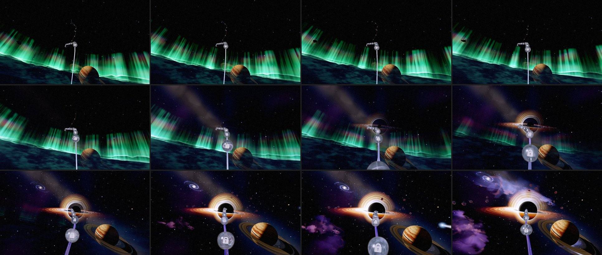
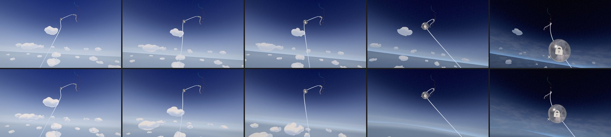

# Odyssey — the journey into space (2026-10-24)

**A plan in five steps, and the record of each as it lands.** Olov: *"I am still not happy with
the transition from the clouds into the space, are we not supposed to get over the clouds, not
having the clouds fade away right in front of us? And how can we improve the reveal of the planet,
and other space things and also really make the Aurora to fit into all of this. I think there is
potential to really improve this visually to make it become a visually perfect journey into
space."*

## What the player saw

The journey's own idle drift from late chapter 5 (p 0.64) into chapter 6, live, a frame every
5 s. Chapters 5 and 6 drift at 4.2 × 0.55 ≈ 2.3 u/s, halved within 0.03 of the boundary
(p 0.7543), so the passage takes about four minutes.

- **0:00–1:50, the clouds.** The rail rises only ~150 u through this stretch (the eye from
  y ~990 to ~1140), while the cumulus stand from ~830 to ~2030. The eye stays among them. As the
  sky went black the departure first thinned their paint (from p 0.59), then shrank each mass
  toward its own centre until it was gone (p 0.695–0.73). So the clouds dissolved in front of the
  eye and never sank below it. Only past the boundary, when everything was already the void's
  colour, did the world shrink away beneath the eye.
- **~1:50, the aurora.** It rose as a wall of curtains across the horizon, just beyond a flat,
  dark band of cloud (the cloud bank's horizon band). It was still up on the left when the black
  hole arrived at ~2:40.
- **~1:50, the planet.** It faded in at a fixed seat, low right, in front of the aurora and on top
  of the cloud band. Nothing said it was huge and far away.
- **2:30–3:00, the rest of space.** The Milky Way, the nebula and the black hole faded in one
  after another while the aurora was still up.

## The plan

1. **Climb above the clouds.** *Done (§1).*
2. **A round Earth below.** One curved planet replaces the flat dark band, the straight limb line
   and the shrinking flat world: the cloud sea on it, a thin glowing atmosphere at its edge, and
   an orbital sunset along that edge. As the eye climbs, the limb curves and drops, and the Earth
   sinks out of the bottom of the frame instead of vanishing. The dusk light on the cloud tops
   belongs here too (see §1, *Moved to step 2*).
3. **The aurora on Earth's night side, seen from above.** Green ribbons lying on the curved night
   side, curtains rising toward the eye, following the curve; it slides away with the Earth and is
   gone before the black hole arrives. One aurora: the airglow line and the green light on the
   clouds come from it.
4. **The planet rises over Earth's edge.** No fade: a thin sunlit crescent and the tips of the
   rings first, then the whole ringed body clears the curved horizon over ~20–30 s of drift.
5. **Then deep space, one thing at a time.** As the Earth falls away, the stars, the Milky Way and
   the nebula come up, then the black hole grows, each in clear sky.

Step 1 stands alone; step 2 is the backbone of steps 3 and 4. Each is iterated in the playground
first and checked on the live drift (`scratchpad odyssey-drift.cjs` + `sky-probe.js` in the
2026-10-24 session; the recipe is the ch2 drift probe's).

## §1. The climb above the clouds (2026-10-24)

**What changed.**

- **The eye climbs.** From late chapter 5 the world shrinks toward the sea-level point beneath the
  eye. A world shrunk by `s` about that point looks exactly like the same world seen from `1/s`
  times as high, since a perspective view has no scale. So the near cumulus sink below first, the
  far ones after, the island falls away and the horizon drops
  (`world/odyssey-world-act-gate.js` `worldClimbScale`, driven by the board through
  `setClimb`). The climb opens 0.22 of the sky chapter before the act edge (p 0.665, after the orb
  at 0.653) and runs to the visibility gate (p 0.7765), where the world is a speck straight down,
  as the old post-boundary recession left it. It is even in the logarithm of the height (a
  smoothstep of it): each doubling takes about as long as the last. It replaces the recession
  (`worldDepartureRecede`, `worldRecedeScale`).
- **Every world material shades in the climb's frame.** The materials were written for an
  identity group, and their haze, detail and fades all measure distances. A shrunken world shaded
  on its shrunken distances looks like a model, with crisp distance and little haze. So inside
  `createOdysseyWorld`, `positionWorld` and `cameraPosition` are three's nodes taken into the
  group's own frame (`inClimbFrame`): there the world keeps its size and the eye stands as high as
  the climb has taken it. Outside the climb the frame is the world frame. The ground lattice
  centres on the rail's track in the same frame.
- **The sky dome keeps its size.** It is in the world group and only looks along directions, so
  `setClimb` counter-scales it; shrunk with the rest it would come into view as a ball below the
  eye.
- **The world ends in the sky.** The sea is drawn out to the camera's far plane (a straight cut)
  or, high in the climb, to the clipmap's square, and the dome shows the sky below the horizon
  past it. Through the departure the far sea fades with the world and the dome with the horizon,
  so in the climb the sea read as a grey slab with a pale band beyond it. Over the last stretch
  before the drawn edge the sea and the ground now take the dome's own colour for their
  direction (`meltIntoSky`), so the cut and the square's corners vanish into the haze and the
  limb glow sits just above. It runs in a uniform branch only while the departure runs, so the
  rest of Act II pays nothing for it and keeps its horizon.
- **Removed:** the atmospheric thinning (`worldAtmosphericThin`, `setAtmosphericThin`, the field's
  paint collapse and its shrink) and the departure's shrink of each mass to nothing
  (`uFieldGone`). The masses keep their size and their sculpted paint, and fade with the horizon
  as before.
- **The playground follows the game:** `?effect=odyssey-world&p=0.70` pins the rail and runs the
  board's departure (the colour fade and the climb) from the same functions; `&climb=0` leaves it
  out for an A/B.

**Measured.** The eye's height over the sea, against the tallest cumulus top (1,743 over the sea), eye heights from the live drift:

| p | eye over the sea | the climb (×) | as seen from |
|---|---|---|---|
| 0.665 (climb opens) | 743 | 1 | 743 |
| 0.69 | 774 | 1.6 | 1,274 |
| 0.7037 (orb 34) | 793 | 3.0 | 2,342 |
| 0.7238 | 826 | 8.3 | 6,835 |
| 0.7543 (the boundary) | 875 | 33 | 29,192 |
| 0.7765 (the gate) | 909 | 50 | 45,435 |

On the live drift the cumulus are seen sinking below the horizon from ~0:40 to ~1:20
(p 0.677–0.715). The frame's mean brightness follows the old curve to within ~4 luma at every
station (the climb is a touch brighter at p 0.714–0.718, where the far sea now melts into the lit
horizon), so the departure's smooth darkening and the 5→6 seam are as they were. Console clean
(WebGPU, RTX 5080 Laptop).

**Not changed (steps 2–5).** The cloud bank's horizon band, the aurora, the airglow line, the
planet's reveal and the rest of space are as they were. From ~1:25 the frame looks as before.

**Moved to step 2: the dusk light.** Gold, then rose light on the cloud tops as the eye rises
needs a keyframe between the colour script's `cloud-deck` and `edge-of-space`, and that breaks two
of the script's tested rules: every air horizon converges on one blue hue, and only the two
declared seams may turn the hue fast. It belongs with the orbital sunset, where the light is
designed with the Earth.

**Tests.** `odyssey-world-act-gate` (the climb: full size until it opens, which is after the sky
begins to deepen; above every cumulus top by orb 34 on the real camera; even in the logarithm of the
height with no step; a speck at the gate; fractions survive a re-layout; driven by the board).
`odyssey-world-climb` (new: the point beneath the eye holds still while the rest draws in; the sky
dome keeps its size; identity outside the climb; the ground, the sea, the sky and the cloud field
build on WGSL and GLSL with nothing said, nothing stringified, and no var read before it is
assigned). `odyssey-world-lints` (every material reads positions and the eye in the climb's frame;
the cloud field's offset is the drift and the breath). `odyssey-ground-lever` follows the melt.

**Cost.** No new draws, pipelines or textures. A few multiply-adds per world fragment for the
climb's frame; the melt only while the departure runs.
