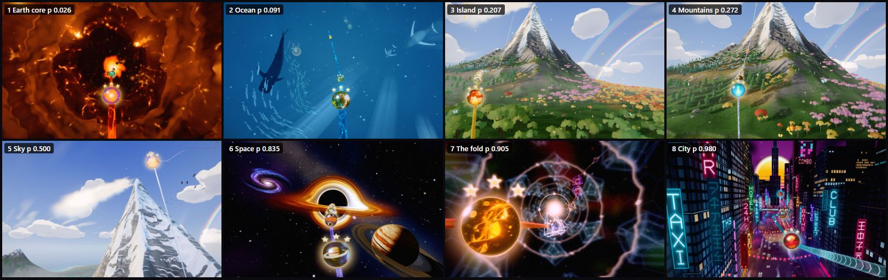

# Odyssey: the journey as a masterpiece (2026-11-17)

The owner asked for an audit of Odyssey as it runs today, judged by eye and not by the older
`ODYSSEY_*` plans, and then for the journey to be raised until it is one of the most stunning
experiences in the game: every chapter with its own mood, every chapter alive, every seam a
moment, the biggest moments the most spectacular, and a UI that belongs to the journey.

This is the record of that pass: the audit (§1 to §3), how the work was split (§4), what was
built (§5), how it was checked (§6) and what is left for the owner to judge (§7).

## 1. How the audit was made

The real game was run in a private headless Chrome on the RTX (WebGPU, High, 30 fps cap,
1707 × 1067, the owner's screen proportions) and driven over the DevTools protocol:

- 102 rail stations with the UI hidden: six in every chapter and six across every seam;
- the map UI over a bright chapter, the navigator, the outcome sheet, a chapter sheet;
- film strips of a glide between two orbs, a portal entry, an orb exit with the glide across
  the island-to-mountains seam, and a chapter arrival.

The console was clean at every station.

## 2. The chapters, ranked

Judged on sky, landscape, colour, light, atmosphere, motion, life and composition.

| Rank | Chapter | What works | What is weak |
|---|---|---|---|
| 1 | 6, at the hole (p 0.82 to 0.86) | The traced black hole with the galaxy and the ringed giant is the best picture in the game. | It is the same picture for seven orbs. Nothing moves or happens. |
| 2 | 3, the island | Painterly sea, forest, blossom, tarn, the double rainbow; butterflies, petals and animals. | The light never changes. |
| 3 | 1, Earth core | The lava lake and the shaft. | The top of the chapter is muddy brown steam. Nothing changes with time. |
| 4 | 2, the ocean | The humpback, whale shark, manta, shoals, jellyfish and light shafts. | One saturated blue from bottom to top, so it never feels deep. No seabed, landmark or landscape. The upper third is empty. |
| 5 | 4, the mountains | The same world as chapter 3. | That is the problem: the same noon light, sky, palette and mountain view. No identity. |
| 6 | 5, the sky | From p 0.65: the island from above with vultures, cloud tops, the Earth's limb. | Orbs 27 to 32 stare at one summit under one noon sky. The "sky" chapter has no sky of its own. |
| 7 | 7, the fold | A different room for every orb; hypercubes round the orbs. | Dim and murky. Every room is rings round a white centre, so eight rooms read as one. |
| 8 | 8, the city | Neon signs, the sun down the street, the spire. | Flat boxes with square windows under a flat purple sky. No depth, air, weather or reflection. The weakest scene, and it is the finale. |
| 9 | 6, early space (p 0.776 to 0.81) | Dark and quiet on purpose. | Sparse: a small galaxy, the giant and stars, with nothing to look at. |

## 3. The seams, ranked, and the journey as a whole

| Rank | Seam | Verdict |
|---|---|---|
| 1 | 6 → 7, the dive | The best moment in the game. The one frame after the horizon falls back on radial streaks. |
| 2 | 5 → 6, leaving the Earth | The right idea (limb, sunset, aurora, planetrise). Rough: blotchy cloud at p 0.72, a flat black night side with blobs for cities, an aurora band with a jagged lower edge, a brief sunset. |
| 3 | 2 → 3, the breach | The island revealed in sun is a good arrival. The breach itself is not shown as a moment. |
| 4 | 7 → 8, the fold opens on the city | The city seen through a ring works. Quick. |
| 5 | 1 → 2, lava to sea | A fade through brown fog. Nothing shows lava meeting water. |
| 6 | 4 → 5, summit into sky | Nothing happens. |
| 7 | 3 → 4, island to mountains | Nothing happens. |

Across the journey:

- **One light for 40 % of the game.** Chapters 3, 4 and most of 5 (24 of 60 orbs) share one
  noon sky. The colour script's horizon anchor, written to make three biomes read as one
  planet, also made three chapters read as one chapter.
- **Nothing changes with time.** The sun, sky and weather are fixed everywhere. Creatures move;
  the places do not.
- **Arrivals are a dark sheet over the same view.** The chapter title is laid on a dimmed
  world; the world does nothing to mark the arrival.
- **The portal is one picture.** The passage into and out of an orb (seen more than 120 times
  in a playthrough) is the same cloud tunnel in every chapter and for every destination.
- **Pacing.** The journey's shape is right: dark and close (core), wide and calm (sea, island),
  a long climb, then the three big moments (leaving the Earth, the dive, the ending). The
  climb is too long for what it shows, and the ending's scene is the weakest.
- **UI.** Polished and legible over every chapter. It is the same indigo panel in a lava cave,
  under the sea, on a sunny island and in space, and the navigator hides the world completely.

## 4. How the work was split

Eight passes ran in parallel, each in its own worktree and branch, with one shared brief
(the owner's request, the audit, the repo's rules, the owner's standing taste from earlier
passes, capture tooling with at most three games on the GPU at a time):

| Pass | Stretch | Aim |
|---|---|---|
| lava | chapter 1, seam 1 → 2 (p 0 to 0.085) | Lava meeting the sea as an undersea eruption; luminous steam; a lake and shaft that change with time. |
| ocean | chapter 2, the breach (p 0.085 to 0.152) | A depth arc from abyss to shallows; an undersea landscape; the surface from below; the breach as a moment. |
| island | chapters 3 and 4, seam 3 → 4 (to p 0.335) | Chapter 4 its own hour and weather; a moment at the seam; cloud shadows, wind and mist on the clock. |
| sky | seam 4 → 5, chapter 5 (p 0.335 to 0.722) | The climb as the day ending over a sea of clouds; the summit as a moment; a sky for every orb. |
| space | leaving the Earth, chapter 6 (p 0.632 to 0.862) | A believable Earth from orbit; a hero for early space; the hole's seven orbs as an evolving approach. |
| fold | the dive, chapter 7, the fold's side of 7 → 8 | Eight rooms that are eight places; the moment after the horizon; the exit as a highlight. |
| city | chapter 8 and the ending | A city worth arriving in; weather and life on the clock; the ending as the journey's last and biggest moment. |
| flow | portal, exit, glide, arrivals, UI | A passage with a character per chapter and destination; arrivals as moments; a UI that carries each chapter's colour. |
