# Odyssey: the journey as a masterpiece (2026-11-17)

The owner asked for an audit of Odyssey as it runs today, judged by eye and not by the older
`ODYSSEY_*` plans, and then for the journey to be raised until it is one of the most stunning
experiences in the game: every chapter with its own mood, every chapter alive, every seam a
moment, the biggest moments the most spectacular, and a UI that belongs to the journey.

This is the record of that pass: the audit (§1 to §3), how the work was split (§4), what was
built (§5), how it was checked (§6) and what is left for the owner to judge (§7).

## 1. How the audit was made

The real game was run in a private headless Chrome on the RTX (WebGPU, High, 30 fps cap,
1707 × 1067, the owner's screen proportions) and driven over the DevTools protocol:

- 102 rail stations with the UI hidden: six in every chapter and six across every seam;
- the map UI over a bright chapter, the navigator, the outcome sheet, a chapter sheet;
- film strips of a glide between two orbs, a portal entry, an orb exit with the glide across
  the island-to-mountains seam, and a chapter arrival.

The console was clean at every station.

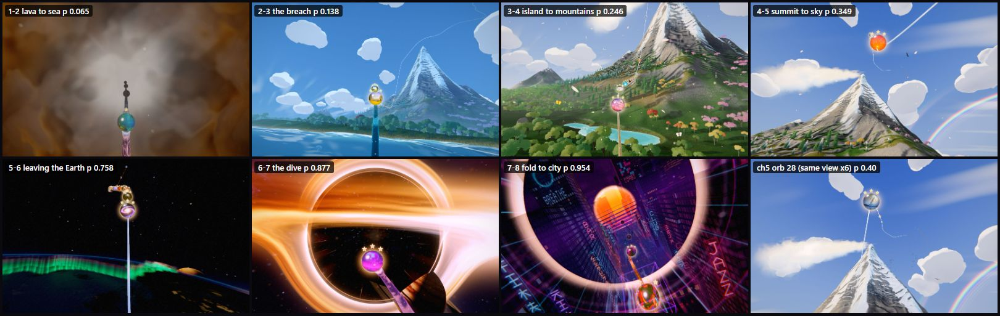

## 2. The chapters, ranked

Judged on sky, landscape, colour, light, atmosphere, motion, life and composition.

| Rank | Chapter | What works | What is weak |
|---|---|---|---|
| 1 | 6, at the hole (p 0.82 to 0.86) | The traced black hole with the galaxy and the ringed giant is the best picture in the game. | It is the same picture for seven orbs. Nothing moves or happens. |
| 2 | 3, the island | Painterly sea, forest, blossom, tarn, the double rainbow; butterflies, petals and animals. | The light never changes. |
| 3 | 1, Earth core | The lava lake and the shaft. | The top of the chapter is muddy brown steam. Nothing changes with time. |
| 4 | 2, the ocean | The humpback, whale shark, manta, shoals, jellyfish and light shafts. | One saturated blue from bottom to top, so it never feels deep. No seabed, landmark or landscape. The upper third is empty. |
| 5 | 4, the mountains | The same world as chapter 3. | That is the problem: the same noon light, sky, palette and mountain view. No identity. |
| 6 | 5, the sky | From p 0.65: the island from above with vultures, cloud tops, the Earth's limb. | Orbs 27 to 32 stare at one summit under one noon sky. The "sky" chapter has no sky of its own. |
| 7 | 7, the fold | A different room for every orb; hypercubes round the orbs. | Dim and murky. Every room is rings round a white centre, so eight rooms read as one. |
| 8 | 8, the city | Neon signs, the sun down the street, the spire. | Flat boxes with square windows under a flat purple sky. No depth, air, weather or reflection. The weakest scene, and it is the finale. |
| 9 | 6, early space (p 0.776 to 0.81) | Dark and quiet on purpose. | Sparse: a small galaxy, the giant and stars, with nothing to look at. |

## 3. The seams, ranked, and the journey as a whole

| Rank | Seam | Verdict |
|---|---|---|
| 1 | 6 → 7, the dive | The best moment in the game. The one frame after the horizon falls back on radial streaks. |
| 2 | 5 → 6, leaving the Earth | The right idea (limb, sunset, aurora, planetrise). Rough: blotchy cloud at p 0.72, a flat black night side with blobs for cities, an aurora band with a jagged lower edge, a brief sunset. |
| 3 | 2 → 3, the breach | The island revealed in sun is a good arrival. The breach itself is not shown as a moment. |
| 4 | 7 → 8, the fold opens on the city | The city seen through a ring works. Quick. |
| 5 | 1 → 2, lava to sea | A fade through brown fog. Nothing shows lava meeting water. |
| 6 | 4 → 5, summit into sky | Nothing happens. |
| 7 | 3 → 4, island to mountains | Nothing happens. |

Across the journey:

- **One light for 40 % of the game.** Chapters 3, 4 and most of 5 (24 of 60 orbs) share one
  noon sky. The colour script's horizon anchor, written to make three biomes read as one
  planet, also made three chapters read as one chapter.
- **Nothing changes with time.** The sun, sky and weather are fixed everywhere. Creatures move;
  the places do not.
- **Arrivals are a dark sheet over the same view.** The chapter title is laid on a dimmed
  world; the world does nothing to mark the arrival.
- **The portal is one picture.** The passage into and out of an orb (seen more than 120 times
  in a playthrough) is the same cloud tunnel in every chapter and for every destination.
- **Pacing.** The journey's shape is right: dark and close (core), wide and calm (sea, island),
  a long climb, then the three big moments (leaving the Earth, the dive, the ending). The
  climb is too long for what it shows, and the ending's scene is the weakest.
- **UI.** Polished and legible over every chapter. It is the same indigo panel in a lava cave,
  under the sea, on a sunny island and in space, and the navigator hides the world completely.

## 4. How the work was split

Eight passes ran in parallel, each in its own worktree and branch, with one shared brief
(the owner's request, the audit, the repo's rules, the owner's standing taste from earlier
passes, capture tooling with at most three games on the GPU at a time):

| Pass | Stretch | Aim |
|---|---|---|
| lava | chapter 1, seam 1 → 2 (p 0 to 0.085) | Lava meeting the sea as an undersea eruption; luminous steam; a lake and shaft that change with time. |
| ocean | chapter 2, the breach (p 0.085 to 0.152) | A depth arc from abyss to shallows; an undersea landscape; the surface from below; the breach as a moment. |
| island | chapters 3 and 4, seam 3 → 4 (to p 0.335) | Chapter 4 its own hour and weather; a moment at the seam; cloud shadows, wind and mist on the clock. |
| sky | seam 4 → 5, chapter 5 (p 0.335 to 0.722) | The climb as the day ending over a sea of clouds; the summit as a moment; a sky for every orb. |
| space | leaving the Earth, chapter 6 (p 0.632 to 0.862) | A believable Earth from orbit; a hero for early space; the hole's seven orbs as an evolving approach. |
| fold | the dive, chapter 7, the fold's side of 7 → 8 | Eight rooms that are eight places; the moment after the horizon; the exit as a highlight. |
| city | chapter 8 and the ending | A city worth arriving in; weather and life on the clock; the ending as the journey's last and biggest moment. |
| flow | portal, exit, glide, arrivals, UI | A passage with a character per chapter and destination; arrivals as moments; a UI that carries each chapter's colour. |

The lead looked at every pass's before and after captures and sent five of them back: the sky
pass (its cloud floor read as pack ice from above; the chapter boundary was still not a
moment), the ocean pass (deep corals that read as scraps of paper; a square patch in the
surface window; dolphins asked for), the city pass (a celebration too small for the last
moment; a gamepad press that launched the last orb), and the island pass twice over (its first
chapter 4 was still chapter 3's day). The passes were merged one by one and each junction was
filmed on the merged build before the next merge.

## 5. What was built

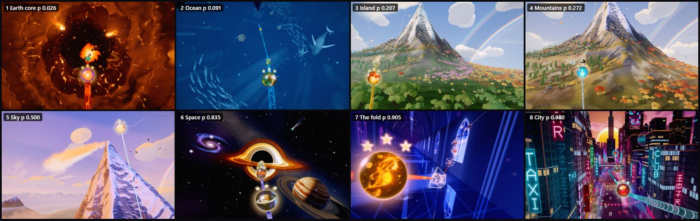

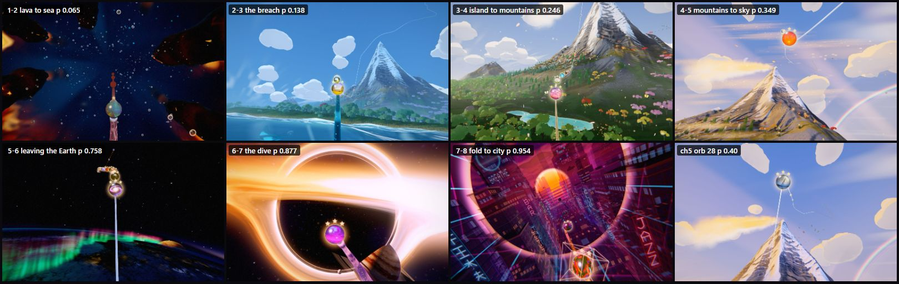

### 5.1 Chapter 1 and lava meeting the sea

- **The seam is a place.** The eye climbs inside a column of steam lit from below by the lava
  (shaded as one heat value on a fire ramp, so a dim reach is deep red and never tan). Straight
  ahead the vapour opens in a ragged eye onto black-blue water. On the vent's rim stand six
  black smokers with fissures that crust over and split again; smoke rolls from their mouths
  and columns of bubbles race up past the eye. Past the boundary the shell is the abyss's
  darkness, lifting to the ocean's blue by p 0.087. Sea life is still behind the shell and
  comes through as the veil lifts (`behindSteamDepth` untouched).
- **The chapter lives on a clock** (`earth-core-clock.js`, hashed slots, continuous in time):
  a mood for the lake (banked to roused, periods 173, 71 and 31 s), dome fountains at seven
  vents, a crust plate that breaks up and skins over, surges down the four lava falls, rock
  falls with spark trails, ember gusts, heat shimmer, and shaft and steam light that breathe
  with the lake. A session starts at a different point of the clock.

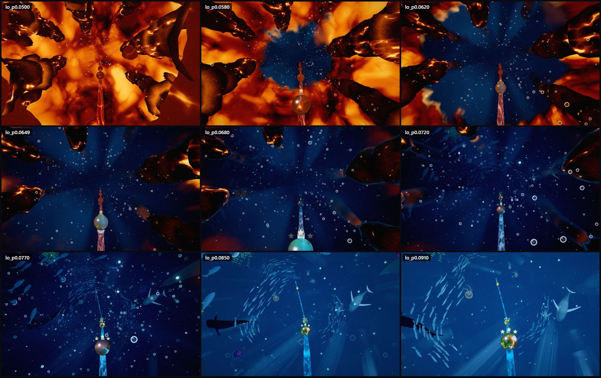

### 5.2 Chapter 2 and the breach

- **A depth arc** keyed on the eye's depth (`world/odyssey-ocean-depth.js`): abyss (blue-black),
  twilight (deep blue), sunlit (blue-green), shallows (turquoise). Each zone sets the water's
  plates, the light from the surface, shafts, living glow and caustics.
- **A seabed.** The orb close-ups look at the island's flank, which was bare sand. It now has a
  kelp-crowned seamount (the backdrop of orbs 8 to 10), sea stacks, boulders, kelp, and a deep
  garden of coral colonies at orbs 6 and 7: branching trees, fans, tube sponges, anemones, sea
  pens, brain and table corals on outcrops, glowing at tips and rims. `odysseyWorldHeight` is
  untouched.
- **The surface from below.** Inside Snell's window: the sky, drifting cloud, the sun's glare
  and the island's mountain on the side it really lies. Outside it: the mirror of the water.
- **The breach.** The crossing is weighted in a travel measure, as the hole's plunge is
  (`transitions/odyssey-travel-measure.js`): the orb 10 to 11 trip takes 2.6 s (was 1.0 s) with
  about 0.4 s at the waterline, a crown of drops, beads running down the lens and a flood of
  light. Diving back gives a curtain of bubbles.
- **Dolphins.** A pod of five leaps along the shore ahead of the breach, two scouts east of the
  column, on their own clock routes, with spray where they leave and enter the water
  (`composition/odyssey-dolphin-pod.js`, a procedural hull).
- **On the clock:** cloud over the sun dims and lifts the column, the sea state runs calm to
  choppy, a plankton bloom wanders, shafts sweep, kelp sways.

### 5.3 Chapters 3 and 4: morning by the sea, autumn on the mountain

- **Chapter 3 keeps its fresh morning.** From its shore the mountain's upper forest shows as a
  far band of gold.
- **Chapter 4 has its own palette and hour.** Autumn (`world/odyssey-autumn.js`): broadleaf
  crowns in gold, amber and russet with a few deep reds, tawny grass and heath, conifers left
  green. It is done in the materials (a tree's kind rides in its existing snow instance lane),
  so the scatter, the golden hashes and the forest mask are untouched. `?odysseyNoAutumn=1`
  turns it off. The light is a golden afternoon that deepens through the chapter into chapter
  5's golden hour with no step (`hour` in the colour script; the afternoon keyframes wear the
  evening's recipe).
- **The seam 3 → 4 is the day turning.** A cloud's shadow comes up the valley and climbs the
  massif (`world/odyssey-day-turn.js`); ahead of it the land is green morning, behind it gold
  autumn. As its edge passes the rail, leaves let go of the nearest crowns and birds lift and
  settle downwind (`world/odyssey-turn-wake.js`). It is paced so a glide shows the whole turn.
- **Weather on a clock** (`world/odyssey-weather-clock.js`): cloud cover, wind, mist and the
  clearness of the light, each two sines out of step; gusts come in spells; cloud shadows lie
  on the sea as well as the land; mist pools in the hollows of the upper meadow
  (`world/odyssey-hollow-mist.js`, High tier).

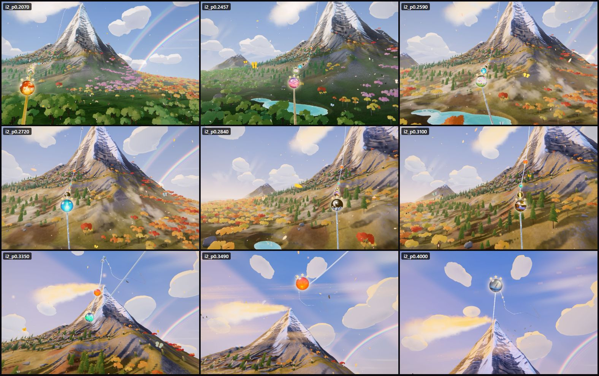

### 5.4 Chapter 5: the day ending over a sea of clouds

- **A sky for every orb.** Eight keyframes, one per orb: golden hour, gold, amber, sunset,
  alpenglow, the belt of Venus, afterglow, the cloud deck. The world sun's direction is
  untouched: a separate apparent sun on the same bearing sinks from 15° to 4.5° and is read
  only by the dome, the cloud floor, the cap, the moon and the antisolar point
  (`world/odyssey-evening.js`). Nothing is re-baked.
- **The sea of clouds** (`world/odyssey-cloud-sea.js`): a floor of cloud gathers round the
  island from the horizon inward, with a bed of thinner cloud under the tops so its lanes are
  hollows of violet haze. Clear air is kept over the mountain, the rail and the island's east
  side.
- **Lights in the sky:** shafts across the high sky, a half moon, the first stars from orb 33,
  a shooting star now and then, lenticular caps in the summit's lee that form and thin.
- **The chapter boundary:** gusts of spindrift cross the mountain's face
  (`world/odyssey-wall-gusts.js`) and a fan of low sun opens. The true crest is at orbs 32 to
  33, where the eye reaches the summit's height: lilac dusk over the cloud sea with the island
  below.

### 5.5 Leaving the Earth and chapter 6

- **The Earth from orbit** (`composition/odyssey-earth-weather*.js`, `odyssey-orbit-earth.js`):
  weather with structure (fronts, two spiral cyclones, decks, cumulus, cirrus) lit as relief by
  a low sun; a layered rim (ember, gold, a pale line, blue) with the Earth's shadow climbing
  through it; towns as webs of lamps along the coasts; lightning in the storms. It arrives under
  the evening's own 4.5° sun, so the sunset on the limb is at about p 0.722 to 0.732.
- **The aurora** was fixed at its cause in the march (a clamp that quantised where a crossing
  landed, light placed at a step's nearer end, rays read once per step). Curtains are taller,
  with rays under crimson-violet crowns and a soft lower border.
- **Space:** three shepherd moons shadow the ringed giant's cloud tops; a far comet with an ion
  and a dust tail crosses the high sky; a nova flares now and then in the galaxy.
- **The hole's seven orbs are an approach.** It wakes orb by orb (an ember at orb 42, the full
  blaze at orb 48), grows on screen (about 12.6° to 16.6° across), and lives on the clock: four
  knots and a dark gap circle in the disc, a stream winds in, and where it lands the inner disc
  and photon ring swell.

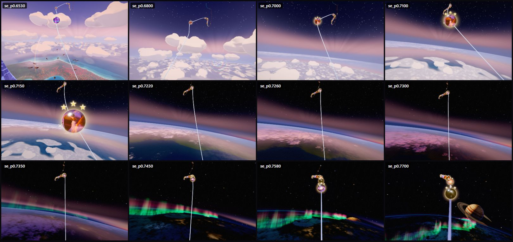

### 5.6 The dive, the fold and the way out

- **After the horizon** the radial streak tunnel is gone. The sky's light closes behind the rim
  as one ring of smeared starlight; the fold opens from the point it closes on.
- **Eight places** (`chapter-environments/fold-places/`): the tide (orbs 49 and 50, which park
  at the same progress and share it), the lattice, the nave, the flock, the stairs, the jewel
  (each facet a window on one of the journey's earlier worlds), the paint, and the hall that
  straightens into the city's grid. A room opens through the last from its own door over 1.5 s.
- **On the clock** (`transitions/odyssey-fold-clock.js`): three moods never in step and one
  happening every 44 s in each place.
- **The way out** is weighted like the plunge: the 56 to 57 trip takes about 3.8 s (was 1 s).
- **Cost fell:** no room costs more than the old corridor.

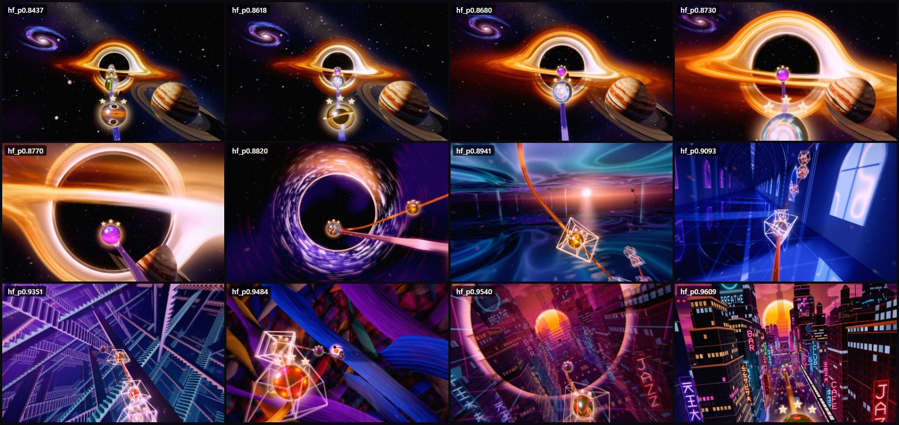

### 5.7 Chapter 8 and the ending

- **The city:** a sky with a hot horizon, a cloud deck lit by the districts and stars in the
  gaps; towers with setbacks, crowns, rooftop gear and rooms behind the glass; an analytic
  mirror street (no second render); far districts out to the haze; trains, steam, searchlights
  and a hologram of the Earth. Showers come and pass on a clock; windows, signs and traffic
  change with it.
- **The ending, "first light".** Finishing the last orb and choosing "Explore the journey" now
  opens the map at the end of the rail, where the ending plays (before, nothing happened). A
  wave of light from the spire switches every window on; the eye rises over the skyline while
  the journey draws itself in the stars; fireworks fill the upper sky in volleys that build to
  a finale; lanterns rise in drifts from the streets; the sun comes back up and the sky turns
  to dawn. It rests at 66 s and replays on later rests at the end of the rail. The map UI stays
  hidden until 61 s or any input; Enter, Space and a pad's A wake it instead of launching the
  orb. Fireworks go through `flashScale` and are off under reduced motion.

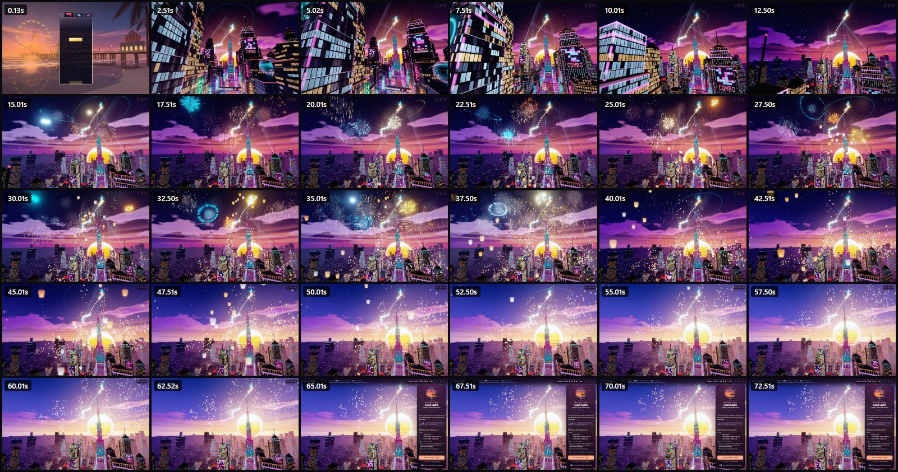

### 5.8 The passage, arrivals and the UI

- **The passage.** A golden theme got a blue passage because the palette came from one UI
  accent per theme. It is now baked from each orb's own theme icon for all 63 themes
  (`scripts/bake-odyssey-passage-palettes.mjs`; a test fails until it is re-run after an icon
  changes). Each chapter has its own wall, matter and rim, still one 2D canvas in a worker
  (ADR-0020): embers and molten glass, bubbles and a fish school, petals and leaves, snow and
  wind, cumulus and gold light, stars and dust, folding facets, neon rain. The layout is seeded
  by orb, visit, direction and session.
- **Emergence and glide.** The world's light blooms through the gate; the finished orb's stars
  land one by one; a ripple runs down the rail and wakes the next orb. The glide banks into the
  turn. Durations are unchanged.
- **Arrivals.** The full-frame dark sheet is gone: the words stand on a pool of the chapter's
  night in the lower left and the world is the picture, with an authored camera move for
  chapters 2, 3, 4, 5, 6 and 8.
- **Chapter glass.** One table (`src/core/odyssey/data/chapter-looks.js`, synced into the
  stylesheet by a script and held by a test) gives each chapter its accent, glass and night.
  The header, orb card, briefing, outcome sheet and navigator wear it; the navigator shows the
  live world through it. No `backdrop-filter` (a test forbids it). Layout, copy, input and
  gamepad navigation are unchanged.

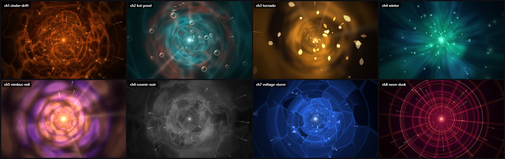

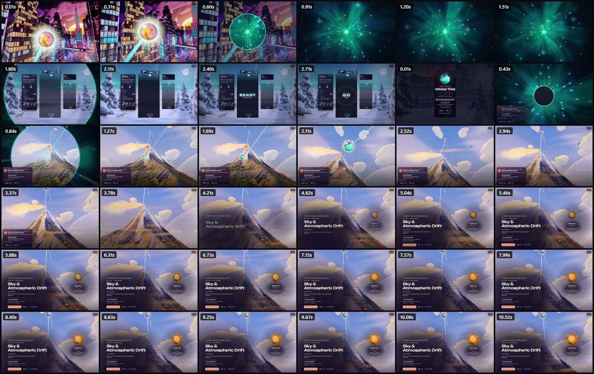

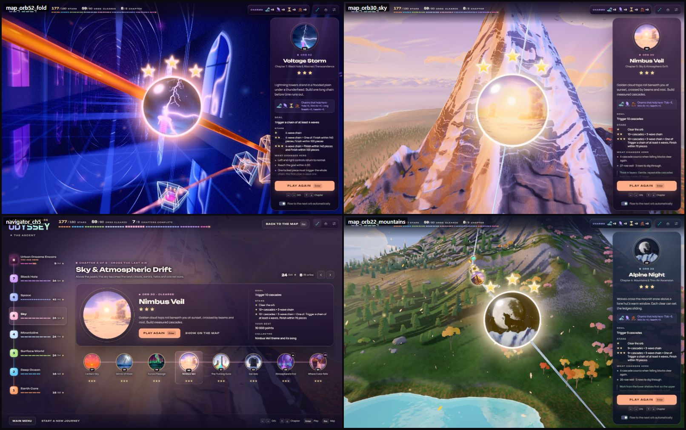

## 6. How it was checked

- **The whole rail re-filmed on the merged build:** the audit's 102 stations again, High,
  WebGPU on the RTX, 1707 × 1067, console clean in every group. Each junction between two
  passes (lava and ocean, island and sky, sky and space, space and fold, fold and city) was
  filmed when the second of the two was merged.
- **Real flows on the merged build:** the last orb played to the finale sheet and the ending
  filmed end to end; the map card and navigator over three chapters.
- **GPU cost, before and after.** The board's own timestamp profile (`?odysseyGpuProfile=1`),
  p50 over 5 s at each station, 30 fps cap, one run each on a quiet machine, the base served
  from a detached worktree of `2d09c6ec`:

| p | Where | Before (ms) | After (ms) |
|---|---|---|---|
| 0.002 | lava lake | 0.39 | 0.41 |
| 0.058 | steam | 0.86 | 0.85 |
| 0.077 | first water | 0.65 | 0.68 |
| 0.103 | mid ocean | 0.31 | 0.47 |
| 0.129 | under the surface | 0.36 | 0.53 |
| 0.207 | island | 0.91 | 1.02 |
| 0.272 | mountains | 0.91 | 0.87 |
| 0.349 | chapter 5 boundary | 0.69 | 0.60 |
| 0.552 | the climb | 0.44 | 0.55 |
| 0.653 | the crest | 1.61 | 1.90 |
| 0.700 | above the cloud sea | 0.89 | 1.37 |
| 0.722 | the evening Earth | 0.43 | 0.67 |
| 0.745 | aurora | 0.83 | 1.31 |
| 0.790 | early space | 0.40 | 0.57 |
| 0.862 | the hole | 0.69 | 0.69 |
| 0.894 | the tide | 0.77 | 0.24 |
| 0.942 | the jewel | 1.12 | 0.50 |
| 0.954 | the way out | 1.22 | 0.58 |
| 0.980 | the city | 0.25 | 0.35 |
| 1.000 | the end of the rail | 0.21 | 0.31 |

  The heaviest station is 1.90 ms (was 1.61). CPU frame time is 4.1 to 4.5 ms at every station
  in both builds. Reported texture memory went from 118 to 131 MB. Not measured: the integrated
  GPU, uncapped frame rate, and the extra pipelines' compile time at boot.
- **The world's CPU build.** `createOdysseyWorld` built three times in a row in one process
  (High, ms): 2009, 1954, 1818 before; 1892, 1741, 1734 after. A fault found on the way: with
  the cloud sea's first cut the second and third builds took 4.0 s. Its lobes were planned as
  `{ x, z, r, top }` object literals with fractional fields, and from the second build on the
  world's relief and macro bakes ran about eight times slower (the bisect points at V8
  de-optimising code that reads objects of that shape; not confirmed with V8 natives). The
  lobes are now rows of a `Float64Array`, the plate is baked once a session, and tests hold
  both.
- **Gates** on the merged build: typecheck, the TypeScript and lint ratchets, architecture
  fitness, the theme lifecycle audit, module boundaries, the full unit suite, performance
  budgets, release gates, the build with its boot closure, and the IP string gate. Results are
  in §6.1.
- **The intermittent `[SoundManager] Music switch failed`** seen by two passes also occurs on
  the base build in this harness (three times in three orb returns): a headless Chrome and dev
  server artefact with aborted music loads, not a change of this pass.

### 6.1 Gate results

On the final merged build:

- Typecheck, the TypeScript ratchet, the lint ratchet (432 errors, at baseline), architecture
  fitness, the theme lifecycle audit, module boundaries, performance budgets, release gates,
  the build with its boot closure and the IP string gate: all pass.
- `npx vitest run src/rendering/odyssey`: 69 files, 702 tests pass. The Odyssey, Earth core,
  journey and portal unit tests with the URL catalogue: 223 files, 2,544 tests pass.
- The full suite (1,439 files, 25,935 tests) was run before the cloud-sea fix: 25,881 passed.
  The failures were the known local ones (the sv-SE number formats in `records-view` and
  `game-over-modal-result-compatibility`; `tts-recorder-e2e`, a symlink Windows refuses in a
  worktree), five timing tests under full-suite load that pass when run alone
  (`display-settings-apply`, `local-versus-cameras`, `painted-ages-prepared-session`,
  `session-geometry`, `odyssey-ground-animals`), and `odyssey-forest-lever`, whose two-world
  hook ran past 30 s because of the slow second build above; it takes 4 s alone after the fix.
  The full suite was not re-run after that fix; the Odyssey suites were.
- Fixed while gating: type errors in three new `@ts-check` files; a sky test that assumed the
  Earth arrives in daylight (it now arrives under the evening sun); three new mentions of a
  ratcheted theme name; a flow-sheet hold timer that threw when its page was gone.

## 7. For the owner to judge

These are choices made without the owner in the room, most of them one constant to change.

- **Autumn on the mountain** was the lead's call, to give chapter 4 a palette of its own.
  `?odysseyNoAutumn=1` shows the journey without it.
- **The hole grows on screen** from orb 42 to 48, relaxing the 2026-10-20 "one size in the
  world". `OMEN_SPINE_ANCHOR.approachGain: 0` restores it.
- **The sunset on the Earth's limb moved earlier** (p 0.722 to 0.732, was 0.735), because the
  Earth now arrives under the evening sun.
- **Three trips are longer:** orb 10 to 11 through the breach (2.6 s, was 1.0 s), orb 56 to 57
  out of the fold (3.8 s, was 1 s), and the ending (66 s to rest, UI hidden for up to 61 s).
- **The first room of the fold opens bright** (+44 luma at the crossing, was +20), after a dark
  beat of about a third of a second.
- **Orbs 49 and 50 share a room,** because they park at the same progress.
- **Dolphins** are small during the crossing itself: the manta's loop and the rail hold the
  water straight ahead. Bringing the pod nearer means moving the manta.
- **Chapter 4's mist** was thinned and paled by the lead after it read as grey smoke; its
  `alpha` and `bright` in `ODYSSEY_HOLLOW_MIST` are the two knobs.
- **The cloud floor from very high** (p 0.71) still reads a little like floes before the Earth
  takes over.
- **UI:** on chapter 3's arrival sheet the first orb sits behind the title; the faint ink is
  stronger (0.46 to 0.62 alpha) to hold 4.5:1; four small navigator labels over the cloud tops
  dip to 3.9 to 4.4 on their brightest patch; the map header has no backing over the fold's
  busiest rooms.
- **Tastes:** the aurora's crimson crowns, the giant's faster spin, lightning, comet and nova
  rates, how fire-red the steam runs when the lake is roused, the saturated deep-garden corals,
  the lens beads over the island reveal, the order "fireworks, then dawn".

Not verified anywhere in this pass: the integrated GPU, a real-game run on the WebGL2 backend
(shader builds and playground captures only), reduced motion in the real game (unit tests
only), a physical gamepad, and a phone frame.

## 8. Lessons worth keeping

- A warm horizon colour mixed with a blue zenith goes grey lilac a third of the way up the
  dome: keep evening warmth in a low belt or in the air term, not in the gradient's end colour.
- Dimmed gold is tan: shade as a scalar and colour it on a ramp.
- A clamp on a marched distance quantises where a crossing lands (stairs); placing light at a
  step's nearer end flips row to row (use the profile's centroid); a periodic pattern read once
  per step aliases against the steps (fade it by the step's span).
- Two octaves of one value-noise tile on the same lattice show square cells: turn each octave's
  lattice.
- A trip between two orbs of one chapter does not glide in progress: anything keyed on progress
  cuts in on one frame. Give it its own clock.
- A place tuned without the Odyssey post is about two stops too bright.
- An apparent sun for the sky alone (dome, cloud floor, moon) can sink without re-baking
  anything that reads the world sun.
- Object literals of a shape the world's own data uses (`{ x, z, ... }`) with fractional fields,
  created at run time, slowed every later world build about 2.5 s: keep planned geometry in
  typed arrays.
- Radial-gradient sizes reject CSS math functions in this Chrome and drop the whole layer.
- Tooling: headless Chrome over CDP drives the real game (see the session memory note);
  `pauseOnFocusLoss` must be off; a save is seeded through `odysseyState.completeLevel`.
