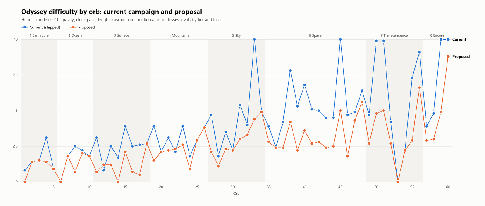
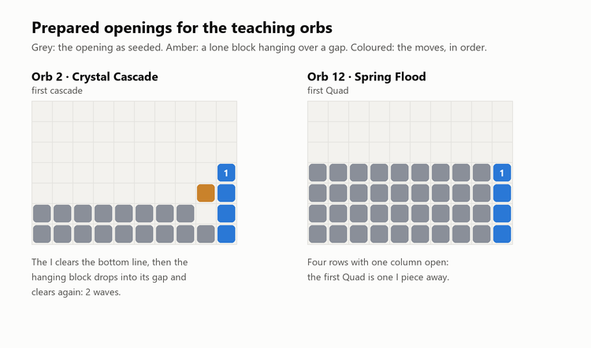
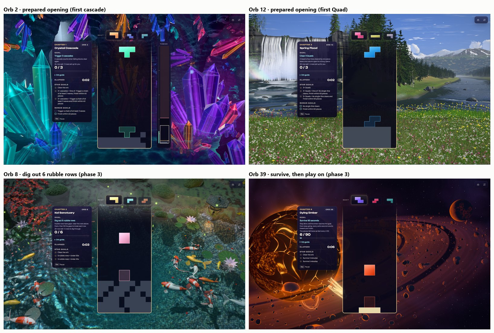

# Odyssey level design audit and plan (2026-11-02)

**Status: approved by the owner on 2026-11-03, every decision as recommended (D8 included), and implemented:** phases
1–1c (the retune, the rival caps and the test tooling) and phase 2's openings for orbs 2 and 12, on branch
`feature/odyssey-level-design-phase1` (handover:
[ODYSSEY_LEVEL_DESIGN_PHASE1_2026-11.md](ODYSSEY_LEVEL_DESIGN_PHASE1_2026-11.md)), then phase 3's new goals (dig out
the rubble on orb 8, survive on orb 39) and in-game screenshots of the openings (§5.10, handover:
[ODYSSEY_LEVEL_DESIGN_PHASE3_2026-11.md](ODYSSEY_LEVEL_DESIGN_PHASE3_2026-11.md)). This audits all 60 Odyssey orbs as
they ship and proposes a campaign that is fun first, genuinely challenging and consistent from orb 1 to orb 60. It
builds on [ODYSSEY_GAMEPLAY_AUDIT_2026-10.md](ODYSSEY_GAMEPLAY_AUDIT_2026-10.md),
[ODYSSEY_JOURNEY_DIFFICULTY_2026-10.md](ODYSSEY_JOURNEY_DIFFICULTY_2026-10.md),
[ODYSSEY_BALANCE_HANDOVER_2026-10.md](ODYSSEY_BALANCE_HANDOVER_2026-10.md),
[ODYSSEY_60_ORB_CAMPAIGN_2026-10.md](ODYSSEY_60_ORB_CAMPAIGN_2026-10.md),
[ODYSSEY_UX_OVERHAUL_2026-10.md](ODYSSEY_UX_OVERHAUL_2026-10.md) and
[ODYSSEY_CHARMS_AUDIT_2026-10.md](ODYSSEY_CHARMS_AUDIT_2026-10.md), and keeps their settled decisions (§1.3).

## Contents

0. [Summary](#0-summary)
1. [How this was measured](#1-how-this-was-measured)
2. [What the campaign has to work with](#2-what-the-campaign-has-to-work-with)
3. [Part 1: level-by-level audit](#3-part-1-level-by-level-audit)
4. [Part 2: the campaign as a whole](#4-part-2-the-campaign-as-a-whole)
5. [Part 3: improvement plan](#5-part-3-improvement-plan)
6. [Decisions for the owner](#6-decisions-for-the-owner)
7. [Reproduce](#7-reproduce)

---

## 0. Summary

**Verdict.** The campaign's structure is sound: eight chapters, each ending on a rival, with authored roles, a charm
safety net and goal text generated from the numbers. The level design inside that structure is uneven. The main reason
is one lever doing too much work: fall speed. It jumps between orbs, sometimes inside an orb, and by chapter 6 it
reaches speeds where a regular player cannot place pieces deliberately. Around it, goals repeat, the teaching rhythm
skips steps, and the stars are either free or out of reach on a third of the orbs.

What the shipped campaign does (main `0cbf3664`, `LEVEL_CONFIGS` after tuning and campaign assembly, plus a
3,600-attempt bot benchmark; §1):

1. **Speed spikes and cliffs.** Five orbs that start at speed level 1 jump 2.25× (720 → 320 ms a row) after 15 lines,
   including orb 1. Chapter arrivals start at
   205 (orb 11), 120 (orb 19), 84 (orb 27), 151 (orb 35), 84 (orb 49) ms.
   That makes each arrival the fastest or nearly the fastest orb of its chapter's first half, while rest orbs start at
   720 ms. From orb 33 on, 13 of the 18 standard and
   hybrid orbs reach 37–58 ms a row before one star, close to the pace of NES levels 16–19.
2. **Seven walls** (difficulty index ≥ 8, §4.1).
   - Five are clocked score or line goals that start at 48–65 ms a row and reach 37–46 ms (orbs 33, 45, 50, 51, 59).
     One star needs 1.11–1.62 pieces a second, and the novice proxy never clears any of them.
   - Two are the last rivals (56, 60): bot tiers 7 and 8, at 650–900 actions a minute. Only the superhuman expert
     policy beats them. **The journey ends on a wall.**
   - Orbs 38 (7.8) and 55 (7.3) come close.
3. **Repeated goals.** Four goal types carry 60 orbs (score 19, lines 18, cascades 15, rival 8). Six of the eight
   chapter peaks are "N cascades on a tall well". Orb 12 is a copy of orb 1, and orbs 43 and 44 share one goal.
4. **Teaching skips steps.** Six orbs are tagged "teach" for cascades, yet nothing teaches the Quad, which 21 orbs ask for,
   or the chain, which 27 orbs ask for from orb 2 on. The first tall hybrid well and the first multiplier debut in a boss
   (orb 4). Teaching is one tip and up to three text cues; openings are a generic garbage pattern.
5. **The stars don't measure mastery.** 26 orbs list extra goals that no star counts. On 13 orbs, three
   stars come free: a regular player who clears the orb at one piece a second earns them without trying. On
   8 orbs, no bot policy ever earned three stars. A full three-star run is not a fair goal today.
6. **Pacing.** Chapter 5 ends test → boss → boss → rival. Chapter 6 runs five tests in a row (38–42), then two bosses
   two orbs apart. The encore (chapter 8) is harder than the main finale.
7. **Metadata drifted.** Roles and difficulty are computed on pre-renumbering ids. Rivals keep their old slots' roles
   ("test", "reinforce", "encore"), and three orbs tagged "boss" never get the crown. The per-orb preview count (3–6) is
   never read. The score multiplier sits on 9 orbs whose goals ignore score.

**The plan** (§5) keeps every orb's id, world, name and chapter, the rival at each chapter's end, three-knockout duels and
the charm rules. It is mostly data:

- **Speed budget.** Each chapter has a start-speed band and a floor. The proportional curve that orb 6 already uses
  removes the cliffs. The main arc's floor becomes about 105 ms a row instead of 37.
- **Clock budget.** One-star clock pace is capped per chapter: 0.45 pieces/s in chapter 3, rising to 0.85 in chapter 8.
  Star times follow one ladder on top of it, so three stars on time alone need 1.1 to 1.5 pieces a second: more than
  a regular player's pace.
- **Teaching order.** Introduce, practise, twist, test: a new idea never debuts in a test, boss or rival.
- **Chapter identities.** The ocean digs, the surface learns rhythm (score, Quads, the clock), the sky asks for
  precision, the abstract chapter twists (mirrored controls, once).
- **New goals from existing systems.** Quads, chains and (phase 3) survival goals use systems the game already has.
  Every extra goal counts toward a star, no star tier is implied by the one below, no tier mixes Quads with chains,
  and there is one chain ladder.
- **Rivals.** Each rival gets an action-rate cap, so each one is smarter than the last but none is faster than a
  person can be. This needs one optional field in the duel's bot setup.

**Measured** in a throwaway copy of the game (the repo is untouched), on the same seeds:

- **Walls: 7 → 1.** The one left is the last rival (60). The index rates it by its nominal tier 8, but with the cap
  the regular proxy wins 2 of 5 matches and the skilled proxy 5 of 5 (over fifteen seeds: 4 of 15 and 13 of 15).
  Shipped, neither ever won.
- **Hardest solo orb: 10 → 5.0** (orb 51, chapter 7's sprint). The fastest fall before one star goes from 37 to 105 ms
  a row, and the highest one-star clock pace from 1.62 to 0.75 pieces a second.
- **Smoother and still climbing.** The largest rise from one orb to the next within a chapter goes from +6.0 to +2.5.
  The average solo index per chapter runs 1.1, 1.1, 0.9, 2.1, 2.6, 3.1, 2.9 and 3.6.
- **Stars.** Free three stars 13 → 0, unreachable three stars 8 → 0, uncounted extra goals 26 → 0.
- **Rules.** 127 breaches of the checkable design rules on 42 orbs → 0.
- **Clears.** The novice proxy clears 93% of attempts (84% shipped); the regular proxy wins 85% of rival matches (68%).
- **Checked beyond its own seeds.** In an overnight prototype on the real campaign (§5.9), the first version passed
  6 of the 9 phase 1 gates on fresh seeds. After small fixes it passes all 9 over 15 seeds in three sets. Every solo
  orb was also played at casual, regular and strong human pace: at a regular player's pace, 50 of 52 clear on at
  least 8 of 10 seeds.

[Phased rollout](#56-rollout): (1) data retune and design-rule tests; (1b) rival caps; (1c) test tooling:
human-paced bots and feel metrics; (2) prepared openings for the teaching orbs; (3) survival and clear-the-seabed
goals; (4) the formative player playtest already written in ODYSSEY_JOURNEY_DIFFICULTY. [§5.7](#57-test-and-tune-programme-getting-every-orb-right)
is the test-and-tune programme that takes every orb from "meets the rules" to "right".

---

## 1. How this was measured

### 1.1 Sources

- **Shipped values.** `LEVEL_CONFIGS` imported from `src/core/odyssey/data/levels.js` at main `0cbf3664` and dumped as
  JSON. That is after `deriveOdysseyLevelTuning`, the tuning overrides, `applyBotChallenge`,
  `normalizeOdysseyCompletionStars`, `MASTERY_RETUNE`, `harmonizeChainGoals`, `assembleOdysseyCampaign` (Vesper and
  Warp inserted, duels rotated to chapter ends, crowns resolved) and the orb copy. Every number in this doc is the
  shipped one.
- **Rules read in code.** Speed: `getDropIntervalForLevel`, 15 lines a level (`physics.js`), and the proportional curve
  for a custom opening interval (`GameplayHybridEngine`). Scoring: 250/500/1000/2000 for one to four lines, ×(1 + 0.1 per
  level), a cascade bonus of 200·(waves−1)², and ×(1 + 0.5·streak) on multiplier orbs. Also the goal and bonus
  evaluator (`VictoryConditionEvaluator`), the modifiers (`ModifierStack`), opening rubble
  (`buildStartingRowEntries`: a cycle of six hole patterns), rival tiers (`bot-difficulty.js`) and the briefing cues
  (`odyssey-level-briefing.js`).
- **Benchmark.** `npm run benchmark:odyssey` plays the shipped gameplay loop and real physics in virtual time. It ran
  all 60 orbs × 4 policies (stacker, cascade, expert, Quad) × 3 input cadences × 5 fresh seeds (12001–12005): 3,600
  attempts. The proposal ran on the same seeds (§5.8).

### 1.2 Reading bot results as player evidence

Bots plan instantly and never tire, so a bot's clear is not a person's. This doc reads them through five proxies:

| Proxy | Policy · cadence | Stands for |
|---|---|---|
| novice | stacker · deliberate (250–350 ms reactions, 180 ms moves, no lookahead) | the floor of a regular player's execution, with perfect attention |
| regular | stacker · native | a regular player's best day |
| skilled | cascade · steady (one-piece lookahead) | a player who builds cascades on purpose |
| expert | expert · native (35–65 ms reactions) | beyond nearly any human; if only this wins, it is a wall |
| quad | Quad · native | a player who builds for Quads; judges Quad goals and Quad star asks |

- **Pieces to the goal** are a skill-neutral measure of an orb's size. They are converted to human time with pace bands:
  casual 0.6, regular 1.0, strong 1.6 and elite 2.5 pieces a second. A clock or star time becomes a required pace
  (pieces ÷ seconds), comparable across orbs.
- **Difficulty index (0–10)** is a transparent heuristic, used to draw the curve and find spikes, not as a claim about
  real players. For a solo orb it adds four terms:
  - gravity: the fastest fall reached on the way to one star, log-scaled (450 ms scores 0, 56 ms scores 4.8);
  - clock: the one-star pace, 0 at 0.3 pieces/s and +1 per 0.25 above that;
  - length: 0 up to 180 pieces, rising to 2;
  - construction: 3 × the share of novice and regular attempts lost (on Quad goals the Quad proxy's, on chain goals
    the skilled proxy's), plus 1 + 0.12 × the count on a cascade goal (bots search for cascades; people have to learn
    to build them).

  For a rival: 0.9 × tier plus 3 × the share of novice, regular and skilled attempts lost. Eight or more is called a
  wall.
- **Stars** on normal orbs are scored from each run's metrics at the goal with the game's own rules (`calculateStars`
  and `evaluateBonuses`, re-implemented in `restar.py`). This reproduces all 4,080 recorded star results (2,880
  shipped, 1,200 proposal), so star and extra-goal edits need no re-run: a normal orb ends at its goal whatever its
  stars ask. Showcase orbs and duels keep the stars recorded after their lap or match.
  - *Free three stars:* the novice proxy's clears, replayed at a regular person's pace of 1 piece a second, earn three
    stars on at least 4 of 5 seeds. A time star then measures a person, not the bot's speed.
  - *Out of reach:* no policy earns three stars on any seed.
- **Limits.** Five seeds per cell are descriptive, not statistics. Bots don't model learning, fatigue, readability or
  fun. Human pace bands are coarse. The plan's gates (§5.6) therefore end in a human playtest.

### 1.3 Decisions this plan keeps (from earlier records)

- Every chapter ends on its rival; duels are a race to **three** knockouts at the chapter's gravity; duel stars are
  win, at most one top-out, flawless (UX overhaul 2026-10-18).
- Whole orbs keep their id, world, name and copy; save v5 and its frozen id tables stay. Nothing here moves an orb.
- Chains are one metric (`maxCascadeDepth`). A cascade is a lock whose clears come in two or more waves.
- Charms v3 (Tide, Still Air, Long Breath, Hearth) stay as they are: bounded help that never costs stars. The plan
  doesn't rely on charms to make a wall passable.
- Three previews in every well. Normal orbs end at the goal after the full cascade; four showcase orbs play on for stars.
- Earlier balance work asked for evidence before lowering targets. This plan answers with a design argument (§4)
  plus a measured before/after on matched seeds, and ends in the human protocol, not a statistical claim.

---

## 2. What the campaign has to work with

| Lever | Shipped use | Notes |
|---|---|---|
| Goal: lines / score / cascades / rival | 18 / 19 / 15 / 8 | the whole campaign |
| Goal: Quads (`tetrises`), chain (`combo`), survive (`time`), height | **0** | the evaluator supports all four; `height` is never fed (`updateHeight` has no caller) |
| Clock (`failure: time`) | 11 orbs | 150–480 s |
| Board: standard 10×20 / tall (Infinity) / hybrid | 30 / 18 / 12 | tall wells 24–100 rows; hybrids 24–32 |
| Opening rubble | 26 orbs, 1–30 rows | a fixed cycle of six garbage-hole patterns, offset by slot: never designed per orb |
| Speed | level 1–13 with progression, or a fixed interval | global curve 720, 320, 205, 151, 120, 99, 84, 73, 65, 58, 54, 51, 48 ms a row (levels 1–13); +1 level per 15 lines; a fixed interval with progression follows the curve proportionally (orb 6 only today) |
| Modifiers | gravity cascade 24, multiplier 28, clock 10, slow start 1 | **mirror and speed-up are never used** (mirror is wired in both input paths and has a briefing cue) |
| Extra goals (bonuses) | max-chain 26, Quad count 21, cascades 12, no singles 9, time 7 | **`pieces` (finish within N pieces) and `no-top-out` are never used** |
| Previews | authored 3–6 | **inert**: every well shows three and nothing reads `previewCount` |
| Piece sequence / bag | 7-bag on all 60; `customSequence` empty | no scripted openings exist |
| Rival tiers 1–8 | APM 90, 120, 165, 230, 320, 460, 650, 900; reactions 500–900 ms down to 30–100 ms | the same global tiers as versus mode; no Odyssey-only cap |
| Teaching surfaces | a tip, a folded guide, up to three "what changes here" cues | no demonstration or prepared practice board |
| Help | Charms v3 | bounded; one use of each per attempt |

---

## 3. Part 1: level-by-level audit

How to read the tables:

- **Goal.** The one-star goal; "in N s" is a clock.
- **Well.** std = standard 10×20; tall = Infinity well; hybrid = a tall standard well with progression. ms/row is the
  start speed → the fastest speed reached on the way to one star.
- **Mods.** GC = gravity cascade, ×M = score multiplier.
- **2★ / 3★ add.** What each tier asks beyond the goal.
- **Bots.** Wins out of attempts for the novice, regular, skilled and expert proxies, the pieces a regular (or, on
  cascade goals, skilled) player needed, and the best three-star rate any policy reached.
- **Ratings.** The six questions: Goal, Speed, Mechanics (introduce, practise, test), Modifiers, Stars, Metadata.
  ✓ fine, ~ minor, ✗ needs work. 👑 marks the chapter's crowned boss.

#### Chapter 1: Earth Core & Subterranean Origins (orbs 1–5)

| # | Orb · role | Goal | Well · ms/row | Mods | 2★ / 3★ add | Bots N R S E · pieces · best 3★ | G S M Mo St Me | Note |
|---|---|---|---|---|---|---|---|---|
| 1 | Ashen Dawn · arrival | 20 lines | std 20 rows · 720→320 | — | ≤150 s / ≤120 s, 1 extra goal | 5/5 5/5 5/5 5/5 · 54 · 60% | ✓ ✗ ✓ ✓ ✓ ~ | Good first orb, but at line 15 the pieces fall 2.25× faster (720 → 320 ms), on the very first orb of the game. |
| 2 | Crystal Cascade · teach | 3 cascades | tall 24 rows · 820 | GC | 2-wave chain / 3-wave chain | 5/5 5/5 5/5 5/5 · 31 · 80% | ✓ ✓ ~ ✓ ✗ ✓ | First cascade with an empty well and only a tip to explain it. Two stars ask for a 2-wave chain, which any cascade already is: the second star is free. |
| 3 | Geode Heart · reinforce | 4 cascades | tall 25 rows, 1 rubble · 810 | GC | 2-wave chain / 3-wave chain | 5/5 5/5 5/5 5/5 · 29 · 80% | ✓ ✓ ✓ ✓ ✗ ✓ | Fine practice step. Same free second star as orb 2. |
| 4 | The Living Grotto · boss 👑 | 40 lines | hybrid 26 rows, 2 rubble · 205→120 | GC, ×M | 2 cascades / 3 cascades, 1 extra goal | 5/5 5/5 5/5 5/5 · 105 · 100% | ~ ✗ ✗ ✗ ~ ~ | Speed spike: 205 → 120 ms, 3.5–4× faster than orb 3 and faster than anything in chapter 2. First hybrid well and first multiplier, both debuting in a boss. The multiplier only changes score, which this lines goal ignores. |
| 5 | Molten Flow · test | Rival Cinder (tier 1), 3 knockouts | std 20 rows · 1000 | — | ≤1 top-out / ≤0 top-outs | 5/5 5/5 5/5 5/5 · 327 · 100% | ✓ ✓ ✓ ✓ ~ ~ | Fair first rival (tier 1, 1000 ms). Every bot policy earns three stars, so the third star asks little of a capable player. |

#### Chapter 2: Deep Ocean & Liquid Worlds (orbs 6–10)

| # | Orb · role | Goal | Well · ms/row | Mods | 2★ / 3★ add | Bots N R S E · pieces · best 3★ | G S M Mo St Me | Note |
|---|---|---|---|---|---|---|---|---|
| 6 | Ocean Descent · arrival | 20 lines | std 20 rows, 5 rubble · 800→636 | — | 1 Quad / 2 Quads, ≤150 s | 5/5 5/5 5/5 5/5 · 45 · 80% | ✓ ✓ ✓ ✓ ✓ ✓ | Clean introduction to rubble on the proportional speed curve; Quad stars are a real ask. |
| 7 | Night Surf · teach | 7 cascades | tall 28 rows, 8 rubble · 800 | GC | 3-wave chain / 4-wave chain | 5/5 5/5 5/5 5/5 · 49 · 60% | ✓ ✓ ~ ✓ ✓ ~ | Cascades from rubble: a good practice orb, though tagged "teach" for an idea taught in chapter 1. |
| 8 | Koi Sanctuary · reinforce | 35 lines | std 20 rows · 320→151 | — | ≤190 s / ≤135 s, 1 extra goal | 5/5 5/5 5/5 5/5 · 93 · 40% | ~ ✗ ✓ ✓ ✓ ~ | Plain lines with nothing of the chapter's digging. 320 → 151 ms makes it the fastest orb in chapter 2, faster than its boss. |
| 9 | Tarn of Wisps · boss 👑 | 10 cascades | tall 27 rows, 3 rubble · 710 | GC, ×M | 3-wave chain / 4-wave chain | 5/5 5/5 5/5 5/5 · 89 · 80% | ~ ✓ ✓ ~ ~ ✓ | Boss reuses the "N cascades on a tall well" formula and ignores the chapter's rubble (3 rows). It lists a 6-wave chain bonus that no star counts, and a multiplier that does nothing. |
| 10 | Wave Runner · reinforce | Rival Coral (tier 2), 3 knockouts | std 20 rows · 950 | — | ≤1 top-out / ≤0 top-outs | 5/5 5/5 5/5 5/5 · 346 · 100% | ✓ ✓ ✓ ✓ ~ ~ | Fair rival (tier 2). The third star comes almost free (94% of bot wins). |

#### Chapter 3: Surface World & Living Landscapes (orbs 11–18)

| # | Orb · role | Goal | Well · ms/row | Mods | 2★ / 3★ add | Bots N R S E · pieces · best 3★ | G S M Mo St Me | Note |
|---|---|---|---|---|---|---|---|---|
| 11 | Grainfields · arrival | 32 lines | std 20 rows · 205→120 | — | ≤190 s / ≤145 s, 1 extra goal | 5/5 5/5 5/5 5/5 · 85 · 60% | ✓ ✗ ✓ ✓ ✓ ✗ | Chapter arrival starts at 205 ms and climbs to 120 ms. It is harder than the orb tagged "teach" after it. |
| 12 | Spring Flood · teach | 20 lines | std 20 rows · 720→320 | — | ≤140 s / ≤105 s | 5/5 5/5 5/5 5/5 · 54 · 100% | ✗ ✗ ✗ ✓ ✗ ✗ | Exact copy of orb 1 (20 lines, level 1, empty well) with the same speed cliff. Tagged "teach", it teaches nothing. Its star times (0.39 and 0.51 pieces/s) are free, and its no-singles bonus counts for nothing. |
| 13 | Golden Reflection · reinforce | score 15,000 | std 20 rows · 320→151 | ×M | 3 Quads / 5 Quads, 5-wave chain | 5/5 5/5 5/5 5/5 · 90 · 0% | ✓ ~ ~ ✓ ✗ ~ | The first score orb and the first standard-board multiplier, but tagged "reinforce". Three stars ask for 5 Quads and a 5-wave chain together; no bot policy ever reached it. |
| 14 | Glasshouse Reverie · teach | 6 cascades | tall 25 rows, 1 rubble · 800 | GC | 3-wave chain / 4-wave chain | 5/5 5/5 5/5 5/5 · 46 · 60% | ✗ ✓ ✗ ✓ ✓ ✗ | Third orb tagged "teach cascade". At 6 cascades it is easier than chapter 2's boss (10): a dip that teaches nothing new. |
| 15 | Gathering Storm · test | 42 lines in 270 s | std 20 rows · 151→99 | — | ≤150 s / ≤105 s | 5/5 5/5 4/5 5/5 · 109 · 100% | ✓ ~ ~ ✓ ✓ ✓ | First clock. It debuts in a test, but the clock is generous (0.4 pieces/s for one star) and the stars scale well. |
| 16 | Amber Grove · release | 45 lines | std 20 rows · 720→151 | — | 4 Quads / 6 Quads, 2 extra goals | 5/5 5/5 5/5 5/5 · 115 · 40% | ~ ✗ ✓ ✓ ✓ ~ | A rest orb with the chapter's longest lines goal (45), and the 720 → 320 ms cliff. |
| 17 | Halcyon Ascension · boss 👑 | 13 cascades | tall 27 rows, 4 rubble · 670 | GC, ×M | 3-wave chain / 4-wave chain | 5/5 5/5 4/5 5/5 · 100.0 · 80% | ~ ✓ ~ ~ ~ ✓ | Third "N cascades" boss in a row. It never tests the score and clock this chapter taught. Multiplier with no effect; the 6-wave bonus counts for nothing. |
| 18 | Summer Glow · test | Rival Willow (tier 3), 3 knockouts | std 20 rows · 900 | — | ≤1 top-out / ≤0 top-outs | 5/5 5/5 5/5 5/5 · 406 · 100% | ✓ ✓ ✓ ✓ ✓ ~ | Fair rival (tier 3). |

#### Chapter 4: Mountains & Thin-Air Ascension (orbs 19–26)

| # | Orb · role | Goal | Well · ms/row | Mods | 2★ / 3★ add | Bots N R S E · pieces · best 3★ | G S M Mo St Me | Note |
|---|---|---|---|---|---|---|---|---|
| 19 | Blossom Foothills · arrival | score 22,000 | hybrid 24 rows, 2 rubble · 120→84 | ×M | 3 cascades / 5 cascades, 5 Quads | 5/5 5/5 5/5 5/5 · 98 · 0% | ✓ ✗ ~ ✓ ✗ ✗ | Arrival starts at 120 ms, the fastest start in the campaign so far. Three stars (5 cascades and 5 Quads) were never reached; a 6-cascade bonus counts for nothing. |
| 20 | Verdant Rise · teach | 9 cascades | tall 36 rows, 8 rubble · 700 | GC | 3-wave chain / 4-wave chain | 5/5 5/5 5/5 5/5 · 66 · 60% | ✓ ✓ ✓ ✓ ✓ ✓ | A good teaching orb: the first well taller than 30 rows, with room to practise. |
| 21 | Ice Temple · reinforce | score 21,000 | std 20 rows · 205→120 | ×M | ≤210 s / ≤158 s | 5/5 5/5 5/5 5/5 · 111 · 100% | ✓ ~ ✓ ✓ ✗ ~ | Three stars come free (0.7 pieces/s). The 6-Quad bonus counts for nothing. |
| 22 | Alpine Night · reinforce | 9 cascades | tall 26 rows, 2 rubble · 740 | GC | 3-wave chain / 4-wave chain | 5/5 5/5 5/5 5/5 · 72 · 60% | ~ ✓ ✓ ✓ ✓ ✓ | Same 9 cascades as orb 20 with less rubble: a flat step. |
| 23 | Everest Ascent · test | 28 lines in 240 s | std 20 rows · 99→84 | — | ≤192 s / ≤149 s | 5/5 5/5 5/5 5/5 · 74 · 100% | ✓ ✗ ✓ ✓ ✗ ~ | Starts at 99 ms. Its star times ask only 0.4–0.5 pieces/s, a pace the gravity forces anyway, so they are free. A 120 s bonus counts for nothing. |
| 24 | The High Coast · release | score 16,000 | std 20 rows · 720→205 | ×M | ≤160 s / ≤120 s | 5/5 5/5 5/5 5/5 · 99 · 100% | ✓ ✗ ✓ ~ ✗ ✓ | A rest orb with the 720 → 320 ms cliff. Its star times (0.62 and 0.83 pieces/s) are free, and its 8-cascade and 6-Quad bonuses count for nothing. |
| 25 | Garden Under Stone · boss 👑 | 16 cascades | tall 29 rows, 6 rubble · 600 | GC, ×M | 3-wave chain / 4-wave chain | 5/5 5/5 5/5 5/5 · 126 · 80% | ~ ✓ ✓ ~ ~ ✓ | Fourth "N cascades" boss. Multiplier with no effect; the 6-wave bonus counts for nothing. |
| 26 | Winter Trial · test | Rival Frost (tier 4), 3 knockouts | std 20 rows · 850 | — | ≤1 top-out / ≤0 top-outs | 4/5 5/5 5/5 5/5 · 392 · 100% | ✓ ✓ ✓ ✓ ✓ ~ | Fair rival (tier 4). |

#### Chapter 5: Sky & Atmospheric Drift (orbs 27–34)

| # | Orb · role | Goal | Well · ms/row | Mods | 2★ / 3★ add | Bots N R S E · pieces · best 3★ | G S M Mo St Me | Note |
|---|---|---|---|---|---|---|---|---|
| 27 | Lantern Sky · arrival | score 34,000 | hybrid 26 rows, 1 rubble · 84→58 | GC, ×M | 7 cascades / 9 cascades, 7 Quads | 5/5 5/5 4/5 5/5 · 137 · 0% | ✓ ✗ ✓ ✓ ✗ ✗ | Arrival starts at 84 ms. Three stars (9 cascades and 7 Quads) were never reached. |
| 28 | Mirror of Stars · release | 42 lines | std 20 rows · 720→205 | — | ≤190 s / ≤135 s, 1 extra goal | 5/5 5/5 5/5 5/5 · 111 · 20% | ✓ ✗ ✓ ✓ ~ ~ | Rest orb with the cliff. Fine otherwise. |
| 29 | Aurora Passage · reinforce | score 20,000 | std 20 rows · 151→99 | ×M | 4 Quads / 7 Quads, 6-wave chain | 5/5 5/5 5/5 5/5 · 103 · 0% | ~ ~ ✓ ✓ ✗ ~ | Three stars (7 Quads and a 6-wave chain) were never reached. |
| 30 | Nimbus Veil · reinforce | 10 cascades | tall 27 rows, 3 rubble · 670 | GC, ×M | 4-wave chain / 5-wave chain | 5/5 5/5 5/5 5/5 · 72 · 20% | ✓ ✓ ✓ ~ ✓ ✓ | Good mid-chapter cascade orb. The multiplier has no effect. |
| 31 | The Turning Suns · test | 37 lines in 210 s | std 20 rows · 73→58 | — | ≤168 s / ≤130 s | 5/5 5/5 4/5 5/5 · 98 · 100% | ✓ ✗ ✓ ✓ ✗ ✓ | A sprint at 73 → 58 ms. Its star times (0.58 and 0.75 pieces/s) are free at a regular pace. |
| 32 | Ice Halo · boss | 20 cascades | tall 30 rows, 8 rubble · 530 | GC, ×M | 3-wave chain / 24 cascades, 4-wave chain | 4/5 4/5 5/5 5/5 · 150 · 100% | ~ ✓ ✓ ~ ~ ✗ | Tagged boss without the crown, the second of three peaks in a row (31–34). Its showcase stars after the goal (24 cascades and a 4-wave chain) are earned; the 6-wave bonus counts for nothing. |
| 33 | Atmosphere's End · boss 👑 | score 71,000 in 180 s | hybrid 31 rows, 7 rubble · 54→42 | GC, ×M | ≤144 s / ≤112 s | 0/5 3/5 5/5 5/5 · 200 · 100% | ✓ ✗ ~ ~ ✗ ✓ | WALL. 71,000 points in 180 s at 54 → 42 ms needs about 1.1 pieces/s; 3 stars need 1.8. Clock, hybrid well, multiplier and rubble all at once. |
| 34 | Where Color Falls · reinforce | Rival Zephyr (tier 5), 3 knockouts | std 20 rows · 800 | — | ≤1 top-out / ≤0 top-outs | 4/5 4/5 5/5 5/5 · 528.0 · 60% | ✓ ✓ ✓ ✓ ✓ ~ | Rival tier 5: the third peak in a row. |

#### Chapter 6: Space & Cosmic Expanse (orbs 35–48)

| # | Orb · role | Goal | Well · ms/row | Mods | 2★ / 3★ add | Bots N R S E · pieces · best 3★ | G S M Mo St Me | Note |
|---|---|---|---|---|---|---|---|---|
| 35 | Galaxy Core · arrival | score 28,000 | std 20 rows · 151→84 | ×M | 5 Quads / 9 Quads, 6-wave chain | 5/5 5/5 4/5 5/5 · 136 · 0% | ✓ ~ ✓ ✓ ✗ ✓ | Three stars (9 Quads and a 6-wave chain) were never reached. |
| 36 | Cosmic Nocturne · teach | 12 cascades | tall 27 rows, 3 rubble · 670 | GC, ×M | 3-wave chain / 4-wave chain | 5/5 5/5 5/5 5/5 · 95 · 40% | ✓ ✓ ~ ~ ~ ~ | Fifth orb tagged "teach cascade". The multiplier has no effect; the 6-wave bonus counts for nothing. |
| 37 | Stellar Flare · reinforce | 36 lines | std 20 rows, 6 rubble · 99→73 | — | ≤250 s / ≤188 s | 5/5 5/5 5/5 5/5 · 87 · 100% | ✓ ✗ ✓ ✓ ✗ ~ | Digging at 99 → 73 ms. Its star times ask 0.35–0.47 pieces/s, below the forced pace: free. |
| 38 | Blood Moon · test | score 58,000 in 210 s | hybrid 30 rows, 6 rubble · 73→51 | GC, ×M | ≤168 s / ≤130 s | 4/5 5/5 5/5 5/5 · 189 · 100% | ✓ ✗ ✓ ~ ~ ✓ | Close to a wall: 0.92 pieces/s for one star at 73 → 51 ms. The 10-cascade and 10-Quad bonuses count for nothing. |
| 39 | Dying Ember · test | score 70,000 | std 20 rows · 65→44 | ×M | 9 Quads / 14 Quads, 6-wave chain | 5/5 5/5 5/5 5/5 · 236 · 0% | ~ ✗ ✓ ✓ ✗ ✓ | A 243-piece score grind at 65 → 44 ms with no clock. Three stars (14 Quads and a 6-wave chain) were never reached. |
| 40 | Aether Surge · test | 52 lines in 180 s | std 20 rows · 54→46 | — | 8 Quads / 12 Quads, ≤120 s | 5/5 5/5 5/5 5/5 · 136 · 0% | ✓ ✗ ✓ ✓ ✗ ✓ | Close to a wall: 52 lines in 180 s at 54 → 46 ms. Three stars (12 Quads within 120 s) were never reached. |
| 41 | Loom of Heaven · reinforce | score 54,000 | std 20 rows · 73→48 | ×M | ≤540 s / ≤405 s | 5/5 5/5 3/5 5/5 · 204 · 100% | ~ ✗ ✓ ✓ ✗ ~ | A 209-piece grind at 73 → 48 ms. Its star times sit below the forced pace: free. Two bonuses count for nothing. |
| 42 | Twin-Sun Dunes · test | 56 lines | std 20 rows · 54→46 | — | ≤390 s / ≤293 s | 5/5 5/5 5/5 5/5 · 145 · 100% | ✓ ✗ ✓ ✓ ✗ ✓ | 56 lines at 54 → 46 ms. Its star times sit below the forced pace: free. Two bonuses count for nothing. |
| 43 | Celestial Chrysalis · release | score 43,000 | std 20 rows · 180→65 | ×M, slow start | ≤430 s / ≤323 s | 5/5 5/5 4/5 5/5 · 189 · 100% | ✗ ✗ ✓ ~ ✗ ~ | The same goal (43,000) and star times as orb 44 right after it. The gentler start only lasts until the first level-up, then it reaches 58 ms. Stars free. |
| 44 | Silent Drift · release | score 43,000 | std 20 rows · 120→65 | ×M | ≤430 s / ≤323 s | 5/5 5/5 4/5 5/5 · 189 · 100% | ✗ ✗ ✓ ✓ ✗ ~ | Duplicate of orb 43. Stars free; two bonuses count for nothing. |
| 45 | Eclipse Horizon · boss | score 90,000 in 150 s | hybrid 32 rows, 8 rubble · 48→40 | GC, ×M | ≤120 s / ≤93 s | 0/5 0/5 5/5 5/5 · 187 · 100% | ✓ ✗ ~ ~ ✗ ✗ | WALL. 90,000 in 150 s at 48 → 40 ms needs 1.25 pieces/s; 3 stars need 2.0. Tagged boss without the crown. |
| 46 | The Painted Giants · release | 42 lines | std 20 rows · 73→58 | — | ≤190 s / ≤135 s, 1 extra goal | 5/5 5/5 4/5 5/5 · 109 · 20% | ✓ ✗ ✓ ✓ ~ ~ | A rest orb at 73 → 58 ms, fast for a rest. |
| 47 | The Singularity · boss 👑 | 25 cascades | tall 32 rows, 10 rubble · 460 | GC, ×M | 3-wave chain / 30 cascades, 4-wave chain | 3/5 4/5 5/5 5/5 · 169 · 100% | ✓ ✓ ✓ ~ ~ ✓ | The right signature boss, but long (about 170 pieces for a skilled player). Its showcase stars (30 cascades and a 4-wave chain) are earned; the 6-wave bonus counts for nothing. |
| 48 | Comet Chase · test | Rival Nova (tier 6), 3 knockouts | std 20 rows · 750 | — | ≤1 top-out / ≤0 top-outs | 3/5 3/5 4/5 5/5 · 404 · 60% | ✓ ✓ ✓ ✓ ✓ ~ | Rival tier 6: fair for skilled players; the novice and regular proxies win 3 of 5. |

#### Chapter 7: Black Hole & Abstract Transcendence (orbs 49–56)

| # | Orb · role | Goal | Well · ms/row | Mods | 2★ / 3★ add | Bots N R S E · pieces · best 3★ | G S M Mo St Me | Note |
|---|---|---|---|---|---|---|---|---|
| 49 | Fluid Dreams · arrival | score 36,000 | std 20 rows · 84→58 | ×M | 8 Quads / 10 Quads, 5-wave chain | 5/5 5/5 4/5 5/5 · 148 · 0% | ✓ ✗ ✓ ✓ ✗ ~ | Arrival at 84 → 58 ms. Even two stars (8 Quads) were never reached; three stars were out of reach. |
| 50 | Star Cradle · reinforce | score 61,000 in 180 s | hybrid 30 rows, 4 rubble · 65→46 | GC, ×M | ≤144 s / ≤112 s | 0/5 5/5 5/5 5/5 · 202 · 100% | ✓ ✗ ✓ ~ ✗ ✗ | WALL, tagged "reinforce". 61,000 in 180 s at 65 → 46 ms needs 1.12 pieces/s. |
| 51 | Golden Convergence · test | 66 lines in 150 s | std 20 rows · 48→40 | — | ≤120 s / ≤93 s | 0/5 5/5 5/5 5/5 · 171 · 100% | ✓ ✗ ✓ ✓ ✗ ✓ | WALL. 66 lines in 150 s at 48 → 40 ms needs 1.14 pieces/s; 3 stars need 1.84. |
| 52 | Voltage Storm · boss | 22 cascades | tall 32 rows, 10 rubble · 500 | GC, ×M | 4-wave chain / 6-wave chain | 4/5 4/5 5/5 5/5 · 153 · 20% | ~ ✓ ✓ ~ ✗ ✗ | Fifth "N cascades" boss, without the crown. Three stars (a 6-wave chain) were never reached. |
| 53 | Murmuration · release | 36 lines | std 20 rows, 6 rubble · 500 | GC | ≤130 s / ≤100 s | 5/5 5/5 5/5 5/5 · 81 · 100% | ✓ ✓ ✓ ✓ ✗ ~ | A good rest orb: digging with gravity on a slow, fixed 500 ms. Its star times (0.62 and 0.81 pieces/s) are free. |
| 54 | Serenity Passage · teach | 10 cascades | tall 36 rows, 10 rubble · 600 | GC | 3-wave chain / 4-wave chain | 5/5 5/5 5/5 5/5 · 84 · 60% | ✓ ✓ ~ ✓ ✓ ~ | A useful rehearsal for orb 55, though tagged "teach" at orb 54. |
| 55 | Indra's Net · boss 👑 | score 250,000 in 480 s | tall 100 rows, 30 rubble · 500 | GC, ×M | score 320,000, 20 cascades, 4-wave chain / score 400,000, 28 cascades, 6-wave chain | 0/5 0/5 5/5 5/5 · 472 · 80% | ✓ ~ ✓ ~ ~ ✓ | Near-wall (7.3). 250,000 in 480 s needs about 1.0 piece/s for 8 minutes; the novice and regular proxies never clear it. Its showcase stars are earned by the cascade and expert policies. |
| 56 | Chromatic Impasto · test | Rival Prism (tier 7), 3 knockouts | std 20 rows · 700 | — | ≤1 top-out / ≤0 top-outs | 0/5 0/5 1/5 5/5 · 254 · 80% | ✓ ✓ ✓ ✓ ✗ ~ | WALL. Rival tier 7 (650 actions a minute, 60–160 ms reactions) beats every policy except the superhuman expert; the skilled policy wins once in five. |

#### Chapter 8: Urban Dreams Encore (orbs 57–60)

| # | Orb · role | Goal | Well · ms/row | Mods | 2★ / 3★ add | Bots N R S E · pieces · best 3★ | G S M Mo St Me | Note |
|---|---|---|---|---|---|---|---|---|
| 57 | Chromadelic Gateway · encore | 30 lines | std 20 rows · 120→84 | — | ≤210 s / ≤158 s | 5/5 5/5 5/5 5/5 · 82 · 100% | ✓ ~ ✓ ✓ ✗ ~ | Its star times sit below the forced pace: free. Two bonuses count for nothing. |
| 58 | Neon Dusk · encore | score 46,000 | std 20 rows · 99→58 | ×M | ≤460 s / ≤345 s | 5/5 5/5 4/5 5/5 · 194 · 100% | ✓ ✗ ✓ ✓ ✗ ~ | 99 → 54 ms for an encore. Star times free; two bonuses count for nothing. |
| 59 | Rainlit Streets · encore 👑 | score 160,000 in 210 s | hybrid 30 rows, 5 rubble · 54→37 | GC, ×M | score 200,000, 16 cascades, 4-wave chain / score 240,000, 20 cascades, 6-wave chain | 0/5 0/5 2/5 5/5 · 341.0 · 20% | ✓ ✗ ~ ~ ✗ ~ | WALL. 160,000 in 210 s at 54 → 37 ms needs 1.6 pieces/s. The encore is harder than the main finale. |
| 60 | Last Light · encore | Rival Neon (tier 8), 3 knockouts | std 20 rows · 650 | — | ≤1 top-out / ≤0 top-outs | 0/5 0/5 0/5 4/5 · 286.0 · 20% | ✓ ✓ ✓ ✓ ✗ ~ | WALL. Rival tier 8 (900 actions a minute, 30–100 ms reactions); only the expert policy ever wins. The journey ends on it. |

### 3.1 Outliers

**Speed spikes.** These orbs start at least twice as fast as the standard or hybrid orb before them:

| Orb | Start speed (ms/row) | Jump |
|---|---|---|
| 4 | 720 → 205 | 3.5× |
| 8 | 800 → 320 | 2.5× |
| 13 | 720 → 320 | 2.2× |
| 15 | 320 → 151 | 2.1× |
| 19 | 720 → 120 | 6.0× |
| 23 | 205 → 99 | 2.1× |
| 27 | 720 → 84 | 8.6× |
| 29 | 720 → 151 | 4.8× |
| 31 | 151 → 73 | 2.1× |
| 45 | 120 → 48 | 2.5× |
| 57 | 500 → 120 | 4.2× |

Inside an orb, the 720 → 320 ms cliff at line 15 hits 1, 12, 16, 24 and 28.

**Difficulty spikes and walls.** Orbs 33, 45, 50, 51 and 59 are clocked score or line goals that reach 37–46 ms a
row. Four of them sit 5–6 index points above the orb before them (51 follows 50). The novice proxy clears none of
them, and the regular proxy clears 45 and 59 on no seed. The rivals 56 and 60 lose to every proxy but the expert
(the skilled proxy beats 56 once in five). Orbs 38 (7.8) and 55 (7.3) come close.

**Bosses that aren't the peak.** In five chapters the crowned boss rates lower than an earlier orb of its chapter:

| Chapter | Boss | Earlier orbs that rate higher |
|---|---|---|
| 2 | 9 | 8 |
| 3 | 17 | 11, 15 |
| 4 | 25 | 19, 21, 23 |
| 6 | 47 | 38–42 and 45 |
| 7 | 55 | 50, 51 |

**Too easy for their position.**
- Orb 12, a copy of orb 1 eleven orbs later.
- Orb 14, 6 cascades after chapter 2 ended on 10.
- Orb 36, 12 cascades after chapter 5 asked 20.
- Rest orbs that start at 720 ms in chapters 4–5 (24, 28), beside neighbours at 84–151 ms.

**Too hard for their position.**
- Arrivals 19 (120 ms) and 27 (84 ms), the fastest starts of their chapters.
- Orb 50, a wall tagged "reinforce".
- Orb 59, an encore boss harder than the main finale.
- Orb 60, the journey's last orb, beaten only by the expert proxy.

**Flat stretches.**
- Orbs 2 → 3 (one more cascade).
- Orbs 20 → 22 (the same 9 cascades with less rubble).
- Orbs 43 = 44 (one goal, one set of star times).
- Orbs 41 → 42 → 43 → 44, four untimed orbs whose star times are free.

**Repeated goals.**
- Six chapter peaks are "N cascades on a tall well": 9, 17, 25, 32, 47 and 52.
- Score goals run back to back at 38 → 39, 43 → 44 → 45, 49 → 50 and 58 → 59.

**Unclear objectives.**
- Nine orbs whose goals ignore score still carry the multiplier and its briefing cue ("consecutive clears multiply the
  score"): 4, 9, 17, 25, 30, 32, 36, 47 and 52.
- 26 orbs list extra goals that no star counts.
- On orbs 2 and 3 the two-star chain is already met by the goal.

**Stars.**
- *Free* (the novice proxy's clears, replayed at 1 piece a second, earn three stars on 4 of 5 seeds): 12, 21, 23, 24,
  31, 37, 41, 42, 43, 44, 53, 57 and 58.
- *Out of reach* (no policy earned three stars on any seed): 13, 19, 27, 29, 35, 39, 40 and 49. On orb 49 even two
  stars (8 Quads) never happened.
- *Thin:* on showcase 59, three stars came once in 60 attempts (the expert policy).

---

## 4. Part 2: the campaign as a whole

### 4.1 Difficulty curve



*Heuristic index per orb (§1.2). Blue is the shipped campaign; orange is the proposal measured on the same seeds (§5.8).*

| Chapter | Orbs | Index mean (max), now → proposed | Walls now → proposed | Free 3★ now | 3★ never reached now → proposed | Goal mix now |
|---|---|---|---|---|---|---|
| 1 Earth Core | 1–5 | 1.5 (3.1) → 1.0 (1.5) | 0 → 0 | 0 | 0 → 0 | lines 2, cascade 2, frags 1 |
| 2 Deep Ocean | 6–10 | 1.7 (2.5) → 1.3 (2.0) | 0 → 0 | 0 | 0 → 0 | lines 2, cascade 2, frags 1 |
| 3 Surface World | 11–18 | 2.5 (3.9) → 1.1 (2.7) | 0 → 0 | 1 | 1 → 0 | lines 4, score 1, cascade 2, frags 1 |
| 4 Mountains | 19–26 | 3.0 (3.9) → 2.3 (3.8) | 0 → 0 | 3 | 1 → 0 | score 3, cascade 3, lines 1, frags 1 |
| 5 Sky | 27–34 | 4.6 (10.0) → 2.9 (4.9) | 1 → 0 | 1 | 2 → 0 | score 3, lines 2, cascade 2, frags 1 |
| 6 Space | 35–48 | 5.4 (10.0) → 3.2 (5.6) | 1 → 0 | 5 | 3 → 0 | score 7, cascade 2, lines 4, frags 1 |
| 7 Black Hole | 49–56 | 5.9 (9.9) → 3.4 (6.6) | 3 → 0 | 1 | 1 → 0 | score 3, lines 2, cascade 2, frags 1 |
| 8 Urban Dreams Encore | 57–60 | 7.2 (10.0) → 4.9 (8.8) | 2 → 1 | 2 | 0 → 0 | lines 1, score 2, frags 1 |

- **Across the campaign** the curve doesn't rise; it saws. In chapters 1–4 it swings between about 0 and 4 orb to orb,
  driven by arrivals that start fast and rests that start at 720 ms. From orb 33 it jumps between walls (8–10) and
  cascade orbs or rests (2–5).
- **Within chapters** the peak is rarely at the end. Chapter 2's fastest orb is its third (8), not its boss.
  Chapter 3's hardest solo orb by speed is its arrival or its test, not its boss (17). In chapters 5–8 the walls sit
  mid-chapter (33 before the rival, 45 two orbs before the crowned boss, 50 and 51 at orbs 2–3 of chapter 7).
- **Speed** carries most of the difficulty. On standard and hybrid wells the start speed rises 720 → 48 ms. Cascade orbs
  stay at 820 → 460 ms, so a cascade orb next to a score orb can be 10× slower. Both are fine, but no rule says which
  orb gets which.
- **The proposal** (orange) climbs across the campaign without walls: chapter averages go from 1.1 to 3.6, chapters
  rise to a peak and drop for a rest, and no orb sits more than 2.5 points above the one before it. Two soft spots
  remain on the index: chapter 3 is calm (it introduces three ideas), and chapter 7 averages a little below chapter 6.
  §5.8 has the numbers and the places where the index and the intended peak disagree.

### 4.2 Teaching rhythm

| Idea | First appears | Practised | Twisted / tested | Verdict |
|---|---|---|---|---|
| Line clears | 1 (arrival) | 8, 11, 12 | 15 (clock) | ✓, but orb 12 repeats orb 1 |
| Cascades | 2 (teach) | 3, 7, 14, 20, 22, 30, 36, 54 | 4, 9, 17, 25 (bosses) | ✗ taught six times, never twisted beyond "more of them" |
| Chains (wave depth) | asked by 2★ on **2** | — | asked by 27 orbs | ✗ never taught as a goal; first 2★ is free |
| Rubble / digging | 6 (arrival) | 7, 37, 53 | 9 is barely rubble | ~ the ocean chapter doesn't own it |
| Score + multiplier | **4 (boss, as noise)**, 13 | 19, 21, 24, 27, 29 | 33 (boss, clock) | ✗ debuts in a boss where it does nothing |
| Quads | asked by 2★ on 6 | — | asked by 21 orbs | ✗ never taught |
| Clock | 15 (test) | 23, 31 | 33, 38, 40, 45, 50, 51, 55, 59 | ~ debuts in a test (but gently) |
| Tall / hybrid wells | **4 (boss)** | 19, 20, 27 | 33, 38, 45 | ✗ debuts in a boss |
| Rival | 5 | every chapter end | — | ✓ |

### 4.3 Chapter identity

| Chapter | Theme promise | Plays like | Identity |
|---|---|---|---|
| 1 Earth core | first rhythm | lines, then cascades, then a fast hybrid boss | ✓, but the boss jumps |
| 2 Ocean | dive deep, then rise | rubble once (6), cascades from rubble (7), plain lines (8), cascades (9) | ~ digging appears once |
| 3 Surface | learn the seasons | lines ×3, score, cascades ×2, a clock test | ✗ no single new skill; a cascade boss again |
| 4 Mountains | climb the ridgeline | tall wells (20) and rising speed | ~ |
| 5 Sky | cross the last air | score and sprints, then two bosses | ~ |
| 6 Space | push into the void | everything at 48–73 ms; the black hole | ~ long, five tests in a row |
| 7 Transcendence | into another dimension | walls (50, 51), cascades, Indra's Net | ✗ "another dimension" never changes the rules |
| 8 Encore | one last electric dream | harder than the finale | ✗ an encore should look back, not climb past the peak |

### 4.4 Pacing and rest beats

Shipped role sequences (A arrival, T teach, P reinforce/practise, X test, B boss, R release, V rival; tags as shipped):

| Chapter | Sequence | Issue |
|---|---|---|
| 1 | A T P B V | fine shape; B is a spike |
| 2 | A T P B V | P (8) is faster than B |
| 3 | A T P T X R B V | A is harder than T; the boss tests chapter 1's skill |
| 4 | A T P P X R B V | A is the hardest start |
| 5 | A R P P X B B V | **X B B V**: four peaks with no rest |
| 6 | A T P X X X P X R R B R B V | **five tests in a row**; R R are duplicates; two bosses two orbs apart |
| 7 | A P X B R T B V | two bosses; the rest (53) is good |
| 8 | E E E V | **encore harder than the finale**; ends on the hardest rival |

### 4.5 Star economy

- **180 stars** in the campaign: 60 for clears, 120 for quality.
- **Free:** on 13 orbs a regular player who clears at one piece a second earns three stars without trying: the
  star times ask less than that pace, or for nothing the goal doesn't already need. That's 26 quality stars
  that measure nothing. Orbs 2 and 3 also give two stars for the goal itself.
- **Out of reach:** on 8 orbs no policy ever earned three stars across 60 attempts each. Five ask for a Quad
  count and a deep chain in the same run (13, 29, 35, 39, 49), two for cascades and Quads together (19, 27), and one
  for 12 Quads in 120 s (40). On orb 49 even two stars (8 Quads) never happened.
- **Showcases work:** the four orbs that play on after the goal (32, 47, 55, 59) do pay out their higher stars, though
  on 59 only the expert policy reached three, once.
- **Uncounted:** 26 orbs list 1–2 extra goals that no star tier counts, so a player chases a "Clear 6 Quads"
  that pays nothing.
- **Rivals:** three stars mean a flawless 3–0. That's fair against tiers 1–6; against tiers 7–8 only the expert proxy
  wins at all.
- **Verdict:** a full three-star run is not a "real but fair" goal. It mixes free stars, impossible stars and stars
  that don't exist. R2 and R4 (§5.1) give the rules that fix it.

---

## 5. Part 3: improvement plan

### 5.1 Design rules

These rules are checkable. Phase 1 adds a test (`odyssey-campaign-design-rules.test.js`) that asserts every row against
`LEVEL_CONFIGS`, so a later tweak can't quietly break the curve. A prototype checker (`rules.py` for R1, R2 and R4–R6,
`r7.py` for R7, in the artifact folder) finds 127 breaches on 42 of the 52 solo orbs in the shipped campaign and none in the proposal.

**R1. Speed budget.** On standard and hybrid wells, a chapter's orbs start within its band and never fall faster than
its floor before one star. Speed changes only through the proportional curve: `fixedDropInterval` sets the opening,
`startLevel` ≥ 2 avoids the 720 → 320 cliff, and each level-up scales by at most 1.6× (about 1.35× from start level 3
on). Rest and twist orbs may start slower than the band, never faster. A boss or showcase may dip up to 5% below the
floor.

| Chapter | Start band (ms/row) | Floor before 1★ | Arrival starts no faster than | Rival gravity (kept) |
|---|---|---|---|---|
| 1 | 720–420 | ≥ 240 | 720 | 1000 |
| 2 | 800–450 | ≥ 250 | 800 | 950 |
| 3 | 700–330 | ≥ 200 | 450 | 900 |
| 4 | 650–250 | ≥ 170 | 330 | 850 |
| 5 | 600–150 | ≥ 125 | 260 | 800 |
| 6 | 260–140 | ≥ 115 | 240 | 750 |
| 7 | 260–120 | ≥ 105 | 200 | 700 |
| 8 | 190–140 | ≥ 105 | 180 | 650 |

Chapter 8 holds chapter 7's floor: the encore looks back rather than climbing past the finale. Tall cascade wells keep
their fixed 820–460 ms. Their difficulty is construction, and R5 budgets it.

**R2. Clock budget.** One-star pace (the pieces a regular player needs ÷ the clock) is at most 0.45 pieces/s in
chapter 3, 0.55 in chapter 4, 0.65 in chapter 5, 0.75 in chapter 6, 0.80 in chapter 7 and 0.85 in chapter 8. The
first clocked orb in the campaign asks at most 0.45.

Star times use the same pieces count and one ladder on top of the cap (chapters 1–2 use 0.40 as their base):

| Tier | Pace asked (pieces/s) | Chapter 3 → chapter 8 |
|---|---|---|
| Two stars | cap + 0.25 | 0.70 → 1.10 |
| Three stars that also ask for a construction goal | cap + 0.45 | 0.90 → 1.30 |
| Three stars on time alone | cap + 0.65, and never below 1.10 | 1.10 → 1.50 (1.10 in chapters 1–2 too) |

Time is pieces ÷ pace, rounded to 5 s. A regular player (1 piece/s) earns two-star times through chapter 6; three
stars always need a stronger pace or a construction goal on top.

**R3. One new idea per orb, in order.** A new goal type or modifier first appears on a gentle orb (arrival, teach,
twist or release), never in a test, boss or rival. It gets at least one practice orb before a test. A clock is
pressure, not a new skill: the first one may sit on a test if it asks at most 0.45 pieces a second (R2). Rubble and
taller wells grow by steps. A hybrid well plays by the standard rules in a taller well, so it is not a new idea. A boss
combines at most two ideas the player has met, and at least one must be this chapter's.

**R4. Stars.**
- One star is the goal.
- Two stars add one quality ask. The policy that plays that skill (the cascade policy for cascades and chains, the
  Quad policy for Quads) reaches it on at least two thirds of its clears. Time asks follow R2's ladder, which is set
  against human pace, not bot speed.
- Three stars add one more mastery ask. The best policy reaches it on at least 30% of seeds, and it is never free: the
  novice proxy's clears, replayed at 1 piece a second, don't earn it.
- No tier is implied by the one below. No tier mixes Quads with cascades or chains: no policy, and few players, build
  both in one run.
- A normal orb ends at its goal, so no tier asks for more of the goal's own metric (the registry already rejects it).
  Score tiers ask how the points were made. Only the four showcases play on for their higher stars.
- Every listed extra goal counts toward a star (`bonuses: n` or a matching condition). A tier may count one of two
  extra goals, so the player picks the mastery (orb 22: a 4-wave chain or within 85 pieces).

**R5. Construction ladder.**
- Chains asked by two stars: at most 3 waves in chapters 1–2, 4 in chapters 3–5 and 5 in chapters 6–8. Three stars
  and extra goals may ask one wave more, a showcase two more.
- Cascade goals: at most 4, 8, 13, 16, 16, 20, 20 and 20 for chapters 1–8.
- Quad asks outside Quad goals: at most 2 in chapters 1–2, 4 in chapters 3–4 and 6 from chapter 5.

**R6. Length budget** (pieces a regular player needs for one star; 60 pieces is about a minute at 1 piece/s):

| Role | Pieces |
|---|---|
| Any normal orb | 25–260 |
| Arrival, release | at most 160 |
| Test, boss | at least 60 |
| Showcase capstone (55) | up to 420 |
| Rival | first to 3 knockouts |

**R7. Chapter template** (8 orbs): Arrival → Teach → Practise → Twist → Release → Test → Boss → Rival. The order may
shift by one slot, but no three peaks (test, boss, rival) sit back to back. In 5-orb chapters a single orb does Teach
and Practise. Chapter 6's 14 orbs are two arcs of seven, each with its own rest.

**R8. Rivals.** Each rival is at least as smart as the last (tier: lookahead, mistakes, cascade planning) and faster,
but none acts faster than a strong person can. From tier 5 on, an Odyssey cap: 270, 300, 330 and 340 actions a minute,
with reaction floors of 200, 180, 160 and 150 ms. Tiers 1–4 stay as they are, and the last four rivals play at tiers
5, 6, 6 and 8: tier 7's two-piece lookahead made Prism (56) as hard as the last rival for a person (D8, §5.9).

**R9. Every field means something.** The multiplier only appears on score goals. `previewCount` is dropped from the
data (or set to 3 everywhere). Roles, the difficulty number and the band are recomputed from the shipped position and
tested. The rival role is `rival`, a rule-changing orb is `twist`, and "practise" keeps the code's existing `reinforce`
tag.

### 5.2 Chapter identities and sequences

| Chapter | Identity: what plays differently | New idea it owns | Sequence (proposed roles) |
|---|---|---|---|
| 1 Earth core | foundations | lines, the cascade | arrival · teach · practise · boss · rival |
| 2 Ocean | **digging** | rubble; cascades out of rubble | teach · practise · twist (rubble at pace) · boss (deep seabed cascades) · rival |
| 3 Surface | **rhythm** | the Quad, score and multiplier, the chain, the clock | arrival · teach Quads · teach score · teach chain · test (clock) · release · boss (score against the clock) · rival |
| 4 Mountains | **altitude** | tall wells, rising speed | arrival · teach (tall) · practise · practise · test (sprint) · release · boss (tall cascades) · rival |
| 5 Sky | **precision** | Quads as a goal, clean play | arrival · release · teach (5 Quads) · practise · test · showcase (wonder) · boss (score + clock) · rival |
| 6 Space | **gravity**, two arcs | arc A: pace and clocks; arc B: technique, then the black hole | A: arrival · practise · practise · test · practise · test · release / B: test · release · practise (6 Quads) · test · release · boss (black hole) · rival |
| 7 Transcendence | **another dimension** | mirrored controls (once), the capstone | arrival · twist · test · test · release (the mirror, on a slow, short orb) · practise · boss (Indra's Net) · rival |
| 8 Encore | **a look back** | none new: remixes at chapter 6–7 level | arrival · practise · boss · rival |

### 5.3 Per-orb changes

Old → **new**, as measured (§5.8). "Keep" means the shipped values meet the rules. Role changes are metadata
(`role` / `mechanicFocus` in the tag table) and are applied in phase 1 with the rest. The bots column adds the Quad
proxy (Q), which judges the Quad goals.

#### Chapter 1: Earth Core & Subterranean Origins

| # | Orb | Role | Change (old → **new**) | Why | Bots N R S E Q: now → proposed | Index |
|---|---|---|---|---|---|---|
| 1 | Ashen Dawn | arrival | speed 720→320 ms → **720→461 ms** (`startLevel 1→2`, `fixedDropInterval None→720`); stars ≤150 s / ≤120 s, 1 extra goal → **≤85 s / ≤65 s, 1 extra goal** | Remove the 2.25× speed cliff from the first orb of the game: it now eases 720 → 461 ms. Star times ask a real pace (85 s, then 65 s without singles). | 5/5 5/5 5/5 5/5 4/5 → 5/5 5/5 5/5 5/5 4/5 | 0.8 → 0.0 |
| 2 | Crystal Cascade | teach | well tall 24 rows → **tall 24 rows, 3-row prepared opening**; stars 2-wave chain / 3-wave chain → **1 extra goal / 2 extra goals**; extra goals [max-cascade-depth=2] → **[max-cascade-depth=3, pieces=40]** | The second star was met by any cascade. Now two stars for a 3-wave chain or finishing within 40 pieces, three for both. Phase 2 adds a prepared opening. | 5/5 5/5 5/5 5/5 5/5 → 5/5 5/5 5/5 5/5 5/5 | 1.4 → 1.4 |
| 3 | Geode Heart | practise | stars 2-wave chain / 3-wave chain → **1 extra goal / 2 extra goals**; extra goals [max-cascade-depth=2] → **[max-cascade-depth=3, pieces=45]** | Same fix as orb 2, with a 45-piece budget. | 5/5 5/5 5/5 5/5 4/5 → 5/5 5/5 5/5 5/5 4/5 | 1.5 → 1.5 |
| 4 | The Living Grotto | boss | goal 40 lines → **30 lines**; speed 205→120 ms → **420→246 ms** (`startLevel 3→3`, `fixedDropInterval None→420`); modifiers GC, ×M → **GC**; stars 2 cascades / 3 cascades, 1 extra goal → **3 cascades / 2 extra goals**; extra goals [cascade=3, no-singles] → **[cascade=6, max-cascade-depth=3]** | Pace the first boss to what chapter 1 taught (420 → 246 ms instead of 205 → 120), 30 lines instead of 40. Drop the multiplier, which no goal reads. "No singles" can't sit beside cascades, so three stars ask for 6 cascades and a 3-wave chain. | 5/5 5/5 5/5 5/5 5/5 → 5/5 5/5 5/5 5/5 5/5 | 3.1 → 1.4 |
| 5 | Molten Flow | rival | keep | Keep. | 5/5 5/5 5/5 5/5 5/5 → 5/5 5/5 5/5 5/5 5/5 | 0.9 → 0.9 |

#### Chapter 2: Deep Ocean & Liquid Worlds

| # | Orb | Role | Change (old → **new**) | Why | Bots N R S E Q: now → proposed | Index |
|---|---|---|---|---|---|---|
| 6 | Ocean Descent | teach | stars 1 Quad / 2 Quads, ≤150 s → **1 Quad / 2 Quads, ≤55 s** | Keep: a clean introduction to rubble. Three stars ask for the 2 Quads within 55 s, not a 150 s time nobody misses. | 5/5 5/5 5/5 5/5 5/5 → 5/5 5/5 5/5 5/5 5/5 | 0.0 → 0.0 |
| 7 | Night Surf | practise | keep | Keep; retag it as practice. | 5/5 5/5 5/5 5/5 2/5 → 5/5 5/5 5/5 5/5 2/5 | 1.8 → 1.8 |
| 8 | Koi Sanctuary | twist | goal 35 lines → **dig out 6 rubble rows**; well std 20 rows → **std 20 rows, 6 rubble**; speed 320→151 ms → **450→331 ms** (`startLevel 2→3`, `fixedDropInterval None→450`); stars ≤190 s / ≤135 s, 1 extra goal → **≤50 s / ≤25 s**; extra goals [no-singles] → **[—]** | The chapter's digging twist now digs: dig out the 6 rubble rows (phase 3's new goal) at chapter 2's pace (450 → 331 ms instead of 320 → 151). Two and three stars for digging fast. | 5/5 5/5 5/5 5/5 4/5 → 5/5 5/5 5/5 5/5 0/5 | 2.5 → 0.7 |
| 9 | Tarn of Wisps | boss | goal 10 cascades → **8 cascades**; well tall 27 rows, 3 rubble → **tall 27 rows, 8 rubble**; modifiers GC, ×M → **GC**; extra goals [max-cascade-depth=6] → **[—]** | The boss joins the chapter's two ideas: cascades out of a deep seabed (8 rubble rows, 8 cascades instead of 10). Drop the inert multiplier and the uncounted 6-wave bonus. | 5/5 5/5 5/5 5/5 0/5 → 5/5 5/5 5/5 5/5 3/5 | 2.2 → 2.0 |
| 10 | Wave Runner | rival | keep | Keep. | 5/5 5/5 5/5 5/5 5/5 → 5/5 5/5 5/5 5/5 5/5 | 1.8 → 1.8 |

#### Chapter 3: Surface World & Living Landscapes

| # | Orb | Role | Change (old → **new**) | Why | Bots N R S E Q: now → proposed | Index |
|---|---|---|---|---|---|---|
| 11 | Grainfields | arrival | goal 32 lines → **26 lines**; speed 205→120 ms → **450→331 ms** (`startLevel 3→3`, `fixedDropInterval None→450`); stars ≤190 s / ≤145 s, 1 extra goal → **≤100 s / ≤75 s, 1 extra goal** | Arrival at 450 → 331 ms instead of 205 → 120, with 26 lines. Star times ask a real pace. | 5/5 5/5 5/5 5/5 5/5 → 5/5 5/5 5/5 5/5 4/5 | 3.1 → 0.7 |
| 12 | Spring Flood | teach | goal 20 lines → **3 Quads**; well std 20 rows → **std 20 rows, 4-row prepared opening**; speed 720→320 ms → **600 ms** (`startLevel 1→2`, `fixedDropInterval None→600`); stars ≤140 s / ≤105 s → **1 extra goal / 2 extra goals**; extra goals [no-singles] → **[no-singles, pieces=60]** | Replace the copy of orb 1 with the campaign's missing lesson, the Quad: clear 3 Quads at a calm 600 ms. Two stars for no singles or within 60 pieces, three for both. Phase 2 adds a prepared open-column well. | 5/5 5/5 5/5 5/5 4/5 → 4/5 4/5 5/5 5/5 3/5 | 0.8 → 1.2 |
| 13 | Golden Reflection | teach | goal score 15,000 → **score 16,500**; speed 320→151 ms → **450→263 ms** (`startLevel 2→3`, `fixedDropInterval None→450`); stars 3 Quads / 5 Quads, 5-wave chain → **2 Quads / 4 Quads**; extra goals [tetris-count=5, max-cascade-depth=4] → **[tetris-count=4]** | The first score orb, taught as one: 450 → 263 ms instead of 320 → 151 (start level 3, so the target rises 10% to 16,500). Stars: 2 Quads, then 4, which a Quad builder reaches before the goal; no chain. | 5/5 5/5 5/5 5/5 5/5 → 5/5 5/5 5/5 5/5 5/5 | 2.5 → 1.2 |
| 14 | Glasshouse Reverie | teach | goal 6 cascades → **3-wave chain**; well tall 25 rows, 1 rubble → **tall 25 rows, 2 rubble**; stars 3-wave chain / 4-wave chain → **1 extra goal / 2 extra goals**; extra goals [max-cascade-depth=4] → **[pieces=100, pieces=30]** | The first chain goal ("Trigger a 3-wave chain") instead of a third cascade lesson. Stars for building it on purpose: within 100 pieces, then within 30. A prepared opening was tried and rejected (§5.9). | 5/5 5/5 5/5 5/5 4/5 → 5/5 5/5 5/5 5/5 4/5 | 1.7 → 0.0 |
| 15 | Gathering Storm | test | speed 151→99 ms → **330→216 ms** (`startLevel 4→4`, `fixedDropInterval None→330`); stars ≤150 s / ≤105 s → **≤160 s / ≤100 s**; extra goals [time=120] → **[—]** | Keep the generous clock; pace 330 → 216 ms instead of 151 → 99. Star times ask 0.7 and 1.1 pieces/s; the separate time bonus folds into them. | 5/5 5/5 4/5 5/5 5/5 → 5/5 5/5 5/5 5/5 5/5 | 3.9 → 2.1 |
| 16 | Amber Grove | release | goal 45 lines → **30 lines**; speed 720→151 ms → **700→330 ms** (`startLevel 1→2`, `fixedDropInterval None→700`); stars 4 Quads / 6 Quads, 2 extra goals → **3 Quads / 3 Quads, 1 extra goal**; extra goals [no-singles, tetris-count=6] → **[tetris-count=4, no-singles]** | A real rest: 30 lines instead of 45, without the cliff (700 → 330 ms). Stars: 3 Quads, then also a fourth Quad or no singles, the player's choice. | 5/5 5/5 5/5 5/5 4/5 → 5/5 5/5 5/5 5/5 5/5 | 2.5 → 0.7 |
| 17 | Halcyon Ascension | boss | goal 13 cascades → **score 30,000 in 300 s**; stars 3-wave chain / 4-wave chain → **≤185 s / ≤145 s, 4-wave chain**; extra goals [max-cascade-depth=6] → **[max-cascade-depth=4]** | The boss now tests what the chapter taught: score with the multiplier against the chapter's tightest clock (30,000 in 300 s, 0.43 pieces/s over the chapter's longest solo run) on the cascade well. Three stars: within 145 s and a 4-wave chain. | 5/5 5/5 4/5 5/5 0/5 → 5/5 5/5 4/5 5/5 4/5 | 2.6 → 0.5 |
| 18 | Summer Glow | rival | keep | Keep. | 5/5 5/5 5/5 5/5 5/5 → 5/5 5/5 5/5 5/5 5/5 | 2.7 → 2.7 |

#### Chapter 4: Mountains & Thin-Air Ascension

| # | Orb | Role | Change (old → **new**) | Why | Bots N R S E Q: now → proposed | Index |
|---|---|---|---|---|---|---|
| 19 | Blossom Foothills | arrival | speed 120→84 ms → **330→231 ms** (`startLevel 5→5`, `fixedDropInterval None→330`); stars 3 cascades / 5 cascades, 5 Quads → **3 cascades / 8 cascades**; extra goals [cascade=6, tetris-count=4] → **[cascade=8]** | Arrival at 330 ms instead of 120. Three stars ask for 8 cascades instead of cascades and Quads in one run. | 5/5 5/5 5/5 5/5 4/5 → 5/5 5/5 5/5 5/5 5/5 | 3.9 → 1.5 |
| 20 | Verdant Rise | teach | keep | Keep: the tall well. | 5/5 5/5 5/5 5/5 1/5 → 5/5 5/5 5/5 5/5 1/5 | 2.1 → 2.1 |
| 21 | Ice Temple | practise | speed 205→120 ms → **300→176 ms** (`startLevel 3→3`, `fixedDropInterval None→300`); stars ≤210 s / ≤158 s → **≤140 s / ≤110 s, 1 extra goal**; extra goals [tetris-count=6] → **[tetris-count=4]** | Pace 300 → 176 ms instead of 205 → 120. The uncounted 6-Quad bonus becomes a 4-Quad ask that three stars need. | 5/5 5/5 5/5 5/5 5/5 → 5/5 5/5 5/5 5/5 5/5 | 3.1 → 2.2 |
| 22 | Alpine Night | practise | goal 9 cascades → **11 cascades**; well tall 26 rows, 2 rubble → **tall 26 rows, 5 rubble**; speed 740 ms → **680 ms** (`startLevel 4→4`, `fixedDropInterval 740→680`); stars 3-wave chain / 4-wave chain → **3-wave chain / 3-wave chain, 1 extra goal**; extra goals [max-cascade-depth=4] → **[max-cascade-depth=4, pieces=85]** | No longer a flat repeat of orb 20: 11 cascades and 5 rubble rows, at 680 ms. Three stars: a 4-wave chain or a tidy run (within 85 pieces), the player's choice. | 5/5 5/5 5/5 5/5 1/5 → 5/5 5/5 5/5 5/5 0/5 | 2.1 → 2.3 |
| 23 | Everest Ascent | test | goal 28 lines in 240 s → **34 lines in 200 s**; speed 99→84 ms → **250→184 ms** (`startLevel 6→6`, `fixedDropInterval None→250`); stars ≤192 s / ≤149 s → **≤110 s / ≤75 s**; extra goals [time=120] → **[—]** | Slower gravity (250 → 184 ms instead of 99 → 84) with a real clock: 34 lines in 200 s. Star times ask 0.8 and 1.17 pieces/s. | 5/5 5/5 5/5 5/5 5/5 → 5/5 5/5 5/5 5/5 5/5 | 3.9 → 2.6 |
| 24 | The High Coast | release | goal score 16,000 → **score 17,500**; speed 720→205 ms → **650→307 ms** (`startLevel 1→2`, `fixedDropInterval None→650`); stars ≤160 s / ≤120 s → **≤125 s / ≤85 s**; extra goals [cascade=8, tetris-count=6] → **[—]** | Remove the cliff (650 → 307 ms); the target rises 9% to 17,500 for the start-level change. The uncounted bonuses are gone. | 5/5 5/5 5/5 5/5 5/5 → 5/5 5/5 5/5 5/5 5/5 | 1.8 → 0.9 |
| 25 | Garden Under Stone | boss | modifiers GC, ×M → **GC**; extra goals [max-cascade-depth=6] → **[—]** | Keep the tall-well cascade boss. Drop the inert multiplier and the uncounted 6-wave bonus. | 5/5 5/5 5/5 5/5 0/5 → 5/5 5/5 5/5 5/5 0/5 | 2.9 → 2.9 |
| 26 | Winter Trial | rival | keep | Keep. | 4/5 5/5 5/5 5/5 5/5 → 4/5 5/5 5/5 5/5 5/5 | 3.8 → 3.8 |

#### Chapter 5: Sky & Atmospheric Drift

| # | Orb | Role | Change (old → **new**) | Why | Bots N R S E Q: now → proposed | Index |
|---|---|---|---|---|---|---|
| 27 | Lantern Sky | arrival | speed 84→58 ms → **260→180 ms** (`startLevel 7→7`, `fixedDropInterval None→260`); stars 7 cascades / 9 cascades, 7 Quads → **5 cascades / 12 cascades**; extra goals [cascade=10, tetris-count=8] → **[cascade=12]** | Arrival at 260 ms instead of 84. Stars become reachable: 5 cascades, then 12, with no Quads in the same tier. | 5/5 5/5 4/5 5/5 3/5 → 5/5 5/5 5/5 5/5 4/5 | 4.7 → 2.1 |
| 28 | Mirror of Stars | release | goal 42 lines → **32 lines**; speed 720→205 ms → **600→283 ms** (`startLevel 1→2`, `fixedDropInterval None→600`); stars ≤190 s / ≤135 s, 1 extra goal → **≤95 s / ≤75 s, 1 extra goal** | Remove the cliff (600 → 283 ms); 32 lines instead of 42. | 5/5 5/5 5/5 5/5 4/5 → 5/5 5/5 5/5 5/5 5/5 | 1.8 → 1.1 |
| 29 | Aurora Passage | teach | goal score 20,000 → **5 Quads**; speed 151→99 ms → **280 ms** (`startLevel 4→4`, `fixedDropInterval None→280`); modifiers ×M → **—**; stars 4 Quads / 7 Quads, 6-wave chain → **1 extra goal / 1 extra goal, ≤95 s**; extra goals [tetris-count=7, max-cascade-depth=5] → **[pieces=105]** | Chapter 5's precision lesson: 5 Quads at a steady 280 ms, no multiplier. Two stars within 105 pieces; three stars also within 95 s. | 5/5 5/5 5/5 5/5 5/5 → 3/5 1/5 3/5 5/5 3/5 | 3.5 → 2.3 |
| 30 | Nimbus Veil | practise | modifiers GC, ×M → **GC**; stars 4-wave chain / 5-wave chain → **3-wave chain / 4-wave chain**; extra goals [max-cascade-depth=5] → **[max-cascade-depth=4]** | Drop the inert multiplier. The chain asks fit the chapter: 3 and 4 waves instead of 4 and 5. | 5/5 5/5 5/5 5/5 0/5 → 5/5 5/5 5/5 5/5 0/5 | 2.2 → 2.2 |
| 31 | The Turning Suns | test | speed 73→58 ms → **200→159 ms** (`startLevel 8→8`, `fixedDropInterval None→200`); stars ≤168 s / ≤130 s → **≤105 s / ≤75 s**; extra goals [time=120] → **[—]** | Pace 200 → 159 ms instead of 73 → 58; same lines and clock. The separate time bonus folds into the star times. | 5/5 5/5 4/5 5/5 5/5 → 5/5 5/5 4/5 5/5 5/5 | 5.4 → 3.0 |
| 32 | Ice Halo | practise | goal 20 cascades → **14 cascades**; well tall 30 rows, 8 rubble → **tall 30 rows, 6 rubble**; speed 530 ms → **580 ms** (`startLevel 9→9`, `fixedDropInterval 530→580`); modifiers GC, ×M → **GC**; stars 3-wave chain / 24 cascades, 4-wave chain → **18 cascades / 22 cascades, 4-wave chain**; extra goals [max-cascade-depth=6] → **[—]** | No longer a second boss in a row: a "wonder" showcase. 14 cascades at 580 ms; stars after the goal at 18, then 22 cascades with a 4-wave chain. | 4/5 4/5 5/5 5/5 0/5 → 4/5 4/5 5/5 5/5 0/5 | 4.0 → 3.3 |
| 33 | Atmosphere's End | boss | goal score 71,000 in 180 s → **score 55,000 in 250 s**; speed 54→42 ms → **150→122 ms** (`startLevel 11→11`, `fixedDropInterval None→150`); stars ≤144 s / ≤112 s → **≤180 s / ≤145 s, 1 extra goal**; extra goals [cascade=15, tetris-count=12] → **[cascade=12]** | Take the wall down to a peak: 55,000 in 250 s at 150 → 122 ms needs 0.64 pieces/s instead of 1.11. Three stars: within 145 s and 12 cascades. | 0/5 3/5 5/5 5/5 1/5 → 5/5 5/5 5/5 5/5 4/5 | 10 → 4.4 |
| 34 | Where Color Falls | rival | goal Rival Zephyr (tier 5), 3 knockouts → **Rival Zephyr (tier 5), 3 knockouts, capped 270 APM** | Capped at 270 actions a minute (tier 5 plays at 320). | 4/5 4/5 5/5 5/5 2/5 → 4/5 4/5 5/5 5/5 4/5 | 4.9 → 4.9 |

#### Chapter 6: Space & Cosmic Expanse

| # | Orb | Role | Change (old → **new**) | Why | Bots N R S E Q: now → proposed | Index |
|---|---|---|---|---|---|---|
| 35 | Galaxy Core | arrival | speed 151→84 ms → **240→134 ms** (`startLevel 4→4`, `fixedDropInterval None→240`); stars 5 Quads / 9 Quads, 6-wave chain → **3 Quads / 5 Quads**; extra goals [tetris-count=8, max-cascade-depth=6] → **[tetris-count=5]** | Pace 240 → 134 ms instead of 151 → 84. Stars become reachable: 3 Quads, then 5, with no chain in the same tier. | 5/5 5/5 4/5 5/5 5/5 → 5/5 5/5 4/5 5/5 5/5 | 3.9 → 2.8 |
| 36 | Cosmic Nocturne | practise | modifiers GC, ×M → **GC**; extra goals [max-cascade-depth=6] → **[—]** | Keep; retag it, and drop the inert multiplier and the uncounted bonus. | 5/5 5/5 5/5 5/5 0/5 → 5/5 5/5 5/5 5/5 0/5 | 2.4 → 2.4 |
| 37 | Stellar Flare | practise | speed 99→73 ms → **220→162 ms** (`startLevel 6→6`, `fixedDropInterval None→220`); stars ≤250 s / ≤188 s → **≤85 s / ≤60 s**; extra goals [time=90] → **[—]** | Pace 220 → 162 ms instead of 99 → 73. Star times are real: 1.0 and 1.4 pieces/s instead of 0.35 and 0.46. | 5/5 5/5 5/5 5/5 4/5 → 5/5 5/5 5/5 5/5 3/5 | 4.2 → 2.4 |
| 38 | Blood Moon | test | goal score 58,000 in 210 s → **score 50,000 in 240 s**; speed 73→51 ms → **190→133 ms** (`startLevel 8→8`, `fixedDropInterval None→190`); stars ≤168 s / ≤130 s → **≤155 s / ≤130 s, 1 extra goal**; extra goals [cascade=10, tetris-count=10] → **[cascade=10]** | Close to a wall, now a test: 50,000 in 240 s at 190 → 133 ms (0.65 pieces/s instead of 0.90). Three stars add 10 cascades. | 4/5 5/5 5/5 5/5 3/5 → 5/5 5/5 5/5 5/5 2/5 | 7.8 → 4.2 |
| 39 | Dying Ember | twist | goal score 70,000 → **survive 90 s**; speed 65→44 ms → **170 ms** (`startLevel 9→9`, `fixedDropInterval None→170`); speed ramp **halves the drop every 150 s** (survival); modifiers ×M → **—**; stars 9 Quads / 14 Quads, 6-wave chain → **survive 180 s / survive 300 s**; extra goals [tetris-count=12, max-cascade-depth=6] → **[—]** | Phase 3's survival goal ("keep the ember alive"): last 90 seconds from 170 ms while the pieces fall twice as fast every 2:30, then play on; two stars at 3 minutes, three at 5. A twist between the arc's two tests instead of a 70,000-point grind at 65 → 44 ms. | 5/5 5/5 5/5 5/5 1/5 → 5/5 5/5 4/5 5/5 2/5 | 5.3 → 2.2 |
| 40 | Aether Surge | test | goal 52 lines in 180 s → **45 lines in 210 s**; speed 54→46 ms → **170→145 ms** (`startLevel 11→11`, `fixedDropInterval None→170`); stars 8 Quads / 12 Quads, ≤120 s → **≤115 s / ≤95 s, 1 extra goal**; extra goals [tetris-count=10, time=140] → **[tetris-count=6]** | 45 lines in 210 s at 170 → 145 ms (0.55 pieces/s for one star instead of 0.76). Three stars: within 95 s and 6 Quads, instead of 12 Quads that no policy reached. | 5/5 5/5 5/5 5/5 4/5 → 5/5 5/5 4/5 5/5 5/5 | 6.8 → 3.6 |
| 41 | Loom of Heaven | release | goal score 54,000 → **score 40,000**; speed 73→48 ms → **200→140 ms** (`startLevel 8→8`, `fixedDropInterval None→200`); stars ≤540 s / ≤405 s → **≤155 s / ≤130 s, 1 extra goal**; extra goals [tetris-count=8, max-cascade-depth=6] → **[tetris-count=6]** | The rest after the tests: 40,000 at 200 → 140 ms instead of 54,000 at 73 → 48. Star times are real; three stars add 6 Quads. | 5/5 5/5 3/5 5/5 2/5 → 5/5 5/5 4/5 5/5 4/5 | 5.1 → 2.7 |
| 42 | Twin-Sun Dunes | test | goal 56 lines → **45 lines**; speed 54→46 ms → **160→136 ms** (`startLevel 11→11`, `fixedDropInterval None→160`); stars ≤390 s / ≤293 s → **≤115 s / ≤95 s, 1 extra goal**; extra goals [tetris-count=6, max-cascade-depth=6] → **[tetris-count=5]** | Second-arc opener: 45 lines at 160 → 136 ms instead of 56 at 54 → 46. Star times are real; three stars add 5 Quads. | 5/5 5/5 5/5 5/5 4/5 → 5/5 5/5 4/5 5/5 5/5 | 5.0 → 2.8 |
| 43 | Celestial Chrysalis | release | goal score 43,000 → **score 30,000**; speed 180→65 ms → **260→158 ms** (`startLevel 5→5`, `fixedDropInterval None→260`); modifiers ×M, slow start → **×M**; stars ≤430 s / ≤323 s → **≤135 s / ≤110 s, 1 extra goal**; extra goals [cascade=8, no-singles] → **[tetris-count=4]** | Its own rest orb: 30,000 at 260 → 158 ms. Real star times; three stars add 4 Quads. The slow start goes: the pace is already gentle. | 5/5 5/5 4/5 5/5 2/5 → 5/5 5/5 4/5 5/5 4/5 | 4.5 → 2.4 |
| 44 | Silent Drift | practise | goal score 43,000 → **6 Quads**; speed 120→65 ms → **260 ms** (`startLevel 5→5`, `fixedDropInterval None→260`); modifiers ×M → **—**; stars ≤430 s / ≤323 s → **1 extra goal / 1 extra goal, ≤100 s**; extra goals [max-cascade-depth=6, tetris-count=6] → **[pieces=120]** | No longer a duplicate of orb 43: a Quad practice, 6 Quads at a steady 260 ms. Two stars within 120 pieces; three also within 100 s. | 5/5 5/5 4/5 5/5 3/5 → 2/5 2/5 2/5 5/5 3/5 | 4.5 → 2.5 |
| 45 | Eclipse Horizon | test | goal score 90,000 in 150 s → **score 68,000 in 240 s**; speed 48→40 ms → **145→115 ms** (`startLevel 13→13`, `fixedDropInterval None→145`); stars ≤120 s / ≤93 s → **≤180 s / ≤150 s, 1 extra goal**; extra goals [cascade=18, tetris-count=15] → **[cascade=15]** | The wall becomes the second arc's test: 68,000 in 240 s at 145 → 115 ms (0.75 pieces/s instead of 1.25). Three stars: within 150 s and 15 cascades. | 0/5 0/5 5/5 5/5 1/5 → 5/5 5/5 5/5 5/5 2/5 | 10 → 5.0 |
| 46 | The Painted Giants | release | goal 42 lines → **32 lines**; speed 73→58 ms → **260→207 ms** (`startLevel 8→8`, `fixedDropInterval None→260`); stars ≤190 s / ≤135 s, 1 extra goal → **≤85 s / ≤70 s, 1 extra goal** | A real rest: 32 lines at 260 → 207 ms instead of 42 at 73 → 58. | 5/5 5/5 4/5 5/5 5/5 → 5/5 5/5 5/5 5/5 5/5 | 4.7 → 1.8 |
| 47 | The Singularity | boss | goal 25 cascades → **20 cascades**; speed 460 ms → **520 ms** (`startLevel 9→9`, `fixedDropInterval 460→520`); modifiers GC, ×M → **GC**; stars 3-wave chain / 30 cascades, 4-wave chain → **24 cascades, 3-wave chain / 28 cascades, 4-wave chain**; extra goals [max-cascade-depth=6] → **[—]** | The black hole stays the chapter's signature: 20 cascades at 520 ms instead of 25 at 460. Stars after the goal at 24 and 28 cascades. | 3/5 4/5 5/5 5/5 0/5 → 3/5 4/5 5/5 5/5 0/5 | 4.9 → 4.3 |
| 48 | Comet Chase | rival | goal Rival Nova (tier 6), 3 knockouts → **Rival Nova (tier 6), 3 knockouts, capped 300 APM** | Capped at 300 actions a minute (tier 6 plays at 460). | 3/5 3/5 4/5 5/5 4/5 → 4/5 5/5 5/5 5/5 5/5 | 6.4 → 5.6 |

#### Chapter 7: Black Hole & Abstract Transcendence

| # | Orb | Role | Change (old → **new**) | Why | Bots N R S E Q: now → proposed | Index |
|---|---|---|---|---|---|---|
| 49 | Fluid Dreams | arrival | speed 84→58 ms → **200→138 ms** (`startLevel 7→7`, `fixedDropInterval None→200`); stars 8 Quads / 10 Quads, 5-wave chain → **4 Quads / 6 Quads**; extra goals [tetris-count=10, max-cascade-depth=5] → **[tetris-count=6]** | Arrival at 200 ms instead of 84. Stars become reachable: 4 Quads, then 6 (no policy reached the shipped 8). | 5/5 5/5 4/5 5/5 4/5 → 5/5 5/5 4/5 5/5 4/5 | 4.7 → 2.7 |
| 50 | Star Cradle | twist | goal score 61,000 in 180 s → **score 52,000 in 240 s**; speed 65→46 ms → **170→126 ms** (`startLevel 9→9`, `fixedDropInterval None→170`); stars ≤144 s / ≤112 s → **≤170 s / ≤145 s, 1 extra goal**; extra goals [cascade=12, tetris-count=10] → **[cascade=12]** | The wall becomes the chapter's first clocked orb: 52,000 in 240 s at 170 → 126 ms (0.75 pieces/s instead of 1.12). | 0/5 5/5 5/5 5/5 2/5 → 5/5 5/5 5/5 5/5 4/5 | 9.9 → 4.8 |
| 51 | Golden Convergence | test | goal 66 lines in 150 s → **50 lines in 180 s**; speed 48→40 ms → **120→105 ms** (`startLevel 13→13`, `fixedDropInterval None→120`); stars ≤120 s / ≤93 s → **≤125 s / ≤90 s**; extra goals [time=90] → **[—]** | The sprint stays the fastest orb in the campaign (120 → 105 ms) but asks 50 lines in 180 s (0.72 pieces/s instead of 1.14). | 0/5 5/5 5/5 5/5 4/5 → 5/5 5/5 4/5 5/5 4/5 | 9.9 → 5.0 |
| 52 | Voltage Storm | test | goal 22 cascades → **14 cascades**; modifiers GC, ×M → **GC**; stars 4-wave chain / 6-wave chain → **4-wave chain / 4-wave chain, 1 extra goal**; extra goals [max-cascade-depth=6] → **[max-cascade-depth=5, pieces=95]** | A mid-chapter test, no longer a crownless boss: 14 cascades instead of 22. Stars: a 4-wave chain, then also a 5-wave chain or a tidy run (within 95 pieces). | 4/5 4/5 5/5 5/5 0/5 → 5/5 5/5 5/5 5/5 0/5 | 4.2 → 2.7 |
| 53 | Murmuration | release | goal 36 lines → **24 lines**; well std 20 rows, 6 rubble → **std 20 rows, 3 rubble**; modifiers GC → **GC, mirror**; stars ≤130 s / ≤100 s → **≤55 s / ≤40 s**; extra goals [time=100] → **[—]** | Chapter 7 is "another dimension": mirrored controls on a slow, short orb (24 lines, 500 ms, 3 rubble rows instead of 36 lines and 6). | 5/5 5/5 5/5 5/5 5/5 → 5/5 5/5 5/5 5/5 4/5 | 0.0 → 0.0 |
| 54 | Serenity Passage | practise | keep | Keep the rehearsal for orb 55; retag it. | 5/5 5/5 5/5 5/5 0/5 → 5/5 5/5 5/5 5/5 0/5 | 2.2 → 2.2 |
| 55 | Indra's Net | boss | goal score 250,000 in 480 s → **score 160,000 in 600 s**; stars score 320,000, 20 cascades, 4-wave chain / score 400,000, 28 cascades, 6-wave chain → **score 210,000, 20 cascades / score 270,000, 26 cascades, 5-wave chain**; extra goals [max-cascade-depth=6, cascade=25, tetris-count=12] → **[max-cascade-depth=5, cascade=26]** | The capstone stays the longest orb but becomes possible: 160,000 in 600 s (0.70 pieces/s instead of 0.98). Stars after the goal: 210,000 with 20 cascades, then 270,000 with 26 cascades and a 5-wave chain. | 0/5 0/5 5/5 5/5 1/5 → 5/5 5/5 5/5 5/5 1/5 | 7.3 → 2.9 |
| 56 | Chromatic Impasto | rival | goal Rival Prism (tier 7), 3 knockouts → **Rival Prism (tier 6), 3 knockouts, capped 330 APM** | Tier 6 instead of 7 (D8): tier 7 looks two pieces ahead, which made Prism as hard as the last rival for a person. Capped at 330 actions a minute (tier 6 plays at 460). | 0/5 0/5 1/5 5/5 0/5 → 1/5 3/5 5/5 5/5 3/5 | 9.1 → 6.6 |

#### Chapter 8: Urban Dreams Encore

| # | Orb | Role | Change (old → **new**) | Why | Bots N R S E Q: now → proposed | Index |
|---|---|---|---|---|---|---|
| 57 | Chromadelic Gateway | arrival | speed 120→84 ms → **180→126 ms** (`startLevel 5→5`, `fixedDropInterval None→180`); stars ≤210 s / ≤158 s → **≤75 s / ≤65 s, 1 extra goal**; extra goals [tetris-count=8, max-cascade-depth=6] → **[tetris-count=4]** | Pace 180 → 126 ms instead of 120 → 84. Real star times; three stars add 4 Quads. | 5/5 5/5 5/5 5/5 5/5 → 5/5 5/5 5/5 5/5 5/5 | 3.9 → 2.9 |
| 58 | Neon Dusk | practise | goal score 46,000 → **score 34,000**; speed 99→58 ms → **190→125 ms** (`startLevel 6→6`, `fixedDropInterval None→190`); stars ≤460 s / ≤345 s → **≤135 s / ≤115 s, 1 extra goal**; extra goals [cascade=15, max-cascade-depth=6] → **[cascade=10]** | Shorter (34,000 instead of 46,000) at 190 → 125 ms instead of 99 → 58. Real star times; three stars add 10 cascades. | 5/5 5/5 4/5 5/5 3/5 → 5/5 5/5 4/5 5/5 4/5 | 4.8 → 3.0 |
| 59 | Rainlit Streets | boss | goal score 160,000 in 210 s → **score 70,000 in 300 s**; speed 54→37 ms → **150→117 ms** (`startLevel 11→11`, `fixedDropInterval None→150`); stars score 200,000, 16 cascades, 4-wave chain / score 240,000, 20 cascades, 6-wave chain → **score 115,000, 14 cascades / score 140,000, 18 cascades, 5-wave chain**; extra goals [cascade=20, max-cascade-depth=6] → **[cascade=18, max-cascade-depth=5]** | The encore boss comes down from a wall to chapter 7's level instead of climbing past it: 70,000 in 300 s at 150 → 117 ms (0.70 pieces/s instead of 1.62). Stars after the goal: 115,000 with 14 cascades, then 140,000 with 18 and a 5-wave chain. | 0/5 0/5 2/5 5/5 1/5 → 5/5 5/5 5/5 5/5 3/5 | 10 → 4.9 |
| 60 | Last Light | rival | goal Rival Neon (tier 8), 3 knockouts → **Rival Neon (tier 8), 3 knockouts, capped 340 APM** | The last rival stays the strongest but becomes beatable: capped at 340 actions a minute (tier 8 plays at 900). | 0/5 0/5 0/5 4/5 0/5 → 0/5 2/5 5/5 5/5 2/5 | 10 → 8.8 |

### 5.4 New goal types and combinations

All but two are data on systems that already exist:

| Goal | Built from | Where | Why |
|---|---|---|---|
| **Clear N Quads** (`primary: tetrises`) | the evaluator's `tetrises` case | 12, 29, 44 | teaches and tests the skill 21 orbs ask for |
| **Trigger a K-wave chain** (`primary: combo`) | the evaluator's `combo` case (the same metric as chain depth) | 14 | teaches the chain that 27 orbs ask for |
| **Finish within N pieces** (bonus `pieces`) | `evaluateBonuses` | 2, 3, 12, 14, 22, 29, 44 | an efficiency star that isn't a clock |
| **Mirrored controls** (modifier `mirror`) | `ModifierStack` + `legacy-input-wrapper` + the briefing's `MIRROR_RULE` | 53 | gives "another dimension" one rule change, on a slow, short rest orb |
| **Score against the clock on a cascade well** | existing modifiers | 17 | the chapter 3 boss tests chapter 3 |
| **Prepared opening** (new: `board.opening`, row strings as in Stillfall) | `applyGarbage` + Stillfall's row notation | 2 and 12 (phase 2, prototyped); 14 tried and rejected (§5.9) | the first cascade and the first Quad are one obvious placement away |
| **Survive N seconds** (`primary: time`) | the evaluator's `time` case, a showcase lap to play on, a `survived` star key (at least N seconds) and a speed ramp (`speed.doublingSeconds`) | 39 (phase 3, built, §5.10) | a test of steadiness, not score |
| **Dig out N rubble rows** (new: `primary: rubble`) | rubble rows counted on the settled grid by their GARBAGE cell type, which survives every clear | 8 (phase 3, built, §5.10) | gives the ocean chapter a goal of its own |
| *Optional:* **rising tide** (a rubble row every N s) | `applyGarbage` on a timer | encore remix (not built: only if playtests want it) | a survival classic; not needed for the plan |

None of these goes in `OdysseyMode.js`: it is under the line ratchet (ARCHITECTURAL_REMEDIATION_PLAN §fitness).
They live in the data, the evaluator, `GameplayHybridEngine` and the briefing module. The deterministic-simulation rule
holds: the rising tide would run on the session clock and rng, never `Math.random` or wall time.

### 5.5 Rivals

| Rival (orb) | Tier | Shipped | Proposed cap | Measured wins N R S E: shipped → proposed |
|---|---|---|---|---|
| Cinder (5) | 1 | 90 APM, 500–900 ms | keep | 5/5 5/5 5/5 5/5 → 5/5 5/5 5/5 5/5 |
| Coral (10) | 2 | 120 APM, 420–760 ms | keep | 5/5 5/5 5/5 5/5 → 5/5 5/5 5/5 5/5 |
| Willow (18) | 3 | 165 APM, 320–620 ms | keep | 5/5 5/5 5/5 5/5 → 5/5 5/5 5/5 5/5 |
| Frost (26) | 4 | 230 APM, 240–480 ms | keep | 4/5 5/5 5/5 5/5 → 4/5 5/5 5/5 5/5 |
| Zephyr (34) | 5 | 320 APM, 160–320 ms | 270 APM, 200–380 ms | 4/5 4/5 5/5 5/5 → 4/5 4/5 5/5 5/5 |
| Nova (48) | 6 | 460 APM, 100–230 ms | 300 APM, 180–340 ms | 3/5 3/5 4/5 5/5 → 4/5 5/5 5/5 5/5 |
| Prism (56) | 7 → **6** (D8) | 650 APM, 60–160 ms | 330 APM, 160–320 ms | 0/5 0/5 1/5 5/5 → 1/5 3/5 5/5 5/5 |
| Neon (60) | 8 | 900 APM, 30–100 ms | 340 APM, 150–300 ms | 0/5 0/5 0/5 4/5 → 0/5 2/5 5/5 5/5 |

Implementation: an optional `versus.botOverrides` in `AUTHORED_BOT_CHALLENGES`. `OdysseyBotMatch` passes it as
`configOverrides`, and `PuzzleBotController` merges it over `getBotDifficultyConfig(tier)`, recomputing
`actionIntervalMs` from `maxApm`. Versus mode passes nothing and is unchanged. The benchmark prototype is about ten lines
(§5.8). This is the only gameplay-code change in phase 1.

### 5.6 Rollout

| Phase | What | Files | Verify |
|---|---|---|---|
| **0** | Owner approves this doc and §6's decisions | — | Done 2026-11-03: every decision as recommended |
| **1 · data retune** | Every change in §5.3 except rivals: speed through the proportional curve, goals, stars, extra goals, modifiers, roles. Recompute the difficulty number and band from the shipped id (`computeOdysseyDifficulty` on public ids after assembly, with a frozen expectation table); drop `previewCount`. Retire `MASTERY_RETUNE` and `harmonizeChainGoals` into the authored data. | `levels.js` (tags, overrides), `difficulty-model.js`, `campaign-order.js` (roles of inserted orbs) | **New test** `odyssey-campaign-design-rules.test.js` asserts R1–R9 on `LEVEL_CONFIGS`. Update the tests that pin old values. Benchmark gates on 15 seeds (three sets of five; on one set of five a single seed moves a rate by 20 points): the rules checker finds nothing; novice ≥ 80% on every solo orb except bosses (≥ 60%) and Quad goals; on Quad goals the Quad proxy ≥ 60% (the novice gate applies after phase 2's openings); skilled ≥ 80% on every other solo orb; best policy three-star rate 30–100% everywhere; no orb's index rises more than 3 over the orb before within a chapter (rivals excepted). The prototype passes all of these over seeds 12001–12005, 13001–13005 and 16001–16005 together (§5.9). Steam: bump the time-board namespace (`OdysseyLevelTime_v4_` → `v5_`), since goals changed. Saves: ids unchanged, earned stars kept (no migration). |
| **1b · rivals** | `versus.botOverrides` (§5.5) | `levels.js`, `OdysseyBotMatch.js`, `puzzle-bot-controller.js` | Unit test: versus mode's config is byte-identical without overrides. Benchmark (15 seeds): at the chapter 8 rival, skilled ≥ 60% and regular ≥ 20%; at chapters 5–7, regular ≥ 40%. |
| **1c · test tooling** | §5.7 levels 2–3: human-paced cadences (0.6, 1.0 and 1.6 pieces/s) in the benchmark, a per-attempt trace summary (tension, near-misses, reward cadence, shape, variety) and one card per orb | `scripts/odyssey-benchmark/profiles.mjs`, `runtime.mjs`, `report.mjs` | The human-paced cadences hold their target pace within ±10% on a calm orb. Cards for all 60 orbs from one overnight CPU run. |
| **2 · prepared openings** | `board.opening` rows for 2 and 12 (and 29 if playtests ask), a briefing cue, and a tip that points at the board. Orb 14 keeps its rubble: every 3-wave puzzle needs a gap buried under a full row, which costs the players who don't solve it (§5.9). | `GameplayHybridEngine.seedStartingRows`, levels data, `odyssey-level-briefing.js`, `orb-copy.js` | Unit: an opening seeds exactly the authored cells, and each plays its lesson with the real physics (one I in the open column cascades on orb 2 and clears a Quad on orb 12). Benchmark: no proxy does worse beyond a one-seed swing over 15 seeds. Measured overnight: on orb 2 the novice proxy clears 15 of 15 (14 before) in 89 pieces instead of 128; on orb 12 the Quad proxy's median falls from 47 to 38 pieces. A stacking proxy can't judge a Quad opening: it never builds Quads, so it still needs 300–800 pieces. The real test is the playtest: do people learn the cascade and the Quad from them? Screenshots of both openings (WebGPU workflow). |
| **3 · new goals** | Survive (with a `survived` star key and a speed ramp), dig out the rubble, optional rising tide. Built 2026-11-03 for orbs 39 and 8 (§5.10); the rising tide waits for playtests. | `VictoryConditionEvaluator`, `GameplayHybridEngine`, `objective-copy.js` | Evaluator unit tests per type; failure debrief copy; benchmark the orbs that adopt them. |
| **4 · playtest** | The formative protocol in ODYSSEY_JOURNEY_DIFFICULTY (three experience groups, natural progression from orb 1), with §5.7's local attempt log, the two taps and the think-aloud orbs | playtest build only | §5.7's acceptance: medians inside the role targets, quits, boss named hardest, teach idea named. One tuning pass with the loop in §5.7, then re-verify neighbours. |

### 5.7 Test-and-tune programme: getting every orb right

The rules and the retune get the campaign into shape. Making each orb *right* (challenging for its place, rewarding to
master, fun to play) needs a repeatable loop with evidence at four levels. Each level is cheaper and faster than the
next, so most mistakes are caught before a person ever plays them.

**Targets per role.** What "right" means for a regular player who arrives in order. These are starting values for the
playtest to confirm or move, not facts.

| Role | Attempts to first clear (median) | Felt difficulty (1–7) | Minutes | Three stars, strong player |
|---|---|---|---|---|
| Arrival, release | 1 | 2–3 | 1–2.5 | 1–3 attempts |
| Teach | 1 | 2–3 | 1–2 | the idea, done cleanly |
| Practise, twist | 1–2 | 3–4 | 1.5–3 | 2–4 attempts |
| Test | 2–3 | 4–5 | 2–4 | 3–6 attempts |
| Boss | 2–4 | 5–6 | 2–5 | a real chase |
| Rival | 2–4 | 5–6 | 2–5 | flawless 3–0 is rare |

**Level 1: rules in CI (seconds).** The design-rules test (R1–R9) and the registry validation run on every change.
Every goal and extra-goal type has objective copy and a briefing line, and every orb's star tiers are worded from the
same numbers the evaluator reads. A config change that breaks the curve fails before review.

**Level 2: simulation gates (minutes, overnight, CPU only).** The benchmark runs on fresh seeds with the five proxies,
plus three new **human-paced proxies**: the stacker and cascade policies held to 0.6, 1.0 and 1.6 pieces a second with
human reaction spread and a small misdrop rate. Clocks and star times are then measured against people's pace directly,
replacing the "replay at 1 piece a second" approximation. Gates use 20 seeds per cell, which is enough to tell 60% from
80%, and exploration keeps 5. Every orb gets a one-line card: pieces, minutes at each pace band, clear rate per proxy,
star rates and index. The chart in §4.1 is regenerated from the cards.

**Level 3: feel metrics from traces (minutes).** Difficulty gates can't see boredom or stress, so the benchmark also
records a light trace summary per attempt and flags orbs that pass the gates but play badly:

| Metric | What it catches | Flag |
|---|---|---|
| Tension: share of time the stack is above 60% of the well | an orb that is stressful all the way, or never | above 40% outside bosses; below 5% on a test or boss |
| Near-misses per minute (top three rows occupied) | the "almost lost it" moments that make a boss | none on a boss; frequent on a rest |
| Reward cadence: seconds between notable events (multi-line clear, cascade, Quad, star) | dead stretches | median above 20 s on teach or rest orbs, 30 s elsewhere |
| Shape: tension in the last third against the first | an orb that peaks early and fizzles | a test or boss whose last third is calmer than its first |
| Variety of clear types | an orb won by one repeated move | one clear type above 80% of clears on a non-teach orb |

**Level 4: people (days).** The formative protocol from ODYSSEY_JOURNEY_DIFFICULTY (three experience groups, natural
progression from orb 1, several sessions), with three additions:
- an opt-in, local-only attempt log in the playtest build: attempts, time, stars, quit points, charm use and the retry
  reason from the debrief;
- two taps after each first clear: "How hard? 1–7" and "How fun? 1–7";
- think-aloud sessions on the teach orbs (12, 13, 14, 29) and the mirror orb (53).

Acceptance: medians inside the role targets, no orb where more than a quarter of players quit, each crowned boss named
the hardest orb of its chapter by at least two thirds of players, and each teach orb's idea named correctly by at least
80% after playing it.

**The tuning loop, per orb.**
1. Change one lever: position in the speed band, target, clock, rubble or a star threshold.
2. Run the rules (level 1), then the simulation gates (level 2).
3. Read the feel metrics (level 3).
4. Re-check the orb before and after it.
5. Log the change, the reason and the evidence.
6. People (level 4) see changes in batches, never one orb at a time.

**Rewards: what makes three stars worth chasing.**
- *The next star is always visible.* The debrief names the next tier's exact ask and how close the run came ("3★: 4
  Quads — you made 3"). Today the retry debrief explains losses; it should also explain wins.
- *Mastery has a tail.* After the ladder (R2, R4) come the showcases' after-goal stars, the time boards and the encore.
- *Every chapter ends on a crown.* The boss is the chapter's peak (checked at level 4), and the rival is the bow on it.

**Visual checks stay calm.** Prepared openings, the mirror cue and the debrief hints get one small 30 fps playground
capture each (CLAUDE.md's WebGPU loop). Everything else in this programme is CPU only.

### 5.8 Measured: proposal against shipped

The proposal ran in a throwaway worktree with two experiment-only edits. The benchmark got a `proposal` scenario that
deep-merges `proposal.json` (in this doc's artifact folder). The bot controller accepted `configOverrides`. Same 60
orbs, same seeds (12001–12005), five proxies (the four above plus the Quad policy at native cadence). Orbs whose
gameplay changed while the plan was tuned were re-run on the same seeds, and every proposal row was checked against
the final values (`restar.py check`). One exception needed no re-run: orb 33's clock grew from 240 to 250 s, and every
attempt there had ended by 166 s. Star and extra-goal values were scored offline (§1.2).

| Measure | Shipped | Proposal |
|---|---|---|
| Walls (index ≥ 8) | 7: 33, 45, 50, 51, 56, 59, 60 | 1: 60 |
| Novice proxy clears, all attempts | 251/300 (84%) | 279/300 (93%) |
| Regular proxy clears | 267/300 (89%) | 284/300 (95%) |
| Skilled proxy clears | 275/300 (92%) | 284/300 (95%) |
| Expert proxy clears | 299/300 (100%) | 300/300 (100%) |
| Solo orbs the novice clears on ≥ 4 of 5 seeds | 45/52 | 49/52 |
| Rival matches won by the regular proxy | 27/40 (68%) | 34/40 (85%) |
| Fastest fall before one star (standard and hybrid) | 37 ms | 105 ms |
| Highest one-star clock pace | 1.62 pieces/s (orb 59) | 0.75 pieces/s (orb 50) |
| Largest index jump within a chapter | +6.0 (orb 33) | +2.5 (orb 47) |
| Mean index | 4.1 | 2.6 |
| Orbs with free three stars | 13 | 0 |
| Orbs whose three stars no policy reached | 8 | 0: — |
| Orbs with uncounted extra goals | 26 | 0 |
| Design-rule findings (R1, R2, R4–R6) | 127 on 42 orbs | 0 on 0 orbs |

What the numbers say:

- **Easier on average, by design.** The mean index drops from 4.1 to 2.6 because the walls go: most of the shipped
  difficulty was fall speed and clock pace beyond a person's reach. The challenge moves to construction (Quads, chains,
  cascades) and to the stars. Three stars now need more than a regular player's pace or a construction goal on every
  orb, and none come free.
- **Peaks.** The crowned boss is its chapter's highest solo orb by index in chapters 2, 4, 5 and 8, and within 0.1 in
  chapter 1. Shipped, that held only in chapters 1, 5 and 8. In chapters 3, 6 and 7 a pace orb rates higher (15, 45,
  51). The index scores speed and clock, and 17, 47 and 55 are construction bosses on slow tall wells, where bots plan
  perfectly and people don't. The playtest (phase 4) checks that each boss feels like its chapter's peak. If 17 plays
  easy, its fallback is more rubble (dig while scoring), since its clock is already at chapter 3's cap.
- **Chapter 3 reads lowest (0.9).** It introduces three ideas (Quads, score, chains) at a calm pace, and the index
  doesn't count Quad or chain construction. That is deliberate. If the playtest finds it slack, its arrival and teach
  orbs can start at the fast end of the chapter's band (330 ms) with no other change.
- **Quad goals** (12, 29, 44) are judged on the Quad proxy, which clears them on 3–4 of 5 seeds. Its losses come from
  the policy, not the orbs: it tops out at piece 90 of the same sequence on all three, at 600, 280 and 260 ms a row.
  The stacking proxies rarely build Quads and clear them on 1–3 of 5. Phase 2's prepared openings are what make these
  orbs teachable.
- **The last rival** keeps the highest index (8.8). It is meant to be the journey's hardest match, and now a regular
  player can win it.
- **Noise, and the fresh-seed check.** Five seeds per cell are descriptive: one seed moves a rate by 20 points. So the
  plan was checked on five seeds it was not tuned on (13001–13005), in a prototype of phase 1 (branch
  `feature/odyssey-level-design-phase1`, which applies these exact values to the real campaign). The first version
  passed 6 of the 9 gates:
  - orb 52 lost the novice proxy on 2 of 5 seeds;
  - three stars on orbs 27, 35 and 52 came on only 1 of 5;
  - the regular proxy never beat the last rival.

  Four small fixes followed, each re-measured on all ten seeds:

  | Orb | Fix |
  |---|---|
  | 52 | 14 cascades instead of 16; three stars become a 4-wave chain plus a 5-wave chain or a tidy run |
  | 27 | three stars become 12 cascades |
  | 35 | stars ask 3, then 5 Quads |
  | 60 | the cap drops from 360 to 340 actions a minute, with a 150–300 ms reaction window |

  The plan now passes all 9 gates on the tuning seeds, on the fresh seeds and on both together. The tables above
  include the fixes.

### 5.9 Overnight validation (2026-11-03)

After this plan was written, phases 1–1c and phase 2's openings for orbs 2 and 12 were prototyped overnight on a branch
(`feature/odyssey-level-design-phase1`). The branch applies these exact values to the real campaign
(`LEVEL_CONFIGS`); its design-rules test (R1–R9) and every Odyssey test pass. The campaign was then checked three more
ways, and the tables in §5.3–§5.8 include the fixes that followed.

**Gates on three seed sets** (five proxies, 5 seeds per cell in each set):

| Seeds | Phase 1 and 1b gates passing |
|---|---|
| 12001–12005 (the seeds the plan was tuned on) | 9 of 9 |
| 13001–13005 (fresh) | 9 of 9, after four fixes (the first version passed 6) |
| 16001–16005 (confirmation) | 8 of 9: orb 52's three stars missed by one seed (rival 56's regular win rate, one seed short before D8, now passes) |
| All 15 together | 9 of 9 |

On five seeds a single seed moves a rate by 20 points, so the gates (§5.6) now judge 15 seeds.

**Human pace.** New benchmark cadences hold a casual, regular and strong player's pace (0.62, 1.05 and 1.53 pieces a
second, measured). Every solo orb was played at each pace by the policy that plays its skill.

**Orb cards.** Every solo orb, played by the policy that plays its skill (stacker; the
cascade policy on cascade and chain goals; the Quad policy on Quad goals) at casual, regular and strong pace, on fresh
seeds 15001–15005 and 17001–17005 (4,680 attempts). Three stars take the best style at strong pace.

- **Regular pace (1 piece/s):** 50 of the 52 solo orbs clear on at least 8 of 10 seeds. The exceptions are the Quad
  goals 29 and 44, at 7 of 10 each.
- **Casual pace (0.6 pieces/s):** every orb through chapter 4 clears on at least 8 of 10. From chapter 5 the clocked
  orbs (33, 38, 45, 50, 51, 55, 59) are out of a casual player's reach, as R2's clock caps intend: by then the clocks
  ask a regular player's pace. The Quad goals 29 and 44 clear on 5 and 4 of 10.
- **Strong pace (1.6 pieces/s):** every orb clears on at least 8 of 10, and every orb's three stars pay out at least
  once.
- **Three stars stay earned:** a plain stacker at regular pace never earns them on 41 of the 52 orbs, and at most on
  4 of 10 seeds (orb 54). The best style at regular pace earns them on 42 orbs; the other ten need strong pace.
- **Length:** a median orb takes 1.7 minutes at regular pace. The range runs from 0.5 minutes to 7.1 for the capstone
  (orb 55).

**What the cards can't tell yet.** On standard wells the feel flags mostly measure the bot, not the orb. The stacker
keeps its stack low and clears singles, so nearly every orb reads "no pressure" and "one move". On tall wells and dig
orbs, three of the flags misfire by design and are now switched off there. The flags become useful with a placement
model that errs like a person, or with real play data (phase 4).

**The Quad goals at human pace** are the open question, a smaller one over 10 seeds: 29 and 44 clear on 7 of 10 at
regular pace (2 and 3 of 5 on the first five seeds). The Quad policy tops out after its own misplacements (4–6% at
casual and regular pace), at the same pieces whatever the fall speed. A test at 400 ms a row
showed the same losses, so the change was reverted (see the tuning log). The playtest should ask whether people
recover from a misdrop while building for Quads. If they don't, a prepared opening like orb 12's is the fix.

The full table is in `artifacts/odyssey-level-design-audit-2026-11/orb-cards-2026-11-03.md`.

**Prepared openings (phase 2).** Orbs 2 and 12 now start on prepared boards, and each tip points at the board. On orb
2 a lone block hangs over a gap: one I in the open column clears the bottom line, and the block drops in and clears
again, the first cascade. On orb 12 four rows wait with one column open, so the first Quad is one I piece away. A unit
test plays both with the real physics. Over 15 seeds no proxy did worse on either; on orb 2 the novice proxy cleared
15 of 15 (14 before) in 89 pieces instead of 128.



Orb 14, the first 3-wave chain, was tried too and rejected. A search found a forgiving puzzle (`........X.`,
`XXXXXXXX..`, `XXXXXX.XX.`, `XXXXXXXXX.`): fill the open column at once and it chains twice; cover the bare gap with
almost any piece first and it chains three times. The cascade policy solved it, but every 3-wave puzzle the search
found needs a gap buried under a full row, and the policies that don't solve it paid for that: the novice proxy fell
from 14 to 11 of 15 and the Quad builder from 13 to 9. A well two rows taller didn't help. Orb 14 keeps its rubble
start. A chain opening would need a different idea, for example an orb that asks for two chains, so the first can be a
gift.

**Rivals at human pace.** Each rival was also played at casual, regular and strong human pace by the stacker and
the cascade policy (seeds 15001–15005; the last three rivals also on 17001–17010, so 30 matches per pace):

| Rival | Regular pace | Strong pace |
|---|---|---|
| 5, 10, 18, 26 | 100% | 100% |
| 34 (Zephyr, tier 5) | 50% | 90% |
| 48 (Nova, tier 6) | 60% | 90% |
| 56 (Prism) at tier 7 | 20% | 53% |
| 56 (Prism) at tier 6, as approved (D8) | 60% | 73% |
| 60 (Neon, tier 8) | 27% | 63% |

A regular player beats the first four rivals every time and the next two about half the time. Rival 56, though,
played like the last rival for a person at tier 7. The bot proxies hid this (the regular proxy wins 47% and 27% over 15 seeds)
because they react faster than a person. The step comes from the tiers: tier 7 is the first that looks two pieces
ahead, and tier 8 adds little to that. Two levers were measured and reverted: a lower cap (310 actions a minute) and
tier 6's misdrop rate. Neither moved it. Tier 6 with the same cap does: a regular player wins 60% and a strong one
73%, and every gate passes on all three seed sets. That broke R8's "each rival is smarter than the last", so it went
to the owner as D8 (§6). The owner chose tier 6: R8 now asks each rival to be at least as smart as the last,
and faster, and the branch plays Prism at tier 6.

**Tuning log.** One lever per change. Each change was re-measured: gameplay changes on the seed sets above with five proxies, star changes by offline re-scoring of every recorded run, and Quad lessons also at human pace.

| When | Orb | Evidence | Change | Re-measured result |
|---|---|---|---|---|
| 22:35 | 52 (test) | Fresh seeds: the novice proxy cleared 3 of 5 (gate 80%). | 16 → 14 cascades | Novice 5/5 (tuning) and 4/5 (fresh); gates pass. |
| 22:35 | 52 | Three stars (5-wave chain) came on 1 of 5 fresh seeds. | 4-wave chain, plus a 5-wave chain or within 95 pieces | Best policy 60% (tuning) and 40% (fresh). |
| 22:35 | 27 (arrival) | Three stars (10 cascades and a 4-wave chain) came on 1 of 5 fresh seeds. | Three stars = 12 cascades | Best policy 60% (tuning) and 100% (fresh). |
| 22:35 | 35 (arrival) | Three stars (6 Quads) came on 1 of 5 fresh seeds. | Stars 3, then 5 Quads | Best policy 60% (tuning) and 80% (fresh). |
| 22:35 | 60 (last rival) | The regular proxy won 0 of 5 fresh matches (target 20%). | Cap 360 → 340 actions a minute, reaction 140–280 → 150–300 ms | Regular 3 of 10, skilled 9 of 10 over both sets. |
| 23:25 | 29 (Quad lesson) | At human pace the Quad builder cleared 2 of 5 at casual and regular pace; it topped out mid-build at 280 ms a row. | Tried 280 → 400 ms a row | **Rejected and reverted.** At 400 ms the same runs topped out at the same pieces (77, 81, 90, 97): the losses follow the bot's own misplacements (6% and 4% at casual and regular pace), which the Quad policy never recovers from; at strong pace (2%) it clears 5 of 5. Speed was not the cause. Playtest question: do people recover from a misdrop while building for Quads? If not, the fix is phase 2's prepared opening, not speed. |
| 23:25 | 16 (rest) | Three stars (4 Quads and no singles) never came at strong human pace. | Three stars = 3 Quads plus a fourth Quad or no singles | 1 of 5 at strong human pace (2 of 5 at regular); the Quad proxy at native pace 4 of 5 (tuning) and 5 of 5 (fresh). |
| 23:25 | 44 (Quad practice) | 3 of 5 at regular human pace, already at chapter 6's slowest start. | No change: a practice orb's target is one or two attempts | Left for the playtest. |
| 23:25 | 8 (dig twist) | Strong human pace lost 2 of 5 while casual and regular cleared 5 of 5. | No change: the same orb clears 5 of 5 at native pace, so this is bot noise | — |
| 23:53 | 8 (dig twist) | Confirmation seeds: its time-only three stars (65 s, 1.05 pieces/s) were met at a regular person's 1 piece/s on 4 of 5 seeds. | Floor for time-only three stars: never below 1.10 pieces/s (65 → 60 s) | Not free on any seed set; best policy 100%. |
| 23:55 | 12 (Quad lesson) | Phase 2 prototype: a four-row prepared opening with the right-hand column open (the first Quad is one placement away). | Prepared opening | Quad proxy median 47 → 38 pieces; no proxy worse beyond a one-seed swing. Stacking proxies still need 300–800 pieces (they never build Quads), so the plan's phase 2 gate was rewritten: the playtest decides. Kept. |
| 00:15 | 2 (cascade lesson) | Phase 2: a three-row opening with a lone block hanging over a gap and the right-hand column open. One I in that column clears the bottom line, then the block drops into its gap and clears again (a unit test plays it). | Prepared opening; the tip points at it | Over 15 seeds every proxy did as well or better: the novice proxy cleared 15 of 15 (14 before) in 89 pieces instead of 128, the Quad builder 15 of 15 (14). Best-policy three stars 60% → 40%, inside the gate. Kept. |
| 00:15 | 14 (chain lesson) | A search for a 3-wave chain opening found a forgiving four-row puzzle: an I in the open column at once chains twice; cover the bare gap with almost any piece first and it chains three times. | Prepared opening | **Rejected and reverted.** The cascade policy solved it (median 53 → 21 pieces), but the policies that don't solve it now stack over a buried gap: novice 14 → 11 of 15, Quad builder 13 → 9 of 15. Every 3-wave puzzle the search found needs a gap buried under a full row. |
| 00:20 | 14 | The puzzle takes two more rows than the old rubble. | Same opening, well 25 → 27 rows | **Rejected and reverted.** The novice proxy recovered to 13 of 15, but the Quad builder fell to 8 of 15 and the novice needed two to three times the pieces. Orb 14 keeps its two rubble rows and its shelf tip. |
| 00:35 | all solo orbs | The orb cards rested on five seeds per pace, where one seed moves a rate by 20 points. | Second human-pace set, seeds 17001–17005 (2,340 more attempts) | Regular pace: 50 of 52 clear on at least 8 of 10 (29 and 44 at 7 of 10, up from 2 and 3 of 5). Strong pace: all 52 clear on at least 8 of 10, and every orb's three stars come at least once. No change needed. |
| 01:15 | 56 (rival) | At human pace a regular player beat rival 56 in 20% of 30 matches, less than the last rival (27%); chapters 5–7 aim for 40%. | Cap 330 → 310 actions a minute, reaction 160–320 → 170–330 ms | **Rejected and reverted.** No consistent effect: the regular proxy went 7 → 8 of 15, the fresh seeds 3 → 1 of 5, and at human pace one style rose while the other fell. |
| 01:35 | 56 | The cap is not the lever: tier 7 is the first tier that looks two pieces ahead. | Experiment: tier 6's misdrop rate (2.5%) on tier 7's judgement | **Reverted.** No change at human pace (20% regular, 53% strong over 30 matches each). |
| 01:45 | 56 | — | Experiment: tier 6 with the same cap | A regular player wins 60%, a strong one 73% (30 matches each); the regular proxy 10 of 15; every gate passes on all three seed sets. It breaks R8, so **reverted** and put to the owner as D8. |
| 09:05 | 56 (rival) | The owner approved the plan and D8. | Tier 7 → 6 with the same cap (330 actions a minute, 160–320 ms); the duel's subtitle reads Tier 6, and its description no longer says Prism thinks two pieces ahead | Gates: 9 of 9 on the tuning and fresh seeds and over all 15; the confirmation set alone misses only orb 52's three stars (one seed). A regular player wins 60% of matches at human pace, a strong one 73% (30 each). |
| 23:53 | all | Confirmation run on new seeds 16001–16005 (whole campaign, five proxies). | — | 7 of 9 gates on that set alone (orb 52's three stars 1/5, rival 56 regular 1/5: one-seed swings); 9 of 9 over all 15 seeds. Gates now judge 15 seeds. |

### 5.10 Phase 3: new goals (2026-11-03)

Phase 3 adds two goal types and gives each its first orb. Both build on systems the game already had, plus two
small engine additions (branch `feature/odyssey-level-design-phase3`, handover
[ODYSSEY_LEVEL_DESIGN_PHASE3_2026-11.md](ODYSSEY_LEVEL_DESIGN_PHASE3_2026-11.md)).

**Dig out N rubble rows** (`primary: rubble`) **on orb 8, Koi Sanctuary.** The ocean chapter's digging twist now asks
for what the chapter is about: dig the 6 silt rows off the pond floor. The engine counts the rows that still hold
rubble on the settled board. Physics rebuilds locked pieces from the grid after every clear and drops `isGarbage`,
but each cell keeps its GARBAGE piece type, so the count reads the cell type; a unit test plays a real clear to prove
it. The goal is met when the asked rows are dug out, never more than the orb starts with (validated). Two stars for
digging out within 50 s, three within 25 s: the ladder's 1.10 pieces/s floor, rounded down (see the log).

| Orb 8, 15 seeds | Novice | Regular | Skilled | Expert | Quad builder |
|---|---|---|---|---|---|
| Clears | 15/15 | 15/15 | 14/15 | 15/15 | 0/15 |
| Three stars | 5 | 9 | 6 | 11 | — |

At human pace (10 seeds) a casual player digs out on 9 of 10, regular and strong on 10 of 10; three stars come on 5
of 10 at strong pace and 1 of 10 at regular pace. The Quad builder never digs, so it never clears: a dig goal should
beat a player who refuses to dig, and the Quad builder is only gated on Quad goals.

**Survive N seconds** (`primary: time`) **on orb 39, Dying Ember** ("keep the ember alive"). Reach 90 seconds for the
goal, then play on in a showcase lap: two stars at 3 minutes, three at 5. Stars that ask to last longer use a new star
key, `survived` (at least N seconds), so `time` stays a finish-within bound everywhere else. A survival orb stays off
its fastest-first time board on Steam and on the results sheet. Orb 39 becomes chapter 6's twist (R3: a new goal type
debuts on a gentle orb) and drops the score multiplier (R9: the multiplier belongs to score goals).

The first version sped up with lines, like every other orb. Measured, it never ended: the stacker played the whole
15-minute cap even at a casual pace, because the speed table flattens. So survival got its own ramp: the pieces fall
twice as fast every 2:30 of play (`speed.doublingSeconds`, on the simulation clock, so a replay ramps the same), from
170 ms. At the goal they fall at 112 ms, inside chapter 6's floor (115 ms, 95% for a showcase), and the ramp reaches
the game's fastest drop after about ten minutes.

The bots can't judge how long a person lasts. Once the drop is fast they slide each piece along the stack during the
lock delay, which a person can't do reliably, and the novice proxy outlasts three stars on 13 of 15 seeds. So the extra
stars come from a person model built on classic Tetris speeds: most players top out near 67 ms a row, regular players
near 50, strong ones near 33. On the ramp, 3:00 is 74 ms (a regular player) and 5:00 is 43 ms (a strong one). For
survival orbs the bots' free-stars verdict is set aside, in the gates and in the rules checker, and the playtest asks
whether regular players reach 3 minutes and only strong ones 5. The goal itself is measured: the novice proxy reaches
90 s on 14 of 15 seeds, and every stacking style at human pace on 10 of 10.

**Gates** with both orbs: 9 of 9 over all 15 seeds, and on the tuning, fresh and combined sets; the confirmation set
alone still misses only orb 52's three stars, as before.

**Not built:** the rising tide (rubble pushing up on a timer). It stays an optional survival variant for an encore
remix, if playtests ask for one.

**In game.** Both prepared openings (phase 2) and both new goals, captured in the real game at 30 fps with no console
errors:



| When | Orb | Evidence | Change | Result |
|---|---|---|---|---|
| 09:50 | 8 (twist) | The chapter's digging twist asked for 28 lines, not digging. | Goal: dig out the 6 rubble rows | Novice 15 of 15; human casual 9 of 10. Kept. |
| 09:50 | 39 | Phase 3's survival goal, first version: speed up with lines. | Goal: survive 90 s, then play on | **Rejected:** the stacker lasted the 15-minute cap at every pace. |
| 10:15 | 39 | The speed table flattens, so survival never ends. | Ramp: twice as fast every 2:30, from 170 ms | Runs end. Bots still slide at full speed, so the extra stars come from the person model (3:00, 5:00). Kept. |
| 10:30 | 8 | Its three-star time rounded up to 30 s (1.03 pieces/s), under the 1.10 floor: a novice replayed at 1 piece/s got it on 8 of 15 seeds. | 30 → 25 s | 6 of 15; gates pass. Kept. |

---

## 6. Decisions for the owner

Approved on 2026-11-03: every decision as recommended, D8 included.

| # | Decision | Recommended | Alternative |
|---|---|---|---|
| D1 | **Speed floor** for the main arc | about 105 ms a row (chapter 7's sprint), 120–160 ms on most late orbs | keep 48–54 ms on tests only, as an optional "hard" variant later |
| D2 | **Rival caps** from tier 5 | yes (270 → 340 APM) | keep the global tiers and accept the last two rivals as walls |
| D3 | **Mirrored controls** on orb 53 (Murmuration) | yes, slow and short | no rule change; orb 53 stays a plain rest |
| D4 | **New goal types** on 12, 14, 17, 29, 44 | yes | keep their types, retune numbers only |
| D5 | **Time leaderboards** for retuned orbs | bump the namespace for all orbs (one constant) | bump only changed orbs (more code) |
| D6 | **Stars earned under the old rules** | keep them | recompute (not recommended: it takes away stars players earned) |
| D7 | **Star time ladder** (R2) | three stars on time alone at 1.1 (chapter 3) to 1.5 (chapter 8) pieces/s | gentler: cap + 0.45 for every three-star time (0.9 to 1.3) |
| D8 | **Rival 56's tier** (found overnight, §5.9) | tier 6 with its 330 cap: a regular player wins 60% at human pace, and the last rival stays the clear peak. R8 becomes "each rival is at least as smart as the last, and faster" | keep tier 7 as R8 says: rival 56 then plays as hard as the last rival for a person (20% against 27% at regular pace) |

---

## 7. Reproduce

All analysis inputs and outputs are in `artifacts/odyssey-level-design-audit-2026-11/` (git-ignored):
- `bench/`: the shipped campaign, 3,600 attempts;
- `proposal-*/`: the proposal, by proxy, plus `proposal-rerun*/` for orbs re-run after a gameplay change
  (`combine.py` keeps the newest run per orb, policy and cadence);
- `levels.json`, `proposal.json` and `final*.json`: the shipped levels, the proposal and the joined analysis;
- `scripts/`: `dump.mjs` (shipped `LEVEL_CONFIGS` to JSON), `static.py`, `final.py` (joined analysis and index),
  `restar.py` (offline star scoring and staleness check), `apply_stars.py` (the star ladder and fixes),
  `merge_proposal.py`, `rules.py` and `r7.py` (design-rule checks), `chart.py`, `measured.py`, `gen.py` and
  `assemble.py` (this doc), and `patch_wt.py` (the two experiment-only edits).

```sh
# shipped campaign
npm run benchmark:odyssey -- --levels all --profiles stacker,cascade,expert,quad --cadences all \
  --samples 5 --seed-start 12001 --workers 8 --max-seconds 1800 --max-pieces 3000 --wall-ms 120000 \
  --output artifacts/odyssey-level-design-audit-2026-11/bench
# proposal (in a worktree with the experiment patch from scripts/patch_wt.py applied)
ODYSSEY_PROPOSAL=artifacts/odyssey-level-design-audit-2026-11/proposal.json \
  node scripts/odyssey-benchmark.mjs --levels all --profiles stacker --cadences deliberate,native --scenarios proposal \
  --samples 5 --seed-start 12001 --workers 8 --max-seconds 1800 --max-pieces 3000 --wall-ms 120000 \
  --output artifacts/odyssey-level-design-audit-2026-11/proposal-stacker   # likewise cascade/steady, expert/native, quad/native
```
